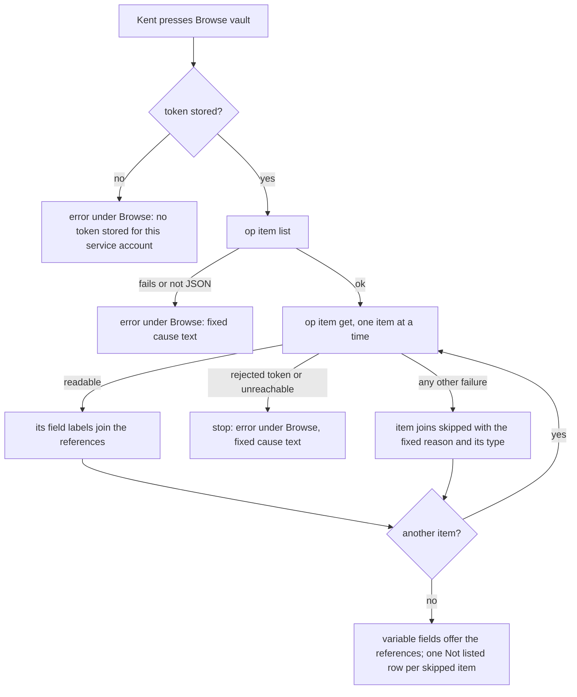

---
id:
title: Browse vault lists fields even when one item cannot be read
status: done
variant: kc-dev-flow-2
profile: pilot
merge: pr
worktree: .worktrees/spacedock-ensign-project-env-browse-vault-survives
pr: pr-merge:16
journey: paseo-project-env
journey-release: r1b
journey-story: pick-field
gates:
    version: 1
    records:
        - id: gate:project-env-browse-vault-survives:backlog
          stage: backlog
          attempts:
            - id: gate-attempt:project-env-browse-vault-survives-backlog-1
              briefing:
                id: briefing:project-env-browse-vault-survives:backlog:attempt-1:revision-1
                digest: sha256:e29f9846d02624608745c9068f3ce3b9f7f6cdd4959900b09996caa9867d5813
                room-ref: ./project-env-browse-vault-survives/review/backlog/briefing-1
              resolution:
                type: Resolution
                id: resolution:spacedock:project-env-browse-vault-survives:backlog:1
                briefing: briefing:project-env-browse-vault-survives:backlog:attempt-1:revision-1
                by: person:captain
                at: "2026-10-21T08:41:04.452867Z"
                decision: approve
                reason: 'Captain 2026-10-21: 「准」 — accepts this release r1.5 task''s outcome, scope and acceptance criteria on the pilot profile, into ideation.'
              application:
                target-stage: ideation
                state: consumed
        - id: gate:project-env-browse-vault-survives:ideation
          stage: ideation
          attempts:
            - id: gate-attempt:project-env-browse-vault-survives-ideation-1
              briefing:
                id: briefing:project-env-browse-vault-survives:ideation:attempt-1:revision-1
                digest: sha256:5290b358800247868e7fb6797ff871e9c9da3af3a5805063b4fd3f9feed06fbe
                room-ref: ./project-env-browse-vault-survives/review/ideation/briefing-1
              resolution:
                type: Resolution
                id: resolution:spacedock:project-env-browse-vault-survives:ideation:1
                briefing: briefing:project-env-browse-vault-survives:ideation:attempt-1:revision-1
                by: person:captain
                at: "2026-10-21T09:36:27.368545Z"
                decision: approve
                reason: 'Captain 2026-10-21: 「准五個設計」 — accepts this ideation design and its acceptance criteria into implementation, with the additions presented at this gate: no guessed reference in project-env-variable-row-edit (a new variable has no reference until a field is picked), AC-4 and the rewritten AC-3 in project-env-paste-token-check-first, the empty-value wording ''the 1Password field is empty'' in project-env-test-results-match-draft; FO''s recommendations also presented: removing the OP_CONNECT names in project-env-token-works-cause is left out and listed for the Captain, and naming a locked Keychain on the Test row is a follow-up after project-env-test-results-match-draft.'
              application:
                target-stage: implementation
                state: consumed
        - id: gate:project-env-browse-vault-survives:validation
          stage: validation
          attempts:
            - id: gate-attempt:project-env-browse-vault-survives-validation-1
              briefing:
                id: briefing:project-env-browse-vault-survives:validation:attempt-1:revision-1
                digest: sha256:036d01b382a5dfb5f891f3c2fdcd8861c4c3de8b048efa5b56e8a91487bbc9c2
                room-ref: ./project-env-browse-vault-survives/review/validation/briefing-1
              resolution:
                type: Resolution
                id: resolution:spacedock:project-env-browse-vault-survives:validation:1
                briefing: briefing:project-env-browse-vault-survives:validation:attempt-1:revision-1
                by: person:captain
                at: "2026-10-21T11:21:48.741216Z"
                decision: approve
                reason: 'Captain 2026-10-21: 「可以，同意你的計畫」 — approves delivery of PR iamcxa/kc-paseo-plugins#16 at head a422acd308768abf707fce5ff7ebce45ac3c248a, merged first by squash once Codex is clean, including later review rounds on the same PR and removing its clean pushed worktree.'
              application:
                target-stage: done
                state: consumed
started: 2026-10-21T08:42:14Z
verdict: PASSED
completed: 2026-10-21T11:28:47Z
archived: 2026-10-21T11:28:48Z
---

Release r1.5 of the paseo-project-env journey: on his own Mac, Kent stores a token only after it is checked, sees why a token fails, edits each variable where it sits, and sees test results that match his draft; his own use accepts it. Captain, 2026-10-20: 「我覺得UI不夠直覺」. Captain accepted this task list on 2026-10-21: 「可以」. Kent hit this on 2026-10-21: Browse vault failed with op's raw "invalid PEM private key passed in" because one item in his vault is typed SSH Key; listRefs runs op item get per item and one failure fails the whole list. Captain confirmed the item and approved this task on 2026-10-21 (「可以」).

## Scope

In: an item that cannot be read is skipped and named with a plain reason; the other fields are still listed; Browse vault errors show cause text, never op output; ideation assesses listing field names without reading values into the plugin. Pulled from story pick-field (r1b): references by ID and a bounded browse stay in r1b. Stop condition: the acceptance criteria below pass.

## Acceptance criteria

**AC-1**: When one item fails to read, the other items' fields are still listed and the failed item is named with a plain reason.
Verified by: in `project-env`, `npm test` runs `test/browse-vault.test.ts`: a fake op vault holds a Login item, a Secure Note with custom fields (its `notesPlain` NOTES field not listed) and an item typed SSH Key whose `op item get` fails with stderr `invalid PEM private key passed in`; the test asserts the readable items' field references are all listed and the SSH Key item is named with the reason `1Password could not read this item (ssh key)`. A second case where an item get fails with a rejected token asserts the list stops with fixed text instead. The first case fails on today's code (probe on main 487b9b0, 2026-10-21: the whole list throws the raw stderr line). Also Kent's own use: Browse vault on his vault lists the other items' fields and names the SSH Key item.

**AC-2**: No Browse vault error shows op output or a value.
Verified by: in the same file, a test puts a fixed sentinel in stderr of a failing `op item list`, of a skipped item's `op item get` and of a rejected-token `op item get`, in malformed stdout of `op item list` and of `op item get`, and a second sentinel as the value of every field of the readable items; it calls the registered `vault.list-refs` handler and asserts neither sentinel appears in the returned result or in a thrown error's message. It fails if the error passes through `RunFailure.message` or `JSON.parse`'s message as today.

## FO alignment

Surfaces: ui
Visible change: Browse vault lists the fields it can read and names the item it skipped.
Direction alignment with the Captain: not needed — the Captain approved this task on 2026-10-21 (「可以」); it pulls part of r1b's pick-field into r1.5 (signal 2), recorded here.
Release review: paseo-project-env/r1.5 at 9489e13
Map footprints: not needed: no ruling on this task answered an open map question.

## Design

### PRFAQ

**Press release (future).** When Kent presses Browse vault and one item cannot be read, such as an item typed SSH Key, the rest of the vault still lists, and the item that was skipped is named with a plain reason.

**FAQ**
- *Why does it fail today?* `listRefs` reads each item in one loop with no per-item catch, so one failing `op item get` throws out of the whole list, and `run` makes that error's message op's first stderr line. Observed 2026-10-21 with a throwaway fake op outside the repository (one Login, one item typed SSH Key whose get fails with `invalid PEM private key passed in`, one Secure Note): `listRefs` threw `[ERROR] … invalid PEM private key passed in`, which `settings-screen` shows verbatim in the Browse vault action's `error`.
- *What is skipped, and what stops the list?* An item whose get fails for a reason about that item (op's failure classifies as `unexpected` or `missing-field`, or its output is not JSON) is skipped and named. A failure that would hit every item (`classifyOpFailure` gives `rejected-token` or `unreachable`, which includes a timeout) stops the list with that cause's fixed text, because naming every item as skipped would hide the real problem. A failed `op item list`, a missing token and a missing vault also stop the list with fixed text.
- *What reason is shown?* One fixed phrase, `1Password could not read this item`, followed by the item's type from `op item list`'s `category` key, lower-cased with underscores as spaces (`ssh key`), only when it matches `^[A-Z_]+$`; without a usable `category` the type is left out. No stderr text is ever copied. Recommendation: do not add a class to `CAUSES`. Those eight classes describe a variable failing to resolve (ADR 0002, plain-failure-reason) and the `failure-reason` test requires each to be produced by `resolveProject`; an item skipped by Browse is a different fact. The phrase lives beside `causeText` in `shared/cause.ts`. Past rulings checked: ADRs 0001-0005 name no behaviour for Browse vault beyond 0005's last consequence ("an item typed SSH Key or Document can still fail to read"); `git -C <state> grep -n 'Override:'` finds only archived prose, none about this area.
- *How do whole-list errors stop leaking?* `listRefs` throws `new Error(causeText[cause])` for every failure outside the per-item skip, and treats an unparsable `op` output as `unexpected`; the message never comes from `RunFailure.message` or `JSON.parse`. Recommendation over returning a cause in the result: the client already renders a thrown error under the action, so no new state is drawn.
- *What does the wire look like?* `vault.list-refs` output becomes `{ refs: string[], skipped: { item: string, reason: string }[] }`, with `skipped` defaulting to `[]` so a client older than the daemon still parses (the `cause`-as-plain-string precedent). The reason is final text; the client draws it verbatim.
- *Can listing avoid reading values? (checklist item 2)* No. Assessment of what `op` offers, from `op item get --help` and `op item list --help` on op 2.30.3 on this Mac, 2026-10-21: `op item list --format json` returns item summaries, no fields (its help documents only filters such as `--categories`). `op item get` returns the item's fields; its flags are `--fields label=…|type=…` (which "Return data from specific fields", so it returns their values), `--otp`, `--reveal` ("Don't conceal sensitive fields"), `--share-link`; there is no flag that returns labels or types without values. A direct field read needs a full reference and returns a value. So listing field labels requires `op item get`, and the values reach the daemon's memory; the plugin keeps only `label`, `type` and `purpose` and sends only references over the wire. This adds no new class of exposure: the same daemon process already holds resolved values at session open (ADR 0001). The remaining protections are the test (AC-2's value sentinel) and the code path that drops values at once. Not verified: whether `op item get --format json` includes a concealed field's `value` by default (the reveal flag's text suggests human output conceals it; this session may not run a command that fetches a value), and whether `op item template get` works with a service account (it timed out asking for desktop authorization here, a path the plugin does not use).
- *Is a Secure Note with custom fields still listed?* Yes, unchanged: fields with a label and not purpose `NOTES` are listed, so `notesPlain` is not and the custom fields are. AC-1's test keeps it as a case that must list.
- *Which sibling interfaces?* None needed. `project-env-variable-row-edit` (T3) re-lays the variables card; this task only adds rows right after the Browse vault action and does not touch variable rows or how `refs` fill them. Both edit `client/settings-screen.tsx`; whichever merges second rebases.
- *Non-goals.* Bounding a large vault and rate limits (journey pick-field/q2, release r1b); references by ID, duplicate titles and text-only fields (pick-field/q1, r1b); the variables-card layout (T3); showing a skipped item's fix; a row for an empty vault (unchanged from today); clearing the rows when the account or vault changes (the options already stay until the next Browse).

### Existing-code check

Searches on main 487b9b0, 2026-10-21: `git grep -n -E 'listRefs|item get|item list' -- project-env` finds the loop in `server/secrets.ts`, its handler in `server/contribute.ts`, the rpc in `shared/config.ts` and the caller in `client/settings-screen.tsx`, and no test; `git grep -n -E 'classifyOpFailure|causeText' -- project-env` finds the classifier and the fixed texts. Conclusion: repair `listRefs` in place and reuse the classifier and texts; nothing is replaced. The fake op (`test/fakes/op.mjs`) implements only a field read and `vault list`, so the test seam extends the scenario with per-account `items` (id, title, category, fields) and a per-item failure entry, and answers `item list` and `item get`.

### UI proposal

UI proposal: In the "Environment variables" card of the plugin's settings screen, pressing Browse vault, as today, fills the variable fields with the references it could read. When it skipped an item, one extra row per skipped item appears under the Browse vault action: the item's title as the label and `Not listed: 1Password could not read this item (ssh key)` as the help line. When the list stops (no token, 1Password rejected the token, could not be reached, an unrecognised error), the action shows one fixed sentence as its error, as today's error line does, never op's text. No tool output and no value appears anywhere.

Preview: project-env-browse-vault-survives/design/preview.html

The preview is an operable page, disposable and not Paseo's real styling: open it, press Browse vault, and use the dashed preview controls to switch between one skipped, nothing skipped, all skipped, whole list fails, many skipped and a long title, and between light and dark; `?w=390` draws a phone width. Pictures of it, in the same folder, are `design/preview-*.png`: before browse, loading (desktop light, phone dark), nothing skipped, one skipped (desktop and phone, light and dark), all skipped (desktop light, phone dark), whole list fails (desktop light and dark, phone light, and with the unrecognised-error sentence), eight skipped drawn to the end (desktop light, phone dark), and a long title (phone light, desktop dark). A new Browse vault press clears the previous result first (the loading picture shows no skipped rows), and a failed run leaves no skipped rows. The variables card is drawn as it is today with two variable fields; its layout is variable-row-edit's. Fidelity limit: real rows are Paseo's `SettingsRow` and `SettingsAction`, which have label and help text only, no colour control; the action's error line is drawn red as an approximation.

### Design review

Design review: design/ideation-1.yaml

Design finding 1: declined: rows are Paseo's `SettingsRow`, which has no weight or marker control; the `Not listed:` help text marks the row as a result.
Design finding 2: declined: the type in the reason can differ per item, and a long run of identical rows is the unbounded-vault case journey pick-field/q2 (release r1b) owns.
Design finding 3: declined: spacing of the action's error line is Paseo's `SettingsAction`; the preview only approximates it.
Design finding 4: declined: row height is Paseo's row component; the preview only approximates it.
Design finding 5: declined: Browse vault stays the card's one action, as today.
Design finding 6: declined: button and select size are Paseo's components, unchanged by this task.
Design finding 7: declined: a remedy sentence belongs to the token-cause and setup-guide work (T1 and the setup-guide release); the fixed cause text is the ruled form (ADR 0002).
Design finding 8: fixed: failure in dark, failure with the unrecognised-error sentence, loading on phone dark and eight-skipped pictures added; the previous result clears on a new press and a failure keeps no skipped rows, written into the design above.
Design finding 9: declined: capping or scrolling the skipped list is the bounded browse of release r1b (pick-field/q2); `preview-many-desktop-light.png` and `preview-many-phone-dark.png` are redrawn to the end of the list.
Design finding 10: declined: with every item skipped, each is named with its reason, which is the cue; a silent empty vault is unchanged from today and is a stated non-goal.
Design finding 11: declined: no confirmation after a clean run is today's behaviour and unchanged here.
Design finding 12: fixed: dark and phone pictures added for failure, eight skipped, all skipped and long title; the red error colour is drawn on a dark background in `preview-failure-desktop-dark.png`.
Design finding 13: declined: the select arrow is Paseo's `SettingsSelect`; skipped rows carry no control by design.

## Stage Report: ideation

- DONE: Design listing that survives one unreadable item: skip it, name it with a plain reason, keep listing the rest; the confirmed trigger is an item typed SSH Key whose op item get fails with "invalid PEM private key" (Kent's vault, 2026-10-21); include a Secure Note with custom fields as a case that must still list.
  `## Design` PRFAQ and flowchart: per-item catch, skip only for item-specific failures, stop on rejected token or unreachable; reproduced on main 487b9b0 with a throwaway fake op (list throws the raw stderr line). Secure Note case is in AC-1's test.
- DONE: Assess listing field labels and types without reading values into the plugin (op item get returns values today), and say what op offers for that.
  Design FAQ: op 2.30.3 help shows no labels-only mode; item list has no fields, item get carries values; exposure is no new class (ADR 0001 daemon already holds values). Unverified: concealed values in JSON by default; `op item template get` timed out without desktop authorization.
- DONE: Keep AC-1 and AC-2 with reproducible evidence clauses and produce the artifact the ui surface owes.
  Both ACs keep their first sentence and gain `npm test` / `test/browse-vault.test.ts` clauses; UI proposal, operable `design/preview.html` and 20 pictures; design review `design/ideation-1.yaml` with 13 MINOR findings dispositioned (2 fixed, 11 declined).
- DONE: AC-1 current evidence.
  Not yet verified: the test does not exist; only the failure on today's code is observed (probe, 2026-10-21).
- DONE: AC-2 current evidence.
  Not yet verified: the test does not exist; today's raw stderr line reaching the Browse vault error is observed in the same probe.
- DONE: design_surfaces.py check.
  Output: "project-env-browse-vault-survives.md: design surfaces presentable" / "design review design/ideation-1.yaml: 13 findings, 2 fixed, 0 criteria, 11 declined, 0 decisions", exit 0.

### Summary

Browse vault gets a per-item catch in `listRefs`: an unreadable item is skipped and named (`1Password could not read this item (ssh key)`), while a rejected token or an unreachable 1Password stops the list with fixed text; every Browse error is built from `causeText`, never op or `JSON.parse` text. Recommendations (no Captain decision needed): do not grow `CAUSES`, and throw the fixed text rather than return a cause. Known limits: a missing vault reads with the closest existing text "field not found in the vault"; `category` in `op item list` JSON is unverified here and the type text is dropped without it; bounding a large vault stays in r1b.

## Stage Report: implementation

- DONE: Implement the approved design: per-item skip in listRefs with a plain reason naming the item, fixed cause text for list-wide failures, `{refs, skipped}` on the wire, and a Secure Note with custom fields still listing.
  Commits 4a0d044 and a422acd on spacedock-ensign/project-env-browse-vault-survives: `listRefs` in `server/secrets.ts`, `unreadableItemText` in `shared/cause.ts`, `skipped` in `shared/config.ts`, `Not listed:` rows in `client/settings-screen.tsx`.
- DONE: Land tests so AC-1 and AC-2 pass with the evidence their clauses name (one failing item get, stderr and value sentinels) and fail when the behaviour is removed.
  `test/browse-vault.test.ts`, 12 pass. With `server/secrets.ts` and `server/contribute.ts` restored to 487b9b0, 11 of 12 fail; the Secure Note case passes on both by design.
  AC-1: a failing SSH Key get leaves all four other refs listed and names `Deploy key` with `(ssh key)`; fails if the per-item catch is removed. A rejected token or unreachable get rejects with exactly `causeText`; fails if every failure is skipped.
  AC-2: stderr sentinel in a failing list, a skipped get and a rejected-token get, malformed stdout of list and get, and a value sentinel on every readable field, all absent from the result or error message; fails if `RunFailure.message` or `JSON.parse`'s message passes through (shown on base).
- DONE: Record Kent's on-vault use as owed.
  Owed: Kent presses Browse vault on his own vault and sees the other items' fields plus the SSH Key item named (AC-1 last sentence). The client rows are type-checked only, not drawn in a running Paseo.
- DONE: Run `npm test`, `npm run typecheck`, the roborev gate, design_surfaces and doc_impact.
  `npm test` 92 tests; `session open > blanks a variable 1Password does not answer in time` failed once in a loaded full run and passed on solo re-run (path untouched). Typecheck clean. `roborev_gate.py` exit 0: `clean on a422acd30; evidence=roborev:968`. `design_surfaces.py check`: presentable, exit 0. `comment_ratio.py`: code 210, comment 2, 1.0%, maximum 5% met.
  `doc_impact.py 487b9b0 HEAD` listed one document: docs/adr/0004-reserved-variable-names-are-skipped-not-blanked.md: unaffected: it cites `shared/config.ts` for the reserved-name list, which this change does not touch.
- DONE: Open the Draft PR.
  https://github.com/iamcxa/kc-paseo-plugins/pull/16 (draft, title `feat(project-env): Browse vault lists fields even when one item cannot be read`).

### Summary

An item whose get fails for an item-specific reason or returns non-JSON is skipped and named as `1Password could not read this item (ssh key)`; a rejected token, unreachable 1Password, failed list or missing token stops the list with fixed `causeText`, so no op or `JSON.parse` text reaches Browse vault. `CAUSES` was not grown, as the design recommended. Limits: a missing vault reads "field not found in the vault"; the type text depends on `category` from `op item list`, unverified on a real vault; one timing-sensitive session-open test is flaky under load. No ADR added or changed; no Number guards section.

## Stage Report: validation

- DONE: Independently check candidate a422acd308768abf707fce5ff7ebce45ac3c248a (PR iamcxa/kc-paseo-plugins#16, base main) against AC-1, AC-2 and the approved design, including that each decisive test fails when its behaviour is removed and that a Secure Note with custom fields still lists; give a verdict.
  Verdict: recommend PASSED (no Material finding). Checked at a422acd: `test/browse-vault.test.ts` 12/12 pass; `npm run typecheck` exit 0; full `npm test` 91/92 under load average 132, the one failure being the recorded flaky `session open > blanks a variable 1Password does not answer in time`, which passes solo (exit 0, 1 pass).
  Falsifiability, run on a scratch copy outside the repo (removed afterwards): per-item skip replaced by a stop fails the SSH Key case and the no-category case; skipping rejected-token/unreachable too fails both stop-the-list cases; letting op/`JSON.parse` text through fails the failing-list and malformed-list sentinel cases; dropping the NOTES filter fails the Secure Note case, the SSH Key case and the malformed-get case. Base `server/secrets.ts` + `contribute.ts` (487b9b0) fails 11 of 12; the Secure Note case passes on both by design (it guards listing, not the fix).
  AC-1 holds: the failing SSH Key get leaves all four readable refs listed (Login username/password, Secure Note `api_key`/`region`; `notesPlain` absent) and names `Deploy key` with `1Password could not read this item (ssh key)`; a rejected-token get rejects with exactly `causeText`. AC-2 holds: stderr sentinel in a failing list, a skipped get and a rejected-token get, malformed stdout of list and get, and a value sentinel on every readable field never appear in the result or error message. Design holds: `{refs, skipped}` with `skipped` defaulting to `[]`, `CAUSES` not grown, reason text beside `causeText`, client draws `Not listed: <reason>` rows under the action.
  Minimal necessity: every changed surface maps to AC-1/AC-2 or the wire contract; the two added comments (`secrets.ts` list-wide-cause rationale, `config.ts` default rationale) carry facts the code cannot state. `comment_ratio.py 487b9b0 a422acd` exit 0 (210 code, 2 comment, 1.0%); `doc_impact.py` lists ADR 0004 only, implementation recorded `unaffected: <reason>`, which I agree with (the reserved-name list is untouched); ADR 0005's last consequence ("can still fail to read") stays true for the whole-list case and is now softened for Browse, no edit owed; `design_surfaces.py check` exit 0; `dispatch_records.py` exit 0 (3 records).
- DONE: Write the minimal acceptance script FO will rerun in a fresh shell, including the "Not listed" row text the ui surface owes, and run `python3 /Users/kent/.claude/plugins/cache/kc-claude-plugins/kc-dev-flow-2/0.26.0/scripts/adr_lint.py docs/adr --since 60799d9` recording its exit code.
  adr_lint exit code 0 ("5 ADR file(s) checked, 0 legacy"), run from the task worktree; the candidate adds no ADR. Script is under `### Acceptance script` below.
- DONE: Record every unverified obligation, including Kent's use against his vault and whether op item list carries `category`, without touching the live paseo-project-env install.
  Listed under `### Unverified obligations` below; no live install, op, Keychain or secret command was run (the live checkout was not touched; the scratch copy lived in /tmp and is deleted).

### Acceptance script

Run from any shell; `WT` is the task worktree on branch `spacedock-ensign/project-env-browse-vault-survives`.

    WT=/Users/kent/Project/kc-paseo-plugins/.worktrees/spacedock-ensign-project-env-browse-vault-survives
    cd "$WT/project-env"
    1. git rev-parse HEAD                      # expect a422acd308768abf707fce5ff7ebce45ac3c248a
    2. npm test -- 2>&1 | tail -n 12           # expect "fail 0"; if only "blanks a variable 1Password does not answer in time" fails, rerun it alone:
       node --disable-warning=MODULE_TYPELESS_PACKAGE_JSON --test --test-name-pattern="blanks a variable 1Password does not answer" test/session-open.test.ts   # expect "pass 1"
    3. node --disable-warning=MODULE_TYPELESS_PACKAGE_JSON --test test/browse-vault.test.ts 2>&1 | grep -E "^ℹ (tests|pass|fail)"   # expect tests 12, pass 12, fail 0
    4. node --disable-warning=MODULE_TYPELESS_PACKAGE_JSON -e 'import("./shared/cause.ts").then(m=>console.log("Not listed: "+m.unreadableItemText("SSH_KEY")))'   # expect: Not listed: 1Password could not read this item (ssh key)
       grep -n 'Not listed: ${s.reason}' client/settings-screen.tsx   # expect one match: the row help line the screen draws
    5. npm run typecheck                       # expect exit 0
    6. cd "$WT" && python3 /Users/kent/.claude/plugins/cache/kc-claude-plugins/kc-dev-flow-2/0.26.0/scripts/adr_lint.py docs/adr --since 60799d9; echo "exit $?"   # expect exit 0

Does not cover: Kent's own vault, the rows drawn in a running Paseo, the real `op` output shape (all below).

### Unverified obligations

- Kent's use: Browse vault pressed on his own vault lists the other items' fields and names the SSH Key item (AC-1 last sentence). Not run; needs his vault and sign-in.
- `category` in real `op item list --format json`: not checked (running `op` was barred). Fake op carries it. Without it the row reads `1Password could not read this item` with no type: still plain, never a leak.
- Client rows: `Not listed:` rows are type-checked and the text is exercised only through `unreadableItemText`; no screenshot of the changed screen at the candidate exists (the design preview is a stand-in, not the candidate), so the validation principle "a screenshot of the changed screen" is unmet. Needs Kent's Paseo with this branch loaded, not the live install.
- That a new press clears earlier rows and a failed run leaves none rests on react-query v5 mutation-state semantics (`refs.data` is undefined while pending and after an error), not on a test here.
- Real `op item get` stderr for an SSH Key reaches `classifyOpFailure` as `unexpected` (the line `invalid PEM private key passed in` matches no class), shown only with the fake op; a real wording that matched the network/auth patterns would stop the list instead of skipping. Deferred risk: becomes Material if Kent's real SSH Key item stops the list.
- Whether `op item get --format json` includes concealed `value` by default is unverified (ideation limit): values enter daemon memory and are dropped at once; only the value sentinel test guards the wire.
- Flaky `session open` deadline test failed in the full run under load average 132 and passed solo (deferred risk since r1).

### Summary

Recommend PASSED: AC-1 and AC-2 hold at a422acd, the decisive tests fail when the skip, the list-wide stop, the sanitized errors or the notes filter is removed, and a Secure Note with custom fields still lists. Open items are Kent's own vault run, the real `category` shape and a real screen render, none a defect found; the missing screenshot is the one principle-level gap FO should weigh at the gate.
