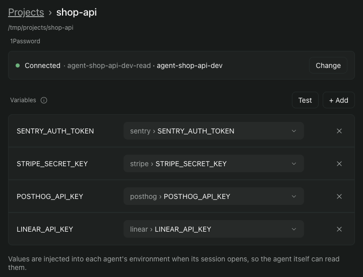

# Introduction

Project environment is a Paseo plugin. It gives every agent that Paseo starts in a repository the secrets that repository needs, as environment variables read from 1Password. You say once which 1Password field fills which variable. After that, nobody pastes a token into a chat.

*Click or tap a picture to see it full size.*

## What you get

- **Every new agent starts ready.** When an agent starts in a connected repository, the plugin reads each mapped field with the 1Password CLI and sets the variable before the agent's first message.
- **The agent is told where the values come from.** A short notice in the agent's instructions says the variables come from this plugin, that the agent must not ask for or print a token, and where to look when one is blank. It names no variable and holds no value.
- **A failure is visible, not silent.** A variable that cannot be read is set to an empty value, the agent still starts, and a line at the top of the new conversation, "Started without 1 project variable", says which one and why.

## How it fits together

1. A person makes one 1Password vault for the repository and a read-only service account that can see only that vault.
2. The service account's token is stored in the login Keychain of the Mac that runs Paseo. The plugin passes it only to the 1Password CLI, `op`.
3. The plugin keeps a list of variable names and field references. It never stores a value.
4. When an agent starts, the plugin reads each field, puts the value in the agent's environment, and adds the notice.

## What it does not protect against

An agent can read and print its own environment, so any variable you map is visible to that agent. Any program running as you on the Mac can read the token in the login Keychain, and with it every secret the service account can reach, so keep the vault narrow. Another Mac, a phone or a headless Paseo daemon is not supported. The full list is in [Reference](../../reference.md).

## Set it up

1. [Install the plugin](install.md): install, turn plugins on in Paseo, and get the 1Password CLI.
2. [Prepare 1Password](prepare-1password.md): one vault, one read-only service account, and connecting them to your repository.

Also: when a variable comes up blank, see [When a variable is blank](../../reference.md#when-a-variable-is-blank). The [Changelog](../../changelog.md) is the developer log of every change in each version; the packaged versions are on [GitHub Releases](https://github.com/iamcxa/kc-paseo-plugins/releases).
