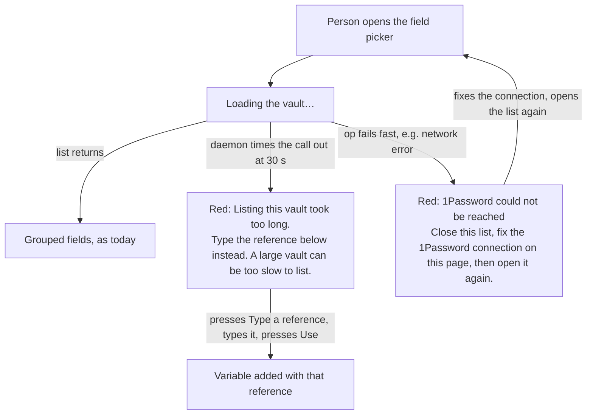

---
id:
title: A slow vault list says it is slow, not that the connection is broken
status: done
variant: kc-dev-flow-2
profile: pilot
merge: pr
worktree: .worktrees/spacedock-ensign-project-env-picker-slow-hint
pr: pr-merge:72
gates:
    version: 1
    records:
        - id: gate:project-env-picker-slow-hint:backlog
          stage: backlog
          attempts:
            - id: gate-attempt:project-env-picker-slow-hint-backlog-1
              briefing:
                id: briefing:project-env-picker-slow-hint:backlog:attempt-1:revision-1
                digest: sha256:87ff607726b6323bfb8b4910998490eee45679cd899804ebfe342c7686371b8d
                room-ref: ./project-env-picker-slow-hint/review/backlog/briefing-1
              resolution:
                type: Resolution
                id: resolution:spacedock:project-env-picker-slow-hint:backlog:1
                briefing: briefing:project-env-picker-slow-hint:backlog:attempt-1:revision-1
                by: person:captain
                at: "2026-11-05T08:38:39.893569Z"
                decision: approve
                reason: '「開這批」 — Captain in FO chat, 2026-11-05. Asked: 「回「開這批」，我就開這 4 個任務，同時派設計」 after FO proposed batch r1b-polish-1 (picker-slow-hint, rate-limit-cause, started-row-visible, journey-map-r1b-catch-up) and recommended opening it.'
              application:
                target-stage: ideation
                state: consumed
        - id: gate:project-env-picker-slow-hint:ideation
          stage: ideation
          attempts:
            - id: gate-attempt:project-env-picker-slow-hint-ideation-1
              briefing:
                id: briefing:project-env-picker-slow-hint:ideation:attempt-1:revision-1
                digest: sha256:cd66afef3f61ccf5ccbffbba8ea2b64c25f46940592dd65e6d2a69400ca49f22
                room-ref: ./project-env-picker-slow-hint/review/ideation/briefing-1
              resolution:
                type: Resolution
                id: resolution:spacedock:project-env-picker-slow-hint:ideation:1
                briefing: briefing:project-env-picker-slow-hint:ideation:attempt-1:revision-1
                by: person:captain
                at: "2026-11-05T15:10:37.571497Z"
                decision: approve
                reason: 「准」 — Captain in FO chat, 2026-11-05, on the batch r1b-polish-1 ideation gates presented together (picker-slow-hint cd66afef, rate-limit-cause b950f3c3, started-row-visible e37a1851, journey-map-r1b-catch-up d0cd0aa6), FO having recommended approving all four and building in the order picker-slow-hint, rate-limit-cause, started-row-visible, with the map task independent.
              application:
                target-stage: implementation
                state: consumed
        - id: gate:project-env-picker-slow-hint:validation
          stage: validation
          attempts:
            - id: gate-attempt:project-env-picker-slow-hint-validation-1
              briefing:
                id: briefing:project-env-picker-slow-hint:validation:attempt-1:revision-1
                digest: sha256:faac1b2585a22e2b24a7282df1a57897bd99472171531dcb91628adae342ae18
                room-ref: ./project-env-picker-slow-hint/review/validation/briefing-1
              resolution:
                type: Resolution
                id: resolution:spacedock:project-env-picker-slow-hint:validation:1
                briefing: briefing:project-env-picker-slow-hint:validation:attempt-1:revision-1
                by: person:captain
                at: "2026-11-06T00:44:55.977915Z"
                decision: approve
                reason: '「准」 — Captain in FO chat, 2026-11-06, on the batch r1b-polish-1 validation gates presented together (picker-slow-hint faac1b25 PR #72, rate-limit-cause a2fca5f9 PR #73, started-row-visible 05ebb219 PR #75, journey-map-r1b-catch-up 4e0593b0 PR #71), FO having recommended approving all four with the proposed declines and merging #72, #73, #75 in order plus #71, then one plugin reload under ADR 0007 class 2.'
              application:
                target-stage: done
                state: consumed
started: 2026-11-05T08:40:10Z
journey: paseo-project-env
journey-release: r1b
journey-story: pick-field
verdict: PASSED
completed: 2026-11-06T03:07:48Z
archived: 2026-11-06T03:07:48Z
---

Batch: r1b-polish-1, approved by the Captain on 2026-11-05 (「開這批」) with four members: project-env-picker-slow-hint, project-env-rate-limit-cause, project-env-started-row-visible, project-env-journey-map-r1b-catch-up. On 2026-10-27 the vault-list task saw the field picker on main give up at 30 s on a 100-item vault with a working connection and show "Plugin RPC timed out" under the hint built in `settings-screen.tsx` ("Close this list, fix the 1Password connection on this page, then open it again."), which sends a person to fix a connection that is fine (archived project-env-vault-list-loads-faster, "Findings from the runs"). Reads are now four at a time, so the limit moved out but did not go away.

## Scope

In: when the field picker's list fails because the call timed out, the picker says the vault took too long to list and what to try, instead of asking the person to fix the connection; other failures keep today's words.
Non-goals: making the list faster; raising any timeout; the Test path; caching.
Budget: one ideation, implementation and validation round; a second validation cycle returns to the Captain.
Stop condition: the acceptance criterion passes and the Captain's UAT is recorded.

## Acceptance criteria

**AC-1**: When the vault list call times out, the picker shows a sentence that says the list took too long and names a next step, and does not tell the person to fix the 1Password connection; a connection failure still shows today's hint.
Verified by: an isolated Paseo with a fake `op` slow enough to hit the timeout, pictures at 1280 and 400 px of both cases, and a unit test that fails when the timeout branch is removed.

## FO alignment

Surfaces: ui
Visible change: A field picker that times out says the vault took too long to list instead of blaming the connection.
Direction alignment with the Captain: done — he answered 「開這批」 on 2026-11-05 to FO's proposed batch naming this task.
Result: the batch question and this Scope.
Release review: paseo-project-env/r1b at 637d05404ccafa198d9f283e1d7d2183c8304dea — signal 1: admitted into r1b under story pick-field ("release 1b bounds the browse and reports a slow or limited vault"); review-release runs at the batch's first implementation dispatch.
Map footprints: not needed: no map answer is recorded by this task.

## Design

Evidence folder: `project-env-picker-slow-hint/design/` in this state checkout. Everything below was run on an isolated Paseo 0.15.1 (own home, port 7391, fake `op` and `security`, no secret read) from a copy of main 6709c72 under `/tmp`; the proposed change is a throwaway copy of the same (`design/evidence/candidate.diff`). No branch, no repository file, no live install touched.

### PRFAQ

**Press release.** A person who opens the field picker on a big vault and waits sees "Listing this vault took too long." and a next step, instead of "Plugin RPC timed out: <plugin id>.invoke" under "Close this list, fix the 1Password connection on this page, then open it again." Their connection was never the problem; now the screen no longer says it is. A connection that really fails keeps today's words.

**FAQ.**
- *What does main show today?* Reproduced: 100 items, each fake `op` call 1.5 s, reads four at a time. After 31.4 to 32.4 s of "Loading the vault…" (5 runs) the picker shows the red line "Plugin RPC timed out: pe-psh.invoke" and, under it, the connection hint (`design/main-timeout-1280.png`, `-400.png`). The same words came from a run with 3 items where every `op item list` waits 35 s (`design/evidence/rpc-wire.txt`).
- *What will it show?* Red line: "Listing this vault took too long." Under it: "Type the reference below instead. A large vault can be too slow to list." The "Type a reference…" row below stays; in the preview I pressed it, typed `op://Dev/Item 5/KEY_5`, pressed Use, and the row KEY_5 was added (`design/proposed-timeout-typed-1280.png`, `-used-1280.png`). The sentence carries no number of seconds: the limit is Paseo's, not ours.
- *Where can a timeout be told apart from a connection failure?* Three places were read. (1) Paseo's plugin host rejects any plugin call that runs 30 s with `Plugin RPC timed out: <pluginId>.<type>` (app bundle, `REQUEST_TIMEOUT_MS = 30000`; the error frame has `code: "handler_error"`, the same code any plugin error gets, so the code does not tell them apart; `rpc-wire.txt`). (2) Our server kills one `op` call after 30 s (`CALL_TIMEOUT_MS`, `run` in `server/secrets.ts`) and classifies it `unreachable`, "1Password could not be reached". That sentence never reached the picker in any run: the daemon's 30 s clock starts when the call is sent and ours after the token lookup, so the daemon always speaks first, even with one call that hangs 35 s. (3) The client error text. The only discriminator is the daemon's sentence in the client error text.
- *Smallest change?* In the client, where the picker's failure line is built (`list` in `settings-screen.tsx`, the `refs.isError` branch): a small pure function `vaultListFailure(rawMessage)` in `shared/field-picker.ts` strips the `Request failed:` prefix and ` requestType=…` suffix as the line does now, and when the text starts with `Plugin RPC timed out` returns the two sentences above; otherwise the same message with today's hint, which moves into the exported constant `FIX_CONNECTION_HINT`. No server change, no new cause in `CAUSES`.
- *What if Paseo changes that sentence?* The match misses and the picker shows today's words, no worse than today. The unit test feeds the sentence, so it cannot notice; the AC-1 rerun on a Paseo (clause b) does. The sentence was seen on this Mac's 0.15.1 today and in the archived run of 2026-10-27 (version not recorded there); not seen on 0.14.0, which the Captain's install may still be.
- *Why not a deadline in our server, say 25 s?* It would give us a sentence of our own, but adds a timer racing a constant we do not own, changes what the reads do, and is the "bound the browse" half of r1b `pick-field` q2, not "report a slow vault". It would also stop the reads the client gave up on: the archived vault-list run found the daemon keeps reading after the client gives up. Out of Scope (non-goal: raising any timeout, making the list faster); stated so the Captain can pull it in.
- *Does the same sentence show on the Test path?* Test builds its own line from the same two regexes in `useMutation` for `test`; this task does not touch it (non-goal).
- *Cost?* One pure function and one constant in `shared/field-picker.ts`, three lines of `settings-screen.tsx` changed, one test file with two tests. No dependency, no server change, no docs page names the old text (`grep` of `docs/project-env`, `OVERVIEW.md`, `docs/journey`).

### Existing-code check

Boundary: the picker's failure line, `list` in `client/settings-screen.tsx`, and `VaultList` in `client/field-picker.tsx`. Search: `grep -rn "Close this list\|requestType=" project-env/client project-env/shared project-env/server` finds the hint once (`fix`, used for the list failure and the unusable-token line) and the strip regexes twice (the list line and the Test line). Completeness: the list failure shows the daemon's raw sentence, so it works but misleads; the error row, the "Type a reference…" row and the search hiding are existing and reused unchanged. Need: r1b story `pick-field` q2 ("reports a slow or limited vault"), the vault-list task's finding, and today's reproduction. Unknowns: other Paseo versions' wording (above). Conclusion: repair the existing line with one pure function; build no replacement and no server deadline.

### UI proposal

UI proposal: When the field picker's list call times out, the red line reads "Listing this vault took too long." and the line under it reads "Type the reference below instead. A large vault can be too slow to list."; the "Type a reference…" row below stays and works. Every other list failure keeps its red line and "Close this list, fix the 1Password connection on this page, then open it again."

Preview: /Users/kent/Project/kc-paseo-plugins/docs/dev2/.spacedock-state/project-env-picker-slow-hint/design/previews.html

The preview is whole-page pictures from a running isolated Paseo (disposable): `main-*` is today, `proposed-*` is main plus `candidate.diff`; both timeout cases at 1280 and 400 px, the next step operated at 1280, and the connection failure at both widths (its pictures were taken before one hint word changed; that branch is untouched by it). The sidebar shows this Mac's host name; working evidence, not docs pictures.

### Design review

Design review: design/ideation-1.yaml
Design finding 1: AC-1 (clause 6: the reference row, once opened, shows the placeholder `op://Dev/item/field` with the saved vault; `design/proposed-timeout-ref-empty-1280.png`)
Design finding 2: AC-1 (clause 6: the top box stays live in the timeout state, typing a name offers "Add NEW_NAME and pick the field later", as it does today when the list works; `design/proposed-timeout-search-name-1280.png`)
Design finding 3: AC-1 (clause 6: a reference outside the vault or not shaped like one leaves Use off, shows "Use op://Dev/item/field" and keeps the dialog open; `design/proposed-timeout-ref-outside-1280.png`, `-ref-malformed-1280.png`)
Design finding 4: fixed: added the 400 px typed state (`design/proposed-timeout-ref-typed-400.png`: Use shares the row with the input, the hint wraps to two lines); the light theme is not pictured: both lines use the theme tokens of today's error row, so it is a stated limit below

(`design/ideation-1.yaml` is the director's report with only its `preview:` line cut to the path of the Preview line above, because the check compares them exactly; the report as returned is `design/ideation-1.as-returned.yaml`.)

### Acceptance evidence plan

- AC-1, current evidence: (a) today's behaviour reproduced and photographed at both widths (`main-timeout-*`, `main-conn-*`); (b) the proposed text photographed at both widths and operated at 1280 (`proposed-*`) from a throwaway copy; (c) `npm test` on main 6709c72: 325 of 325 pass (`design/evidence/main-npm-test.txt`); on the candidate: 327 of 327, `tsc --noEmit` exit 0 on main and on the candidate; (d) removing the timeout branch fails the timeout test, and changing today's hint fails the connection test (`design/evidence/candidate-tests.txt`). Not yet verified: any of this on the real implementation, and on the Captain's Paseo version.
- AC-1, clauses a reviewer reruns on the implementation: (1) `cd project-env && npm test && npm run typecheck` exit 0, with a test whose input is the raw timeout frame text `Request failed: Plugin RPC timed out: <id>.invoke requestType=plugin.rpc.invoke.request code=handler_error` and a second whose input is a connection failure; (2) replace the timeout branch with `false` and the timeout test fails; (3) `design/evidence/harness/` (`setup.sh` with `N=100 DELAY=1500`, then `shoot.sh` at `W=1280` and `W=400`, `CHECKOUT` pointing at the implementation) shows "Listing this vault took too long." and not "fix the 1Password connection" at both widths, after 30 to 33 s; (4) the same harness with `FAILLIST=1 N=3 DELAY=50` still shows "1Password could not be reached" over the old hint at both widths; (5) `operate.sh` after (3) adds the typed reference as a variable row; (6) `operate2.sh` after (3) shows the placeholder `op://Dev/item/field` in the opened reference row, "Add NEW_NAME and pick the field later" after typing a name in the top box, and Use off with "Use op://Dev/item/field" for `op://Other/x/y` and for `not a reference`. Limits: dark theme only; a fake `op`, not a real large vault or its real time to the timeout. In `proposed-timeout-ref-empty-1280.png` an "Add NEW_NAME" row remains after my script cleared the top box; I did not investigate it and the code it runs is today's.

### Needs decision

None. Open for the gate, not a decision: the sentence's wording is mine and the Captain's UAT reads it; the fix depends on Paseo's own sentence (see "What if Paseo changes that sentence?").

### Batch overlap

`project-env-rate-limit-cause` (ideation, no design yet when read 2026-11-05): will show a rate-limit reply in the picker's failure line, the same `list` branch in `client/settings-screen.tsx`, and adds a heading to `OVERVIEW.md` (this task adds none). `project-env-started-row-visible` and `project-env-journey-map-r1b-catch-up`: none (session start row; the journey YAML). `project-env-test-row-draft-note` (backlog): one sentence on the Test row, another region of `settings-screen.tsx`. No shared test file, table or numbered record; `CHANGELOG.md` is generated. Recommended order: this task first, then `project-env-rate-limit-cause` adds its branch to `vaultListFailure` instead of building a second place that picks the hint.

## Stage Report: ideation

- DONE: Reproduce the 30 s timeout on main with a slow fake `op` on an isolated Paseo and record what the picker shows (picture at 1280 and 400 px).
  100 items at 1.5 s per call: list gives up after 31.4 to 32.4 s (5 runs) with "Plugin RPC timed out: pe-psh.invoke" over the connection hint; `design/main-timeout-1280.png`, `-400.png`; connection failure for contrast in `main-conn-*`.
- DONE: Find where a timeout can be told apart from a connection failure (server cause or client error) and propose the smallest change; quote the proposed sentence.
  The daemon's 30 s plugin-call limit speaks first (frame in `design/evidence/rpc-wire.txt`, `code` is `handler_error` for every plugin error); our own 30 s `op` kill never reached the picker. Change: pure `vaultListFailure` in `shared/field-picker.ts` matching the daemon's sentence in the client; proposed "Listing this vault took too long." / "Type the reference below instead. A large vault can be too slow to list."
- DONE: Write the PRFAQ, Mermaid and the ui artifact the Surfaces value owes, plus AC-1 evidence clauses that a reviewer can rerun.
  `## Design` has PRFAQ, Mermaid, existing-code check, UI proposal, Preview (`design/previews.html`, operated pictures at 1280 and 400), clauses (1) to (6); design review `design/ideation-1.yaml`, 4 MINOR findings: 1 fixed, 3 to AC-1 clauses, 0 declined; `design_surfaces.py check` exit 0.
- DONE: Every project-env change you propose names how `npm test` in project-env stays green; run `npm test` on main once and record the result.
  Main 6709c72: 325 of 325 pass (`design/evidence/main-npm-test.txt`); candidate: 327 of 327 (adds one file, two tests), `tsc --noEmit` exit 0 on both; the change touches no server file or existing test, since no test names the old text.
- DONE: Live probes run only on an isolated Paseo (own PASEO_HOME, fake `op`/`security`); never touch the Captain's live install or its settings, and never read or print a secret value.
  Own home `/tmp/pe-psh/s-*`, port 7391, plugin id `pe-psh`, torn down at the end; no real `op` or `security` run, no secret read.

### AC mapping
- AC-1: current evidence: both cases photographed at 1280 and 400 px on main and on a throwaway candidate; candidate unit tests fail when the timeout branch is removed (`candidate-tests.txt`); next step operated. Not yet verified: the real implementation, Paseo versions other than 0.15.1, a real large vault.

### Findings
- Paseo's host rejects any plugin call at 30 s, so one `op` call that hangs also surfaces as "Plugin RPC timed out", never as our "1Password could not be reached".
- The only discriminator is Paseo's own sentence; a reworded sentence degrades to today's words. Not seen on 0.14.0.
- The daemon keeps reading after the client gives up (archived vault-list run); this design leaves that alone (Non-goals).

### Summary
The picker's list failure gets one pure function that recognises the daemon's timeout sentence and shows "Listing this vault took too long." with a working next step (the existing "Type a reference…" row); every other failure keeps today's words. No decision for the Captain; the sentence wording and the dependence on Paseo's wording are open for the gate. Ideation wrote no repository file, branch or commit.

## Stage Report: implementation

- DONE: Branch from a freshly fetched `origin/main`; implement the approved design (`vaultListFailure`, `FIX_CONNECTION_HINT`, small `settings-screen.tsx` change) and its tests; every other failure keeps today's words.
  Commit b684b68 on spacedock-ensign/project-env-picker-slow-hint, based on origin/main c1458f7 (fetched 2026-11-05); the ideation `candidate.diff` applied cleanly, 3 files, +36 -6; PR https://github.com/iamcxa/kc-paseo-plugins/pull/72 (Draft).
- DONE: Run `npm test` and `npx tsc --noEmit` in `project-env`, save both outputs; show that removing the timeout branch fails a test.
  327/327 pass, tsc exit 0 (`implementation/npm-test.txt`, `tsc.txt`). `message.startsWith("Plugin RPC timed out")` replaced by `false`: the timeout test fails, 1 of 2 (`falsify-timeout.txt`). Changing today's hint text fails the connection test, 1 of 2 (`falsify-hint.txt`).
- DONE: Take the AC-1 pictures on an isolated Paseo at the newest release, timeout and connection-failure cases, 1280 and 400 px; never touch the live install or read a secret.
  Paseo 0.15.2 (newest on npm, installed under /tmp), own home, port 7391, fake `op`; timeout shows "Listing this vault took too long." after 31.2 s (1280) and 31.6 s (400); `FAILLIST=1` shows "1Password could not be reached" over the old hint at both widths; typed reference added as a variable; name search, outside-vault and malformed references behave per design. Pictures `implementation/impl-*.png`, log `run.log`. Daemons and my browser sessions (pe-psh-impl, pe-docs-fake) stopped; temp homes removed.
- DONE: Docs: retake the docs pictures and compare; update docs for every altered screen word or picture, or `docs: no change` with the capture diff.
  docs: no change. `capture.sh` on 0.15.2 for this branch and for main c1458f7: 01, 03-07 identical; 02 differs only by a menu hover highlight (`cmp02.png`). Against the committed pictures 01-06 differ on both, so that drift is Paseo 0.15.2 and not this change; the committed pictures show no failure screen and no page names the old text. `doc_impact.py` lists ADR 0005: unaffected: it cites only `sameName` in `field-picker.ts`, which is untouched.
- DONE: Commit with a conventional title, push, open a Draft PR with the evidence; do not mark ready or merge.
  Draft PR #72, not marked ready. `comment_ratio.py c1458f7 HEAD`: 32 code lines, 0 comment lines, 0.0%, max 5% met (exit 0). `design_surfaces.py check`: presentable (exit 0). No ADR added; no `## Number guards`, no migration.
- DONE: Close only browser sessions you opened yourself, by name.
  Closed `pe-psh-impl` and `pe-docs-fake` only; `preview-sign-in-implementation` untouched.

### Summary

A timed-out vault list now shows "Listing this vault took too long." with a working next step, and connection failures keep today's words; AC-1 is shown by two unit tests that fail when their branch is changed and by pictures from a real Paseo 0.15.2 at both widths. The fix depends on Paseo's timeout sentence (limit stated in the PR); `vaultListFailure` returns `{ message, hint }` so `project-env-rate-limit-cause` can add its branch there. Limits: fake `op`, dark theme only; the Captain's Paseo version may be 0.14.0, where the sentence was not seen.

## Stage Report: validation

- DONE: Validate PR #72 at its exact head (name the SHA as the Candidate) against AC-1: isolated Paseo at the newest release, fake `op` slow enough to hit the timeout, timeout and connection-failure cases, pictures at 1280 and 400 px.
  Candidate b684b68de779ba2174a5efc6437f2a7d6805e26d (PR #72 head, Draft, checked with `gh pr view`; worktree clean). Paseo 0.15.2 (newest on npm and GitHub releases 2026-11-05, my own install, own home, port 7395, 100 items at 1.5 s per `op` call): the list gave up after 31.5 s (1280) and 30.6 s (400) and shows red "Listing this vault took too long." over "Type the reference below instead. A large vault can be too slow to list."; no word of the connection (`design/built-timeout-1280.png`, `-400.png`). `FAILLIST=1`: "1Password could not be reached" over "Close this list, fix the 1Password connection on this page, then open it again." at both widths (`design/built-conn-*.png`). Typed reference added as a row (`built-timeout-used-1280.png`); the name-search, outside-vault and malformed-reference states match the design (`validation/run.log`). Run again by `validation/acceptance.sh`.
- DONE: Run `npm test` and `npx tsc --noEmit` in `project-env` at the candidate; confirm a unit test fails when the timeout branch is removed.
  npm test 327 of 327 pass, exit 0; `tsc --noEmit` exit 0 (`validation/npm-test.txt`, `tsc.txt`). In a copy of the candidate under /tmp, `message.startsWith("Plugin RPC timed out")` replaced by `false`: `vault-list-failure.test.ts` 1 pass, 1 fail, the timeout test (asserts the two sentences and no "connection"). Not rerun, read from the implementation (`implementation/falsify-hint.txt`): changing today's hint text fails the connection test, which asserts the exact message and `FIX_CONNECTION_HINT`.
- DONE: Docs: follow the built Install and Prepare 1Password pages' words through the screens this change touches, and report any sentence or picture that no longer matches.
  Built the candidate's site (`build-site.sh`, exit 0, github-pages gem set in Docker) and read `install.html` and `prepare-1password.html`: no sentence names a slow list, a timeout or the connection hint (grep of `_site` for "took too long", "timed out", "fix the 1Password connection" finds nothing), so no sentence this change makes false. Prepare 4b "Choose + Add, then pick a field from the vault" and the picture 05 caption (fields grouped by item, search box, Type a reference) still describe the working list, shown at the candidate in `design/built-list-1280.png`. The pages give no word for a list that times out: a gap, not a mismatch, and outside this task's Scope. Pictures 01-06 differ from Paseo 0.15.2 as the implementation already reported (Paseo drift, same on main).
- DONE: Run `python3 <package>/scripts/design_surfaces.py check <task>` and record it.
  Package 0.35.0, exit 0: "design surfaces presentable"; "built screen review design/validation-1.yaml: 1 findings, 1 upheld declines, 0 decisions in 0 groups"; "scope check not run: stage is validation, not ideation". Before the `Built screen review:` line existed it exited 1 ("built screen review not run"), as expected.
- DONE: Never touch the Captain's live install `paseo-project-env` or its settings; never read or print a secret value. Do not push, mark ready or merge. Close only browser sessions you opened yourself, by name; stop only daemons you started.
  Own homes `/tmp/pe-psh-val/root` and `/tmp/pe-psh-acc/root`, fake `op`/`security`, no secret read; browser sessions `pe-psh-val-b` and `pe-psh-acc` closed, daemons I started stopped (no `pe-psh-*` process left); `pe-docs-fake` and `office-audit-ideation` are not mine and untouched; no code push, PR state unchanged.

### Verdict

Recommend PASSED for AC-1 at b684b68. Goal sufficiency: the picker no longer sends a person with a working connection to fix it, and the reference row is a working next step. Minimal necessity: 36 added lines (`vaultListFailure`, `FIX_CONNECTION_HINT` used by both the new function and the unusable-token line, three lines in `settings-screen.tsx`, two tests); each maps to AC-1 or to its connection-failure falsifier; `comment_ratio.py c1458f7 b684b68`: 32 code lines, 0 comment lines, 0.0%, maximum 5% met (exit 0); `adr_lint.py docs/adr --since c1458f7` exit 0 (9 files, no ADR added, none owed).

- F1 Deferred risk: the fix depends on Paseo's own sentence "Plugin RPC timed out". Seen on 0.15.1 (ideation) and 0.15.2 (here); not seen on 0.14.0 or any Paseo before 0.15; Install says Paseo 0.12 or later. Where the sentence differs, the picker shows today's words, no worse than before. It would become material if a supported Paseo reworded it and the Captain's install were that version.
- F2 FO: `dispatch_records.py <task folder>` exits 1, "no dispatch records under dispatch/"; no task folder in this state checkout has a `dispatch/` folder, so this is not specific to this task. Not a candidate defect; for FO.

### Built screen

Built screen review: design/validation-1.yaml
Built screen finding 1: declined: the "Type a reference…" row is the picker's existing reference row, unchanged by this task and shown the same in the connection-failure state (built-conn-*.png) and on main; AC-1 asks for the sentence and a next step, and redrawing the row as an outlined field with a Use button changes a control used by every picker state, which is its own task. (My first wording also named the working-list picture, which does not show that row; the ruling corrects it.)
Built screen decline check: design/validation-declines-1.yaml

`design/validation-1.yaml` carries only its `preview:` line cut to one path so the check resolves it; the report as returned is `design/validation-1.as-returned.yaml`. Director's report: AC-1 holds as drawn; one MINOR, upheld as a decline. Unchecked by any picture: light theme, a real large vault and real time to the timeout, a resize of an open dialog.

### Minimal acceptance script

Run in a terminal on the Captain's Mac with Node, npm, git and `agent-browser` installed. It uses its own Paseo 0.15.2 under /tmp and port 7396, and touches no live install. `S` is the state checkout, `/Users/kent/Project/kc-paseo-plugins/docs/dev2/.spacedock-state/project-env-picker-slow-hint`.

1. `cd /Users/kent/Project/kc-paseo-plugins/.worktrees/spacedock-ensign-project-env-picker-slow-hint/project-env && npm test 2>&1 | grep -E "^ℹ (pass|fail)"` expect `ℹ pass 327` and `ℹ fail 0`.
2. `bash -c 'WT=/Users/kent/Project/kc-paseo-plugins/.worktrees/spacedock-ensign-project-env-picker-slow-hint; rm -rf /tmp/pe-psh-acc/mut && mkdir -p /tmp/pe-psh-acc/mut && git -C $WT archive HEAD project-env | tar -x -C /tmp/pe-psh-acc/mut && cd /tmp/pe-psh-acc/mut/project-env && ln -s $WT/project-env/node_modules node_modules && sed -i "" "s/message.startsWith(\"Plugin RPC timed out\")/false/" shared/field-picker.ts && node --test test/vault-list-failure.test.ts 2>&1 | grep -E "^ℹ (pass|fail)"'` expect `ℹ pass 1` and `ℹ fail 1` (the timeout test fails when its branch is gone).
3. `/Users/kent/Project/kc-paseo-plugins/docs/dev2/.spacedock-state/project-env-picker-slow-hint/validation/acceptance.sh timeout` (about 2.5 minutes; the first run installs Paseo) expect two `loading_for_s` lines of 30 to 33, the lines "Listing this vault took too long." and "Type the reference below instead. A large vault can be too slow to list.", no line with "fix the 1Password connection", and two picture paths (a leading `n` on a printed line is an artifact of the script's text cleanup).
4. Open the two printed pictures: the red line "Listing this vault took too long." with the grey line under it and a "Type a reference…" row below, at 1280 and 400 px.
5. `/Users/kent/Project/kc-paseo-plugins/docs/dev2/.spacedock-state/project-env-picker-slow-hint/validation/acceptance.sh conn` (about 30 seconds) expect "1Password could not be reached" and "Close this list, fix the 1Password connection on this page, then open it again.", and two picture paths showing the same at 1280 and 400 px.

Not covered: a real 1Password vault and its real time to the timeout; any Paseo other than 0.15.2; the light theme; the Captain's own install (the Captain's UAT in the Stop condition).

### Summary

PR #72 at b684b68 meets AC-1 on a real Paseo 0.15.2 with a fake `op`: a timed-out list says it took too long and offers the reference row, a connection failure keeps today's words, and the unit test fails when the timeout branch is removed. One dependence on Paseo's own sentence is recorded as a deferred risk; the built-screen MINOR was declined and upheld. The Captain's UAT remains.

## UAT

UAT (Captain, 2026-11-06): OK — 「ＯＫ」
Asked: FO asked for the UAT of batch r1b-polish-1 after merging #71, #72, #73 and #75 and reloading the live plugin (「回「OK」或問題」): a real-environment check of the Started-without line and a no-regression check of the field picker and Test; his 「ＯＫ」 answers all four tasks.
Cost: Captain messages 5, shared across batch r1b-polish-1; worker tokens not measured (reported: ideation 224404, implementation 127068 after a session restart, earlier part not reported, validation 137644)

### Local extension doc-site (round 3)

Asked: implementation retakes the docs pictures; validation follows the built Install and Prepare 1Password pages through the picker. Caught: nothing stale (`docs: no change`; the pages name no slow list or timeout, a gap rather than a mismatch). Cost: one capture run and one site build, no extra cycle. By hand: FO wrote both lines into the checklists.
