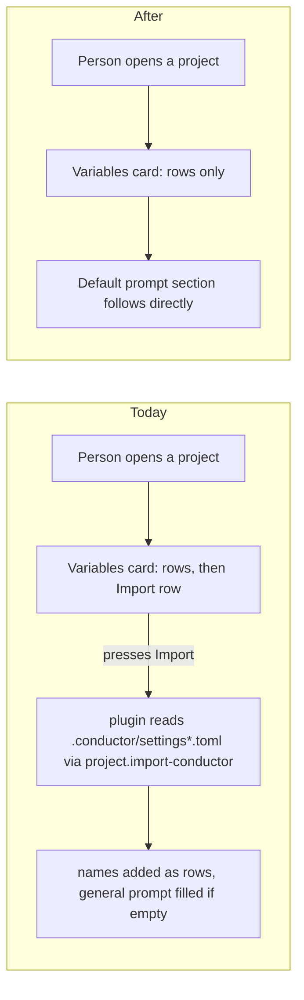

---
id:
title: The variables card no longer offers a Conductor import
status: done
variant: kc-dev-flow-2
profile: pilot
merge: pr
worktree: .worktrees/spacedock-ensign-project-env-remove-conductor-import
pr: pr-merge:41
gates:
    version: 1
    records:
        - id: gate:project-env-remove-conductor-import:backlog
          stage: backlog
          attempts:
            - id: gate-attempt:project-env-remove-conductor-import-backlog-1
              briefing:
                id: briefing:project-env-remove-conductor-import:backlog:attempt-1:revision-1
                digest: sha256:a3046e92a8559a59e091dfb11880787c120d91ff767ab4c5bc4f5d92d205b508
                room-ref: ./project-env-remove-conductor-import/review/backlog/briefing-1
              resolution:
                type: Resolution
                id: resolution:spacedock:project-env-remove-conductor-import:backlog:1
                briefing: briefing:project-env-remove-conductor-import:backlog:attempt-1:revision-1
                by: person:captain
                at: "2026-10-23T12:21:58.418798Z"
                decision: approve
                reason: 'Captain 2026-10-23: 「准」 — answers the backlog question put in chat: approves Design Director round-2 Tasks 1 to 3 in order, with option A, the re-point behaviour and the r2 rename as stated.'
              application:
                target-stage: ideation
                state: consumed
        - id: gate:project-env-remove-conductor-import:ideation
          stage: ideation
          attempts:
            - id: gate-attempt:project-env-remove-conductor-import-ideation-1
              briefing:
                id: briefing:project-env-remove-conductor-import:ideation:attempt-1:revision-1
                digest: sha256:673bfe6f362b4ad4f4c87705dcde75529c845ad5b79bf29382333733c44df4e4
                room-ref: ./project-env-remove-conductor-import/review/ideation/briefing-1
              resolution:
                type: Resolution
                id: resolution:spacedock:project-env-remove-conductor-import:ideation:1
                briefing: briefing:project-env-remove-conductor-import:ideation:attempt-1:revision-1
                by: person:captain
                at: "2026-10-23T15:03:41.761477Z"
                decision: approve
                reason: 'Captain 2026-10-23: 「准」 (decision d-1mybcg, relayed by the Comms Officer and checked on its [User] line) — approves this removal design and its acceptance criteria into implementation, including the gate question''s stated recommendations (fold the newName to nameFromLabel journey repair into this task; add AC-3 that ADR 0004 records the removal).'
              application:
                target-stage: implementation
                state: consumed
        - id: gate:project-env-remove-conductor-import:validation
          stage: validation
          attempts:
            - id: gate-attempt:project-env-remove-conductor-import-validation-1
              briefing:
                id: briefing:project-env-remove-conductor-import:validation:attempt-1:revision-1
                digest: sha256:7e542942dd808d20e38fba4dc424ffd1bea772787211afffbf098955e92ccf38
                room-ref: ./project-env-remove-conductor-import/review/validation/briefing-1
              resolution:
                type: Resolution
                id: resolution:spacedock:project-env-remove-conductor-import:validation:1
                briefing: briefing:project-env-remove-conductor-import:validation:attempt-1:revision-1
                by: person:captain
                at: "2026-10-24T01:16:44.106889Z"
                decision: approve
                reason: 'Captain 2026-10-24: 「准」 (decision d-dd665o, relayed by the Comms Officer and checked on its [User] line) — approves delivery of PR #41 at 099e7b7 per the gate question, including the live plugin update.'
              application:
                target-stage: done
                state: consumed
started: 2026-10-23T12:22:37Z
verdict: PASSED
completed: 2026-10-24T01:22:10Z
archived: 2026-10-24T01:22:11Z
---

Polish round 2 of the project-env settings screen. Source: the Captain's UAT on 2026-10-23 (「這個 use this connection 按鈕是否可以放在 vault 選擇的後面？或是換個方式重新設計儲存跟取消」, 「import from conductor 功能可以移除」, and the qnow vault rename that blanked five variables live) and the Design Director's ruling in `ux-review-polish-2/design-director.md`, approved by the Captain on 2026-10-23 with 「准」, including option A, the re-point behaviour and the r2 wording.

## Scope

In (design-director.md Task 1): remove the Conductor import from the client row and its state, the `importConductor` RPC, `server/conductor.ts`, its handler, `splitImported` and their tests; variables and prompts it already imported stay. Journey map: delete the two stories that cite it, rename r2 to "RELEASE 2 — Standing instructions" with the goal "New agents follow the repository's standing instructions.", and drop "import" from the answer to add-remove-variable/q9. ADR 0004 gains a dated amendment recording the removal. Out: the default prompt section, and Paseo's session-open "import" reason. Stop condition: the acceptance criteria pass. Runs first; project-env-connection-done-cancel-one-row branches from its merged main.

## Acceptance criteria

**AC-1**: No project shows an import row at 1280 or 400 px, and the plugin serves no `project.import-conductor` call.
Verified by: (a) a runtime text check on an isolated Paseo built from the candidate: `get text body` of the editor page of all four fixture projects (work, work-empty, work-many, work-bare) at 1280 and at 400 px (viewport 400 x 2600, so the whole page is read) contains neither "Conductor" nor a lone "Import" line, and the same check on main f849058 finds both in all eight pages (reproduced during ideation: 8 of 8 before, 0 of 8 after); the text check does not depend on the theme; (b) `grep -rniE 'importConductor|conductor|splitImported|import-conductor|importNote|doImport|importRpc' project-env --exclude-dir=node_modules --exclude=CHANGELOG.md` prints nothing, and `server/conductor.ts` does not exist; (c) `npm test` and `npm run typecheck` in `project-env/` pass, with 273 tests, which is main's 274 less the one deleted `Import` test; (d) the diff has no hunk in the settings schema `project` in `shared/config.ts`, so a project that an earlier import filled loads as before.

**AC-2**: The journey map passes its check with no story citing a removed symbol, and r2 reads as the Captain confirmed.
Verified by: `node <kc-journey-map>/lib/journey-lint.mjs docs/journey/project-env/give-agents-their-project-setup.yaml <repoRoot>` prints no `evidence-not-found` line naming `importConductor`, and prints no violation that main f849058 does not already print (main prints exactly one: `evidence "newName" for story add-remove-variable`, left as it is, see Needs decision 1); the same run with the code removed but the map unedited prints two more, one for each deleted story, so the check can fail; a text diff of the map shows exactly four edits: the two story lines deleted, the r2 line reading `{id: r2, name: "RELEASE 2 — Standing instructions", goal: "New agents follow the repository's standing instructions."}`, and `Add and import refuse exact duplicates only` reading `Add refuses exact duplicates only` in add-remove-variable/q9.

**AC-3**: ADR 0004 records the removal.
Verified by: `docs/adr/0004-reserved-variable-names-are-skipped-not-blanked.md` gains one dated amendment after the 2026-10-21 one, with the text under Design below, and `python3 <package>/scripts/adr_lint.py docs/adr` still exits 0 (it exits 0 on main f849058 today). Source: the Captain's approval of the Design Director's Task 1 (2026-10-23, 「准」), which names this amendment.

## FO alignment

Surfaces: ui
Visible change: The Import names and prompt from Conductor row is gone from every project.
Direction alignment with the Captain: done — the Captain approved the Design Director's Task 1 and the r2 wording on 2026-10-23 (「准」).
Result: ux-review-polish-2/design-director.md, Task 1; every ui gate shows the Captain screenshots of the screen.
Release review: not needed: the Captain ruled the removal and the r2 rename directly at backlog; the task carries the map edit itself.
Map footprints: not needed: the task edited the journey map directly in PR #41 (two stories deleted, r2 renamed, add-remove-variable's evidence repaired) and carries no journey fields, so no footprints.jsonl entry is owed.

## Design

### PRFAQ

**Headline.** The variables card ends with the variables. A person who opens any project in the project-env settings no longer sees a row offering to read names and a prompt from a `.conductor` folder.

**Who and why.** The Captain, who uses the screen on his own setup, asked for the removal after the 2026-10-23 UAT (「import from conductor 功能可以移除」) and approved the Design Director's Task 1 with 「准」. The recce teammates in release 1 never see the row's purpose: their journey has no Conductor step.

**FAQ.**
- *Do variables and prompts an earlier import saved disappear?* No. They are ordinary saved rows and an ordinary saved prompt. The settings schema `project` is not touched (AC-1d).
- *Is the Default prompt section removed?* No. Out of scope; only the row that filled it goes.
- *Does Paseo's "import" session reason (resumed or imported sessions, journey story resumed-env) change?* No. It is Paseo's own `agent.session_open` reason, unrelated to Conductor; it stays.
- *Can a person still get names from Conductor?* Not through the plugin. Add and the field picker are the routes.

Stops: the removal ends at the card and the RPC. It does not rewrite saved projects, the prompt section, the save bar or the connection form.

### Existing-code capability check

Boundary: variables card, `project.import-conductor` RPC, `.conductor/settings*.toml` read. Completeness today: working through the journey (the row ran in the main checkout on all four fixture projects during ideation, 8 of 8 pages show it); its unit coverage is one test of `splitImported`, none of `importConductor`. Consumers found by `git grep -niE 'conductor'` over `project-env/`, `docs/adr`, `docs/journey` (2026-10-23, main f849058): the row, the handler, `server/conductor.ts`, `splitImported` (used by the client and its one test only), two journey stories, one r2 name and goal, one q9 answer, one ADR 0004 consequence. No other package reads them. Need: none; the Captain ruled the removal. Decision: delete, with no replacement mechanism.

### UI proposal and preview

UI proposal: Remove the row "Import names and prompt from Conductor" (its label, hint line and Import button) from the end of the Variables card in every project; nothing replaces it, so the card ends after its last variable row and the Default prompt section follows.

Preview: /Users/kent/Project/kc-paseo-plugins/docs/dev2/.spacedock-state/project-env-remove-conductor-import/shots/

The preview is two running builds of the real plugin, not mockups: "before" is main f849058 (the single 1280 and 400 x 900 pictures ran from the main checkout at e4f95ae, whose `project-env/` is identical to f849058 by `git diff --stat`; the whole-page 400 pictures ran from a `git archive` of f849058) and "after" is the same tree with the removal applied in a throwaway copy (`evidence/removal-disposable.diff`, 5 files, 69 lines deleted plus the 36-line `server/conductor.ts`; typecheck clean, 273 of 273 tests pass in the copy). Both ran on an isolated Paseo (own home, port 6951, fake `op`, `security` and `git`; the A5 harness). Each `compare-<project>-<width>.png` puts before on the left and after on the right for work, work-empty, work-many and work-bare at 1280 px (1280 x 1400) and at 400 px (whole page, viewport 400 x 2600); `before-*` and `after-*` hold the single pictures and the page text. Measured: at 400 px the page is 116 px shorter in work (1244 to 1128) and work-empty (1001 to 885), and work-many (2160 to 2044) and work-bare (1488 to 1371) lose 116 and 117. At 400 x 900 the work-empty editor overflows its scroller by 71 px today (scrollHeight 907, clientHeight 836) and not after (no scroller overflows; the Danger zone text ends at y 727, above the save bar at y 803). This is the round-1 R3a overlap for that one case; it is information, not a criterion (design-director.md, R3a).

### Design review

Design review: design/ideation-1.yaml

Design finding 1: declined: the prompt box placeholder belongs to the Default prompt section, which Scope puts out of this task; the removal did not change it.
Design finding 2: declined: the note under the prompt box sits where main puts it (the same line follows the prompt box in every before picture); the removal moves nothing but the rows above it.
Design finding 3: declined: the save-bar line "N with no field picked yet" beside "No unsaved changes" is main's A5 wording and is untouched by the removal.
Design finding 4: declined: the empty-account card in work-bare is the first-setup form, which the round-1 ruling R10 keeps and Scope does not touch.
Design finding 5: declined: the 12 px remove glyph is not part of the removed row and the removal does not touch it.
Design finding 6: declined: the removal deletes a row from the card and adds no state; Test, loading, Stop managing and read-only render from code the diff does not touch, and the four fixture pages in AC-1 are the states the deleted row appeared in.
Design finding 7: declined: Stop managing's missing confirm is main's A5 design (its hint says it acts now) and is outside this removal.
Design finding 8: declined: the removal adds no colour or size rule, and AC-1(a) reads the page text, which is the same in any theme; every picture is dark theme.

The review's limitation that it did not open `after-<project>-400.png` is closed by me: the viewport-only picture of work-many at 400 x 900 was read (`after-work-many-400.png`) and shows the card, the sticky save bar and no import row.

### What the removal touches

| File | Symbol | Change |
|---|---|---|
| `project-env/client/settings-screen.tsx` | imports `importConductor`, `splitImported`; state `importNote`/`setImportNote`; `importRpc`; mutation `doImport`; the `SettingsAction` row labelled "Import names and prompt from Conductor" | delete (35 lines). `SettingsAction`, `useMutation`, `useRpc`, `newVariable` stay: other code uses them |
| `project-env/server/contribute.ts` | import of `importConductor`; `server.handle(rpc.importConductor, ...)` | delete (2 lines) |
| `project-env/shared/config.ts` | `splitImported`; RPC `importConductor` (name `project.import-conductor`) | delete (22 lines). `reservedReason` stays: `nameFromLabel` and `test-marks.ts` use it |
| `project-env/server/conductor.ts` | `importConductor` (reads `.conductor/settings*.toml`) | delete the file (36 lines) |
| `project-env/test/variable-name.test.ts` | import of `splitImported`; `describe("Import")` | delete (10 lines); tests 274 to 273 |
| `docs/journey/project-env/give-agents-their-project-setup.yaml` | stories `import-conductor-names`, `import-conductor-prompt` (evidence `importConductor`); release `r2` name and goal; add-remove-variable/q9 answer | delete both stories; r2 becomes "RELEASE 2 — Standing instructions" with goal "New agents follow the repository's standing instructions."; q9 answer "Add and import refuse exact duplicates only" becomes "Add refuses exact duplicates only" (`evidence/journey-edit-disposable.diff`) |
| `docs/adr/0004-reserved-variable-names-are-skipped-not-blanked.md` | Consequences bullet "Add, Conductor import and the variables card use the same table" | stays as written; the amendment below supersedes it |

Left alone on purpose: `project-env/CHANGELOG.md` (release-please writes it); the Default prompt section and `systemPrompt`; Paseo's session-open "import" reason in `test/missing-variables.test.ts` and story `resumed-env`; journey add-remove-variable/q4, whose question names the import but is the record of the Captain's 2026-10-21 ruling; the release-1 task file's non-goal "Conductor import" (task history).

ADR 0004 amendment, draft (no number; the file exists as ADR 0004), to append after the 2026-10-21 amendment:

> **Amendment, 2026-10-23** (Captain, polish round 2, 「准」): the Conductor import is removed, so a name enters a project only through Add or an edit of the variables card. Add and the variables card still use the same table, and a reserved variable already saved stays, shows "Not applied" and is skipped at session open; the Consequences line that names the import no longer applies.

### Evidence plan and honest limits

Each criterion's evidence is stated in its clause above. Already run in the throwaway copy during ideation, not on a candidate branch: the text check (8 of 8 before, 0 of 8 after), the search (empty), `npm test` (273 of 273) and `npm run typecheck` (clean), journey-lint with and without the map edits (`evidence/journey-lint.txt`). Not run: any check on the real candidate; AC-3's lint on the amended ADR. No new durable test is added: nothing has bitten from a returned import row, and the search plus the page text in AC-1 are run at validation (without-it: a re-added row would show in AC-1(a) at the next validation).

Pre-existing, found by the check: on main f849058 journey-lint already prints `evidence "newName" for story add-remove-variable does not grep in any executable file outside the journey file` (`newName` was removed from the code earlier; commit 0314c91 changed Add). This task leaves it, so AC-2 asks for "no new violation" rather than a clean run.

### Needs decision

1. **Confirm AC-2's reading: "no citation failure" means none caused by or left from this removal, not a clean lint run.** Recommendation: confirm. Main already fails the lint on `newName`, so the original wording cannot pass without an unrelated edit to add-remove-variable's evidence; picking that story's new evidence symbol (`nameFromLabel` exists and fits) is a separate one-line map fix, proposed here as a follow-up for FO, not accepted scope. What gets worse: the map stays one violation short of clean until that follow-up lands.

### Batch overlap

- project-env-connection-done-cancel-one-row (backlog): changes `project-env/client/settings-screen.tsx` (the Change form), tests, and its own journey notes; this task changes the same file in the Variables card. Branches from this task's merged main, as its Scope says.
- project-env-vault-change-repoints-refs (backlog): changes `settings-screen.tsx`, `shared/config.ts` (a re-point rule beside the pill code) and amends ADR 0005; this task deletes `splitImported` and `importConductor` from `shared/config.ts` and amends ADR 0004. Different ADR files, different hunks; it branches after the previous task.
- project-env-test-row-draft-note (backlog): changes the Test row hint in `settings-screen.tsx`, a different region; it starts after project-env-token-works-cause (PR #15) merges.
- ADR index: `docs/adr` holds only the numbered records, no index file.
Recommended order: this task, then project-env-connection-done-cancel-one-row, then project-env-vault-change-repoints-refs, as the Design Director sequenced them; project-env-test-row-draft-note after its own prerequisite.

## Stage Report: ideation

- DONE: Design the removal your Scope names (code, tests, journey map edits, ADR 0004 amendment), with each acceptance criterion kept and given a reproducible evidence clause; list every symbol, file and journey story the removal touches.
  `## Design` "What the removal touches" table lists 5 code files, 2 stories, r2, q9 and ADR 0004 plus what stays; AC-1 and AC-2 kept with commands and the observed before/after; AC-3 added to give the ADR amendment a check (source: Scope's ADR clause).
- DONE: AC-1 evidence (current, not yet on a candidate branch).
  In a throwaway copy of f849058 with the removal: page text has no Conductor or Import line in 8 of 8 pages (main: 8 of 8 have it); search empty; `npm test` 273 of 273 (main 274; the deleted test asserts `splitImported` skips reserved names and duplicates); typecheck clean. Falsifier: re-adding the row or `importConductor` fails (a) or (b).
- DONE: AC-2 evidence (current).
  journey-lint on the edited map plus removed code prints only main's existing `newName` violation; with the code removed and the map unedited it prints two extra `evidence-not-found` lines for the deleted stories (`evidence/journey-lint.txt`).
- DONE: AC-3 evidence.
  Not yet verified: the amendment is a draft in `## Design`; `adr_lint.py docs/adr` exits 0 on main today.
- DONE: Produce the artifact the ui surface owes: whole-page previews from a running build at desktop and 400 px of a project before and after the removal, plus the design review, with each finding dispositioned.
  `shots/compare-<project>-{1280,400}.png` for 4 projects from an isolated Paseo (port 6951); `design/ideation-1.yaml` (sonnet, 8 MINOR, 8 declined with reasons, none MAJOR so no second run); `design_surfaces.py check` printed "design surfaces presentable" and "8 findings, 0 fixed, 0 criteria, 8 declined, 0 decisions".
- DONE: Name any decision the Captain must make (at most one), with a recommendation; the removal and the r2 wording are already approved.
  One: confirm AC-2 means "no new journey-lint violation", because main already fails on `newName` of add-remove-variable; recommendation: confirm, fix `newName` as a separate follow-up.

### Summary

The removal is 105 deleted lines in 5 code files plus 4 map edits and one ADR 0004 amendment, rehearsed in a throwaway copy (tests, typecheck, search, lint, page text all as the criteria require). At 400 px every editor page is 116 px shorter and the work-empty 400 x 900 overlap of the save bar over the Danger zone disappears. Needs decision: AC-2's literal "no citation failure" cannot pass on main's existing `newName` violation. Not touched: no repository file, branch or commit. Disposable copies live in /tmp/pe-rci-src; the harness daemons and browser sessions are stopped.

## Stage Report: implementation

- DONE: Implement the approved removal exactly (Design section of the task file): delete the Conductor import from client, server, shared and tests; apply the journey map edits, including the approved repair of story add-remove-variable's stale evidence newName to nameFromLabel; add the dated ADR 0004 amendment.
  Candidate 099e7b7 on spacedock-ensign/project-env-remove-conductor-import (base 78ce6c1): 7 files, 9 insertions, 109 deletions; the diff has no hunk in the `project` schema. Journey edits are the four in AC-2 plus `evidence: nameFromLabel`. ADR 0004 amendment sits after the 2026-10-21 one.
- DONE: Land evidence for AC-1 to AC-3 with the clauses they name, plus whole-page screenshots of the built change at desktop and 400 px, under this task's state folder.
  `project-env-remove-conductor-import/evidence/implementation/`: `after-<project>-{1280,400}.{png,txt}` for work, work-empty, work-many, work-bare (viewports 1280x1400 and 400x2600, isolated Paseo port 6961 built from the candidate) and `main-*-*.txt` from main 78ce6c1 (port 6962). AC-1(a): `grep -ci conductor` and `grep -cx Import` are 0 in 8 of 8 after pages (each has Variables, Default prompt and Danger zone, so the check reads real editors); main gives 2 and 1 in 8 of 8. Falsifier: re-adding the row fails it.
- DONE: Run `npm test`, `npm run typecheck`, the journey lint, adr_lint, the roborev gate, design_surfaces check, doc_impact, then open the Draft PR.
  `npm test` 273 pass 0 fail; `npm run typecheck` clean; AC-1(b) grep prints nothing and `server/conductor.ts` is gone; journey-lint prints "all lints pass" (the `newName` violation is gone, no `importConductor` line), which fails if a deleted story's evidence remains; `adr_lint.py docs/adr --since 60799d9` exit 0 (7 ADR files); `design_surfaces.py check` "design surfaces presentable"; roborev `clean on 099e7b790; evidence=roborev:1125`; comment_ratio 0 code and 0 comment lines added. Draft PR: https://github.com/iamcxa/kc-paseo-plugins/pull/41

### Affected documents

doc_impact printed one document: `docs/adr/0004-reserved-variable-names-are-skipped-not-blanked.md` updated (amendment). ADRs added or changed: 0004 (amended, not a new number).

### Summary

The removal is as designed with no deviation. AC-2 was met stronger than the ideation draft: the approved `newName` repair makes journey-lint fully clean rather than "no new violation". The load-sensitive session-open test did not fail. The two isolated Paseo daemons, browser sessions and /tmp copies are removed; no secret was read and no op or security command was run.

## Stage Report: validation

- DONE: Independently check candidate 099e7b790d89ca8b63b28afb65f98f3d71c6f30e (PR iamcxa/kc-paseo-plugins#41, base main 78ce6c1) against AC-1 to AC-3 and the approved design: rebuild and run it yourself on an isolated Paseo; confirm no project shows an import row at 1280 and 400 px and the plugin serves no project.import-conductor call; previously imported variables and prompts in a saved project still load and save; the Default prompt section still works; the save bar, pills, picker, Test and the connection line still work; journey-lint passes on give-agents-their-project-setup.yaml with the two stories gone, r2 renamed and add-remove-variable's evidence nameFromLabel; ADR 0004 carries the dated amendment and adr_lint exits 0; give a verdict.
  Verdict PASSED. Built from `git archive` of the candidate (tests 273/273, typecheck exit 0; `diff --stat` 7 files, 9 ins, 109 del; no hunk in the `project` schema). Isolated Paseo (own home, ports 6971/6972, throwaway plugin ids, own browser sessions, all removed): 8 of 8 candidate pages have 0 "Conductor" and 0 lone "Import" lines (each has Variables, Default prompt, Danger zone); main 78ce6c1 on the same fixtures gives 2 and 1 in 8 of 8. Handler probe (real `contribute` with a recording server): candidate registers project.test, token.status, token.store, vault.list-refs; main also registers project.import-conductor. A saved project seeded as an earlier import would leave it (two empty-ref variables, a two-line prompt) loaded with both intact; I then picked a field, added a variable, edited the prompt, ran Test ("3 set · 1 no field") and Save: projects.json holds the new prompt, 4 variables (the empty-ref one kept), other projects unchanged; the field picker, Add, Change (connection form, "Token works"), Close/Discard/Save bar all behaved. journey-lint on the candidate: "all lints pass"; on main it prints the `newName` violation; on candidate code with main's map it prints 3 (newName and both importConductor stories), so the check can fail. ADR 0004 holds the 2026-10-23 amendment after the 2026-10-21 one.
- DONE: Write the minimal acceptance script FO will rerun in a fresh shell, and run `python3 /Users/kent/.claude/plugins/cache/kc-claude-plugins/kc-dev-flow-2/0.28.0/scripts/adr_lint.py docs/adr --since 60799d9` recording its exit code.
  `project-env-remove-conductor-import/evidence/validation/acceptance.sh` (5 steps, about 2 minutes, clones the candidate to a temp dir, removes everything it makes); run by me under `env -i bash --noprofile --norc`: 0 failing steps (`acceptance-run.txt`). adr_lint exit 0 ("7 ADR file(s) checked, 0 legacy"), run in the candidate worktree and again inside the script on a fresh clone.
- DONE: Look at the whole-page screenshots at 1280 and 400 px and record what the Captain should see; record every unverified obligation.
  Captain should see (`evidence/validation/cand-<project>-{1280,400}.png`, read for work, work-many, work-bare): the Variables card ends at its last row, the Default prompt box follows directly, then its hint line, the Danger zone, and the save bar; no Conductor row anywhere. At 400 px rows stack (name above the field pill) and the page is one column. Seen and not caused by this task: at 1280 x 1400 the sticky save bar sits over the foot of the prompt box in work-many because the page is taller than the viewport; "N with no field picked yet" beside "No unsaved changes" is main's wording. Unverified: (1) light theme (every picture is dark; the text checks do not depend on theme); (2) a real `.conductor` folder, real 1Password and real Keychain (fake op, security and git only); (3) the Draft PR's CI beyond GitGuardian (the only check on PR #41 is green; no project CI ran `npm test`); (4) the roborev gate result `clean on 099e7b790; evidence=roborev:1125` was read, not rerun; (5) Paseo's own "Import session" button on the sidebar is Paseo's, unrelated, and was seen present; (6) the Captain's own device, Paseo version and saved projects; the live plugin was not touched.

### Findings

None. comment_ratio: 0 code lines, 0 comment lines added. doc_impact lists docs/adr/0004 only, marked `updated` in the implementation report. dispatch_records: 3 records complete. design_surfaces check: presentable. No Number guards section.

### Minimal acceptance script (FO reruns as written)

    bash /Users/kent/Project/kc-paseo-plugins/docs/dev2/.spacedock-state/project-env-remove-conductor-import/evidence/validation/acceptance.sh

Expect `== result: 0 failing step(s)` and exit 0. Steps: (1) clone and check out the candidate SHA; (2) grep for Conductor symbols empty, journey-lint "all lints pass", adr_lint exit 0, amendment present; (3) typecheck exit 0, 273 tests 0 fail; (4) the plugin's registered handlers list has no project.import-conductor; (5) 8 real editor pages (4 projects x 1280, 400) with no Conductor or Import line. Does not cover: light theme, real Conductor/1Password/Keychain, CI, the Captain's device.

### Summary

The candidate meets AC-1 to AC-3 and the design with no finding; verdict PASSED. The runtime check on an isolated Paseo reproduced main's row in 8 of 8 pages and its absence in 8 of 8 on the candidate, and a seeded imported-style project loads, edits and saves intact. Limits are fake 1Password, dark theme only and no CI run of the tests.

## FO records

External review rounds at the validation gate: Codex 1 (code review clean at 099e7b7). The local roborev gate is not an external round.
delivery_gate.py check passed at 099e7b7 before the ask and again just before the merge; FO reran evidence/validation/acceptance.sh before the ask (0 failing steps). The Captain approved with 「准」 (d-dd665o, relayed by the Comms Officer and checked on its [User] line) and FO merged as 4e22d4a, then updated the live plugin (settings backed up, fast-forward, npm ci, reload; settings unchanged; a new qnow agent reports its 5 variables set).
FO response to observer.md: both relayed rulings were checked on the Comms Officer session's [User] line, which is the Captain's own typing in that session, not the Comms Officer's report: d-1mybcg read 「准」 on "Gate: project-env-remove-conductor-import · stage ideation · briefing:...:ideation:attempt-1:revision-1 · sha256:673bfe6f362b · Decision: approve · My words: 「准」", and d-dd665o the same for the validation briefing (sha256:7e542942dd80). Whether a Comms Officer relay of the Captain's own [User] text counts as a peer under the peers extension is a dev2 question, raised with the dev2 maintainer. The newName repair was an FO proposal the Captain accepted at the open ideation gate, so the Design text's "follow-up, not accepted scope" is superseded by that approval, not an amendment.
