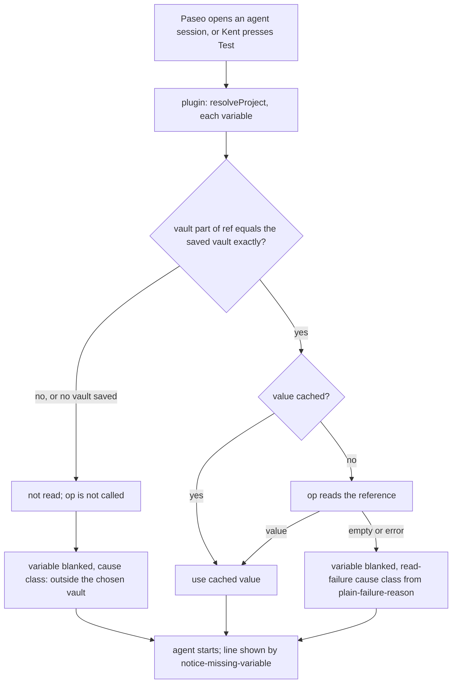

---
id:
title: A reference outside the repository's chosen vault is never read
status: done
variant: kc-dev-flow-2
profile: pilot
merge: pr
worktree: .worktrees/spacedock-ensign-project-env-vault-boundary
pr: pr-merge:10
journey: paseo-project-env
journey-release: r1
journey-story: pick-vault
journey-required-tasks: '["project-env-vault-boundary"]'
journey-mapping-complete: true
gates:
    version: 1
    records:
        - id: gate:project-env-vault-boundary:backlog
          stage: backlog
          attempts:
            - id: gate-attempt:project-env-vault-boundary-backlog-1
              briefing:
                id: briefing:project-env-vault-boundary:backlog:attempt-1:revision-1
                digest: sha256:c8c7d3f7c4976bc56e5b36d0760d8f69994825ac094cbe4971b11901b351294a
                room-ref: ./project-env-vault-boundary/review/backlog/briefing-1
              resolution:
                type: Resolution
                id: resolution:spacedock:project-env-vault-boundary:backlog:1
                briefing: briefing:project-env-vault-boundary:backlog:attempt-1:revision-1
                by: person:captain
                at: "2026-10-20T14:17:31.403685Z"
                decision: approve
                reason: 'Captain 2026-10-20: 「准。」 — accepts this release r1 task''s outcome, scope and acceptance criteria on the pilot profile, into ideation.'
              application:
                target-stage: ideation
                state: consumed
        - id: gate:project-env-vault-boundary:ideation
          stage: ideation
          attempts:
            - id: gate-attempt:project-env-vault-boundary-ideation-1
              briefing:
                id: briefing:project-env-vault-boundary:ideation:attempt-1:revision-1
                digest: sha256:4f639d1159cd167ee08e792ef8ed346adaedf2874a4e31c0df1fb031268db44a
                room-ref: ./project-env-vault-boundary/review/ideation/briefing-1
              resolution:
                type: Resolution
                id: resolution:spacedock:project-env-vault-boundary:ideation:1
                briefing: briefing:project-env-vault-boundary:ideation:attempt-1:revision-1
                by: person:captain
                at: "2026-10-20T14:57:24.552544Z"
                decision: approve
                reason: 'Captain 2026-10-20: 「准」 — accepts this ideation design and its acceptance criteria into implementation, including the presented additions (the one-line run fix in project-env-plain-failure-reason; AC-2 in project-env-vault-boundary).'
              application:
                target-stage: implementation
                state: consumed
        - id: gate:project-env-vault-boundary:validation
          stage: validation
          attempts:
            - id: gate-attempt:project-env-vault-boundary-validation-1
              briefing:
                id: briefing:project-env-vault-boundary:validation:attempt-1:revision-1
                digest: sha256:438e2d82abc20fc58c9eb0748f9d91fd2fb164c1b2d6457fd509d1a25cf141c4
                room-ref: ./project-env-vault-boundary/review/validation/briefing-1
              resolution:
                type: Resolution
                id: resolution:spacedock:project-env-vault-boundary:validation:1
                briefing: briefing:project-env-vault-boundary:validation:attempt-1:revision-1
                by: person:captain
                at: "2026-10-21T00:32:25.017863Z"
                decision: approve
                reason: 'Captain 2026-10-21: 「其他的部分授權你合併」 — approves delivery of PR iamcxa/kc-paseo-plugins#10 at head a30ad6357ae0fb3f2d02f5e990c0d9a28dea7022 after the roborev run he asked for (clean), including later review rounds on the same PR, merging that head, and removing its clean pushed worktree.'
              application:
                target-stage: done
                state: consumed
started: 2026-10-20T14:20:03Z
verdict: PASSED
completed: 2026-10-21T00:39:31Z
archived: 2026-10-21T00:39:31Z
---

ADR 0001 rules that the plugin refuses a reference outside the chosen vault. Today any `op://` reference is read, including one typed by hand or imported.

## Scope

In: refusing, at agent start, a reference whose vault is not the repository's chosen vault; the variable is blanked with the outside-the-vault cause class. Non-goals: refusing it on save in the settings screen (r1.5). Residual: an existing configuration with such references, possibly Kent's own, will have those variables blanked. Depends on: project-env-new-agent-env, project-env-plain-failure-reason. Stop condition: the acceptance criteria below pass.

## Acceptance criteria

**AC-1**: At agent start, a reference to a vault other than the chosen one is not read and its variable is blanked with the outside-the-vault cause.
Verified by: a fake-op unit test asserting `op` is not called for that reference.

**AC-2** (added in ideation, for the Captain to accept or strike at the gate): A reference counts as inside the chosen vault only when the part between `op://` and the first `/` equals the saved vault string exactly, in the form saved (name or id) and in the same letter case; with no vault saved, every reference is outside.
Verified by: the same fake-op test run over a table of references (saved name; the vault's id while a name is saved; a different letter case; `$VAULT`; a bare `op://name`; an empty saved vault), asserting `op` is not called for each row that is not an exact match, and is called once for the exact match.

## FO alignment

Surfaces: none
Visible change: none
Direction alignment with the Captain: not needed — the outcome follows rulings already recorded (docs/adr/0001, docs/adr/0002, and the Captain's 2026-10-20 rulings in the journey map); release r1 was marked changed by signal 2 (the Captain narrowed r1 on 2026-10-20: 「可以改成兩段，不用第一時間給隊友，要先我用到覺得可以」, 「就五個，剩下做 r1.5」). kc-journey-map review-release ran on r1 at 60799d9; after the rulings, a fresh audit, the map split and an interrogation of the changed stories, this task split was re-derived from the map at 760bfaa (branch docs/project-env-r1-split, PR #6).
Release review: paseo-project-env/r1 at 760bfaa
Map footprints: not needed: no ruling on this task answered an open map question; pick-vault/q1 already carries the ADR 0001 ruling.

## Design

### PRFAQ

**Press release.** When Kent's agent starts in a connected repository, the plugin checks every variable's `op://` reference before it asks 1Password for anything. A reference that points into any vault other than the one Kent chose for that repository is never read; its variable reaches the agent empty and is reported as outside the chosen vault. A hand-typed or imported reference can no longer pull a secret from a vault the repository was not meant to use.

**FAQ.**

- *How is the chosen vault identified?* By the string already saved as the project's `vault` field. The picker saves a vault name; a hand-typed vault may be an id. A reference is inside only when the text between `op://` and the first `/` equals that string exactly (same form, same letter case). No new field and no schema change.
- *Why not accept both the name and the id of the chosen vault?* Telling that a name and an id are the same vault needs a 1Password call on every agent start, and AC-1 requires that no call is made for an outside reference. A reference written in the other form is refused (fails closed); the user rewrites it in the saved form.
- *What happens when the vault is renamed in 1Password?* The check does not notice: the saved name and the references still match each other, so they pass, and 1Password then fails the read because that name no longer exists. The variable is blanked with whatever read-failure cause class plain-failure-reason assigns; the user fixes it by saving the new name and rewriting the references. Limit: if a different vault the service account can read later takes the old name, references are read from that vault. The service account's own scope (ADR 0001, one vault per account) is what bounds this; an id-based identity would close it and is deferred (it needs the picker to save an id, a settings-screen change).
- *What if no vault is saved?* Every reference is outside; every variable is blanked. This is ADR 0001's "every reference must point into the chosen vault" with nothing chosen, and fails closed.
- *Does the Test button show it?* Yes. Test and session open both go through `resolveProject`, so the settings Test row shows the same cause for the draft. Refusing on save in the settings screen stays out (r1.5).
- *Which agent starts are covered?* Every `agent.session_open` (create, resume, refresh, import), because the check sits in `resolveProject`, which the hook calls for all of them.
- *What about a cached value?* The check runs before the cache is read, so a value cached under an earlier vault setting is not returned for a reference that is now outside.
- *Is a new ADR needed?* No. ADR 0001 already rules the refusal; this design only fixes how "the chosen vault" is matched.



### Existing-code check

Boundary: the path from a saved `ref` to the `op` read in `project-env/server/secrets.ts` (`resolveProject`, `readRef`), the vault field in `shared/config.ts`, and `client/settings-screen.tsx`. Two searches of `project-env/` (`vault`, case-insensitive; `op://`, `split(`, `startsWith`) found no comparison of a reference's vault against the saved vault anywhere: the schema only requires the `op://` prefix (`ref: z.string().startsWith("op://")`), and `readRef` passes any reference straight to `op`. Completeness: not found. Need: safety obligation (ADR 0001); no other consumer needed. Unknowns: code outside `project-env/` is not in this repository; the picker and `listRefs` build references from the saved vault, so they stay inside by construction. Conclusion: add one pure function (reference, saved vault) to a boolean, called at the top of the per-variable step in `resolveProject`; nothing is replaced.

### Residual sized

Read-only shape check of the plugin's host settings file on Kent's Mac, 2026-10-20, with a `jq` filter that printed counts and booleans only (no values, no names): 1 project, 1 variable, 1 service account saved, 1 vault saved. Variables with an `op://` reference: 1. Variables whose vault part equals the saved vault exactly: 1. Variables outside it: 0. References with a query part, `%`, `$`, or other than three `/`-separated parts: 0. The saved vault and the reference's vault part are both name-shaped, not 26-character ids. Result: Kent's current configuration holds no reference outside its chosen vault, so this change blanks nothing today. Unmeasured: configurations on other Macs (none known; no teammate has installed it).

### Interfaces needed from siblings

- project-env-new-agent-env: a fake `op` that records every call's arguments, so a test can assert none mentions the outside reference; `resolveProject` stays the only place references are read.
- project-env-plain-failure-reason: a cause class for "outside the chosen vault" in the one cause list (proposed name `outside-vault`; the name is theirs to settle, this task uses whatever they settle). Entries carry the class, not `op`'s text.

### Evidence plan

AC-1 and AC-2: one fake-op unit test (the fake from new-agent-env) over the AC-2 table. Falsified by removing the check (the fake then records calls for the outside rows), by comparing letter case loosely, or by accepting the id form (those table rows would then be read). Not run yet: implementation has not started and both siblings are unmerged. No deployed-daemon check is owed here; the check is local string logic whose only seam (`op`) is faked, and the daemon run is owed by project-env-new-agent-env AC-1.

### Needs decision

None blocks implementation. One limit for the gate to accept: an id-based identity is deferred, so a rename that frees a name for a different readable vault is not detected (see FAQ). Recommendation: accept, because release 1 has one user and ADR 0001's one-vault service account is the real boundary; the cost under the recommendation is that the check guards against wrong references, not against a service account with wider scope than asked.

## Stage Report: ideation

- DONE: Design the session-open check that refuses an `op://` reference outside the repository's chosen vault, including how the chosen vault is identified (name or id) and how renamed vaults behave.
  Design section: chosen vault = the saved `vault` string as written; exact match on the reference's vault part, checked in `resolveProject` before cache and `op`; rename and id-form limits stated in the FAQ.
- DONE: Size the residual: report, by shape only (counts, never values or names of secrets), whether Kent's current configuration holds references outside its chosen vault.
  `jq` counts on the host settings file, 2026-10-20: 1 project, 1 variable, 0 outside the chosen vault; nothing blanked today.
- DONE: Keep AC-1 with a fake-op test asserting op is not called as its evidence clause.
  AC-1 kept verbatim; its evidence clause is unchanged. Not yet verified: no implementation exists.
- DONE: AC-1 evidence status.
  Not yet verified; the proof is a fake-op unit test that fails if the check is removed (the fake then records an `op` call for the outside reference).
- DONE: AC-2 evidence status (proposed addition).
  Not yet verified; the same test over a table of reference forms would fail if matching were loose in case or accepted the id form.
- DONE: `design_surfaces.py check` run.
  Output: "project-env-vault-boundary.md: design surfaces presentable", exit 0 (Surfaces: none).

### Summary

The check is one pure comparison in `resolveProject`, using the already-saved vault string with no schema change and no extra 1Password call; Kent's own configuration has 0 of 1 references outside its vault. Needs from siblings: a call-recording fake `op` (new-agent-env) and an outside-vault cause class (plain-failure-reason). For the gate: AC-2 is a proposed addition, and an id-based vault identity is deferred (a rename that frees a name for another readable vault is undetected; bounded by the service account's scope).

## Stage Report: implementation

- DONE: Implement the approved design: at the top of the per-variable step in `resolveProject`, before the cache and `op`, refuse a reference whose vault part (via `parseRef`) is not exactly the saved `vault` string, blanking it with cause `outside-vault`; with no vault saved every reference is outside.
  Commit a30ad63 on spacedock-ensign/project-env-vault-boundary: `isOutsideVault` in `server/cause.ts`, called first in `readVariable` (`server/secrets.ts`); a malformed reference (parseRef null) stays `missing-field`, op not called either way.
- DONE: Land the fake-op tests for AC-1 (op not called for that reference) and AC-2 (the matching-rule table), each failing when the check is removed.
  `test/vault-boundary.test.ts`: table rows (exact name; other vault; id while name saved; name while id saved; other case; `$VAULT`; bare `op://name`; no vault saved) assert the fake records zero reads for every row but the exact one (one read). Mutations run: check removed fails 10 tests; case-insensitive compare fails "a different letter case"; empty vault accepted fails "no vault saved". `test/failure-reason.test.ts` now also produces `outside-vault`, so its coverage test expects no unproduced cause.
- DONE: Run `npm test`, `npm run typecheck` and `doc_impact.py <base> <candidate>`, and open the Draft PR.
  npm test 57 pass 0 fail; typecheck clean; doc_impact f53d485..a30ad63: "0 document(s) mention what changed"; Draft PR https://github.com/iamcxa/kc-paseo-plugins/pull/10, base spacedock-ensign/project-env-plain-failure-reason.
- DONE: Affected documents.
  No document listed by doc_impact; nothing to mark updated or unaffected.
- DONE: Comment ratio and design surfaces.
  comment_ratio.py: 101 code lines, 1 comment line, 1.0%, maximum 5% met; design_surfaces.py check exit 0. No ADR added (design: ADR 0001 already rules it); no Number guards section.

### Summary

One pure comparison now runs first in the per-variable step, so an outside reference never reaches the cache or the 1Password tool; the Test button and every session open inherit it. Base was #9 head f53d485 (ff-merged, unchanged during the work). Not run: a live-daemon check (local string logic over a faked seam; the daemon run is owed by project-env-new-agent-env); Kent's live install `paseo-project-env` was not touched. Limits unchanged from the design: vault rename and id-based identity are not detected.

## Stage Report: validation

- DONE: Independently check candidate a30ad6357ae0fb3f2d02f5e990c0d9a28dea7022 (PR iamcxa/kc-paseo-plugins#10, stacked on #9) against AC-1, AC-2 and the approved design, including that each decisive test fails when the vault check is removed or loosened; give a verdict.
  Verdict: PASSED, with one Polish finding (below). Delta f53d485..a30ad63 is 4 files; `npm test` 57 pass 0 fail, `npm run typecheck` exit 0 (both run by me). Code read: `isOutsideVault` runs first in `readVariable`, before token, cache and `op`; exact `!==` on the saved `vault`; empty saved vault makes every well-formed reference outside; matches the design.
  Mutations run in a throwaway copy (candidate untouched): check removed -> 10 fail (8 in `vault-boundary.test.ts`, plus the cause-coverage tests); case-insensitive compare -> fails "a different letter case"; empty vault accepted -> fails "no vault saved"; check moved below the cache read -> fails "is refused before the cache". AC-1 is shown by the `reads().length === 0` assertions on the call-recording fake `op`.
  Minimal necessity: every added line maps to AC-1/AC-2 (check + call site, the `failure-reason` coverage expectation, the new test file); nothing else retained.
- DONE: Polish finding (not blocking): the AC-2 table does not catch a prefix loosening.
  Mutation `vault !== "" && parsed.vault.startsWith(vault)` left 57 pass 0 fail, so a reference such as `op://Development/i/x` with saved `Dev` is not covered by any row. The product code is exact, so no current harm: Polish. A row with a longer vault name sharing the saved prefix (and one with trailing whitespace) would close it; FO may return it or accept it.
- DONE: Write the minimal acceptance script FO will rerun in a fresh shell, and run `python3 /Users/kent/.claude/plugins/cache/kc-claude-plugins/kc-dev-flow-2/0.26.0/scripts/adr_lint.py docs/adr --since 60799d9` recording its exit code.
  adr_lint exit 0 ("4 ADR file(s) checked, 0 legacy"). Also: comment_ratio exit 0 (101 code lines, 1 comment line, 1.0%, max 5%); doc_impact exit 0 (0 documents listed); design_surfaces exit 0; dispatch_records exit 0 (3 complete); no Number guards section. The script below ran unchanged under `env -i` with only HOME and PATH, about 40 s, with the observed output shown.
- DONE: Record every unverified obligation, including the malformed-reference limit, without running anything against the live `paseo-project-env` install.
  Listed under Unverified obligations; nothing was run against the live install, no secret was fetched.

### Acceptance script (about 1 minute, no secret, touches no install)

```bash
W=/Users/kent/Project/kc-paseo-plugins/.worktrees/spacedock-ensign-project-env-vault-boundary
P=/Users/kent/.claude/plugins/cache/kc-claude-plugins/kc-dev-flow-2/0.26.0
T="node --disable-warning=MODULE_TYPELESS_PACKAGE_JSON --test test/vault-boundary.test.ts"
echo "1 candidate:"; git -C $W rev-parse HEAD
echo "2 boundary test:"; cd $W/project-env && $T 2>&1 | grep -E '^ℹ (pass|fail)'
echo "3 mutation (check removed, in a temp copy):"
M=$(mktemp -d) && cp -R server shared test package.json tsconfig.json $M/ && ln -s $W/project-env/node_modules $M/node_modules
sed -i '' 's|^    if (isOutsideVault(ref, vault)) return .*$||' $M/server/secrets.ts
(cd $M && $T 2>&1 | grep -E '^ℹ (pass|fail)')
echo "4 full suite:"; cd $W/project-env && npm test 2>&1 | grep -E '^ℹ (pass|fail)'
echo "5 typecheck:"; npm run typecheck >/dev/null 2>&1; echo "exit $?"
echo "6 ADR lint:"; cd $W && python3 $P/scripts/adr_lint.py docs/adr --since 60799d9; echo "exit $?"
```

Expected: 1 prints `a30ad6357ae0fb3f2d02f5e990c0d9a28dea7022`; 2 prints `pass 10` `fail 0`; 3 prints `pass 2` `fail 8` (the mutated copy reads outside references, so 8 rows fail); 4 prints `pass 57` `fail 0`; 5 prints `exit 0`; 6 prints `4 ADR file(s) checked, 0 legacy` then `exit 0`. Uses macOS `sed -i ''`.
Does not cover: a real daemon session, real 1Password or Keychain, the settings-screen Test row as rendered, or any machine other than this one.

### Unverified obligations

- Malformed-reference limit: a reference with fewer than three non-empty `/` parts (`op://Prod`, `op://Prod/item`, an empty segment) is blanked as `missing-field`, not `outside-vault`, even if it names another vault; `op` is not called (table row "a bare op://name"; `parseRef` check precedes the read). Only the cause class is less specific; no read happens.
- Real `op` parsing is not exercised: the check compares the text before the first `/`. How real `op` treats a well-formed-looking reference that differs from that text (percent-encoding, `..` segments, vault names containing `/`, case-insensitive vault lookup) is unverified; the plugin fails closed on text mismatch, and the service account's one-vault scope (ADR 0001) is the real bound.
- No live-daemon or settings-screen Test row run (owed by project-env-new-agent-env AC-1); no screenshot, as this candidate changes no screen markup.
- Accepted design limits unchanged: a vault rename, and an id-based identity, are not detected. Kent's own configuration had 0 of 1 references outside its vault on 2026-10-20 (from ideation; not re-measured here, no host settings read).
- Stacked on unmerged #9 (f53d485): the `outside-vault` cause class and `readVariable` shape come from it; this verdict holds only on that base.

### Summary

PASSED: the vault check is one exact comparison placed before the token, cache and `op`, and both the AC-1 and AC-2 tests fail when it is removed, made case-insensitive, accepts an empty saved vault, or moves behind the cache. One Polish gap: no table row catches a prefix loosening. Real `op` reference parsing, the live daemon and the rendered Test row remain unverified.
