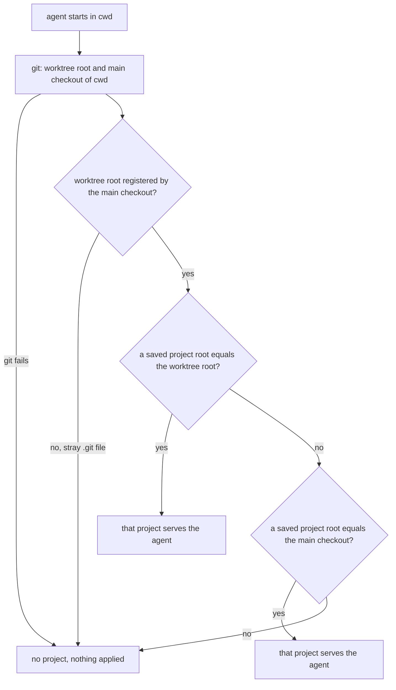

---
id:
title: A project registered at a worktree path gives its agents their variables
status: done
variant: kc-dev-flow-2
profile: pilot
merge: pr
worktree: .worktrees/spacedock-ensign-project-env-worktree-project-root
pr: pr-merge:19
gates:
    version: 1
    records:
        - id: gate:project-env-worktree-project-root:backlog
          stage: backlog
          attempts:
            - id: gate-attempt:project-env-worktree-project-root-backlog-1
              briefing:
                id: briefing:project-env-worktree-project-root:backlog:attempt-1:revision-1
                digest: sha256:a8511e0a77264672d5ec078e18c0b2ad322e13b5de9906d81266a0ce1ce9e9a7
                room-ref: ./project-env-worktree-project-root/review/backlog/briefing-1
              resolution:
                type: Resolution
                id: resolution:spacedock:project-env-worktree-project-root:backlog:1
                briefing: briefing:project-env-worktree-project-root:backlog:attempt-1:revision-1
                by: person:captain
                at: "2026-10-21T09:42:21.906728Z"
                decision: approve
                reason: 'Captain 2026-10-21: 「准」 — accepts this bug-fix task''s outcome, scope and acceptance criteria on the pilot profile, into ideation.'
              application:
                target-stage: ideation
                state: consumed
        - id: gate:project-env-worktree-project-root:ideation
          stage: ideation
          attempts:
            - id: gate-attempt:project-env-worktree-project-root-ideation-1
              briefing:
                id: briefing:project-env-worktree-project-root:ideation:attempt-1:revision-1
                digest: sha256:4741d4fd480ba368e9712db705b0da678999993297e9190aa283f1e36df788e0
                room-ref: ./project-env-worktree-project-root/review/ideation/briefing-1
              resolution:
                type: Resolution
                id: resolution:spacedock:project-env-worktree-project-root:ideation:1
                briefing: briefing:project-env-worktree-project-root:ideation:attempt-1:revision-1
                by: person:captain
                at: "2026-10-21T11:22:05.825515Z"
                decision: approve
                reason: 'Captain 2026-10-21: 「可以，同意你的計畫」 — accepts this ideation design and its acceptance criteria into implementation.'
              application:
                target-stage: implementation
                state: consumed
        - id: gate:project-env-worktree-project-root:validation
          stage: validation
          attempts:
            - id: gate-attempt:project-env-worktree-project-root-validation-1
              briefing:
                id: briefing:project-env-worktree-project-root:validation:attempt-1:revision-1
                digest: sha256:13167fad1a2e81e34cb84c7338cb365c42ba07c9c0f9a9b4830ecd9baa5420cd
                room-ref: ./project-env-worktree-project-root/review/validation/briefing-1
              resolution:
                type: Resolution
                id: resolution:spacedock:project-env-worktree-project-root:validation:1
                briefing: briefing:project-env-worktree-project-root:validation:attempt-1:revision-1
                by: person:captain
                at: "2026-10-21T12:09:50.880692Z"
                decision: approve
                reason: 'Captain 2026-10-21: 「Dev2檢驗都過了嗎？ 如果說就批准合併」 — conditional approval; FO confirmed for this PR: validation PASSED, FO acceptance rerun matched, roborev clean, Codex clean on the head, real-tool integration test passed — approves delivery of PR iamcxa/kc-paseo-plugins#19 at head 09bc5c98488f75d77e14c9bf73bd532457dd490e by squash, including removing its clean pushed worktree.'
              application:
                target-stage: done
                state: consumed
started: 2026-10-21T09:42:39Z
verdict: PASSED
completed: 2026-10-21T12:14:05Z
archived: 2026-10-21T12:14:05Z
---

Kent found on 2026-10-21 that agents in /Users/kent/conductor/repos/qnow-adopt-dev2 start with none of the project's variables (reported missing, not empty, and no timeline line), while Test reads them. That directory is a linked worktree of /Users/kent/conductor/repos/qnow and is itself the project's saved root. `projectForCwd` in project-env/server/secrets.ts maps every working directory to its main checkout (`mainCheckout`) and compares only that with the saved roots, so a project saved at a worktree path never matches. Captain, 2026-10-21: 「也准加入」 — added to the release r1.5 batch.

## Scope

In: a working directory matches a saved project when its own worktree root is that project's root, and otherwise when its main checkout is; registered-worktree trust stays. Non-goals: resumed agents (r2). Stop condition: the acceptance criteria below pass.

## Acceptance criteria

**AC-1**: An agent started in a linked worktree that is itself a saved project's root receives that project's variables.
Verified by: (a) a fake-git test in `project-env/test/project-for-cwd.test.ts`: main checkout `repo` with registered linked worktrees `wt` and `wt2`, the project saved at `wt`, `projectForCwd` called with cwd `wt` returns that project; the same test fails on main 487b9b0 (returns null) and passes after the fix; (b) after the fix merges and Kent reloads `paseo-project-env`, a new agent in /Users/kent/conductor/repos/qnow-adopt-dev2 on Kent's daemon runs, for each variable name in the project, `[ -n "${NAME}" ] && echo set || echo missing` and every name reads `set` (shape only, no value printed), with no missing-variables timeline row.

**AC-2**: A project saved at a main checkout still serves agents in its registered worktrees, and an unconnected repository still matches nothing.
Verified by: the seven existing cases in `project-env/test/project-for-cwd.test.ts` staying green, plus two added cases: a project saved at `repo` still returns for cwd `wt`; a project saved at `wt` returns null for cwd `other` (an unconnected repository).

## FO alignment

Surfaces: none
Visible change: none
Direction alignment with the Captain: not needed — a defect fix the Captain approved on 2026-10-21 (「也准加入」).
Release review: not needed: a bug fix carrying no journey story; the Captain placed it in the r1.5 batch.
Map footprints: not needed: a bug fix with no journey story; no ruling answered a map question.

## Design

**Press release.** An agent started in a directory that is itself a saved project's root gets that project's variables, even when the directory is a linked git worktree. Kent saved `/Users/kent/conductor/repos/qnow-adopt-dev2` as a project; agents there now start with their variables instead of none.

**FAQ.**
- *What matches?* The agent's working directory is first resolved to its own worktree root (`git rev-parse --show-toplevel`, realpath). If a saved project's root (realpath) equals it, that project serves the agent. Otherwise the main checkout (`dirname` of `--git-common-dir`, realpath) is compared with the saved roots, as today.
- *Which wins when both a worktree and its main checkout are saved?* The worktree's own project, in that worktree only. It is the more specific entry and the one a person saved on purpose for that directory. The main checkout's project still serves the main checkout and every other registered worktree. Order in the saved list does not matter.
- *Does a project saved at one worktree serve its sibling worktrees?* No. Only a project saved at the main checkout reaches siblings, as today.
- *Is the registered-worktree trust check kept?* Yes, unchanged and applied before either comparison: the worktree root must appear in `git worktree list --porcelain` run from the main checkout. A stray `.git` file naming another repository still yields no match, and the new comparison uses the verified worktree root, so it adds no way to claim a root the directory does not have.
- *Do symlinks still work?* Yes. Both sides go through `realOrSelf`, as the existing cases require.



**Existing-code check.** `projectForCwd` already resolves both the worktree root (`top`, used only for the trust check) and the main checkout (`root`) and discards `top`. The smallest change keeps both from the one function that already computes them and compares `top` before `root`. No new git call, no new export, no replacement mechanism. Proposed shape: `mainCheckout` body becomes a private `locate(cwd)` returning `{ top, root }` or null; `mainCheckout` stays exported with unchanged behaviour (`locate(cwd)?.root ?? null`); `projectForCwd` does `roots.indexOf(place.top)` first, then `roots.indexOf(place.root)`. About ten changed lines in `server/secrets.ts`; no other file.

**Observation that shows the change is needed.** On main 487b9b0, with real git and no secrets involved (read-only, 2026-10-21): for cwd `/Users/kent/conductor/repos/qnow-adopt-dev2` (registered linked worktree of `/Users/kent/conductor/repos/qnow`), `mainCheckout` returns `/Users/kent/conductor/repos/qnow`; `projectForCwd` with a project saved at the worktree path returns null at the root and at a subdirectory. A prototype of the shape above, run on a scratch copy (not the repository), returns the project at both, null for the sibling worktree `.worktrees/r1-walk`, and still returns a project saved at `qnow` for the worktree.

Scratch cases run on main and on the prototype (6 new cases, fake git plus one real-git case, run with the 7 existing cases):
- main 487b9b0: the 7 existing pass; of the new cases, fail: project saved at `wt` serves cwd `wt`; both saved, `wt` wins in `wt`; real linked worktree matches. Pass: saved at `repo` serves `wt`; saved at `wt` does not serve `other`; saved at `wt` does not serve sibling `wt2`.
- prototype: all 13 pass.

## Interface conflict check

Checked 2026-10-21 against the three branches off main (`git diff main` on `project-env/server/secrets.ts`, committed plus working tree):
- project-env-variable-row-edit: does not touch `server/secrets.ts` (changes `client/settings-screen.tsx`, `shared/config.ts`). No conflict.
- project-env-token-works-cause: edits `secrets.ts` imports, `opEnv`, `tokenStatus` and `readToken` area, and the final `return { mainCheckout, projectForCwd, tokenStatus, checkToken, ... }` line. It does not touch `mainCheckout` or `projectForCwd` bodies. Conflict risk: the return line, which this design leaves alone (`mainCheckout` stays exported), and a one-line gap between `projectForCwd` and its `readToken` hunk. Expect a clean textual merge; whichever task lands second rebases.
- project-env-browse-vault-survives: edits the `node:path` import line and the `listRefs` region from about line 153 on, plus `contribute.ts`, `config.ts`, `cause.ts`, `test/world.ts`, `test/fakes/op.mjs`. No overlap with lines 72-96. This design adds no import and does not touch `test/world.ts` or `test/fakes/`, which both siblings change. No conflict.
- Test file: only `test/project-for-cwd.test.ts` gains cases; neither sibling edits it.

No interface (exported signature, shared type, setting shape) changes, so no sibling must wait.

## Unresolved decisions for the Captain

None. Past rulings checked: ADRs 0001-0005 name no rule for matching a working directory to a project root, and `git -C docs/dev2/.spacedock-state grep -n 'Override:'` finds only prose in sibling tasks, none on this area.

Known limits (not decisions): the qnow-adopt-dev2 agent check in AC-1(b) cannot run before merge, because Kent's live plugin runs from the main checkout; it is owed after merge and reload, by shape only. The AC-1(b) shell check assumes the agent can run a shell. One pre-existing test, `session-open.test.ts` "blanks a variable 1Password does not answer in time and returns at the deadline", failed once on main 487b9b0 in `npm test` while other agents were running; not investigated, not related to this change.

## Stage Report: ideation

- DONE: Design the match: a working directory matches a saved project when its own worktree root (realpath) is that project's root, otherwise when its main checkout is; keep the registered-worktree trust check; say which wins if both a worktree root and its main checkout are saved as projects.
  See Design: worktree root compared first, then main checkout; trust check unchanged and applied first; when both are saved the worktree's own project wins in that worktree only. Mermaid matches the prose.
- DONE: Reproduce the defect on main with fake git (a project saved at a linked-worktree path, an agent in that worktree) and keep AC-1 and AC-2 with reproducible evidence clauses, including the owed qnow-adopt-dev2 agent check on Kent's daemon by shape.
  On main 487b9b0 three new scratch cases fail (fake-git AC-1, both-saved, real-git) and the 7 existing pass; real qnow-adopt-dev2 layout via read-only git returns null; a prototype passes all 13. AC-1 clauses (a) test and (b) post-merge shape check, AC-2 clause named; (b) is not yet verified, it needs merge and Kent's reload.
- DONE: Name the interface conflict, if any, with project-env-variable-row-edit, project-env-token-works-cause and project-env-browse-vault-survives (all in implementation off main), since this task touches project-env/server/secrets.ts.
  See Interface conflict check: no signature change; only a possible adjacent textual merge with token-works-cause around the exports line, none with the other two.
- DONE: AC-1 evidence (current)
  Defect reproduced on main (above); fix proven only on a scratch prototype, repository tests not yet written; live-daemon check not yet verified.
- DONE: AC-2 evidence (current)
  The 7 existing project-for-cwd cases and the two sibling-negative cases pass on the prototype; not yet run in the repository after the real change.
- DONE: design_surfaces check
  `python3 <package>/scripts/design_surfaces.py check <task>` printed "design surfaces presentable", exit 0 (Surfaces: none).

### Summary

Smallest fix is about ten lines in `server/secrets.ts`: keep the worktree root that the trust check already computes and compare it with saved roots before the main checkout. No decision needs the Captain. Scratch reproduction and prototype lived in /tmp/wtpr only; no repository file, branch or commit was made.

## Stage Report: implementation

- DONE: Implement the approved design in project-env/server/secrets.ts: match the agent's own worktree root against saved project roots first, then its main checkout; keep the registered-worktree trust check; a worktree's own project wins in that worktree only.
  Commit 09bc5c9 on spacedock-ensign/project-env-worktree-project-root (base 15b1e3f): private `locate(cwd)` returns `{top, root}` after the unchanged trust check; `mainCheckout` stays exported; `projectForCwd` indexes `top` before `root`. 2 files, +93/-6.
- DONE: Land the fake-git cases so AC-1's unit clause and AC-2 pass and the new cases fail on today's projectForCwd; record the qnow-adopt-dev2 agent check on Kent's daemon as owed.
  Seven cases added to `project-for-cwd.test.ts`. Falsifiable pair, failing on 15b1e3f before the fix (observed): "serves an agent in a linked worktree from a project saved at that worktree" (AC-1a; revert top-first match and it returns null) and "lets a worktree's own project win in that worktree only, whatever the list order" (own beats main in wt, main serves wt2, both list orders). AC-2 and trust (pass before and after, pin behaviour): project at `repo` serves `wt`; project at `wt` returns null for `other` and for sibling `wt2`; unregistered worktree with its project saved returns null. The seven existing cases stay green. Real-git scratch repo with two linked worktrees (removed afterwards): saved at wt serves wt, not wt2; saved at repo serves wt. AC-1(b) is OWED: needs merge and Kent's reload, then the shape-only `[ -n "${NAME}" ]` check for every variable in /Users/kent/conductor/repos/qnow-adopt-dev2; not run.
- DONE: Run `npm test`, `npm run typecheck`, the roborev gate and doc_impact.py, then open the Draft PR.
  `npm test` 127 pass 0 fail (an earlier run on unfixed code also failed the load-sensitive session-open deadline test, which passed on the full rerun); typecheck clean; roborev gate exit 0 `clean on 09bc5c984; evidence=roborev:976`; `doc_impact.py 15b1e3f HEAD`: "0 document(s) mention what changed", nothing to record; `comment_ratio.py`: code lines 86, comment lines 0, 0.0%, max 5% met; `design_surfaces.py check`: presentable. Draft PR: https://github.com/iamcxa/kc-paseo-plugins/pull/19 (pushed under the Captain's standing grant).

### Summary

Port of the approved ~10-line design, no deviations: worktree root compared first, main checkout second, trust check first. The worktree was at 487b9b0 and was fast-forwarded to origin/main 15b1e3f before work; no rebase needed. CHANGELOG.md is release-please generated and was not edited. No ADR added or changed; Number guards: not applicable (Surfaces: none, no migration). Limits: AC-1(b) owed after merge and reload; a `node_modules` symlink to the main checkout was used locally for test runs and removed before the gate, not committed.

## Stage Report: validation

- DONE: Independently check candidate 09bc5c98488f75d77e14c9bf73bd532457dd490e (PR iamcxa/kc-paseo-plugins#19, base main) against AC-1, AC-2 and the approved design, including that the new cases fail on main's projectForCwd and that every existing project-for-cwd case still passes; also run the match read-only with real git against /Users/kent/conductor/repos/qnow-adopt-dev2 and a saved root equal to it; give a verdict.
  Verdict: PASSED for AC-1(a) and AC-2 at 09bc5c9 (PR head confirmed by `gh pr view 19`: headRefOid 09bc5c9, Draft, base main; diff vs 15b1e3f is only secrets.ts +10/-5 and the test file). Extracted candidate and 15b1e3f with `git archive` (no worktree touched): project-for-cwd 13/13 pass on candidate; with the candidate's test file on 15b1e3f's secrets.ts, 11 pass and 2 fail ("serves an agent in a linked worktree from a project saved at that worktree" = AC-1(a), returns null; "lets a worktree's own project win in that worktree only..." = own-wins) - the 7 existing cases pass on both. The other 4 added cases (AC-2 pair, sibling wt2, unregistered worktree) pass on both sides: they pin behaviour and are not falsifiers. Real git, read-only, saved root = qnow-adopt-dev2, cwd same: 15b1e3f null, candidate MATCH; also candidate: cwd `docs` subdirectory MATCH, sibling `.worktrees/r1-walk` null, project saved at qnow serves the worktree, [qnow, worktree] list gives the worktree project, `/tmp` null; `mainCheckout` still returns qnow. Matches the design's trust-check-then-top-then-root order and the Mermaid.
- DONE: Write the minimal acceptance script FO will rerun in a fresh shell, and run `python3 /Users/kent/.claude/plugins/cache/kc-claude-plugins/kc-dev-flow-2/0.26.0/scripts/adr_lint.py docs/adr --since 60799d9` recording its exit code.
  Script below, run once by me via `bash --norc --noprofile` with the expected outputs shown. adr_lint.py exit code 0 ("5 ADR file(s) checked, 0 legacy"); no ADR added or changed by the candidate, none reserved (no Number guards section).
- DONE: Record every unverified obligation, including the qnow-adopt-dev2 agent check on Kent's daemon, without touching the live paseo-project-env install.
  See Unverified obligations below; no secret, op or security command was run, no value read, live install and main checkout branch untouched.

### Summary

The fix is minimal: one private `locate` returning `{top, root}` after the unchanged trust check, `projectForCwd` indexing `top` before `root`; `mainCheckout` is kept only because two existing tests in secrets.test.ts call it (no signature change). Other checks at 09bc5c9: `npm test` 126/127 with the known load-sensitive session-open deadline test failing in the full run and 15/15 when rerun alone (not counted); `npm run typecheck` exit 0; `comment_ratio.py 15b1e3f 09bc5c9`: code lines 86, comment lines 0, 0.0%, exit 0 (I read the diff: no added comments); `doc_impact.py`: 0 documents, exit 0; `design_surfaces.py check`: presentable, exit 0; `dispatch_records.py`: 3 records complete, exit 0. Goal sufficiency: the real-git result shows the reported case (agent in qnow-adopt-dev2) now matches. Necessity: each changed line maps to AC-1/AC-2; no new git call, export or file. No findings.

### Unverified obligations

- AC-1(b) is not verified: after merge and Kent's reload of `paseo-project-env`, a new agent in /Users/kent/conductor/repos/qnow-adopt-dev2 on Kent's daemon must report `[ -n "${NAME}" ] && echo set || echo missing` as `set` for every project variable, with no missing-variables timeline row. Needs Kent's daemon, 1Password and a reload; I ran no op/security command.
- The candidate was not run inside the paseo plugin host; the real-git check calls `projectForCwd` directly with fake op/security paths, so it proves the match, not variable delivery or `session-open` wiring.
- The real-git result depends on this machine's qnow worktree layout (qnow-adopt-dev2 registered under /Users/kent/conductor/repos/qnow); it will differ if that worktree is removed.
- Resumed agents are out of scope (r2). Merge-order with token-works-cause (adjacent hunks in secrets.ts) was not tested; whichever lands second rebases.
- Not run: the repository's own roborev gate (read from the implementation report only).

### Minimal acceptance script

Run in a fresh shell (bash). Needs only this machine's checkout at /Users/kent/Project/kc-paseo-plugins (for `git archive` and its project-env/node_modules), node, and the qnow-adopt-dev2 worktree. Prints no secret, runs no op/security. Not covered: variable delivery to a real agent (AC-1(b)), the plugin host, the full suite.

```bash
set -u
REPO=/Users/kent/Project/kc-paseo-plugins
NM=$REPO/project-env/node_modules
W=$(mktemp -d /tmp/wtpr-accept.XXXXXX)
mkdir "$W/pr" "$W/main"

echo "Step 1: unpack the candidate (09bc5c9) and main before the fix (15b1e3f) side by side"
git -C "$REPO" archive 09bc5c9 project-env | tar -x -C "$W/pr" && git -C "$REPO" archive 15b1e3f project-env | tar -x -C "$W/main" \
  && ln -s "$NM" "$W/pr/project-env/node_modules" && ln -s "$NM" "$W/main/project-env/node_modules" && echo "expect: no error above; both unpacked"

echo "Step 2: candidate, project-for-cwd tests (expect 13 pass, 0 fail)"
(cd "$W/pr/project-env" && node --disable-warning=MODULE_TYPELESS_PACKAGE_JSON --test test/project-for-cwd.test.ts 2>&1 | grep -E "^ℹ (pass|fail)")

echo "Step 3: same new tests on main's projectForCwd (expect 11 pass, 2 fail: the worktree-saved case and the own-project-wins case)"
cp "$W/pr/project-env/test/project-for-cwd.test.ts" "$W/main/project-env/test/project-for-cwd.test.ts"
(cd "$W/main/project-env" && node --disable-warning=MODULE_TYPELESS_PACKAGE_JSON --test test/project-for-cwd.test.ts 2>&1 | grep -E "^ℹ (pass|fail)|^  ✖")

echo "Step 4: real git, read-only, project saved at qnow-adopt-dev2, cwd the same directory (expect: main null, candidate MATCH)"
for v in main pr; do
  printf '%s: ' "$v"
  (cd "$W" && node --disable-warning=MODULE_TYPELESS_PACKAGE_JSON --input-type=module -e '
    const { createSecrets } = await import("file://" + process.argv[1] + "/project-env/server/secrets.ts");
    const s = createSecrets({ op: "/none", security: "/none", git: "/usr/bin/git" });
    const w = "/Users/kent/conductor/repos/qnow-adopt-dev2";
    const r = await s.projectForCwd([{ root: w }], w);
    console.log(r ? "MATCH" : "null");
  ' "$W/$v")
done

echo "Step 5: candidate, typecheck (expect no error output)"
(cd "$W/pr/project-env" && npm run typecheck 2>&1 | grep -E "error" ; echo "typecheck done")
rm -rf "$W"
```

Expected output: Step 2 `ℹ pass 13` and `ℹ fail 0`; Step 3 two `✖` lines (the "serves an agent in a linked worktree..." and "lets a worktree's own project win..." cases), `ℹ pass 11`, `ℹ fail 2`; Step 4 `main: null` then `pr: MATCH`; Step 5 only `typecheck done`.
