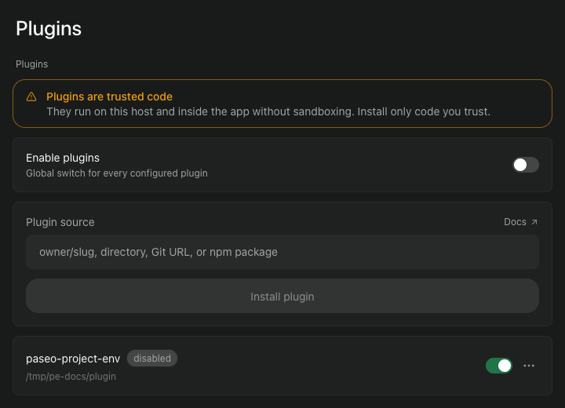
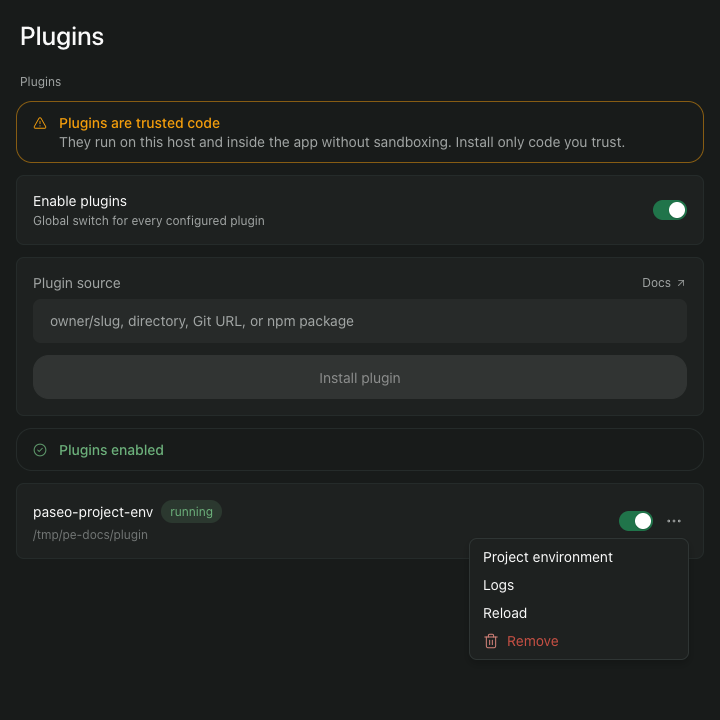

# Install

You need a Mac that runs Paseo 0.12 or later. The plugin works only with Paseo running on your own Mac. Check the version in a terminal:

```
paseo --version
```

## 1. Install the plugin

In a terminal:

```
paseo plugin add \
  git:iamcxa/kc-paseo-plugins:project-env
```

Or paste `git:iamcxa/kc-paseo-plugins:project-env` into **Plugin source** under **Settings**, **Plugins** and choose **Install plugin**.

The command prints that plugin code runs on your Mac without a sandbox, so install only code you trust. The plugin appears in the list as `paseo-project-env`.

## 2. Turn plugins on

Plugins are off until you turn them on, and the switch covers every plugin on this Paseo. A plugin you have installed reads `disabled` until you do.

Open Paseo, then **Settings**, then **Plugins**, and turn on **Enable plugins**. The plugin then reads `running`.

*Click or tap a picture to see it full size.*

[](img/01-enable-plugins.png)

## 3. Install the 1Password CLI

The plugin reads 1Password through the `op` command. You also need the [1Password app for Mac](https://1password.com/downloads/mac) and a 1Password account, on macOS Big Sur 11.0.0 or later, as [1Password's CLI page](https://www.1password.dev/cli/get-started/) asks. The plugin itself needs no sign-in to `op`, because it gives `op` a service account token each time it reads. You sign in as yourself for the next page, where you create a vault and a service account with your own account.

### 3a. Install the command

If you do not have Homebrew, install it first from [brew.sh](https://brew.sh). Then in a terminal:

```
brew install 1password-cli
```

Check it. It prints a version number such as `2.41.1`:

```
op --version
```

### 3b. Turn on the app integration

Open and unlock the 1Password app, select your account at the top of the sidebar, choose **Settings**, then **Developer**, and turn on **Integrate with 1Password CLI**.

### 3c. Check you are signed in

```
op vault list
```

1Password asks you to approve the request. Once you do, the command prints your vaults, and you are signed in.

## 4. Open the plugin's settings

In **Settings**, **Plugins**, open the plugin's actions menu (the three dots) and choose **Project environment**.

[](img/02-actions-menu.png)

## Next

Nothing is connected yet. Go on to [prepare 1Password](prepare-1password.md): the repository is added there, once the service account exists.
