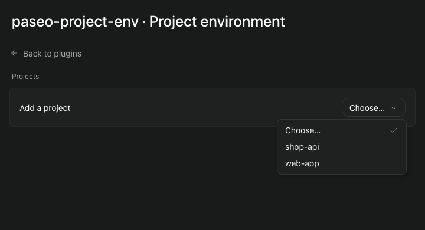
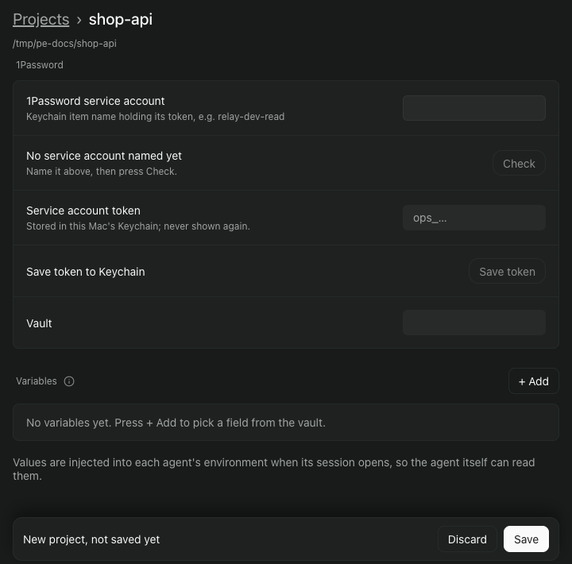
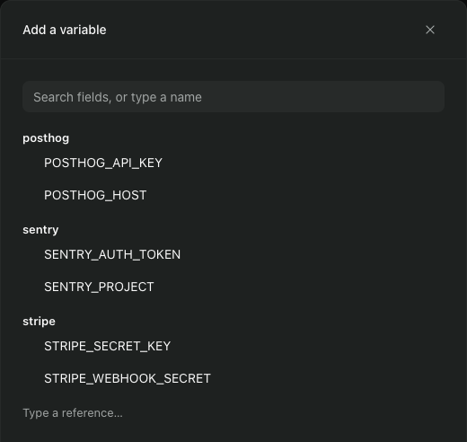
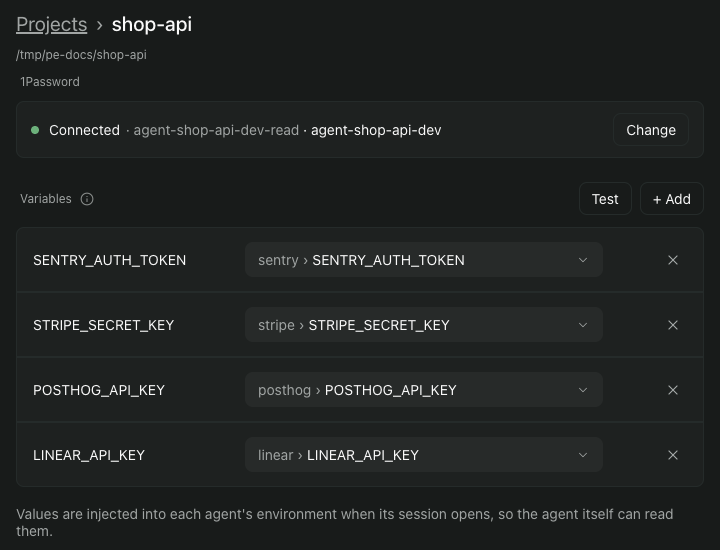
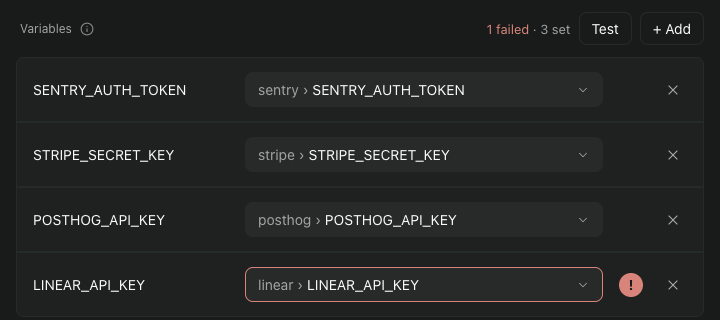

# Prepare 1Password

You make three things in 1Password: a vault that holds only what this repository's agents need, the secrets in it, and a read-only service account that can see that vault and nothing else. Then you connect them to the repository in Paseo.

Do this once per repository and environment. Names here follow a recommended convention. Nothing checks them, and you can name things differently.

You need the 1Password CLI, signed in as yourself, from [Install](install.md) step 3, and an account that is allowed to create vaults and service accounts. If you do not see the option to create service accounts, [1Password says](https://www.1password.dev/service-accounts/get-started/) to ask your administrator to give you access.

## 1. Create a vault

Name it `agent-<project>-<env>`, for example `agent-shop-api-dev`. A shared prefix keeps the vaults agents read together in 1Password's alphabetical list.

In the 1Password app, click the plus button in the sidebar, enter the name and choose **Create**. Or in a terminal, signed in to `op` as yourself:

```
op vault create agent-shop-api-dev
```

Put only what this repository's agents need in this vault. Every secret in it is readable by the service account, and so by anything that holds the token.

## 2. Put each secret in the vault

Make one **Secure Note** per service, in that vault.

- **Item title:** the service name, lowercase, words joined by hyphens, for example `stripe`. No project prefix: the vault name carries the project.
- **A secret:** a field of type **Password**, for example `STRIPE_SECRET_KEY`.
- **A setting that is not secret:** a field of type text, for example `STRIPE_ACCOUNT`.
- **Field label:** the environment variable name the agent should receive, for example `STRIPE_SECRET_KEY`.

Keep the note body empty, put no field inside a section, and use no `/` in a label. When a label equals the variable name, the plugin's field picker suggests that field, so you do not have to choose.

To add a field, open the item, choose **Edit**, then **Add More**, pick **Password**, rename the field, and choose **Save**.

## 3. Create a read-only service account with an expiry

1Password's website steps for a service account do not offer an expiry. The command line does. In a terminal, signed in to `op` as yourself:

```
op service-account create \
  agent-shop-api-dev-read \
  --expires-in 30d \
  --vault agent-shop-api-dev:read_items \
  --raw | pbcopy
```

- `--vault agent-shop-api-dev:read_items` gives read access to that one vault. A service account cannot be changed after it is created, so make a new one if the vault changes.
- `--expires-in` takes seconds, minutes, hours, days or weeks, such as `12h` or `30d`. When the account expires, agents start with blank variables until you create a new one and paste its token again.
- `--raw` prints only the token and `pbcopy` puts it on your clipboard instead of the screen. 1Password shows a token once.

Paste the token into a new item in a vault only you read, titled with the service account's name, so you can find it again. Then copy something else to clear the clipboard.

## 4. Connect the repository in Paseo

Open **Settings**, **Plugins**, the plugin's actions menu (the three dots), then **Project environment**. The repository must already be a project in Paseo; if the list is empty, add the folder from the sidebar's **Add project** first.

Under **Add a project**, open the menu and choose your repository.

*Click or tap a picture to see it full size.*

[](img/03-add-project.png)

A new project shows fields for the service account, its token and the vault.

[](img/04-connect-1password.png)

### 4a. Name the account and save the token

In **1Password service account**, type the service account's name, `agent-shop-api-dev-read`, and choose **Check**. It reads "No token in Keychain" until you save one, which is expected. That name is also the name of the Keychain item that holds the token.

Paste the token into **Service account token** and choose **Save token**. The plugin stores it in your login Keychain, and only after 1Password accepts it. The three fields then shrink to one line that starts with "Connected" and names the service account and the vault.

When the service account can read only one vault, the plugin picks it for you. If the **Vault** field is still there, choose `agent-shop-api-dev`.

### 4b. Add the variables

Choose **+ Add**, then pick a field from the vault. The variable is named after the field's label. Repeat for each variable.

[](img/05-field-picker.png)

The connected project then lists each variable and the field behind it.

[](img/06-variables.png)

### 4c. Test and save

Choose **Test**. The summary reads "All 1 set" when every variable can be read, or like "1 failed · 3 set" when one cannot, and a row that cannot be read shows a red "!" that gives the reason.

[](img/07-test-result.png)

Choose **Save**.

Agents you start in this repository from now on get the variables. An agent that was already running keeps the environment it started with.

To check, start a new agent in the repository and ask whether `STRIPE_SECRET_KEY` is set. It can tell you it is set. It will not show the value, because the plugin tells every agent not to print one.

If a row fails, see [When a variable is blank](../../reference.md#when-a-variable-is-blank).

## Done

Setup is complete. For how it works and what it does not protect against, read the [Introduction](index.md) and the [Reference](../../reference.md).
