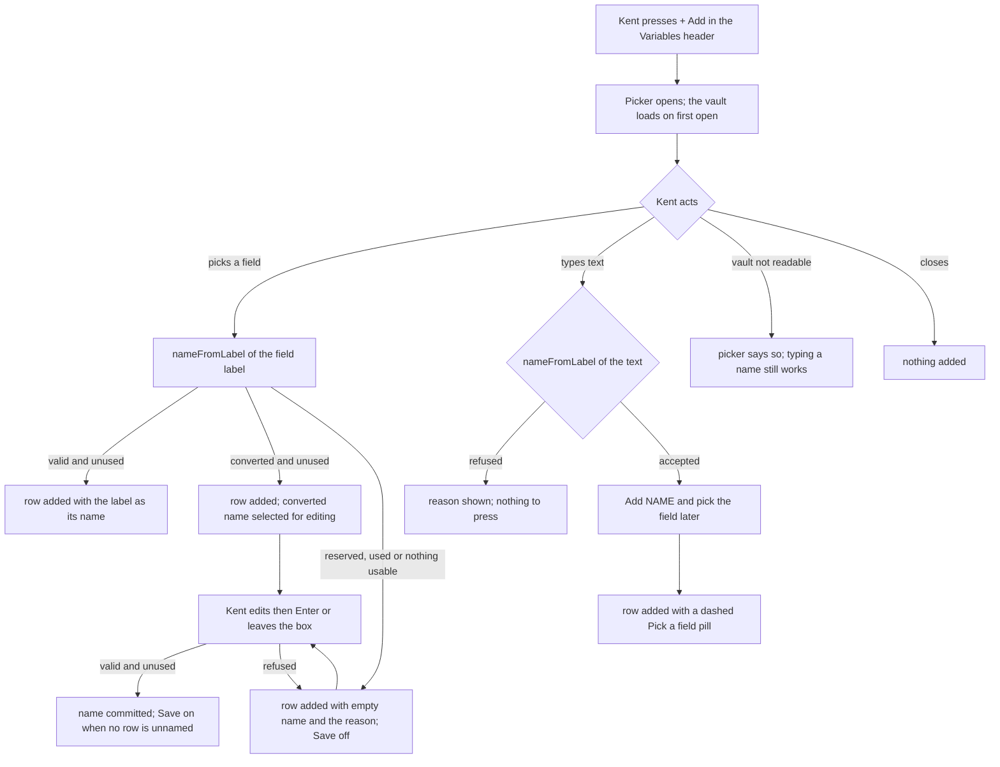

---
id:
title: Add opens the field picker and names the variable from the field
status: implementation
variant: kc-dev-flow-2
profile: pilot
merge: pr
worktree: .worktrees/spacedock-ensign-project-env-add-variable-one-step
pr:
gates:
    version: 1
    records:
        - id: gate:project-env-add-variable-one-step:backlog
          stage: backlog
          attempts:
            - id: gate-attempt:project-env-add-variable-one-step-backlog-1
              briefing:
                id: briefing:project-env-add-variable-one-step:backlog:attempt-1:revision-1
                digest: sha256:56a8cabfdc21525ca19ff247496c689f70f98c6630aa46578291d32eba570d87
                room-ref: ./project-env-add-variable-one-step/review/backlog/briefing-1
              resolution:
                type: Resolution
                id: resolution:spacedock:project-env-add-variable-one-step:backlog:1
                briefing: briefing:project-env-add-variable-one-step:backlog:attempt-1:revision-1
                by: person:captain
                at: "2026-10-22T04:15:11.024862Z"
                decision: approve
                reason: 'Captain 2026-10-22: 「准」 — accepts this A5 settings-screen rework task''s outcome, scope and acceptance criteria on the pilot profile, into ideation.'
              application:
                target-stage: ideation
                state: consumed
        - id: gate:project-env-add-variable-one-step:ideation
          stage: ideation
          attempts:
            - id: gate-attempt:project-env-add-variable-one-step-ideation-1
              briefing:
                id: briefing:project-env-add-variable-one-step:ideation:attempt-1:revision-1
                digest: sha256:a3b34b880ea7ed84c15215e89a733de1007b8635f2cc77bba1a81b7d7d683756
                room-ref: ./project-env-add-variable-one-step/review/ideation/briefing-1
              resolution:
                type: Resolution
                id: resolution:spacedock:project-env-add-variable-one-step:ideation:1
                briefing: briefing:project-env-add-variable-one-step:ideation:attempt-1:revision-1
                by: person:captain
                at: "2026-10-22T07:45:08.127665Z"
                decision: approve
                reason: 'Captain 2026-10-22: 「准」 — accepts this A5 rework design and its acceptance criteria into implementation, including the recommendation stated in this gate''s question.'
              application:
                target-stage: implementation
                state: consumed
started: 2026-10-22T04:16:46Z
---

Settings-screen rework of release r1.5 of the project-env plugin. Design reference: the design-director review (ux-review-r1.5/index.html) and direction A5 (ux-review-r1.5/direction-a5.html, shots/a5-*.png) in the state checkout; Captain approved A5 on 2026-10-22 (「就這樣」) after 「這個 UX 完全不行」, and the Add flow on 2026-10-22 (「可以」).

## Scope

In: "+ Add" in the Variables header opens the field picker; picking a field adds a row named from the field label (kept when it is a valid unused name; converted to upper snake case and selected for editing otherwise; left empty with the reason when it is reserved or already used); the picker also offers "add with this name, pick the field later" from its search text. The old name row and Add row are removed (review finding 5; Captain 「可以」 2026-10-22). Depends on: project-env-field-picker-grouped. Stop condition: the acceptance criteria pass.

## Acceptance criteria

**AC-1**: Picking a field from Add creates a row named from its label, or converted, or empty with a reason for a reserved or used name.
Verified by: `project-env/test/name-from-label.test.ts` (new), a table of labels against the project's names. Kept: `STRIPE_SECRET_KEY`, `api_key`, `apiKey`, `path`, a label with spaces around it. Converted: `secret-key` to `SECRET_KEY`, `Publishable key` to `PUBLISHABLE_KEY`, `2fa code` to `_2FA_CODE`. Refused with the `refusal` reason and an empty name: `PATH`, `LD_PRELOAD`, a label that converts to a reserved name (`dyld insert`, `op service account token`), a used label and one that converts to a used name (`sentry auth token`), and a label with no letters or digits (`密碼`, empty). It fails if the conversion is dropped, if the reserved and used check runs before conversion, or if a reserved or used candidate is returned instead of refused; the 20 cases pass on the spike copy (`spike/name-from-label.test.ts`, 2026-10-22). Plus pictures 03 to 06 and 15 (desktop and 400 px) taken again on the implemented build on an isolated Paseo: a kept name with no input, a converted name selected, a reserved and a used label left empty with the reason, and the new row in view in a 12-variable project.

**AC-2**: Add can create a named row with no field yet, which shows "Pick a field".
Verified by: on an isolated Paseo, type a name in the picker's search box and press "Add NAME and pick the field later": a screenshot shows the row with the dashed "Pick a field" pill (picture 09). Save is not blocked by it: pressing Save wrote `{"name":"NEW_API_KEY","ref":""}` to the plugin's settings file on the spike (2026-10-22, project `work-empty`). Test on that row reports "field not found in the vault" (`readVariable` returns `missing-field` when `parseRef` fails; read from the code, to be run on the implemented build). It fails if the row is dropped, blocks Save, or is red before Test.

## FO alignment

Surfaces: ui
Visible change: Add opens the field picker and names the new variable from the picked field.
Direction alignment with the Captain: done — the Captain chose direction A5 and the Add flow on 2026-10-22.
Result: direction A5 (ux-review-r1.5/direction-a5.html); every ui gate shows the Captain screenshots of the screen.
Release review: not needed: a rework of the r1.5 settings screen the Captain ruled on 2026-10-22; it adds no journey story.

## Design

### PRFAQ

**Press release.** Kent presses "+ Add" in the Variables header and the field picker opens. He picks the field, and a row appears already named from it: pick `STRIPE_WEBHOOK_SECRET` and the row is `STRIPE_WEBHOOK_SECRET`. The name row, the Add row and the red "No field picked" row are gone. If he has no field yet, he types a name in the picker's search box and adds it with "Pick a field" left for later.

**FAQ.**
- *What did the Captain decide?* Direction A5 (「就這樣」) and the Add flow (「可以」), both 2026-10-22: Add opens the picker and the name comes from the field (review finding 5).
- *What name does a picked field give?* One rule, `nameFromLabel(label, existing)` in `project-env/shared/config.ts`, built on the `refusal` that Add already uses. Trim the label. A label that is already a valid name is kept as written (`api_key` stays `api_key`; names are case-sensitive, as today). Any other label becomes upper snake case: runs of characters outside letters and digits become one `_`, ends are trimmed, letters are upper-cased, a leading digit gets a `_` in front (`secret-key` becomes `SECRET_KEY`, `2fa code` becomes `_2FA_CODE`), and the row opens with the name selected for editing. Then the candidate is checked with `refusal`: if the kept or converted name is reserved (ADR 0004) or already in the project, or nothing usable is left (`密碼`), the row is added with an empty name and the reason under it. Precedence: a label whose converted form is reserved or used is refused, not converted around.
- *Why is keeping the label the common path?* ADR 0005 lays out one Secure Note per service with the field label equal to the variable name.
- *What does the row with an empty name do?* It is an input with the reason in red under it. Save stays off with "Name N variables first" while any row has no name; Test sends only named rows. Typing a valid unused name and pressing Enter, or leaving the box, names the row. The remove cross works at any time and is the only way back.
- *What does "pick the field later" save?* A row with a name and no field. It is not blocked from Save: the settings schema already accepts an empty reference (`newVariable`), and a saved row with no field reads "field not found in the vault" at Test and at session open (`readVariable` in `server/secrets.ts` returns `missing-field` when `parseRef` fails; ADR 0002: blanked and shown). Before Test it shows no red mark: the dashed pill says what is missing, which answers review finding 5.
- *What if the vault cannot be read (no token, no vault chosen)?* "+ Add" still opens the picker. It says the vault is not connected and the search box still turns typed text into "Add NAME and pick the field later" (picture 12).
- *Can a name be changed after it is committed?* No, see the decision below.
- *Does Import change?* No. It still appends names with no field and skips reserved names.

### What changes (read from `project-env/` on main at 1adf630, 2026-10-22)

Today the Variables card ends with a "New variable name" input, an "Add" action that appends `newVariable(name)` and a "Browse vault" action; `nameRefusal` gates Add. After this task the card has the rows and the Import action; the input, the Add action and `newName`, `nameInput` and `nameRefusal` are removed (Browse vault belongs to project-env-field-pill-one-control). Rows are addressed by position, because a row's name can be empty while it is being named. `variableLine` no longer reads "No field picked" in red for an empty reference.

**Existing-code check.** Boundary: the add path in `client/settings-screen.tsx` and the name predicates in `shared/config.ts`. Searched 2026-10-22: `grep -rn 'newVariable\|refusal(' project-env` (config.ts, settings-screen.tsx, `test/variable-name.test.ts`). Completeness: `refusal` already gives the one reserved, used and shape message each, tested in `test/variable-name.test.ts`; `newVariable` already makes the empty-reference row that the schema accepts. Decision: reuse both unchanged, add only `nameFromLabel` (the conversion and the precedence), the naming state in the row, and the add mode of the picker. No second reserved list, no schema change.

### Interfaces named, not designed

- **project-env-field-picker-grouped** (the picker): an add mode with no owning variable. `onPick({ ref, item, label })`; `onAddByName(text)`, offered first under the search box when text is typed, drawn as a plain row with the converted name in it, or the refusal reason as plain text when refused; `fieldNote(field)`, a short muted note after a field label in add mode ("reserved name", "name already used"), where the picker's own "used by" mark wins when both apply, so a field carries one note; the search box and the add-by-name row stay usable while the vault is loading or unavailable, and a picker opened while the connection check is still running loads the vault when the check finishes (the preview loads only at open; picture 15 first drew "not connected" for that reason). Without a variable name there is no "Suggested" group.
- **project-env-field-pill-one-control** (the row): the name cell can be text or an input, with an error line under it; the dashed "Pick a field" pill; the pill opens the picker in row mode; at 400 px the name and the cross share the first line and the pill takes the second (A5 `a5-400.png`).
- **project-env-test-summary-failure-mark** (header and marks): the header's trailing slot reads summary, Test, "+ Add" (A5); this task adds the "+ Add" button. Test sends only named rows. A row with no field shows no mark before Test, as the A5 mock shows after it; whether it counts as failed after Test is that task's.
- **project-env-save-footer-danger-zone** (Save): Save is disabled while any row has an empty name, with the note "Name N variables first". An added row is one unsaved change; naming it is not another.
- **project-env-draft-survives-remount** (draft store): the stored draft may hold a row with an empty name. The naming focus, the reason text and the scroll-to-row are not stored; after a remount an unnamed row reads "Name this variable".

### Decision for the Captain

**Can a variable's name be edited after it is committed?** Recommendation: no, not in this task. The Captain's words give an editable name only to a converted or refused name at the moment of Add; a general rename adds an edit path for saved variables, where a rename changes what agents receive. What gets worse: a kept name Kent dislikes (`Publishable key` kept as written when it is already valid) is fixed by Remove and Add again. Past rulings checked: ADRs 0004 and 0005 name no rename behaviour; `git -C docs/dev2/.spacedock-state grep -n 'Override:'` finds only archived prose about other areas.

### UI proposal

UI proposal: The Variables header gets a "+ Add" button beside Test; it opens the field picker (a dialog on desktop, a bottom sheet at 400 px) whose search box also accepts a name; picking a field adds a row named from the field label (kept when it is a valid unused name; converted to upper snake case with the name selected for editing otherwise; left empty with the reason when reserved or already used); typing text in the search box offers "Add NAME and pick the field later", which adds a row whose pill reads "Pick a field"; the separate "New variable name" and "Add" rows are gone, and Save stays off with "Name N variables first" while a row has no name.

Preview: project-env-add-variable-one-step/design/preview-desktop-dark-09-name-only-row.png

The main picture is the one above. The proposed design is the set `design/preview-desktop-dark-*.png` (1280 px) and `design/preview-compact-dark-*.png` (400 px), numbered alike, whole settings page each, taken from Paseo's real web client running a disposable build of main at 1adf630 plus `spike/preview-client.diff` and `spike/preview-shared.diff`, under the throwaway plugin id `pe-add-step` on an isolated daemon (own home, port 6897) with the fake `op`, `security` and `git` from `project-env/test/fakes`; no real token, Keychain item or 1Password was touched. It is operable while the daemon is up: `http://127.0.0.1:6897`, Settings, Plugins, Project environment. Disposable: the daemon, plugin and `/tmp/pe-add-step` are removed at the end of ideation. Pictures: 01 the page before Add; 02 picker open; 03 a kept name; 04 a converted name selected for editing; 05 a reserved label; 06 a used label; 07 typed text offering a name; 08 typed text refused; 09 the name-only row with a dashed pill; 10 an empty project; 11 its picker; 12 the picker with no vault connection; 13 a project of 12 variables with a 54-character name; 14 typed symbols only; 15 a new row scrolled into view in that project.

What the previews are not: the rows, pills, header Test button and the grouped list in the picker are stand-ins for the sibling tasks' designs, drawn so the Add flow can be seen on the whole page; the Add flow, the naming states and the Save note are this task's. Dark theme only.

### Design review

Design review: design/ideation-2.yaml

Round 1 (`design/ideation-1.yaml`, pictures 01 to 12) listed two MAJOR findings, both fixed before round 2: fields that would be refused were not marked in the picker (now marked, picture 02), and nothing said whether a row with no field blocks Save (stated in the FAQ and AC-2). Round 2 (`design/ideation-2.yaml`, pictures 01 to 15) is the last report; it repeated the second finding, so Save now says it (below). The review limit of two runs is reached: the Save note and the picker tags were redrawn after round 2 and were not reviewed again.

Design finding 1: fixed: under "Save this project" a note now reads "N without a field will read failed until you pick one" when no row is unnamed (pictures 09 and 15, both sizes), and the FAQ and AC-2 state that Save is not blocked.
Design finding 2: declined: the count belongs to the sticky save footer of project-env-save-footer-danger-zone, which stays in view (A5); scrolling to the first unnamed row is that task's.
Design finding 3: fixed: the picker tags now read "reserved; you name it" and "name in use; you name it" (pictures 02, both sizes).
Design finding 4: declined: the sentence is the existing `refusal` text (ADR 0004, `test/variable-name.test.ts`); this task adds no new wording.
Design finding 5: declined: A5 puts "+ Add" in the Variables header; project-env-connection-collapse shortens the card above it.
Design finding 6: declined: row layout and alignment belong to project-env-field-pill-one-control; the rows in the previews are stand-ins.
Design finding 7: declined: the header buttons use the A5 mock's button size, and the header's content belongs to project-env-test-summary-failure-mark.
Design finding 8: declined: a 44 px hit area adds no visible change; implementation sets it on the header buttons and the row cross.
Design finding 9: declined: the ring is the host input's own focus style, which the previews do not change.
Design finding 10: declined: loading, long lists and long field labels belong to project-env-field-picker-grouped; this task requires only that the search box and the add row work while the vault loads (Interfaces).
Design finding 11: declined: the Captain's A5 pictures are dark at 1280 and 400 px, which these match; the red uses `theme.colors.statusDanger`, so light follows the host.

### Spike notes

Machine dependencies, declared: Paseo.app 0.12.0 CLI at `/Users/kent/.local/bin/paseo` and its `app-dist` web client, Node 24, `agent-browser`, python3. Run (2026-10-22): `S=/tmp/pe-add-step`; copy `client/`, `shared/`, `server/`, `index.client.tsx`, `package.json`, `tsconfig.json` from `project-env/` into `$S/plugin`, apply `spike/preview-client.diff` and `spike/preview-shared.diff`, put `test/fakes/*` in `$S/plugin/server/fakes` (the plugin loader rejects modules outside `client/`, `server/` and `shared/`), `spike/spike-world.ts` beside them (it is `test/world.ts` with the fakes path hardcoded, because `import.meta.dirname` is undefined at runtime) and `spike/index.server.ts` as the server entry; `spike/home-config.json` is the daemon config; `spike/fx.py` writes the project fixtures (names and references only); `spike/lib.sh`, `flow.sh`, `flow2.sh`, `flow3.sh` drive the browser and take the pictures. Facts learned: a full-page screenshot resizes the window and the host remounts the screen, dropping the editor (the review's finding 3), so the pictures use a tall window; `paseo plugin reload pe-add-step` is needed after a client edit.

## Stage Report: ideation

- DONE: Design the change your Scope names inside direction A5, with each acceptance criterion kept and given a reproducible evidence clause.
  `## Design`: Add in the Variables header opens the picker; one rule `nameFromLabel` (kept, converted and selected, or empty with the reason; converted-to-reserved or used is refused); name-only add from the search box; Save off while a row is unnamed. AC-1 and AC-2 wording unchanged, each `Verified by` now carries steps and a falsifier. Existing-code check recorded (reuses `refusal`, `newVariable`).
- DONE: Produce the artifact the ui surface owes: whole-page previews from a running build at desktop and 400 px, plus the design review, with each finding dispositioned.
  `UI proposal:` and `Preview:` lines; 30 whole-page pictures `design/preview-{desktop,compact}-dark-01..15` from the real web client on an isolated Paseo 0.12.0 (own home, port 6897, plugin id `pe-add-step`, fake op/security/git). Review `design/ideation-2.yaml` (round 1 in `ideation-1.yaml`): 11 findings, 2 fixed, 9 declined. Checker: `design_surfaces.py check` printed "design surfaces presentable" and "11 findings, 2 fixed, 0 criteria, 9 declined, 0 decisions".
- DONE: Name every interface you need from a sibling rework task, and any decision the Captain must make (at most one), with a recommendation.
  `### Interfaces named, not designed` covers field-picker-grouped, field-pill-one-control, test-summary-failure-mark, save-footer-danger-zone, draft-survives-remount. One Captain decision: may a name be edited after it is committed? Recommendation: no, in this task.
- DONE: AC-1 (picking a field creates a row named from its label, converted, or empty with a reason). Not yet verified in code.
  Current evidence: the naming rule runs in `spike/name-from-label.test.ts`, 20 cases pass (kept, converted, reserved, used, converted-to-reserved, no letters); pictures 03 to 06 and 15 show each outcome on the real client. It fails if conversion is dropped or the check runs before conversion.
- DONE: AC-2 (Add can create a named row with no field yet, showing "Pick a field"). Not yet verified in code.
  Current evidence: picture 09 and 13 to 15 show the dashed pill; on the spike, Save wrote `{"name":"NEW_API_KEY","ref":""}` to the settings file. Test on that row reporting "field not found" is read from `readVariable`, not run.

### Summary

Add opens the picker and the row is named from the field by one pure rule built on `refusal`; the empty-name row is a client state that blocks Save, so no schema change is needed. Review round 2 repeated one MAJOR (what Save does with a no-field row); I added a Save note and tag text after round 2 and did not re-review (limit of two reached). The one Captain decision is whether names can be renamed after commit.

### Unverified and limits

- Rows, pills, the header Test button and the grouped list in the previews are stand-ins for sibling designs; only the Add flow, naming states and Save note are this task's. Dark theme only; light, 768 px and the on-screen keyboard are not drawn.
- The preview opens the picker before the connection check finishes and then never loads the vault; the picker's contract (Interfaces) requires loading when the check finishes. Not built in the preview.
- The `preview:` field of both review files was corrected from `design/...` to `project-env-add-variable-one-step/design/...` after the review, because my brief gave the checker's wrong path; no finding was edited.
- Machine dependencies: Paseo.app 0.12.0 CLI and `app-dist`, Node 24, `agent-browser`, python3; scripts hardcode `/tmp/pe-add-step` and port 6897. Teardown: daemon stopped, browser session closed, `/tmp/pe-add-step` removed; Kent's live `paseo-project-env` plugin and `~/.paseo` were not touched (listed only). No secret was read and no op or security command was run outside the fakes.
