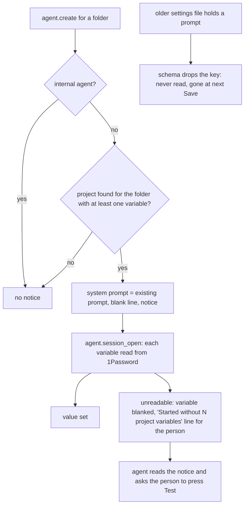

---
id:
title: Every agent that receives project variables is told where they come from and what to do when one is blank
status: ideation
variant: kc-dev-flow-2
profile: pilot
merge: pr
worktree:
pr:
gates:
    version: 1
    records:
        - id: gate:project-env-built-in-agent-notice:backlog
          stage: backlog
          attempts:
            - id: gate-attempt:project-env-built-in-agent-notice-backlog-1
              briefing:
                id: briefing:project-env-built-in-agent-notice:backlog:attempt-1:revision-1
                digest: sha256:e1171d167ab3d52f6cbdd32b5badef6997ca4afdc5a5891b94dc0af70cadc40a
                room-ref: ./project-env-built-in-agent-notice/review/backlog/briefing-1
              resolution:
                type: Resolution
                id: resolution:spacedock:project-env-built-in-agent-notice:backlog:1
                briefing: briefing:project-env-built-in-agent-notice:backlog:attempt-1:revision-1
                by: person:captain
                at: "2026-10-24T01:15:35.218834Z"
                decision: approve
                reason: 'Captain 2026-10-24: 「開，但是是否不需要列出有哪些金鑰？」 — approves opening the task; his question on variable names is answered by FO''s recommendation (do not list them) in Scope and confirmed at the ideation gate.'
              application:
                target-stage: ideation
                state: consumed
started: 2026-10-25T13:53:45Z
---

From the Captain's UAT discussion on 2026-10-24. He found the default-prompt box 「稍嫌多餘」 but liked using it to tell agents 「這個 repo 的金鑰都已經在環境變數裡，不要叫使用者貼 token，也不要把值印出來」, and asked whether a default like that should also 「讓agent 知道有這個套件存在，有問題可以知道排查方向，例如讀取套件文件」. He approved opening the task with 「開」, and asked 「是否不需要列出有哪些金鑰？」; the FO recommends not listing them, and he confirms at the ideation gate.

## Scope

In: when project-env injects variables into a new agent, the plugin adds a fixed notice ahead of the project's own prompt. The notice says the session's environment variables come from the Paseo project-env plugin's 1Password mapping; that the agent must not ask the user to paste a token or print, log or commit a value; and that a blank variable means it did not resolve, with the steps to find out why (Paseo settings, Plugins, Project environment, Test) and where the plugin's troubleshooting notes are. It names no variable. A short troubleshooting document for people and agents (`project-env/OVERVIEW.md`, today an empty template) explains where variables come from, why one can be blank (vault changed, field missing, token rejected, reference outside the saved vault) and how Test shows the reason. The default-prompt box stays for the project's own instructions. Out: listing variable names or values; changing which variables are injected. Stop condition: the acceptance criteria pass. Runs after project-env-vault-change-repoints-refs, since both touch what an agent receives at session open.

## Acceptance criteria

**AC-1**: A new agent in a project with at least one injected variable receives the notice in its system prompt, ahead of the project's prompt, and the notice contains no variable name or value; a project with no variables adds no notice.
Verified by: a unit test on the agent.create hook output for both cases that fails when the notice is dropped or a name appears in it; a runtime check on an isolated Paseo reading the created agent's system prompt.

**AC-2**: The troubleshooting document explains each blank-variable cause the screen's Test can report and how to see it.
Verified by: a reviewer ticks each cause in shared/cause.ts against the document.

**AC-3**: (Captain amendment 1, 「拿掉避免誤會」, 2026-10-25) The project settings screen has no default-prompt box, and a prompt left in an older settings file is never sent to an agent and is gone from the file after the next Save.
Verified by: whole-page pictures from a running build at 1280 and 400 px of a project whose file holds a saved prompt show no box and none of its text (`shots/cand-1280-legacy.png`, `shots/cand-400-page-legacy.png`); `evidence/harness/notice-check.sh` on that project shows a system prompt that is only the notice; after Save in the screen the project has no `prompt` key (`evidence/legacy-prompt-save.txt`); a unit test, "never carries a prompt left in an older settings file", fails when the prompt is read again.

## FO alignment

Surfaces: ui
Visible change: Agents in a configured project are told where their variables come from and how to check a blank one; the plugin gets a troubleshooting page.
Direction alignment with the Captain: done — he approved opening the task on 2026-10-24 (「開」); the no-names choice is confirmed at the ideation gate.
Result: this task's Scope; the ideation gate shows the notice text and the document.
Release review: not needed: a small addition to what the r1 injection already does; it adds no journey story.
Map footprints: not needed: no journey story or open map question is attached to this task.

## Captain amendments

### Amendment 1 — 2026-10-25, chat
Captain: 「拿掉避免誤會」 (FO chat, 2026-10-25)
Asked: "**One decision for you:** I recommend removing the prompt box in that next task, so only the built-in notice remains. Neither project uses the box. The cost: if a project someday needs its own instructions, there's no place to put them, and we'd have to add the box back. Reply 「拿掉」 to remove it, or 「保留」 to keep it."
Supersedes: none
Design: Scope sentence "The default-prompt box stays for the project's own instructions."

## Design

### PRFAQ

**Headline.** Every new agent in a project that injects variables is told, in one fixed notice, where those variables come from and what to do when one is blank; the settings screen loses its default-prompt box, so the notice is the only text project-env adds to an agent.

**Who and why.** The Captain and any teammate whose agents receive 1Password values. From his UAT of 2026-10-24 the Captain wants agents to know the package exists, not to ask people to paste a token or print a value, and to know where to look when a variable is blank. He asked 「是否不需要列出有哪些金鑰？」 and, on 2026-10-25, ruled 「拿掉避免誤會」 on removing the box.

**FAQ.**
- *What does the notice say?* The text below, which is what a created agent holds as its system prompt (`evidence/agent-notice-as-received.txt`, read from the saved agent record of an isolated Paseo). It names no variable and carries no value, so FO's recommendation (do not list names) holds; the Captain confirms it at this gate.
- *When is it added?* In the `agent.create` hook, when the project found for the agent's folder has at least one variable, and the agent is not internal. The condition is one predicate, `hasVariables`, used by both `agent.create` and `agent.session_open`, so the notice and the injection cannot drift apart. A project with no variable, a folder in no project, and an internal agent get no notice.
- *Where does it go?* After any system prompt the request already carries, separated by a blank line; for an agent that had none it is the whole system prompt. Paseo's Claude provider appends a system prompt to its own preset (`append:` in the provider's `buildOptions`, read from the installed Paseo.app on 2026-10-25), so it does not replace Claude's instructions; the Codex provider joins it into developer instructions.
- *What happens to a prompt saved earlier?* It is no longer sent. The `prompt` field leaves the project schema, so a settings file that still holds one loads normally (zod strips the unknown key), the text is never read, and the key is gone from the file at the next Save of any project (`evidence/legacy-prompt-save.txt`). The screen shows no cue for it. This is the one Captain decision below.
- *What changed on the screen?* The "Default prompt for new agents" heading and box are gone. The Danger zone hint now reads "Deletes its variables now, without Save. The Keychain token stays." and the Stop managing confirmation drops "and default prompt". Nothing else.
- *Where are the troubleshooting notes?* `project-env/OVERVIEW.md` (draft: `design/OVERVIEW.draft.md`), which the package already ships (`files` in `package.json`). The notice names the file, not a path: Paseo's loader gives a plugin no `import.meta.url` (tried on 2026-10-25, the plugin failed to load: "Invalid URL") and no plugin folder, and an npm-installed plugin lives under an install root whose layout this task cannot see, so a path would be a guess.
- *Does an agent already open get it?* No. Only agents created after the plugin update; the system prompt is fixed when an agent is created.
- *What is not solved?* A person who has never read the overview has no cue on the settings screen that agents get a notice (design finding 2, upheld as intended); an agent cannot press Test, so the notice asks it to tell the user.

The notice, exactly as an agent receives it:

```
Project environment (Paseo plugin "project-env")
Some environment variables in this session were filled in by the project-env plugin from this repository's 1Password mapping. They are already set; use them as they are.
- Do not ask the user to paste a token or key, and never print, log or commit a value.
- A variable that is empty here could not be read, and the plugin blanked it on purpose. Do not guess a value or work around it. Ask the user to open Paseo Settings, Plugins, the plugin's actions menu, Project environment, edit this repository and press Test: each variable shows "set" or the reason it failed. Paseo also shows the user a "Started without N project variables" line at the start of this conversation with the same reasons.
- The plugin's troubleshooting notes (OVERVIEW.md in the project-env plugin package) list every reason and what to do.
```



Stops: the notice never lists a name or value; it is not sent to an internal agent; a saved prompt is never sent.

### Amendment 1: where it makes the original wording moot

- Scope "the plugin adds a fixed notice ahead of the project's own prompt": the project has no prompt of its own any more; the notice goes after any system prompt the request already carries, the position the project's prompt had, and nothing else is added.
- Scope "The default-prompt box stays for the project's own instructions": superseded (recorded in Captain amendments).
- AC-1 "ahead of the project's prompt": moot; read as "after any system prompt the request already carries". Its other clauses (notice present when at least one variable is injected, no name or value, none for a project without variables) stand, and both evidence clauses are kept and run (below).
- AC-2 is unchanged. AC-3 is new and comes only from the amendment.

### Existing-code capability check

Boundary: `server/contribute.ts` `agent.create` hook (works today: appends `project.prompt` only when non-empty; observed on main 7e038cd, `evidence/notice-check-main.txt`: a project with a saved prompt gets exactly that text, a project with none gets no system prompt), `shared/config.ts` `project` schema and `unsavedCount`, `client/settings-screen.tsx` (box, Danger zone text), `shared/cause.ts` `CAUSES`. Completeness: the hook works end to end; the prompt it carried had never been used in live use (both live projects hold an empty prompt, per FO's dispatch; I did not read `~/.paseo`). Bounded searches, 2026-10-25, main 7e038cd: `git grep -n "systemPrompt" -- project-env` finds only `server/contribute.ts`; `git grep -n "OVERVIEW" -- project-env` finds `package.json` `files` and the template file. Need: Captain's 2026-10-24 UAT words and amendment 1. Decision: reuse the hook and its session-open twin; replace the prompt source with a constant and one shared predicate. The disposable candidate (`evidence/candidate-disposable.diff`, a throwaway copy of main 7e038cd, never on a branch) changes 55 production lines in six files (one new, `server/agent-notice.ts`), 15 new tests and a rewritten `OVERVIEW.md`; it adds no comment line. `npm run typecheck` is clean and 302 of 302 tests pass (287 on main; `evidence/candidate-checks.txt`).

### UI proposal and preview

UI proposal: The "Default prompt for new agents" section (its heading and the multi-line box) is removed from the project settings screen and nothing replaces it. The foot note "Values are injected into each agent's environment when its session opens, so the agent itself can read them." stays directly under the Variables card. The Danger zone hint and the Stop managing confirmation drop "and default prompt". The built-in notice is not shown on the screen; its text is above.

Preview: project-env-built-in-agent-notice/shots/

Two running builds of the real plugin on isolated Paseos (own homes under `/tmp/pe-ban`, ports 6934 and 6935; fake `op` and `security`, real `git`; the A5 harness copied to `evidence/harness/` with its own plugin id, session and fixtures): `main-*` is main 7e038cd (today, context), `cand-*` the same tree with the candidate. Names read `<build>[-light]-<width>[-page]-<state>.png`; no `-page` at 1280 is a whole page at 1280 x 1400, `400` is the 400 x 900 window with the sticky bar, `400-page` the whole page at 400 px. States: `work` (three variables, nothing wrong), `mixed-after-test` (four variables after Test: one outside the vault, one with no field, one missing; "2 failed · 1 set · 1 no field"), `legacy` (older file holding a saved prompt), `stop-modal` (`cand` only, window captures). `cand-light-*` is the light theme. Not drawn: a phone keyboard, hover, a real vault.

### Design review

Design review: design/ideation-1.yaml

Design finding 1: AC-3 (the design states that a saved prompt is not sent and leaves no cue, and AC-3 tests the legacy pictures, the agent's system prompt and the file after Save; whether to show a cue instead is the Captain decision below).
Design finding 2: declined: Captain amendment 1 removes the box so the screen shows no agent text; what the plugin sends is documented in the overview, and the foot note keeps the ADR 0001 weakness statement.
Design finding 3: declined: the sticky Save bar covering the lower page at 400 px is the A5 choice and round-1 ruling R3a (do not solve) and is today's behaviour; the full-page 400 pictures show the foot note and the Danger zone intact.
Decline check: design/declines-1.yaml

Both declines were upheld (pass 1b). The review's limitation that the Stop managing dialog was not drawn is fixed: `shots/cand-1280-stop-modal.png` and `shots/cand-400-stop-modal.png` show it, with the new wording. The other limitations (hover, a real Test, a real vault) are runtime checks that no criterion needs; hover is in none.

### Needs decision

**What becomes of a prompt a project saved before this change?** Recommendation: drop it silently, as designed. Both live projects hold an empty prompt (FO's dispatch; not read by me), so no known person loses text; keeping it applied with no box would send invisible text to agents, which is the misunderstanding amendment 1 removes. What gets worse: someone with a non-empty prompt would find out only when agents stop following it, and the text is deleted from the file at their next Save. If you want a cue, say so; it adds a one-time row to the screen and a changed AC-3. Approving also accepts this recommendation and the no-names notice. Past rulings checked: ADRs 0001 to 0005 (read by the design director) name no prompt behaviour; `git -C docs/dev2/.spacedock-state grep -n 'Override:'` finds only archived prose about other areas.

### Evidence plan and honest limits

Run at ideation on the disposable candidate: AC-1 unit (the "notice a new agent receives" tests in `test/agent-notice.test.ts`; four mutations each fail at least one test: notice dropped, a name added to it, the no-variable guard removed, a cause removed from the notes) and runtime (`evidence/harness/notice-check.sh` creates an inert agent per fixture project with provider `pi`, which fails at once with no model, and reads the system prompt from the saved agent record: `evidence/notice-check-cand.txt` shows the notice, 863 characters, for the two projects with variables and none for the empty, the bare and an unconnected folder; `notice-check-main.txt` is today's contrast). AC-2: the eight sentences from `CAUSES` each appear in `design/OVERVIEW.draft.md` (the test "explain <cause> with the words the screen shows"), and a reviewer ticks each cause. Statements in the draft were each checked against code or a running build on 2026-10-25: the Logs menu holds one line per failed variable (`[project-env] <root> <name>: <cause>`); the Test summary and the red "!" are in the pictures; a locked Keychain reads as "no token" at session open because `readToken` returns null for any lookup failure. AC-3: pictures, notice-check on the legacy fixture, `legacy-prompt-save.txt`, and the unit test.

Not verified: a real Claude or Codex agent reading the notice (the inert agent shows what the daemon hands the provider; the append behaviour is read from Paseo's source); a real 1Password account; a plugin installed from npm; the notice's effect on what an agent actually does. Known limits: agents created before the update have no notice; the notice asks the agent to tell the person because an agent cannot press Test.

### Batch overlap

- project-env-vault-change-repoints-refs (validation): merged in PR #50 into the base this design starts from. It changed `client/settings-screen.tsx` and `shared/ref.ts`; this task edits other regions of the screen (the prompt section and two Danger zone sentences) and the OVERVIEW text on "vault changed" matches its merged behaviour (Change re-points references); no shared file left open.
- project-env-test-row-draft-note (backlog): edits the Test row hint in `client/settings-screen.tsx`, a different region; it starts after its own prerequisite, so no concurrent edit.
- project-env-release-1 (backlog): no file or check in common.
Recommended order: this task, then project-env-test-row-draft-note.

## Stage Report: ideation

- DONE: Design the change your Scope names as amended by Captain amendment 1 (remove the default-prompt box from the settings screen; the built-in notice is the only text project-env adds to a new agent): the notice text (no variable name or value), when it is added (only when at least one variable is injected), how a previously saved prompt is treated, and the OVERVIEW.md troubleshooting document covering every cause in shared/cause.ts; keep each acceptance criterion and give it a reproducible evidence clause, and say where amendment 1 makes a criterion's wording moot.
  Design above: notice text, `hasVariables` condition, saved prompt dropped (schema strips it), AC-1 and AC-2 kept with evidence clauses, "Amendment 1: where it makes the original wording moot" names AC-1's "ahead of the project's prompt"; AC-3 added from the amendment only.
- DONE: Produce the artifact the ui surface owes: whole-page previews from a running build at desktop and 400 px of the settings screen without the prompt box, the full notice text as an agent receives it, and the document draft, plus the design review, with each finding dispositioned.
  `shots/cand-1280-*.png`, `shots/cand-400-page-*.png` (and `main-*` contrast, light, stop dialog); `evidence/agent-notice-as-received.txt` (read from a saved agent record); `design/OVERVIEW.draft.md`; `design/ideation-1.yaml`, `design/declines-1.yaml`; 3 findings dispositioned (AC-3, two declines upheld).
- DONE: Name any decision the Captain must make (at most one), with a recommendation; not listing variable names is FO's recommendation, confirmed at this ideation gate.
  One decision, saved-prompt treatment, recommend drop silently; the no-names notice is shown for confirmation, not as a second decision.

### Acceptance criteria, current evidence

- AC-1: unit part run and passing on a throwaway copy (`test/agent-notice.test.ts`, 302 of 302; each of 4 mutations (notice dropped, a name added, guard removed, a cause renamed in the notes) fails at least one test); runtime part run: `evidence/notice-check-cand.txt` (notice in the two variable projects, none in the empty, bare and unconnected ones). Not run: a real Claude or Codex agent.
- AC-2: all 8 `CAUSES` sentences are in `design/OVERVIEW.draft.md` (8 generated tests, one fails when a heading is renamed); reviewer tick not yet done.
- AC-3: pictures drawn (`shots/cand-1280-legacy.png`, `shots/cand-400-page-legacy.png`); `notice-check-cand.txt` legacy fixture sends the notice only; `evidence/legacy-prompt-save.txt` shows the key gone after Save; unit test passes. The implementation PR must repeat these on the real branch.

### Design surfaces check

`python3 <package>/scripts/design_surfaces.py check <task>` exit 0: "design surfaces presentable; 3 findings, 0 fixed, 1 criteria, 2 declined, 0 decisions; decline check 2 upheld, 0 overruled".

### Summary

The notice is a fixed 4-line text added in `agent.create` after any existing system prompt, only for a non-internal agent in a project with at least one variable; a saved prompt is dropped by the schema and never sent. The OVERVIEW draft covers all eight causes and where to see each. The disposable candidate (throwaway copy of main 7e038cd, 302 tests, typecheck clean) is evidence only; evidence folders hold the harness under `evidence/harness/`, which cleans up with `teardown.sh`. The one decision for the Captain is what becomes of a prompt saved earlier.
