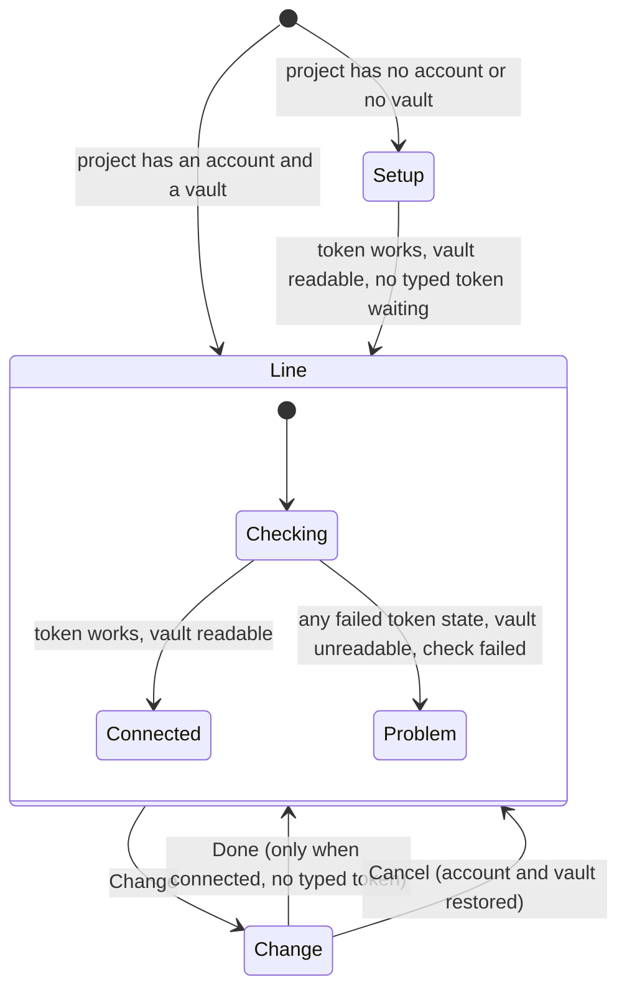

---
id:
title: The 1Password connection collapses to one line once the token works
status: ideation
variant: kc-dev-flow-2
profile: pilot
merge: pr
worktree:
pr:
gates:
    version: 1
    records:
        - id: gate:project-env-connection-collapse:backlog
          stage: backlog
          attempts:
            - id: gate-attempt:project-env-connection-collapse-backlog-1
              briefing:
                id: briefing:project-env-connection-collapse:backlog:attempt-1:revision-1
                digest: sha256:22ae5b236de78b8e78296e10b884c16e701657e8fe055d9a3ed903a2265d24fe
                room-ref: ./project-env-connection-collapse/review/backlog/briefing-1
              resolution:
                type: Resolution
                id: resolution:spacedock:project-env-connection-collapse:backlog:1
                briefing: briefing:project-env-connection-collapse:backlog:attempt-1:revision-1
                by: person:captain
                at: "2026-10-22T04:15:44.262945Z"
                decision: approve
                reason: 'Captain 2026-10-22: 「准」 — accepts this A5 settings-screen rework task''s outcome, scope and acceptance criteria on the pilot profile, into ideation.'
              application:
                target-stage: ideation
                state: consumed
started: 2026-10-22T04:17:06Z
---

Settings-screen rework of release r1.5 of the project-env plugin. Design reference: the design-director review (ux-review-r1.5/index.html) and direction A5 (ux-review-r1.5/direction-a5.html, shots/a5-*.png) in the state checkout; Captain approved A5 on 2026-10-22 (「就這樣」) after 「這個 UX 完全不行」, and the Add flow on 2026-10-22 (「可以」).

## Scope

In: once the token works and a vault is chosen, the connection card collapses to one line (status dot, service account, vault) with a Change button that reopens the full form (review finding 8). Stop condition: the acceptance criterion passes.

## Acceptance criteria

**AC-1**: A working connection shows as one line with Change, and Change reopens the account, token and vault controls.
Verified by: (a) unit tests in `project-env/test/connection-line.test.ts` (`cd project-env && npm test`) over `connectionLine`: connected only when the token works and the saved vault is readable; checking; one problem per failed token state; unreadable, empty or no vault; failed check; deleting the `canReadVault` line in `connectionLine` fails the unreadable-vault test (seen on the prototype, 2026-10-22); (b) whole-page screenshots at 1280 px and 400 px on an isolated Paseo, a project that is connected before Change and the full controls after Change (the recipe is under `### Preview` in `## Design`).

## FO alignment

Surfaces: ui
Visible change: A working 1Password connection shows as one line with a Change button.
Direction alignment with the Captain: done — the Captain chose direction A5 and the Add flow on 2026-10-22.
Result: direction A5 (ux-review-r1.5/direction-a5.html); every ui gate shows the Captain screenshots of the screen.
Release review: not needed: a rework of the r1.5 settings screen the Captain ruled on 2026-10-22; it adds no journey story.

## Design

**PRFAQ.** Press release: a 1Password connection that works takes one row, not six. Once a project's service account has a token that 1Password accepts and a readable vault is chosen, the card shows a dot, "Connected", the account and the vault, and a Change button; the controls Kent set up on day one stop sitting above what he edits most (review finding 8). FAQ: *What if the token later fails?* The same row turns red and names the cause ("1Password rejected the token"); Change opens the controls. *What if I only wanted to look?* Cancel returns to the row with the account and vault as they were. *Does the first setup still work?* Yes: a project with no account or no vault shows the controls as today and collapses to the row the moment the token works and a vault is chosen. *Where did the folder path go?* It is the grey line under the project-name heading above the card.

**Existing-code check** (bounded). Searched `@getpaseo/plugin/client/ui` (`ui.d.ts`: `SettingsSection`, `SettingsCard`, `SettingsRow`, `SettingsInput`, `SettingsSelect`, `SettingsAction`, `SettingsSwitch`; no collapsible) and `project-env/shared/token.ts`, `client/settings-screen.tsx` (2026-10-22, main 1adf630). Nothing collapses today, so one small row component is added; `tokenRowText`, `canReadVault`, `pickVault` and the `token` query are reused unchanged. Upstream chain: no spacedock or kc-dev-flow capability is involved; no sibling plugin screen was consulted.

**Mechanism** (a working prototype, disposable, is `spike/prototype.patch`; it applies to main 1adf630 with `git apply --check`, typechecks, and its 5 tests pass; the implementation redoes it in a worktree).
1. `shared/token.ts`: `connectionLine({ vault, fetching, failed, status })` returns `checking`, `connected`, or `problem` with a label. Rule: fetching, or no answer yet, is checking; a failed check is "Could not check the connection"; a token state other than `ok`, or a token reading no vault, is a problem labelled by `tokenRowText(status).label`; no vault chosen is "No vault chosen"; an unreadable vault is "This token cannot read <vault>"; otherwise connected.
2. `client/settings-screen.tsx`, `ProjectEditor`: a `view` state, `setup` | `line` | `change`. Initial `line` when the saved project has an account and a vault, else `setup`. `setup` moves to `line` when `connectionLine` is connected (the vault is either picked by the person or, for a token that reads exactly one vault, chosen by the existing `pickVault`) and nothing is pending (no typed token, no shared-name warning, no save running). Change records the account and vault and opens `change`. Done (enabled only when connected and nothing pending) returns to `line`. Cancel restores the recorded account and vault (only when they differ, so the edit count is not raised for nothing), re-checks the restored account, clears any typed token and its messages, and returns to `line`.
3. The first `SettingsSection` becomes titled "1Password"; above it a heading with the project name and, in grey, its folder path replaces the "Main checkout" row. In `line` the section holds one `ConnectionLineRow` (dot, headline, account muted, vault normal, Change). Under 520 px wide the headline sits above "account · vault" and the dot lines up with the headline. In `problem` the vault is muted too. The row carries an accessible label naming the status, account and vault.
4. In `change` and `setup` the card is today's rows (account, status and Check, token, Save token, Vault, shared-name warning) plus, in `change` only, "Use this connection / Done" and "Keep the current connection / Cancel". Done carries a reason when disabled. While a token is typed and unsaved the status row reads "Saved token works" and adds "The token you typed is not saved yet."
5. Nothing else on the screen changes. No server, schema or setting changes; the saved project keeps the same fields.

UI proposal: On a project's settings screen, the 1Password card becomes one row once the connection works: a green dot, "Connected", the service account in muted text and the vault in normal text, and a Change button at the right (on a wide screen one line; at 400 px wide the headline sits above a second line "account · vault", the dot aligned with the headline). A project opens in this state when it has a service account and a vault; while the check runs the dot is grey and the word is "Checking…"; if the check fails the dot is red, the first words are the cause ("1Password rejected the token") and the vault is muted too. Change replaces the row with the full set of controls (service account, token check, token, Save token, Vault) and adds a last row "Use this connection / Done" that is disabled with a reason ("Save the token or clear the field first." while a typed token is unsaved, "Available once the connection works." while the connection does not work) and a row "Keep the current connection / Cancel" that restores the account and vault. While a token is typed and unsaved, the status row reads "Saved token works" and says the typed token is not saved yet. A project with no account or no vault shows the full controls and collapses to the row the moment the token works and a vault is chosen. A heading with the project name and its folder path sits above the card, which is titled "1Password". The rest of each page (variables, prompt, save) is today's screen and is context: sibling tasks change it.

### Preview

Preview: project-env-connection-collapse/design/preview-1-connected-desktop-dark.png
Preview: project-env-connection-collapse/design/preview-2-change-desktop-dark.png
Preview: project-env-connection-collapse/design/preview-3-problem-desktop-dark.png
Preview: project-env-connection-collapse/design/preview-8-collapsed-after-vault-desktop-dark.png
Preview: project-env-connection-collapse/design/preview-10-connected-400-dark.png
Preview: project-env-connection-collapse/design/preview-11-change-400-dark.png
Preview: project-env-connection-collapse/design/preview-14-connected-desktop-light.png

The 23 pictures in `design/` are of the real client (a disposable build of the prototype on main 1adf630) on an isolated Paseo: own `PASEO_HOME=/tmp/connection-collapse-preview/home`, port 6872, throwaway plugin id `collapse-preview`, `op`, `security` and `git` replaced by the fakes in `project-env/test/fakes`. Each is the whole settings page at 1280 px (with the host sidebar) or 400 px. Names: `preview-<n>-<state>-<size>-<theme>.png`: 1 connected, 2 after Change, 3 failed check, 4 checking, 5 new project, 6 account typed, 7 account checked with two vaults, 8 after choosing a vault (collapsed), 9 Change with a token typed, 10 to 13 the 400 px connected, Change, failed, new project, 14 to 17 light theme, 18 Change on a failed project, 19 and 20 long names, 21 token typed at 400 px, 22 after Cancel, 23 a token with one readable vault (the account is checked and the row appears with no vault choice, because `pickVault` chooses the only vault). Pictures 4 to 8 and 23 were taken before the last edits (400 px layout, typed-token wording, Cancel row); those edits change nothing those pictures show (desktop, no typed token, no Change view). The variables card in every picture is today's: sibling tasks replace it.

Reproduce (machine dependencies, declared): Paseo.app 0.12.0 CLI `/Users/kent/.local/bin/paseo` and its `app-dist` as the web client, Node 24, `agent-browser`. Copy `project-env` (without `node_modules`, linked) to `$S/plugin`, apply `spike/prototype.patch`, set the plugin id in `paseo-plugin.json`, put `test/fakes` under `$S/plugin/server/fakes` and a `makeWorld` that points at that path (the plugin loader rejects modules outside `client/`, `server/`, `shared/` and `import.meta.dirname` is undefined at runtime), write `projects.json` under `$S/home/plugin-settings/<id>/` with one connected project, one with an unknown service account and one empty, then `PASEO_HOME=$S/home PASEO_LISTEN=127.0.0.1:6872 PASEO_RELAY_ENABLED=false PASEO_WEB_UI_ENABLED=true PASEO_WEB_UI_DIST_DIR=/Applications/Paseo.app/Contents/Resources/app-dist paseo daemon run --home $S/home`, open `/settings/hosts/<server-id>/plugins/<id>/projects` and press Edit. Kent's daemon (`~/.paseo`) and live plugin were not touched; no real Keychain, 1Password or `op` was run.

### Design review

Design review: design/ideation-2.yaml

Reviews: `design/ideation-1.yaml` (1 MAJOR, 12 MINOR) led to a redraw of picture 9 and the status row wording ("Saved token works ... not saved yet"), the 400 px layout, the muted vault in a failed row, the Done reason, and new pictures 18 to 21. `design/ideation-2.yaml` (1 MAJOR, 15 MINOR) is the last allowed run; its MAJOR (no way out of Change) was fixed with the Cancel row and pictures 2, 9, 11, 15, 18 and 21 redrawn and 22 added; that redraw was not reviewed again (two runs is the limit).

Design finding 1: fixed: a "Keep the current connection / Cancel" row was added under Done and pictures 2, 9, 11, 15, 18, 21 redrawn; picture 22 shows Cancel restoring "demo-revoked" after "demo-wrong" was typed.
Design finding 2: declined: the Check button tests the account's saved token, as in today's screen and the paste-token flow; the status row now says "Saved token works" while a token is typed, which names its target.
Design finding 3: declined: the unsaved cue is the footer's unsaved-change count, owned by project-env-save-footer-danger-zone; collapsing on the vault pick is the behaviour the Captain's Scope states.
Design finding 4: declined: a token shared by another project already asks "Replace" first (the shared-name warning, shipped with the paste-token task); this task leaves that row as it is.
Design finding 5: AC-1
Design finding 6: declined: the open Vault menu and the Checking row inside the form are today's host and plugin controls, unchanged here; "Checking…" in the one-line row is picture 4.
Design finding 7: declined: every colour is a host theme token (`statusSuccess`, `statusDanger`, `foregroundMuted`) and the 400 px layout is one rule, so the missing combinations reuse the drawn ones; light is shown for connected, Change and failed.
Design finding 8: declined: the Vault control inside the form is today's, unchanged here; the field-pill tasks own the control kinds of the variables card only, and a Vault restyle is outside this task's Scope.
Design finding 9: declined: the form's rows keep their present wording ("Token works", the check status) because they are today's rows; the dot appears in the one-line row only, as in direction A5.
Design finding 10: declined: the vault list in the status hint and the "1Password service account" title are today's wording, outside this task's Scope.
Design finding 11: declined: the cause is the first words of the row and its next step is on the form row after Change (picture 18); Test and Browse vault are the variables card's, owned by the sibling tasks.
Design finding 12: declined: direction A5, approved by the Captain, shows account and vault as muted and normal text; the row gets an accessible label naming both.
Design finding 13: declined: the input widths at 400 px are the host's SettingsInput layout, unchanged here.
Design finding 14: declined: button heights are the host's; this task adds only Change and the Cancel and Done rows, which use the same size as the host's action buttons.
Design finding 15: declined: muted and disabled colours are the host's light theme tokens; the status word sits beside the dot, so colour is not the only cue.
Design finding 16: declined: long names wrap inside the row (pictures 19 and 20) rather than cut off, because an ellipsis would hide the account.

## Interfaces and decisions

- Needed from siblings: none. Files touched: `shared/token.ts` (new function), `client/settings-screen.tsx` (new state at the top of `ProjectEditor`, `ConnectionLineRow`, and the first `SettingsSection` only), `test/connection-line.test.ts` (new). `current`, `vaultReadable` and the token query stay computed in `ProjectEditor` outside the card, so the field picker and pill tasks keep reading them.
- project-env-draft-survives-remount: `view` and the recorded account and vault are view state. If that task lifts the draft out of the re-mounting component, no interface is needed: the editor recomputes `view` from the draft (a connected draft shows the row and re-checks). Its lifted state must keep the typed token readable by `ProjectEditor`, because Done and the collapse depend on it.
- project-env-save-footer-danger-zone: the footer's unsaved count should count a changed account or vault like any draft edit (`patch` already raises `edits`). Cancel only calls `patch` when something differs.
- This task owns the project-name heading, the folder-path line and the "1Password" section title; no sibling should re-add the "Main checkout" row.
- Not adopted: finding 8's numbered steps for the not-connected state; the Scope covers only the collapse, so a not-connected project keeps today's controls. The A5 mock hides the account at 400 px; this design keeps it (the Scope names it) and wraps instead.
- Captain decisions: none.

## Stage Report: ideation

- DONE: Design the change your Scope names inside direction A5, with each acceptance criterion kept and given a reproducible evidence clause.
  `## Design` (PRFAQ, state diagram, existing-code check, mechanism); the checker prints `design surfaces presentable`.
  AC-1 is kept word for word; its Verified by now names `test/connection-line.test.ts` (5 prototype tests pass; deleting the `canReadVault` line fails the unreadable-vault test) and the whole-page screenshots before and after Change. Not yet verified in code: nothing is implemented; the prototype is `spike/prototype.patch`.
- DONE: Produce the artifact the ui surface owes: whole-page previews from a running build at desktop and 400 px, plus the design review, with each finding dispositioned.
  23 pictures in `design/` (dark, light, 1280 and 400 px) from the real client on an isolated Paseo (port 6872, own home, fakes); `design/ideation-1.yaml` and `design/ideation-2.yaml`; checker: `design review design/ideation-2.yaml: 16 findings, 1 fixed, 1 criteria, 14 declined, 0 decisions`.
- DONE: Name every interface you need from a sibling rework task, and any decision the Captain must make (at most one), with a recommendation.
  `## Interfaces and decisions`: no interface needed from a sibling; two notes for draft-survives-remount and save-footer-danger-zone; no Captain decision.

### Summary

A working connection becomes one row (dot, Connected, account, vault, Change); Change opens today's controls plus Done and Cancel; a failed check shows the same row in red with the cause. The variables, prompt and save parts of every picture are today's screen, which sibling tasks replace; only the 1Password card and the project heading are this task's change. Known limits: Cancel's redraw was not re-reviewed (two runs is the limit); on a 400 px page the row is two lines, not one, because the account is kept (the A5 mock hides it); the preview was never run against a real Keychain or 1Password.
