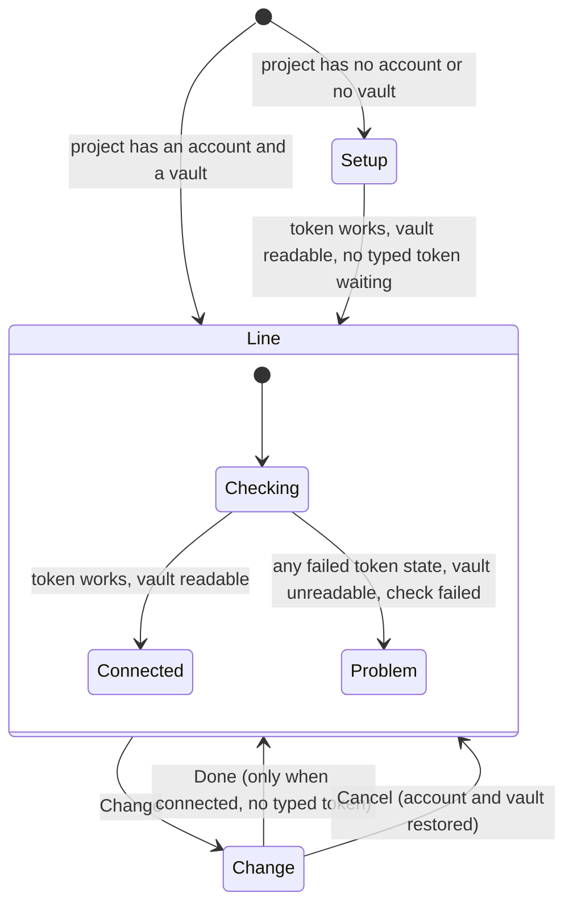

---
id:
title: The 1Password connection collapses to one line once the token works
status: validation
variant: kc-dev-flow-2
profile: pilot
merge: pr
worktree: .worktrees/spacedock-ensign-project-env-connection-collapse
pr: iamcxa/kc-paseo-plugins#25
gates:
    version: 1
    records:
        - id: gate:project-env-connection-collapse:backlog
          stage: backlog
          attempts:
            - id: gate-attempt:project-env-connection-collapse-backlog-1
              briefing:
                id: briefing:project-env-connection-collapse:backlog:attempt-1:revision-1
                digest: sha256:22ae5b236de78b8e78296e10b884c16e701657e8fe055d9a3ed903a2265d24fe
                room-ref: ./project-env-connection-collapse/review/backlog/briefing-1
              resolution:
                type: Resolution
                id: resolution:spacedock:project-env-connection-collapse:backlog:1
                briefing: briefing:project-env-connection-collapse:backlog:attempt-1:revision-1
                by: person:captain
                at: "2026-10-22T04:15:44.262945Z"
                decision: approve
                reason: 'Captain 2026-10-22: 「准」 — accepts this A5 settings-screen rework task''s outcome, scope and acceptance criteria on the pilot profile, into ideation.'
              application:
                target-stage: ideation
                state: consumed
        - id: gate:project-env-connection-collapse:ideation
          stage: ideation
          attempts:
            - id: gate-attempt:project-env-connection-collapse-ideation-1
              briefing:
                id: briefing:project-env-connection-collapse:ideation:attempt-1:revision-1
                digest: sha256:d5df3610c9e42ec6ff315d035ef40fbddc50bc5d3805bb3d2e561c647a454b50
                room-ref: ./project-env-connection-collapse/review/ideation/briefing-1
              resolution:
                type: Resolution
                id: resolution:spacedock:project-env-connection-collapse:ideation:1
                briefing: briefing:project-env-connection-collapse:ideation:attempt-1:revision-1
                by: person:captain
                at: "2026-10-22T07:44:56.146656Z"
                decision: approve
                reason: 'Captain 2026-10-22: 「准」 — accepts this A5 rework design and its acceptance criteria into implementation, including the recommendation stated in this gate''s question.'
              application:
                target-stage: implementation
                state: consumed
        - id: gate:project-env-connection-collapse:validation
          stage: validation
          attempts:
            - id: gate-attempt:project-env-connection-collapse-validation-1
              briefing:
                id: briefing:project-env-connection-collapse:validation:attempt-1:revision-1
                digest: sha256:367c7e25ab842f16ff5b56efb02117bee118a9992d27b42300016c54916b4671
                room-ref: ./project-env-connection-collapse/review/validation/briefing-1
              resolution:
                type: Resolution
                id: resolution:spacedock:project-env-connection-collapse:validation:1
                briefing: briefing:project-env-connection-collapse:validation:attempt-1:revision-1
                by: person:captain
                at: "2026-10-22T10:51:11.240682Z"
                decision: approve
                reason: 'Captain 2026-10-22: 「准」 — approves delivery of PR #25 at 8b02d11 per the gate question (this PR only; he did not choose the standing-merge option).'
              application:
                target-stage: done
                state: pending
started: 2026-10-22T04:17:06Z
---

Settings-screen rework of release r1.5 of the project-env plugin. Design reference: the design-director review (ux-review-r1.5/index.html) and direction A5 (ux-review-r1.5/direction-a5.html, shots/a5-*.png) in the state checkout; Captain approved A5 on 2026-10-22 (「就這樣」) after 「這個 UX 完全不行」, and the Add flow on 2026-10-22 (「可以」).

## Scope

In: once the token works and a vault is chosen, the connection card collapses to one line (status dot, service account, vault) with a Change button that reopens the full form (review finding 8). Stop condition: the acceptance criterion passes.

## Acceptance criteria

**AC-1**: A working connection shows as one line with Change, and Change reopens the account, token and vault controls.
Verified by: (a) unit tests in `project-env/test/connection-line.test.ts` (`cd project-env && npm test`) over `connectionLine`: connected only when the token works and the saved vault is readable; checking; one problem per failed token state; unreadable, empty or no vault; failed check; deleting the `canReadVault` line in `connectionLine` fails the unreadable-vault test (seen on the prototype, 2026-10-22); (b) whole-page screenshots at 1280 px and 400 px on an isolated Paseo, a project that is connected before Change and the full controls after Change (the recipe is under `### Preview` in `## Design`).

## FO alignment

Surfaces: ui
Visible change: A working 1Password connection shows as one line with a Change button.
Direction alignment with the Captain: done — the Captain chose direction A5 and the Add flow on 2026-10-22.
Result: direction A5 (ux-review-r1.5/direction-a5.html); every ui gate shows the Captain screenshots of the screen.
Release review: not needed: a rework of the r1.5 settings screen the Captain ruled on 2026-10-22; it adds no journey story.

## Design

**PRFAQ.** Press release: a 1Password connection that works takes one row, not six. Once a project's service account has a token that 1Password accepts and a readable vault is chosen, the card shows a dot, "Connected", the account and the vault, and a Change button; the controls Kent set up on day one stop sitting above what he edits most (review finding 8). FAQ: *What if the token later fails?* The same row turns red and names the cause ("1Password rejected the token"); Change opens the controls. *What if I only wanted to look?* Cancel returns to the row with the account and vault as they were. *Does the first setup still work?* Yes: a project with no account or no vault shows the controls as today and collapses to the row the moment the token works and a vault is chosen. *Where did the folder path go?* It is the grey line under the project-name heading above the card.



**Existing-code check** (bounded). Searched `@getpaseo/plugin/client/ui` (`ui.d.ts`: `SettingsSection`, `SettingsCard`, `SettingsRow`, `SettingsInput`, `SettingsSelect`, `SettingsAction`, `SettingsSwitch`; no collapsible) and `project-env/shared/token.ts`, `client/settings-screen.tsx` (2026-10-22, main 1adf630). Nothing collapses today, so one small row component is added; `tokenRowText`, `canReadVault`, `pickVault` and the `token` query are reused unchanged. Upstream chain: no spacedock or kc-dev-flow capability is involved; no sibling plugin screen was consulted.

**Mechanism** (a working prototype, disposable, is `spike/prototype.patch`; it applies to main 1adf630 with `git apply --check`, typechecks, and its 5 tests pass; the implementation redoes it in a worktree).
1. `shared/token.ts`: `connectionLine({ vault, fetching, failed, status })` returns `checking`, `connected`, or `problem` with a label. Rule: fetching, or no answer yet, is checking; a failed check is "Could not check the connection"; a token state other than `ok`, or a token reading no vault, is a problem labelled by `tokenRowText(status).label`; no vault chosen is "No vault chosen"; an unreadable vault is "This token cannot read <vault>"; otherwise connected.
2. `client/settings-screen.tsx`, `ProjectEditor`: a `view` state, `setup` | `line` | `change`. Initial `line` when the saved project has an account and a vault, else `setup`. `setup` moves to `line` when `connectionLine` is connected (the vault is either picked by the person or, for a token that reads exactly one vault, chosen by the existing `pickVault`) and nothing is pending (no typed token, no shared-name warning, no save running). Change records the account and vault and opens `change`. Done (enabled only when connected and nothing pending) returns to `line`. Cancel restores the recorded account and vault (only when they differ, so the edit count is not raised for nothing), re-checks the restored account, clears any typed token and its messages, and returns to `line`.
3. The first `SettingsSection` becomes titled "1Password"; above it a heading with the project name and, in grey, its folder path replaces the "Main checkout" row. In `line` the section holds one `ConnectionLineRow` (dot, headline, account muted, vault normal, Change). Under 520 px wide the headline sits above "account · vault" and the dot lines up with the headline. In `problem` the vault is muted too. The row carries an accessible label naming the status, account and vault.
4. In `change` and `setup` the card is today's rows (account, status and Check, token, Save token, Vault, shared-name warning) plus, in `change` only, "Use this connection / Done" and "Keep the current connection / Cancel". Done carries a reason when disabled. While a token is typed and unsaved the status row reads "Saved token works" and adds "The token you typed is not saved yet."
5. Nothing else on the screen changes. No server, schema or setting changes; the saved project keeps the same fields.

UI proposal: On a project's settings screen, the 1Password card becomes one row once the connection works: a green dot, "Connected", the service account in muted text and the vault in normal text, and a Change button at the right (on a wide screen one line; at 400 px wide the headline sits above a second line "account · vault", the dot aligned with the headline). A project opens in this state when it has a service account and a vault; while the check runs the dot is grey and the word is "Checking…"; if the check fails the dot is red, the first words are the cause ("1Password rejected the token") and the vault is muted too. Change replaces the row with the full set of controls (service account, token check, token, Save token, Vault) and adds a last row "Use this connection / Done" that is disabled with a reason ("Save the token or clear the field first." while a typed token is unsaved, "Available once the connection works." while the connection does not work) and a row "Keep the current connection / Cancel" that restores the account and vault. While a token is typed and unsaved, the status row reads "Saved token works" and says the typed token is not saved yet. A project with no account or no vault shows the full controls and collapses to the row the moment the token works and a vault is chosen. A heading with the project name and its folder path sits above the card, which is titled "1Password". The rest of each page (variables, prompt, save) is today's screen and is context: sibling tasks change it.

### Preview

Preview: project-env-connection-collapse/design/preview-1-connected-desktop-dark.png
Preview: project-env-connection-collapse/design/preview-2-change-desktop-dark.png
Preview: project-env-connection-collapse/design/preview-3-problem-desktop-dark.png
Preview: project-env-connection-collapse/design/preview-8-collapsed-after-vault-desktop-dark.png
Preview: project-env-connection-collapse/design/preview-10-connected-400-dark.png
Preview: project-env-connection-collapse/design/preview-11-change-400-dark.png
Preview: project-env-connection-collapse/design/preview-14-connected-desktop-light.png

The 23 pictures in `design/` are of the real client (a disposable build of the prototype on main 1adf630) on an isolated Paseo: own `PASEO_HOME=/tmp/connection-collapse-preview/home`, port 6872, throwaway plugin id `collapse-preview`, `op`, `security` and `git` replaced by the fakes in `project-env/test/fakes`. Each is the whole settings page at 1280 px (with the host sidebar) or 400 px. Names: `preview-<n>-<state>-<size>-<theme>.png`: 1 connected, 2 after Change, 3 failed check, 4 checking, 5 new project, 6 account typed, 7 account checked with two vaults, 8 after choosing a vault (collapsed), 9 Change with a token typed, 10 to 13 the 400 px connected, Change, failed, new project, 14 to 17 light theme, 18 Change on a failed project, 19 and 20 long names, 21 token typed at 400 px, 22 after Cancel, 23 a token with one readable vault (the account is checked and the row appears with no vault choice, because `pickVault` chooses the only vault). Pictures 4 to 8 and 23 were taken before the last edits (400 px layout, typed-token wording, Cancel row); those edits change nothing those pictures show (desktop, no typed token, no Change view). The variables card in every picture is today's: sibling tasks replace it.

Reproduce (machine dependencies, declared): Paseo.app 0.12.0 CLI `/Users/kent/.local/bin/paseo` and its `app-dist` as the web client, Node 24, `agent-browser`. Copy `project-env` (without `node_modules`, linked) to `$S/plugin`, apply `spike/prototype.patch`, set the plugin id in `paseo-plugin.json`, put `test/fakes` under `$S/plugin/server/fakes` and a `makeWorld` that points at that path (the plugin loader rejects modules outside `client/`, `server/`, `shared/` and `import.meta.dirname` is undefined at runtime), write `projects.json` under `$S/home/plugin-settings/<id>/` with one connected project, one with an unknown service account and one empty, then `PASEO_HOME=$S/home PASEO_LISTEN=127.0.0.1:6872 PASEO_RELAY_ENABLED=false PASEO_WEB_UI_ENABLED=true PASEO_WEB_UI_DIST_DIR=/Applications/Paseo.app/Contents/Resources/app-dist paseo daemon run --home $S/home`, open `/settings/hosts/<server-id>/plugins/<id>/projects` and press Edit. Kent's daemon (`~/.paseo`) and live plugin were not touched; no real Keychain, 1Password or `op` was run.

### Design review

Design review: design/ideation-2.yaml

Reviews: `design/ideation-1.yaml` (1 MAJOR, 12 MINOR) led to a redraw of picture 9 and the status row wording ("Saved token works ... not saved yet"), the 400 px layout, the muted vault in a failed row, the Done reason, and new pictures 18 to 21. `design/ideation-2.yaml` (1 MAJOR, 15 MINOR) is the last allowed run; its MAJOR (no way out of Change) was fixed with the Cancel row and pictures 2, 9, 11, 15, 18 and 21 redrawn and 22 added; that redraw was not reviewed again (two runs is the limit).

Design finding 1: fixed: a "Keep the current connection / Cancel" row was added under Done and pictures 2, 9, 11, 15, 18, 21 redrawn; picture 22 shows Cancel restoring "demo-revoked" after "demo-wrong" was typed.
Design finding 2: declined: the Check button tests the account's saved token, as in today's screen and the paste-token flow; the status row now says "Saved token works" while a token is typed, which names its target.
Design finding 3: declined: the unsaved cue is the footer's unsaved-change count, owned by project-env-save-footer-danger-zone; collapsing on the vault pick is the behaviour the Captain's Scope states.
Design finding 4: declined: a token shared by another project already asks "Replace" first (the shared-name warning, shipped with the paste-token task); this task leaves that row as it is.
Design finding 5: AC-1
Design finding 6: declined: the open Vault menu and the Checking row inside the form are today's host and plugin controls, unchanged here; "Checking…" in the one-line row is picture 4.
Design finding 7: declined: every colour is a host theme token (`statusSuccess`, `statusDanger`, `foregroundMuted`) and the 400 px layout is one rule, so the missing combinations reuse the drawn ones; light is shown for connected, Change and failed.
Design finding 8: declined: the Vault control inside the form is today's, unchanged here; the field-pill tasks own the control kinds of the variables card only, and a Vault restyle is outside this task's Scope.
Design finding 9: declined: the form's rows keep their present wording ("Token works", the check status) because they are today's rows; the dot appears in the one-line row only, as in direction A5.
Design finding 10: declined: the vault list in the status hint and the "1Password service account" title are today's wording, outside this task's Scope.
Design finding 11: declined: the cause is the first words of the row and its next step is on the form row after Change (picture 18); Test and Browse vault are the variables card's, owned by the sibling tasks.
Design finding 12: declined: direction A5, approved by the Captain, shows account and vault as muted and normal text; the row gets an accessible label naming both.
Design finding 13: declined: the input widths at 400 px are the host's SettingsInput layout, unchanged here.
Design finding 14: declined: button heights are the host's; this task adds only Change and the Cancel and Done rows, which use the same size as the host's action buttons.
Design finding 15: declined: muted and disabled colours are the host's light theme tokens; the status word sits beside the dot, so colour is not the only cue.
Design finding 16: declined: long names wrap inside the row (pictures 19 and 20) rather than cut off, because an ellipsis would hide the account.

## Interfaces and decisions

- Needed from siblings: none. Files touched: `shared/token.ts` (new function), `client/settings-screen.tsx` (new state at the top of `ProjectEditor`, `ConnectionLineRow`, and the first `SettingsSection` only), `test/connection-line.test.ts` (new). `current`, `vaultReadable` and the token query stay computed in `ProjectEditor` outside the card, so the field picker and pill tasks keep reading them.
- project-env-draft-survives-remount: `view` and the recorded account and vault are view state. If that task lifts the draft out of the re-mounting component, no interface is needed: the editor recomputes `view` from the draft (a connected draft shows the row and re-checks). Its lifted state must keep the typed token readable by `ProjectEditor`, because Done and the collapse depend on it.
- project-env-save-footer-danger-zone: the footer's unsaved count should count a changed account or vault like any draft edit (`patch` already raises `edits`). Cancel only calls `patch` when something differs.
- This task owns the project-name heading, the folder-path line and the "1Password" section title; no sibling should re-add the "Main checkout" row.
- Not adopted: finding 8's numbered steps for the not-connected state; the Scope covers only the collapse, so a not-connected project keeps today's controls. The A5 mock hides the account at 400 px; this design keeps it (the Scope names it) and wraps instead.
- Captain decisions: none.

## Stage Report: ideation

- DONE: Design the change your Scope names inside direction A5, with each acceptance criterion kept and given a reproducible evidence clause.
  `## Design` (PRFAQ, state diagram, existing-code check, mechanism); the checker prints `design surfaces presentable`.
  AC-1 is kept word for word; its Verified by now names `test/connection-line.test.ts` (5 prototype tests pass; deleting the `canReadVault` line fails the unreadable-vault test) and the whole-page screenshots before and after Change. Not yet verified in code: nothing is implemented; the prototype is `spike/prototype.patch`.
- DONE: Produce the artifact the ui surface owes: whole-page previews from a running build at desktop and 400 px, plus the design review, with each finding dispositioned.
  23 pictures in `design/` (dark, light, 1280 and 400 px) from the real client on an isolated Paseo (port 6872, own home, fakes); `design/ideation-1.yaml` and `design/ideation-2.yaml`; checker: `design review design/ideation-2.yaml: 16 findings, 1 fixed, 1 criteria, 14 declined, 0 decisions`.
- DONE: Name every interface you need from a sibling rework task, and any decision the Captain must make (at most one), with a recommendation.
  `## Interfaces and decisions`: no interface needed from a sibling; two notes for draft-survives-remount and save-footer-danger-zone; no Captain decision.

### Summary

A working connection becomes one row (dot, Connected, account, vault, Change); Change opens today's controls plus Done and Cancel; a failed check shows the same row in red with the cause. The variables, prompt and save parts of every picture are today's screen, which sibling tasks replace; only the 1Password card and the project heading are this task's change. Known limits: Cancel's redraw was not re-reviewed (two runs is the limit); on a 400 px page the row is two lines, not one, because the account is kept (the A5 mock hides it); the preview was never run against a real Keychain or 1Password.

## Stage Report: implementation

- DONE: Implement the approved design exactly, including every interface it names for its sibling tasks and, where present, Captain amendment 1 in the task file.
  PR https://github.com/iamcxa/kc-paseo-plugins/pull/25 (Draft, base d61e243): `connectionLine` in `shared/token.ts`, `ConnectionLineRow` and `view` state in `ProjectEditor`; draft changes go through `patch`/`openProject.update`; no Captain amendment in the task file. Initial view is computed from the draft (not `initial`) so a re-mounted editor recomputes it, as the interfaces section says.
- DONE: Land tests so each acceptance criterion passes with the evidence its clause names and fails when its behaviour is removed, plus whole-page screenshots of the built change at desktop and 400 px.
  AC-1(a): `test/connection-line.test.ts`, 6 tests; deleting the `canReadVault` line makes "unreadable, empty, or no vault" fail (run 2026-10-22); a test with `failed: true` plus cached success fails if the `failed` check moves below the status check. AC-1(b): 14 whole-page screenshots in `project-env-connection-collapse/evidence/` (01-04, 08-09 and 13-14 desktop and 400 px Change/Cancel flows, 05-07 setup collapsing, 10-12 400 px) from an isolated Paseo (own home, port 6872, id `collapse-impl`, fakes).
- DONE: Run `npm test`, `npm run typecheck`, the roborev gate, design_surfaces check and doc_impact, then open the Draft PR.
  `npm test` 180 pass 0 fail (session-open deadline test failed once under load, passed alone and in the final full run); typecheck clean; `evidence=roborev:1036` (clean; two fix rounds: failed recheck hidden by cached success, "Saved token works" shown for a failed saved token, Change lost on re-mount); design_surfaces: presentable; doc_impact: 0 documents mention the change.

### Summary

A working connection is one row with Change; Change opens today's controls plus Done and Cancel; a failed check turns the row red with the cause. Not verifiable by unit test: the `view` transitions live in the component, so they are proven by the screenshots and the browser runs only, not by a test that fails when they are removed. Known limits: a typed unsaved token is not kept across a re-mount; run against fakes only.

### Feedback cycle 1 (validator polish: changing into the store)

- DONE: `changing` moved from a module-level variable in `settings-screen.tsx` into the `openProject` store (`OpenProject.changing`, `openProject.setChanging(before, session?)`); `begin` and `close` clear it, the manual `changing = null` is gone. New head 3fe658d on PR #25, pushed.
- DONE: two `open-project.test.ts` cases: a Change survives draft updates without counting as an edit and is cleared by `begin` and `close`; `setChanging` tagged with a stale session is ignored. Both fail without the field (`setChanging` missing). `npm test` 182 pass 0 fail; typecheck clean.
- DONE: `/tmp/cc-accept.sh` and the script copy in the validation report now use `git archive 3fe658d`; fresh run: 7 PASS, 0 FAIL (the first two attempts failed on a cold-start browser timing and a stale daemon from the aborted run, not on the code).
- FINDINGS for FO: roborev gate `evidence=roborev:1041` exited 1 with two Medium findings, both outside this polish and not fixed: (1) a resize during a token save loses the pending save and its result (typed token and `store.isPending` are component state; known limit already stated); (2) project Save (the footer) still saves the draft while Change is open and Done is disabled, which belongs to project-env-save-footer-danger-zone. The earlier gate runs on 4dc1123 were clean (roborev:1036).

### Main merge (af6aaec)

- DONE: merged origin/main af6aaec (the save bar, PR #23) into the branch with a merge commit (96f8e93), no rebase, no force-push. One conflicted file, `settings-screen.tsx`, three hunks: imports (kept both: `Platform`, `useToast` from main and `useWindowDimensions` from the branch); the component area (kept `ConnectionLineRow` whole, then main's `barButton` and save-bar helpers); the top of `ProjectEditor` (kept both state groups: `changing`/`view`/`backToLine` and `confirmDiscard`/`toast`). `open-project.ts` merged without conflict; main's Discard goes through `onDone`, which closes the store and so clears `changing`.
- DONE: `npm test` 185 pass 0 fail; `npm run typecheck` clean on the merge.
- Known, deferred to the Captain by FO and not fixed: the footer Save still saves while Change is open (roborev 1041 finding 2).

### Feedback cycle 2 (Codex P2)

- DONE: `ConnectionLineRow` no longer groups the whole row as one accessible element: the status (dot, headline, account, vault) is its own `accessible` View carrying the label, and the Change Pressable is a sibling, so Change takes accessibility focus. Commit 8b02d11, pushed.
- DONE: `/tmp/cc-accept.sh` (and the copy above) uses `git archive 8b02d11` and asserts that the Change button is not inside the labelled status element, at 1280 and 400 px. The assertion fails on the previous build (3fe658d: both FAIL) and passes on 8b02d11. Fresh run: 9 PASS 0 FAIL, 6 unit-test passes, typecheck ok.
- Roborev on 8b02d11 with `--base af6aaec` (evidence=roborev:1045): exit 1, one Medium finding, the known limit already reported (a resize during Save token loses the pending save and its result). Not fixed; no new finding.

## Stage Report: validation

- DONE: Independently check candidate 4dc112307ded792890fab8d7886359c2ca6dd01b (PR iamcxa/kc-paseo-plugins#25, base main d61e243) against AC-1 and the approved design on an isolated Paseo; give a verdict.
  Verdict PASSED (recommend). Rebuilt the candidate (`git archive 4dc1123`) on my own Paseo (home /tmp/cc-val, port 6881, id `ccval`, fakes for op/security/git, own agent-browser session); no real op, security, Keychain, ~/.paseo or live plugin touched. Seen: a working connection is one line (green dot, "Connected", account muted, vault normal, Change) at 1280 and 400 px; Change shows account, Check, token, Save token, Vault, Done, Cancel; Cancel after typing demo-one restores the demo-ok line; legacy-api (rejected token) shows a red dot and "1Password rejected the token" with Change; Change plus a typed account survives 1280 to 600 to 1280 and 400 to 1280 and Cancel still restores; a new project collapses the moment a vault is picked, and a one-vault token collapses with no vault choice; a typed token disables Done with "Save the token or clear the field first." and the status row reads "Saved token works ... not saved yet."; Done returns to the line. `npm test` 180 pass 0 fail (session-open deadline test failed once under load, rerun alone and in the full run passed); typecheck clean.
- DONE: Confirm the `connectionLine` tests fail when their behaviour is removed.
  Throwaway copy in /tmp/cc-val-mut, one deletion at a time: removing the `canReadVault` line fails "vault is unreadable, empty..."; moving `failed` below the status check fails "recheck failed even though an earlier check succeeded"; removing the `vault === ""` line, the `fetching` line or the `status.state !== "ok"` line fails one test each. Survived: removing the `status.vaults.length === 0` line (the test checks only `kind` of `ok([])`, and the vault is then unreadable anyway; only the label differs). Polish, no loss.
- DONE: Judge the two departures from the design; say whether `changing` should move into the `openProject` store and whether the `view` transitions need a test that fails when removed.
  (1) Initial view computed from `draft`: accepted; the design's own interfaces note says the editor recomputes `view` from the draft after a re-mount, and a draft with account and vault is a line either way. (2) Module-level `changing` keyed by session: it works (resize runs above) and cannot collide, because session numbers never repeat; but it is the same re-mount state `openProject` exists for, so it should move into the store as a field cleared by `begin`/`close`, which removes the manual `changing = null` and lets `open-project.test.ts` prove it in node. Polish, not a blocker: no observed harm. (3) `view` transitions: no component test harness exists in the repo, so a failing-test needs the transitions pulled into a pure function first; not required by AC-1 (its clause (b) names screenshots for them). Runtime mutation instead: deleting `patch(before)` in Cancel leaves "demo-one . Dev" on the line after Cancel, and deleting the `changing = {...}` assignment drops Change back to the line on resize; the acceptance script below asserts both outcomes (I ran those two mutants by hand with the same steps, not through the script).
- DONE: Write the minimal acceptance script FO will rerun in a fresh shell, and run `python3 <package>/scripts/adr_lint.py docs/adr --since 60799d9` recording its exit code.
  Script below ran in a fresh `bash` at 4dc1123: 6 unit-test passes, typecheck ok, 7 PASS 0 FAIL, teardown leaves only the screenshots. `adr_lint.py docs/adr --since 60799d9`: "5 ADR file(s) checked, 0 legacy", exit 0 (the candidate adds no ADR). Also: `comment_ratio.py d61e243 4dc1123`: 1 comment line of 193 code lines, 0.5%, exit 0 (the one comment states the 720 px re-mount, a fact the code cannot); `design_surfaces.py check`: presentable; `doc_impact.py`: 0 documents; `dispatch_records.py`: 3 records complete.
- DONE: Look at the whole-page screenshots at 1280 and 400 px and record what the Captain should see; record every unverified obligation.
  1280 (/tmp/cc-val/shots/v11-cancel-after-resize-1280.png, v05-problem-1280.png, v02-change-1280.png; script copies land in /tmp/cc-accept/shots): under the project name and grey folder path, a "1Password" card of one row, green dot, "Connected", muted "demo-ok", normal "Dev", Change at the right; the variables, prompt and save parts below are today's. Problem: the dot is red and the cause is the first words. Change: today's rows plus "Use this connection / Done" and "Keep the current connection / Cancel". 400 (v08-connected-400.png, v09-change-400.png): two-line row, "Connected" above "demo-ok . Dev", dot aligned with the headline, Change at the right, host sidebar hidden. Unverified: real 1Password and Keychain (fakes only); light theme (not rerun; design pictures only); the "Checking..." row (too short to catch); Save token inside Change (shipped by a sibling task); a typed token lost on re-mount (a known limit; the implementer's note); the Paseo desktop (Electron) app, only the web client was driven; the roborev result `roborev:1036` was read, not rerun; I did not weigh PR #25's CI.

### Minimal acceptance script

Needs: Paseo.app 0.12.0 at /Applications, `agent-browser`, node, the worktree below; about 2 minutes, ports 6882. It uses fakes only and no secret.

```bash
WT=/Users/kent/Project/kc-paseo-plugins/.worktrees/spacedock-ensign-project-env-connection-collapse
S=/tmp/cc-accept; PORT=6882; export AGENT_BROWSER_SESSION=cc-accept
chk(){ if eval "$2"; then echo "PASS  $1"; else echo "FAIL  $1"; fi; }
echo "== 1. unit tests and typecheck at the candidate"
git -C $WT rev-parse HEAD
( cd $WT/project-env && node --disable-warning=MODULE_TYPELESS_PACKAGE_JSON --test test/connection-line.test.ts 2>&1 | grep -E "^. (pass|fail) " ; npm run typecheck >/dev/null 2>&1 && echo "typecheck ok" || echo "typecheck FAIL" )
echo "== 2. isolated Paseo with fake op/security/git (own home, port $PORT, plugin id ccaccept)"
rm -rf $S; mkdir -p $S/plugin $S/world $S/home/plugin-settings/ccaccept $S/repos $S/shots
git -C $WT archive 8b02d11 project-env | tar -x -C $S/plugin --strip-components=1
cd $S/plugin && ln -s $WT/project-env/node_modules node_modules && mkdir server/fakes && cp test/fakes/* server/fakes/
echo '{"id":"ccaccept","media":[],"requirements":{"paseo":">=0.12.0"},"name":"Project environment (acceptance)"}' > paseo-plugin.json
for t in op security git; do printf '#!/bin/sh\nexec %s %s/plugin/server/fakes/%s.mjs %s/world "$@"\n' "$(command -v node)" $S $t $S > $S/world/$t; chmod +x $S/world/$t; done
printf 'import type { Tools } from "./secrets.ts";\nexport const realTools: Tools = { op: "%s/world/op", security: "%s/world/security", git: "%s/world/git" };\n' $S $S $S > server/tools.ts
echo '{"keychain":{"demo-ok":"demo-ok","demo-one":"demo-one","demo-revoked":"demo-revoked"},"op":{"accounts":{"demo-ok":{"vaults":["Dev","Prod"]},"demo-one":{"vaults":["Solo"]}}}}' > $S/world/scenario.json
for r in ci-app legacy-api; do mkdir -p $S/repos/$r; git -C $S/repos/$r init -q; done
echo "{\"version\":1,\"values\":{\"projects\":[{\"root\":\"$S/repos/ci-app\",\"serviceAccount\":\"demo-ok\",\"vault\":\"Dev\",\"variables\":[],\"prompt\":\"\"},{\"root\":\"$S/repos/legacy-api\",\"serviceAccount\":\"demo-revoked\",\"vault\":\"Dev\",\"variables\":[],\"prompt\":\"\"}]}}" > $S/home/plugin-settings/ccaccept/projects.json
echo "{\"version\":1,\"daemon\":{\"listen\":\"127.0.0.1:$PORT\",\"cors\":{\"allowedOrigins\":[\"https://app.paseo.sh\"]},\"relay\":{\"enabled\":false}},\"app\":{\"baseUrl\":\"https://app.paseo.sh\"},\"plugins\":{\"ccaccept\":{\"source\":\"directory\",\"path\":\"$S/plugin\",\"enabled\":true}},\"pluginsEnabled\":true}" > $S/home/config.json
( PASEO_HOME=$S/home PASEO_LISTEN=127.0.0.1:$PORT PASEO_RELAY_ENABLED=false PASEO_WEB_UI_ENABLED=true PASEO_WEB_UI_DIST_DIR=/Applications/Paseo.app/Contents/Resources/app-dist nohup /Users/kent/.local/bin/paseo daemon run --home $S/home > $S/daemon.log 2>&1 & )
until curl -s -o /dev/null http://127.0.0.1:$PORT/; do sleep 1; done; sleep 4
SID=$(cat $S/home/server-id)
snap(){ agent-browser snapshot -i 2>&1; }
text(){ agent-browser get text body 2>&1; }
press(){ local r; r=$(snap | grep -E "button \"$1\"( |\\[)" | sed -n "$((${2:-0}+1))p" | sed -E 's/.*ref=(e[0-9]+).*/\1/'); agent-browser click @$r >/dev/null; sleep 2; }
openproj(){ agent-browser open "http://127.0.0.1:$PORT/settings/hosts/$SID/plugins/ccaccept/projects" >/dev/null; sleep 3; press Edit $1; sleep 2; }
echo "== 3. a working connection is one line; Change opens the controls; Cancel restores the line"
agent-browser set viewport 1280 1500 >/dev/null
openproj 0
chk "ci-app: line reads Connected, demo-ok, Dev with a Change button" 'text | grep -q Connected && text | grep -q "demo-ok" && snap | grep -q "Change the 1Password connection"'
chk "ci-app: no account textbox while collapsed" '! snap | grep -q "textbox \"1Password service account\""'
chk "status element and Change are separate: Change is not inside the labelled status element (1280)" 'agent-browser eval "(()=>{const s=[...document.querySelectorAll(\"[aria-label]\")].find(e=>/^(Connected|Checking|.*), service account /.test(e.getAttribute(\"aria-label\")));const b=document.querySelector(\"[aria-label=\\\"Change the 1Password connection\\\"]\");return !!s&&!!b&&!s.contains(b)})()" | grep -q true'
agent-browser screenshot --full $S/shots/1-connected-1280.png >/dev/null
press "Change the 1Password connection"
chk "Change: account, Check, token, Save token, Vault, Done, Cancel shown" 'S1=$(snap); for w in "textbox \"1Password service account\"" "button \"Check\"" "textbox \"Service account token\"" "button \"Save token\"" "button \"Vault: Dev\"" "button \"Done\"" "button \"Cancel\""; do echo "$S1" | grep -q "$w" || exit 1; done'
agent-browser screenshot --full $S/shots/2-change-1280.png >/dev/null
agent-browser set viewport 400 1500 >/dev/null; sleep 3; agent-browser set viewport 1280 1500 >/dev/null; sleep 3
chk "Change survives a resize across 720 px (400 then 1280)" 'snap | grep -q "button \"Cancel\"" && snap | grep -q "textbox \"1Password service account\""'
R=$(snap | grep 'textbox "1Password service account"' | sed -E 's/.*ref=(e[0-9]+).*/\1/'); agent-browser fill @$R demo-one >/dev/null; press Check 0; sleep 2
chk "Typed account demo-one: Done is disabled (vault Dev not readable)" 'snap | grep -q "button \"Done\" \[disabled"'
press Cancel 0
chk "Cancel restores the one line with demo-ok" 'text | grep -q Connected && text | grep -q "demo-ok" && ! text | grep -q "demo-one"'
echo "== 4. a failed check is red with its cause"
openproj 1
chk "legacy-api: line says 1Password rejected the token, demo-revoked, with Change" 'text | grep -q "1Password rejected the token" && snap | grep -q "Change the 1Password connection"'
agent-browser screenshot --full $S/shots/3-problem-1280.png >/dev/null
echo "== 5. 400 px"
agent-browser set viewport 400 1500 >/dev/null; openproj 0; chk "status element and Change are separate: Change is not inside the labelled status element (400)" 'agent-browser eval "(()=>{const s=[...document.querySelectorAll(\"[aria-label]\")].find(e=>/^(Connected|Checking|.*), service account /.test(e.getAttribute(\"aria-label\")));const b=document.querySelector(\"[aria-label=\\\"Change the 1Password connection\\\"]\");return !!s&&!!b&&!s.contains(b)})()" | grep -q true'
agent-browser screenshot --full $S/shots/4-connected-400.png >/dev/null
echo "screenshots: $S/shots/ (open them: the dot is green with Connected, account muted, vault normal; at 400 px the second line holds account and vault)"
echo "== teardown"
pkill -f "daemon run --home $S/home"; agent-browser close >/dev/null 2>&1; rm -rf $S/plugin $S/home $S/world $S/repos
```

Not covered: real 1Password or Keychain, light theme, the desktop app, a typed token across a re-mount, layout details beyond the screenshots (look at /tmp/cc-accept/shots/*.png).

### Summary

PASSED (recommend): AC-1 holds on the rebuilt candidate in a real browser on an isolated Paseo, and the `connectionLine` tests fail when five of the six branches are removed. Two polish items, neither blocking: move `changing` into the `openProject` store, and the untested empty-vault label. The view transitions are proven by the browser run and the script, not by a unit test.

### FO declines

- Validator polish 1 (`changing` belongs in the `openProject` store): adopted; done in feedback cycle 1 (3fe658d).
- Validator polish 2 (the `vaults.length === 0` label is untested): declined; only the label differs and the vault is unreadable either way.
- roborev:1041 finding 1 (a resize during a token save loses the pending save and its result): deferred; the typed token is component state, a limit stated since implementation-1, unchanged by this task.
- roborev:1041 finding 2 (footer Save still saves while Change is open and Done is disabled): deferred; before this rework Save also wrote any draft, so nothing regresses. FO raises it with the Captain when he tries the screen.

## Stage Report: validation (cycle 2)

- DONE: Revalidate candidate 8b02d1159f109cd90fb0d4bee012fa0e06b750fe (PR iamcxa/kc-paseo-plugins#25): connection line, Change, Cancel, failed check and resize behaviour; the save bar and Danger zone from main on the merged page; Change as its own button at 1280 and 400 px; give a verdict.
  Verdict PASSED (recommend), no Material finding. Worktree HEAD is 8b02d11, clean. On my own isolated Paseo (fakes only, own home, port 6882, throwaway id `ccaccept`, own agent-browser session, torn down; no process left): the line, Change, Cancel (account restored, save bar back to "No unsaved changes"), the red failed check with "1Password rejected the token", and a Change in progress across 400 to 1280 all hold. Merged page: a saved untouched project shows "No unsaved changes", Close and a disabled Save; one prompt edit shows "1 unsaved change", Discard and an enabled Save; Discard asks "Discard 1 unsaved change?" and Discard changes returns to the list with the edit gone; Save shows the toast "Saved ci-app" and returns to the list; a saved project has the Danger zone with Stop managing; a project added from the workspace list (fresh-app) shows "New project, not saved yet" and no Danger zone.
- DONE: Change is its own button in the accessibility snapshot at 1280 and 400 px.
  Both widths: `button "Change the 1Password connection"` is in the snapshot and the DOM check "the labelled status element does not contain the Change button" passes. The same script at 4dc1123 FAILS that check at both widths (the 8b02d11 change fixes what it names). Whether a screen reader reads it as intended was not tested with one.
- DONE: The new store tests fail without the field.
  Full suite at the candidate: 185 pass 0 fail (npm test, run by me; typecheck clean). Throwaway copy, one change at a time, `test/open-project.test.ts` (10 tests): `begin` not resetting `changing` fails 2; `setChanging` without the session guard fails "tagged with a session that is no longer open"; `update` dropping `changing` fails 1; `setChanging` as a no-op fails 1; `setChanging` counting as an edit fails 1. What no unit test covers: that the component calls `setChanging` on Change and on Done and Cancel; the script's resize step and the Cancel step cover that (cycle 1: deleting either assignment broke them).
- DONE: Rerun /tmp/cc-accept.sh in a fresh shell at 8b02d1159f109cd90fb0d4bee012fa0e06b750fe, record its PASS/FAIL lines, and run adr_lint with its exit code.
  `/tmp/cc-accept.sh` as dispatched (copy /tmp/cc-accept.v1.sh): 9 PASS, 0 FAIL, 6 unit tests pass, typecheck ok. The extended script below (the merged-page steps 6 and 7 and the Cancel save-bar step added; copy /tmp/cc-accept.v2.sh): 18 PASS, 0 FAIL on the final run; the same extended script at 4dc1123 fails the two separate-element checks and the seven merged-page checks, as it should. One earlier run had one FAIL on the very first check (cold-start timing on a loaded machine); `chk` now retries up to four times. `python3 <package>/scripts/adr_lint.py docs/adr --since 60799d9`: "5 ADR file(s) checked, 0 legacy", exit 0. Also `comment_ratio.py af6aaec 8b02d11`: 0 comment lines of 227, exit 0; design_surfaces: presentable; doc_impact: 0 documents; dispatch_records: 6 complete.
- DONE: Look at whole-page screenshots of the merged page at 1280 and 400 px and record what the Captain should see; record every unverified obligation.
  1280 (/tmp/cc-accept/shots/1-connected-1280.png, 5-unsaved-1280.png, 7-new-project-1280.png after a run): project name and grey folder path, then a "1Password" card of one row (green dot, "Connected", muted demo-ok, normal Dev, Change at the right), the variables card, the default-prompt box, a "Danger zone" card with a red-outlined Stop managing, and a sticky bar at the bottom reading "No unsaved changes" with Close and a dimmed Save. 400 (4-connected-400.png): the same, host sidebar hidden, "Connected" above "demo-ok . Dev", Change at the right, the bar wraps cleanly. Unverified: real 1Password and Keychain (fakes only); light theme; the Paseo desktop app (web client only); the Stop managing confirmation and a failed Save (only the section and button were seen; the save bar's error text was not triggered); a screen reader itself; a typed token across a re-mount (known limit); Footer Save while Change is open (deferred to the Captain, not counted); PR #25 CI and the Codex review rounds were not weighed.

### Minimal acceptance script

Needs: Paseo.app 0.12.0 at /Applications, `agent-browser`, node, the worktree below (HEAD must be the candidate); about 3 minutes, port 6882; fakes only, no secret.

```bash
WT=/Users/kent/Project/kc-paseo-plugins/.worktrees/spacedock-ensign-project-env-connection-collapse
S=/tmp/cc-accept; PORT=6882; export AGENT_BROWSER_SESSION=cc-accept
chk(){ for i in 1 2 3 4; do if eval "$2"; then echo "PASS  $1"; return; fi; sleep 2; done; echo "FAIL  $1"; }
echo "== 1. unit tests and typecheck at the candidate"
git -C $WT rev-parse HEAD
( cd $WT/project-env && node --disable-warning=MODULE_TYPELESS_PACKAGE_JSON --test test/connection-line.test.ts 2>&1 | grep -E "^. (pass|fail) " ; npm run typecheck >/dev/null 2>&1 && echo "typecheck ok" || echo "typecheck FAIL" )
echo "== 2. isolated Paseo with fake op/security/git (own home, port $PORT, plugin id ccaccept)"
rm -rf $S; mkdir -p $S/plugin $S/world $S/home/plugin-settings/ccaccept $S/repos $S/shots
git -C $WT archive 8b02d11 project-env | tar -x -C $S/plugin --strip-components=1
cd $S/plugin && ln -s $WT/project-env/node_modules node_modules && mkdir server/fakes && cp test/fakes/* server/fakes/
echo '{"id":"ccaccept","media":[],"requirements":{"paseo":">=0.12.0"},"name":"Project environment (acceptance)"}' > paseo-plugin.json
for t in op security git; do printf '#!/bin/sh\nexec %s %s/plugin/server/fakes/%s.mjs %s/world "$@"\n' "$(command -v node)" $S $t $S > $S/world/$t; chmod +x $S/world/$t; done
printf 'import type { Tools } from "./secrets.ts";\nexport const realTools: Tools = { op: "%s/world/op", security: "%s/world/security", git: "%s/world/git" };\n' $S $S $S > server/tools.ts
echo '{"keychain":{"demo-ok":"demo-ok","demo-one":"demo-one","demo-revoked":"demo-revoked"},"op":{"accounts":{"demo-ok":{"vaults":["Dev","Prod"]},"demo-one":{"vaults":["Solo"]}}}}' > $S/world/scenario.json
for r in ci-app legacy-api fresh-app; do mkdir -p $S/repos/$r; git -C $S/repos/$r init -q; git -C $S/repos/$r -c user.email=a@b -c user.name=a commit -q --allow-empty -m init; done
echo "{\"version\":1,\"values\":{\"projects\":[{\"root\":\"$S/repos/ci-app\",\"serviceAccount\":\"demo-ok\",\"vault\":\"Dev\",\"variables\":[],\"prompt\":\"\"},{\"root\":\"$S/repos/legacy-api\",\"serviceAccount\":\"demo-revoked\",\"vault\":\"Dev\",\"variables\":[],\"prompt\":\"\"}]}}" > $S/home/plugin-settings/ccaccept/projects.json
echo "{\"version\":1,\"daemon\":{\"listen\":\"127.0.0.1:$PORT\",\"cors\":{\"allowedOrigins\":[\"https://app.paseo.sh\"]},\"relay\":{\"enabled\":false}},\"app\":{\"baseUrl\":\"https://app.paseo.sh\"},\"plugins\":{\"ccaccept\":{\"source\":\"directory\",\"path\":\"$S/plugin\",\"enabled\":true}},\"pluginsEnabled\":true}" > $S/home/config.json
( PASEO_HOME=$S/home PASEO_LISTEN=127.0.0.1:$PORT PASEO_RELAY_ENABLED=false PASEO_WEB_UI_ENABLED=true PASEO_WEB_UI_DIST_DIR=/Applications/Paseo.app/Contents/Resources/app-dist nohup /Users/kent/.local/bin/paseo daemon run --home $S/home > $S/daemon.log 2>&1 & )
until curl -s -o /dev/null http://127.0.0.1:$PORT/; do sleep 1; done; sleep 4
SID=$(cat $S/home/server-id)
/Users/kent/.local/bin/paseo --home $S/home workspace create --isolation local --path $S/repos/fresh-app >/dev/null 2>&1; echo "workspace create exit $?"
snap(){ agent-browser snapshot -i 2>&1; }
text(){ agent-browser get text body 2>&1; }
press(){ local r; r=$(snap | grep -E "button \"$1\"( |\\[)" | sed -n "$((${2:-0}+1))p" | sed -E 's/.*ref=(e[0-9]+).*/\1/'); agent-browser click @$r >/dev/null; sleep 2; }
openproj(){ agent-browser open "http://127.0.0.1:$PORT/settings/hosts/$SID/plugins/ccaccept/projects" >/dev/null; sleep 3; press Edit $1; sleep 2; }
echo "== 3. a working connection is one line; Change opens the controls; Cancel restores the line"
agent-browser set viewport 1280 1500 >/dev/null
openproj 0
chk "ci-app: line reads Connected, demo-ok, Dev with a Change button" 'text | grep -q Connected && text | grep -q "demo-ok" && snap | grep -q "Change the 1Password connection"'
chk "ci-app: no account textbox while collapsed" '! snap | grep -q "textbox \"1Password service account\""'
chk "status element and Change are separate: Change is not inside the labelled status element (1280)" 'agent-browser eval "(()=>{const s=[...document.querySelectorAll(\"[aria-label]\")].find(e=>/^(Connected|Checking|.*), service account /.test(e.getAttribute(\"aria-label\")));const b=document.querySelector(\"[aria-label=\\\"Change the 1Password connection\\\"]\");return !!s&&!!b&&!s.contains(b)})()" | grep -q true'
agent-browser screenshot --full $S/shots/1-connected-1280.png >/dev/null
press "Change the 1Password connection"
chk "Change: account, Check, token, Save token, Vault, Done, Cancel shown" 'S1=$(snap); for w in "textbox \"1Password service account\"" "button \"Check\"" "textbox \"Service account token\"" "button \"Save token\"" "button \"Vault: Dev\"" "button \"Done\"" "button \"Cancel\""; do echo "$S1" | grep -q "$w" || exit 1; done'
agent-browser screenshot --full $S/shots/2-change-1280.png >/dev/null
agent-browser set viewport 400 1500 >/dev/null; sleep 3; agent-browser set viewport 1280 1500 >/dev/null; sleep 3
chk "Change survives a resize across 720 px (400 then 1280)" 'snap | grep -q "button \"Cancel\"" && snap | grep -q "textbox \"1Password service account\""'
R=$(snap | grep 'textbox "1Password service account"' | sed -E 's/.*ref=(e[0-9]+).*/\1/'); agent-browser fill @$R demo-one >/dev/null; press Check 0; sleep 2
chk "Typed account demo-one: Done is disabled (vault Dev not readable)" 'snap | grep -q "button \"Done\" \[disabled"'
press Cancel 0
chk "Cancel restores the one line with demo-ok" 'text | grep -q Connected && text | grep -q "demo-ok" && ! text | grep -q "demo-one"'
chk "after Cancel the save bar is back to No unsaved changes" 'text | grep -q "No unsaved changes"'
echo "== 4. a failed check is red with its cause"
openproj 1
chk "legacy-api: line says 1Password rejected the token, demo-revoked, with Change" 'text | grep -q "1Password rejected the token" && snap | grep -q "Change the 1Password connection"'
agent-browser screenshot --full $S/shots/3-problem-1280.png >/dev/null
echo "== 5. 400 px"
agent-browser set viewport 400 1500 >/dev/null; openproj 0; chk "status element and Change are separate: Change is not inside the labelled status element (400)" 'agent-browser eval "(()=>{const s=[...document.querySelectorAll(\"[aria-label]\")].find(e=>/^(Connected|Checking|.*), service account /.test(e.getAttribute(\"aria-label\")));const b=document.querySelector(\"[aria-label=\\\"Change the 1Password connection\\\"]\");return !!s&&!!b&&!s.contains(b)})()" | grep -q true'
agent-browser screenshot --full $S/shots/4-connected-400.png >/dev/null
echo "== 6. merged page: save bar, Danger zone, Discard, Save toast"
agent-browser set viewport 1280 1500 >/dev/null
openproj 0
chk "untouched saved project: bar says No unsaved changes, buttons Close and Save (disabled)" 'text | grep -q "No unsaved changes" && snap | grep -q "button \"Close\"" && snap | grep -q "button \"Save\" \[disabled"'
chk "saved project has the Danger zone with Stop managing" 'text | grep -q "Danger zone" && snap | grep -q "button \"Stop managing\""'
P=$(snap | grep 'textbox "Appended to the system prompt' | sed -E 's/.*ref=(e[0-9]+).*/\1/'); agent-browser fill @$P "hello" >/dev/null; sleep 1
chk "one edit: bar says 1 unsaved change, Discard shown, Save enabled" 'text | grep -q "1 unsaved change" && snap | grep -q "button \"Discard\"" && ! snap | grep -q "button \"Save\" \[disabled"'
agent-browser screenshot --full $S/shots/5-unsaved-1280.png >/dev/null
press Discard 0; sleep 2
chk "Discard with an edit asks first: Discard 1 unsaved change? with Keep editing" 'text | grep -q "Discard 1 unsaved change?" && snap | grep -q "button \"Keep editing\""'
press "Discard changes" 0; sleep 3
chk "Discard changes leaves the editor for the project list (Edit buttons, no Danger zone)" 'snap | grep -q "button \"Edit\"" && ! text | grep -q "Danger zone"'
openproj 0
chk "after Discard the prompt edit is gone: No unsaved changes" 'text | grep -q "No unsaved changes"'
P=$(snap | grep 'textbox "Appended to the system prompt' | sed -E 's/.*ref=(e[0-9]+).*/\1/'); agent-browser fill @$P "hello" >/dev/null; sleep 1
press Save 0; agent-browser screenshot $S/shots/6-after-save.png >/dev/null
chk "Save: toast Saved ci-app and the editor closes to the project list" 'text | grep -q "Saved ci-app" && snap | grep -q "button \"Edit\""'
echo "== 7. a project not yet saved: bar says so, no Danger zone"
agent-browser open "http://127.0.0.1:$PORT/settings/hosts/$SID/plugins/ccaccept/projects" >/dev/null; sleep 3
press "Add a project: Choose…" 0
M=$(snap | grep 'menuitem "fresh-app"' | sed -E 's/.*ref=(e[0-9]+).*/\1/'); agent-browser click @$M >/dev/null; sleep 3
chk "new project fresh-app: New project, not saved yet; no Danger zone" 'text | grep -q "New project, not saved yet" && ! text | grep -q "Danger zone"'
agent-browser screenshot --full $S/shots/7-new-project-1280.png >/dev/null
echo "screenshots: $S/shots/ (open them: the dot is green with Connected, account muted, vault normal; at 400 px the second line holds account and vault)"
echo "== teardown"
pkill -f "daemon run --home $S/home"; agent-browser close >/dev/null 2>&1; rm -rf $S/plugin $S/home $S/world $S/repos
```

Not covered: real 1Password or Keychain, light theme, the desktop app, a screen reader, Stop managing's confirmation, a failed Save, layout beyond the screenshots (look at /tmp/cc-accept/shots/*.png).

### Summary

PASSED (recommend): at 8b02d11 the connection line, Change, Cancel, failed check and resize behave as accepted, the save bar and Danger zone from main work on the merged page, Change is a separate accessible button at both widths, and the full suite is 185 pass 0 fail. Both cycle-1 polish items are done (the `changing` store field, and its store tests fail without it); the empty-vault label test gap remains, polish only.
