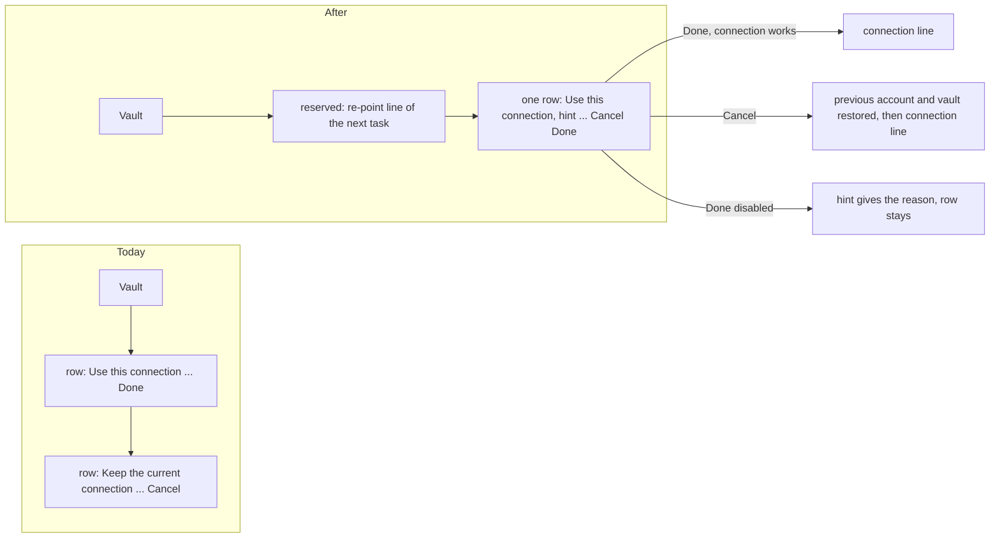

---
id:
title: Finishing or cancelling a connection change is one row right after the vault
status: implementation
variant: kc-dev-flow-2
profile: pilot
merge: pr
worktree:
pr:
gates:
    version: 1
    records:
        - id: gate:project-env-connection-done-cancel-one-row:backlog
          stage: backlog
          attempts:
            - id: gate-attempt:project-env-connection-done-cancel-one-row-backlog-1
              briefing:
                id: briefing:project-env-connection-done-cancel-one-row:backlog:attempt-1:revision-1
                digest: sha256:c33390948f4dcb7c3991563a2b4968b4b2d3f53caa6a940a480cbd2a10c51c2f
                room-ref: ./project-env-connection-done-cancel-one-row/review/backlog/briefing-1
              resolution:
                type: Resolution
                id: resolution:spacedock:project-env-connection-done-cancel-one-row:backlog:1
                briefing: briefing:project-env-connection-done-cancel-one-row:backlog:attempt-1:revision-1
                by: person:captain
                at: "2026-10-23T12:22:04.513444Z"
                decision: approve
                reason: 'Captain 2026-10-23: 「准」 — answers the backlog question put in chat: approves Design Director round-2 Tasks 1 to 3 in order, with option A, the re-point behaviour and the r2 rename as stated.'
              application:
                target-stage: ideation
                state: consumed
        - id: gate:project-env-connection-done-cancel-one-row:ideation
          stage: ideation
          attempts:
            - id: gate-attempt:project-env-connection-done-cancel-one-row-ideation-1
              briefing:
                id: briefing:project-env-connection-done-cancel-one-row:ideation:attempt-1:revision-1
                digest: sha256:68e0041fa16999a10e54750dbb42b016d478a6e524ca4abe7ada711e0f511a5a
                room-ref: ./project-env-connection-done-cancel-one-row/review/ideation/briefing-1
              resolution:
                type: Resolution
                id: resolution:spacedock:project-env-connection-done-cancel-one-row:ideation:1
                briefing: briefing:project-env-connection-done-cancel-one-row:ideation:attempt-1:revision-1
                by: person:captain
                at: "2026-10-24T03:40:53.301159Z"
                decision: approve
                reason: 'Captain 2026-10-24, in the FO chat: 「准」. Asked: approve the one-row Cancel/Done design (option A) and its acceptance criteria into implementation, also accepting the recommendation to leave the save bar unchanged in this task.'
              application:
                target-stage: implementation
                state: consumed
started: 2026-10-24T01:18:38Z
---

Polish round 2 of the project-env settings screen. Source: the Captain's UAT on 2026-10-23 (「這個 use this connection 按鈕是否可以放在 vault 選擇的後面？或是換個方式重新設計儲存跟取消」, 「import from conductor 功能可以移除」, and the qnow vault rename that blanked five variables live) and the Design Director's ruling in `ux-review-polish-2/design-director.md`, approved by the Captain on 2026-10-23 with 「准」, including option A, the re-point behaviour and the r2 wording.

## Scope

In (design-director.md Task 2, option A): in the Change form only, the "Use this connection / Done" and "Keep the current connection / Cancel" rows become one row right after Vault, with Cancel and Done on the right styled like the save bar's buttons, and the reason a disabled Done is disabled shown in the row. Cancel and Done keep their behaviour, including the blocked Save and its survival across 720 px. Out: the first-setup form (r1b) and the save bar. Stop condition: the acceptance criteria pass. Branches from project-env-remove-conductor-import's merged main.

## Acceptance criteria

**AC-1**: In the Change form with a working vault picked, Cancel and Done sit in one row after Vault and both end above the save bar, at 1280 × 1400 and 400 × 900.
Verified by: a measuring script (`project-env-connection-done-cancel-one-row/evidence/drive.sh` with `measure.js`, the A5 harness plus a second readable vault `Ops`) on an isolated Paseo built from the candidate, project `work`, Change opened and `Ops` picked, at 1280 × 1400 and 400 × 900: the two buttons' top edges differ by at most 2 px, both tops are below the Vault select's bottom, both bottoms are above the save bar's top. On the disposable build at main 4e22d4a plus the option-A edit: tops 605 and 605, Vault bottom 570, bottoms 638 against bar top 1312 at 1280; tops 658 and 658, Vault bottom 623, bottoms 691 against bar top 786 at 400 (`evidence/measure-after.txt`). The same script on main fails the shared-top-edge clause at both widths (tops 668 and 603 at 1280, 721 and 656 at 400, `evidence/measure-before.txt`), which is what a two-row layout cannot pass. Correction to the backlog text: on main with this fixture the picked state at 400 × 900 is still above the bar (Cancel bottom 753 against bar top 786); Cancel goes under the bar there only in the unchecked-account state (bottom 798 against 786, `shots/before-400-unchecked.png`) or once a line sits above the buttons, as the Design Director's mock did.

**AC-2**: With an unchecked account name Done is disabled and the row reads "Available once the connection works."; with a typed unsaved token it reads "Save the token or clear the field first."; Cancel brings back the previous account and vault.
Verified by: the same script at 1280 and 400: with the account edited to an unchecked name (`sa-x`) the section text holds "Available once the connection works." and the Done button's `aria-disabled` is true; with a token typed into the token field it holds "Save the token or clear the field first." and Done is disabled; after Cancel, from each of the picked (`Ops`), unchecked and failed-Check states, the section reads "Connected · sa-a · Dev", the previous account and vault (`evidence/measure-after.txt`, lines `section` and `after-Cancel`). `npm test` and `npm run typecheck` in `project-env/` pass on the candidate with `test/save-rule.test.ts` untouched (273 of 273, `evidence/typecheck-and-tests-candidate.txt`; main also 273 of 273). The behaviour already holds on main, so this criterion guards the move: removing a hint or a Cancel reset from the new row makes the script's text or after-Cancel line differ.

## FO alignment

Surfaces: ui
Visible change: Cancel and Done sit together in one row right after the vault choice.
Direction alignment with the Captain: done — the Captain chose option A on 2026-10-23 (「准」).
Result: ux-review-polish-2/director-shots/opt-a-*.png; every ui gate shows the Captain screenshots of the screen.
Release review: not needed: a polish of the r1.5 settings screen the Captain ruled at backlog; it adds no journey story.
Map footprints: not needed: no journey story or open map question is attached to this polish task.

## Design

### PRFAQ

**Headline.** In the 1Password card's Change form, finishing or cancelling is one row, "Use this connection", right after Vault, with Cancel and Done at its right edge.

**Who and why.** The Captain, who changes the connection on his own setup. On 2026-10-23 he asked 「這個 use this connection 按鈕是否可以放在 vault 選擇的後面？或是換個方式重新設計儲存跟取消」 and approved option A with 「准」. Today two full rows sit under Vault, and Cancel can lie under the sticky save bar.

**FAQ.**
- *Do Cancel and Done behave differently?* No. Done still returns to the connection line only when the connection works and no token is pending; Cancel still restores the previous account and vault and clears the typed token; both keep the Save block and its survival across 720 px (`open.changing`, untouched).
- *Where does the disabled-Done reason go?* In the row's hint, beside the buttons: the same two strings as today.
- *What does the row say when Done is ready?* "Cancel keeps the current one." (the Design Director's proposal; Cancel has no label of its own any more). Cancel keeps the accessible name "Keep the current connection".
- *Where does project-env-vault-change-repoints-refs put its line?* In its own row between Vault and this row ("3 variables point at Dev. Done points them at agent-dev. ..."), as the Director drew it. This row needs no change.
- *First-setup form and save bar?* Untouched (`view === "setup"` and `SaveBar`).

Stops: the row ends at the card's last row; it does not touch Check, Save token, the save bar or the first-setup form.

### Existing-code capability check

Boundary: the two `SettingsAction` rows labelled "Use this connection" and "Keep the current connection" in `ProjectEditor` (`client/settings-screen.tsx`). The host's `SettingsRow` with buttons inside already exists in this file (the Danger zone row), and `barButton`/`barText` already draw the save bar's tones. Consumers of the old rows: none outside the screen (`git grep -n "Keep the current connection\|Use this connection" -- . ':!docs/dev2'` finds only these two, 2026-10-24, main 4e22d4a). Need: Captain-ruled. Decision: reuse `SettingsRow`, `barButton`, `barText`; add no component. The edit in the disposable copy is 76 diff lines, one file (`evidence/candidate-disposable.diff`), `npm run typecheck` clean and 273 of 273 tests pass in it.

### UI proposal and preview

UI proposal: In the Change form only, replace the two rows "Use this connection / Done" and "Keep the current connection / Cancel" with one row right after Vault: label "Use this connection", a hint under it, and Cancel (plain tone) and Done (primary tone, off when it cannot be pressed) at the right, drawn like the save bar's Discard and Save. The hint is "Available once the connection works." for an unchecked or failed account, "Save the token or clear the field first." for a typed unsaved token, and "Cancel keeps the current one." when Done is ready.

Preview: project-env-connection-done-cancel-one-row/shots/

The preview is two running builds of the real plugin on an isolated Paseo (own home; ports 6962 and 6963; fake `op`, `security`, `git`; the A5 harness with its fake vault list widened to `Dev` and `Ops`): "before" is main 4e22d4a, "after" is the same tree with the option-A edit in a throwaway copy, disposable and never on a branch. Pictures, all project `work`, dark theme unless named: `after-1280-{picked,unchecked,token,failed}.png` (whole page at 1280 × 1400), `after-400-{...}.png` (400 × 900 window with the sticky bar), `after-400-page-{...}.png` (400 px, whole page), `after-800-{picked,unchecked}.png` (800 × 1000), `after-light-{1280,400,400-page}-{picked,unchecked,token}.png`, `after-1280-after-done.png`; each `before-*` is today's build in the same state, and `room-after-*` is the same row with a stand-in line above it (disposable, `evidence/room-standin.diff`). States: `picked` is `Ops` chosen with a working token, `unchecked` is the account edited to `sa-x`, `token` is a token typed and not saved (a fake string), `failed` is `sa-x` after Check ("No token in Keychain"). Measured, 400 × 900, picked: buttons end at y 691, the bar starts at 786 (95 px clear); with the stand-in line above the row they end at 775 (11 px clear). So the next task's line fits, with a thin margin that task must re-measure.

### Design review

Design review: design/ideation-2.yaml

Design finding 1: Needs decision: with a typed, unsaved token the save bar reads "No unsaved changes" and offers Close; the bar is out of Scope and `before-400-token.png` shows the same today, so this row did not cause it. See Needs decision.
Design finding 2: AC-2 (the Done hint "Save the token or clear the field first." is the Captain's own AC-2 wording, tested by AC-2's script; the check row's sentence "The token you typed is not saved yet." is today's, `before-400-token.png`, and outside this row).
Design finding 3: AC-1 (that is AC-1 of project-env-vault-change-repoints-refs, not of this task): what a vault change does to the variables, and the "Dev ·" prefixes and "≠" chips, is that task's line above this row, which the Captain approved on 2026-10-23 (`room-after-400-picked.png` shows its place).
Design finding 4: declined: the failed-check title and the token help text belong to the Check row, which this task does not touch (`before-*` shows the same); the new row's own reason for the disabled Done is correct in that state.
Design finding 5: declined: Vault turning into a text box when the account is unchecked is today's behaviour (`before-400-unchecked.png`); no Vault code moves.
Design finding 6: declined: the sticky bar's covering and its two heights are the A5 bar and round-1 ruling R3a, out of Scope.
Design finding 7: declined: Cancel and Done are the save bar's own `barButton` (height and 8 px gap) as the Captain chose; a taller pair would differ from the bar beside it.
Design finding 8: declined: the Variables card is untouched by the candidate diff (`evidence/candidate-disposable.diff`); the squeeze is today's.
Design finding 9: declined: the disabled style is the save bar's (0.5 opacity), the same for Save; a theme-wide contrast change is outside this row.
Design finding 10: declined: check-in-progress shares Done's off expression and hint with unchecked; a long account name sits in the account input and a long vault list in the host's menu, neither in this row; the failed state at 1280 and 400 and after Done at 1280 are drawn, and AC-2's script reads the failed state's hint and after-Cancel line at both widths (`evidence/measure-after.txt`).
Design finding 11: declined: the ready hint is the Design Director's proposal under the approved option A, and Cancel has no label of its own once the old row is gone; "Uses Ops with sa-a." would repeat the connection line.

Design review run 1 (`design/ideation-1.yaml`, before the failed, 800 px and light previews were drawn) raised the same three MAJOR themes plus the save bar's repeated "Finish or cancel the connection change first" sentence; run 2 no longer lists the last one, and it stays in the decision below.

### Needs decision

1. **Does the save bar change in this task?** Recommendation: no. Design finding 1 (and run 1's repeated-sentence finding) is about the bar, which Scope excludes and which Task A's wording the Captain approved on 2026-10-23; both read the same on today's build. What gets worse: a person can press Close with a typed, unsaved token and see "No unsaved changes" (finding 1), and the connection sentence appears in the bar and in the row (finding 2) until a later task. If the Captain wants finding 1 fixed (count a typed token as an unsaved change), it is a separate backlog task, because it changes `unsavedCount` and the Close/Discard flow. Past rulings checked: ADRs 0001-0008 name no save-bar behaviour; `git -C docs/dev2/.spacedock-state grep -n 'Override:'` finds only archived prose about other areas.

### Evidence plan and honest limits

Already run on the disposable build during ideation: the measuring script at 1280, 400 and 800 (AC-1, AC-2 texts, after-Cancel lines), `npm run typecheck` and `npm test`. Not run: anything on a real candidate branch, hover, focus and open-menu states, a real 1Password account, a touch device. No new durable test is added: the existing save-rule tests cover the behaviour that did not change, and the layout is only observable in a browser, which the validation script covers; without it a regression to two rows would show in AC-1's shared top edge at the next validation. Limits: the fixture has one token, so "picked" means a second vault of the same account, not a different account; the Task 3 line in `room-after-*` is a stand-in with that task's wording and a placeholder count; `drive.sh` carries this run's `/tmp/pe-cdc` paths and is a record of the run, validation adapts its paths.

### Batch overlap

- project-env-vault-change-repoints-refs (backlog): changes `client/settings-screen.tsx` in the same Change form (its line goes in its own row above this one, and Done's handler gets the re-point) and `shared/config.ts`; it branches from this task's merged main and must re-run AC-1's script with its line present (margin 11 px at 400 × 900 with the stand-in).
- project-env-test-row-draft-note (backlog): changes the Test row hint in a different region of the same file.
- No ADR is changed by this task, so no shared ADR index is touched.
Recommended order: this task, then project-env-vault-change-repoints-refs; project-env-test-row-draft-note after its own prerequisite.

## Stage Report: ideation

- DONE: Design the change your Scope names (option A: one row right after Vault with Cancel and Done on the right, the disabled-Done reason in the row), with each acceptance criterion kept and given a reproducible evidence clause.
  `## Design` holds the PRFAQ, Mermaid, capability check and UI proposal; AC-1 and AC-2 keep the Captain's wording and carry `evidence/drive.sh` + `measure.js` clauses. Correction recorded in AC-1: on main with this fixture the picked state at 400 x 900 is above the bar (Cancel bottom 753 vs bar top 786); today fails the shared-top-edge clause at both widths and hides Cancel only when unchecked (798 vs 786).
- DONE: Produce the artifact the ui surface owes: whole-page previews from a running build at desktop and 400 px (working vault picked; unchecked account with Done disabled; typed unsaved token), plus the design review, with each finding dispositioned.
  `shots/` (after-/before- at 1280, 400 window, 400 whole page; plus failed, 800, light, after-Done); `design/ideation-2.yaml` (run 2 of 2; run 1 kept as `ideation-1.yaml`); 11 findings dispositioned. `design_surfaces.py check`: "design surfaces presentable; 11 findings, 0 fixed, 2 criteria, 8 declined, 1 decisions". In ideation-2.yaml I changed only the `preview:` value to the task-relative path so it equals the `Preview:` line (the checker resolves it against the state checkout).
- DONE: Leave room in the row for project-env-vault-change-repoints-refs's re-point line.
  The line is its own row above this one; with a stand-in line the 400 x 900 picked state still ends at y 775 against bar top 786 (11 px), `room-after-400-picked.png`; that task must re-run AC-1.
- DONE: Name any decision the Captain must make (at most one), with a recommendation; option A is already chosen.
  One: keep the save bar unchanged in this task (recommended); the typed-token "No unsaved changes" finding is a separate backlog item if wanted.
- DONE: AC-1 evidence (not yet a pass on a candidate branch).
  Disposable build: tops 605/605 (1280) and 658/658 (400), both bottoms above bar (638 < 1312; 691 < 786); main fails shared top (668 vs 603; 721 vs 656). Falsified by a two-row layout.
- DONE: AC-2 evidence (not yet a pass on a candidate branch).
  Both hints read as specified at 1280, 400 and 800; Done `aria-disabled` true; after Cancel the line reads "Connected · sa-a · Dev" from picked, unchecked and failed states; 273 of 273 tests and typecheck pass on the disposable build, save-rule tests untouched.

### Summary

Option A is drawn from a running build: one `SettingsRow` after Vault with `barButton` Cancel and Done, 76 diff lines in one file, nothing new added. The one Captain decision is whether the save bar stays out of this task; two MAJOR review findings (typed token shows "No unsaved changes", same on main) hang on it. Implementation: the candidate edit lives only as `evidence/candidate-disposable.diff`, no branch exists.

### Batch overlap

See `### Batch overlap` under `## Design`.
