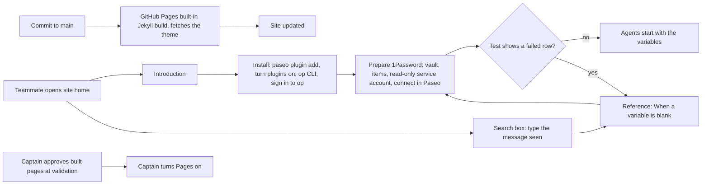

---
id:
title: A public docs page introduces project-env and walks a new teammate through setup
status: validation
variant: kc-dev-flow-2
profile: pilot
merge: pr
worktree: .worktrees/spacedock-ensign-project-env-docs-site
pr:
journey: paseo-project-env
journey-release: r1b
journey-story: install-one-command
gates:
    version: 1
    records:
        - id: gate:project-env-docs-site:backlog
          stage: backlog
          attempts:
            - id: gate-attempt:project-env-docs-site-backlog-1
              briefing:
                id: briefing:project-env-docs-site:backlog:attempt-1:revision-1
                digest: sha256:d58c363dda8bb88a084208b56ec6a6222cfccb5d65341e235bb07d347294f430
                room-ref: ./project-env-docs-site/review/backlog/briefing-1
              resolution:
                type: Resolution
                id: resolution:spacedock:project-env-docs-site:backlog:1
                briefing: briefing:project-env-docs-site:backlog:attempt-1:revision-1
                by: person:captain
                at: "2026-10-27T15:33:25.323767Z"
                decision: approve
                reason: '「可以，先文件」 — Captain in FO chat, 2026-10-27. Asked: 「你要決定的：先做哪一個？建議先做「文件網站加插件介紹」…可以併進「r1b 新同事上手」…回「先文件」或「先保險庫」。」 FO had recommended docs first. The page''s scope and the Pages switch-on are confirmed at the ideation gate.'
              application:
                target-stage: ideation
                state: consumed
        - id: gate:project-env-docs-site:ideation
          stage: ideation
          attempts:
            - id: gate-attempt:project-env-docs-site-ideation-1
              briefing:
                id: briefing:project-env-docs-site:ideation:attempt-1:revision-1
                digest: sha256:b558da556eabd0983e4fbb3543c790d783d146d2fc990c5e2739679352e537b8
                room-ref: ./project-env-docs-site/review/ideation/briefing-1
              resolution:
                type: Resolution
                id: resolution:spacedock:project-env-docs-site:ideation:1
                briefing: briefing:project-env-docs-site:ideation:attempt-1:revision-1
                by: person:captain
                at: "2026-10-27T17:23:45.747333Z"
                decision: revise
                reason: '「just-the-docs」 — Captain in FO chat, 2026-10-28, while the ideation gate (briefing-1, sha256:b558da55) was open, after FO''s theme comparison. Override: recommended stock minima (gate question); Captain chose just-the-docs (FO''s later chat recommendation); area: docs site theme. Asked: 「回「換 just-the-docs」或「維持 minima」。」'
            - id: gate-attempt:project-env-docs-site-ideation-2
              briefing:
                id: briefing:project-env-docs-site:ideation:attempt-2:revision-1
                digest: sha256:289c806805bcf011c810f7a89f7abc1360a303359faa1eac8e03186d8a0cb592
                room-ref: ./project-env-docs-site/review/ideation/briefing-2
              resolution:
                type: Resolution
                id: resolution:spacedock:project-env-docs-site:ideation:2
                briefing: briefing:project-env-docs-site:ideation:attempt-2:revision-1
                by: person:captain
                at: "2026-10-27T18:00:30.609402Z"
                decision: approve
                reason: '「准」 — Captain in FO chat, 2026-10-28, on the ideation gate attempt 2 (sha256:289c8068), FO having recommended approval; approval also allows one stylesheet rule darkening the search result''s page label to at least 4.5:1, and keeps the two root wrapper files (he did not object). Asked: Approve the revised docs site design (just-the-docs pinned at v0.12.0, six pages in reader order with search, two root wrapper files) and AC-1 and AC-2 into implementation? ... Say if you object to any part.'
              application:
                target-stage: implementation
                state: consumed
started: 2026-10-27T15:33:59Z
---

From the Captain on 2026-10-27, before opening project-env to the recce team: 「顯然還缺 plugin 介紹，文件說明，以及可以的話應該架一個基於 github md 檔案的 release page…方便大家看設定看文件看圖片等」. FO's research (`research/2026-10-27-1password-agents-and-docs-site.md` in this state checkout) recommended GitHub Pages with its built-in Jekyll from the repository's Markdown. Asked which to do first, the docs page or agent-organised vaults, he answered 「可以，先文件」. FO checked on 2026-10-27: `project-env/OVERVIEW.md` has one line on prerequisites and no install steps for the 1Password CLI; the journey map (`docs/journey/project-env/give-agents-their-project-setup.yaml`) marks the install story `unverified` and its prerequisite and plugin-enable stories `gap`.

## Scope

In: one public page set built from Markdown in iamcxa/kc-paseo-plugins: a short introduction to project-env with screenshots, install steps that a new teammate can follow from nothing (Paseo version, enabling plugins, `paseo plugin add github:iamcxa/kc-paseo-plugins:project-env`, the 1Password CLI), how to prepare 1Password (one read-only service account per vault, an expiry, the `agent-<project>-<env>` vault name from ADR 0005), the existing troubleshooting notes, and links to the GitHub releases. Internal documents (`docs/adr`, `docs/dev2`, `docs/dev2-poc`, state) are not published. Turning on GitHub Pages is a public, outward-facing step: it is done only after the Captain approves the built page at validation. Out: agent-organised vaults, a search or sidebar theme, Netlify, spacedock-bridge's own pages beyond a link. Stop condition: the acceptance criteria pass.

## Acceptance criteria

**AC-1**: Built from the repository with GitHub Pages' own Jekyll and the just-the-docs remote theme pinned at v0.12.0, the site shows the project-env introduction, install, 1Password preparation and troubleshooting pages with their pictures, a sidebar of the six pages in reader order, and search, and no file from `docs/adr`, `docs/dev2` or `docs/dev2-poc`.
Verified by, on a throwaway copy of the repository at the implementation commit, never a branch:
1. `project-env-docs-site/capture/build-site.sh <copy>` (Docker `ruby:3.3`, `github-pages` 232, the versions `pages.github.com/versions.json` lists; it needs network to fetch the theme) exits 0.
2. `project-env-docs-site/capture/crawl.py <copy>/_site` prints a built-file list equal to the 23-file list in `evidence/build-crawl.txt`, `INTERNAL PATHS PRESENT: none`, a `SEARCH INDEX PAGES` list with no excluded path, and `LINK/IMAGE PROBLEMS: 0` (every href, image and `#anchor` resolves).
3. `capture/preview.sh <served-url> <dir>` takes whole-page pictures of the six pages at 1280 px and 400 px, the open menu at 400 px, search results for one query, for a cause sentence and for no match, and Install at 700 and 900 px; `document.documentElement.scrollWidth` equals the window width (1280, 900, 700, 400) on every page.
4. `capture/checks.sh <served-url>` prints, on the built Reference page, that a link to "When a variable is blank" is visible without scrolling at 1280 and 400 px and its target exists; that every picture on the Introduction, Install and Prepare pages sits inside a link to its own full-size file (the browser's own image view, back button to return); that each of the six pages shows its title as the page heading; that the built Changelog lists each change once (27 entries, 27 distinct); that Install has a copy button on each of its 5 code blocks; and that at 400 px neither plugin name splits across lines on Home.
5. `capture/capture.sh <dir>` on an isolated Paseo with fake `op` and `security` retakes the seven plugin pictures, and the pages show them.

**AC-2**: The install and preparation steps were followed as written by someone starting from a Mac without the plugin, up to an agent that starts with one mapped variable set.
Verified by: a run on a new isolated Paseo home (own port, `--home`), by someone who reads only the built Install and Prepare 1Password pages, copying each command from the built page text (so a long dash in the code font cannot hide a wrong character), with the plugin installed from GitHub and fake `op` and `security` where a real account is needed. The run ends with an agent started in the connected repository whose environment holds one mapped variable. It records each step and each place the words were not enough, and every such place becomes a change to the pages before the task closes. The sign-in in Install step 3 (3b, 3c) needs a real 1Password account, so an agent run skips it and says so. A run with a real 1Password account is the Captain's, not an agent's.

## FO alignment

Surfaces: ui
Visible change: A public page introduces project-env and gives a new teammate install, 1Password preparation and troubleshooting steps with pictures.
Direction alignment with the Captain: done — he asked for the introduction, docs and a Markdown-based page on 2026-10-27 and chose docs first (「可以，先文件」); the page's scope and the Pages switch-on are confirmed at the ideation gate.
Release review: paseo-project-env/r1b at bed5a6644c646e91c9cbc235807f33bce878cc8f — review-release run 2026-10-28 (signal 4, before the first implementation dispatch), `project-env-docs-site/release-review-r1b.md`: this task can be dispatched; it does not finish r1b; the map edit, the interrogation and the other r1b tasks wait for the Captain.
Map footprints: not needed: no journey answer is recorded by this task; the ideation report lists the stories for a later map update.

## Captain amendments

### Amendment 1 — 2026-10-28, chat
Captain: 「just-the-docs」 (FO chat, 2026-10-28)
Asked: "回「換 just-the-docs」或「維持 minima」。" after FO's comparison of four themes (evidence/themes/comparison.md)
Supersedes: none
Design: Scope words "a search or sidebar theme" in the Out list

## Design

**Revision 2 (2026-10-28, ideation cycle 2).** The Captain's revise of the first ideation gate (「just-the-docs」) replaced the stock minima theme. Changed: `_config.yml` now loads the just-the-docs remote theme pinned at v0.12.0 with `jekyll-remote-theme`; the sidebar lists six pages in reader order by `nav_order` (Home first); each page shows its title as its heading; search is on and splits results by section and by each blank-variable cause; code blocks have a copy button; Reference and Changelog are published through two six-line wrapper files so search lands on a cause heading; Install gains a sign-in step and Homebrew line, Prepare a "Done" section and 4a to 4c sub-steps. Withdrawn: the stock-minima decision and its ADR title. Unchanged: scope, AC-1 and AC-2's intent, the capture scripts for the seven plugin pictures, the verified statements not named here. The dark scheme is not used: it is one fixed switch that does not follow a reader's device setting, and in `previews/dark-intro-1280.png` the near-black plugin pictures lose their edge against a dark page while they read as framed pictures on the light one (the Director's reading in `design/ideation-4.yaml` agrees).

### PRFAQ

**Press release (future-facing).** A recce teammate who has never seen project-env opens `https://iamcxa.github.io/kc-paseo-plugins/`, finds a sidebar of six pages and a search box, reads what the plugin does with a picture of its settings screen, then follows two pages with pictures: Install (the command, turning plugins on, the 1Password CLI and signing in to it) and Prepare 1Password (a vault, its items, a read-only service account with an expiry, and connecting them in Paseo). A blank variable sends them to a heading for their cause, or they search the message they see. Nothing from the repository's workflow folders is on the site.

**FAQ.**
- *Why GitHub Pages' built-in Jekyll and not a docs framework?* It renders the repository's Markdown with one `_config.yml` and no Node, workflow or Gemfile in the deploy path. Research file: `research/2026-10-27-1password-agents-and-docs-site.md`, Q2.
- *Why the just-the-docs remote theme?* The Captain chose it on 2026-10-28 after the four-theme comparison (`evidence/themes/comparison.md`): it is the only one with a sidebar that marks the current page and search. `jekyll-remote-theme` 0.4.3 is in the `github-pages` 232 set (`pages.github.com/versions.json`, read 2026-10-28); `remote_theme` pins the tag v0.12.0. Getting worse: the build fetches the theme from GitHub, about 970 KB of CSS and JS where minima had 20 KB, and two unused sample photographs (590 KB) the theme copies into the site.
- *Why a root source and not `/docs`?* The existing `project-env/OVERVIEW.md` and `CHANGELOG.md` are reused, not copied; Pages' source folder is one folder, so the source is the repository root and `exclude` lists every internal path.
- *How are the overview and changelog reused, not copied?* `reference.md` and `changelog.md` at the repository root each hold front matter (title, `nav_order`, `permalink` under `/docs/project-env/`) and one `` (or `CHANGELOG.md`) line; the two originals are excluded from the build. Without the wrappers, Jekyll's optional-front-matter pages reach just-the-docs' search index as unconverted Markdown with no section split (observed: search hits on Reference were page-level and showed backticks, and the overview needed a `# Reference` heading added to a file the plugin ships). `include_relative` accepts no `..`, so the wrappers sit at the root.
- *What if someone adds a folder?* A new top-level folder publishes unless excluded. The built-file list in AC-1 step 2 is the guard; it runs when the pages change, not in CI (no cost added).
- *What does this not do?* It does not make the Test or agent-start screens appear; the "Started without N project variables" line is quoted as text, not pictured. The sign-in step (Install 3b, 3c) needs a real 1Password account and is the Captain's run.

### Reader flow and build



The last line is the only outward-facing step: Pages is turned on by the Captain after validation, never by an agent (Scope).

### Pages and files

| Page (sidebar order) | Source file (repository path) | Origin |
| --- | --- | --- |
| 1 Home | `README.md` (root; `jekyll-readme-index`; title and `nav_order` from `_config.yml` `defaults`) | existing, edits below |
| 2 Introduction | `docs/project-env/index.md` | new |
| 3 Install | `docs/project-env/install.md` | new |
| 4 Prepare 1Password | `docs/project-env/prepare-1password.md` | new |
| 5 Reference, with troubleshooting | `reference.md` (root wrapper) including `project-env/OVERVIEW.md`; address `/docs/project-env/reference.html` | wrapper new, overview existing and reused |
| 6 Changelog | `changelog.md` (root wrapper) including `project-env/CHANGELOG.md`; address `/docs/project-env/changelog.html` | wrapper new, changelog existing (release-please) and reused |
| Pictures | `docs/project-env/img/01..07-*.png` | produced by `capture.sh`, kept in the repository |

Relative `img/x.png` links work on GitHub and on Pages at any base URL. Edits to existing files, shown in `evidence/source-edits.diff` (the two wrappers are its last two entries): README (`git:` form; a link to Install; one sentence saying the pages are about project-env; the two plugin names in `<code style="white-space: nowrap">` spans so they never split at the hyphen at 400 px, which GitHub shows as plain code); OVERVIEW (one line under the first paragraph linking to the blank-variable section; each of the eight causes becomes a `###` heading instead of a bold run-in, which GitHub, Pages and Paseo's overview all render; Setup step 2 matches the screens, which have no "Change" on a new project; screen names bold like the step pages); CHANGELOG (the four duplicated 0.1.0 pairs collapse to one line each, a hand edit of an already-released entry that release-please does not rewrite). Edits to `project-env/` use a `docs(project-env):` commit type, which release-please does not turn into a release.

`_config.yml` (full text in `site-draft/_config.yml`): `remote_theme: just-the-docs/just-the-docs@v0.12.0` and `plugins: [jekyll-remote-theme]`; `search_enabled: true` with `search: heading_level: 3`; `enable_copy_code_button: true`; `defaults` giving every page `layout: default` and the README the title "Home" and `nav_order: 1` (the other five pages carry their `nav_order` 2 to 6 in their own front matter); no `color_scheme`, so the light scheme; and `exclude` for `docs/adr`, `docs/dev2`, `docs/dev2-poc`, `docs/journey`, `docs/project-env/capture`, `project-env/OVERVIEW.md`, `project-env/CHANGELOG.md`, `project-env/{client,server,shared,test}`, `project-env/index.*.ts*`, `project-env/package*.json`, `project-env/paseo-plugin.json`, `project-env/tsconfig.json`, `spacedock-bridge`, `release-please-config.json`, `Gemfile*`, `vendor`. Dot-files such as `.release-please-manifest.json`, `.github` and the state checkout are excluded by Jekyll itself. `Gemfile` (`github-pages` 232) exists only for the local build; Pages ignores it.

Pictures and checks: `docs/project-env/capture/` holds `capture.sh`, `setup.sh`, `fx.py`, `env.sh`, `teardown.sh`, `build-site.sh`, `crawl.py`, `preview.sh` and `checks.sh` (drafts in this task's `capture/`). `setup.sh` builds the plugin's own `contribute()` against the existing `project-env/test/world.ts` fakes in an isolated Paseo (own home, own port, no real `op` or `security`); `capture.sh` drives it with `agent-browser`, takes seven pictures of one fictional project, crops away the sidebar (it shows this Mac's host name) and deletes the raw frames. Declared outside the repository: `paseo` 0.12 or later, `agent-browser`, Docker with network, Python 3 with Pillow. Kept current by rerunning `capture.sh` whenever a PR changes `project-env/client/`; nothing enforces it. Implementation must replace the drafts' machine paths (`CHECKOUT` and the tmp directories) with arguments.

### Verified statements

Every install and preparation statement on the drafted pages, with its source. Run on 2026-10-27 and 2026-10-28; Paseo 0.13.0, `op` 2.41.1, macOS.

| Statement | Source |
| --- | --- |
| Needs Paseo 0.12 or later; Paseo's own plugin page states no minimum | `project-env/paseo-plugin.json` `requirements.paseo`; `https://paseo.sh/docs/plugins` |
| `paseo plugin add git:iamcxa/kc-paseo-plugins:project-env` installs it; the same command with `github:` also works but Paseo documents only `git:` | run on isolated homes, plugin shown `running`, revision bed5a66; Paseo plugin page |
| Plugins are off until Settings, Plugins, Enable plugins; an installed plugin reads `disabled` until then | run: fresh home showed `disabled`, switch off; toggling it gave `running`; Paseo plugin page |
| The plugin's actions menu has Project environment, Logs, Reload, Remove | run, picture 02 |
| With no Paseo project the plugin's screen is empty with no hint; with one, "Add a project: Choose…" lists it | run on the real plugin from GitHub (the empty screen is a finding below) |
| `brew install 1password-cli`; `op --version` prints a version (2.41.1 here) | `https://www.1password.dev/cli/get-started/`, read 2026-10-27 and 2026-10-28; `op --version` run 2026-10-28 |
| Prerequisites of the CLI: a 1Password subscription and the 1Password app for Mac; Homebrew's address is brew.sh | the same page (prerequisites list); `https://1password.com/downloads/mac` and `https://brew.sh` both answered 200 on 2026-10-28 |
| Sign in as yourself: app, Settings, Developer, Integrate with 1Password CLI; then `op vault list` asks for approval and lists the vaults | the same page (Sign in, Checking); `op signin --help` 2.41.1 names the same toggle (prints the menu path in the other order; the page's order is used) |
| The plugin works without a signed-in `op` and passes the token as `OP_SERVICE_ACCOUNT_TOKEN`; it looks for `op` in `/opt/homebrew/bin`, `/usr/local/bin`, then PATH | `project-env/server/secrets.ts`, `project-env/server/tools.ts` |
| The token is stored in the macOS login Keychain, found by service account name | `project-env/server/secrets.ts` (`security find-generic-password`); ADR 0003 |
| The 1Password website wizard has no expiry option; expiry is `--expires-in` on the CLI | `https://www.1password.dev/service-accounts/get-started/`, fetched and grepped 2026-10-28 |
| `op service-account create <name> --expires-in <d> --vault <vault>:read_items --raw`; default permission read; units s, m, h, d, w; cannot grant Personal or Private; token shown once | `op service-account create --help`, op 2.41.1 |
| `op vault create <name>` | `op vault create --help`, op 2.41.1 |
| Add a Password field: Edit, Add More, Password, Save | `https://support.1password.com/custom-fields/`, fetched 2026-10-28 |
| Create a vault: plus in the Mac sidebar, name, Create | `https://support.1password.com/create-share-vaults/`, fetched 2026-10-28 (it does not say who may create vaults in a team account) |
| Vault `agent-<project>-<env>`, items titled by service in lowercase with hyphens, field label equal to the variable name, no `/`, no sections | ADR 0005 amendment 2026-10-23 (advice, nothing checks it) |
| New-project form: service account, Check, token, Save token, Vault, + Add, Test, Save; "1 failed · 3 set" and a red "!" | full UI run on an isolated Paseo with fakes, pictures 03 to 07 |
| Theme and search behave as drawn: sidebar marks the current page, search by a cause sentence ("rejected the token") lists that cause heading first, a nonsense query shows "No results found", 5 copy buttons on Install | built and served locally 2026-10-28; `evidence/previews/search-*`, `evidence/checks.txt` |

Not verified, stated on no page as fact: a real 1Password account (who may create a service account; the sign-in steps 3b and 3c; the Captain's run), an agent started in the connected repository showing the variables (AC-2 run), `op item create --category "Secure Note" 'NAME[password]='` (ADR 0005's run on op 2.30.3; the pages teach the app's Add More steps instead), the theme fetch and the search on the real GitHub Pages build (local build only), and the copy button's hover and copied states in a browser.

### Existing-code check

Checked in the fleet order: Paseo (its plugin page documents install and enabling, no docs-site feature), spacedock and kc-dev-flow-2 (no docs-site capability), sibling repositories under `~/Project` (no `_config.yml`, and GitHub Pages returns 404 for `kc-claude-plugins` and `kc-paseo-plugins`, read-only `gh api`, 2026-10-28). The theme: `jekyll-remote-theme` is in `github-pages` 232 and just-the-docs is a published public theme; no sibling uses one. Nothing to reuse; the repository's own Markdown is reused as described above. `project-env/test/world.ts` and `project-env/test/fakes/` already provide the fake `op` and `security`; the capture harness is built on them.

### Journey stories (`docs/journey/project-env/give-agents-their-project-setup.yaml`, release r1b)

| Story | Pages cover it | Stays a gap |
| --- | --- | --- |
| get-plugin / install-one-command | Install: Mac, Paseo 0.12, `op` (Homebrew, the app, signing in), the one command | Paseo documents no minimum plugin version, only the manifest does |
| get-plugin / enable-plugins | Install step 2, with the picture; README keeps the command | none on the site |
| get-plugin / find-settings | Install step 4 (actions menu, Project environment) | the screen's token hint says "this Mac's Keychain" (product text, not pages) |
| prepare-1password / create-vault, add-secrets | Prepare steps 1 and 2 | none on the site |
| prepare-1password / create-service-account | Install 3b and 3c (sign in), Prepare step 3 | q2 (can a non-admin teammate create one) stays open: the page repeats 1Password's "ask your administrator" and does not claim an answer |
| prepare-1password / setup-guide | Prepare steps 1 to 4 and Done, naming advice (ADR 0005), both ADR 0001 weaknesses on the Introduction | the in-app steps on the screen itself stay a product gap |
| prepare-1password / agent-lays-out-vault | not covered | no skill exists (ADR 0005); the pages do not mention it |
| connect / pick-repository | Prepare step 4 says the repository must be a Paseo project first | the plugin's empty screen still gives no hint, and a failed load is silent |

The ideation does not edit the map; a later map update records these.

### UI proposal and preview

UI proposal: A public documentation site built from the repository's Markdown by GitHub Pages' built-in Jekyll with the just-the-docs remote theme (v0.12.0, light colour scheme, search on, copy button on code blocks). Six pages in a left sidebar in reader order (a header menu button below 800 px, which also holds the search box): Home (the repository README), Introduction (with one screenshot), Install, Prepare 1Password, Reference (the plugin's overview, which holds the "When a variable is blank" troubleshooting, each cause a heading) and Changelog (the plugin's changelog, the developer log). Each page shows its title as the page heading and the sidebar marks the current page. Install and Prepare 1Password are step pages with screenshots of the plugin's settings screens, each clickable to the full-size picture file. A search box sits above the content on wide screens; search results are split by section and by each cause heading. Audience: a recce teammate with a Mac and Paseo who has never used the plugin or the 1Password CLI.

Preview: /Users/kent/Project/kc-paseo-plugins/docs/dev2/.spacedock-state/project-env-docs-site/evidence/previews/

The preview folder holds pictures of the built site (a disposable local build of a throwaway copy, `github-pages` 232 in Docker `ruby:3.3`, the closest reproducible build to Pages' Ruby 3.3.4, theme fetched from GitHub): whole pages `{home,intro,install,prepare,reference,changelog}-{1280,400}.png`, `install-{700,900}.png`, the open menus `menu-open-400.png` and `install-menu-700.png`, search results `search-{1280,400}.png` (query "keychain"), `search-cause-{1280,400}.png` (a cause sentence) and `search-none-{1280,400}.png` (no match), and `dark-intro-1280.png` (the dark scheme, for the choice only), plus `scrollwidth.txt` and `scrollwidth-700-900.txt`. In the 1280 whole-page pictures the sidebar's grey stops at 900 px: the capture tool stretches the 900 px window to page height; a real browser keeps the sidebar fixed. The cycle 1 minima pictures are in `evidence/previews-1/`. The drafted pages are in `site-draft/`; the plugin pictures are `site-draft/docs/project-env/img/`. A still picture shows no scroll, click or hover; AC-1 steps 3 and 4 measure those.

### Design review

Design review: design/ideation-4.yaml
Design finding 1: fixed: Install step 3 is split into 3a install the command, 3b turn on the app integration, 3c check you are signed in, each with what to expect (previews/install-1280.png, install-400.png).
Design finding 2: declined: Reference is the plugin's own overview file, which ships inside the plugin and must stand alone in Paseo, so its short Setup, How it works and Limits stay; the site pages link to it and the repeated facts are accepted (the earlier review's decline of the same repetition, declines-1.yaml finding 13, was upheld).
Design finding 3: fixed: the UI proposal now says that below 800 px search is inside the open menu (previews/menu-open-400.png, install-menu-700.png).
Design finding 4: Needs decision: the search result's page label is 2.1 to 1 on white; accept the stock colour or build a one-rule override (Decisions). Recommend the override. ADR: The docs site uses the just-the-docs theme pinned at v0.12.0
Design finding 5: declined: host component Search results list at _sass/search.scss (just-the-docs v0.12.0; copy at /tmp/docs-site-v2/theme-files/): the list height and the absence of a close control are the theme's own; the Escape key and a tap outside close it, a site-owned stylesheet would be needed to change it.
Design finding 6: declined: host component Search no-result message at assets/js/just-the-docs.js (just-the-docs v0.12.0; copy at /tmp/docs-site-v2/theme-files/just-the-docs.js): the text "No results found" is written by the theme's script, a site-owned copy of the script would be needed to change it.
Design finding 7: declined: host component Menu button at _includes/components/sidebar.html (just-the-docs v0.12.0; copy at /tmp/docs-site-v2/theme-files/): the button's glyph is the fixed menu icon, a site-owned copy of the sidebar include would be needed to change it.
Design finding 8: declined: the pictures are retaken from the real plugin screens by the capture script and outlining one control per picture would need picture-annotation code the task does not have; each step's text names its control in bold. The caption now reads "Click or tap a picture to see it full size" at the first picture of each page.
Design finding 9: AC-1 (step 4 checks every picture is a link to its own file; the full-size view is the browser's own image page and its back button)
Design finding 10: fixed: Prepare 1Password ends with a "Done" section naming Introduction and Reference (previews/prepare-1280.png).
Design finding 11: declined: the Home page is the repository's README, which is also the landing page on GitHub where its heading is the repository name; changing the heading changes the GitHub page too.
Design finding 12: fixed: Home's first paragraph now points to Install for the project-env command (previews/home-1280.png, home-400.png).
Design finding 13: fixed: the plugin names on Home are `<code style="white-space: nowrap">` spans; AC-1 step 4 counts split names at 400 px and prints 0 (previews/home-400.png). Overruled from declined, pass 1b.
Design finding 14: declined: release-please generates the changelog and writes the 0.2.0 compare link and no link for the first release; the file is generated and a hand edit would be overwritten (the earlier review's same decline was upheld, declines-1.yaml finding 11).
Design finding 15: declined: release-please generates the changelog and keeps its title and entry format, so a lead sentence or removing the prefix would be lost or break the format (the earlier review's same decline was upheld, declines-1.yaml finding 12).
Design finding 16: declined: searching the on-screen sentence reaches the cause heading directly (search-cause-1280.png and search-cause-400.png), and a list of eight links would add a second copy of the headings to the plugin's shipped overview file.
Decline check: design/declines-2.yaml

The first review of this cycle (`design/ideation-3.yaml`, on the first just-the-docs draft) had one MAJOR finding: nothing told a reader who has never used the CLI how to sign in to `op`, which Prepare's commands need. Install step 3 now covers it (verified statements), and the second review (`ideation-4.yaml`, the last, on the redrawn pictures) has no MAJOR finding. The same round also fixed: the Homebrew line, Prepare's 4a to 4c headings, bold screen names in the overview, copy buttons, `heading_level: 3` search and the two wrappers (Reference and Changelog hits carry a section name and one address style), the no-match, cause-sentence, 700 px and 900 px pictures. Two first-round MINOR items were not raised again by the second review and were not re-ruled: the cause headings are only slightly larger than body text (the theme's `h3` size) and each changelog line ends with two small links (release-please text). The Director saw pictures only; facts it cannot see (code blocks scroll inside themselves at 400 px, copy buttons exist, copied commands keep plain hyphens) are covered by AC-1 steps 3 and 4 and AC-2.

### Decisions

Needs the Captain (one, finding 4, ruled `host-look` by the Director): the search result's page label (for example "Reference" above each hit) is the theme's pale lavender, 2.1 to 1 on white at about 12 px. Accept it as the theme draws it, or allow one site-owned stylesheet rule that darkens it to at least 4.5 to 1 (the theme's documented custom-style file `_sass/custom/custom.scss`, one rule, pinned to v0.12.0 so it cannot drift). **Recommendation: allow the one rule.** The label says which page a hit is on, and on 2026-10-28 the Captain chose the fuller theme over my recommendation of the stock one (gate record Override: recommended stock minima; Captain chose just-the-docs), so I am not recommending the plainer path again. What gets worse: one more site-owned file, and the override is checked only in the pictures (a criterion if built: the label reaches 4.5 to 1 on white in `search-1280.png` and `search-400.png`).

Open, not a Captain decision: (a) the capture scripts add nine files to `docs/project-env/capture/`; without them the pictures and checks cannot be retaken the same way, and nothing has gone stale yet, so that is an unanswered without-it question for the implementation PR body under `without-it unanswered`; (b) `reference.md` and `changelog.md` add two six-line files at the repository root, which GitHub shows with their Liquid line raw; without them search lands on the page top, not on a cause heading, and the overview file the plugin ships needs an extra `# Reference` heading. I chose them and the Captain may rule them out at the gate.

### Findings recorded for the product (outside this task's scope)

- With no Paseo project the plugin's screen is blank under "Projects" with no hint; the journey's pick-repository story already names this as release r1b work.
- OVERVIEW Setup step 2 described "Edit the repository, choose Change", which a new project does not show; this design corrects the sentence.
- The repository README told people to use `github:`; Paseo documents `git:`. Both work on Paseo 0.13.0.
- The 1Password website wizard offers no expiry, yet OVERVIEW Setup step 1 says "Give it an expiry"; the page says how (the CLI).
- Home's search entry shows the README's Markdown unconverted (backticks in the snippet), because the README is an optional-front-matter page like the overview was; one entry, accepted, no wrapper for it.
- just-the-docs copies two sample photographs (`assets/images/large-image.jpg`, `small-image.jpg`, about 590 KB) into the site that no page uses; `exclude` does not reach theme files.
- A local build cannot show the real site address: `jekyll-github-metadata` needs an API token, so canonical and feed links point at a wrong GitHub address locally. Page links are unaffected (crawl: 0 problems). The real addresses are checked once the Captain turns Pages on.

### Batch overlap

none: the other two tasks in the workflow (`project-env-release-1`, `project-env-test-row-draft-note`) are held at backlog as superseded and change none of `README.md`, `project-env/OVERVIEW.md`, `project-env/CHANGELOG.md`, `_config.yml`, `reference.md`, `changelog.md` or `docs/project-env/`. Recommended order: none.

## Stage Report: ideation

- DONE: Design the docs site your Scope names: the page list and outline (introduction with screenshots, install from nothing, 1Password preparation, troubleshooting from OVERVIEW.md, releases), where each Markdown file lives and how it is reused from project-env/OVERVIEW.md rather than copied, the `_config.yml` (theme, `exclude` for every internal path) for GitHub Pages' built-in Jekyll, and how the pictures are produced and kept current; keep AC-1 and AC-2 and give each a reproducible evidence clause.
  See `### Pages and files` and `### PRFAQ`; AC-1 now has five numbered steps and AC-2 a copy-the-built-text run. AC-1 current evidence on the draft: build exit 0, 19 built files, `INTERNAL PATHS PRESENT: none`, `LINK/IMAGE PROBLEMS: 0`, scrollWidth 400 on six pages (`evidence/build-crawl.txt`); not yet run at an implementation commit. AC-2 current evidence: partial only (real plugin installed from GitHub on an isolated home; add-project to Test to Save driven on fakes); the run from the built pages' words is not yet verified.
- DONE: Produce the artifact the ui surface owes: whole-page previews of the built site at desktop and 400 px from a local build with the GitHub Pages gem set (or the closest reproducible build, named), the install and 1Password preparation pages drafted in full, plus the design review, with each finding dispositioned; list which r1b journey stories (get-plugin and prepare-1password) the pages cover and which stay gaps.
  `evidence/previews/` (13 pictures, `github-pages` 232 in Docker ruby 3.3, Pages uses 3.3.4); pages in `site-draft/`; reviews `design/ideation-1.yaml`, `ideation-2.yaml`, `declines-1.yaml`; 13 findings dispositioned; story table in `### Journey stories`. `design_surfaces.py check`: "design surfaces presentable", exit 0.
- DONE: Verify every install and preparation statement against code, Paseo's own docs or a run (for example `paseo plugin add` from GitHub on an isolated Paseo home, the 1Password CLI install page), and name any decision the Captain must make (at most one), with a recommendation.
  `### Verified statements` lists each with its source; three items are stated unverified. One decision for the Captain, with a recommendation (accept stock minima), under `### Decisions`.

### Summary

The site is a root-source GitHub Pages build: three new pages under `docs/project-env/`, the existing overview and changelog published as Reference and Changelog by `_config.yml` rather than copied, and seven pictures retaken by a capture script on an isolated Paseo with fakes. The checks found real defects in the existing words (OVERVIEW Setup describes a screen a new project does not show; the website wizard has no expiry option; `github:` is undocumented by Paseo; the plugin's screen is blank with no Paseo project), and the design corrects the first three and records the last. Pages is not turned on and nothing in the repository was changed; the Captain's one decision is whether to accept the stock theme's look.

## Stage Report: ideation (cycle 2)

- DONE: Revise the design for the Captain's revise of 2026-10-28 (quoted in the ideation gate record): switch the site to the just-the-docs remote theme pinned at v0.12.0 (`remote_theme` plus `plugins: [jekyll-remote-theme]`), with the home page first and the pages in reader order via `nav_order`, each page's title heading shown, and search on; keep the rest of the design, AC-1 and AC-2; update `_config.yml`, the page drafts and the design text, and say whether the dark scheme is used, with a reason.
  `site-draft/_config.yml` and the drafts are updated and `## Design` carries a "Revision 2" note; Home is `nav_order` 1, the sidebar order is Home, Introduction, Install, Prepare 1Password, Reference, Changelog; all six pages show their title heading (`evidence/checks.txt`); the dark scheme is not used (one fixed switch, plugin pictures keep their edge on light; `previews/dark-intro-1280.png`). AC-1 current evidence (draft, local build): build exit 0, 23 built files, `INTERNAL PATHS PRESENT: none`, `LINK/IMAGE PROBLEMS: 0` (`evidence/build-crawl.txt`), scrollWidth equal to the window at 400, 700, 900 and 1280 px, checks.sh results above; not yet run at an implementation commit. AC-2 current evidence: partial only (plugin installed from GitHub on an isolated home and the add-project to Test to Save flow driven on fakes, cycle 1); the run from the built pages' words, including the new sign-in step, is not yet verified.
- DONE: Rebuild with the github-pages gem set and retake the whole-page previews at 1280 and 400 px (each page, the open phone menu, and search results for one query), recheck the crawl, exclusions and scrollWidth, and run the design review of the new pictures with each finding dispositioned; name any decision the Captain must make (at most one), with a recommendation.
  Rebuilt (`github-pages` 232, Docker ruby 3.3) and 25 pictures retaken in `evidence/previews/` by `capture/preview.sh`; crawl, exclusions and scrollWidth rechecked; design review `design/ideation-3.yaml` (one MAJOR: no sign-in step, fixed) then `design/ideation-4.yaml` (no MAJOR, 16 findings dispositioned) and `design/declines-2.yaml` (one decline overruled and fixed, one ruled a decision). One Captain decision, with a recommendation (allow one contrast override), under `### Decisions`. `design_surfaces.py check`: "design surfaces presentable", exit 0 (16 findings: 5 fixed, 1 criteria, 9 declined, 1 decision; decline check: 9 upheld, 1 overruled, 1 decision). Note for FO: the Scope line "Out: ... a search or sidebar theme" now conflicts with the Captain's revise; I restored it and left any amendment to FO.

### Summary

The site now uses just-the-docs v0.12.0 with a six-page sidebar, search and copy buttons, and two six-line root wrappers publish the overview and changelog so search reaches each cause heading. The review caught a real gap for a newcomer (no step for signing in to the 1Password CLI, now Install step 3), and the design records its source. Pages is not turned on and nothing in the repository was changed; the Captain's one decision is whether to darken the search result's page label (2.1 to 1) with one stylesheet rule.

## Number guards

ADR: 0009

## Stage Report: implementation

- DONE: Implement the approved revision 2 design exactly from this task's site-draft/, capture/ and evidence/source-edits.diff: `_config.yml` with the just-the-docs remote theme pinned at v0.12.0, `nav_order`, search and every internal path excluded; the Introduction, Install and Prepare 1Password pages; the two root wrapper files; the one `_sass/custom/custom.scss` rule that takes the search result's page label to at least 4.5:1 on white; the OVERVIEW.md, README.md and CHANGELOG.md edits; the screenshots; and the capture and check scripts with their hard-coded paths turned into arguments.
  PR #58 (Draft), candidate 48ecb5f on `spacedock-ensign/project-env-docs-site`, base bed5a66. Edits equal source-edits.diff (its CHANGELOG hunk differs only because the base already holds 0.2.0). Scripts take `<copy>`, `<served-url> <dir>`, `<out-dir> <work-dir> <port>`; setup and teardown delete only a directory carrying their own marker file.
- DONE: Write ADR 0009 (reserved under ## Number guards), "The docs site uses the just-the-docs theme pinned at v0.12.0", recording the Captain's words 「just-the-docs」 (2026-10-28) and his 「准」 on the one contrast rule (ideation attempt 2, 2026-10-28) with the questions they answered, and run adr_lint and number_guards check.
  `docs/adr/0009-the-docs-site-uses-the-just-the-docs-theme-pinned-at-v0-12-0.md`; `adr_lint.py docs/adr --since bed5a66 --require 0009` exit 0 (9 files); `number_guards.py check` "PASS: no findings", base bed5a6644c64. Protects lists `_config.yml` and `custom.scss`, each carrying a pointer comment.
- DONE: Land AC-1's evidence at the candidate commit (build with the github-pages gem set, crawl, exclusions, scrollWidth, previews at 1280 and 400 px, the search label's contrast) and AC-2's run from the built pages' own words on an isolated Paseo home with fake op and security up to an agent that starts with one mapped variable set, recording every place the words were not enough; then run the roborev gate, design_surfaces.py check and doc_impact.py, and open the Draft PR with `without-it unanswered` listing the capture scripts.
  AC-1 at 48ecb5f, `evidence/impl/`: build exit 0 (`build-exit.txt`); `crawl.txt` file list equal to the 23 in `build-crawl.txt`, INTERNAL none, no excluded path in the 46 search-index pages, LINK/IMAGE 0; `previews/` 24 files, scrollWidth equals the window on all six pages at 400, 700, 900, 1280 (24 of 24); `checks.txt` step-4 lines as listed in AC-1 (27 of 27 changelog entries, 5 of 5 copy buttons, 0 split names, label 5.03 to 1); `contrast-without-the-rule.txt` 2.09 to 1; capture.sh retake pixel-identical to the committed seven pictures. AC-2: `evidence/impl/ac2/record.txt` (steps, harness facts, `agent-log.txt`): an agent started in the connected repository with STRIPE_SECRET_KEY set; four places the words were not enough, all changed (a8a006a); steps needing a real account were skipped and named. Gates: roborev clean, `evidence=roborev:1277` (two findings repaired first, runs 1275 and 1276); design_surfaces "design surfaces presentable"; Draft PR https://github.com/iamcxa/kc-paseo-plugins/pull/58 with `without-it unanswered` naming the capture scripts and the two root wrappers.

### Affected documents

`doc_impact.py bed5a66 HEAD` lists one: `docs/adr/0009-...md: updated` (written in this change). `comment_ratio.py`: code lines 46, comment lines 0, 0.0%, maximum 5% met.

### Findings for FO

- Not run, by design: AC-2's sign-in (Install 3b, 3c) and Prepare 1 to 3 against a real account, and the theme fetch and search on the real Pages build; the Captain's run and the Pages switch-on.
- The plugin from GitHub cannot run against fakes: `project-env/server/tools.ts` hard-codes `/opt/homebrew/bin/op` and `/usr/bin/security`, so AC-2 past the actions menu used a plugin built on the repository's fakes (harness in `evidence/impl/ac2/harness/`). Not changed here.
- Harness trap worth knowing: the fake world's Keychain lives in a temp folder, so a daemon restart empties it, and its fake git has no answers for an agent start (the harness uses real git). Neither affects the pages.

### Summary

The docs site is delivered as Draft PR 58 at 48ecb5f: just-the-docs pinned at v0.12.0, the six pages with search, the one contrast rule (2.09 to 5.03), seven retaken pictures, the capture and check scripts as arguments, and ADR 0009. AC-1 passed at the candidate; AC-2 reached an agent with the variable set and found four word gaps, all fixed. Pages is not turned on and nothing outside this task's scope was touched.

## Stage Report: validation

- DONE: Independently check candidate 48ecb5f38bac6d8de9382a5bfddf52d38a70bddb (PR iamcxa/kc-paseo-plugins#58, base main bed5a66) against AC-1 and AC-2 and the approved revision 2 design: rebuild from git archive with the github-pages gem set, crawl it, confirm every internal path is absent (pages and search index), the six pages and seven pictures, scrollWidth at 400 and 1280 px, and the search label at or above 4.5:1; read every install and 1Password preparation statement against code, Paseo's docs or a run, and follow the Install and Prepare pages' words yourself on an isolated Paseo home up to an agent that starts with one mapped variable set, recording where the words fall short; check ADR 0009 quotes the Captain's words with the questions they answered; give a verdict.
  Verdict recommended: PASSED (AC-1 met at the candidate; AC-2 run reached an agent with one variable set; five Polish findings below, none Material). Evidence `evidence/val/` (crawl.txt, checks.txt, preview.log, previews/, ac2/, capture-retake/, acceptance-out.txt). Build exit 0 from `git archive` (github-pages 232, ruby:3.3); crawl: 23 built files equal to `evidence/build-crawl.txt`, `INTERNAL PATHS PRESENT: none`, no excluded path in the 46 search-index pages, `LINK/IMAGE PROBLEMS: 0`; 7 picture files, 6 pages; scrollWidth equals the window on all 24 (1280/900/700/400); `checks.sh`: Reference blank-link visible at 1280 and 400, every picture in a link to itself, 6 page headings, changelog 27 of 27 distinct, 5 of 5 copy buttons, 0 split plugin names; label 5.03:1 measured at 1280 and, by my own probe, at 400 px (opacity 1, rgb 114,83,237; impl measured 2.09 without the rule).
  Statements read against code, Paseo's and 1Password's pages (fetched 2026-10-28) or a run: `>=0.12.0` (`paseo-plugin.json`); `git:` source and the unsandboxed warning (run, Paseo docs); install through Settings > Plugins > Plugin source (run, installed on a fresh home); disabled until Enable plugins, then running (run); `brew install`, Developer > Integrate with 1Password CLI, `op vault list` approval, no expiry in the website wizard, accounts immutable, "ask your administrator", `--expires-in` units and `--raw` (1Password pages and `op ... --help`, no account call); Add More > Password, plus button for a vault (1Password support pages); token stored only after `checkToken` ok, single vault auto-picked, red "!" with reason, agent notice forbids printing (`server/secrets.ts`, `shared/token.ts`, `server/agent-notice.ts`).
  AC-2 run (new isolated homes, ports 18481-18483 and 18484, own folder `/tmp/val-ds`, removed after): commands copied from the built page text by `ac2/extract.py` (no non-ASCII in any code block, fake `op` and `pbcopy` on PATH, fake `op` checked against the real `op --help` flags). Install 1, 2, 4 and Prepare 1, 3, 4a to 4c followed as written: reads "No token in Keychain" (once the harness keychain was emptied), Connected line, "All 1 set", Save; agent started in the repository (claude/haiku) reports STRIPE_SECRET_KEY set without showing it (`ac2/agent-log.txt`). Failure boundary: with the token gone the agent starts, the variable is blank, the conversation shows "Started without 1 project variable / STRIPE_SECRET_KEY, no token stored for this service account" and the agent sends the user to Test (`ac2/s6-blank-agent.png`). Skipped, named: Install 3a to 3c and Prepare 2 (need the 1Password app or a real account). Harness facts: the GitHub-installed plugin hard-codes `/opt/homebrew/bin/op` and `/usr/bin/security` so it was driven only to its empty screen; Prepare 4 used the repository-built plugin on the repository fakes with real git.
  ADR 0009: Words 1 and 2 match the gate records of this task word for word (「just-the-docs」 answering 「回「換 just-the-docs」或「維持 minima」。」; 「准」 answering the attempt-2 question), `adr_lint.py docs/adr --since bed5a66 --require 0009` exit 0 (9 files); `number_guards.py check` PASS; `comment_ratio.py` 46 code lines, 0 comment lines, 0.0%, and I read the added `#` lines (usage lines and two pointers to ADR 0009, no narration); `doc_impact.py bed5a66 48ecb5f` lists ADR 0009 only, `updated`; `dispatch_records.py` 4 records complete.
- DONE: Run the built screen review your validation principles require (design-director pass 2a on your own screenshots of the built site at 1280 and 400 px) and write its Built screen review lines; write the minimal acceptance script FO will rerun in a fresh shell.
  Pass 2a saved as `design/validation-1.yaml` (23 pictures of my own build, `design/built-1/`): no MAJOR, 7 MINOR, all declined and all 7 upheld in pass 2b (`design/validation-declines-1.yaml`). Acceptance script below, run verbatim in a fresh bash on 2026-10-28 in 3m25s (`evidence/val/acceptance-out.txt`).
- DONE: Record what the Captain should see in the screenshots and every unverified obligation (real Pages build, real 1Password account).
  See the two sections below.

### Built screen review

Built screen review: design/validation-1.yaml
Built screen finding 1: declined: the Discard/Save bar is the plugin screen's bottom bar shown after every change, the 4c step names the control, and the AC-2 run found and used it on the built words (evidence/val/ac2/s4c-test.png).
Built screen finding 2: declined: a failed-row picture exists (07-test-result.png); a reason popup and the conversation line need a failing Test and an agent run the capture harness does not draw, and the on-screen sentence reaches the cause heading by search (search-cause-1280.png, search-cause-400.png).
Built screen finding 3: declined: AC-1 asks for a sidebar of the six pages and the design the Captain approved on 2026-10-28 puts the troubleshooting in Reference as the section "When a variable is blank", linked from Introduction, Prepare and the Reference opening line.
Built screen finding 4: declined: a page contents list was not in the approved design and no accepted criterion asks for it.
Built screen finding 5: declined: the steps inside the 1Password app need a real 1Password account to picture, which the capture harness (isolated Paseo, fake op) does not have; each step names its control in bold.
Built screen finding 6: declined: AC-1 step 4 measures that every picture sits inside a link to its own full-size file, so a tap opens the browser's own image view.
Built screen finding 7: declined: the plugin pictures are shown at their natural width (720 px crops of the real screens); stretching them would blur small text.
Built screen decline check: design/validation-declines-1.yaml

`design_surfaces.py check` on this task: "design surfaces presentable", 7 findings, 7 upheld declines, 0 decisions, exit 0.

### Findings

- F1 Polish: Prepare step 3 ends "copy something else to clear the clipboard", and step 4a then says "Paste the token"; the page never says to copy it back from the item the reader just saved it in. Trigger: reading the two steps in order; the run did not clear the clipboard. Value-ac[AC-2] reading: a place the words were short.
- F2 Polish: Prepare 4 says "add the folder from the sidebar's Add project"; that button opens three choices (Search for directory, Clone from GitHub, New directory) and the page names none (run on port 18482: Search for directory, type the path, Open this path).
- F3 Polish: Prepare step 2 says "Make one Secure Note per service" without saying how (New Item), and says the field picker "suggests that field, so you do not have to choose", but in the + Add flow no Suggested group appears (`s4b-picker.png`; `name` is set only when changing an existing variable's field, `client/settings-screen.tsx` `pickingVariable`).
- F4 Polish: Prepare 3's expiry bullet says "paste its token again" without naming where (the Change button on the connected line, as Reference says); observed after the token was gone: the screen shows "No token in Keychain" and Change (`s5-after-restart.png`).
- F5 Polish: Install 3b omits two lines of 1Password's own page: "Select your account at the top of the sidebar" before Settings, and macOS Big Sur 11 or later.
- F6 Polish: the retaken pictures show the capture folder path (`/tmp/pe-docs/...`) and picture 02 shows a directory install, not the GitHub source a reader has; and the PR's "pixel-identical" holds only for the same folder path: my retake in `/tmp/val-ds/capwork` differs from the committed seven only in that path text and one check mark's edge (`capture-retake/`).
- F7 Polish: every plugin picture is a Paseo screen on fakes; no 1Password app picture exists (Built screen finding 5).
Rule for FO: AC-2 ends "every such place becomes a change to the pages before the task closes". I did not treat F1 to F5 as blocking: each was recoverable from the page or screen in the run and none breaches a protected boundary. FO decides whether to repair F1 to F4 (four sentences) before delivery.

### What the Captain should see in the screenshots

`design/built-1/` (open any) or the site from the acceptance script at `http://127.0.0.1:18491/kc-paseo-plugins/`: a left sidebar of six pages with the current one marked (Home, Introduction, Install, Prepare 1Password, Reference, Changelog) and a search box above the text (`home-1280.png`); below 800 px a menu button holding the sidebar and search (`menu-open-400.png`); Install and Prepare as numbered steps with Paseo screen pictures and copy buttons on commands (`install-1280.png`, `prepare-1280.png`); searching "rejected the token" lists the Reference cause heading first with a dark-purple page label (`search-cause-400.png`); no horizontal scroll at 400 px (`prepare-400.png`); a blank variable shows the "Started without 1 project variable" line in the agent's conversation (`evidence/val/ac2/s6-blank-agent.png`, run on fakes).

### Unverified obligations

- The real GitHub Pages build: the theme fetch by `jekyll-remote-theme` on GitHub's servers, search on the live site, and the site address (local build shows wrong GitHub canonical and og links because `jekyll-github-metadata` has no token). Pages is not turned on; that is the Captain's step.
- A real 1Password account: Install 3a to 3c, Prepare 1 to 3 (vault, Secure Note and Add More > Password, `op service-account create ... --raw | pbcopy` against real `op`, whether a non-admin may create one), and the plugin installed from GitHub past its actions menu (it needs the real `op` and `security`).
- Real Keychain storage; the copy button's hover and copied states; keyboard use; browsers other than the headless Chromium of agent-browser; the Captain's own Mac and Paseo version.
- Not covered by the acceptance script: Prepare 4 in the app, any 1Password step, the live Pages address.

### Minimal acceptance script

Run in bash on a Mac with Docker (network), `paseo` 0.13, `agent-browser`, `python3` and `git`; it uses only `/tmp/ds-accept` and ports 18491 and 18492 and removes both at the end. Each comment line states the expected observation.

```bash
# Step 1: build the candidate site (needs Docker and network; about 1 to 2 minutes). Expect: exit 0 and "done in".
rm -rf /tmp/ds-accept && mkdir -p /tmp/ds-accept/copy && git -C /Users/kent/Project/kc-paseo-plugins archive 48ecb5f38bac6d8de9382a5bfddf52d38a70bddb | tar -x -C /tmp/ds-accept/copy && bash /tmp/ds-accept/copy/docs/project-env/capture/build-site.sh /tmp/ds-accept/copy | tail -3; echo "build exit ${PIPESTATUS[0]}"
# Step 2: crawl the built files. Expect: 23, INTERNAL PATHS PRESENT: none, 0 search-index paths that mention adr/dev2/journey, LINK/IMAGE PROBLEMS: 0.
python3 -I /tmp/ds-accept/copy/docs/project-env/capture/crawl.py /tmp/ds-accept/copy/_site > /tmp/ds-accept/crawl.txt; sed -n '/^BUILT FILES/,/^INTERNAL/p' /tmp/ds-accept/crawl.txt | grep -c '^  '; grep -E '^(INTERNAL|LINK)' /tmp/ds-accept/crawl.txt; grep '^SEARCH INDEX' /tmp/ds-accept/crawl.txt | grep -c -E 'adr|dev2|journey'
# Step 3: serve the site and run the page checks. Expect the output listed after the script.
mkdir -p /tmp/ds-accept/serve && ln -sfn /tmp/ds-accept/copy/_site /tmp/ds-accept/serve/kc-paseo-plugins && (cd /tmp/ds-accept/serve && nohup python3 -m http.server 18491 --bind 127.0.0.1 >/dev/null 2>&1 &) ; sleep 2; bash /tmp/ds-accept/copy/docs/project-env/capture/checks.sh http://127.0.0.1:18491/kc-paseo-plugins
# Step 4: take the pictures and measure page width. Expect 24 scrollWidth lines, each number equal to its width (400, 700, 900 or 1280), and 23 pictures in /tmp/ds-accept/previews (open install-400.png, search-cause-400.png).
bash /tmp/ds-accept/copy/docs/project-env/capture/preview.sh http://127.0.0.1:18491/kc-paseo-plugins /tmp/ds-accept/previews | awk '{split($0,a,"scrollWidth="); n=split($0,p," "); print $0}' | tail -24; ls /tmp/ds-accept/previews/*.png | wc -l
# Step 5: run the Install page's plugin command, copied from the built page, on a new isolated Paseo. Expect: the "Trusting plugin code" warning, then a list with paseo-project-env, status disabled.
mkdir -p /tmp/ds-accept/home && printf '%s' '{"version":1,"daemon":{"listen":"127.0.0.1:18492","mcp":{"injectIntoAgents":false},"browserTools":{"enabled":false},"enableTerminalAgentHooks":false,"relay":{"enabled":false}},"pluginsEnabled":false,"features":{"dictation":{"enabled":false},"voiceMode":{"enabled":false},"webUi":{"enabled":false}}}' > /tmp/ds-accept/home/config.json && paseo daemon start --home /tmp/ds-accept/home --timeout 120 | head -1
CMD=$(curl -s http://127.0.0.1:18491/kc-paseo-plugins/docs/project-env/install.html | python3 -I -c 'import sys,re,html; b=re.findall(r"<pre[^>]*>(.*?)</pre>",sys.stdin.read(),re.S); print(html.unescape(re.sub(r"<[^>]+>","",b[1])).strip())'); echo "$CMD"; bash -c "$CMD --home /tmp/ds-accept/home" | cut -c1-90
# Step 6: clean up. Expect: "stopped".
paseo daemon stop --home /tmp/ds-accept/home | tail -1; pkill -f 'http.server 18491'; rm -rf /tmp/ds-accept
```

Expected at step 3: `reference 1280` and `reference 400` read `true ; target exists = true`; Introduction `images=1`, Install `images=2`, Prepare `images=5`, each `images-not-in-a-link-to-themselves=0`; `install: code blocks=5 copy buttons=5`; `changelog: list items=27 distinct texts=27`; `home 400: plugin names split across lines = 0`; `search page label: ... contrast on white 5.03 to 1`.

### Summary

The candidate rebuilds from `git archive` to the designed 23-file site with no internal path in pages or search, six pages, seven pictures, no sideways scroll at 400 to 1280 px and a 5.03:1 search label. Following the built Install and Prepare words on isolated Paseo homes reached an agent with one mapped variable set, and the blank-variable case behaves as the pages say; the run found five Polish word gaps (F1 to F5) and the real-account and real-Pages checks stay the Captain's.

## ADR 0007 classes for this task

Classes 1 and 3 stay with the Captain (demoted 2026-10-25, kept by 「可以，這輪維持」 on 2026-10-26, not restored in writing since).

### Captain disposition of validation-1 findings (2026-10-28)

Captain: 「修」 (FO chat, 2026-10-28)
Asked: 「回「修」，或「先合併、之後再修」。」, after FO named validation-1 F1 to F5 at candidate 48ecb5f38bac6d8de9382a5bfddf52d38a70bddb as the places AC-2 says must become page changes before the task closes.
Effect: F1 to F5 are repaired on PR #58, then validation reruns. F6 and F7 stay as recorded.
