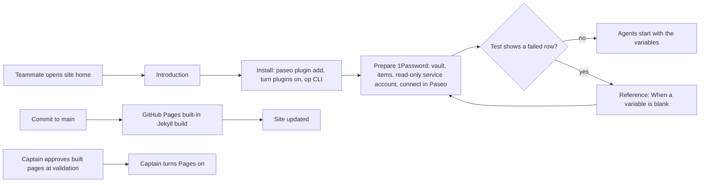

---
id:
title: A public docs page introduces project-env and walks a new teammate through setup
status: ideation
variant: kc-dev-flow-2
profile: pilot
merge: pr
worktree:
pr:
journey: paseo-project-env
journey-release: r1b
journey-story: install-one-command
gates:
    version: 1
    records:
        - id: gate:project-env-docs-site:backlog
          stage: backlog
          attempts:
            - id: gate-attempt:project-env-docs-site-backlog-1
              briefing:
                id: briefing:project-env-docs-site:backlog:attempt-1:revision-1
                digest: sha256:d58c363dda8bb88a084208b56ec6a6222cfccb5d65341e235bb07d347294f430
                room-ref: ./project-env-docs-site/review/backlog/briefing-1
              resolution:
                type: Resolution
                id: resolution:spacedock:project-env-docs-site:backlog:1
                briefing: briefing:project-env-docs-site:backlog:attempt-1:revision-1
                by: person:captain
                at: "2026-10-27T15:33:25.323767Z"
                decision: approve
                reason: '「可以，先文件」 — Captain in FO chat, 2026-10-27. Asked: 「你要決定的：先做哪一個？建議先做「文件網站加插件介紹」…可以併進「r1b 新同事上手」…回「先文件」或「先保險庫」。」 FO had recommended docs first. The page''s scope and the Pages switch-on are confirmed at the ideation gate.'
              application:
                target-stage: ideation
                state: consumed
        - id: gate:project-env-docs-site:ideation
          stage: ideation
          attempts:
            - id: gate-attempt:project-env-docs-site-ideation-1
              briefing:
                id: briefing:project-env-docs-site:ideation:attempt-1:revision-1
                digest: sha256:b558da556eabd0983e4fbb3543c790d783d146d2fc990c5e2739679352e537b8
                room-ref: ./project-env-docs-site/review/ideation/briefing-1
started: 2026-10-27T15:33:59Z
---

From the Captain on 2026-10-27, before opening project-env to the recce team: 「顯然還缺 plugin 介紹，文件說明，以及可以的話應該架一個基於 github md 檔案的 release page…方便大家看設定看文件看圖片等」. FO's research (`research/2026-10-27-1password-agents-and-docs-site.md` in this state checkout) recommended GitHub Pages with its built-in Jekyll from the repository's Markdown. Asked which to do first, the docs page or agent-organised vaults, he answered 「可以，先文件」. FO checked on 2026-10-27: `project-env/OVERVIEW.md` has one line on prerequisites and no install steps for the 1Password CLI; the journey map (`docs/journey/project-env/give-agents-their-project-setup.yaml`) marks the install story `unverified` and its prerequisite and plugin-enable stories `gap`.

## Scope

In: one public page set built from Markdown in iamcxa/kc-paseo-plugins: a short introduction to project-env with screenshots, install steps that a new teammate can follow from nothing (Paseo version, enabling plugins, `paseo plugin add github:iamcxa/kc-paseo-plugins:project-env`, the 1Password CLI), how to prepare 1Password (one read-only service account per vault, an expiry, the `agent-<project>-<env>` vault name from ADR 0005), the existing troubleshooting notes, and links to the GitHub releases. Internal documents (`docs/adr`, `docs/dev2`, `docs/dev2-poc`, state) are not published. Turning on GitHub Pages is a public, outward-facing step: it is done only after the Captain approves the built page at validation. Out: agent-organised vaults, a search or sidebar theme, Netlify, spacedock-bridge's own pages beyond a link. Stop condition: the acceptance criteria pass.

## Acceptance criteria

**AC-1**: Built from the repository with GitHub Pages' own Jekyll, the site shows the project-env introduction, install, 1Password preparation and troubleshooting pages with their pictures, and no file from `docs/adr`, `docs/dev2` or `docs/dev2-poc`.
Verified by, on a throwaway copy of the repository at the implementation commit, never a branch:
1. `project-env-docs-site/capture/build-site.sh <copy>` (Docker `ruby:3.3`, `github-pages` 232, the versions `pages.github.com/versions.json` lists) exits 0.
2. `project-env-docs-site/capture/crawl.py <copy>/_site` prints a built-file list equal to the 19-file list in `evidence/build-crawl.txt`, `INTERNAL PATHS PRESENT: none`, and `LINK/IMAGE PROBLEMS: 0` (every href, image and `#anchor` resolves).
3. Whole-page pictures of the six pages at 1280 px and 400 px, plus the open menu at 400 px, are taken from the served build (the set in `evidence/previews/`), and `document.documentElement.scrollWidth` is 400 on every page at 400 px.
4. On the built Reference page a link to "When a variable is blank" is visible without scrolling at 1280 and 400 px and jumps to that heading; every picture on the Introduction, Install and Prepare pages sits inside a link to its full-size file; the built Changelog lists each 0.1.0 change once.
5. `capture/capture.sh <dir>` on an isolated Paseo with fake `op` and `security` retakes the seven plugin pictures, and the pages show them.

**AC-2**: The install and preparation steps were followed as written by someone starting from a Mac without the plugin, up to an agent that starts with one mapped variable set.
Verified by: a run on a new isolated Paseo home (own port, `--home`), by someone who reads only the built Install and Prepare 1Password pages, copying each command from the built page text (so a long dash in the code font cannot hide a wrong character), with the plugin installed from GitHub and fake `op` and `security` where a real account is needed. The run ends with an agent started in the connected repository whose environment holds one mapped variable. It records each step and each place the words were not enough, and every such place becomes a change to the pages before the task closes. A run with a real 1Password account is the Captain's, not an agent's.

## FO alignment

Surfaces: ui
Visible change: A public page introduces project-env and gives a new teammate install, 1Password preparation and troubleshooting steps with pictures.
Direction alignment with the Captain: done — he asked for the introduction, docs and a Markdown-based page on 2026-10-27 and chose docs first (「可以，先文件」); the page's scope and the Pages switch-on are confirmed at the ideation gate.
Release review: paseo-project-env/r1b at 4e22d4ad63bc50d4bcc32a403720b429152bad8a — signal 1: this task is admitted into r1b under story install-one-command and writes the words for r1b's get-plugin and prepare-1password stories, so r1b is marked changed and kc-journey-map review-release runs at the first implementation dispatch.
Map footprints: not needed: no journey answer is recorded by this task; the ideation report lists the stories for a later map update.

## Design

### PRFAQ

**Press release (future-facing).** A recce teammate who has never seen project-env opens `https://iamcxa.github.io/kc-paseo-plugins/`, reads what the plugin does with a picture of its settings screen, then follows two pages with pictures: Install (the command, turning plugins on, the 1Password CLI) and Prepare 1Password (a vault, its items, a read-only service account with an expiry, and connecting them in Paseo). A blank variable sends them to a heading for their cause. Nothing from the repository's workflow folders is on the site.

**FAQ.**
- *Why GitHub Pages' built-in Jekyll and not a docs framework?* It renders the repository's Markdown with one `_config.yml` and no Node, workflow or Gemfile in the deploy path. Research file: `research/2026-10-27-1password-agents-and-docs-site.md`, Q2. Getting worse: a plain theme, no search, no sidebar (non-goals in Scope).
- *Why a root source and not `/docs`?* The existing `project-env/OVERVIEW.md` and `CHANGELOG.md` are reused as published pages, not copied; Pages' source folder is one folder, so the source is the repository root and `exclude` lists every internal path.
- *How is the overview reused, not copied?* `project-env/OVERVIEW.md` becomes the Reference page and `project-env/CHANGELOG.md` the Changelog page, at their own paths, by `_config.yml` `defaults` (a title and a layout) and `header_pages`. The troubleshooting page is the overview's "When a variable is blank" section; pages link to it by anchor. No Liquid, no include, no second copy.
- *What if someone adds a folder?* A new top-level folder publishes unless excluded. The built-file list in AC-1 step 2 is the guard; it runs when the pages change, not in CI (no cost added).
- *What does this not do?* It does not make the Test or agent-start screens appear; the "Started without N project variables" line is quoted as text, not pictured (needs a real agent start on a real provider).

### Reader flow and build

The last line is the only outward-facing step: Pages is turned on by the Captain after validation, never by an agent (Scope).

### Pages and files

| Page | Source file (repository path) | Origin |
| --- | --- | --- |
| Home | `README.md` (root; `jekyll-readme-index`) | existing, one link added, `github:` becomes the documented `git:` form |
| Introduction | `docs/project-env/index.md` | new |
| Install | `docs/project-env/install.md` | new |
| Prepare 1Password | `docs/project-env/prepare-1password.md` | new |
| Reference, with troubleshooting | `project-env/OVERVIEW.md` | existing, reused; edits below |
| Changelog | `project-env/CHANGELOG.md` | existing, generated by release-please; reused |
| Pictures | `docs/project-env/img/01..07-*.png` | produced by `capture.sh`, kept in the repository |

URLs keep the file paths (no `permalink`), so a relative `img/x.png` works on GitHub and on Pages at any base URL. Edits to existing files, shown in `evidence/source-edits.diff`: README (`git:` form, link to Introduction); OVERVIEW (one line under the first paragraph linking to the blank-variable section; each of the nine causes becomes a `###` heading instead of a bold run-in, which GitHub, Pages and Paseo's overview all render; Setup step 2 matches the screens, which have no "Change" on a new project); CHANGELOG (the four duplicated 0.1.0 pairs collapse to one line each, a hand edit of an already-released entry that release-please does not rewrite). Edits to `project-env/` use a `docs(project-env):` commit type, which release-please does not turn into a release.

`_config.yml` (full text in `site-draft/_config.yml`): `theme: minima` (Pages built-in, no remote theme); `author: Kent` (stops the footer repeating the site name); `header_pages` listing the five pages; `defaults` giving OVERVIEW the title "Reference", CHANGELOG the title "Changelog" with `layout: default`, and README `layout: default`; and `exclude` for `docs/adr`, `docs/dev2`, `docs/dev2-poc`, `docs/journey`, `docs/project-env/capture`, `project-env/{client,server,shared,test}`, `project-env/index.*.ts*`, `project-env/package*.json`, `project-env/paseo-plugin.json`, `project-env/tsconfig.json`, `spacedock-bridge`, `release-please-config.json`, `Gemfile*`, `vendor`. Dot-files such as `.release-please-manifest.json`, `.github` and the state checkout are excluded by Jekyll itself. `Gemfile` (`github-pages` 232) exists only for the local build; Pages ignores it.

Pictures: `docs/project-env/capture/` holds `capture.sh`, `setup.sh`, `fx.py`, `env.sh`, `teardown.sh`, `build-site.sh` and `crawl.py` (drafts in this task's `capture/`). `setup.sh` builds the plugin's own `contribute()` against the existing `project-env/test/world.ts` fakes in an isolated Paseo (own home, own port, no real `op` or `security`); `capture.sh` drives it with `agent-browser`, takes seven pictures of one fictional project, crops away the sidebar (it shows this Mac's host name) and deletes the raw frames. Declared outside the repository: `paseo` 0.12 or later, `agent-browser`, Docker, Python 3 with Pillow. Kept current by rerunning `capture.sh` whenever a PR changes `project-env/client/`; nothing enforces it. Implementation must replace the drafts' machine paths (`CHECKOUT` and the tmp directories) with arguments.

### Verified statements

Every install and preparation statement on the drafted pages, with its source. Run on 2026-10-27 and 2026-10-28; Paseo 0.13.0, `op` 2.41.1, macOS.

| Statement | Source |
| --- | --- |
| Needs Paseo 0.12 or later; Paseo's own plugin page states no minimum | `project-env/paseo-plugin.json` `requirements.paseo`; `https://paseo.sh/docs/plugins` |
| `paseo plugin add git:iamcxa/kc-paseo-plugins:project-env` installs it; the same command with `github:` also works but Paseo documents only `git:` | run on isolated homes, plugin shown `running`, revision bed5a66; Paseo plugin page |
| Plugins are off until Settings, Plugins, Enable plugins; an installed plugin reads `disabled` until then | run: fresh home showed `disabled`, switch off; toggling it gave `running`; Paseo plugin page |
| The plugin's actions menu has Project environment, Logs, Reload, Remove | run, picture 02 |
| With no Paseo project the plugin's screen is empty with no hint; with one, "Add a project: Choose…" lists it | run on the real plugin from GitHub (`evidence/` pictures were retaken with fakes; the empty screen is a finding below) |
| `brew install 1password-cli`; `op --version` | `https://www.1password.dev/cli/get-started/`, read 2026-10-27 |
| The plugin works without a signed-in `op` and passes the token as `OP_SERVICE_ACCOUNT_TOKEN`; it looks for `op` in `/opt/homebrew/bin`, `/usr/local/bin`, then PATH | `project-env/server/secrets.ts`, `project-env/server/tools.ts` |
| The token is stored in the macOS login Keychain, found by service account name | `project-env/server/secrets.ts` (`security find-generic-password`); ADR 0003 |
| The 1Password website wizard has no expiry option; expiry is `--expires-in` on the CLI | `https://www.1password.dev/service-accounts/get-started/`, fetched and grepped 2026-10-28 |
| `op service-account create <name> --expires-in <d> --vault <vault>:read_items --raw`; default permission read; units s, m, h, d, w; cannot grant Personal or Private; token shown once | `op service-account create --help`, op 2.41.1 |
| `op vault create <name>` | `op vault create --help`, op 2.41.1 |
| Add a Password field: Edit, Add More, Password, Save | `https://support.1password.com/custom-fields/`, fetched 2026-10-28 |
| Create a vault: plus in the Mac sidebar, name, Create | `https://support.1password.com/create-share-vaults/`, fetched 2026-10-28 (it does not say who may create vaults in a team account) |
| Vault `agent-<project>-<env>`, items titled by service in lowercase with hyphens, field label equal to the variable name, no `/`, no sections | ADR 0005 amendment 2026-10-23 (advice, nothing checks it) |
| New-project form: service account, Check, token, Save token, Vault, + Add, Test, Save; "1 failed · 3 set" and a red "!" | full UI run on an isolated Paseo with fakes, pictures 03 to 07 |

Not verified, stated on no page as fact: a real 1Password account (who may create a service account; the Captain's run), an agent started in the connected repository showing the variables (AC-2 run), and `op item create --category "Secure Note" 'NAME[password]='` (ADR 0005's run on op 2.30.3; the pages teach the app's Add More steps instead).

### Existing-code check

Checked in the fleet order: Paseo (its plugin page documents install and enabling, no docs-site feature), spacedock and kc-dev-flow-2 (no docs-site capability), sibling repositories under `~/Project` (no `_config.yml`, and GitHub Pages returns 404 for `kc-claude-plugins` and `kc-paseo-plugins`, read-only `gh api`, 2026-10-28). Nothing to reuse; the repository's own Markdown is reused as described above. `project-env/test/world.ts` and `project-env/test/fakes/` already provide the fake `op` and `security`; the capture harness is built on them.

### Journey stories (`docs/journey/project-env/give-agents-their-project-setup.yaml`, release r1b)

| Story | Pages cover it | Stays a gap |
| --- | --- | --- |
| get-plugin / install-one-command | Install: Mac, Paseo 0.12, `op`, the one command | Paseo documents no minimum plugin version, only the manifest does |
| get-plugin / enable-plugins | Install step 2, with the picture; README keeps the command | none on the site |
| get-plugin / find-settings | Install step 4 (actions menu, Project environment) | the screen's token hint says "this Mac's Keychain" (product text, not pages) |
| prepare-1password / create-vault, add-secrets | Prepare steps 1 and 2 | none on the site |
| prepare-1password / create-service-account | Prepare step 3 | q2 (can a non-admin teammate create one) stays open: the page repeats 1Password's "ask your administrator" and does not claim an answer |
| prepare-1password / setup-guide | Prepare steps 1 to 4, naming advice (ADR 0005), both ADR 0001 weaknesses on the Introduction | the in-app steps on the screen itself stay a product gap |
| prepare-1password / agent-lays-out-vault | not covered | no skill exists (ADR 0005); the pages do not mention it |
| connect / pick-repository | Prepare step 4 says the repository must be a Paseo project first | the plugin's empty screen still gives no hint, and a failed load is silent |

The ideation does not edit the map; a later map update records these.

### UI proposal and preview

UI proposal: A public documentation site built from the repository's Markdown by GitHub Pages' built-in Jekyll with the stock minima theme. Five pages in a header nav (folds into a menu button at 400 px): Introduction (with one screenshot), Install, Prepare 1Password, Reference (the plugin's overview, which holds the "When a variable is blank" troubleshooting, each cause a heading) and Changelog (the plugin's changelog, the developer log). The home page is the repository README. Install and Prepare 1Password are step pages with screenshots of the plugin's settings screens, each clickable to the full-size picture. Audience: a recce teammate with a Mac and Paseo who has never used the plugin or the 1Password CLI.

Preview: /Users/kent/Project/kc-paseo-plugins/docs/dev2/.spacedock-state/project-env-docs-site/evidence/previews/

The preview folder holds whole-page pictures of the built site (a disposable local build of a throwaway copy, `github-pages` 232 in Docker `ruby:3.3`, the closest reproducible build to Pages' Ruby 3.3.4) at 1280 px and 400 px: `{home,intro,install,prepare,reference,releases}-{1280,400}.png` (`releases-*` is the Changelog) and `menu-open-400.png`. The drafted pages are in `site-draft/` (`docs/project-env/{index,install,prepare-1password}.md` in full, with `_config.yml`, `Gemfile` and the edited existing files); the plugin pictures are `site-draft/docs/project-env/img/`. A static picture shows no scroll or click; the 400 px width and full-size-picture checks are AC-1 steps 3 and 4.

### Design review

Design review: design/ideation-2.yaml
Design finding 1: fixed: Install now ends at "Next" and no longer adds the repository; Prepare step 4 owns the Add a project picture (previews/install-*, prepare-*).
Design finding 2: fixed: the Introduction page is titled "Introduction", which frees the nav gap between the site name and the first item (previews/home-1280.png, releases-1280.png).
Design finding 3: Needs decision: the stock minima nav draws no current-page mark; accept it, or add a site-owned header copy. Recommend accepting. ADR: The docs site uses the stock minima theme without overrides
Design finding 4: AC-1
Design finding 5: AC-2
Design finding 6: fixed: the full-size cue now sits under the first picture on Introduction, Install and Prepare; AC-1 step 4 checks every picture is a link (previews/intro-*).
Design finding 7: Needs decision: the stock minima menu button and rows are about 38 px and 34 px; accept them, or override to 44 px with custom CSS. Recommend accepting. ADR: The docs site uses the stock minima theme without overrides
Design finding 8: fixed: `author: Kent` is set so the footer's first column no longer repeats the site name, and the home link reads "Introduction" like the nav (previews/home-1280.png).
Design finding 9: declined: the blank space is the 900 px preview window; minima pins the footer to the bottom of the window, and the gap closes on any page longer than the window.
Design finding 10: fixed: Reference opens with a line linking to "When a variable is blank"; AC-1 step 4 checks it is visible without scrolling (previews/reference-*).
Design finding 11: declined: release-please writes the 0.2.0 compare link and writes no link for the first release; the file is generated and a hand edit would be overwritten.
Design finding 12: declined: release-please generates the changelog and keeps its title and header; a sentence under the title would be lost or break its format, so the Introduction labels it the developer log.
Design finding 13: declined: the overview ships inside the plugin and must stand alone in Paseo, so its short Setup stays, corrected to match the screens; the step pages carry the detail and the repetition is accepted.
Decline check: design/declines-1.yaml

The first review (`design/ideation-1.yaml`) had one MAJOR finding, the duplicated 0.1.0 changelog lines; the CHANGELOG edit and a redraw cleared it, and the second review (`ideation-2.yaml`) has no MAJOR finding. The Director saw the pictures only: two layout facts it cannot see (code blocks scroll inside themselves at 400 px; copied commands keep plain hyphens, checked by `grep 'paseo --version'` on the built install page) are covered by AC-1 steps 3 and 4 and AC-2.

### Decisions

Needs the Captain (one, covering findings 3 and 7, which the Director ruled `host-look`): accept the stock minima theme as it draws, with no current-page mark in the nav and a 38 px menu button at 400 px, or allow a small site-owned header and stylesheet. **Recommendation: accept stock minima.** A site-owned copy adds files to keep in step with the theme for a five-page site whose page heading already tells the reader where they are. What gets worse: a reader on Reference cannot see the nav mark, and a thumb can miss the menu button.

Open, not a Captain decision: the capture scripts add seven files to the repository. Without them the pictures cannot be retaken the same way; nothing has gone stale yet, so that is an unanswered without-it question. It goes in the implementation PR body under `without-it unanswered` for the Captain to rule.

### Findings recorded for the product (outside this task's scope)

- With no Paseo project the plugin's screen is blank under "Projects" with no hint; the journey's pick-repository story already names this as release r1b work.
- OVERVIEW Setup step 2 described "Edit the repository, choose Change", which a new project does not show; this design corrects the sentence.
- The repository README told people to use `github:`; Paseo documents `git:`. Both work on Paseo 0.13.0.
- The 1Password website wizard offers no expiry, yet OVERVIEW Setup step 1 says "Give it an expiry"; the page says how (the CLI).
- A local build cannot show the real site address: `jekyll-github-metadata` needs an API token, so canonical and feed links point at a wrong GitHub address locally. Page links are unaffected (crawl: 0 problems). The real addresses are checked once the Captain turns Pages on.

### Batch overlap

none: the other two tasks in the workflow (`project-env-release-1`, `project-env-test-row-draft-note`) are held at backlog as superseded and change none of `README.md`, `project-env/OVERVIEW.md`, `project-env/CHANGELOG.md`, `_config.yml` or `docs/project-env/`. Recommended order: none.

## Stage Report: ideation

- DONE: Design the docs site your Scope names: the page list and outline (introduction with screenshots, install from nothing, 1Password preparation, troubleshooting from OVERVIEW.md, releases), where each Markdown file lives and how it is reused from project-env/OVERVIEW.md rather than copied, the `_config.yml` (theme, `exclude` for every internal path) for GitHub Pages' built-in Jekyll, and how the pictures are produced and kept current; keep AC-1 and AC-2 and give each a reproducible evidence clause.
  See `### Pages and files` and `### PRFAQ`; AC-1 now has five numbered steps and AC-2 a copy-the-built-text run. AC-1 current evidence on the draft: build exit 0, 19 built files, `INTERNAL PATHS PRESENT: none`, `LINK/IMAGE PROBLEMS: 0`, scrollWidth 400 on six pages (`evidence/build-crawl.txt`); not yet run at an implementation commit. AC-2 current evidence: partial only (real plugin installed from GitHub on an isolated home; add-project to Test to Save driven on fakes); the run from the built pages' words is not yet verified.
- DONE: Produce the artifact the ui surface owes: whole-page previews of the built site at desktop and 400 px from a local build with the GitHub Pages gem set (or the closest reproducible build, named), the install and 1Password preparation pages drafted in full, plus the design review, with each finding dispositioned; list which r1b journey stories (get-plugin and prepare-1password) the pages cover and which stay gaps.
  `evidence/previews/` (13 pictures, `github-pages` 232 in Docker ruby 3.3, Pages uses 3.3.4); pages in `site-draft/`; reviews `design/ideation-1.yaml`, `ideation-2.yaml`, `declines-1.yaml`; 13 findings dispositioned; story table in `### Journey stories`. `design_surfaces.py check`: "design surfaces presentable", exit 0.
- DONE: Verify every install and preparation statement against code, Paseo's own docs or a run (for example `paseo plugin add` from GitHub on an isolated Paseo home, the 1Password CLI install page), and name any decision the Captain must make (at most one), with a recommendation.
  `### Verified statements` lists each with its source; three items are stated unverified. One decision for the Captain, with a recommendation (accept stock minima), under `### Decisions`.

### Summary

The site is a root-source GitHub Pages build: three new pages under `docs/project-env/`, the existing overview and changelog published as Reference and Changelog by `_config.yml` rather than copied, and seven pictures retaken by a capture script on an isolated Paseo with fakes. The checks found real defects in the existing words (OVERVIEW Setup describes a screen a new project does not show; the website wizard has no expiry option; `github:` is undocumented by Paseo; the plugin's screen is blank with no Paseo project), and the design corrects the first three and records the last. Pages is not turned on and nothing in the repository was changed; the Captain's one decision is whether to accept the stock theme's look.
