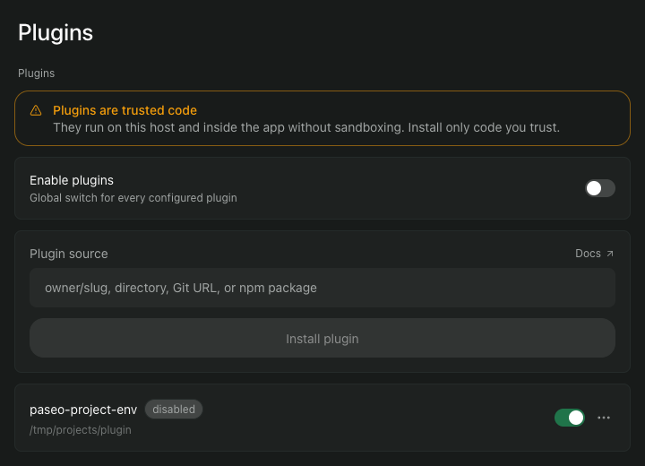
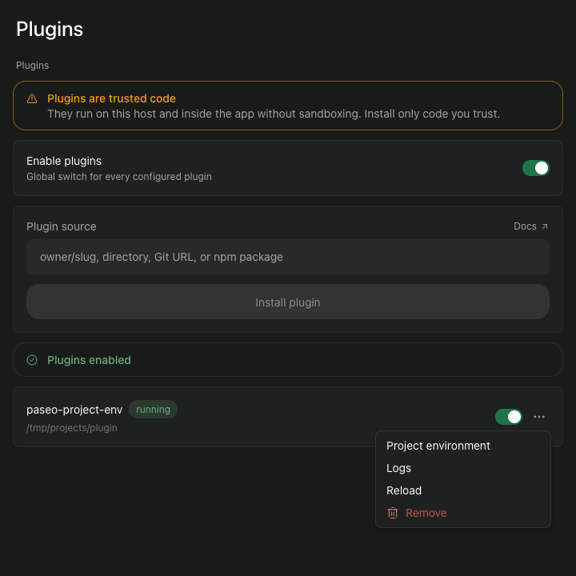

You need a Mac that runs Paseo 0.12 or later. The plugin works only with Paseo running on your own Mac. Check the version in a terminal:

```
paseo --version
```

## 1. Install the plugin

In a terminal:

```
paseo plugin add \
  git:iamcxa/kc-paseo-plugins:project-env
```

Or paste `git:iamcxa/kc-paseo-plugins:project-env` into **Plugin source** under **Settings**, **Plugins** and choose **Install plugin**.

The command prints that plugin code runs on your Mac without a sandbox, so install only code you trust. The plugin appears in the list as `paseo-project-env`.

## 2. Turn plugins on

Plugins are off until you turn them on, and the switch covers every plugin on this Paseo. A plugin you have installed reads `disabled` until you do.

Open Paseo, then **Settings**, then **Plugins**, and turn on **Enable plugins**. The plugin then reads `running`.

*Tap a picture to see it full size.*

[](img/01-enable-plugins.png)

## 3. Install the 1Password CLI

The plugin reads 1Password through the `op` command. Install it with Homebrew:

```
brew install 1password-cli
```

Check it:

```
op --version
```

You do not need to sign in to `op` for the plugin to work. The plugin gives `op` a service account token each time it reads. You do sign in once to prepare 1Password, which is the next page.

## 4. Open the plugin's settings

In **Settings**, **Plugins**, open the plugin's actions menu (the three dots) and choose **Project environment**.

[](img/02-actions-menu.png)

## Next

Nothing is connected yet. Go on to [prepare 1Password](prepare-1password.md): the repository is added there, once the service account exists.
