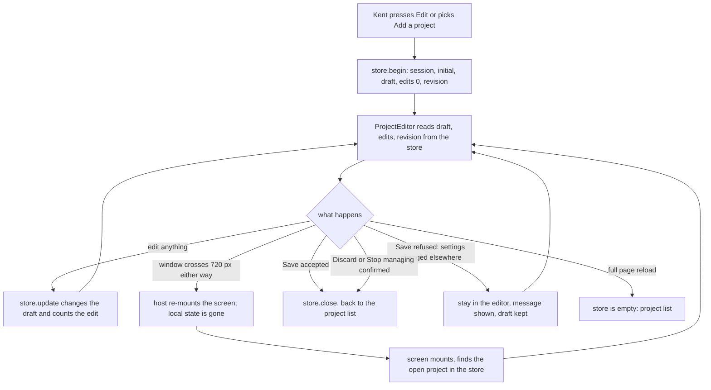

---
id:
title: Unsaved edits survive the settings screen re-mounting
status: ideation
variant: kc-dev-flow-2
profile: pilot
merge: pr
worktree:
pr:
gates:
    version: 1
    records:
        - id: gate:project-env-draft-survives-remount:backlog
          stage: backlog
          attempts:
            - id: gate-attempt:project-env-draft-survives-remount-backlog-1
              briefing:
                id: briefing:project-env-draft-survives-remount:backlog:attempt-1:revision-1
                digest: sha256:4ccabc9aa6689722fe6567c055e57f94a00afd38a626df0476c51b0d1a6063c8
                room-ref: ./project-env-draft-survives-remount/review/backlog/briefing-1
              resolution:
                type: Resolution
                id: resolution:spacedock:project-env-draft-survives-remount:backlog:1
                briefing: briefing:project-env-draft-survives-remount:backlog:attempt-1:revision-1
                by: person:captain
                at: "2026-10-22T04:14:35.862941Z"
                decision: approve
                reason: 'Captain 2026-10-22: 「准」 — accepts this A5 settings-screen rework task''s outcome, scope and acceptance criteria on the pilot profile, into ideation.'
              application:
                target-stage: ideation
                state: consumed
        - id: gate:project-env-draft-survives-remount:ideation
          stage: ideation
          attempts:
            - id: gate-attempt:project-env-draft-survives-remount-ideation-1
              briefing:
                id: briefing:project-env-draft-survives-remount:ideation:attempt-1:revision-1
                digest: sha256:f02ff4af014c0fe4b2cb25ac666d695a8fffc8f317ae4575dfe1134842e349a7
                room-ref: ./project-env-draft-survives-remount/review/ideation/briefing-1
started: 2026-10-22T04:16:26Z
---

Settings-screen rework of release r1.5 of the project-env plugin. Design reference: the design-director review (ux-review-r1.5/index.html) and direction A5 (ux-review-r1.5/direction-a5.html, shots/a5-*.png) in the state checkout; Captain approved A5 on 2026-10-22 (「就這樣」) after 「這個 UX 完全不行」, and the Add flow on 2026-10-22 (「可以」).

## Scope

In: keep the open project and its unsaved draft outside the screen component that Paseo re-mounts when the window crosses a width between 700 and 800 px (review finding 3; shots 30a, 30b). Non-goals: an unsaved-changes warning (r3). Stop condition: the acceptance criterion passes.

## Acceptance criteria

**AC-1**: Resizing the window across the narrow-wide breakpoint keeps the open project and every unsaved edit.
Verified by: a runtime check on an isolated Paseo (own `PASEO_HOME` and port, throwaway plugin id, fake `op`, `security` and `git`) that adds a variable and types a prompt at 1280 px, resizes to 719 px and to 400 px, and asserts the editor, the added row and the prompt text are still on screen, then grows back to 1280 px and asserts the same; the same run starting at 400 px and growing; a new unsaved project; and Save, Discard and the revision-conflict refusal after a resize. Before and after screenshots at desktop and 400 px. A unit test of the open-project store covers begin, update, edit count, revision kept and close.

## FO alignment

Surfaces: ui
Visible change: Resizing the window no longer drops unsaved edits.
Direction alignment with the Captain: done — the Captain chose direction A5 and the Add flow on 2026-10-22.
Result: direction A5 (ux-review-r1.5/direction-a5.html); every ui gate shows the Captain screenshots of the screen.
Release review: not needed: a rework of the r1.5 settings screen the Captain ruled on 2026-10-22; it adds no journey story.

## Design

### PRFAQ

**Press release.** Kent edits a project in Project environment settings, rotates his phone or snaps the window narrow, and the screen stays exactly where he left it: same project, same added row, same typed prompt. Save, Discard and Stop managing work as before.

**FAQ.**
- *Why did the edits vanish?* Paseo draws plugin settings in a wide layout at 720 px and up and a compact layout at 719 px and below; crossing 720 px re-mounts the plugin screen. The open project and the draft were React state inside that screen (`Configured` and `ProjectEditor` in `client/settings-screen.tsx`), so the re-mount dropped them. Measured 2026-10-22 on Paseo 0.12.0: 720 px keeps the editor, 719 px returns to the project list.
- *What survives?* The plugin module itself: its client code ran once per page load across the re-mount (a `console.warn` at module top printed once at page load and not again after the Edit click or the resize). So the open project and its draft move into a small module-level store.
- *What does the store hold?* One open project: `session`, `initial` (the project as opened), `draft`, `edits` (the counter Test uses to know its results are stale) and `revision` (the settings revision seen when it opened, so a save over another client's change is still refused after a re-mount).
- *What is deliberately not kept?* The service-account token being typed (a secret stays in its input only), Test results, the open field picker, the Stop managing dialog and the import note. After a crossing a Test must be re-run, and an open dialog closes while the draft stays (pictures below).
- *When is the draft dropped?* On Save, Discard and Stop managing (the three existing `onDone` exits), and on a full page reload. It also survives leaving the settings screen inside the app and coming back, because that is the same re-mount; the unsaved-changes warning stays r3, as Scope says.
- *Does the host offer something already?* No. Bounded searches 2026-10-22: `grep -rniE "remount|persist|storage|session"` over `@getpaseo/plugin/dist/client/*.d.ts` finds no UI-state store (client state is workspace and agent snapshots only; settings are saved documents), and `grep` for module-level state under `project-env/client` and `project-env/shared` finds only constant sets. Not searched: Paseo's closed app source.

### What changes (read from `project-env/` on main at 1adf630, 2026-10-22)

Code shape for implementation (not written here): a new `client/open-project.ts` with `openProject.begin`, `openProject.update(change, countsAsEdit)`, `openProject.close` and a `useOpenProject()` hook on `useSyncExternalStore`; `Configured` shows the editor whenever the store holds a project; `ProjectEditor` drops its `useState` for draft, edits and revision, and its `patch`, import and prompt handlers call `openProject.update`. The disposable spike is 85 diff lines plus a 40-line store (`design/spike/prototype.patch`, `design/spike/open-project.ts`); it typechecks with the repository's `tsc`.

Existing-code check: journey bounded to "open a project, edit, resize" in `client/settings-screen.tsx`. Complete: the editor works at both widths (unit and runtime). Needed: Captain goal, review finding 3. Missing: any state that outlives the screen (two bounded searches above). Repair by adding the store; nothing is replaced or removed.

### Interfaces named from sibling tasks (none designed here)

- **project-env-save-footer-danger-zone** must count unsaved changes from the store (`initial` against `draft`, read through `useOpenProject()`), not from component state, or after a re-mount its footer says "No unsaved changes" over a kept draft.
- **project-env-test-summary-failure-mark** keeps its marks in component state, which a re-mount clears: with `edits > 0` and no results its header must read "Not tested since changes", never "All set".
- **project-env-field-pill-one-control, -field-picker-grouped, -add-variable-one-step, -connection-collapse** change the draft only through `openProject.update(change, countsAsEdit)`; an open picker or an expanded connection form is local and closes on a re-mount. All six siblings edit the top of `ProjectEditor`, so this task should merge first or the others rebase over its state lines.

### UI proposal

UI proposal: The settings screen looks the same as today; what changes is that the open project and its unsaved edits stay open and intact when the window crosses 720 px in either direction, and Save, Discard and Stop managing still return to the project list exactly as before.

Preview: project-env-draft-survives-remount/design/preview-compact-dark-after-fix-edits-kept.png

The preview is the real Paseo 0.12.0 web client on an isolated daemon (`PASEO_HOME` and port 6862 under `/tmp/draft-remount-spike`, throwaway plugin id `draft-remount-spike`, fake `op`, `security` and `git` from `project-env/test/fakes`), disposable and operable: the plugin is installed on that daemon and each picture comes from `design/spike/scenario*.sh`. Whole page, not the control. Each pair is today's page next to the page with the prototype:

| State | Today (main) | With the store |
| --- | --- | --- |
| desktop 1280, edited (added LINEAR_API_KEY, typed a prompt) | `preview-desktop-dark-edited-before-resize.png` | same picture |
| resized to 400 px | `preview-compact-dark-before-fix-edits-lost.png` (project list) | `preview-compact-dark-after-fix-edits-kept.png` |
| grown back to 1280 px | `preview-desktop-dark-before-fix-edits-lost.png` | `preview-desktop-dark-after-fix-edits-kept.png` |
| edited at 400 px, grown to desktop | not drawn (lost, scripted check) | `preview-compact-dark-edited-at-400.png`, `preview-desktop-dark-after-fix-grown-from-400-kept.png` |
| unsaved new project, resized to 400 px | `preview-compact-dark-before-fix-new-project-lost.png` | `preview-desktop-dark-new-project-edited.png`, `preview-compact-dark-after-fix-new-project-kept.png` |
| Save at 400 px after a crossing | | `preview-compact-dark-after-fix-list-after-save.png` |
| Discard at 400 px after a crossing | | `preview-compact-light-after-fix-list-after-discard.png` |
| Stop managing dialog open, then crossing | | `preview-desktop-light-after-fix-stop-dialog-open.png`, `preview-compact-light-after-fix-stop-dialog-closed-edits-kept.png` |
| another client saved first, then Save | | `preview-compact-dark-after-fix-conflict-refused.png` (message "Settings changed on another client. Reload before saving again.") |
| light theme | `preview-desktop-light-edited-before-resize.png` | `preview-compact-light-after-fix-edits-kept.png`, `preview-desktop-light-after-fix-edits-kept.png` |

Scripted results of the runs (2026-10-22, counting accessibility-tree rows, not reading values): without the store the added row and the prompt are gone after 400 px (scenarios A, B and C: the row and the prompt are not found); with it both are found in every step; Save after a crossing wrote the draft to the settings file; Discard after a crossing left no draft on reopening; a Save after the revision changed elsewhere left the other writer's value in the file and kept the editor open.

### Design review

Design review: design/ideation-1.yaml
Design finding 1: Needs decision: not a new Captain decision; for FO. The Stop managing look and confirm are the scope of project-env-save-footer-danger-zone AC-2 (own section, destructive confirm, review finding 9), and this task leaves that card as it is; no action here unless FO rules otherwise.
Design finding 2: declined: the unsaved-change cue is project-env-save-footer-danger-zone AC-1; this task supplies `initial` and `draft` for its count.
Design finding 3: declined: what Save does with an unpicked row is unchanged and out of scope; the sticky footer is project-env-save-footer-danger-zone.
Design finding 4: declined: the duplicated connection fact is project-env-connection-collapse.
Design finding 5: declined: repeated "Save" wording belongs to project-env-save-footer-danger-zone, which rebuilds that section.
Design finding 6: declined: Test help text moves in project-env-test-summary-failure-mark (review finding 11); this task changes no text.
Design finding 7: declined: input widths are today's layout, reworked by project-env-field-pill-one-control; this task draws no new control.
Design finding 8: declined: the placeholder is today's and the whole name row goes in project-env-add-variable-one-step.
Design finding 9: declined: clipped references are project-env-field-pill-one-control (review finding 2).
Design finding 10: fixed: drew the list after Save and after Discard and the Stop managing dialog before and after a crossing (`preview-compact-dark-after-fix-list-after-save.png`, `preview-compact-light-after-fix-list-after-discard.png`, the two `stop-dialog` pictures); an open dialog closes on a crossing and the draft stays, written into the FAQ. Browse vault panel and Vault menu are not drawn: the first is removed by project-env-field-pill-one-control and a menu is host-drawn local state like the dialog. Loading and read-only host not drawn: this task adds neither.
Design finding 11: declined: button radius and weight are the host's controls and the field-pill task's rows.
Design finding 12: declined: touch target size of the host's `SettingsAction` and header arrow is not changed by this task.
Design finding 13: fixed: drew the desktop light picture (`preview-desktop-light-after-fix-edits-kept.png`); light new-project and conflict pictures are not drawn because the mechanism does not depend on the theme.

The reviewer read only the one named picture (its first limitation), so findings 10 and 13 came from the file list; pictures it did not open are not reviewed.

### Spike notes

Machine dependencies, declared: Paseo.app 0.12.0 CLI `/Users/kent/.local/bin/paseo`, Node 24.18.0, `agent-browser`, Paseo.app's `app-dist` as the web client. The spike plugin is a copy of `project-env/` plus `server/fakes` and `server/spike-world.ts`; `design/spike/` holds the scenario scripts, `fx.py` (fixture, names and references only), `prototype.patch` and the store. After editing the plugin the daemon needs `paseo --home <home> plugin reload <id>`; without it the old client bundle is served. Kent's daemon (`~/.paseo`, port 6767) and live plugin were never touched; no real Keychain, 1Password or `op` was reached.

### Acceptance evidence plan

- **AC-1**: current evidence is the scripted run and pictures above on a prototype; the implementation run on the real change repeats `design/spike/scenario.sh`, `scenario3.sh`, `scenario2.sh` and `scenario4.sh` against the built client and adds the store unit test (`project-env/test/open-project.test.ts`: `begin` then `update` keeps the draft and counts edits; `update(..., false)` leaves `edits`; `close` empties the store; `begin` twice yields different `session`s; `revision` is the one passed to `begin`). Falsified by: removing the store read in `Configured` makes the 400 px run return to the list.

Unresolved decisions for the Captain: none. Recorded consequence for his gate: a draft is also kept when he leaves the settings screen and returns inside the app.

## Stage Report: ideation

- DONE: Design the change your Scope names inside direction A5, with each acceptance criterion kept and given a reproducible evidence clause.
  `## Design` keeps the open project, draft, edit count and revision in a module-level store (`openProject`) that survives Paseo's re-mount at 720 px; AC-1 text is unchanged and its `Verified by:` names the scripted run, the unit test and the pictures. Cause measured: 720 px keeps the editor, 719 px drops it.
- DONE: Produce the artifact the ui surface owes: whole-page previews from a running build at desktop and 400 px, plus the design review, with each finding dispositioned.
  18 whole-page pictures in `design/` from the real client on an isolated Paseo (port 6862, throwaway plugin id, fake op/security/git), before and after, dark and light; `Design review: design/ideation-1.yaml`, 13 findings, each with a `Design finding n:` line (2 fixed, 10 declined as sibling or unchanged scope, 1 for FO).
- DONE: Name every interface you need from a sibling rework task, and any decision the Captain must make (at most one), with a recommendation.
  Interfaces: save-footer reads `initial` and `draft` from the store; test-summary shows "Not tested since changes" when edits exist and results are gone; the four picker and pill tasks change the draft only through `openProject.update`; merge order recommended first. No Captain decision; one consequence recorded: a draft also survives leaving and re-entering the screen.
- DONE: AC-1 Resizing the window across the narrow-wide breakpoint keeps the open project and every unsaved edit.
  Current evidence on a prototype, not the implementation: scenarios A, B, C, D, E, F in `design/spike/` found the added row and prompt after every crossing with the store and not without it; the unit test and the run on the real change are not yet verified.

### Summary

The edits vanish because Paseo re-mounts the plugin screen at 720 px and the draft lived in that screen's React state; a module-level store survives because the plugin module loads once per page. The prototype keeps the draft in both directions, for a new project, and across Save, Discard and the revision-conflict refusal. Design finding 1 (Stop managing looks like Save) is for FO to route to the save-footer task; `design_surfaces.py check` reported "design surfaces presentable" with 13 findings, 2 fixed, 10 declined, 1 decision.
