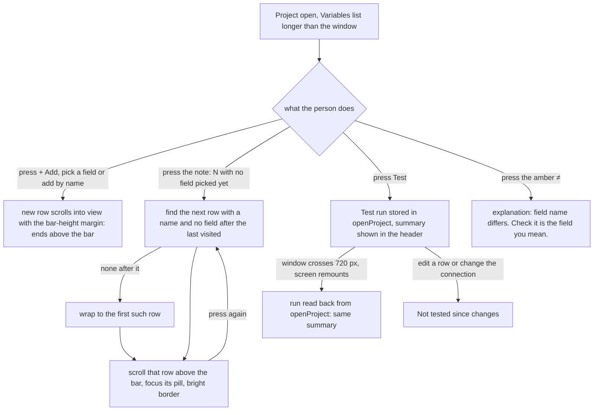

---
id:
title: You can find and read every variable row
status: implementation
variant: kc-dev-flow-2
profile: pilot
merge: pr
worktree:
pr:
gates:
    version: 1
    records:
        - id: gate:project-env-every-row-findable:backlog
          stage: backlog
          attempts:
            - id: gate-attempt:project-env-every-row-findable-backlog-1
              briefing:
                id: briefing:project-env-every-row-findable:backlog:attempt-1:revision-1
                digest: sha256:468a67eb385a89a7aba15d953d50b6384a6350cdd8e61b59b99669373a4d7e9d
                room-ref: ./project-env-every-row-findable/review/backlog/briefing-1
              resolution:
                type: Resolution
                id: resolution:spacedock:project-env-every-row-findable:backlog:1
                briefing: briefing:project-env-every-row-findable:backlog:attempt-1:revision-1
                by: person:captain
                at: "2026-10-23T05:25:36.396333Z"
                decision: approve
                reason: 'Captain 2026-10-23: 「准」 — answers the backlog question put in chat: approves Design Director Tasks A and B, A first, with both stated recommendations (token store refreshes the field list; the ≠ explanation adds ''Check it is the field you mean.'').'
              application:
                target-stage: ideation
                state: consumed
        - id: gate:project-env-every-row-findable:ideation
          stage: ideation
          attempts:
            - id: gate-attempt:project-env-every-row-findable-ideation-1
              briefing:
                id: briefing:project-env-every-row-findable:ideation:attempt-1:revision-1
                digest: sha256:d37d35915e5c03e4baace619ee73350039730934a99faa43f65effc61a1f7a9a
                room-ref: ./project-env-every-row-findable/review/ideation/briefing-1
              resolution:
                type: Resolution
                id: resolution:spacedock:project-env-every-row-findable:ideation:1
                briefing: briefing:project-env-every-row-findable:ideation:attempt-1:revision-1
                by: person:captain
                at: "2026-10-23T08:11:54.372173Z"
                decision: approve
                reason: 'Captain 2026-10-23: 「准」 — approves this Task B design and its acceptance criteria into implementation.'
              application:
                target-stage: implementation
                state: consumed
started: 2026-10-23T07:37:00Z
---

Polish round after the A5 settings-screen rework of the project-env plugin. Source: the picky-user pass (`ux-review-a5-polish/astra-review.md`, `gemini-review.md`) and the Design Director's ruling (`ux-review-a5-polish/design-director.md`, Task B, rows R3b, R4, R5, R6 and R7), approved by the Captain on 2026-10-23 with 「准」, including the Director's recommendation to add "Check it is the field you mean." to the ≠ explanation.

## Scope

In: rows the screen scrolls to end above the save bar (R3b); the "N with no field picked yet" note moves you to each such row in turn (R4); the last Test result survives a remount at 720 px (R5); long names break only after underscores (R6); the ≠ explanation reads "The field name differs from the variable name. Check it is the field you mean." with the amber colour kept (R7). Out: undo of a removed row (R9, r3), Test results kept after Save (R13, r2), moving Conductor import and the prompt (R14, r2). Stop condition: the acceptance criteria pass. Starts after project-env-save-blocks-half-changed-connection merges, from that main.

## Acceptance criteria

**AC-1**: In work-many at 400 × 900 and 1280 × 1400, a newly added row ends fully above the save bar, and so does each row reached through the note.
Verified by: a measuring script on an isolated Paseo comparing each row's bottom edge with the bar's top edge at both widths.

**AC-2**: Pressing the note four times in work-many visits LINEAR_API_KEY, RESEND_API_KEY, SLACK_BOT_TOKEN and SLACK_SIGNING_SECRET in order, and a fifth press returns to the first.
Verified by: a runtime script at both widths.

**AC-3**: A Test summary reads the same before and after the window crosses 720 px and back; the 54-character name starts every new line right after an underscore and its copied text equals the name; the open ≠ explanation reads "The field name differs from the variable name. Check it is the field you mean."
Verified by: a runtime resize script comparing the summary text; a measuring script checking where each line starts and reading the name's text content; a text check of the open ≠ explanation. Each clause is falsified on its own.

## FO alignment

Surfaces: ui
Visible change: Rows are never hidden under the save bar, the no-field count takes you to those rows, Test results survive a resize and long names wrap at underscores.
Direction alignment with the Captain: done — the Captain approved the Design Director's Task B and its recommendation on 2026-10-23 (「准」).
Result: ux-review-a5-polish/design-director.md, Task B; every ui gate shows the Captain screenshots of the screen.
Release review: not needed: a polish of the r1.5 settings screen from the Captain-approved picky-user pass; it adds no journey story.
Map footprints: not needed: no journey story or open map question is attached to this polish task.

## Design

### PRFAQ

**Press release.** Kent opens a project with twelve variables, four of them with no field. The save bar says "4 with no field picked yet" and the line is now a button: each press scrolls to the next such row, puts it fully above the save bar, and marks its field pill, then wraps from the last back to the first. A row added with + Add ends above the bar too, instead of half hidden under it. The last Test summary stays in the Variables header when the window crosses 720 px and back. A long variable name breaks only after an underscore, so `DATABASE_URL_FOR_THE_PRODUCTION_REPLICA_READ_ONLY_USER` reads as three clean lines, and copying it still gives the exact name. The open ≠ explanation adds "Check it is the field you mean.", with the amber ≠ unchanged.

**FAQ.**
- *How far must a row clear the bar?* Each row carries a bottom scroll margin of the bar's measured height plus 20 px (the bar floats 12 px above the window bottom, plus an 8 px gap). The height is measured, not fixed, because Task A's reason line makes the bar 120 px tall at 400 px (57 px otherwise, 75 px at 1280 with the reason). A fixed margin would be wrong in one of them.
- *Which rows does the note visit?* Rows with a name and no field, the same rows the count counts. The cursor is the name of the row last visited: the next press goes to the next such row after it in list order, or the first when none follows. A row that got a field meanwhile just drops out; with a single such row, every press returns to it. A row with no name keeps the plain "Name N variables first" line, which is not a button (the unnamed rows are fixed first).
- *How does the person see which row they were taken to?* The pill of that row takes keyboard focus and draws a bright border while it holds focus (also a cue for keyboard users). It is a 1 px border colour change, so nothing moves. The reviewer could not tell it from the dashed empty-pill border in one picture; pictures 3 and 4 show a bright pill beside three muted ones.
- *Where does the Test run live?* In the `openProject` store next to the draft, written when the Test call returns (so it lands even if the screen was remounted while the call ran). The existing "Not tested since changes" rule reads it unchanged. `begin` clears it, so a newly opened project shows no old run.
- *How is "break after an underscore" done?* On the web client each underscore is followed by an empty `<wbr>` break opportunity; it adds no text, so selecting and copying gives the exact name. A name with no underscore, or a segment wider than its column, still breaks anywhere as today (`overflowWrap: anywhere` is kept). On the phone app the name renders as today.
- *Does the note cycle survive the 720 px remount?* No: the cursor is screen state and starts at the first row again. The Test summary does.
- *What is out?* Undo of Remove (R9), Test results kept after Save (R13), moving Conductor import and the prompt (R14). The note's wording stays as the Director ruled it; it does not show "1 of 4".

### What changes (read from `project-env/` on main d540a04, 2026-10-23)

Today `VariableRow` reveals an added row with `scrollIntoView({ block: "nearest" })` and no margin, so a row that lands at the window bottom sits under the sticky `SaveBar`; the "N with no field picked yet" line is plain `Text`; `test.data` holds the run in component state, which Paseo drops at the 720 px remount; the name `Text` has no break opportunity except `overflowWrap: "anywhere"`; `DIFFERS` is the one sentence. New: `nextFieldless(variables, after)` in `shared/config.ts` (pure, unit-tested); `run` and `setRun` in `client/open-project.ts`; in `settings-screen.tsx` a `scrollMarginBottom` on each row from `SaveBar`'s `onLayout` height, one reveal state `{ index, focus }` replacing `added`, the note as a `Pressable`, the pill's `onFocus`/`onBlur` border, `breakAfterUnderscores`, and the longer `DIFFERS`. The spike is `spike/every-row-findable.diff` (142 added, 18 removed lines, 7 new unit tests in `spike/every-row-findable.test.ts`). No new setting, RPC or dependency.

Existing-code check: the reveal mechanism, the note's count and the Test run all exist; what is missing is the margin, the press, and the run's place in the store, so existing code is repaired, not replaced. Two bounded searches over `project-env/client` and `project-env/shared`, excluding `node_modules`: `grep -n "scrollIntoView\|scrollMargin\|onLayout" client/*.tsx` finds the one reveal call and no margin; `grep -n "fieldless\|no field picked yet" client/*.tsx shared/*.ts` finds the count and its plain-text line and no handler. Not searched: other plugins and the phone app.

### UI proposal

UI proposal: Rows are never hidden under the save bar, and the no-field count takes you to those rows. The save bar keeps its shape (count on the left, Close or Discard and Save on the right, pinned at the bottom of the window). The line "N with no field picked yet" becomes a button: it is drawn in normal text colour with an underline, and each press scrolls to the next variable row that has no field, in list order, wraps from the last back to the first, puts that row fully above the bar, and gives its field pill a bright border while the pill holds keyboard focus. The same clearance applies to a row the screen scrolls to after Add. "Name N variables first" stays plain muted text. The last Test summary stays in the Variables header when the window crosses 720 px and back. A long variable name breaks only after an underscore (it still copies as the exact name). The open ≠ explanation reads "The field name differs from the variable name. Check it is the field you mean." with the amber ≠ unchanged. Nothing else on the page changes.

Preview: project-env-every-row-findable/design/preview-desktop-dark-2-note-first-press.png

The proposed design is the set `design/preview-*.png`, drawn from a running build of the real `project-env` client at main d540a04 with only this task's change applied (`spike/every-row-findable.diff`), on a throwaway Paseo 0.12.0 daemon (own home `/tmp/pe-row/s`, port 6941, plugin id `pe-row`, fake `op`, `security` and `git`; the review harness's work-many project: 12 rows, 4 with no field, one 54-character name), driven through Paseo's own web client with a headless browser. `design/today-*.png` are the same screens drawn from unpatched main (own daemon, port 6942) for comparison. Window-sized pictures (the sticky bar is visible): 1 a row added by name sits above the bar, 2 first press of the note, 3 fourth press (SLACK_SIGNING_SECRET), 4 fifth press (wraps to LINEAR_API_KEY), 5 a press while the connection change is open (the bar has the Task A reason line and is 120 px tall at 400 px). Whole-page pictures: 6 after Test (1 failed · 7 set · 4 no field; the long name wraps at underscores), 7 the same page at 700 px (desktop) or 1280 px (compact), 8 back at the first width with the same summary, 9 the ≠ explanation open. Desktop is 1280 px (window 1280 x 800, page 1280 x 1750); compact is 400 px (window 400 x 900, page 400 x 2900); dark for all, light for picture 2 at both sizes. The page is operable while the daemon is up. Disposable: the daemons, plugins and `/tmp/pe-row` are removed at the end of ideation (see the Stage Report).

### Design review

Design review: design/ideation-1.yaml
Design finding 1: declined: the count stays fixed ("4 with no field picked yet") on purpose, so the bar never changes text or width between presses and Task A's reason line does not move; the focused pill marks which row you are on, and pictures 2 to 4 walk the cycle.
Design finding 2: declined: the focus border is the same shape in a brighter colour so no row moves; pictures 3 and 4 show the focused pill beside three unfocused empty pills in one frame, where it reads bright against muted.
Design finding 3: declined: the note has `hitSlop` of 6 px on every side, about 25 px of height with the 13 px line; the same size as the plain line it replaces, and the bar's buttons are today's.
Design finding 4: declined: the row-to-bar gap is 8 px measured (`spike/evidence/ac12-spike.txt`, "gap to bar 8 px"); the bar's 12 px float above the window bottom is today's bar (project-env-save-footer-danger-zone).
Design finding 5: declined: "No unsaved changes" with a dimmed Save is today's bar and its copy was settled in project-env-save-footer-danger-zone.
Design finding 6: declined: Test, + Add, Close and Save are today's controls; this task changes none of their sizes.

The reviewer opened one picture only (its first limitation); I looked at pictures 1, 2, 3, 4, 5, 6, 9 and the today pictures myself and found nothing the review does not already cover.

### Acceptance evidence plan

Each result below was observed on 2026-10-23 on the isolated Paseo from the spike (`spike/every-row-findable.diff` on main d540a04, port 6941), and the same script was run against unpatched main (port 6942). The merged implementation is not yet verified.

AC-1: runtime `spike/harness/ac12.sh` (output in `spike/evidence/ac12-spike.txt` and `ac12-base.txt`). Spike: a row added by name ends 8 px above the bar at 400 x 900 and at 1280 x 800, 85 px above at 1280 x 1400; a row added from the picker 276 and 83 px above; each of the five note presses ends above the bar with the plain bar (57 px) and with the Change reason line (120 px at 400, 75 px at 1280): all PASS. Unpatched main: the row added by name ends 69 px under the bar at 400 x 900 and 1280 x 800 (FAIL), and the note does nothing. Limit: at 1280 x 1400 unpatched main already passes the new-row clause because the whole page fits, so that clause is falsified at 400 x 900 and 1280 x 800 only. The mutation that matters, removing `scrollMarginBottom`, was not run; the base build is the nearest proof.
AC-2: same script: at 400 x 900, 1280 x 1400 and 1280 x 800 the five presses focus LINEAR_API_KEY, RESEND_API_KEY, SLACK_BOT_TOKEN, SLACK_SIGNING_SECRET, LINEAR_API_KEY (PASS); unit `spike/every-row-findable.test.ts` "wraps from the last such row back to the first" fails when the wrap-around is removed (mutation run: 2 failed). Unpatched main has no button.
AC-3: three clauses, each with its own check. Summary: `spike/harness/ac3.sh` at 1280 -> 700 -> 1280 and 400 -> 1280 -> 400 reads "1 failed · 7 set · 4 no field" before, during and after (PASS); unpatched main reads nothing after the crossing (FAIL); unit "is kept by setRun" fails when `setRun` stores nothing (mutation run: 1 failed). Name: `spike/harness/ac3wrap.sh` (`spike/evidence/ac3wrap.txt`): at 1280 the lines start with PRODUCTION_ and READ_ONLY_, at 400 with REPLICA_, every start follows an underscore, and the copied text equals the name; unpatched main starts lines at "ODUCTION_REP", "NLY_USER" and "EPLICA_READ_". ≠: the open explanation reads "The field name differs from the variable name. Check it is the field you mean." at both widths; unpatched main reads the old sentence.

Not yet verified: the merged implementation; `npm test` and `npm run typecheck` on the merged branch (on the spike copy: typecheck clean, 269 of 269 tests pass, 2026-10-23); the phone app (the sticky bar and `<wbr>` are web-only, the name renders as today there); a name with no underscore (unchanged by source: `breakAfterUnderscores` returns the string); a remount while a Test call is still running (the result lands in the store when it returns, but the "Testing…" text is lost; not run).

### Needs decision

None. The Director's Task B and its two recommendations were approved by the Captain on 2026-10-23 (「准」), including the ≠ wording. Past rulings checked: `git -C docs/dev2/.spacedock-state grep -n 'Override:'` finds no override line, and ADRs 0001 to 0005 name no behaviour for scrolling, the no-field count or name wrapping.

### Spike notes

Machine dependencies, declared: Paseo.app 0.12.0 CLI at `/Users/kent/.local/bin/paseo`, Node, `agent-browser`, python3. `spike/harness/` is the review harness with plugin id, session, port and checkout overridable (`env.sh`), `dom.js` (measuring helpers), `ac12.sh`, `ac3.sh`, `ac3wrap.sh`, `shoot.sh`, `shoot-today.sh`, and `on.sh spike|base` to pick the build; its defaults point at `/tmp/pe-row/ckpt` (a copy of `project-env` from main d540a04 with the diff applied, `node_modules` linked) on port 6941, and `/tmp/pe-row/base` on port 6942. No real Keychain, 1Password or model provider was touched; Kent's `~/.paseo`, the live plugin and `/tmp/pe-astra` were not touched.

## Stage Report: ideation

- DONE: Design the change your Scope names inside the current settings screen, with each acceptance criterion kept and given a reproducible evidence clause.
  `## Design` holds the PRFAQ, Mermaid, existing-code check, UI proposal and evidence plan; AC-1 to AC-3 are unchanged; the spike is `spike/every-row-findable.diff` on main d540a04 (142 lines added, 7 unit tests).
- DONE: Produce the artifact the ui surface owes: whole-page previews from a running build at desktop and 400 px (a new row and a note-reached row above the save bar; the note stepping through the no-field rows; a Test summary across a 720 px round trip; the long name wrapping at underscores; the ≠ explanation), plus the design review, with each finding dispositioned.
  21 proposed pictures plus 6 of today's build in `design/`, from the real client on an isolated Paseo 0.12.0 (port 6941; today's build on 6942); `design/ideation-1.yaml` (6 MINOR, no MAJOR, all declined with reasons; the reviewer opened one picture only); `design_surfaces.py check`: "design surfaces presentable; design review design/ideation-1.yaml: 6 findings, 0 fixed, 0 criteria, 6 declined, 0 decisions".
- DONE: Name any decision the Captain must make (at most one), with a recommendation; the ≠ wording is already approved and is not a decision.
  None needed; the note keeps its fixed count and the focus border is a design choice inside the Director's ruling.
- DONE: AC-1 In work-many at 400 × 900 and 1280 × 1400, a newly added row ends fully above the save bar, and so does each row reached through the note.
  Spike 2026-10-23, `ac12.sh`: all rows end above the bar at 400 x 900, 1280 x 1400 and 1280 x 800, with the bar 57, 75 and 120 px tall; unpatched main puts a row added by name 69 px under the bar at 400 x 900 and 1280 x 800. Not falsified: the new-row clause at 1280 x 1400 (base passes there); the merged implementation is not yet verified.
- DONE: AC-2 Pressing the note four times in work-many visits LINEAR_API_KEY, RESEND_API_KEY, SLACK_BOT_TOKEN and SLACK_SIGNING_SECRET in order, and a fifth press returns to the first.
  Spike: `ac12.sh` order PASS at three window sizes; unit test on `nextFieldless` fails when the wrap-around is removed (mutation: 2 failed). Merged implementation not yet verified.
- DONE: AC-3 A Test summary reads the same before and after the window crosses 720 px and back; the 54-character name starts every new line right after an underscore and its copied text equals the name; the open ≠ explanation reads "The field name differs from the variable name. Check it is the field you mean."
  Spike: `ac3.sh` summary identical at 1280-700-1280 and 400-1280-400 (unpatched main blank); `ac3wrap.sh` every line start follows an underscore with copied text equal (unpatched main mid-word); ≠ text matches at both widths. Unit "is kept by setRun" fails when `setRun` stores nothing (mutation: 1 failed). Not tested: phone app, remount during a running Test.

Teardown (2026-10-23): both daemons stopped, browser sessions closed, `/tmp/pe-row` removed; Kent's `~/.paseo`, the live plugin, `/tmp/pe-astra` (port 6920) and the branch of `/Users/kent/Project/kc-paseo-plugins` were not touched. No secret value was read and no `op` or `security` command was run.

### Summary

The note becomes an underlined button that visits the no-field rows in order and wraps, every revealed row clears the save bar by its measured height plus 20 px, the Test run moves into the `openProject` store, names break after underscores through `<wbr>`, and the ≠ text gains the approved sentence. All of it was built as a spike on main d540a04, drawn at 1280 and 400 px, and shown to fail on unpatched main (except the new-row clause at 1280 x 1400, which main already passes). The design review found no MAJOR finding; no Captain decision remains.
