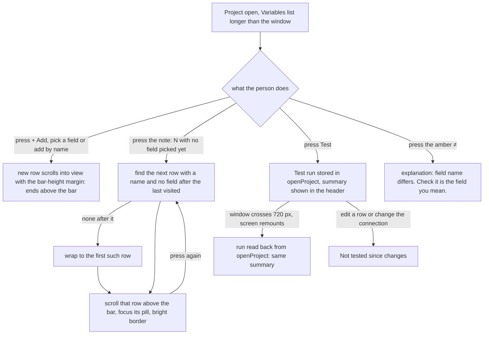

---
id:
title: You can find and read every variable row
status: validation
variant: kc-dev-flow-2
profile: pilot
merge: pr
worktree: .worktrees/spacedock-ensign-project-env-every-row-findable
pr: pr-merge:33
gates:
    version: 1
    records:
        - id: gate:project-env-every-row-findable:backlog
          stage: backlog
          attempts:
            - id: gate-attempt:project-env-every-row-findable-backlog-1
              briefing:
                id: briefing:project-env-every-row-findable:backlog:attempt-1:revision-1
                digest: sha256:468a67eb385a89a7aba15d953d50b6384a6350cdd8e61b59b99669373a4d7e9d
                room-ref: ./project-env-every-row-findable/review/backlog/briefing-1
              resolution:
                type: Resolution
                id: resolution:spacedock:project-env-every-row-findable:backlog:1
                briefing: briefing:project-env-every-row-findable:backlog:attempt-1:revision-1
                by: person:captain
                at: "2026-10-23T05:25:36.396333Z"
                decision: approve
                reason: 'Captain 2026-10-23: 「准」 — answers the backlog question put in chat: approves Design Director Tasks A and B, A first, with both stated recommendations (token store refreshes the field list; the ≠ explanation adds ''Check it is the field you mean.'').'
              application:
                target-stage: ideation
                state: consumed
        - id: gate:project-env-every-row-findable:ideation
          stage: ideation
          attempts:
            - id: gate-attempt:project-env-every-row-findable-ideation-1
              briefing:
                id: briefing:project-env-every-row-findable:ideation:attempt-1:revision-1
                digest: sha256:d37d35915e5c03e4baace619ee73350039730934a99faa43f65effc61a1f7a9a
                room-ref: ./project-env-every-row-findable/review/ideation/briefing-1
              resolution:
                type: Resolution
                id: resolution:spacedock:project-env-every-row-findable:ideation:1
                briefing: briefing:project-env-every-row-findable:ideation:attempt-1:revision-1
                by: person:captain
                at: "2026-10-23T08:11:54.372173Z"
                decision: approve
                reason: 'Captain 2026-10-23: 「准」 — approves this Task B design and its acceptance criteria into implementation.'
              application:
                target-stage: implementation
                state: consumed
        - id: gate:project-env-every-row-findable:validation
          stage: validation
          attempts:
            - id: gate-attempt:project-env-every-row-findable-validation-1
              briefing:
                id: briefing:project-env-every-row-findable:validation:attempt-1:revision-1
                digest: sha256:69309b17352db4d700644dc48f69aa94fce76d807171a8f9654b4d79f5e7b860
                room-ref: ./project-env-every-row-findable/review/validation/briefing-1
              resolution:
                type: Resolution
                id: resolution:spacedock:project-env-every-row-findable:validation:1
                briefing: briefing:project-env-every-row-findable:validation:attempt-1:revision-1
                by: person:captain
                at: "2026-10-23T09:58:23.817315Z"
                decision: approve
                reason: 'Captain 2026-10-23: 「准」 — approves delivery of PR #33 at fd59224 per the gate question, including its stated recommendation to keep the note button''s accessibilityLabel and hitSlop.'
              application:
                target-stage: done
                state: pending
started: 2026-10-23T07:37:00Z
---

Polish round after the A5 settings-screen rework of the project-env plugin. Source: the picky-user pass (`ux-review-a5-polish/astra-review.md`, `gemini-review.md`) and the Design Director's ruling (`ux-review-a5-polish/design-director.md`, Task B, rows R3b, R4, R5, R6 and R7), approved by the Captain on 2026-10-23 with 「准」, including the Director's recommendation to add "Check it is the field you mean." to the ≠ explanation.

## Scope

In: rows the screen scrolls to end above the save bar (R3b); the "N with no field picked yet" note moves you to each such row in turn (R4); the last Test result survives a remount at 720 px (R5); long names break only after underscores (R6); the ≠ explanation reads "The field name differs from the variable name. Check it is the field you mean." with the amber colour kept (R7). Out: undo of a removed row (R9, r3), Test results kept after Save (R13, r2), moving Conductor import and the prompt (R14, r2). Stop condition: the acceptance criteria pass. Starts after project-env-save-blocks-half-changed-connection merges, from that main.

## Acceptance criteria

**AC-1**: In work-many at 400 × 900 and 1280 × 1400, a newly added row ends fully above the save bar, and so does each row reached through the note.
Verified by: a measuring script on an isolated Paseo comparing each row's bottom edge with the bar's top edge at both widths.

**AC-2**: Pressing the note four times in work-many visits LINEAR_API_KEY, RESEND_API_KEY, SLACK_BOT_TOKEN and SLACK_SIGNING_SECRET in order, and a fifth press returns to the first.
Verified by: a runtime script at both widths.

**AC-3**: A Test summary reads the same before and after the window crosses 720 px and back; the 54-character name starts every new line right after an underscore and its copied text equals the name; the open ≠ explanation reads "The field name differs from the variable name. Check it is the field you mean."
Verified by: a runtime resize script comparing the summary text; a measuring script checking where each line starts and reading the name's text content; a text check of the open ≠ explanation. Each clause is falsified on its own.

## FO alignment

Surfaces: ui
Visible change: Rows are never hidden under the save bar, the no-field count takes you to those rows, Test results survive a resize and long names wrap at underscores.
Direction alignment with the Captain: done — the Captain approved the Design Director's Task B and its recommendation on 2026-10-23 (「准」).
Result: ux-review-a5-polish/design-director.md, Task B; every ui gate shows the Captain screenshots of the screen.
Release review: not needed: a polish of the r1.5 settings screen from the Captain-approved picky-user pass; it adds no journey story.
Map footprints: not needed: no journey story or open map question is attached to this polish task.

## Design

### PRFAQ

**Press release.** Kent opens a project with twelve variables, four of them with no field. The save bar says "4 with no field picked yet" and the line is now a button: each press scrolls to the next such row, puts it fully above the save bar, and marks its field pill, then wraps from the last back to the first. A row added with + Add ends above the bar too, instead of half hidden under it. The last Test summary stays in the Variables header when the window crosses 720 px and back. A long variable name breaks only after an underscore, so `DATABASE_URL_FOR_THE_PRODUCTION_REPLICA_READ_ONLY_USER` reads as three clean lines, and copying it still gives the exact name. The open ≠ explanation adds "Check it is the field you mean.", with the amber ≠ unchanged.

**FAQ.**
- *How far must a row clear the bar?* Each row carries a bottom scroll margin of the bar's measured height plus 20 px (the bar floats 12 px above the window bottom, plus an 8 px gap). The height is measured, not fixed, because Task A's reason line makes the bar 120 px tall at 400 px (57 px otherwise, 75 px at 1280 with the reason). A fixed margin would be wrong in one of them.
- *Which rows does the note visit?* Rows with a name and no field, the same rows the count counts. The cursor is the name of the row last visited: the next press goes to the next such row after it in list order, or the first when none follows. A row that got a field meanwhile just drops out; with a single such row, every press returns to it. A row with no name keeps the plain "Name N variables first" line, which is not a button (the unnamed rows are fixed first).
- *How does the person see which row they were taken to?* The pill of that row takes keyboard focus and draws a bright border while it holds focus (also a cue for keyboard users). It is a 1 px border colour change, so nothing moves. The reviewer could not tell it from the dashed empty-pill border in one picture; pictures 3 and 4 show a bright pill beside three muted ones.
- *Where does the Test run live?* In the `openProject` store next to the draft, written when the Test call returns (so it lands even if the screen was remounted while the call ran). The existing "Not tested since changes" rule reads it unchanged. `begin` clears it, so a newly opened project shows no old run.
- *How is "break after an underscore" done?* On the web client each underscore is followed by an empty `<wbr>` break opportunity; it adds no text, so selecting and copying gives the exact name. A name with no underscore, or a segment wider than its column, still breaks anywhere as today (`overflowWrap: anywhere` is kept). On the phone app the name renders as today.
- *Does the note cycle survive the 720 px remount?* No: the cursor is screen state and starts at the first row again. The Test summary does.
- *What is out?* Undo of Remove (R9), Test results kept after Save (R13), moving Conductor import and the prompt (R14). The note's wording stays as the Director ruled it; it does not show "1 of 4".



### What changes (read from `project-env/` on main d540a04, 2026-10-23)

Today `VariableRow` reveals an added row with `scrollIntoView({ block: "nearest" })` and no margin, so a row that lands at the window bottom sits under the sticky `SaveBar`; the "N with no field picked yet" line is plain `Text`; `test.data` holds the run in component state, which Paseo drops at the 720 px remount; the name `Text` has no break opportunity except `overflowWrap: "anywhere"`; `DIFFERS` is the one sentence. New: `nextFieldless(variables, after)` in `shared/config.ts` (pure, unit-tested); `run` and `setRun` in `client/open-project.ts`; in `settings-screen.tsx` a `scrollMarginBottom` on each row from `SaveBar`'s `onLayout` height, one reveal state `{ index, focus }` replacing `added`, the note as a `Pressable`, the pill's `onFocus`/`onBlur` border, `breakAfterUnderscores`, and the longer `DIFFERS`. The spike is `spike/every-row-findable.diff` (142 added, 18 removed lines, 7 new unit tests in `spike/every-row-findable.test.ts`). No new setting, RPC or dependency.

Existing-code check: the reveal mechanism, the note's count and the Test run all exist; what is missing is the margin, the press, and the run's place in the store, so existing code is repaired, not replaced. Two bounded searches over `project-env/client` and `project-env/shared`, excluding `node_modules`: `grep -n "scrollIntoView\|scrollMargin\|onLayout" client/*.tsx` finds the one reveal call and no margin; `grep -n "fieldless\|no field picked yet" client/*.tsx shared/*.ts` finds the count and its plain-text line and no handler. Not searched: other plugins and the phone app.

### UI proposal

UI proposal: Rows are never hidden under the save bar, and the no-field count takes you to those rows. The save bar keeps its shape (count on the left, Close or Discard and Save on the right, pinned at the bottom of the window). The line "N with no field picked yet" becomes a button: it is drawn in normal text colour with an underline, and each press scrolls to the next variable row that has no field, in list order, wraps from the last back to the first, puts that row fully above the bar, and gives its field pill a bright border while the pill holds keyboard focus. The same clearance applies to a row the screen scrolls to after Add. "Name N variables first" stays plain muted text. The last Test summary stays in the Variables header when the window crosses 720 px and back. A long variable name breaks only after an underscore (it still copies as the exact name). The open ≠ explanation reads "The field name differs from the variable name. Check it is the field you mean." with the amber ≠ unchanged. Nothing else on the page changes.

Preview: project-env-every-row-findable/design/preview-desktop-dark-2-note-first-press.png

The proposed design is the set `design/preview-*.png`, drawn from a running build of the real `project-env` client at main d540a04 with only this task's change applied (`spike/every-row-findable.diff`), on a throwaway Paseo 0.12.0 daemon (own home `/tmp/pe-row/s`, port 6941, plugin id `pe-row`, fake `op`, `security` and `git`; the review harness's work-many project: 12 rows, 4 with no field, one 54-character name), driven through Paseo's own web client with a headless browser. `design/today-*.png` are the same screens drawn from unpatched main (own daemon, port 6942) for comparison. Window-sized pictures (the sticky bar is visible): 1 a row added by name sits above the bar, 2 first press of the note, 3 fourth press (SLACK_SIGNING_SECRET), 4 fifth press (wraps to LINEAR_API_KEY), 5 a press while the connection change is open (the bar has the Task A reason line and is 120 px tall at 400 px). Whole-page pictures: 6 after Test (1 failed · 7 set · 4 no field; the long name wraps at underscores), 7 the same page at 700 px (desktop) or 1280 px (compact), 8 back at the first width with the same summary, 9 the ≠ explanation open. Desktop is 1280 px (window 1280 x 800, page 1280 x 1750); compact is 400 px (window 400 x 900, page 400 x 2900); dark for all, light for picture 2 at both sizes. The page is operable while the daemon is up. Disposable: the daemons, plugins and `/tmp/pe-row` are removed at the end of ideation (see the Stage Report).

### Design review

Design review: design/ideation-1.yaml
Design finding 1: declined: the count stays fixed ("4 with no field picked yet") on purpose, so the bar never changes text or width between presses and Task A's reason line does not move; the focused pill marks which row you are on, and pictures 2 to 4 walk the cycle.
Design finding 2: declined: the focus border is the same shape in a brighter colour so no row moves; pictures 3 and 4 show the focused pill beside three unfocused empty pills in one frame, where it reads bright against muted.
Design finding 3: declined: the note has `hitSlop` of 6 px on every side, about 25 px of height with the 13 px line; the same size as the plain line it replaces, and the bar's buttons are today's.
Design finding 4: declined: the row-to-bar gap is 8 px measured (`spike/evidence/ac12-spike.txt`, "gap to bar 8 px"); the bar's 12 px float above the window bottom is today's bar (project-env-save-footer-danger-zone).
Design finding 5: declined: "No unsaved changes" with a dimmed Save is today's bar and its copy was settled in project-env-save-footer-danger-zone.
Design finding 6: declined: Test, + Add, Close and Save are today's controls; this task changes none of their sizes.

The reviewer opened one picture only (its first limitation); I looked at pictures 1, 2, 3, 4, 5, 6, 9 and the today pictures myself and found nothing the review does not already cover.

### Acceptance evidence plan

Each result below was observed on 2026-10-23 on the isolated Paseo from the spike (`spike/every-row-findable.diff` on main d540a04, port 6941), and the same script was run against unpatched main (port 6942). The merged implementation is not yet verified.

AC-1: runtime `spike/harness/ac12.sh` (output in `spike/evidence/ac12-spike.txt` and `ac12-base.txt`). Spike: a row added by name ends 8 px above the bar at 400 x 900 and at 1280 x 800, 85 px above at 1280 x 1400; a row added from the picker 276 and 83 px above; each of the five note presses ends above the bar with the plain bar (57 px) and with the Change reason line (120 px at 400, 75 px at 1280): all PASS. Unpatched main: the row added by name ends 69 px under the bar at 400 x 900 and 1280 x 800 (FAIL), and the note does nothing. Limit: at 1280 x 1400 unpatched main already passes the new-row clause because the whole page fits, so that clause is falsified at 400 x 900 and 1280 x 800 only. The mutation that matters, removing `scrollMarginBottom`, was not run; the base build is the nearest proof.
AC-2: same script: at 400 x 900, 1280 x 1400 and 1280 x 800 the five presses focus LINEAR_API_KEY, RESEND_API_KEY, SLACK_BOT_TOKEN, SLACK_SIGNING_SECRET, LINEAR_API_KEY (PASS); unit `spike/every-row-findable.test.ts` "wraps from the last such row back to the first" fails when the wrap-around is removed (mutation run: 2 failed). Unpatched main has no button.
AC-3: three clauses, each with its own check. Summary: `spike/harness/ac3.sh` at 1280 -> 700 -> 1280 and 400 -> 1280 -> 400 reads "1 failed · 7 set · 4 no field" before, during and after (PASS); unpatched main reads nothing after the crossing (FAIL); unit "is kept by setRun" fails when `setRun` stores nothing (mutation run: 1 failed). Name: `spike/harness/ac3wrap.sh` (`spike/evidence/ac3wrap.txt`): at 1280 the lines start with PRODUCTION_ and READ_ONLY_, at 400 with REPLICA_, every start follows an underscore, and the copied text equals the name; unpatched main starts lines at "ODUCTION_REP", "NLY_USER" and "EPLICA_READ_". ≠: the open explanation reads "The field name differs from the variable name. Check it is the field you mean." at both widths; unpatched main reads the old sentence.

Not yet verified: the merged implementation; `npm test` and `npm run typecheck` on the merged branch (on the spike copy: typecheck clean, 269 of 269 tests pass, 2026-10-23); the phone app (the sticky bar and `<wbr>` are web-only, the name renders as today there); a name with no underscore (unchanged by source: `breakAfterUnderscores` returns the string); a remount while a Test call is still running (the result lands in the store when it returns, but the "Testing…" text is lost; not run).

### Needs decision

None. The Director's Task B and its two recommendations were approved by the Captain on 2026-10-23 (「准」), including the ≠ wording. Past rulings checked: `git -C docs/dev2/.spacedock-state grep -n 'Override:'` finds no override line, and ADRs 0001 to 0005 name no behaviour for scrolling, the no-field count or name wrapping.

### Spike notes

Machine dependencies, declared: Paseo.app 0.12.0 CLI at `/Users/kent/.local/bin/paseo`, Node, `agent-browser`, python3. `spike/harness/` is the review harness with plugin id, session, port and checkout overridable (`env.sh`), `dom.js` (measuring helpers), `ac12.sh`, `ac3.sh`, `ac3wrap.sh`, `shoot.sh`, `shoot-today.sh`, and `on.sh spike|base` to pick the build; its defaults point at `/tmp/pe-row/ckpt` (a copy of `project-env` from main d540a04 with the diff applied, `node_modules` linked) on port 6941, and `/tmp/pe-row/base` on port 6942. No real Keychain, 1Password or model provider was touched; Kent's `~/.paseo`, the live plugin and `/tmp/pe-astra` were not touched.

## Stage Report: ideation

- DONE: Design the change your Scope names inside the current settings screen, with each acceptance criterion kept and given a reproducible evidence clause.
  `## Design` holds the PRFAQ, Mermaid, existing-code check, UI proposal and evidence plan; AC-1 to AC-3 are unchanged; the spike is `spike/every-row-findable.diff` on main d540a04 (142 lines added, 7 unit tests).
- DONE: Produce the artifact the ui surface owes: whole-page previews from a running build at desktop and 400 px (a new row and a note-reached row above the save bar; the note stepping through the no-field rows; a Test summary across a 720 px round trip; the long name wrapping at underscores; the ≠ explanation), plus the design review, with each finding dispositioned.
  21 proposed pictures plus 6 of today's build in `design/`, from the real client on an isolated Paseo 0.12.0 (port 6941; today's build on 6942); `design/ideation-1.yaml` (6 MINOR, no MAJOR, all declined with reasons; the reviewer opened one picture only); `design_surfaces.py check`: "design surfaces presentable; design review design/ideation-1.yaml: 6 findings, 0 fixed, 0 criteria, 6 declined, 0 decisions".
- DONE: Name any decision the Captain must make (at most one), with a recommendation; the ≠ wording is already approved and is not a decision.
  None needed; the note keeps its fixed count and the focus border is a design choice inside the Director's ruling.
- DONE: AC-1 In work-many at 400 × 900 and 1280 × 1400, a newly added row ends fully above the save bar, and so does each row reached through the note.
  Spike 2026-10-23, `ac12.sh`: all rows end above the bar at 400 x 900, 1280 x 1400 and 1280 x 800, with the bar 57, 75 and 120 px tall; unpatched main puts a row added by name 69 px under the bar at 400 x 900 and 1280 x 800. Not falsified: the new-row clause at 1280 x 1400 (base passes there); the merged implementation is not yet verified.
- DONE: AC-2 Pressing the note four times in work-many visits LINEAR_API_KEY, RESEND_API_KEY, SLACK_BOT_TOKEN and SLACK_SIGNING_SECRET in order, and a fifth press returns to the first.
  Spike: `ac12.sh` order PASS at three window sizes; unit test on `nextFieldless` fails when the wrap-around is removed (mutation: 2 failed). Merged implementation not yet verified.
- DONE: AC-3 A Test summary reads the same before and after the window crosses 720 px and back; the 54-character name starts every new line right after an underscore and its copied text equals the name; the open ≠ explanation reads "The field name differs from the variable name. Check it is the field you mean."
  Spike: `ac3.sh` summary identical at 1280-700-1280 and 400-1280-400 (unpatched main blank); `ac3wrap.sh` every line start follows an underscore with copied text equal (unpatched main mid-word); ≠ text matches at both widths. Unit "is kept by setRun" fails when `setRun` stores nothing (mutation: 1 failed). Not tested: phone app, remount during a running Test.

Teardown (2026-10-23): both daemons stopped, browser sessions closed, `/tmp/pe-row` removed; Kent's `~/.paseo`, the live plugin, `/tmp/pe-astra` (port 6920) and the branch of `/Users/kent/Project/kc-paseo-plugins` were not touched. No secret value was read and no `op` or `security` command was run.

### Summary

The note becomes an underlined button that visits the no-field rows in order and wraps, every revealed row clears the save bar by its measured height plus 20 px, the Test run moves into the `openProject` store, names break after underscores through `<wbr>`, and the ≠ text gains the approved sentence. All of it was built as a spike on main d540a04, drawn at 1280 and 400 px, and shown to fail on unpatched main (except the new-row clause at 1280 x 1400, which main already passes). The design review found no MAJOR finding; no Captain decision remains.

## Stage Report: implementation

- DONE: Implement the approved design exactly, starting from the spike diff and tests in this task's spike/ folder.
  Spike diff applied unchanged to cad57e0 as commit fc4b095 on `spacedock-ensign/project-env-every-row-findable`; Draft PR https://github.com/iamcxa/kc-paseo-plugins/pull/33. comment_ratio.py: 2 comment lines of 131 code lines, 1.5%, limit met.
- DONE: Land tests so each acceptance criterion passes with the evidence its clause names and fails when its behaviour is removed (including a mutation that removes the scroll margin), plus whole-page screenshots of the built change at desktop and 400 px.
  Runtime scripts (`implementation/harness/`, own daemon port 6951, mutants on 6952, outputs in `implementation/evidence/`) pass on the build and fail on six one-line mutants: margin removed (AC-1: added row 69 px under the bar at 400x900 and 1280x800, note rows fail at all three sizes: `ac12-mut-margin.txt`), wrap-around removed and pill focus removed (AC-2 order), run kept in component state and `setRun` dropped (AC-3 summary blank after the crossing: `ac3-mut-localrun.txt`, `ac3-mut-run.txt`), `<wbr>` removed (lines start at "ODUCTION_REP"), old ≠ sentence (`ac3wrap-mut-*.txt`). Unit tests: `nextFieldless` fails 2 when the wrap is removed, "is kept by setRun" fails 1 when `setRun` stores nothing (`unit-mutations.txt`). AC-1 clause "new row at 1280x1400" passes on every build (page fits), so only the 400x900, 1280x800 and note clauses falsify it. Screenshots: `implementation/screens/built-*.png`, whole page at 1280 and 400 px, dark, light for the first press.
- DONE: Run `npm test`, `npm run typecheck`, the roborev gate, design_surfaces.py check and doc_impact.py, then open the Draft PR.
  `npm test` 269 of 269 pass (53 s), typecheck clean, design_surfaces: "design surfaces presentable". roborev gate exit 1, `evidence=roborev:1089` on fc4b09561, one finding left open, see below. doc_impact.py lists one document: docs/adr/0004-reserved-variable-names-are-skipped-not-blanked.md: unaffected: it governs reserved-name skipping and names config.ts only as the home of `isReservedName`; this change adds `nextFieldless` and touches no name rule. Draft PR #33 open.

### Findings for FO
- roborev (Medium, settings-screen.tsx `test` mutation): a remount during a running Test lets a second Test start, and if the older call finishes last its run replaces the newer. Not repaired: Deferred risk. Trigger is press Test, cross 720 px mid-call, press Test again, older call last; and `Run` carries `sent`, so `summaryParts` and the row marks show a stored run only against rows whose field and the connection match what it was sent, so a stale run is never shown against a different draft. It would become Material if a Test run could be shown for a draft it did not run.
- Also listed in the PR body: `accessibilityLabel` on the note and `hitSlop={6}` are not named by an acceptance criterion (without-it unanswered).
- Not run: phone app; a remount while a Test call is running ("Testing…" text is lost).

Teardown: all three daemons and browser sessions stopped, `/tmp/pe-rowi` removed; `~/.paseo`, the live plugin, `/tmp/pe-astra` and the branch of `/Users/kent/Project/kc-paseo-plugins` untouched. No secret read, no op or security command run.

### Summary

The spike diff landed unchanged as one commit on main cad57e0 and passes AC-1 to AC-3 on a build run through Paseo's own web client at 400 and 1280 px; each clause fails on its own one-line mutant, including the scroll margin. Tests, typecheck and the design check pass; the roborev gate left one Deferred-risk finding for FO.

### Feedback cycle 1 (Codex P2 x2)

- Fixed (455d20d): a new Test now clears the stored run and failure in `openProject.startTest`; a Test that throws stores `Test failed: <message>` through `failTest`, shown by `summaryParts` in the same header slot, so the earlier summary and marks no longer reappear as a failed retry's result. Each Test takes a sequence number from `startTest`; `setRun` and `failTest` drop a result whose number is not the latest. This closes roborev:1089 and the Deferred-risk finding in the first report.
- Fixed (781c356), found by roborev:1090 on the repair: `startTest` cleared the run, so a remount during a running Test lost "Testing…" and re-enabled Test. The store now holds `testing` (set by `startTest`, cleared when the current Test settles); the summary and the Test button read it next to `test.isPending`. This was the limit "remount while a Test call is running" in the first report; it is no longer a limit.
- Tests (`test/every-row-findable.test.ts`, each fails on its own mutant, `implementation/evidence/unit-mutations-cycle1.txt`): "drops the earlier run when a new Test starts, and shows the failure" fails when `startTest` keeps the run (1 failed) and when `summaryParts` ignores `failure` (1 failed); "drops a result that finishes after a newer Test started" fails when the sequence check is removed (1 failed); "keeps saying Testing until the running Test finishes" fails when `startTest` leaves `testing` false (1 failed).
- Checks at 781c356: `npm test` 272 of 272, typecheck clean, comment_ratio 2 comment lines of 178 code lines (1.1%). Runtime harness unchanged (no check changed); rerun on the new build: `ac12.sh` 18 PASS 0 FAIL at three sizes, `ac3.sh` summary identical across both 720 px round trips (`ac12-impl-cycle1.txt`, `ac3-impl-cycle1.txt`). The failed-retry display has no runtime check: the fake world has no failing Test call.
- roborev gate, run twice as the cap allows: 455d20d `evidence=roborev:1090` (Medium, remount during Test: fixed in 781c356); 781c356 `evidence=roborev:1091` exit 1, one finding left for FO: the "no field picked yet" button also appears on native, where reveal and focus use DOM methods that do not exist, so a press does nothing. Not fixed (cap reached). It matches the first report's "phone app not run"; the simplest repair is to keep the plain-text line when `Platform.OS !== "web"`, a one-line change to the approved design that FO or the Captain should rule on.
- Pushed to origin/spacedock-ensign/project-env-every-row-findable (PR #33). Isolated daemon and `/tmp/pe-rowi` removed.

### Feedback cycle 2 (roborev:1091)

- Fixed (cd9f1c9): outside the web client (`Platform.OS !== "web"`) the "N with no field picked yet" note is the plain muted `Text` it was before this task; on web it stays the approved underlined button. Three added lines in `SaveBar`.
- Check: no test was added. No test in `project-env/test` renders a client component (they cover pure `shared/` and store code), so a check that native gets no button would need a new renderer harness, or a helper extracted only to be tested; neither fits. Evidence instead: typecheck clean, `npm test` 272 of 272, comment_ratio 2 comment lines of 194 code lines (1.0%); on web the button path is unchanged and was exercised by `ac12.sh` in cycle 1 (18 PASS) and not rerun since the change is behind the `Platform.OS` test. The native branch has not been run on a device or simulator.
- roborev gate at cd9f1c9: `evidence=roborev:1092`, exit 1, one Medium finding left for FO, not fixed: with duplicate variable names among the no-field rows (`A, A, B`), `nextFieldless` finds the visited row by name with `findIndex`, so the cursor stays on the second `A` and never reaches `B`. Trigger evidence: `validateName` in `shared/config.ts` refuses a name already in the project (`"... is already in this project"`), so duplicates can only come from a hand-edited or older saved file, which the zod schema accepts. I classed it Deferred risk: no supported-workflow trigger observed. Repair if FO rules it Material: keep the cursor as a row index in the screen ref instead of a name, and add a duplicate-name regression test; it departs from the design sentence that the cursor is the name of the last row visited.
- Pushed to origin/spacedock-ensign/project-env-every-row-findable (PR #33).

### Feedback cycle 3 (Codex P2)

- Fixed (fd59224): a failed Test now stores what it was sent, `Failure = { sent, message }` in `shared/test-marks.ts`, as a successful run does. `summaryParts` shows "Test failed: <message>" only while `unchanged(draft, failure)`; after an edit to a variable, the account or the vault it reads "Not tested since changes". `failTest` takes the `Failure`; `settings-screen.tsx` passes `{ sent, message }`. Nothing else changed.
- Tests (`test/every-row-findable.test.ts`, mutants in `implementation/evidence/unit-mutations-cycle3.txt`): "reads Not tested since changes once the draft is edited after a failed Test" (edits a row's field, then the vault) fails 1 when `summaryParts` skips the `unchanged` check; "clears an earlier failure when a new Test starts" fails 1 when `startTest` keeps `failure`. The second mutant survived every unit test in validation-2; it now fails one.
- Checks at fd59224: `npm test` 274 of 274, typecheck clean, comment_ratio 2 comment lines of 219 code lines (0.9%). No runtime check changed.
- roborev gate at fd59224: `evidence=roborev:1099`, exit 1, one Medium finding left for FO, not fixed (the dispatch said change nothing else): `startTest` runs inside `mutationFn`, which React Query can postpone while offline, so during that pause the store keeps the previous result and `testing: false`, and a 720 px remount would show the old result and allow a second Test. I classed it Deferred risk: no observed trigger (the Test call goes to the local Paseo daemon, and nothing in this plugin sets a React Query `networkMode`). Repair if FO rules it Material: call `startTest` in the Test button's `onPress` before `test.mutate` and pass the number into `mutationFn`.
- Pushed to origin/spacedock-ensign/project-env-every-row-findable (PR #33).

### FO declines

- roborev:1089 (Medium): if the window crosses 720 px while a Test call runs, a second Test can start and the older call, finishing last, overwrites the newer run. Deferred risk. Released workflow: press Test, resize across 720 px, press Test again before the first returns. Harm: none observed; each stored run carries the draft it was sent with, so a stale run never shows against rows it was not run on (implementation report, fc4b095). Criterion: value-ac[AC-3] covers a summary across a resize, not two overlapping runs. Trigger evidence: roborev:1089 read in code only. Material if the Captain sees an older Test result replace a newer one; candidate revision: tag each run with a sequence number in the `openProject` store and drop a result older than the stored run.
- roborev:1092 (Medium): with two no-field rows sharing a name (`A, A, B`), `nextFieldless` finds the visited row by name and never reaches `B`. Deferred risk. Released workflow: none; the screen refuses a duplicate name (`validateName` in project-env/shared/config.ts, "is already in this project"), so duplicates come only from a hand-edited or older saved file. Harm: the note skips a row in that file. Criterion: value-ac[AC-2] names distinct rows. Trigger evidence: roborev:1092, read in code at cd9f1c9. Material if a saved project with duplicate names appears; candidate revision: keep the cursor as a row index and add a duplicate-name test.
- roborev:1099 (Medium): `startTest` runs inside `mutationFn`, which React Query can postpone while the browser reports offline; during that pause a 720 px remount shows the previous result and allows a second Test. Deferred risk. Released workflow: press Test while the Mac is offline, then resize across 720 px. Harm: an earlier result shows until the paused call runs. Criterion: value-ac[AC-3] covers a summary across a resize with a running Test, which validation-2 proved online. Trigger evidence: roborev:1099, read in code at fd59224; whether the host's query client pauses for a local daemon is not verified. Material if the Captain sees Test stall while offline; candidate revision: call `startTest` in the Test button's onPress before `test.mutate` and pass the sequence into `mutationFn`.

### Feedback Cycles

- Cycle 1 (Codex round 1 on fc4b095, two P2): (a) after a successful Test, a failed retry leaves the old summary and marks showing as its result. FO assessment: Material. Workflow: press Test again after a change upstream. Harm: an old "All N set" reads as the outcome of a failed retry. Protected boundary: value-ac[AC-3] (a Test summary the user can trust across a resize). Trigger evidence: Codex finding, settings-screen.tsx near line 636. (b) An older Test result overwrites a newer one after a remount; the same as roborev:1089, which FO had deferred under FO declines. FO now authorizes both fixes as implementation-2, superseding that deferral, because the Codex finding shows the harm is the visible marks, not only stored state.
- Cycle 2 (roborev:1091 on 781c356): on native the no-field note renders as a button whose reveal and focus use DOM methods native lacks, so a press does nothing. FO assessment: Material. Workflow: the Paseo phone app opens the settings screen. Harm: a control that looks pressable does nothing. Protected boundary: value-ac[AC-2] promises the note moves you to each row; on native it cannot. Trigger evidence: roborev:1091, read in code. FO authorizes the one-line fallback (plain text on native, as before this task) as implementation-3; the web design is unchanged.

## Stage Report: validation

- DONE: Independently check candidate fc4b095610925af7ea32e1402fbaf74659317d81 (PR iamcxa/kc-paseo-plugins#33, base main cad57e0) against AC-1 to AC-3 and the approved design: rebuild and run it yourself on an isolated Paseo.
  Candidate extracted with `git archive fc4b095` and diffed equal to the plugin the daemon served (client and shared); own daemon port 6961, plugin id pe-rowv, own agent-browser session. `npm run typecheck` clean, `npm test` 269 of 269 pass at fc4b095 (the worktree HEAD moved during validation, see Findings for FO; nothing below ran on it).
- DONE: Confirm a newly added row and each row reached through the note end above the save bar at 400x900, 1280x1400 and 1280x800.
  `ac12.sh` at each size: added by name ends 8, 85 and 8 px above the bar; from the picker 276, 83 and 277 px; the five note presses end above the bar with the plain bar (57 px) and with the Change reason line (120 px at 400, 75 px at 1280): all PASS.
- DONE: The note's five presses visit LINEAR_API_KEY, RESEND_API_KEY, SLACK_BOT_TOKEN, SLACK_SIGNING_SECRET and back to the first.
  Same script, document.activeElement after each press, at all three sizes and with the Change reason line open: order matches, PASS.
- DONE: The Test summary survives a 720 px round trip.
  `ac3.sh` 1280 -> 700 -> 1280 and 400 -> 1280 -> 400 reads "1 failed · 7 set · 4 no field" after Test, while crossed and back.
- DONE: The 54-character name breaks only after underscores and copies exactly.
  `ac3wrap.sh`: 3 lines at 1280 (starts PRODUCTION_, READ_ONLY_), 2 at 400 (REPLICA_); every start follows an underscore. Separate probe: a Selection over the name element returns the exact 54 characters with 8 `<wbr>` present.
- DONE: The ≠ explanation has the new sentence.
  Open explanation reads "The field name differs from the variable name. Check it is the field you mean." at 1280 and 400.
- DONE: Task A's Save block and reason line still work beside the note.
  With a mistyped service account entered and Check pressed: bar reads "1 unsaved change | Finish or cancel the connection change first | 4 with no field picked yet | Discard | Save", Save stays disabled before and after pressing the note and after pressing Save (projects.json unchanged, 3/0/12/1 variables).
- DONE: Confirm the new tests fail when their behaviour is removed.
  One-line mutants of fc4b095 on a second isolated daemon: margin removed -> AC-1 FAIL (400x900 and 1280x800 added row -69 px, note rows FAIL; at 1280x1400 only the Change-reason walk fails because the page fits); wrap-around removed -> AC-2 order stops after four; pill focus removed -> AC-2 order empty; `run` not stored and `run` read from component state -> summary "(none)" after the crossing; `<wbr>` removed -> lines start "ODUCTION_REP", "NLY_USER", "EPLICA_READ_"; old ≠ sentence -> explanation lacks the new sentence. Unit: wrap-around mutant fails 2 tests, `setRun` mutant fails 1.
- DONE: Give a verdict.
  PASSED for fc4b095: AC-1 to AC-3 and the design hold at the three sizes; no defect found; roborev:1089 not reported (no user-visible change found; FO declined).
- DONE: Write the minimal acceptance script FO will rerun in a fresh shell, and run `python3 .../adr_lint.py docs/adr --since 60799d9` recording its exit code.
  Script `validation/accept.sh` (below), run by me from `env -i` in 3 min 58 s with every expected line. adr_lint exit 0 ("5 ADR file(s) checked, 0 legacy"; the candidate adds no ADR). Also: comment_ratio exit 0 (131 code lines, 2 comment lines, 1.5%; both read, both carry a fact); dispatch_records exit 0 (5 complete); design_surfaces exit 0; doc_impact lists ADR 0004 and the implementation report carries `unaffected: <reason>`; no `## Number guards` section.
- DONE: Look at the whole-page screenshots at 1280 and 400 px and record what the Captain should see; record every unverified obligation.
  `validation/screens/test-1280.png`, `test-400.png` (whole page after Test), `note-1280.png`, `note-400.png`. Captain sees: header "1 failed · 7 set · 4 no field"; one red-bordered row with a red mark; the 54-character name on 3 lines at 1280 and 2 at 400, broken after underscores; amber ≠ on two rows; the save bar reading "No unsaved changes / 4 with no field picked yet" with the second part underlined; after a note press the row sits fully above the floating bar (8 px gap). Weak point: the focused pill's border is a brighter dashed line beside three muted dashed ones (RESEND vs LINEAR at 1280); it is visible when you look for it but not strong (design finding 2, declined by the ideation worker). Unverified: phone app (sticky bar and `<wbr>` are web-only); remount while a Test call runs; a name with no underscore (source returns the string unchanged); the new-row clause at 1280x1400 is not falsified by removing the margin (page fits); `accessibilityLabel` and `hitSlop` on the note are not named by an AC (without-it unanswered in the PR body); light theme not re-viewed.

### Findings for FO
- The worktree `.worktrees/spacedock-ensign-project-env-every-row-findable` did not stay at the candidate: during validation HEAD moved from fc4b095 to 455d20d and later 781c356 and cd9f1c9 (per `git log`), with uncommitted edits to `open-project.ts`, `settings-screen.tsx` and the test file in between. These repair roborev:1089 and the note outside the web client. This verdict is for fc4b095 only; a candidate with those commits needs its own validation (the new `startTest`/`failTest` and `testing` changes touch the Test summary clause).
- Harness caveat: `implementation/harness/mutate.sh` writes to `/tmp/pe-rowi`; it is removed. `ac12.sh` and `ac3wrap.sh` take width and height as separate arguments (a quoted "400 900" mis-labels the output but the viewport still follows).

### Acceptance script (`project-env-every-row-findable/validation/accept.sh`, run with `bash`)

```
#!/bin/bash
# Acceptance for candidate fc4b095 of iamcxa/kc-paseo-plugins#33, run on its own throwaway Paseo (port 6971, plugin id pe-accept).
# Needs: Paseo CLI /Users/kent/.local/bin/paseo, agent-browser, node, python3, and the repo checkout below (its project-env/node_modules is linked for the unit tests).
set -u
REPO=/Users/kent/Project/kc-paseo-plugins
CAND=fc4b095610925af7ea32e1402fbaf74659317d81
H=$REPO/docs/dev2/.spacedock-state/project-env-every-row-findable/implementation/harness
T=$(mktemp -d /tmp/pe-accept.XXXXXX)
export CHECKOUT=$T S=$T/s PORT=6971 PLUGIN_ID=pe-accept SESSION=pe-accept
trap 'bash "$H/teardown.sh" >/dev/null 2>&1; rm -rf "$T"' EXIT

echo "== 1 build the exact candidate and run its new unit tests (expect: pass 7, fail 0)"
git -C $REPO archive $CAND project-env | tar -x -C $T
ln -s $REPO/.worktrees/spacedock-ensign-project-env-every-row-findable/project-env/node_modules $T/project-env/node_modules
(cd $T/project-env && node --disable-warning=MODULE_TYPELESS_PACKAGE_JSON --test test/every-row-findable.test.ts 2>&1 | grep -E '^ℹ (pass|fail)')

echo "== 2 start the isolated Paseo with the candidate plugin"
bash $H/setup.sh >/dev/null 2>&1 && bash $H/clearstore.sh >/dev/null 2>&1 && echo "daemon up on $PORT"

echo "== 3 AC-1 and AC-2 at 400x900, 1280x1400, 1280x800 (expect every line PASS; order LINEAR_API_KEY RESEND_API_KEY SLACK_BOT_TOKEN SLACK_SIGNING_SECRET LINEAR_API_KEY)"
for sz in "400 900" "1280 1400" "1280 800"; do set -- $sz; bash $H/ac12.sh $1 $2 2>&1 | grep -E '^\[.*(PASS|FAIL)'; done

echo "== 4 AC-3 Test summary across 720 px (expect 'RESULT: summary survived the round trip' twice)"
bash $H/ac3.sh 1280 1400 700 2>&1 | grep RESULT
bash $H/ac3.sh 400 900 1280 2>&1 | grep RESULT

echo "== 5 AC-3 long name and the not-equal explanation (expect copiedTextEqualsName=true everyLineStartsAfterUnderscore=true, and the sentence ending 'Check it is the field you mean.')"
bash $H/ac3wrap.sh 1280 1400 2>&1 | grep -E '^\['
bash $H/ac3wrap.sh 400 900 2>&1 | grep -E '^\['
echo "== done"
```

Does not cover: the phone app, a remount during a running Test, light theme, the real 1Password or Keychain (fake `op`, `security`, `git`), any commit after fc4b095.

### Summary

Candidate fc4b095 passes AC-1 to AC-3 on a fresh isolated Paseo at 400x900, 1280x1400 and 1280x800, and each clause fails on its own one-line mutant. Verdict PASSED; no defect found. The worktree has since advanced past fc4b095, so FO should decide whether a later candidate needs a recheck.
FO note: the repairs for feedback cycles 1 and 2 were dispatched into the same worktree while validation-1 ran on it, so its HEAD moved under the validator; validation-1's verdict covers fc4b095 only. Later repairs wait for a running validation to finish, or the validator works from `git archive` of the candidate as this one did.
- Cycle 3 (Codex round 2 on cd9f1c9, P2): a failed Test keeps showing "Test failed" after the user edits a variable, the account or the vault, because a failure stores only a string; a successful run stores what it sent and becomes "Not tested since changes". FO assessment: Material. Workflow: Test fails, the user edits the failing row. Harm: the screen implies the edited inputs were tested and failed. Protected boundary: value-ac[AC-3] (a Test summary the user can trust). Trigger evidence: Codex finding at project-env/shared/test-marks.ts near line 47. FO authorizes the fix (store what was sent with the failure, or clear it when inputs change) as implementation-4, dispatched after validation-2 reports so the worktree does not move under the validator.

## Stage Report: validation (cycle 2)

- DONE: Revalidate candidate cd9f1c924d14b6a87a535fbc868c1104fb5a1b1a (PR iamcxa/kc-paseo-plugins#33), which adds 455d20d, 781c356 and cd9f1c9 on top of the validated fc4b095.
  Worked only from `git archive cd9f1c9` in a temp dir, never the shared worktree. `npm run typecheck` clean, `npm test` 272 of 272 pass; the new test file has 10 tests, all pass.
- DONE: Rerun validation/accept.sh (update CAND to the candidate) in a fresh shell.
  `accept.sh` now has CAND=cd9f1c9, expects "pass 10", starts a second isolated daemon whose fake vault answers each field lookup after 8 s (delayMs), and adds the remount-while-running check to step 4. Run from `env -i`, 3 min 58 s, every expected line: AC-1 and AC-2 PASS at 400x900, 1280x1400, 1280x800 with the same gaps as cycle 1; summary survived both round trips; long name and ≠ sentence as before. Run twice (second after I hardened the slow check's RESULT line).
- DONE: Confirm AC-3's summary clause still holds across 720 px round trips, including a remount while a Test is running.
  `validation/ac3slow.sh` on the delayed daemon, 1280 to 700 and 400 to 1280: Test pressed, "Testing…" with the Test button disabled before, after crossing and after crossing back; a second press while crossed is ignored; after about 8 s the summary reads "1 failed · 7 set · 4 no field" with the button enabled, and again after one more crossing.
- DONE: Show a failed retry if you can make the Test call fail in the fake world, else say why not.
  The fake world cannot make the Test call itself fail: `resolveProject` turns every vault or Keychain failure into per-row results and never throws, and stopping the daemon unmounts the screen ("Connect to this host"). So I injected the fault in the throwaway plugin copy only (one `throw new Error("simulated vault outage")` in the `project.test` handler behind a flag file; `validation/inject-fail.sh`): summary reads "Test failed: simulated vault outage" (screen `validation/screens/cycle2-test-failed-1280.png`), unchanged across a 720 px crossing; with the fault removed, pressing Test shows "Testing…" then "1 failed · 6 set · 4 no field" (`cycle2-retry-ok-1280.png`), so a successful retry replaces the failure.
- DONE: Confirm the new unit tests fail under their mutants.
  One-line mutants of the archive (`validation/mutate-cycle2.py`), test file alone: run not cleared by a new Test, failure not stored, an older result accepted, `testing` never set, `testing` never cleared each fail exactly one test; runtime mutant "testing never set" fails `ac3slow.sh` (summary "(none)" and button enabled after the crossing). One mutant survives: a new Test not clearing the earlier failure fails no unit test; at runtime it is visible (retry after the outage ended still showed "Test failed: simulated vault outage"), so the behaviour is true on the candidate but guarded only by the runtime check.
- DONE: Run adr_lint.py docs/adr --since 60799d9 and record its exit code.
  Exit 0 ("5 ADR file(s) checked, 0 legacy"; the candidate adds no ADR). Also comment_ratio exit 0 (194 code lines, 2 comment lines, 1.0%; no comment added since cycle 1), dispatch_records exit 0 (6 complete), design_surfaces exit 0, doc_impact lists ADR 0004 (implementation report carries `unaffected`).
- DONE: Record every unverified obligation, and give a verdict.
  Verdict: PASSED for cd9f1c9 against AC-1 to AC-3 and the checklist, with one observation below. Unverified: the native note (the `Platform.OS !== "web"` branch is a one-line ternary read in the diff and covered by typecheck; no phone app run, no unit test); a Test RPC failure from a real transport error (injected fault only); phone app; light theme; real 1Password and Keychain; "no failure cleared by a new Test" has no unit test.

### Findings for FO
- Observation, same as your cycle 3 item: with the injected failure shown, removing a row left "Test failed: simulated vault outage" in place (the summary did not become "Not tested since changes"). I did not rerun it after your cycle 3 note.
- Unit gap above (failure not cleared by a new Test survives all unit tests).

### Acceptance script (`project-env-every-row-findable/validation/accept.sh`, run with `bash`; helper scripts `setup-slow.sh` and `ac3slow.sh` sit beside it)

```
#!/bin/bash
# Acceptance for candidate cd9f1c9 of iamcxa/kc-paseo-plugins#33, run on two throwaway Paseos (ports 6971 and 6972, plugin ids pe-accept and pe-accept-slow).
# Needs: Paseo CLI /Users/kent/.local/bin/paseo, agent-browser, node, python3, and the repo checkout below (its project-env/node_modules is linked for the unit tests).
set -u
REPO=/Users/kent/Project/kc-paseo-plugins
CAND=cd9f1c924d14b6a87a535fbc868c1104fb5a1b1a
V=$REPO/docs/dev2/.spacedock-state/project-env-every-row-findable/validation
H=$REPO/docs/dev2/.spacedock-state/project-env-every-row-findable/implementation/harness
T=$(mktemp -d /tmp/pe-accept.XXXXXX)
trap 'S=$T/s PORT=6971 PLUGIN_ID=pe-accept SESSION=pe-accept bash "$H/teardown.sh" >/dev/null 2>&1; S=$T/slow PORT=6972 PLUGIN_ID=pe-accept-slow SESSION=pe-accept-slow bash "$H/teardown.sh" >/dev/null 2>&1; rm -rf "$T"' EXIT

echo "== 1 build the exact candidate and run its new unit tests (expect: pass 10, fail 0)"
git -C $REPO archive $CAND project-env | tar -x -C $T
ln -s $REPO/.worktrees/spacedock-ensign-project-env-every-row-findable/project-env/node_modules $T/project-env/node_modules
(cd $T/project-env && node --disable-warning=MODULE_TYPELESS_PACKAGE_JSON --test test/every-row-findable.test.ts 2>&1 | grep -E '^ℹ (pass|fail)')

echo "== 2 start two isolated Paseos with the candidate plugin: normal, and one whose fake vault answers each field lookup after 8 s"
(export CHECKOUT=$T S=$T/s PORT=6971 PLUGIN_ID=pe-accept SESSION=pe-accept; bash $H/setup.sh >/dev/null 2>&1 && bash $H/clearstore.sh >/dev/null 2>&1 && echo "normal daemon up on $PORT")
(export CHECKOUT=$T S=$T/slow PORT=6972 PLUGIN_ID=pe-accept-slow SESSION=pe-accept-slow SETUP_COPY=$T/setup-slow.sh; bash $V/setup-slow.sh >/dev/null 2>&1 && bash $H/clearstore.sh >/dev/null 2>&1 && echo "slow daemon up on $PORT")
(export S=$T/slow PORT=6972 PLUGIN_ID=pe-accept-slow SESSION=pe-accept-slow; bash $V/ac3slow.sh 1280 1400 700 > $T/slow-1280.out 2>&1; bash $V/ac3slow.sh 400 900 1280 > $T/slow-400.out 2>&1) &
SLOW=$!

echo "== 3 AC-1 and AC-2 at 400x900, 1280x1400, 1280x800 (expect every line PASS; order LINEAR_API_KEY RESEND_API_KEY SLACK_BOT_TOKEN SLACK_SIGNING_SECRET LINEAR_API_KEY)"
export S=$T/s PORT=6971 PLUGIN_ID=pe-accept SESSION=pe-accept
for sz in "400 900" "1280 1400" "1280 800"; do set -- $sz; bash $H/ac12.sh $1 $2 2>&1 | grep -E '^\[.*(PASS|FAIL)'; done

echo "== 4 AC-3 Test summary across 720 px (expect 'RESULT: summary survived the round trip' twice), then the slow daemon: crossing 720 px while a Test runs (expect 'RESULT: remount during a running Test kept Testing… and ended with the run' twice)"
bash $H/ac3.sh 1280 1400 700 2>&1 | grep RESULT
bash $H/ac3.sh 400 900 1280 2>&1 | grep RESULT
wait $SLOW; grep -h -E 'Testing…|RESULT' $T/slow-1280.out $T/slow-400.out

echo "== 5 AC-3 long name and the not-equal explanation (expect copiedTextEqualsName=true everyLineStartsAfterUnderscore=true, and the sentence ending 'Check it is the field you mean.')"
bash $H/ac3wrap.sh 1280 1400 2>&1 | grep -E '^\['
bash $H/ac3wrap.sh 400 900 2>&1 | grep -E '^\['
echo "== done"
```

Does not cover: the phone app, light theme, a real Test call failure (only an injected one, by hand), the real 1Password or Keychain, any commit after cd9f1c9.

### Summary

Candidate cd9f1c9 passes AC-1 to AC-3 on isolated Paseos at three sizes, keeps "Testing…" and the disabled Test button when a Test is running across a 720 px crossing, shows and clears "Test failed: ..." on retry, and its new tests fail under their mutants except one. Verdict PASSED; the failure-after-edit behaviour is already your cycle 3.

## Stage Report: validation (cycle 3)

- DONE: Revalidate candidate fd592248dbf8059f94fe08ea9ef57a859975b13a (PR iamcxa/kc-paseo-plugins#33), which adds only fd59224 on top of the validated cd9f1c9.
  Worked only from `git archive fd59224`. `npm run typecheck` clean, `npm test` 274 of 274 pass; the new test file has 12 tests, all pass.
- DONE: Rerun validation/accept.sh (update CAND) in a fresh shell.
  CAND now fd59224, expects "pass 12", and step 4b runs the new `validation/fail-cycle3.sh`. From `env -i`, 3 min 49 s, every expected line: AC-1 and AC-2 PASS at 400x900, 1280x1400, 1280x800; summary survived both 720 px round trips; "Testing…" and the disabled Test button held across a crossing while a Test ran (both widths); long name and ≠ sentence as before.
- DONE: With the injected fault (validation/inject-fail.sh) show "Test failed: ..." then edit a row and see "Not tested since changes", then edit back and see the failure again if that is the design, and retry after removing the fault.
  `fail-cycle3.sh` (a throwaway plugin copy with one `throw` in the Test handler behind a flag file; same fault as cycle 2): 1 Test: "Test failed: simulated vault outage"; 2 after + Add NEW_VAR: "Not tested since changes"; 3 after removing NEW_VAR (draft equal to what was sent again): "Test failed: simulated vault outage" returns; 4 after removing a real row: "Not tested since changes", unchanged after a 720 px crossing; 6 fault removed, Test again: run summary "7 set · 4 no field". The same script on cd9f1c9 stays on "Test failed" after every edit, so the check detects the bug the commit repairs. The failure returning on "edit back" is how the code behaves: it compares the draft with what the failed Test sent (names, fields, account, vault), the same rule a successful run uses. Not run at runtime: an account or vault edit (the unit test covers both).
- DONE: Confirm the two new unit tests fail under their mutants.
  One-line mutants of the archive (`validation/mutate-cycle3.py`): failure shown whatever the draft, and the account and vault comparison dropped, each fail "reads Not tested since changes once the draft is edited after a failed Test" only; a new Test not clearing the failure fails "clears an earlier failure when a new Test starts" only. This closes the gap I reported in cycle 2 (that mutant used to survive).
- DONE: Run adr_lint.py docs/adr --since 60799d9 and record its exit code.
  Exit 0 ("5 ADR file(s) checked, 0 legacy"; no ADR added). comment_ratio exit 0 (219 code lines, 2 comment lines, 0.9%; none added since cycle 1), dispatch_records exit 0 (8 complete), design_surfaces exit 0, doc_impact lists ADR 0004 (implementation report carries `unaffected`).
- DONE: Record every unverified obligation, and give a verdict.
  Verdict: PASSED for fd59224. Unverified: a real transport failure of the Test call (injected fault only, a fault added to the throwaway copy); an account or vault edit after a failed Test at runtime; the native note (a `Platform.OS` ternary, read and typechecked only, from cycle 2); phone app; light theme; real 1Password and Keychain; roborev:1099 (offline-paused Test) not examined, FO deferred it.

### Findings for FO
- None new. Harness caveat: my first fault run printed "(none)" for a successful Test because the script's summary pattern did not match "7 set · 4 no field" (no failed row, no "All"); fixed in `fail-cycle3.sh`. `ac3.sh` and `ac3slow.sh` keep the old pattern, which suits their project (one row fails).

### Acceptance script (`project-env-every-row-findable/validation/accept.sh`, run with `bash`; helpers `setup-slow.sh`, `ac3slow.sh` and `fail-cycle3.sh` sit beside it)

```
#!/bin/bash
# Acceptance for candidate fd59224 of iamcxa/kc-paseo-plugins#33, run on three throwaway Paseos (ports 6971, 6972 and 6973).
# Needs: Paseo CLI /Users/kent/.local/bin/paseo, agent-browser, node, python3, and the repo checkout below (its project-env/node_modules is linked for the unit tests).
set -u
REPO=/Users/kent/Project/kc-paseo-plugins
CAND=fd592248dbf8059f94fe08ea9ef57a859975b13a
V=$REPO/docs/dev2/.spacedock-state/project-env-every-row-findable/validation
H=$REPO/docs/dev2/.spacedock-state/project-env-every-row-findable/implementation/harness
T=$(mktemp -d /tmp/pe-accept.XXXXXX)
trap 'S=$T/s PORT=6971 PLUGIN_ID=pe-accept SESSION=pe-accept bash "$H/teardown.sh" >/dev/null 2>&1; S=$T/slow PORT=6972 PLUGIN_ID=pe-accept-slow SESSION=pe-accept-slow bash "$H/teardown.sh" >/dev/null 2>&1; rm -rf "$T"' EXIT

echo "== 1 build the exact candidate and run its new unit tests (expect: pass 12, fail 0)"
git -C $REPO archive $CAND project-env | tar -x -C $T
ln -s $REPO/.worktrees/spacedock-ensign-project-env-every-row-findable/project-env/node_modules $T/project-env/node_modules
(cd $T/project-env && node --disable-warning=MODULE_TYPELESS_PACKAGE_JSON --test test/every-row-findable.test.ts 2>&1 | grep -E '^ℹ (pass|fail)')

echo "== 2 start isolated Paseos with the candidate plugin (a third, for 4b, starts by itself): normal, and one whose fake vault answers each field lookup after 8 s"
(export CHECKOUT=$T S=$T/s PORT=6971 PLUGIN_ID=pe-accept SESSION=pe-accept; bash $H/setup.sh >/dev/null 2>&1 && bash $H/clearstore.sh >/dev/null 2>&1 && echo "normal daemon up on $PORT")
(export CHECKOUT=$T S=$T/slow PORT=6972 PLUGIN_ID=pe-accept-slow SESSION=pe-accept-slow SETUP_COPY=$T/setup-slow.sh; bash $V/setup-slow.sh >/dev/null 2>&1 && bash $H/clearstore.sh >/dev/null 2>&1 && echo "slow daemon up on $PORT")
(export S=$T/slow PORT=6972 PLUGIN_ID=pe-accept-slow SESSION=pe-accept-slow; bash $V/ac3slow.sh 1280 1400 700 > $T/slow-1280.out 2>&1; bash $V/ac3slow.sh 400 900 1280 > $T/slow-400.out 2>&1) &
SLOW=$!
bash $V/fail-cycle3.sh $CAND > $T/fail.out 2>&1 &
FAIL=$!

echo "== 3 AC-1 and AC-2 at 400x900, 1280x1400, 1280x800 (expect every line PASS; order LINEAR_API_KEY RESEND_API_KEY SLACK_BOT_TOKEN SLACK_SIGNING_SECRET LINEAR_API_KEY)"
export S=$T/s PORT=6971 PLUGIN_ID=pe-accept SESSION=pe-accept
for sz in "400 900" "1280 1400" "1280 800"; do set -- $sz; bash $H/ac12.sh $1 $2 2>&1 | grep -E '^\[.*(PASS|FAIL)'; done

echo "== 4 AC-3 Test summary across 720 px (expect 'RESULT: summary survived the round trip' twice), then the slow daemon: crossing 720 px while a Test runs (expect 'RESULT: remount during a running Test kept Testing… and ended with the run' twice)"
bash $H/ac3.sh 1280 1400 700 2>&1 | grep RESULT
bash $H/ac3.sh 400 900 1280 2>&1 | grep RESULT
wait $SLOW; grep -h -E 'Testing…|RESULT' $T/slow-1280.out $T/slow-400.out
echo "== 4b a failed Test (a fault added to the throwaway plugin copy), then edits (expect: 1 Test failed: simulated vault outage; 2 Not tested since changes; 3 Test failed: simulated vault outage again; 4 to 5b Not tested since changes; 6b and 6 a run summary '7 set · 4 no field')"
wait $FAIL; grep -E '^[0-9]' $T/fail.out

echo "== 5 AC-3 long name and the not-equal explanation (expect copiedTextEqualsName=true everyLineStartsAfterUnderscore=true, and the sentence ending 'Check it is the field you mean.')"
bash $H/ac3wrap.sh 1280 1400 2>&1 | grep -E '^\['
bash $H/ac3wrap.sh 400 900 2>&1 | grep -E '^\['
echo "== done"
```

Does not cover: the phone app, light theme, a real Test call failure (injected), the real 1Password or Keychain, an account or vault edit at runtime, any commit after fd59224.

### Summary

Candidate fd59224 passes AC-1 to AC-3 on isolated Paseos, and a failed Test now reads "Not tested since changes" once the draft differs from what it sent, returns to the failure when the draft matches again, and clears on a new Test. Its two new unit tests fail under their mutants, and the same runtime check fails on cd9f1c9. Verdict PASSED.

## FO records

External review rounds at the validation gate: Codex 3 (rounds 1 and 2 raised three P2s, fixed in feedback cycles 1 and 3; round 3 clean at fd59224). The local roborev gate is not an external round; its open items are under FO declines.
delivery_gate.py check passed at fd59224 before the ask (merge/ask-1.json); FO reran validation/accept.sh before the ask with every expected line. The Captain approved with 「准」 on 2026-10-23, including the stated recommendation to keep the note's accessibilityLabel and hitSlop, and FO merged as c46720f.
FO response to observer.md: the roborev:1089 decline is superseded by feedback cycle 1, which fixed it at 455d20d; the FO note and the cycle 3 entry were appended at the file's end and so landed under validation-1's Summary, and later FO notes go under their own headings.
