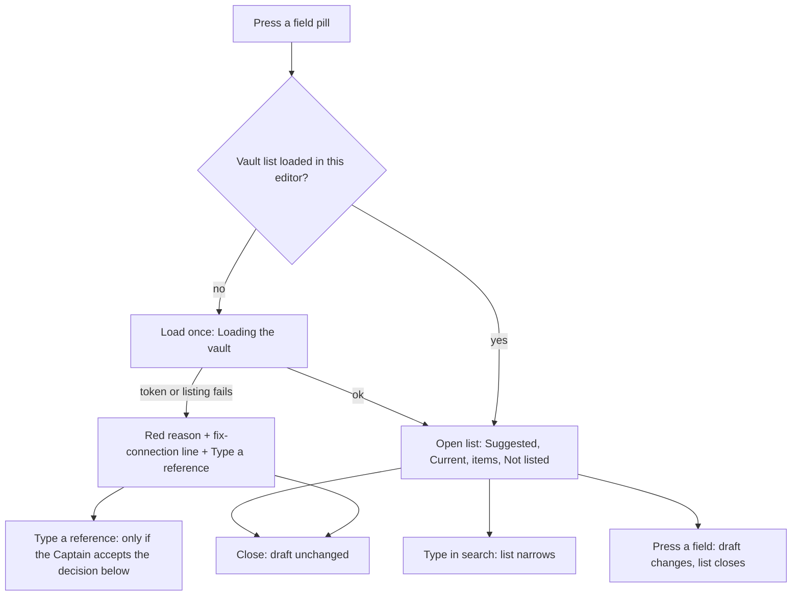

---
id:
title: The field picker is grouped, searchable and suggests the matching field
status: implementation
variant: kc-dev-flow-2
profile: pilot
merge: pr
worktree: .worktrees/spacedock-ensign-project-env-field-picker-grouped
pr:
gates:
    version: 1
    records:
        - id: gate:project-env-field-picker-grouped:backlog
          stage: backlog
          attempts:
            - id: gate-attempt:project-env-field-picker-grouped-backlog-1
              briefing:
                id: briefing:project-env-field-picker-grouped:backlog:attempt-1:revision-1
                digest: sha256:f428f8bb6c8bdab68e5d6c0cd4036a200caddabb65d3f032a157d1e45225a6d0
                room-ref: ./project-env-field-picker-grouped/review/backlog/briefing-1
              resolution:
                type: Resolution
                id: resolution:spacedock:project-env-field-picker-grouped:backlog:1
                briefing: briefing:project-env-field-picker-grouped:backlog:attempt-1:revision-1
                by: person:captain
                at: "2026-10-22T04:14:59.523059Z"
                decision: approve
                reason: 'Captain 2026-10-22: 「准」 — accepts this A5 settings-screen rework task''s outcome, scope and acceptance criteria on the pilot profile, into ideation.'
              application:
                target-stage: ideation
                state: consumed
        - id: gate:project-env-field-picker-grouped:ideation
          stage: ideation
          attempts:
            - id: gate-attempt:project-env-field-picker-grouped-ideation-1
              briefing:
                id: briefing:project-env-field-picker-grouped:ideation:attempt-1:revision-1
                digest: sha256:715d19cd343e43a7cc3ed1d94095ec1287a6eaff456e43173152e833b16b29a2
                room-ref: ./project-env-field-picker-grouped/review/ideation/briefing-1
              resolution:
                type: Resolution
                id: resolution:spacedock:project-env-field-picker-grouped:ideation:1
                briefing: briefing:project-env-field-picker-grouped:ideation:attempt-1:revision-1
                by: person:captain
                at: "2026-10-22T07:45:14.348019Z"
                decision: approve
                reason: 'Captain 2026-10-22: 「准」 — accepts this A5 rework design and its acceptance criteria into implementation, including the recommendation stated in this gate''s question.'
              application:
                target-stage: implementation
                state: consumed
started: 2026-10-22T04:16:39Z
---

Settings-screen rework of release r1.5 of the project-env plugin. Design reference: the design-director review (ux-review-r1.5/index.html) and direction A5 (ux-review-r1.5/direction-a5.html, shots/a5-*.png) in the state checkout; Captain approved A5 on 2026-10-22 (「就這樣」) after 「這個 UX 完全不行」, and the Add flow on 2026-10-22 (「可以」).

## Scope

In: the field picker groups fields by item, has a search box, lists first the field whose label equals the variable name (ADR 0005), marks fields used by another variable, shows a reference missing from the vault in red as "not in vault", and lists unreadable items as "not listed" with their reason outside the variable rows (review findings 4, 10). Non-goals: references by ID (r1b). Stop condition: the acceptance criteria pass.

## Acceptance criteria

**AC-1**: The picker groups fields by item, filters by search, and lists the same-name field first.
Verified by: unit tests of grouping, filtering and ordering, and a screenshot of the open picker.
Evidence clause: `project-env/test/field-picker.test.ts` (new) calls `pickerRows` and asserts items sorted by title with their fields under them, a search that keeps label matches and whole items whose title matches, and the field labelled exactly like the variable listed before every group (it fails if the match turns case-insensitive, the suggestion falls back into its group, or a search hides a matching item); plus screenshots `preview-desktop-picker-suggested.png`, `preview-desktop-picker-search.png` and the 400 px pair, drawn again from the implementation with `spike/run.sh` and `spike/capture.sh` on an isolated Paseo.

**AC-2**: A field used by another variable is marked, and a saved reference missing from the vault shows as not in vault.
Verified by: unit tests and a screenshot.
Evidence clause: the same test file asserts `usedBy` lists the other variables holding a field and never the variable being edited, and that a saved reference absent from the listing, or in another vault, yields the red `stale` row but a reference inside an unreadable item does not; plus screenshots `preview-desktop-picker-used-by.png` and `preview-desktop-picker-not-in-vault.png` and the 400 px pair.

## FO alignment

Surfaces: ui
Visible change: The field picker is grouped by item, searchable, and suggests the field named like the variable.
Direction alignment with the Captain: done — the Captain chose direction A5 and the Add flow on 2026-10-22.
Result: direction A5 (ux-review-r1.5/direction-a5.html); every ui gate shows the Captain screenshots of the screen.
Release review: not needed: a rework of the r1.5 settings screen the Captain ruled on 2026-10-22; it adds no journey story.

## Design

### PRFAQ

**Press release.** Kent presses a variable's field and a list opens. At the top is the field named like the variable, which ADR 0005 makes nearly always the right one; under it the field the variable holds now, ticked, or in red "not in vault" when 1Password no longer has it. Below, every item is a heading with its field labels under it, so a long vault reads as a few services, and a search box narrows it. A field another variable already holds says "used by" that variable. Items 1Password could not read are listed last as "Not listed" with the reason, not as rows that look like variables.

**FAQ.**
- *What did the Captain decide?* Direction A5 and the Add flow, 2026-10-22 (「就這樣」, 「可以」). Review findings 4 and 10 are this task.
- *Where does the list come from?* The existing `vault.list-refs` call, unchanged: `refs` (`op://vault/item/field`) and `skipped` (item, reason). The client groups by cutting each reference after `op://<vault>/` and at its last `/`. ADR 0005 forbids `/` in a label; a pre-ADR label with one would be split in a different place on screen, but picking always stores the original reference string.
- *What is "the field named like the variable"?* A label exactly equal to the variable name, case-sensitive (ADR 0005: label equals variable name). Several items can hold one; all are listed, by item title. `sameName` in `shared/field-picker.ts` is the one comparison; the pill's ≠ mark (project-env-field-pill-one-control) should call it, so the two never disagree.
- *Order?* Suggested, then Current (only when it is not already Suggested), then items by title, case-insensitive, with fields in vault order, then Not listed. A search keeps items whose title matches whole and other items only for matching labels; a stale reference stays visible whatever is typed.
- *Is a shared field blocked?* No. "used by" is a note; two variables may hold one field.
- *When is a reference "not in vault"?* Absent from the listing, or pointing into another vault. A reference inside an unreadable item is not called missing, because the plugin cannot know.
- *Does picking save?* No. It edits the draft, as today.
- *What when the list cannot load?* Loading shows "Loading the vault…"; a failure shows the existing token-row sentence (for example "No token in Keychain") in red with one fixed line telling the person to fix the 1Password connection on this page and reopen. The vault is listed once per open editor and kept in memory; after a failure, opening a picker again tries again.
- *Known limit, not measured on a real vault:* listing runs `op item get` once per item, in order (existing behaviour of Browse vault). With the fake `op` and 21 items the first list took about 6 seconds; real `op` speed was not measured because no `op` command may run here.

### Flow

### UI proposal

UI proposal: Pressing a variable's field opens the host list (a dialog on desktop, a bottom sheet at 400 px) titled "Field for NAME": a "Search fields" box; a "Suggested" heading over each field labelled exactly like the variable, written "Item › field"; a "Current" heading over the field the variable holds now, ticked with "used by" naming other variables that hold it, or in red with "not in vault" when 1Password has no such field; then each item as a bold heading with its fields beneath, items by title; a "Not listed" heading last, each unreadable item with its plain reason; while loading "Loading the vault…"; when listing fails the existing reason in red with one line saying to fix the 1Password connection on this page and reopen; "No field matches" and "Nothing readable in this vault" for empty results; long labels wrap rather than cut; a quiet "Type a reference…" row at the end that opens an `op://` box with a Use button (shown pending the Captain's decision below). The page behind the list is today's settings screen with the field button replaced by a stand-in pill reading "Item › field"; that pill and the rest of the page belong to the sibling tasks named below.

Preview: project-env-field-picker-grouped/design/preview-desktop-picker-suggested.png

The proposed design is the set `design/preview-*.png` in this task's folder, from a real run: `spike/` assembles main at 1adf630 plus `spike/overlay/` (the new picker, `shared/field-picker.ts`, and the stand-in pill) into `/tmp/fp-grouped-spike`, an isolated Paseo 0.12.0 daemon (own home, port 6873, plugin id `fp-grouped`, fake `op`, `security`, `git`; no model provider), driven through Paseo's own web client with a headless browser. Disposable: the daemon and `/tmp/fp-grouped-spike` are removed when ideation ends; `spike/run.sh up` and `spike/capture.sh desktop|400|light|light400` redraw every picture. Whole page at both sizes: `preview-desktop-page.png`, `preview-400-page.png`, light `preview-desktop-light-page.png`, `preview-400-light-page.png`. Picker states, each at desktop and 400 px, dark: suggested, loading, used-by, not-in-vault, empty-field (suggestion only), search, no-match, bottom (Not listed), empty-vault, load-failed, type-reference and type-reference-bad; light: used-by and not-in-vault at both sizes.

Not drawn: the Paseo desktop app and phone app, keyboard navigation, a long variable name in the title, the op:// box opened from a loaded list, mouse-wheel scrolling (the headless wheel did not move the list; the list container was scrolled by script and does scroll), a vault of hundreds of fields.

### Existing-code check

Boundary: the field picker and the vault listing in `project-env/` on main 1adf630. Search, 2026-10-22: `grep -n "RefPicker\|refOptions\|refs.data" project-env/client/settings-screen.tsx` shows a flat `RefPicker` modal of raw paths, current choice marked by colour only, and `refs.data.skipped` drawn as rows inside the variables card; `project-env/server/secrets.ts` `listRefs` already returns `refs` and `skipped` and `test/browse-vault.test.ts` covers it. Conclusion: reuse `listRefs` unchanged (no RPC, schema or server change); replace the picker's body and move the `skipped` rows into it. New code: `shared/field-picker.ts` (pure `splitRef`, `sameName`, `pickerRows`) and `client/field-picker.tsx`; the spike's `overlay/test/field-picker.test.ts` passes 18 cases on `pickerRows` and `splitRef`, so the model is not a guess.

### Acceptance evidence plan

- **AC-1** (not yet verified in code). Today: the spike's 18 unit cases on `pickerRows` pass (spike overlay `test/field-picker.test.ts`, run with `node --test`), and the screenshots above show grouping, search, no-match and the suggestion first. To prove: the clause under AC-1, in `project-env/test/` against the implementation.
- **AC-2** (not yet verified in code). Today: the same 18 cases cover used-by, stale, other vault and unreadable item; screenshots show both marks. To prove: the clause under AC-2.

### Interfaces to siblings

- From project-env-field-pill-one-control: the pill opens `<FieldPicker>` and owns loading the vault on first open; it passes `name`, `current` (the stored reference), `holders` (the draft's variables), `vault` and a `VaultList` of `loading`, `error` (message) or `ready` (refs, skipped); it removes the Browse vault row and the `skipped` rows from the card. It calls `sameName` for the ≠ mark.
- To project-env-add-variable-one-step: the same `<FieldPicker>` with `name: null` (no Suggested); `onPick(ref)` returns the stored reference and `splitRef(ref, vault).field` is the label. The "add with this name" action needs a slot beside the search text, which that task adds; this task leaves the list free for it.
- From project-env-connection-collapse: the load-failed line says "fix the 1Password connection on this page"; if collapsing changes how the connection is reached, that sentence follows it.
- project-env-draft-survives-remount: none. The list's open state and search text are local and close on a remount; the draft itself survives there.
- project-env-test-summary-failure-mark and project-env-save-footer-danger-zone: none.

### Decision for the Captain

**Does the picker keep a "Type a reference…" row?** Recommendation: yes. Today a row accepts a typed `op://` reference when the vault cannot be listed; with one pill per row and no Browse vault row, a project whose token is missing, whose Keychain is locked, or whose item 1Password cannot read could not set any field. Review finding 1 named this as "Type a reference" inside the picker; the Scope here is silent and no sibling owns it. What gets worse: a second way to set one value, though inside the one control and last in the list. If declined, remove the row and the two `type-reference` pictures; fields are then settable only while the vault lists. Past rulings checked: ADRs 0001 to 0005 and `git -C docs/dev2/.spacedock-state grep -n 'Override:'` name nothing on typed references.

### Design review

Design review: design/ideation-1.yaml
Design finding 1: declined: a held field that is also the suggestion is ticked in place so it appears once; the Current heading appears only when the held field sits elsewhere.
Design finding 2: declined: "not in vault" names a state of the saved reference, which has no vault row to tick, and the red icon takes the tick's place; "used by" annotates a row that can be picked.
Design finding 3: declined: the title names the edited variable, so "used by" always means the other variables; AC-2's clause asserts the edited one is excluded.
Design finding 4: declined: item names are what a person scans, so they carry the weight; Suggested, Current and Not listed only separate groups.
Design finding 5: declined: an unreadable item has no fields to pick, so it is drawn as a muted item heading with its reason, at the same left edge as every item heading, and cannot be pressed.
Design finding 6: Needs decision: whether "Type a reference…" exists is the Captain's decision below; if kept, the implementation draws it with a control cue and the pictures are redrawn.
Design finding 7: declined: the op:// box is one component; it is drawn open at both sizes in the load-failed list, and under a loaded list the closed row is drawn in the bottom pictures.
Design finding 8: declined: the focus ring colour belongs to the host input; the hint states the whole shape `op://vault/item/field`.
Design finding 9: fixed: the load-failed line now reads "on this page" in preview-desktop-picker-load-failed.png and preview-400-picker-load-failed.png; no Retry button, because opening a picker again after a failure tries the listing again and the cause is fixed outside the dialog.
Design finding 10: fixed: the search box now stays while the list loads, redrawn in preview-desktop-picker-loading.png and preview-400-picker-loading.png; a spinner is declined because the host exports none.
Design finding 11: declined: wrapping is shown by the 400 px used-by picture (two names) and the desktop long label; a three-name "used by" and a long title at 400 px are listed under Not drawn.
Design finding 12: declined: scrolling, scrollbar and clipping are the host list's; headless capture hides scrollbars by default; sticky group headings are not offered by the host list.
Design finding 13: fixed: field rows are 44 px high under 500 px width, redrawn in every preview-400 picture; the close glyph is the host dialog's.
Design finding 14: declined: the vault is one per project and shown in the Vault row on the same page.
Design finding 15: declined: colours come from the host theme; light pictures of used-by and not-in-vault at both sizes show every colour the picker uses (red, muted, tick).

## Stage Report: ideation

- DONE: Design the change your Scope names inside direction A5, with each acceptance criterion kept and given a reproducible evidence clause.
  `## Design` (PRFAQ, flow, existing-code check); AC-1 and AC-2 sentences kept verbatim, each with an evidence clause naming `project-env/test/field-picker.test.ts` and the pictures.
- DONE: Produce the artifact the ui surface owes: whole-page previews from a running build at desktop and 400 px, plus the design review, with each finding dispositioned.
  32 pictures in `project-env-field-picker-grouped/design/` from an isolated Paseo 0.12.0 (port 6873, plugin `fp-grouped`, fake op/security/git), whole page and 13 picker states at desktop and 400 px, plus light; `design/ideation-1.yaml`, 15 MINOR findings, 3 fixed and redrawn, 11 declined with reasons, 1 Needs decision.
- DONE: Name every interface you need from a sibling rework task, and any decision the Captain must make (at most one), with a recommendation.
  `### Interfaces to siblings` names field-pill-one-control, add-variable-one-step and connection-collapse; one decision, whether the picker keeps "Type a reference…", recommended yes.
- DONE: AC-1 (groups by item, filters by search, same-name field first): current evidence, not yet verified in code.
  Spike `overlay/test/field-picker.test.ts` passes 18 cases on `pickerRows`, `splitRef` (grouping, search, suggestion first); pictures `preview-desktop-picker-suggested/search/no-match.png` and the 400 pair; the implementation's own test and pictures are still to come.
- DONE: AC-2 (used-by mark, saved reference missing from the vault shows as not in vault): current evidence, not yet verified in code.
  The same 18 cases cover used-by (edited variable excluded), missing, other vault and unreadable item; pictures `preview-*-picker-used-by.png` and `preview-*-picker-not-in-vault.png`, dark and light; implementation proof still to come.
- DONE: `design_surfaces.py check` output.
  `python3 <package>/scripts/design_surfaces.py check project-env-field-picker-grouped.md` exit 0: "design surfaces presentable; 15 findings, 3 fixed, 0 criteria, 11 declined, 1 decisions".

### Summary

The picker stays a host dialog or bottom sheet and reuses `vault.list-refs` unchanged; a new pure `pickerRows` groups by item, puts the exact-label field first, ticks the held field, marks "used by" and "not in vault", and moves unreadable items to a "Not listed" footer. One Captain decision: keep a "Type a reference…" row, which nobody owns and which today's typed rows would otherwise lose. Known limits: first-open listing runs `op item get` per item (about 6 s for 21 items with the fake op; a real vault was not measured), and mouse-wheel scrolling and the desktop and phone apps were not exercised. Teardown: daemon stopped, `/tmp/fp-grouped-spike` removed, Kent's daemon on 6767 untouched; `spike/run.sh up` and `spike/capture.sh` redraw everything.
