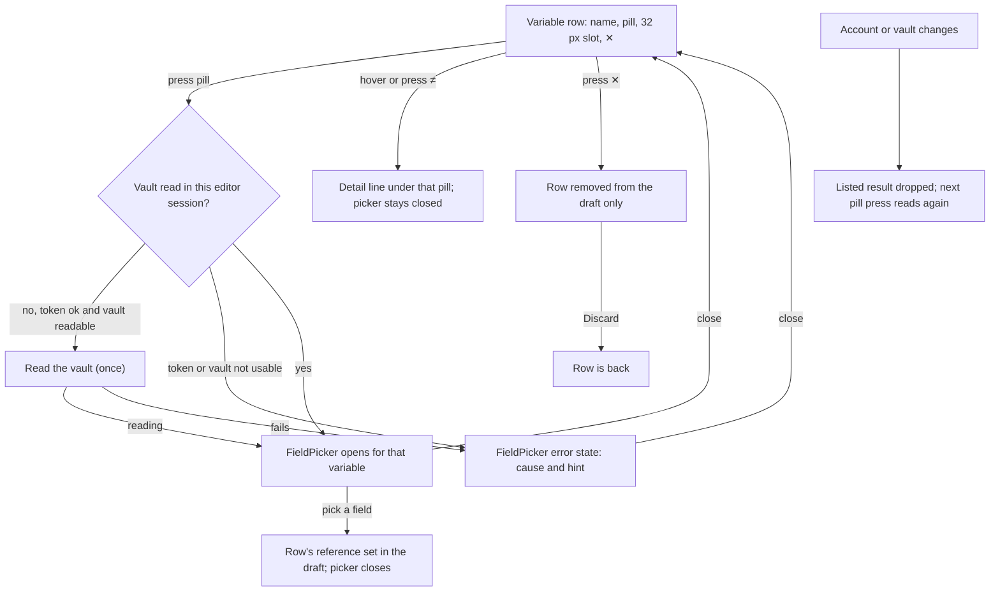

---
id:
title: Each variable row has one field pill showing item and field
status: validation
variant: kc-dev-flow-2
profile: pilot
merge: pr
worktree: .worktrees/spacedock-ensign-project-env-field-pill-one-control
pr: iamcxa/kc-paseo-plugins#24
gates:
    version: 1
    records:
        - id: gate:project-env-field-pill-one-control:backlog
          stage: backlog
          attempts:
            - id: gate-attempt:project-env-field-pill-one-control-backlog-1
              briefing:
                id: briefing:project-env-field-pill-one-control:backlog:attempt-1:revision-1
                digest: sha256:1b21722b990eadd31f70a3870ffae57d37c3fa1a2bfadbd523c707de76da39ff
                room-ref: ./project-env-field-pill-one-control/review/backlog/briefing-1
              resolution:
                type: Resolution
                id: resolution:spacedock:project-env-field-pill-one-control:backlog:1
                briefing: briefing:project-env-field-pill-one-control:backlog:attempt-1:revision-1
                by: person:captain
                at: "2026-10-22T04:14:47.505108Z"
                decision: approve
                reason: 'Captain 2026-10-22: 「准」 — accepts this A5 settings-screen rework task''s outcome, scope and acceptance criteria on the pilot profile, into ideation.'
              application:
                target-stage: ideation
                state: consumed
        - id: gate:project-env-field-pill-one-control:ideation
          stage: ideation
          attempts:
            - id: gate-attempt:project-env-field-pill-one-control-ideation-1
              briefing:
                id: briefing:project-env-field-pill-one-control:ideation:attempt-1:revision-1
                digest: sha256:369cb056ffa571714c726f1673d78970809041d572c6ce482d068998699c19a8
                room-ref: ./project-env-field-pill-one-control/review/ideation/briefing-1
              resolution:
                type: Resolution
                id: resolution:spacedock:project-env-field-pill-one-control:ideation:1
                briefing: briefing:project-env-field-pill-one-control:ideation:attempt-1:revision-1
                by: person:captain
                at: "2026-10-22T08:47:00.611805Z"
                decision: approve
                reason: 'Captain 2026-10-22: 「准。先做完讓我試試看好了，我暫時沒有時間看得太仔細」 — accepts this A5 rework design and its acceptance criteria into implementation, including the scope addition (Remove becomes ✕) and AC-3 stated in this gate''s question (Captain amendment 1).'
              application:
                target-stage: implementation
                state: consumed
started: 2026-10-22T04:16:32Z
---

Settings-screen rework of release r1.5 of the project-env plugin. Design reference: the design-director review (ux-review-r1.5/index.html) and direction A5 (ux-review-r1.5/direction-a5.html, shots/a5-*.png) in the state checkout; Captain approved A5 on 2026-10-22 (「就這樣」) after 「這個 UX 完全不行」, and the Add flow on 2026-10-22 (「可以」).

## Scope

In: every variable row shows one field pill in every state, reading `ITEM › field` without the vault and never cut off mid-field; the whole pill opens the field picker; the separate Browse vault row is removed and the vault list loads the first time a picker opens (review findings 1, 2; A5). A row with no field shows a dashed "Pick a field" pill. A label that differs from the variable name shows a small ≠ mark with its detail on hover or tap. Non-goals: the picker's contents (project-env-field-picker-grouped). Stop condition: the acceptance criteria pass.

## Acceptance criteria

**AC-1**: Each row shows one pill reading `ITEM › field` with the full field name, and pressing it opens the picker; no Browse vault row exists.
Verified by: on an isolated Paseo, `design/spike/capture.sh base` and `long` (after `setup.sh` and `restart.sh`) give whole-page screenshots at 1280 px and 400 px in which every row's pill reads item and field, a long field wraps instead of being cut (`*-01-base`, `*-11-long-names`), and `capture.sh` prints the vault reads as 0 before any press and 1 after the first and after a second pill (the second press reads nothing); a source check, `grep -n "Browse vault\|RefPicker\|HostInput" project-env/client/settings-screen.tsx`, returns nothing after implementation.

**AC-2**: A label that differs from the variable name shows the ≠ mark with its detail on hover and on tap, and pressing ≠ does not open the picker.
Verified by: `project-env/test/field-pill.test.ts` (new): `pillView` marks `stripe/secret-key` for `STRIPE_KEY`, not for `secret-key`, and marks a case difference; and screenshots `*-02-differs-tap` and `1280-03-differs-hover` showing the detail line with no picker dialog open.

**AC-3**: Each row's Remove is a ✕ icon button with the accessible label `Remove <name>`, at desktop and 400 px, and it removes only that draft row.
Verified by: the accessibility snapshot in `capture.sh base` lists `button "Remove SENTRY_AUTH_TOKEN"`; screenshots `*-09-after-remove` show the other rows intact; the plugin's saved settings file still lists all six variables after ✕ (no Save pressed).

## FO alignment

Surfaces: ui
Visible change: Each variable row shows one field pill reading item and field; the Browse vault row is gone.
Direction alignment with the Captain: done — the Captain chose direction A5 and the Add flow on 2026-10-22.
Result: direction A5 (ux-review-r1.5/direction-a5.html); every ui gate shows the Captain screenshots of the screen.
Release review: not needed: a rework of the r1.5 settings screen the Captain ruled on 2026-10-22; it adds no journey story.

## Design

Direction: A5 (Captain 「就這樣」, 2026-10-22). The row geometry, pill look, dashed "Pick a field" pill, ≠ mark and ✕ follow `ux-review-r1.5/direction-a5.html`. What the picker lists, the failure mark, the Add flow, the footer and the connection line belong to sibling tasks, whose designs this one consumes (see Interfaces).

### PRFAQ

**Press line.** Every variable in a project's settings shows on one pill which 1Password item and field fills it. The pill is also the only control that changes it, and ✕ is the only control that removes the row.

**What Kent sees.** A row reads `NAME  [ITEM › field ⌄]  ✕`: item muted, field full strength, the vault left out because it is shown once above. A row with no field shows a dashed "Pick a field" pill. A small ≠ inside the pill marks a field whose label differs from the variable name; pressing it, or hovering it on desktop, opens one line under that pill and does not open the picker. Pressing anywhere else on the pill opens the field picker. There is no Browse vault row. At 400 px the name and ✕ share the first line and the pill takes the second.

**FAQ**
- *Why is Browse vault gone?* It looked like "show me the vault" but changed every row's control, far below the rows (review finding 1). Now the first press on any pill reads the vault; the result is kept until the account or vault changes (the effect resets both); a second pill opens at once.
- *What if the vault cannot be read?* The picker (project-env-field-picker-grouped's) shows the reason: this task passes it the connection's own status text and hint, or the failure message, as its `error` state.
- *Is a long name cut off?* No. Item and field wrap instead (preview 11), and the variable name wraps.
- *A reference in another vault?* Its vault leads: `vault · item › field`.
- *A reference that is not vault/item/field (hand-typed in an older save)?* It is shown as stored in a dashed red pill, with "Not a field reference. It looks like op://vault/item/field." under it.
- *Is removal safe?* ✕ edits the draft only; nothing is saved until Save, and Discard brings the row back. It has no confirm and no undo of its own (unchanged from today's Remove).
- *Not in this task:* what the picker lists (picker-grouped), how a failed row looks beyond the border and the slot (test-summary-failure-mark), "+ Add" and the name input (add-variable-one-step), the footer, the connection line, draft survival on resize.

### What changes (read from `project-env/` at 1adf630, 2026-10-22)

- `client/settings-screen.tsx`: `RefPicker` and the free-text `HostInput` branch are replaced by one `FieldPill`; `VariableRow` stops using `SettingsRow` and lays out `name | pill | 32 px slot | ✕` itself (compact below 600 px: name and ✕, then pill and slot); the `Remove` text button becomes the ✕ icon button, its accessibility label still `Remove <name>`; the Browse vault action and its `skipped` rows are deleted; `ProjectEditor` builds the `VaultList` (`loading`, `error`, `ready`), reads the vault on the first pill press and resets on account or vault change, and renders one `FieldPicker`.
- `shared/ref.ts` (new): `pillView`. `parseRef` stays in `server/cause.ts` (unchanged contract, `test/cause.test.ts` keeps passing).
- `shared/config.ts`: `variableLine` returns no line for an empty reference, because the dashed pill says it. The "set", "failed: …" and "Not applied: …" lines stay under the row until project-env-test-summary-failure-mark removes them, so nothing is lost if this lands first.
- Test change: "reads No field picked on its row" in `test/variable-name.test.ts` is rewritten to the new contract (the one existing test this design breaks, measured in the Acceptance evidence plan).

### Pill rules (`pillView`)

| reference | pill reads |
|---|---|
| empty | dashed `Pick a field` |
| `op://V/item/field`, V is the project's vault | `item › field` |
| same, V differs, or the project has no vault yet | `V · item › field` |
| `op://V/item/section/field` | `item/section › field` (everything between vault and field is the item, as the picker's `splitRef` reads it) |
| starts with `op://` but has fewer than three parts | the text as stored, dashed red, with the reason under it |

≠ shows when `sameName(field, variableName)` is false (`shared/field-picker.ts` from picker-grouped; exact, case-sensitive, ADR 0005). The A5 mock draws `STRIPE_KEY › secret-key` without a ≠; by AC-2 it has one, as in the previews.

### Row layout

Desktop: name column 200 px, pill fills the rest and can shrink, a 32 px slot, ✕ (16 px glyph, hit area extended by 10 px). Compact (under 600 px): line one is the name and ✕, line two the pill and the slot. The name cell is plain text here; add-variable-one-step swaps in an input with an error line for an unnamed row. The slot is empty unless the row failed; with `failed` the pill border is `statusDanger`, and the slot holds the sibling's (!) (preview 10 draws a stand-in dot).

### UI proposal

UI proposal: Each variable row reads `NAME  [ITEM › field ⌄]  ✕`, and at 400 px the name and ✕ sit on the first line with the pill below. The whole pill opens the field picker, so there is one control per row in every state. The item is muted and the field is full strength and wraps instead of being cut off; the vault is left out because it is shown once above, unless the reference is in a different vault, when its name leads. A row with no field shows a dashed "Pick a field" pill, and a reference that is not item and field is shown as stored in a dashed red pill with the reason under it. A small ≠ in the pill marks a field whose label differs from the variable name, and pressing it or hovering it opens one line under that pill without opening the picker. Remove is a ✕ icon button. The Browse vault row is gone: the vault is read the first time a pill is pressed.

Preview: project-env-field-pill-one-control/design/preview.html

The page shows the whole settings page, from a running build of the real client on an isolated Paseo 0.12.0 (own `PASEO_HOME`, port 6851, plugin id `field-pill-spike`, fake op, security and git; no Keychain or 1Password touched), at 1280 px and 400 px: all pill states (01), ≠ on press (02) and hover (03), the picker listed (04), reading (05), failed (06) and unavailable (07), after a pick (08) and after ✕ (09), a failed row (10) and long names with another vault and an unparsable reference (11, 12). The build is `design/spike/prototype.patch` (disposable) on main 1adf630 plus project-env-field-picker-grouped's `FieldPicker` and `sameName` copied unchanged into `design/spike/picker-stand-in/`, so the picker in the pictures is that task's design, not this one's.

### Existing-code check

Reused: the `refs` mutation and `vault.list-refs` RPC (unchanged), `parseRef` (unchanged), `canReadVault`/`tokenRowText` (the unavailable reason), `variableLine`, the host `Modal` through `FieldPicker`. Replaced: `RefPicker`, the text-box branch and the Remove text button. Observation that the change is needed: `ux-review-r1.5/shots/13-test-before-browse.png`, `15-after-browse.png` and `m03-browsed-400.png` (three rows reading the same clipped path, and a text box that becomes a dropdown after a distant button) against previews 01 and 11 here. No ADR is added or changed.

### Interfaces

Consumed, from the sibling designs in this state checkout:
- **project-env-field-picker-grouped**: `<FieldPicker title open onOpenChange name vault current holders list theme onPick>` with `list: VaultList` (`loading`, `error{message,hint}`, `ready{refs,skipped}`); `sameName`. This task builds `list`, reads the vault on first press and renders the one picker. The typed-reference row is that task's pending Captain decision; if declined, a hand-typed reference can no longer be created from the screen but one already saved still shows (preview 11).
- **project-env-test-summary-failure-mark**: `FieldPill` takes `failed` (red border), every row reserves the 32 px slot, the pill shrinks, ✕ replaces Remove (given to this task). The (!) and its reason are that task's.
- **project-env-add-variable-one-step**: the name cell can become an input with an error line; the dashed pill; at 400 px name and ✕ share line one. Rows are keyed by name today; that task re-keys them by position, in the same lines.

Offered: `pillView(ref, name, vault)` is pure and exported for tests.

Order recommended to the FO: picker-grouped first (it defines `FieldPicker` and `sameName`; it carries a stand-in pill until this task lands), then this task, then add-variable-one-step and test-summary-failure-mark in either order. Both of the last two edit the Variables card header and row, so the second to land rebases.

No new Captain decision.

### Acceptance evidence plan

Per-criterion evidence is under `## Acceptance criteria`. Limits: a click stands for "tap" (no touch device); hover is drawn on desktop only; the vault read was timed on the fake `op` only (a real vault was not measured); light theme and a mid width are not drawn.

### Design review

Design review: design/ideation-3.yaml

Two earlier reviews (`design/superseded/ideation-1.yaml`, `ideation-2.yaml`) were of a draft with a stand-in picker; ideation-2's follow-up replaced that draft with the one in `design/preview.html`, so this third run is the one on the final pictures. It lists no MAJOR finding.

Design finding 1: declined: ≠ already has a 12 px hit slop, and a missed press opens the picker, which closes without change; "one control per row" means one field control, with ≠ as an annotation inside it, and A5 draws ≠ in the pill.
Design finding 2: declined: A5 (`shots/a5-desktop.png`, approved by the Captain) draws ≠ in amber; the red border and dot are the sibling's failure look.
Design finding 3: declined: the open detail line is the open state, and A5 draws no pressed state for ≠.
Design finding 4: declined: the line left under the name is today's text and project-env-test-summary-failure-mark removes it; a failed row with ≠ open is the same two lines, drawn in `1280-10-failed-look` and `1280-12-long-differs-open`.
Design finding 5: declined: the unsaved-change cue belongs to project-env-save-footer-danger-zone; ✕ edits the draft and Discard restores the row (stated in the FAQ).
Design finding 6: declined: whether Save accepts a row with no field is project-env-add-variable-one-step's (it keeps Save on).
Design finding 7: declined: A5 draws the pill filled and the Vault selector belongs to project-env-connection-collapse.
Design finding 8: declined: A5 draws the ⌄ on the pill; changing the glyph is a direction change the Captain made on 2026-10-22.
Design finding 9: declined: wrapping a long name keeps the full name visible, which review finding 2 requires; ✕ top-aligns with the first line on purpose.
Design finding 10: declined: the 32 px slot after the pill is reserved for the (!) by project-env-test-summary-failure-mark, as the A5 mock draws it.
Design finding 11: declined: the connection card is project-env-connection-collapse's.
Design finding 12: declined: AC-1 requires item and field in full; A5 draws rows like these.
Design finding 13: declined: a reference in another vault is rare, it is drawn in `*-11-long-names`, and the leading vault and the dot say it.
Design finding 14: declined: the pill has no disabled or read-only state because nothing in the editor disables editing today; a focus ring is the host's `Pressable`; the picker on a filled row and a long list are project-env-field-picker-grouped's pictures.
Design finding 15: declined: light theme and a mid width are not drawn and are stated as limits in the evidence plan; the pill, ≠ and ✕ use only the host's theme colours (`surface2`, `foreground`, `foregroundMuted`, `statusDanger`, `statusWarning`, `border`).

### Scope addition for the FO

The Scope line above lists no ✕; FO routed it here on 2026-10-22 (project-env-test-summary-failure-mark named it as in none of the seven scopes). Suggested Scope wording to add: "each row's Remove text button becomes a ✕ icon button (direction A5)"; AC-3 tests it.

## Stage Report: ideation

- DONE: Design the change your Scope names inside direction A5, with each acceptance criterion kept and given a reproducible evidence clause.
  `## Design` states the pill, row layout and ✕ per A5; AC-1 and AC-2 kept and sharpened, AC-3 (✕) added; every clause names a script, test or grep. AC-1 current evidence: screenshots `*-01-base`, `*-11-long-names` and the printed vault-read counts 0, 1, 1 (desktop); the source grep is not yet verifiable (no code written). AC-2 current evidence: `design/spike/field-pill.test.ts`, 7 pass, asserts `pillView` marks `stripe/secret-key` for `STRIPE_KEY` and not for `secret-key` (fails if `sameName` or the compare changes), plus screenshots `*-02-differs-tap`, `1280-03-differs-hover`. AC-3 current evidence: a11y snapshot lists `Remove <name>`, `*-09-after-remove` shows one row gone, saved file still holds all six variables.
- DONE: Produce the artifact the ui surface owes: whole-page previews from a running build at desktop and 400 px, plus the design review, with each finding dispositioned.
  `design/preview.html` and `design/shots/` (23 whole-page pictures, built from `design/spike/prototype.patch` on 1adf630 plus picker-grouped's `FieldPicker`, isolated Paseo 0.12.0 port 6851, fake op/security/git); `design/ideation-3.yaml`: 15 findings, none MAJOR, all dispositioned (15 declined with reasons). `design_surfaces.py check`: "design surfaces presentable".
- DONE: Name every interface you need from a sibling rework task, and any decision the Captain must make (at most one), with a recommendation.
  `### Interfaces` names `FieldPicker`/`VaultList`/`sameName` (picker-grouped), `failed`, the 32 px slot and shrinkable pill (test-summary-failure-mark), name cell and dashed pill (add-variable-one-step); recommends picker-grouped first. No new Captain decision; picker-grouped's typed-reference decision is theirs.

### Summary

The row becomes `NAME [ITEM › field ⌄] ✕` per A5 and consumes picker-grouped's `FieldPicker` instead of drawing a picker. The prototype reads the vault once per editor session on the first pill press. The full suite on the prototype is 172 of 173 passing; the one failure is "reads No field picked on its row", which this design rewrites. Findings 1 to 15 are all MINOR and declined; the third review exceeded the two-run cap because the follow-up replaced the design the first two reviewed (their reports are in `design/superseded/`). Known limits: a click stands for tap, a real vault read was not timed, light theme and a mid width are not drawn. Teardown: daemon stopped, browser session closed; `/tmp/field-pill-spike` remains until removed (scripts redraw everything: `design/spike/setup.sh`, `restart.sh`, `capture.sh`).

## Captain amendments

### Amendment 1 — 2026-10-22, ideation gate
Captain: 「准。先做完讓我試試看好了，我暫時沒有時間看得太仔細」 (chat, answering the ideation gate)
Asked: "Approve this A5 rework design and its acceptance criteria into implementation? Approving also adds to Scope 'each row's Remove text button becomes a ✕ icon button (direction A5)' and accepts the new AC-3 for it; say if you object."
Supersedes: none

## Stage Report: implementation

- DONE: Implement the approved design exactly, including every interface it names for its sibling tasks and, where present, Captain amendment 1 in the task file.
  Draft PR https://github.com/iamcxa/kc-paseo-plugins/pull/24, branch spacedock-ensign/project-env-field-pill-one-control on base d61e243: c533678 (pill, row, ✕, vault read on first press, `shared/ref.ts`) and a3596fb (picker stand-in files copied unchanged, FO-approved). ✕ is in (amendment 1). `FieldPill` takes `failed` and the 32 px slot is reserved; `pillView(ref, name, vault)` is exported.
- DONE: Land tests so each acceptance criterion passes with the evidence its clause names and fails when its behaviour is removed, plus whole-page screenshots of the built change at desktop and 400 px.
  AC-1: grep for `Browse vault|RefPicker|HostInput` in settings-screen.tsx returns nothing (fails if the row or either component returns); implementation/shots `*-01-base`, `*-11-long-names` at 1280 and 400; capture.sh printed vault reads 0, 1, 1 (second pill reads nothing; the 400 run prints running totals 1 then 2, one new read). AC-2: test/field-pill.test.ts asserts `pillView` marks stripe/secret-key for STRIPE_KEY, not for secret-key, and marks SECRET-KEY (fails if `sameName` or the compare changes); shots `*-02-differs-tap`, `1280-03-differs-hover` show the line with no dialog. AC-3: snapshot lists `button "Remove SENTRY_AUTH_TOKEN"`, `*-09-after-remove` keeps the other rows, saved projects.json still holds 6 variables. test/variable-name.test.ts rewritten: asserts `variableLine` is null for an empty reference (fails if "No field picked" returns). Shots built from committed HEAD c533678 on an isolated Paseo (own home, port 6861, fake op/security/git); also 05, 06, 07, 10, 12 states, in `implementation/shots/` (23 files), scripts in `implementation/spike/`.
- DONE: Run `npm test`, `npm run typecheck`, the roborev gate, design_surfaces check and doc_impact, then open the Draft PR.
  `npm test` 180 pass, 0 fail (session-open deadline test failed once under load, passed alone and on rerun); typecheck clean; design_surfaces "presentable"; comment_ratio 1 comment line in 584 code lines (0.2%), max 5% met. roborev gate exit 1, evidence=roborev:1033 (findings on c53367817), run once, nothing fixed (below). doc_impact lists docs/adr/0004-reserved-variable-names-are-skipped-not-blanked.md: unaffected: `variableLine` still returns the "Not applied" reason for a reserved name before the empty-reference check. Draft PR #24 opened.

### Summary

Each row is now `NAME [ITEM › field ⌄] ✕` and the Browse vault row is gone; the vault is read on the first pill press and kept until the account or vault changes. One addition to the prototype: the picker's error state also covers a token that is unchecked or a vault it cannot read, so the picker never sits on "Loading" (shots 06, 07). Findings for FO from the roborev gate: (1) the stand-in picker keeps its search text after a pick, in picker-grouped's file, left unchanged, so picker-grouped should fix it; (2) there is no way to refresh the vault list once loaded; AC-1 and the design require the second press to read nothing, so this is a deferred risk (becomes material if Captain wants a refresh). Limits: click stands for tap, hover at desktop only, vault read timed on fake op only, light theme and a mid width not drawn. Teardown: daemon stopped and browser closed; /tmp/fp-impl-spike remains.

### FO declines

- roborev:1033 finding 1 (the stand-in picker keeps its search text after a pick): declined here, routed to project-env-field-picker-grouped, which replaces `field-picker.tsx`; FO puts it in that task's implementation dispatch.
- roborev:1033 finding 2 (no way to refresh the vault list once loaded): deferred; AC-1 and the approved design require the second press to read nothing. It becomes material if the Captain wants a refresh, which FO raises with him when he tries the screen.

## Stage Report: validation

Verdict: PASSED (recommended) for candidate c5336781701bd1425b287dc693af0ee58f1dbac1 (PR #24, base d61e243). No new finding.

- DONE: Independently check candidate against AC-1 to AC-3, the approved design and Captain amendment 1 on an isolated Paseo.
  Rebuilt from `git archive` of c533678 on port 6871 (own home, fake op/security/git, own browser session, removed afterwards). Whole-page shots in `validation/shots/` (15 files, 1280 and 400 px). AC-1: every row one `ITEM › field` pill (`*-01-base`), long item and field wrap and are whole (`*-11-long-names`), no Browse vault row, `grep -n "Browse vault\|RefPicker\|HostInput" settings-screen.tsx` exit 1; vault reads 0, 1, 1 at 1280 and 0, 1 at 400 on a fresh daemon. AC-2: `*-02-differs-tap` and `1280-03-differs-hover` show the detail line with no dialog; the picker opens only from the pill (`*-04-picker`). AC-3: snapshot lists `button "Remove SENTRY_AUTH_TOKEN"`, `*-09-after-remove` keeps the other rows at both widths, saved file still has 6 variables. Amendment 1 (✕) covered by AC-3.
- DONE: Confirm the new tests fail when their behaviour is removed.
  Throwaway copy at c533678, five mutations, each fails exactly one test: `differs: false` and a case-insensitive compare fail "marks a field whose label differs"; vault always null fails "names the vault only when..."; item = parsed.item fails "keeps everything between the vault and the field"; restoring "No field picked" in `variableLine` fails the rewritten variable-name test. Base: 33 pass. Not mutated: the runtime wiring (≠ not opening the picker, read once); the capture counters would show a change (0 stays 0, or 1 becomes 2), but I did not run that mutation.
- DONE: Check the two picker files are byte-identical to the stand-in and do not judge their internals.
  `cmp` of `client/field-picker.tsx` and `shared/field-picker.ts` against `design/spike/picker-stand-in/` printed nothing (identical). Not judged.
- DONE: Write the minimal acceptance script, and run adr_lint with its exit code.
  `validation/accept.sh` (below), run once end to end in a fresh `bash`: all expected outputs matched, teardown done. `python3 .../adr_lint.py docs/adr --since 60799d9`: "5 ADR file(s) checked, 0 legacy", exit 0. Also: comment_ratio exit 0 (1 comment line in 584 code lines, in the stand-in), doc_impact lists ADR 0004 with an `unaffected` reason recorded (`variableLine` still returns the reserved-name reason first), dispatch_records exit 0 (4 complete), design_surfaces exit 0.
- DONE: Look at the whole-page screenshots at 1280 and 400 px and record what the Captain should see; record every unverified obligation.
  See Captain view and Unverified below.

### Summary

The candidate meets AC-1 to AC-3 and amendment 1 on a rebuilt isolated Paseo, the new tests fail when their behaviour is removed, and the picker stand-ins are identical to the approved copy. `npm test` is 180 pass, 0 fail, `npm run typecheck` clean; session-open's deadline test failed in one full run and in one alone-run while machine load averaged 150 to 270, and passed alone twice after. One polish note, not a finding: `parseRef` moved from `server/cause.ts` to `shared/ref.ts` and is re-exported from `cause.ts`, where the design said it stays; its contract is unchanged (tested) and the client cannot import from `server/`.

### Captain view

At 1280 px each variable reads `NAME  [item › field ⌄]  ✕`: item muted, field full strength, the dashed "Pick a field" pill on POSTHOG_CLI_HOST, amber ≠ in the pill for STRIPE_KEY and TWILIO_AUTH_TOKEN, no Browse vault row. At 400 px the name and ✕ share the first line and the pill sits below. Pressing ≠ (or hovering at desktop) shows "The field name differs from the variable name." under that pill and opens nothing. Long names wrap rather than being cut, though the field wraps mid-word (`operator_service_account_password_rotat/ed`). A reference in another vault reads `prod-shared · SENTRY › SENTRY_ORG`; a hand-typed `op://demo-dev` shows a dashed red pill with "Not a field reference. It looks like op://vault/item/field." The picker is the stand-in (grouped list, "Type a reference…" row).

### Minimal acceptance script

Run `bash /Users/kent/Project/kc-paseo-plugins/docs/dev2/.spacedock-state/project-env-field-pill-one-control/validation/accept.sh`; it needs the worktree at c533678 with its `node_modules`, paseo 0.12.0 with /Applications/Paseo.app, agent-browser, python3; it reads no secret and touches no live plugin or ~/.paseo. Expected output, in order:
1. `rev-parse` prints c5336781701bd1425b287dc693af0ee58f1dbac1.
2. `grep -n "Browse vault\|RefPicker\|HostInput" project-env/client/settings-screen.tsx` prints nothing, then `grep exit 1`.
3. `node --test test/field-pill.test.ts test/variable-name.test.ts` prints `pass 33` and `fail 0`.
4. Desktop capture on a fresh throwaway daemon prints `vault reads before any picker: 0`, `after first open: 1`, `after a second open (another row): 1`.
5. Capture at 400 px on a fresh daemon prints `0` then `1`.
6. The accessibility snapshot lists `button "Remove SENTRY_AUTH_TOKEN"`, then `rows left ...: 5`, then `saved variables (expect 6): 6`.
7. Teardown prints `done`. Then open `/tmp/fp-val-accept-shots/1280-01-base.png` and `400-01-base.png` and check the pill, ≠ and dashed pill described above.
Does not cover: touch (a click stands for tap), light theme, a mid width, a real vault or 1Password, a failed Test row, the picker's contents (picker-grouped), a vault refresh after load (deferred by FO), or a Paseo other than 0.12.0. The script takes minutes on a loaded machine.

### Unverified obligations

- Tap on a real touch device; hover was checked at desktop only.
- Real 1Password vault read and its timing (fake op only).
- Light theme and widths between 400 and 1280.
- Picker error and loading states (`05`, `06`, `07`) and the failed-row look (`10`): seen only in the implementation's shots, not rerun here.
- Runtime-wiring mutation (read-once, ≠ not opening the picker) not run.
- The stand-in picker's behaviour after a pick (search text kept) is FO-dispositioned and not judged.

### Main merge (af6aaec)

New head 316bd4c0044bd2927d6fb345a68361d5584be7c7, pushed to PR #24. Merge commit (not a rebase) of origin/main af6aaec, then a separate fix commit 316bd4c for Codex round 1 P2.
- Conflict resolved: one, the `react-native` and host `react-native` import lines of `project-env/client/settings-screen.tsx`. Kept main's `Platform` and `useToast` plus my `useWindowDimensions`; dropped `HostInput`, which the pill replaces. Everything else merged cleanly: the save bar, `unsavedCount`, the Danger zone and the Stop managing modal from main sit with my pill rows (1280 px screenshot from accept.sh shows both).
- Codex P2 (a pill opened while the token still resolves left the picker on "Loading the vault…"): cause was the effect that resets the vault read on account or vault change also clearing the `vaultWanted` flag, so the vault auto-picked by `pickVault` dropped the request. Fix in 316bd4c: no `vaultWanted` state; the load effect runs while the picker is open (`picking !== null`), and the reset effect runs before it. Not a pure function (the fault was effect ordering), so runtime proof on the isolated Paseo with the fake `op` delaying `vault list` 4 s and the project saved with no vault (`MODE=slowtoken SCENARIO=novault capture.sh stuck`): before the fix, 12 s after pressing a pill the dialog still read "Loading the vault…" (`implementation/shots/1280-13-before-fix-stuck-loading.png`); after, the same run lists the fields with 1 vault read (`1280-13-after-fix-vault-loaded.png`). Regression run of `capture.sh base`: reads 0, 1, 1; `nokey` still shows the unavailable reason.
- `npm test` 183 pass, 0 fail (an earlier merged-head run had the session-open deadline test fail under load; it passed alone and the next full run); `npm run typecheck` clean.
- roborev gate, `--base af6aaec61449ce85b631606c0fea2f4a0270f37b`, on 316bd4c: exit 1, `evidence=roborev:1047` (findings on 316bd4c00). The two findings are the ones already reported and not fixed: the vault list is not refreshed after it loads (AC-1 requires the second press to read nothing), and the stand-in picker keeps its search text after a pick (picker-grouped's file, unchanged copy).
- accept.sh: candidate sha edited to 316bd4c0044bd2927d6fb345a68361d5584be7c7 and run once fresh, all expected lines met: grep exit 1; pass 33, fail 0; reads 0, 1, 1 at 1280 and 0, 1 at 400; the Remove line, 5 rows left, 6 saved variables.

## Stage Report: validation (cycle 2)

Verdict: PASSED (recommended) for candidate 316bd4c0044bd2927d6fb345a68361d5584be7c7 (PR #24: merge of main af6aaec plus the Codex P2 fix). No new finding.

- DONE: Check AC-1 to AC-3 and amendment 1 still hold on the merged page.
  `validation/accept.sh` rerun in a fresh `env -i` bash at 316bd4c, all expected lines met: grep exit 1; pass 33, fail 0; vault reads 0, 1, 1 at 1280 and 0, 1 at 400; `button "Remove SENTRY_AUTH_TOKEN"`, 5 rows left after one ✕, 6 saved variables. Whole-page shots of the merged page in `validation/shots-merged/` (1280 and 400): pill rows, dashed pill, ≠ and ✕ unchanged next to the save bar and Danger zone.
- DONE: Check the save bar and Danger zone from main still work on the merged page.
  `validation/spike/merged.sh` on a rebuilt isolated Paseo at 316bd4c: ALL PASS, 38 checks, at 1280 and 400 px. Bar reads "No unsaved changes" with Save disabled and Danger zone present for a saved project; one ✕ gives "1 unsaved change" with Discard and Save on and the file still at 6 variables; a pick makes it 2; Discard asks "Discard 2 unsaved changes?", Keep editing keeps the draft, Discard changes leaves the file at 6 and returns to the list; ✕ then Save shows the toast "Saved demo-app" and the file holds 5; Stop managing asks first, Keep this project keeps it, confirming removes it at once; a not-yet-saved project (billing-api) shows "New project, not saved yet", Discard, Save on and no Danger zone.
- DONE: Check the P2 is fixed, with before and after evidence.
  `validation/spike/p2.sh <rev> before|after` (vault list delayed 4 s, project saved with no vault, a pill pressed at once; prints the dialog at 1, 5, 9, 14, 20 s). Before, c533678: "Loading the vault…" at every time through 20 s, no field list, though one item-list read ran (`shots-p2/before/`). After, 316bd4c: loading until 5 s, the field list at 9 s and 20 s, 1 read, no reopening (`shots-p2/after/`). The 1 unsaved change in the after shot is the auto-picked vault. No unit test covers it (the fault was effect ordering); the runtime pair is the evidence and it fails on the old code.
- DONE: Run adr_lint and the other package scripts, and record their exit codes.
  `python3 .../adr_lint.py docs/adr --since 60799d9`: "5 ADR file(s) checked, 0 legacy", exit 0. comment_ratio (d61e243..316bd4c) exit 0, 1 comment line in 815 code lines (stand-in). doc_impact exit 0, lists ADR 0004 with the earlier `unaffected` reason; the merge adds `unsavedCount` to `shared/config.ts`, which does not touch ADR 0004's rule. dispatch_records exit 0 (6 complete), design_surfaces exit 0. `npm test` 183 pass, 0 fail; `npm run typecheck` clean.
- DONE: Record what the Captain should see and every unverified obligation.
  See below.

### Summary

The merged candidate keeps AC-1 to AC-3 and amendment 1, main's save bar and Danger zone work beside the pill rows at both widths, and the picker-stuck-on-Loading fault reproduces on c533678 and is gone on 316bd4c. Two scripts of mine were wrong along the way and are fixed in the committed copies: `accept.sh` step 3 matched the test summary with a pattern that fails in a non-UTF-8 locale, and the first `merged.sh` selected refs with a pattern that missed `[expanded=false, ref=eN]` lines. Observation for the save-footer task, not this one: at 1280 by 1700 the sticky save bar covers the top of the Danger zone card until the page is scrolled to its end.

### Captain view

Same rows as before (`NAME [item › field ⌄] ✕`, dashed "Pick a field", amber ≠, long names wrapping), now with main's bar pinned at the bottom: "No unsaved changes" with Close and a greyed Save; after one ✕ it reads "1 unsaved change" with Discard and a white Save. A "Danger zone" card above the bar holds Stop managing for a saved project. A new project shows "New project, not saved yet" and no Danger zone. At 400 px the bar and the Danger zone stack and fit. Opening a pill while the connection is still being checked now ends on the field list instead of "Loading the vault…".

### Minimal acceptance script

Run in a fresh shell, one after another (each stops any earlier throwaway daemon first, uses port 6871, plugin id field-pill-spike, session fp-val, fake op/security/git, no secret, nothing live):
1. `bash /Users/kent/Project/kc-paseo-plugins/docs/dev2/.spacedock-state/project-env-field-pill-one-control/validation/accept.sh`: expect, in order, the candidate sha 316bd4c0044bd2927d6fb345a68361d5584be7c7; `grep exit 1`; `pass 33` and `fail 0`; vault reads `0`, `1`, `1`; then `0`, `1`; the `Remove SENTRY_AUTH_TOKEN` line, `5`, `6`; `done`.
2. `bash /Users/kent/Project/kc-paseo-plugins/docs/dev2/.spacedock-state/project-env-field-pill-one-control/validation/spike/p2.sh 316bd4c0044bd2927d6fb345a68361d5584be7c7 after`: expect `Loading-the-vault: 1` at 1 s and 5 s, then `Loading-the-vault: 0  field-list-shown(SENTRY_ORG): 1` at 9, 14 and 20 s. Optional reproduction of the fault: the same with `c533678 before`, which stays at `Loading-the-vault: 1` through 20 s.
3. `bash /Users/kent/Project/kc-paseo-plugins/docs/dev2/.spacedock-state/project-env-field-pill-one-control/validation/merged.sh`: expect only PASS lines (38) then `ALL PASS`, `== screenshots in /tmp/fp-val-merged-shots`, `teardown done`.
Each script tears down its own daemon at the end (p2.sh leaves it running: stop it with `paseo daemon stop --home /tmp/fp-val-spike/home; agent-browser --session fp-val close; rm -rf /tmp/fp-val-spike`).
Does not cover: touch, light theme, mid widths, a real 1Password vault, the real Paseo app profile, a failed Test row, picker contents, a vault refresh after load.

### Unverified obligations

- Tap on a touch device; hover at desktop only; light theme; widths between 400 and 1280.
- Real 1Password vault and its timing (fake op only); the real, slower token check the P2 depends on is imitated with a 4 s delay.
- Picker error and loading shots (`05`, `06`, `07`) and the failed-row look (`10`): implementation's shots only.
- Runtime-wiring mutation of read-once and ≠ not opening the picker: not run.
- No unit test for the P2 fix.
- Codex round 2 P2 on 316bd4c (the typed-reference check in the stand-in `shared/field-picker.ts` accepts empty path segments that `parseRef` rejects): declined here, routed to project-env-field-picker-grouped, which replaces that file; FO puts it in that task's implementation dispatch. The Captain tries the screen only after picker-grouped lands.
- Validator observation (validation cycle 2): at 1280 by 1700 the sticky save bar covers the top of the Danger zone card until the page is scrolled to the end; it belongs to the merged save-footer task, not this one. FO raises it with the Captain when he tries the screen.

### Main merge (681f861)

New head d6e5c10620af09bf66f82d553567eeff322735cc, pushed to PR #24 (merge commit of origin/main 681f861; no rebase, no force-push, no other change).
- Conflicts: two, both in `project-env/client/settings-screen.tsx`. (1) The `react-native` and host import lines: took main's `Platform, Pressable, Text, TextInput, useWindowDimensions, View` and `Icon, Modal, useToast`; dropped `HostInput`. (2) After `vaultOptions`: kept main's `connectionLine`, `nothingPending` and the `view`-to-"line" effect and dropped main's `refOptions` line (it fed the removed `RefPicker`), then kept my `list`, `picking` and the two vault-load effects unchanged. The save bar, the connection line (`ConnectionLineRow`, `changing`) and the pill rows are all in the merged file.
- `npm test` 191 pass, 0 fail; `npm run typecheck` clean.
- roborev gate, `--base 681f861ee07c847a83fb59ccb6be27c26960ae95`, on d6e5c10: exit 1, `evidence=roborev:1050` (findings on d6e5c1062). The same two findings as before, not fixed: the vault list is not refreshed once loaded (the review adds "or after replacing the token"; AC-1 requires the second press to read nothing), and the stand-in picker keeps its search text after a pick (picker-grouped's file).
- validation/accept.sh: sha edited to d6e5c10 and run fresh, every expected line met (grep exit 1; pass 33, fail 0; reads 0, 1, 1 at 1280 and 0, 1 at 400; Remove line; 5 rows left; 6 saved variables). validation/merged.sh holds no sha (it builds the worktree HEAD), so it needed no edit; run fresh on d6e5c10 it printed ALL PASS (38 checks at 1280 and 400 px).

## Stage Report: validation (cycle 3)

Verdict: PASSED (recommended) for candidate d6e5c10620af09bf66f82d553567eeff322735cc (PR #24: merge of main 681f861, the connection line from PR #25, on the validated 316bd4c). No new Material finding. The extra token check FO asked for: the stated scenario is not stuck; the "replaced token" variant leaves a stale list (a Deferred risk, below).

- DONE: Check AC-1 to AC-3, amendment 1, the P2 fix, the save bar and Danger zone still hold on the merged page.
  Fresh `env -i` bash at d6e5c10: `validation/accept.sh` met every expected line (grep exit 1; pass 33, fail 0; reads 0, 1, 1 at 1280 and 0, 1 at 400; Remove line; 5 rows left; 6 saved variables). `validation/merged.sh` ALL PASS, 38 checks at 1280 and 400. `validation/spike/p2.sh d6e5c10620af09bf66f82d553567eeff322735cc after`: Loading-the-vault 1 at 1 s and 5 s, then 0 with the field list shown at 9, 14 and 20 s, 1 read. Shots `validation/shots-merged-c3/`.
- DONE: Check the connection line works beside the pill rows.
  New `validation/conn.sh line` (wrapper of `validation/spike/conn.sh`), fresh `env -i` bash, ALL PASS at 1280 and 400: one row reading "Connected · demo-read · demo-dev" with a Change button, no token box and no Check button; Change reopens the controls with Done and Cancel; after typing another account name, Cancel restores the row, the account and "No unsaved changes"; Change then Done returns to the row. Shots `validation/shots-conn/*-c01..c03`.
- DONE: Run the package scripts and record exit codes.
  adr_lint `docs/adr --since 60799d9`: "5 ADR file(s) checked, 0 legacy", exit 0. comment_ratio (d61e243..d6e5c10) exit 0, 1 comment line in 1041 code lines (the stand-in). doc_impact exit 0 (ADR 0004 listed, earlier `unaffected` reason stands). dispatch_records exit 0 (8 complete). design_surfaces exit 0. `npm test` 191 pass, 0 fail; `npm run typecheck` clean.
- DONE: Extra check FO asked for (roborev:1050: stale list "or after replacing the token").
  Fake world, whole run in `validation/conn.sh fixtoken` and `swaptoken` (fake tokens `ops_fake_a`/`ops_fake_b`, no secret). A, as asked: saved token rejected, pill shows "1Password rejected the token / Copy a fresh token from 1Password…", closed; Change, saved a working token for the same account (fake keychain now `demo-read: a`), Done; pill again: the picker lists the fields (SENTRY_ORG present, no error, no "Loading", 1 vault read). Not stuck, at 1280 and at 400. B, the variant: working token and list loaded (1 read), closed; Change, saved a token for different data (keychain `demo-read: b`), Done; pill again: the picker still shows the first list (SENTRY_ORG shown, NEW_FIELD_ONE absent, reads still 1); after reloading the page the same press lists NEW_FIELD_ONE (reads 2). Shots `validation/shots-conn/1280-fixtoken-c10..c12`, `1280-swaptoken-c10..c13`, `400-fixtoken-c10..c12`.
- DONE: Record what the Captain should see and every unverified obligation.
  See below.

### Summary

The merged page keeps AC-1 to AC-3, amendment 1, the P2 fix, the save bar and Danger zone, and main's connection line works beside the pill rows at both widths. A person who fixes a rejected token can pick a field on the next press without reopening the page. One Deferred risk, not a finding: replacing a working token with one that reads different data leaves the earlier list until the page is reloaded. It follows the approved design ("kept until the account or vault changes") and AC-1 (a second press reads nothing), so it is not a defect against either. It becomes Material if the Captain wants a replaced token to refresh the list; the fix would be to drop the loaded list when the token is saved (`refs.reset()` in the `store` mutation's `onSuccess`), which changes what AC-1 allows and is FO's and his call. The roborev findings already dispositioned (stand-in search text; no refresh after load) are not re-reported.

### Captain view

At 1280 px the "1Password" section is one row, a green dot, "Connected · demo-read · demo-dev" and a Change button, above the same pill rows, the Danger zone card and the pinned bar ("No unsaved changes", Close, a greyed Save). At 400 px the same row stacks "Connected" over "demo-read · demo-dev" with Change on the right, then the pill rows (name and ✕ on one line, pill below), Danger zone and bar. Change opens the old controls with "Use this connection / Done" and "Keep the current connection / Cancel". A rejected token still opens the picker on "1Password rejected the token"; fixing the token then pressing a pill lists the fields.

### Minimal acceptance script

Run each in a fresh shell, one after another (same isolation as before: port 6871, plugin id field-pill-spike, session fp-val, fake op/security/git, no secret, nothing live), all under `/Users/kent/Project/kc-paseo-plugins/docs/dev2/.spacedock-state/project-env-field-pill-one-control/validation/`:
1. `bash accept.sh`: candidate sha d6e5c10620af09bf66f82d553567eeff322735cc, `grep exit 1`, `pass 33`/`fail 0`, reads `0 1 1` then `0 1`, the Remove line, `5`, `6`, `done`.
2. `bash spike/p2.sh d6e5c10620af09bf66f82d553567eeff322735cc after`: `Loading-the-vault: 1` at 1 s and 5 s, then `0` with `field-list-shown(SENTRY_ORG): 1` at 9, 14, 20 s (the daemon stays up: `paseo daemon stop --home /tmp/fp-val-spike/home; agent-browser --session fp-val close; rm -rf /tmp/fp-val-spike`).
3. `bash merged.sh`: PASS lines then `ALL PASS`.
4. `bash conn.sh line`: PASS lines and `ALL PASS` for 1280 and 400.
5. `SIZES=1280:1700 bash conn.sh fixtoken`: `FIRST OPEN: Close-this-list(error)=1 list(SENTRY_ORG)=0`, `1Password rejected the token`, `token row: Token works`, then `SECOND OPEN: Close-this-list(error)=0 list(SENTRY_ORG)=1`.
6. `SIZES=1280:1700 bash conn.sh swaptoken`: `SECOND OPEN` still `list(SENTRY_ORG)=1 list(NEW_FIELD_ONE)=0` (the stale list), `AFTER RELOAD` `list(SENTRY_ORG)=0 list(NEW_FIELD_ONE)=1`.
Does not cover: touch, light theme, mid widths, a real 1Password vault or the real Paseo app profile, a failed Test row, picker contents, a refresh after the list loads.

### Unverified obligations

- Tap on a touch device; hover at desktop only; light theme; widths between 400 and 1280.
- Real 1Password vault and token-check timing (fake op only).
- Picker loading and error shots `05`, `06`, `07` and the failed-row look `10`: implementation's shots only; the rejected-token error was seen here (`fixtoken-c10`).
- Runtime-wiring mutation of read-once and ≠ not opening the picker: not run. No unit test for the P2 fix.
- Variant B (replaced token, different data) depends on a fake world where a token for the same keychain name reads other items; a real rotated token normally reads the same data.
