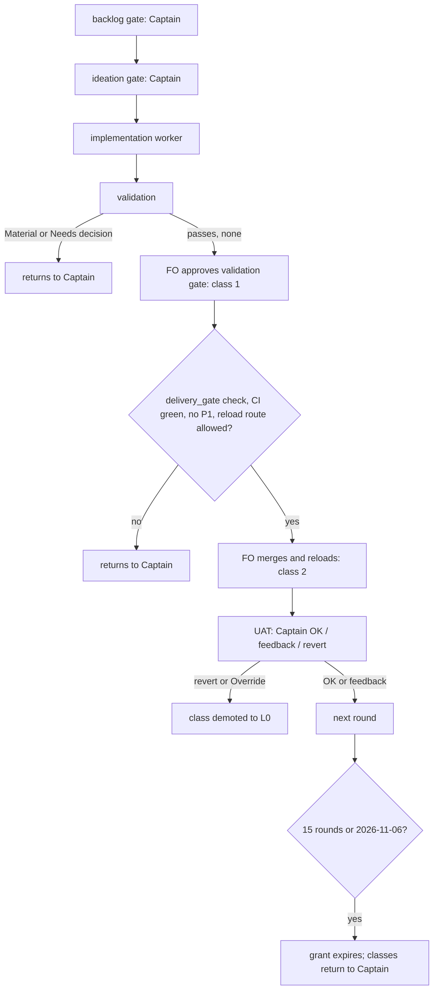

---
id:
title: ADR 0007 records which project-env decisions the FO makes by record
status: implementation
variant: kc-dev-flow-2
profile: pilot
merge: pr
worktree:
pr:
gates:
    version: 1
    records:
        - id: gate:project-env-fo-grant-adr:backlog
          stage: backlog
          attempts:
            - id: gate-attempt:project-env-fo-grant-adr-backlog-1
              briefing:
                id: briefing:project-env-fo-grant-adr:backlog:attempt-1:revision-1
                digest: sha256:75f044144d1d94ede58ef3b522b6ab9b41060e979e6e0dd94cfdb88569d7cdef
                room-ref: ./project-env-fo-grant-adr/review/backlog/briefing-1
              resolution:
                type: Resolution
                id: resolution:spacedock:project-env-fo-grant-adr:backlog:1
                briefing: briefing:project-env-fo-grant-adr:backlog:attempt-1:revision-1
                by: person:captain
                at: "2026-10-23T12:25:13.794808Z"
                decision: approve
                reason: 'Captain 2026-10-23: 「准」 — answers the FO''s question in chat; approves drafting ADR 0007 for review at the ideation gate. He added: 「注意這一份 ADR 可能要在 dev2 更新流程後被更新或替換」.'
              application:
                target-stage: ideation
                state: consumed
        - id: gate:project-env-fo-grant-adr:ideation
          stage: ideation
          attempts:
            - id: gate-attempt:project-env-fo-grant-adr-ideation-1
              briefing:
                id: briefing:project-env-fo-grant-adr:ideation:attempt-1:revision-1
                digest: sha256:43577279230d14d92ab4490303b005212d5348951c0d4158faccce301fec428b
                room-ref: ./project-env-fo-grant-adr/review/ideation/briefing-1
              resolution:
                type: Resolution
                id: resolution:spacedock:project-env-fo-grant-adr:ideation:1
                briefing: briefing:project-env-fo-grant-adr:ideation:attempt-1:revision-1
                by: person:captain
                at: "2026-10-23T12:36:28.646864Z"
                decision: approve
                reason: 'Captain 2026-10-23: 「准，授權你合併」 — approves the ADR 0007 draft into implementation with every part the gate question stated (the README-sentence exception, expiry round 15 or 2026-11-06, demotion rules, class 3, the kept list, the reload route), and authorizes FO to merge this task''s PR.'
              application:
                target-stage: implementation
                state: consumed
started: 2026-10-23T12:25:39Z
---

A grant record for project-env, in the form the Bridge FO used for spacedock-bridge (ADR 0006, merged in PR #36) under kc-dev-flow-2 ADR 0011's L3 rule. The Captain approved drafting it on 2026-10-23 with 「准」, answering 「要不要我照這個格式，幫 project-env 起草一份授權 ADR（會是 ADR 0007）交給你審？」. His earlier split for this project, from the same day: 「這個專案我想給你更大的彈性，我想只抓backlog，設計預覽與uat，其他都授權你做。列一下哪些是我預授權的範圍」.

## Scope

In: a new ADR (number reserved under this README's number guards) granting the project-env FO the classes the Captain did not keep for himself, as an explicit, Captain-authorized exception to the one README sentence that says authority, a gate approval and a merge are always asked. Proposed classes: the validation gate when it has no Material or Needs decision finding; merge and plugin reload after an approved validation; dispositions of review findings (fix, defer with trigger, decline) within approved scope. Kept with the Captain: the backlog gate, the ideation (design preview) gate, UAT, any change to how a secret is read, stored, injected or logged, any edit to his live settings file, releases, anything outward, data deletion, leaving the pilot profile. Recording, expiry, demotion and revocation follow ADR 0006's shape. The record is provisional: the Captain said on 2026-10-23 「注意這一份 ADR 可能要在 dev2 更新流程後被更新或替換」, so it states that when a kc-dev-flow-2 release ships an authorization framework covering this repository, the record is reviewed and then amended to point at that framework or superseded by it. Out: the grant takes effect only when its PR merges; this task's own gates stay with the Captain. Stop condition: the acceptance criterion passes.

## Acceptance criteria

**AC-1**: The new ADR names the granted classes, the classes kept with the Captain, the exact README sentence it excepts, the recording command, expiry, demotion and revocation, and quotes the Captain's words verbatim; adr_lint passes.
Verified by: `python3 <package>/scripts/adr_lint.py docs/adr --since 60799d9 --require 7` exits 0; `number_guards.py check` passes with this task's `ADR:` line; a reviewer ticks each named element against the record.

## Number guards

ADR: 0007

## FO alignment

Surfaces: none
Visible change: none
Direction alignment with the Captain: done — the Captain approved drafting on 2026-10-23 (「准」); he reviews the draft at the ideation gate.
Release review: not needed: a process record with no journey story or product behaviour change.
Map footprints: not needed: no journey story or open map question is attached to this docs task.

## Design

Surfaces: none. Draft ADR text (full, lint-passing): `project-env-fo-grant-adr/draft/0007-the-project-env-fo-decides-by-record-the-decisions-the-captain-did-not-keep.md` in this state checkout; it carries the number the Number guards reserve, as the dispatch asked.

**PRFAQ.** After this record merges, the Captain gives one UAT per project-env round. The FO approves the validation gate and merges and reloads the plugin by record, each time naming the class and quoting his words; the backlog gate, the ideation (design preview) gate and UAT stay his. The grant is bounded (15 rounds or 2026-11-06), is demoted by any reversal, can be revoked in one sentence, and is reviewed when dev2 ships an authorization framework.
- *Why is the README sentence not enough?* It says a gate approval and a merge are always asked, whatever an ADR says; only a Captain-authorized exception recorded as its own ADR (ADR 0011's L3 rule) lifts that for named classes. The draft quotes the sentence verbatim (checked against `docs/dev2/README.md`).
- *What does the evidence say?* `decision_ledger.py` over this repository on 2026-10-23: 72 gate rows, 23 validation resolutions, 0 `Override:` lines. It shows no disagreement but writes none unless he disagrees aloud; the grant's numbers are therefore unmeasured.
- *How is it reviewed when dev2 ships a framework?* At the next package upgrade the FO checks the package CHANGELOG, files one backlog task "review ADR 0007 against kc-dev-flow-2 <version>", and the Captain rules amend-to-point or supersede.

**Existing-code check.** Reused: ADR 0006's shape, `gate record --actor agent:first-officer --conn-quote --conn-source`, `decision_ledger.py`, the learn extension's observer. Not built: no `rounds.md` (0006 keeps one on its state branch; here the task file and ledger already hold every field).

**Needs-decision list for the Captain (recommendation first).** See the Stage Report.

### Batch overlap

Live tasks: `project-env-connection-done-cancel-one-row`, `project-env-release-1`, `project-env-remove-conductor-import`, `project-env-test-row-draft-note`, `project-env-vault-change-repoints-refs`, and the `ux-review-*` folders. None changes `docs/adr`, and no other task's Number guards line holds an ADR number (grep of `## Number guards` across `project-env-*.md` found only this task's `ADR: 0007`). Recommended order: none; this task can land alone.

## Stage Report: ideation

- DONE: Draft the exact text of docs/adr/0007-<slug>.md in ADR 0006's shape: Context, Decision with a Words line quoting the Captain verbatim, the excepted README sentence quoted exactly from docs/dev2/README.md, granted classes, classes kept with the Captain, recording command, per-round records, expiry, demotion, revocation, the provisional clause, and Consequences; keep the acceptance criterion with its evidence clause.
  Draft at `project-env-fo-grant-adr/draft/0007-the-project-env-fo-decides-by-record-the-decisions-the-captain-did-not-keep.md` (120 lines); README sentence checked verbatim against `docs/dev2/README.md` with whitespace folded; AC-1 unchanged.
- DONE: Apply the draft to a temp copy of docs/adr and run adr_lint.py --since 60799d9 --require 7 recording its exit code; do not write into the repo's docs/adr.
  Temp clone of f849058 at /tmp/adr-lint-clone: exit 0 with package 0.26.0 (the dispatch path) and exit 0 with 0.28.0 (the loaded skill's package). Negative control: the same draft minus its `**Recommended:**` line exits 1, so the run does test the draft. Also `number_guards.py check` on the committed temp branch: PASS; `design_surfaces.py check`: presentable.
- DONE: Name any decision the Captain must make with a recommendation (expiry and demotion numbers count: propose them and say they are unmeasured).
  Listed below.

### Decisions for the Captain (all numbers unmeasured, proposed by this worker)

1. Authorize the exception wording. Words 2 (「准」) answered only 「幫你起草」, so the draft says the exception, expiry, demotion and revocation bind only when he approves the PR. Recommend: ask him ADR 0006's amendment question (can the ADR be an exception to that README sentence, with this time limit and right to revoke?) and add his reply to Words as line 4 before implementation.
2. Expiry: 15 rounds or 2026-11-06, whichever first. 2026-11-06 matches ADR 0006 so one review reads both. 15 not 10 because the ledger shows 23 validation resolutions in 3 days (2026-10-20 to 2026-10-23), so 10 rounds could end in days. Unmeasured.
3. Demotion: a UAT `revert`, a Captain `Override:` on an FO-decided gate, or an observer violation returns the class that decided it to L0. 0006's promotion numbers (5 decisions, 0 reversals) are not copied: they bind dev2's later choice, and the draft leaves that to the dev2 FO. Unmeasured.
4. Class 3 (dispositions of review findings). It adds little beyond README Review-finding disposition steps 2, 3 and 5; without it nothing breaks. Recommend keep, bounded as drafted, because 「其他都授權你做」 names no narrower line. If he drops it: delete item 3 and one Consequences bullet.
5. The kept list beyond his three words (secret handling, live settings file, releases, outward, deletion, leaving pilot, revert PR after UAT `revert`) is the dev2 FO's drafting from ADR 0011's never-delegated list and ADR 0001; the draft says he may strike or add. Recommend approve as drafted.

### Open facts (not decisions)

- Plugin reload route: no document in this repo names how a project-env reload happens. The draft grants reload only by a route that reads or prints no secret and edits no live settings file, and returns it to the Captain where the task names none. Someone must name the route before class 2 is first used.
- Package version: the dispatch named kc-dev-flow-2 0.26.0, the loaded skill is 0.28.0; the README marker says 0.26.0. Both lint runs pass. The ideation rule that a design carries no ADR number was overridden by the dispatch (the number is reserved in Number guards).
- ADR 0011 says merge is never delegated and also defines L3; the draft states the tension in Consequences and asks the dev2 FO to resolve it.

### Summary

Drafted ADR 0007 (two granted classes plus bounded review-finding dispositions), lint-clean in a temp clone with a negative control, with expiry 15 rounds or 2026-11-06 and demotion on any reversal, both marked unmeasured. The provisional clause files a review task at the next package upgrade that ships an authorization framework. Draft lives only in the state folder; nothing was written to the repo's docs/adr.
