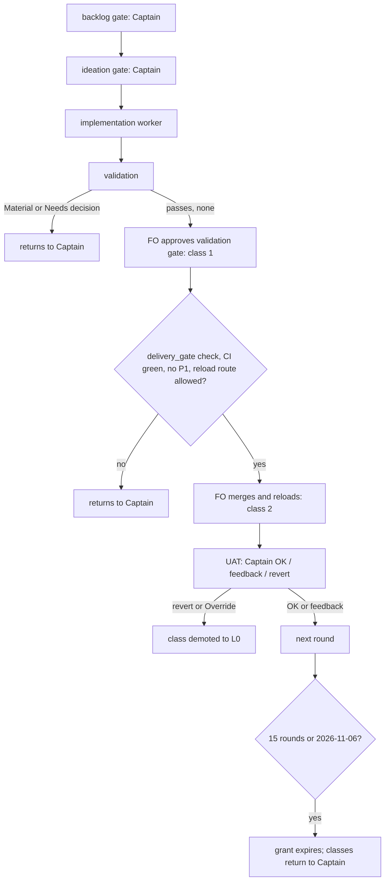

---
id:
title: ADR 0007 records which project-env decisions the FO makes by record
status: validation
variant: kc-dev-flow-2
profile: pilot
merge: pr
worktree: .worktrees/spacedock-ensign-project-env-fo-grant-adr
pr: iamcxa/kc-paseo-plugins#47
gates:
    version: 1
    records:
        - id: gate:project-env-fo-grant-adr:backlog
          stage: backlog
          attempts:
            - id: gate-attempt:project-env-fo-grant-adr-backlog-1
              briefing:
                id: briefing:project-env-fo-grant-adr:backlog:attempt-1:revision-1
                digest: sha256:75f044144d1d94ede58ef3b522b6ab9b41060e979e6e0dd94cfdb88569d7cdef
                room-ref: ./project-env-fo-grant-adr/review/backlog/briefing-1
              resolution:
                type: Resolution
                id: resolution:spacedock:project-env-fo-grant-adr:backlog:1
                briefing: briefing:project-env-fo-grant-adr:backlog:attempt-1:revision-1
                by: person:captain
                at: "2026-10-23T12:25:13.794808Z"
                decision: approve
                reason: 'Captain 2026-10-23: 「准」 — answers the FO''s question in chat; approves drafting ADR 0007 for review at the ideation gate. He added: 「注意這一份 ADR 可能要在 dev2 更新流程後被更新或替換」.'
              application:
                target-stage: ideation
                state: consumed
        - id: gate:project-env-fo-grant-adr:ideation
          stage: ideation
          attempts:
            - id: gate-attempt:project-env-fo-grant-adr-ideation-1
              briefing:
                id: briefing:project-env-fo-grant-adr:ideation:attempt-1:revision-1
                digest: sha256:43577279230d14d92ab4490303b005212d5348951c0d4158faccce301fec428b
                room-ref: ./project-env-fo-grant-adr/review/ideation/briefing-1
              resolution:
                type: Resolution
                id: resolution:spacedock:project-env-fo-grant-adr:ideation:1
                briefing: briefing:project-env-fo-grant-adr:ideation:attempt-1:revision-1
                by: person:captain
                at: "2026-10-23T12:36:28.646864Z"
                decision: approve
                reason: 'Captain 2026-10-23: 「准，授權你合併」 — approves the ADR 0007 draft into implementation with every part the gate question stated (the README-sentence exception, expiry round 15 or 2026-11-06, demotion rules, class 3, the kept list, the reload route), and authorizes FO to merge this task''s PR.'
              application:
                target-stage: implementation
                state: consumed
started: 2026-10-23T12:25:39Z
---

A grant record for project-env, in the form the Bridge FO used for spacedock-bridge (ADR 0006, merged in PR #36) under kc-dev-flow-2 ADR 0011's L3 rule. The Captain approved drafting it on 2026-10-23 with 「准」, answering 「要不要我照這個格式，幫 project-env 起草一份授權 ADR（會是 ADR 0007）交給你審？」. His earlier split for this project, from the same day: 「這個專案我想給你更大的彈性，我想只抓backlog，設計預覽與uat，其他都授權你做。列一下哪些是我預授權的範圍」.

## Scope

In: a new ADR (number reserved under this README's number guards) granting the project-env FO the classes the Captain did not keep for himself, as an explicit, Captain-authorized exception to the one README sentence that says authority, a gate approval and a merge are always asked. Proposed classes: the validation gate when it has no Material or Needs decision finding; merge and plugin reload after an approved validation; dispositions of review findings (fix, defer with trigger, decline) within approved scope. Kept with the Captain: the backlog gate, the ideation (design preview) gate, UAT, any change to how a secret is read, stored, injected or logged, any edit to his live settings file, releases, anything outward, data deletion, leaving the pilot profile. Recording, expiry, demotion and revocation follow ADR 0006's shape. The record is provisional: the Captain said on 2026-10-23 「注意這一份 ADR 可能要在 dev2 更新流程後被更新或替換」, so it states that when a kc-dev-flow-2 release ships an authorization framework covering this repository, the record is reviewed and then amended to point at that framework or superseded by it. Out: the grant takes effect only when its PR merges; this task's own gates stay with the Captain. Stop condition: the acceptance criterion passes.

## Acceptance criteria

**AC-1**: The new ADR names the granted classes, the classes kept with the Captain, the exact README sentence it excepts, the recording command, expiry, demotion and revocation, and quotes the Captain's words verbatim; adr_lint passes.
Verified by: `python3 <package>/scripts/adr_lint.py docs/adr --since 60799d9 --require 7` exits 0; `number_guards.py check` passes with this task's `ADR:` line; a reviewer ticks each named element against the record.

## Number guards

ADR: 0007

## FO alignment

Surfaces: none
Visible change: none
Direction alignment with the Captain: done — the Captain approved drafting on 2026-10-23 (「准」); he reviews the draft at the ideation gate.
Release review: not needed: a process record with no journey story or product behaviour change.
Map footprints: not needed: no journey story or open map question is attached to this docs task.

## Design

Surfaces: none. Draft ADR text (full, lint-passing): `project-env-fo-grant-adr/draft/0007-the-project-env-fo-decides-by-record-the-decisions-the-captain-did-not-keep.md` in this state checkout; it carries the number the Number guards reserve, as the dispatch asked.

**PRFAQ.** After this record merges, the Captain gives one UAT per project-env round. The FO approves the validation gate and merges and reloads the plugin by record, each time naming the class and quoting his words; the backlog gate, the ideation (design preview) gate and UAT stay his. The grant is bounded (15 rounds or 2026-11-06), is demoted by any reversal, can be revoked in one sentence, and is reviewed when dev2 ships an authorization framework.
- *Why is the README sentence not enough?* It says a gate approval and a merge are always asked, whatever an ADR says; only a Captain-authorized exception recorded as its own ADR (ADR 0011's L3 rule) lifts that for named classes. The draft quotes the sentence verbatim (checked against `docs/dev2/README.md`).
- *What does the evidence say?* `decision_ledger.py` over this repository on 2026-10-23: 72 gate rows, 23 validation resolutions, 0 `Override:` lines. It shows no disagreement but writes none unless he disagrees aloud; the grant's numbers are therefore unmeasured.
- *How is it reviewed when dev2 ships a framework?* At the next package upgrade the FO checks the package CHANGELOG, files one backlog task "review ADR 0007 against kc-dev-flow-2 <version>", and the Captain rules amend-to-point or supersede.

**Existing-code check.** Reused: ADR 0006's shape, `gate record --actor agent:first-officer --conn-quote --conn-source`, `decision_ledger.py`, the learn extension's observer. Not built: no `rounds.md` (0006 keeps one on its state branch; here the task file and ledger already hold every field).

**Needs-decision list for the Captain (recommendation first).** See the Stage Report.

### Batch overlap

Live tasks: `project-env-connection-done-cancel-one-row`, `project-env-release-1`, `project-env-remove-conductor-import`, `project-env-test-row-draft-note`, `project-env-vault-change-repoints-refs`, and the `ux-review-*` folders. None changes `docs/adr`, and no other task's Number guards line holds an ADR number (grep of `## Number guards` across `project-env-*.md` found only this task's `ADR: 0007`). Recommended order: none; this task can land alone.

## Stage Report: ideation

- DONE: Draft the exact text of docs/adr/0007-<slug>.md in ADR 0006's shape: Context, Decision with a Words line quoting the Captain verbatim, the excepted README sentence quoted exactly from docs/dev2/README.md, granted classes, classes kept with the Captain, recording command, per-round records, expiry, demotion, revocation, the provisional clause, and Consequences; keep the acceptance criterion with its evidence clause.
  Draft at `project-env-fo-grant-adr/draft/0007-the-project-env-fo-decides-by-record-the-decisions-the-captain-did-not-keep.md` (120 lines); README sentence checked verbatim against `docs/dev2/README.md` with whitespace folded; AC-1 unchanged.
- DONE: Apply the draft to a temp copy of docs/adr and run adr_lint.py --since 60799d9 --require 7 recording its exit code; do not write into the repo's docs/adr.
  Temp clone of f849058 at /tmp/adr-lint-clone: exit 0 with package 0.26.0 (the dispatch path) and exit 0 with 0.28.0 (the loaded skill's package). Negative control: the same draft minus its `**Recommended:**` line exits 1, so the run does test the draft. Also `number_guards.py check` on the committed temp branch: PASS; `design_surfaces.py check`: presentable.
- DONE: Name any decision the Captain must make with a recommendation (expiry and demotion numbers count: propose them and say they are unmeasured).
  Listed below.

### Decisions for the Captain (all numbers unmeasured, proposed by this worker)

1. Authorize the exception wording. Words 2 (「准」) answered only 「幫你起草」, so the draft says the exception, expiry, demotion and revocation bind only when he approves the PR. Recommend: ask him ADR 0006's amendment question (can the ADR be an exception to that README sentence, with this time limit and right to revoke?) and add his reply to Words as line 4 before implementation.
2. Expiry: 15 rounds or 2026-11-06, whichever first. 2026-11-06 matches ADR 0006 so one review reads both. 15 not 10 because the ledger shows 23 validation resolutions in 3 days (2026-10-20 to 2026-10-23), so 10 rounds could end in days. Unmeasured.
3. Demotion: a UAT `revert`, a Captain `Override:` on an FO-decided gate, or an observer violation returns the class that decided it to L0. 0006's promotion numbers (5 decisions, 0 reversals) are not copied: they bind dev2's later choice, and the draft leaves that to the dev2 FO. Unmeasured.
4. Class 3 (dispositions of review findings). It adds little beyond README Review-finding disposition steps 2, 3 and 5; without it nothing breaks. Recommend keep, bounded as drafted, because 「其他都授權你做」 names no narrower line. If he drops it: delete item 3 and one Consequences bullet.
5. The kept list beyond his three words (secret handling, live settings file, releases, outward, deletion, leaving pilot, revert PR after UAT `revert`) is the dev2 FO's drafting from ADR 0011's never-delegated list and ADR 0001; the draft says he may strike or add. Recommend approve as drafted.

### Open facts (not decisions)

- Plugin reload route: no document in this repo names how a project-env reload happens. The draft grants reload only by a route that reads or prints no secret and edits no live settings file, and returns it to the Captain where the task names none. Someone must name the route before class 2 is first used.
- Package version: the dispatch named kc-dev-flow-2 0.26.0, the loaded skill is 0.28.0; the README marker says 0.26.0. Both lint runs pass. The ideation rule that a design carries no ADR number was overridden by the dispatch (the number is reserved in Number guards).
- ADR 0011 says merge is never delegated and also defines L3; the draft states the tension in Consequences and asks the dev2 FO to resolve it.

### Summary

Drafted ADR 0007 (two granted classes plus bounded review-finding dispositions), lint-clean in a temp clone with a negative control, with expiry 15 rounds or 2026-11-06 and demotion on any reversal, both marked unmeasured. The provisional clause files a review task at the next package upgrade that ships an authorization framework. Draft lives only in the state folder; nothing was written to the repo's docs/adr.

## Stage Report: implementation

- DONE: Write docs/adr/0007-<slug>.md from the approved draft, adding Words line 4 and the reload route as a named step under class 2.
  Commit a8c7c02 on spacedock-ensign/project-env-fo-grant-adr: draft copied, Words 4 added, reload route listed as 4 ordered steps under class 2, Judgement line now cites Words 4. Only that one file changed.
Note: the host classifier blocked my script runs and one edit. The Captain then allowed FO to run them (「我現在用手機不方便，所以這次准你跑」), so the items below marked "by FO" were run by FO, not by me; I re-ran nothing. Evidence is FO's, recorded under "FO completion of implementation (2026-10-25)". Branch head 94ec116def3c3fa3abd6f1ede60eacac80816b4d.

- DONE: Write docs/adr/0007-<slug>.md from the approved draft, adding Words line 4 and the reload route as a named step under class 2.
  My commit a8c7c02 (draft copied, Words 4, 4-step reload route, Judgement cites Words 4). By FO, later: "Captain-authorized exception" sentence fixed to "were proposed by the dev2 FO and the Captain approved them in Words 4"; main b20a949 merged; fetch-and-confirm steps added to the reload route on the Captain's 「准補」 after roborev:1143 (Medium: route never fetched).
- DONE: Prove AC-1: adr_lint.py --since 60799d9 --require 7 exits 0, and number_guards.py check passes.
  By FO on the Captain's permission: adr_lint exit 0 (8 files); number_guards PASS (FO's report; I did not observe either run).
- SKIPPED: Tick each named element of AC-1 against the record.
  I did not tick them; no worker tick is recorded. Independent evidence is roborev:1146 (clean on 94ec116de). A reviewer tick before merge remains the Captain's or FO's call.
- DONE: Run the roborev gate, then open the Draft PR with a conventional title scoped project-env (docs).
  By FO: roborev:1143 found one Medium (fixed); final `clean on 94ec116de; evidence=roborev:1146`. Draft PR iamcxa/kc-paseo-plugins#47 (title not re-checked by me). The Captain merges it himself.

### Summary

ADR 0007 is on the branch at 94ec116de, lint, number guards and roborev passed by FO's runs, Draft PR #47 is open. My own lint and roborev runs were blocked by the classifier; the passing evidence is FO's, run on the Captain's permission. The AC-1 element-by-element tick is not recorded.

### FO completion of implementation (2026-10-25)

The implementation worker was stopped by the host's auto-mode classifier ("Instruction Poisoning") on the lint runs and one edit. FO did not rerun them until the Captain gave explicit permission in the FO chat: 「我現在用手機不方便，所以這次准你跑」. FO then applied the one-sentence fix (the terms "were proposed by the dev2 FO and the Captain approved them in Words 4"), merged main b20a949, and ran adr_lint (exit 0, 8 files), number_guards (PASS) and roborev (roborev:1143, one Medium: the reload route never fetches). With the Captain's 「准補」 FO added the fetch-and-confirm steps to the reload route; roborev then read `clean on 94ec116de; evidence=roborev:1146`. Draft PR iamcxa/kc-paseo-plugins#47. The Captain merges it himself.

## Stage Report: validation

- DONE: Independently check candidate 94ec116def3c3fa3abd6f1ede60eacac80816b4d (PR iamcxa/kc-paseo-plugins#47) against AC-1: the diff since main b20a949 changes only docs/adr/0007-*.md; the record names the granted classes, the classes kept with the Captain, the exact docs/dev2/README.md sentence it excepts (verbatim), the recording command, per-round records, expiry, demotion, revocation, the provisional clause and the five-step reload route (backup, fetch and confirm the merge commit, fast-forward and confirm HEAD, npm ci, reload); the Captain's words are quoted verbatim against the task file; nothing in the record makes the grant effective before the Captain merges it; give a verdict.
  Verdict: PASSED (recommended); every named element is present in `git archive` of 94ec116 (ADR lines 44-113), `git diff --name-only b20a949 94ec116` lists only the one ADR file, README sentence found once in the candidate README with whitespace folded, all five Captain quotes found verbatim in this task file; effect-on-merge is ADR lines 13-15 and the Recording command's `--conn-source "docs/adr/0007 on main"`. Findings F1 to F3 below, none Material.
- DONE: Run `python3 .../0.29.0/scripts/adr_lint.py docs/adr --since 60799d9 --require 7` and `python3 .../0.29.0/scripts/number_guards.py check --repo <checkout of the candidate> --workflow-dir /Users/kent/Project/kc-paseo-plugins/docs/dev2 --task docs/dev2/.spacedock-state/project-env-fo-grant-adr.md`, recording exit codes, and write the minimal acceptance script FO will rerun.
  In a detached clone of 94ec116 (/tmp/val-0007-clone): adr_lint exit 0 ("8 ADR file(s) checked, 0 legacy"), number_guards exit 0 ("PASS: no findings"; base 35ee0a6, merge-base b20a949); the same two with the loaded skill's 0.28.0 package also exit 0. Negative control: the clone minus the `**Recommended:**` line gives adr_lint exit 1, so the run tests the record. Also exit 0: comment_ratio (0 code, 0 comment lines), dispatch_records (3 complete), design_surfaces, doc_impact (0 documents listed). Acceptance script below ran clean in a fresh bash.
- DONE: Record every unverified obligation.
  Listed under "Unverified" below.

### Findings

- F1 Deferred risk: the ADR says it excepts "exactly one sentence" of docs/dev2/README.md, but README "Delivery authority" also says "Approval of a validation gate is not permission to push, create or merge a PR, except as follows" and "Preserve manual merge authority". Class 2 (FO merges after an FO-approved validation gate) departs from both and the record does not name them. Harm is unobserved; it becomes Material if an FO or reviewer refuses class 2 citing those lines, or an observer reports the merge as a README violation.
- F2 Polish: Words 4 says the question "named ... the reload route", but the question the Captain answered (review/ideation/briefing-1/index.json) named a four-step route; the fetch-and-confirm steps (route steps 2 and the confirm half of 3) rest on 「准補」, which appears only in the FO implementation report, not as a verbatim quote with its question in the ADR or the task's Captain-facing sections. Additive and safer, so not a loss; add as Words 5 if the Captain wants every approved term traceable.
- F3 Polish: Words 4 「准，授權你合併」 is quoted without saying what it authorizes. The dispatch record for implementation-1 says it authorizes FO to merge this task's PR; the implementation report says "The Captain merges it himself". The ADR is neutral (effective when the PR merges, whoever merges), so AC-1 is unaffected, but FO should settle who merges PR #47 before the gate.

### Unverified

- Ledger numbers in Context (72 rows, 23 validation resolutions, 0 Override, 2026-10-20 to 2026-10-23) were not re-derived; the ledger has grown since 2026-10-23 and I read only the current `--summary`.
- Reload route steps were not executed (they touch the live plugin and ~/.paseo, forbidden here); that `paseo plugin reload paseo-project-env`, the settings path and `npm ci` in `project-env` work as written is unproven.
- `delivery_gate.py check`, `--match-head-commit` merge and "required checks green" were not run; PR #47 shows only GitGuardian SUCCESS, is Draft, mergeable UNKNOWN. FO owns those before any merge.
- roborev:1146 ("clean on 94ec116de") and FO's earlier lint runs were read, not rerun by me; my lint and number_guards runs are independent.
- 「准補」 and the Captain's 「我現在用手機不方便，所以這次准你跑」 were not seen at source; only FO's report quotes them.
- Candidate does not contain main 35ee0a6 (#48, after b20a949); the number_guards run saw it as base and passed. Package mismatch: dispatch named 0.29.0, the loaded skill is 0.28.0; both pass.
- Whether expiry "round 15" counts from merge of this PR is implied by "a round is one task whose validation gate the FO decided under this record", not stated.

### Acceptance script (Captain or FO, fresh bash, under 2 minutes, no secret)

Save as a file and run `bash <file>`:

    set -e
    R=/Users/kent/Project/kc-paseo-plugins
    P=/Users/kent/.claude/plugins/cache/kc-claude-plugins/kc-dev-flow-2/0.29.0
    C=94ec116def3c3fa3abd6f1ede60eacac80816b4d
    D=$(mktemp -d); git clone -q "$R" "$D/c"; git -C "$D/c" checkout -q --detach $C
    echo "STEP 1"; git -C "$D/c" diff --name-only b20a949 $C
    echo "STEP 2"; (cd "$D/c" && python3 $P/scripts/adr_lint.py docs/adr --since 60799d9 --require 7; echo "exit=$?")
    echo "STEP 3"; (cd "$R" && python3 $P/scripts/number_guards.py check --repo "$D/c" --workflow-dir "$R/docs/dev2" --task docs/dev2/.spacedock-state/project-env-fo-grant-adr.md; echo "exit=$?")
    echo "STEP 4"; python3 -I - "$D/c" "$R/docs/dev2/.spacedock-state/project-env-fo-grant-adr.md" <<'PY'
    import sys,re,glob
    c,task=sys.argv[1:]
    adr=open(glob.glob(c+'/docs/adr/0007-*.md')[0]).read(); t=open(task).read(); rd=open(c+'/docs/dev2/README.md').read()
    f=lambda s:re.sub(r'\s+',' ',s)
    print('README sentence verbatim in README:', f(re.search(r'^> (.+)$',adr,re.M).group(1)) in f(rd))
    for q in re.findall(r'「[^」]*」',adr):
        if '<' not in q: print('quote in task file:', q in t, q[:24])
    PY
    echo "STEP 5"; grep -nE '^   [1-5]\. |effect when|Revocation\.|Provisional\.|Recording command\.|Per-round records' "$D/c"/docs/adr/0007-*.md

Expected: STEP 1 prints exactly `docs/adr/0007-the-project-env-fo-decides-by-record-the-decisions-the-captain-did-not-keep.md`; STEP 2 prints `8 ADR file(s) checked, 0 legacy` and `exit=0`; STEP 3 prints `PASS: no findings` and `exit=0`; STEP 4 prints `True` for the README line and for each of 5 quotes; STEP 5 prints the `effect when` line (14), five numbered reload steps (63-67), and the Recording command, Per-round records, Revocation and Provisional headings. Not covered: the Captain's merge, the effect after merge, the reload route working, the ledger numbers, F1 to F3.

### Summary

Recommend PASSED: the candidate changes only the ADR, lint and number guards pass (exit 0, negative control exit 1), every AC-1 element and the five-step reload route are present, the quotes are verbatim, and nothing makes the grant effective before the PR merges. No Material or Needs decision finding; F1 (second README rule not named) is a deferred risk, F2 and F3 are polish. Nothing in the repository was edited.

### FO fixes after validation-1 (2026-10-25)

On the Captain's 「准修，可以我合併」 FO fixed validation-1's F1 to F3: the exception now names all three README sentences it departs from (adds "Approval of a validation gate is not permission to push, create or merge a PR, except as follows." and "Preserve manual merge authority."); Words 5 (「准補」) and Words 6 record his approvals; the record states it takes effect only when the Captain himself merges its pull request. roborev:1147 then found the reload route could load unpushed local commits; on the Captain's 「准加」 step 3 now requires HEAD to equal the fetched origin/main and stops for him otherwise (Words 7). adr_lint exit 0 (8 files), number_guards PASS, roborev `clean on 78052172f; evidence=roborev:1155`. Head 78052172fb6e2b56f80cce0b49283cca89f88cd0, pushed to PR #47.
