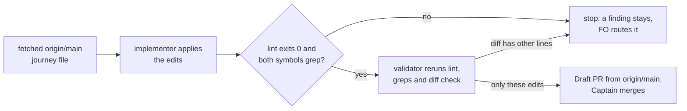

---
id:
title: The project-env journey map shows what shipped since the last map update
status: implementation
variant: kc-dev-flow-2
profile: pilot
merge: pr
worktree: .worktrees/spacedock-ensign-project-env-journey-map-r1b-catch-up
pr:
gates:
    version: 1
    records:
        - id: gate:project-env-journey-map-r1b-catch-up:backlog
          stage: backlog
          attempts:
            - id: gate-attempt:project-env-journey-map-r1b-catch-up-backlog-1
              briefing:
                id: briefing:project-env-journey-map-r1b-catch-up:backlog:attempt-1:revision-1
                digest: sha256:f4a599f8cb65c195dcf2ded408822569026e2adee0aea425e69c101239199e80
                room-ref: ./project-env-journey-map-r1b-catch-up/review/backlog/briefing-1
              resolution:
                type: Resolution
                id: resolution:spacedock:project-env-journey-map-r1b-catch-up:backlog:1
                briefing: briefing:project-env-journey-map-r1b-catch-up:backlog:attempt-1:revision-1
                by: person:captain
                at: "2026-11-05T08:39:15.647329Z"
                decision: approve
                reason: '「開這批」 — Captain in FO chat, 2026-11-05. Asked: 「回「開這批」，我就開這 4 個任務，同時派設計」 after FO proposed batch r1b-polish-1 (picker-slow-hint, rate-limit-cause, started-row-visible, journey-map-r1b-catch-up) and recommended opening it.'
              application:
                target-stage: ideation
                state: consumed
        - id: gate:project-env-journey-map-r1b-catch-up:ideation
          stage: ideation
          attempts:
            - id: gate-attempt:project-env-journey-map-r1b-catch-up-ideation-1
              briefing:
                id: briefing:project-env-journey-map-r1b-catch-up:ideation:attempt-1:revision-1
                digest: sha256:d0cd0aa6d375e5e2abc82700835a88466e640ae0c9541e7a5c1c5dc71202c0a7
                room-ref: ./project-env-journey-map-r1b-catch-up/review/ideation/briefing-1
              resolution:
                type: Resolution
                id: resolution:spacedock:project-env-journey-map-r1b-catch-up:ideation:1
                briefing: briefing:project-env-journey-map-r1b-catch-up:ideation:attempt-1:revision-1
                by: person:captain
                at: "2026-11-05T15:11:25.463848Z"
                decision: approve
                reason: 「准」 — Captain in FO chat, 2026-11-05, on the batch r1b-polish-1 ideation gates presented together (picker-slow-hint cd66afef, rate-limit-cause b950f3c3, started-row-visible e37a1851, journey-map-r1b-catch-up d0cd0aa6), FO having recommended approving all four and building in the order picker-slow-hint, rate-limit-cause, started-row-visible, with the map task independent.
              application:
                target-stage: implementation
                state: consumed
started: 2026-11-05T08:40:29Z
---

Batch: r1b-polish-1, approved by the Captain on 2026-11-05 (「開這批」) with four members: project-env-picker-slow-hint, project-env-rate-limit-cause, project-env-started-row-visible, project-env-journey-map-r1b-catch-up. Since the map update merged as #59 (637d054), PR #61 shipped story `pick-repository` (task project-env-pick-repository, UAT OK 2026-11-05) and PR #58 shipped the docs site story `read-the-docs` (task project-env-docs-site, UAT OK 2026-10-28); both still read `gap` on `docs/journey/project-env/give-agents-their-project-setup.yaml`. The terminal limit the Captain asked to document (「加」, 2026-11-05) is not on the map.

## Scope

In: set `pick-repository` and `read-the-docs` to `exists` with evidence symbols read on main, record the terminal limit where the map's rules allow, and correct the status card.
Non-goals: any other story's status, any release goal, plugin code, the canvas.
Budget: one ideation, implementation and validation round.
Stop condition: the acceptance criterion passes.

## Acceptance criteria

**AC-1**: The journey file carries those edits, every `exists` story's evidence symbol is found on main, and the journey lint passes.
Verified by, all in the candidate checkout, which starts from a fetched `origin/main`:
(a) `node <kc-journey-map 1.9.0>/lib/journey-lint.mjs docs/journey/project-env/give-agents-their-project-setup.yaml "$PWD"` exits 0, prints `all lints pass`, and its `slice-size (accepted)` line says `holds 9 stories`;
(b) `git diff --stat origin/main` lists that one file with 9 insertions and 7 deletions, and `git diff origin/main` shows only the changed lines in `design/journey-edits.diff` of this task's state folder;
(c) `git grep -l -w -F addProjectLine origin/main` lists `project-env/shared/project-list.ts` and `project-env/client/settings-screen.tsx`, and `git grep -l -w -F PAGES_REPO_NWO origin/main` lists `docs/project-env/capture/build-site.sh`.

## FO alignment

Surfaces: none
Visible change: none
Direction alignment with the Captain: done — he answered 「開這批」 on 2026-11-05 to FO's proposed batch naming this task.
Result: the batch question and this Scope.
Release review: not needed: map maintenance recording shipped work; it moves no task into a release.
Map footprints: not needed: no open map question is answered by this task.

## Design

Evidence folder: `project-env-journey-map-r1b-catch-up/design/` in this state checkout (`journey-edits.diff`, `lint-base-origin-main-3aeb2f1.txt`, `lint-edited.txt`). Everything below was built on a throwaway `git archive` copy of `origin/main` 3aeb2f1 (tag `project-env-v0.3.0`) under `/tmp`, with a scratch `git init` so the lint's `git grep` works. No branch, no repo file, no canvas touched. Local `main` is at 6709c72, one commit behind: the missing commit changes only release files, not the journey file or any evidence symbol, but implementation must start from a fetched `origin/main`.

### PRFAQ

Press release: the project-env journey file says what is true on 2026-11-05. The story that makes the Add a project row say what to do next and the story for the public docs site show as built, the map records that a terminal opened in Paseo gets no project variables, and the status card says r1b is partly built and the docs site is live.

FAQ:
- *Why did it drift?* PR #61 (f5d93bd, tag `project-env-v0.3.0`) shipped `pick-repository` and PR #58 (d973876) shipped the docs site; neither edited the map. The Captain's UAT is recorded for both (`pick-repository` 2026-11-05 「ok」; docs site 2026-10-28 「ok」, checking the live site).
- *Why `addProjectLine` and not the old `candidates`?* `candidates` still greps but names the pre-#61 select. `addProjectLine` (with `addProjectState`) is what #61 added: the failed, none and all-configured lines the gap was about. Used by `client/settings-screen.tsx` function `AddProject`; asserted in `test/project-list.test.ts`.
- *Why `PAGES_REPO_NWO` for `read-the-docs`?* The lint accepts a symbol only in an executable file (`.sh`, `.py`, `.ts` and similar, or a workflow). The site's real source is `_config.yml` and Markdown, so the nearest symbol is the environment variable in `docs/project-env/capture/build-site.sh`, the script that builds the site. It proves the build script exists, not that the site is up; the live check is separate (below). Checked: `evidence: remote_theme` (a `_config.yml` key) fails the lint with `evidence-not-found`.
- *Where does the terminal limit go?* A new answered question `q8` on `new-agent-env` ("Does a terminal opened in Paseo get the variables?" - "No: only agents do; Paseo gives plugins no terminal hook."), with `doc:` the Reference page's "Limits worth knowing". The map puts facts at story grain, and the story that gives agents their variables is the one this limit bounds. Not taken: a `rules:` entry. Those three rules are constraints the plugin enforces; this is a Paseo platform limit it cannot change. Source of the request: the Captain's 「加」 of 2026-11-05 (the Reference sentence shipped in PR #66, `OVERVIEW.md`).
- *Why leave `pick-repository/q1` ("Gap: ... release 1b shows ...")?* The file already keeps historical answers on `exists` stories (`paste-token/q1`, `token-works/q1`, `pick-vault/q1`); a rewrite is a separate choice and outside the Scope.
- *Is any plugin code touched?* No. Existing-code check: nothing to change or replace; the artifact is one YAML file.



### The edits, as exact YAML (full diff: `design/journey-edits.diff`)

1. `pick-repository`: `status: gap` becomes `status: exists`; `evidence: candidates` becomes `evidence: addProjectLine`.
2. `read-the-docs`: `status: gap` becomes `status: exists`; add `evidence: PAGES_REPO_NWO`.
3. `new-agent-env`, after `q7`:
   ```yaml
             - {id: "q8", ask: "Does a terminal opened in Paseo get the variables?", status: "answered", answer: "No: only agents do; Paseo gives plugins no terminal hook.", doc: "https://github.com/iamcxa/kc-paseo-plugins/blob/main/project-env/OVERVIEW.md#limits-worth-knowing"}
   ```
   Facts read 2026-11-05: `OVERVIEW.md` on `origin/main` holds "A terminal you open in Paseo does not get the project variables; only agents do." under "Limits worth knowing" and the live Reference page serves the same sentence (`curl` of `/docs/project-env/reference.html`, 1 match). The no-terminal-hook reason is the Paseo plugin SDK 0.14.0 hook list recorded in `_archive/project-env-resume-blank-notice.md`; I did not re-run that check.
4. Status card: `as_of: "2026-11-05"`; `unproven` gains "; r1b's two built stories have Kent's UAT only."; `unmerged` ends "r1b has pick-repository (v0.3.0) and read-the-docs (#58); 9 more are open." (the 9 is the lint's own `slice-size` count after the edits); `undeployed` becomes "Docs site live; plugin runs on Kent's Paseo daemon from his main checkout; no teammate install." Docs site live: `gh api repos/iamcxa/kc-paseo-plugins/pages` reads `status: built`, source `main` `/`; `curl` of the site home returns 200. The "from his main checkout" clause is carried over unchanged and not re-checked today. `irreversible` stays.

Lint result (`design/lint-edited.txt`): exit 0, `all lints pass`, `slice-size (accepted)` now reports 9 stories (it reported 11 on the base, `design/lint-base-origin-main-3aeb2f1.txt`). The advisory `long-card` count goes from 82 to 84: the `unproven` and `unmerged` card lines are now wider than 80 columns (advisory, does not fail the lint). The base lint on `origin/main` also exits 0.

### Needs decision

None. Placement of the terminal limit (question, not rule) and the evidence symbols stay in this recommendation.

Follow-up (proposals, not adopted; each is outside the Scope's non-goals): (1) r1b's `slice_because` still says "four (pick-repository, ...) need plugin code"; `pick-repository` is now built, so the sentence is stale. It is a release-level sentence, so I left it. (2) PR #66 shipped the "Resumed without N project variables" line; story `resumed-env` (r2, `unverified`) is another story's status, so untouched. Prior rulings: `git grep -n 'Override:'` in the state checkout (2026-11-05) finds none that touches the map; no ADR in `docs/adr` governs the journey file.

### Batch overlap

`project-env-picker-slow-hint`, `project-env-rate-limit-cause`, `project-env-started-row-visible` (ideation, batch r1b-polish-1): each records `Map footprints: not needed` and none names `docs/journey`, so no shared file, check, table or numbered record. If `picker-slow-hint` later answers a `pick-repository` question on the map, it edits the same file as this task; this task's lines are different ones (status, evidence, `new-agent-env`, `status:`). `project-env-release-1` and `project-env-test-row-draft-note` (backlog): none. Recommended order: this task first (docs only, no code), then the others.

## Stage Report: ideation

- DONE: Read docs/journey/project-env/give-agents-their-project-setup.yaml on main and list the exact edits: pick-repository and read-the-docs to exists with an evidence symbol found on main, the terminal limit, and the status card.
  Four edits under "The edits, as exact YAML", full diff `design/journey-edits.diff` (9 insertions, 7 deletions, one file): evidence `addProjectLine` and `PAGES_REPO_NWO`, new answered question `new-agent-env/q8` for the terminal limit, status card `as_of` plus three lines. Read on `origin/main` 3aeb2f1; no repo file written.
- DONE: Run the journey lint on main once and record its output; name the evidence symbol for each story and the grep that finds it.
  Base lint on `origin/main`: exit 0, `all lints pass` (`design/lint-base-origin-main-3aeb2f1.txt`; also exit 0 on local main 6709c72). Greps: `git grep -l -w -F addProjectLine origin/main` finds `project-env/shared/project-list.ts`, `client/settings-screen.tsx`, `test/project-list.test.ts`; `git grep -l -w -F PAGES_REPO_NWO origin/main` finds `docs/project-env/capture/build-site.sh`. Lint with the edits on a throwaway copy: exit 0, `slice-size` 9 stories (`design/lint-edited.txt`).
- DONE: Write the PRFAQ and AC-1 evidence clauses that a reviewer can rerun.
  PRFAQ, Mermaid and AC-1 clauses (a) lint, (b) diff check, (c) the two greps are in the task file. Mutation checks on the throwaway copy: `evidence: NoSuchSymbolX` and `evidence: remote_theme` (a non-executable `_config.yml` key) each fail with `evidence-not-found`, so clause (a) fails if a symbol stops grepping.

### AC-1

Current evidence: the base lint passes on `origin/main` and the lint with all four edits applied passes on a throwaway copy (exit 0, 9 stories in `slice-size`); the symbol greps in clause (c) were run on `origin/main`. Not yet verified: clauses (a) and (b) on a real candidate checkout; that is implementation and validation. `python3 design_surfaces.py check`: "design surfaces presentable", exit 0 (Surfaces: none).

### Summary

The map needs four small edits to match main: two stories to `exists`, the terminal limit as an answered question on `new-agent-env`, and the status card. No Captain decision is open; two stale-after-merge items (r1b `slice_because`, the r2 `resumed-env` story) are named as proposals outside the Scope. The one weak point is `read-the-docs`: the lint only accepts a symbol in an executable file, so `PAGES_REPO_NWO` proves the site's build script exists, and the live site (Pages `built`, home 200, the terminal sentence served) is checked separately in this report.

## Stage Report: implementation

- DONE: Branch from a freshly fetched `origin/main`; apply exactly the four approved edits to `docs/journey/project-env/give-agents-their-project-setup.yaml`, re-reading each evidence symbol on origin/main.
  Fetched origin/main = c1458f7 (one doc-only commit past ideation's 3aeb2f1); branch fast-forwarded to it, `git apply` of `design/journey-edits.diff` clean; `git grep -w -F` finds `addProjectLine` (project-env/shared/project-list.ts, client/settings-screen.tsx, test/project-list.test.ts) and `PAGES_REPO_NWO` (docs/project-env/capture/build-site.sh) on origin/main.
- DONE: Run the journey lint and save its output; exit 0 with `slice-size` at 9 stories.
  Exit 0, `all lints pass`, `slice-size (accepted): release r1b holds 9 stories`; saved at `project-env-journey-map-r1b-catch-up/implementation/lint-candidate.txt`. Falsifier: a non-grepping evidence symbol fails with `evidence-not-found` (ideation mutation check).
- DONE: Confirm the diff touches only that file and only those lines (9 insertions, 7 deletions).
  `git diff --stat origin/main`: 1 file, 9 insertions, 7 deletions; +/- lines identical to the approved diff.
- DONE: Commit, push, open a Draft PR with the evidence in the body; not ready, not merged.
  Commit f09ebae on spacedock-ensign/project-env-journey-map-r1b-catch-up; Draft PR https://github.com/iamcxa/kc-paseo-plugins/pull/71.
- SKIPPED: Close only browser sessions you opened yourself, by name.
  No browser session opened.
- Affected documents (`doc_impact.py`): not run; the only changed file is the journey map, which is the artifact itself.

### Summary

Applied the approved four edits unchanged to the journey file on a fetched origin/main; lint passes with 9 stories in r1b and both evidence symbols grep on main. Draft PR #71 is open. Limit carried from ideation: `PAGES_REPO_NWO` proves the site build script, not the live site.
