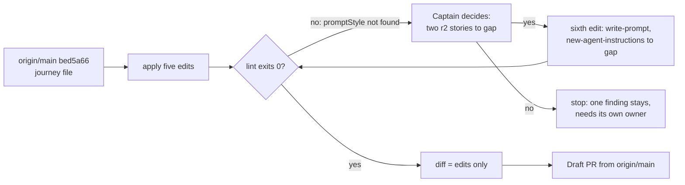

---
id:
title: The project-env journey map matches what shipped and what release r1b now holds
status: validation
variant: kc-dev-flow-2
profile: pilot
merge: pr
worktree: .worktrees/spacedock-ensign-project-env-journey-map-r1b-update
pr:
gates:
    version: 1
    records:
        - id: gate:project-env-journey-map-r1b-update:backlog
          stage: backlog
          attempts:
            - id: gate-attempt:project-env-journey-map-r1b-update-backlog-1
              briefing:
                id: briefing:project-env-journey-map-r1b-update:backlog:attempt-1:revision-1
                digest: sha256:e545cb4fda61288435ac157772214d0e05d179a62e0c1211134629e71adc60bc
                room-ref: ./project-env-journey-map-r1b-update/review/backlog/briefing-1
              resolution:
                type: Resolution
                id: resolution:spacedock:project-env-journey-map-r1b-update:backlog:1
                briefing: briefing:project-env-journey-map-r1b-update:backlog:attempt-1:revision-1
                by: person:captain
                at: "2026-10-27T18:32:37.452639Z"
                decision: approve
                reason: '「開」 — Captain in FO chat, 2026-10-28. Asked: 「下一件要你決定的：要不要開一個「更新旅程地圖」的小任務？我建議開…回「開」或「先不用」。」 FO had recommended opening it.'
              application:
                target-stage: ideation
                state: consumed
        - id: gate:project-env-journey-map-r1b-update:ideation
          stage: ideation
          attempts:
            - id: gate-attempt:project-env-journey-map-r1b-update-ideation-1
              briefing:
                id: briefing:project-env-journey-map-r1b-update:ideation:attempt-1:revision-1
                digest: sha256:e932eb2e47aecac943823ac94c5b699e6caec47d2f6d34c1829e6b67e24c33ff
                room-ref: ./project-env-journey-map-r1b-update/review/ideation/briefing-1
              resolution:
                type: Resolution
                id: resolution:spacedock:project-env-journey-map-r1b-update:ideation:1
                briefing: briefing:project-env-journey-map-r1b-update:ideation:attempt-1:revision-1
                by: person:captain
                at: "2026-10-27T18:47:56.335216Z"
                decision: approve
                reason: '「准」 — Captain in FO chat, 2026-10-28, on the ideation gate (sha256:e932eb2e), FO having recommended approval; approval also accepts the sixth edit (write-prompt and new-agent-instructions to gap). Asked: Approve the journey map edit design and AC-1 into implementation, including a sixth edit ...? Say if you object to any part.'
              application:
                target-stage: implementation
                state: consumed
        - id: gate:project-env-journey-map-r1b-update:validation
          stage: validation
          attempts:
            - id: gate-attempt:project-env-journey-map-r1b-update-validation-1
              briefing:
                id: briefing:project-env-journey-map-r1b-update:validation:attempt-1:revision-1
                digest: sha256:577093dc3ffe23e681d1af4c285600b7071d197385af2d7f3cc0b86ea311b031
                room-ref: ./project-env-journey-map-r1b-update/review/validation/briefing-1
              resolution:
                type: Resolution
                id: resolution:spacedock:project-env-journey-map-r1b-update:validation:1
                briefing: briefing:project-env-journey-map-r1b-update:validation:attempt-1:revision-1
                by: person:captain
                at: "2026-10-27T19:30:21.84067Z"
                decision: approve
                reason: '「准」 — Captain in FO chat, 2026-10-28, on the validation gate (sha256:577093dc), FO having recommended approval; approves validation and the two proposed declines (F1, F2 Polish) at candidate 41359025bec74c8b9b84918d09dfeb2c2f0a7e48. Asked: Approve validation of the journey map update (PR #59 at 4135902) and the two proposed declines? Approval lets FO merge it under ADR 0007 class 2; no plugin reload is needed.'
              application:
                target-stage: done
                state: pending
started: 2026-10-27T18:33:05Z
---

The r1b release review of 2026-10-28 (`project-env-docs-site/release-review-r1b.md` in this state checkout) found `docs/journey/project-env/give-agents-their-project-setup.yaml` out of date: four r1.5 stories that merged (#21, #15, #17, #20) still read `gap`, r1b's `slice_because` says no plugin code is needed although four of its stories need code, and the introduction, reference and changelog pages the Captain asked for (「plugin 介紹，文件說明」, 2026-10-27) belong to no story. The Captain ruled 「移出」 on 2026-10-28: story `agent-lays-out-vault` leaves r1b. Asked whether to open a task for the map edit, recommending it, he answered 「開」.

## Scope

In: one edit of the journey file that (1) takes `agent-lays-out-vault` out of r1b, (2) sets `paste-token`, `token-works`, `add-remove-variable` and `test-each-variable` to `exists` with evidence symbols read from main, (3) replaces r1b's `slice_because` with a true reason, (4) adds one story for reading the plugin's introduction and docs, quoting the Captain's words, and (5) corrects the status card so it says r1.5 is merged and r1b is not built. Out: any plugin code, any other release's goal, r1b's goal sentence (the review's open point on "in-app steps" goes to the Captain separately), the canvas. Stop condition: the acceptance criterion passes.

## Acceptance criteria

**AC-1**: The journey file carries the five edits in Scope, every `exists` story's evidence symbol is found on main, and the journey lint passes.
Verified by: at the candidate checkout, built on `origin/main` (not local `main`, which lags it), run (a) `node <kc-journey-map>/lib/journey-lint.mjs docs/journey/project-env/give-agents-their-project-setup.yaml "$(git rev-parse --show-toplevel)"`, which must exit 0 and end with `all lints pass`; (b) `git diff origin/main -- docs/journey/project-env/give-agents-their-project-setup.yaml`, which must touch only the hunks in `design/journey-five-edits.diff`; (c) for each of `storeToken`, `tokenStatus`, `nameFromLabel`, `testProject`, `git grep -nw <symbol> origin/main -- project-env` returns a non-test hit. Clause (a) cannot pass on the five edits alone; see "Needs decision".

## FO alignment

Surfaces: none
Visible change: none
Direction alignment with the Captain: done — he ruled 「移出」 on agent-lays-out-vault and answered 「開」 to this task on 2026-10-28.
Release review: not needed: map maintenance carrying the review-release output and the Captain's ruling; it moves no task into a release.
Map footprints: not needed: no open map question is answered by this task.

## Design

Evidence folder: `project-env-journey-map-r1b-update/design/` in this state checkout. Everything below was built on a throwaway `git archive` copy of `origin/main` bed5a66 (tag `project-env-v0.2.0`, read with `git ls-remote --tags origin` on 2026-10-28), with a scratch `git init` so the lint's `git grep` works. No branch, no repo file, no canvas touched. Local `main` is at b5381b1, one commit behind `origin/main`; implementation must start from `origin/main`.

### PRFAQ

Press release: the project-env journey file says what is true on 2026-10-28. The four r1.5 stories show as built, release r1b lists the 11 stories it holds with a reason that matches them, the Captain's request for an introduction and docs is a story, and the status card says r1.5 is merged.

FAQ:
- *Why did the file drift?* The r1.5 tasks merged (#21, #15, #17, #20) and the release shipped as `project-env-v0.2.0` without the map being edited; the review of 2026-10-28 found it.
- *What leaves r1b?* `agent-lays-out-vault`, by the Captain's 「移出」 of 2026-10-28. It keeps `status: gap` and stays on the map with no release.
- *Is any plugin code touched?* No. Existing-code check: nothing to change or replace; the only artifact is one YAML file.
- *What does this not do?* It does not edit r1b's goal sentence (the review's "in-app steps" point goes to the Captain separately), another release's goal, the question answers the fold tool wrote, or the canvas.



### The edits, as exact YAML (full diff: `design/journey-six-edits.diff`; five-only: `design/journey-five-edits.diff`)

1. `agent-lays-out-vault` leaves r1b: delete its line `release: r1b`. Id, `status: gap` and card stay.
2. Four r1.5 stories change `status: gap` to `status: exists`. Evidence symbols are unchanged and were read on `origin/main` bed5a66; each tag-contains its merge commit (`git merge-base --is-ancestor <sha> project-env-v0.2.0`).

   | Story | Merged | Evidence symbol | Where it is on main |
   | --- | --- | --- | --- |
   | `paste-token` | #21 1adf630 | `storeToken` | `project-env/server/secrets.ts` (checks the token with `checkToken` before `writeToken`), RPC in `shared/config.ts` |
   | `token-works` | #15 948e98a | `tokenStatus` | `project-env/server/secrets.ts` (names missing, locked, unexpected), RPC in `shared/config.ts` |
   | `add-remove-variable` | #17 15b1e3f | `nameFromLabel` | `project-env/shared/config.ts`, used by `client/field-picker.tsx` and `client/settings-screen.tsx` |
   | `test-each-variable` | #20 985e7e4 | `testProject` | `project-env/shared/config.ts`, handled in `server/contribute.ts` |

   Their `Gap:` question answers are left as the fold tool wrote them.
3. r1b `slice_because` becomes:
   `"Each story is a step a teammate new to the plugin meets, and one teammate-Mac run accepts them together; four (pick-repository, pick-field, setup-guide, find-settings) need plugin code, and the rest need only pages."`
   Count after edits: 11 stories not `exists`, limit 5, so the lint reports `slice-size (accepted)` with this reason, as before. The four are the review's own list of stories that need code; the rest need only pages.
4. New story under step `get-plugin`, after `find-settings`:
   ```yaml
         - id: read-the-docs
           card: "Read the plugin's introduction and docs (「plugin 介紹，文件說明」, Captain)"
           release: r1b
           status: gap
   ```
   The Captain's words are from 2026-10-27, quoted in `project-env-docs-site.md` ("顯然還缺 plugin 介紹，文件說明，..."). No `evidence` (nothing built), no question added.
5. Status card: `as_of: "2026-10-28"`; `unmerged:` becomes `"r1 is merged and tagged project-env-v0.1.0; r1.5 is merged and tagged project-env-v0.2.0; r1b is not built."` The `unproven`, `undeployed` and `irreversible` lines stay: r1.5 has no acceptance ruling in this file, which `unproven` does not claim either way.

### Needs decision

**A sixth edit is needed for AC-1's lint to pass: set the two r2 standing-instruction stories to `gap`. Recommendation: yes, add it.** Baseline lint on `origin/main` already exits 1 (`design/lint-base-bed5a66.txt`): `write-prompt` is `exists` with evidence `promptStyle`, a symbol that no longer greps. PR #53 (0b55dfd, merged 2026-10-27) removed the default-prompt box and the `prompt` key; its task file says so (`_archive/project-env-built-in-agent-notice.md`, "The 'Default prompt for new agents' heading and box are gone"). `new-agent-instructions` ("A new agent follows the standing instructions", evidence `systemPrompt`) is the same drift: its symbol still greps, but only in the new built-in notice (`withNotice` in `server/agent-notice.ts`), not any user instruction, so the lint cannot catch it.
- Edit: in `write-prompt` change `status: exists` to `status: gap` and delete `evidence: promptStyle`; in `new-agent-instructions` do the same with `systemPrompt`. r2's goal and the stories' questions stay. The `write-prompt` q1 answer ("they stay for Kent's own use") is then stale text; I leave it for the Captain's call rather than rewrite an answer.
- Lint result with it: exit 0, `all lints pass` (`design/lint-six-edits.txt`). Without it: exit 1, one finding (`design/lint-five-edits.txt`).
- If the Captain says yes: implementation adds the sixth edit to Scope, and AC-1 (b) points at `design/journey-six-edits.diff`.
- If the Captain says no: AC-1's lint clause (a) is replaced by "exactly one finding, `evidence-not-found` for `promptStyle`" (`design/lint-five-edits.txt`), and that residual needs its own owner.
- Prior rulings: `Override:` lines in the state checkout (`git grep -n 'Override:'`, 2026-10-28) touch neither r2 nor `write-prompt`; the Captain's 「拿掉避免誤會」 (2026-10-25, amendment 1, AC-3) and 「准」 (2026-10-26) in `_archive/project-env-built-in-agent-notice.md` removed the default-prompt box, which is why I recommend yes.

### Batch overlap

`project-env-docs-site` (implementation): its branch `spacedock-ensign/project-env-docs-site` changes no file under `docs/journey` (`git diff --stat origin/main...<branch> -- docs/journey` empty on 2026-10-28), so no file conflict. It refers to journey stories by id in its own task table; the review asks it to add `rotate-token` there, and `read-the-docs` exists only after this task merges. `project-env-release-1` and `project-env-test-row-draft-note` (backlog): none. Recommended order: this task first, then docs-site cites `read-the-docs`.

## Stage Report: ideation

- DONE: Design the five journey-file edits your Scope names, using the kc-journey-map skill's cell contract: write each edit as the exact YAML change (story ids, status, evidence symbols read on main for the four r1.5 stories, the new read-the-docs story's card in the Captain's words, the new r1b slice_because, the status card), keep AC-1 and give it a reproducible evidence clause, and run the journey lint on a throwaway copy with the edits applied.
  All five edits are written as exact YAML under "Design"; full diffs in `design/journey-five-edits.diff` and `design/journey-six-edits.diff`. The four evidence symbols (`storeToken`, `tokenStatus`, `nameFromLabel`, `testProject`) were read on `origin/main` bed5a66; the merge commits are in tag `project-env-v0.2.0`. AC-1 kept, with a three-part command clause; its current evidence is under `### AC-1`.
- DONE: Name any decision the Captain must make (at most one), with a recommendation.
  One: add a sixth edit setting `write-prompt` and `new-agent-instructions` to `gap` (PR #53 removed the default prompt). Recommendation: yes. See "Needs decision".

### AC-1

Current evidence, on the throwaway copy of `origin/main` bed5a66. Five edits: lint exits 1 with one finding, `evidence-not-found` for `promptStyle` (`write-prompt`), which the unedited base also shows (`design/lint-base-bed5a66.txt`, `design/lint-five-edits.txt`). Five edits plus the two r2 corrections: exit 0, `all lints pass` (`design/lint-six-edits.txt`). `slice-size (accepted)` reports 11 stories with the new reason. Not yet verified: clauses (b) and (c) on a real candidate checkout; (c) was only spot-read for the four symbols.

### Summary

The five edits are designed and lint-checked on a throwaway copy of `origin/main`. Finding: the file's lint already fails on `origin/main` because `write-prompt` cites `promptStyle`, removed by #53; AC-1 cannot pass without a sixth edit, so that is the one Captain decision. Local `main` is one commit behind `origin/main`; implement from `origin/main`.

## Stage Report: implementation

- DONE: Apply the approved edits to docs/journey/project-env/give-agents-their-project-setup.yaml exactly as the task's Design writes them (design/journey-six-edits.diff): the five edits plus the sixth (write-prompt and new-agent-instructions to gap without evidence), nothing else.
  Candidate 4135902 on `spacedock-ensign/project-env-journey-map-r1b-update`, from origin/main bed5a66; the design diff applied with `git apply`; one file changed, 13 insertions, 11 deletions.
- DONE: Land AC-1's evidence at the candidate commit: journey-lint with an explicit repo root exits 0, the diff against origin/main touches only those hunks, and `git grep -nw` finds each of the four exists symbols; then run the roborev gate and doc_impact.py, and open the Draft PR.
  (a) journey-lint 1.8.0 with repo root: exit 0, `all lints pass`, `slice-size (accepted)` with the new reason (`implementation/lint-candidate-4135902.txt`). (b) `git diff origin/main HEAD` touches one file; its +/- lines are byte-identical to `design/journey-six-edits.diff` (`cmp`). (c) `git grep -nw` on origin/main finds `storeToken`, `tokenStatus`, `nameFromLabel` (client and server) and `testProject` (`settings-screen.tsx`, `server/contribute.ts`, `shared/config.ts`).
  Roborev: `clean on 41359025b; evidence=roborev:1279`. doc_impact.py: `0 document(s) mention what changed`, nothing to record. comment_ratio: 0 code, 0 comment lines, not enforced. design_surfaces check: presentable. Draft PR: https://github.com/iamcxa/kc-paseo-plugins/pull/59

### Summary

The six edits are applied as designed and AC-1 clauses (a), (b) and (c) pass at 4135902. Residual, as the design recorded: the `write-prompt` q1 answer ("they stay for Kent's own use") is now stale text, left for the Captain's call. Lint evidence and the candidate diff are under `project-env-journey-map-r1b-update/implementation/` in this state checkout.

## Stage Report: validation

- DONE: Independently check candidate 41359025bec74c8b9b84918d09dfeb2c2f0a7e48 (PR iamcxa/kc-paseo-plugins#59, base main bed5a66) against AC-1 and the approved design: from git archive, run the journey lint with an explicit repo root, confirm the diff against bed5a66 touches only the six approved edits, confirm each new exists story's evidence symbol is present in non-test code on main and that the four stories' tasks merged (#21, #15, #17, #20), confirm the read-the-docs card quotes the Captain's words, and that agent-lays-out-vault no longer carries release r1b; give a verdict.
  Verdict: PASSED, recommend delivery. Candidate = PR #59 head (open, draft, base main); `origin/main` is still bed5a66. Ran from a `git archive` of the candidate with a scratch `git init`: journey-lint 1.8.0 with explicit repo root exits 0, `all lints pass`, `slice-size (accepted)` shows the new reason (`evidence/val/lint-candidate.txt`). `git diff bed5a66 41359025` is one file, 13 insertions, 11 deletions; its +/- lines are identical to `design/journey-six-edits.diff` (`evidence/val/candidate.diff`). `git grep -nw` on bed5a66 finds `storeToken`, `tokenStatus`, `nameFromLabel`, `testProject` in client/server/shared code (not test files). `gh pr view` shows #21, #15, #17, #20 MERGED into main; each merge commit is an ancestor of origin/main and of tag `project-env-v0.2.0`. The card reads `「plugin 介紹，文件說明」, Captain`, an exact substring of the Captain's 2026-10-27 words in `project-env-docs-site.md`. `agent-lays-out-vault` has no `release:` line; r1b's remaining stories are the 11 the lint counts.
- DONE: Write the minimal acceptance script FO will rerun in a fresh shell and record every unverified obligation.
  Script: `evidence/val/acceptance.sh` (six steps, read-only, no secret; run in `env -i` shell, all steps gave the expected output). Unverified obligations are listed after this report under `### Unverified`.

### Findings

- F1 Polish: `write-prompt` q1 still answers "they stay for Kent's own use" although the story is now `gap`; implementation and design both left it for the Captain. Becomes Material only if the map is read as the claim that the default prompt box exists.
- F2 Polish: the four stories now `exists` still carry question answers that begin "Gap: ..." describing the pre-r1.5 behaviour (design records leaving them as the fold tool wrote them). No lint or protected boundary is touched.

### Checks run

- journey-lint (a), diff (b), symbol grep (c), PR states, quote and release checks: as above, all pass.
- `adr_lint.py docs/adr --since bed5a66` run in the implementation worktree at 4135902 (the archive has no history): exit 0, 8 ADR files checked; the candidate touches no `docs/adr` file. `comment_ratio.py`: 0 code, 0 comment lines, not enforced, exit 0. `doc_impact.py`: 0 documents mention what changed, exit 0. `dispatch_records.py`: 3 records complete, exit 0. `design_surfaces.py check`: presentable, exit 0. No `## Number guards` section; no migration.
- Detects the known error: base lint on bed5a66 reports `evidence-not-found: promptStyle` (`design/lint-base-bed5a66.txt`), and the candidate removes exactly that cause (symbol absent on main: 0 hits).
- Minimal necessity: every hunk maps to Scope items 1 to 5 or the approved sixth edit; no extra hunk. Goal sufficiency at Pilot depth: AC-1 clauses (a), (b), (c) hold.

### Unverified

- Only journey-lint 1.8.0 was run; 1.6.1 and 1.7.0 are also installed and were not run.
- `slice_because` says four stories (pick-repository, pick-field, setup-guide, find-settings) need plugin code and the rest only pages; read from the 2026-10-28 release review, not re-derived from code.
- That each of the four r1.5 behaviours works at runtime was not exercised; "exists" rests on the evidence symbol and merged PR titles, plus a read of `secrets.ts` (token is checked before `writeToken`) and the "Set means a value came back" hint in `settings-screen.tsx`. No product run, no canvas render of the edited map, no screenshot (Surfaces: none).
- Whether the PR's CI checks are green was not inspected.
- The `status.unproven` card is unchanged; r1.5 has no acceptance ruling in this file.

### Summary

PASSED: the candidate is a one-file journey edit identical to the approved six-edit design, the lint exits 0 from a git archive, evidence symbols are on main, the four r1.5 PRs are merged, the quote and r1b removal are as ruled. Two Polish findings (stale answer text) and the unverified list above remain; none blocks AC-1.

### FO acceptance rerun (2026-10-28)

FO ran `evidence/val/acceptance.sh` in a fresh `env -i` shell against 4135902: all six steps gave the expected output, exit 0 (`evidence/fo-acceptance-rerun-4135902.txt`).

## ADR 0007 classes for this task

Classes 1 and 3 stay with the Captain (demoted 2026-10-25, kept by 「可以，這輪維持」 on 2026-10-26, not restored in writing since). FO merges under class 2 only after his approved validation.

### FO declines (proposed; the Captain rules)

- Validation-1 F1 (Polish), candidate revision 41359025bec74c8b9b84918d09dfeb2c2f0a7e48: `write-prompt` q1 still answers "they stay for Kent's own use" while the story is now `gap`. Proposed decline: the approved design left question answers untouched, and the kc-journey-map skill says a question's `answer`, `status` and `source` may be written by `lib/journey-fold.mjs` and are not rewritten by hand; the story's `gap` status already says the box is gone. Material if the map is read as claiming the prompt box exists; candidate fix: answer the question through the fold in its own task.
- Validation-1 F2 (Polish), candidate revision 41359025bec74c8b9b84918d09dfeb2c2f0a7e48: the four stories now `exists` keep "Gap: …" answers describing the pre-r1.5 behaviour. Proposed decline: same reason; the answers record what was true when the questions were settled, and the lint passes. Material if a reader takes those answers as today's state; candidate fix: the same fold task.

### FO merge (ADR 0007 class 2, 2026-10-28)

After the Captain approved validation (「准」, 2026-10-28), FO merged PR iamcxa/kc-paseo-plugins#59 by squash with `--match-head-commit 41359025bec74c8b9b84918d09dfeb2c2f0a7e48` (delivery_gate check exit 0, GitGuardian pass, Codex clean, no Codex line comment); merge commit 637d05404ccafa198d9f283e1d7d2183c8304dea. No plugin reload: the PR changes only the journey file.

## UAT

Not run: a journey-map edit has nothing to try on the live plugin; the Captain accepted it at validation.

Cost: Captain messages 4; worker tokens not measured (reported: ideation 130776, implementation 76556, validation 85065)

### FO corrections after the observer report (2026-10-28)

- Scope: the Captain's ideation approval (「准」, 2026-10-28) accepted a sixth edit, so the approved scope is six edits: the five listed in `## Scope` plus (6) `write-prompt` and `new-agent-instructions` set to `gap` without evidence. AC-1 (b) is checked against `design/journey-six-edits.diff`, which is what implementation and validation used. FO did not carry this into `## Scope` before archive.
- UAT: the `## UAT` line above was FO's own reading, not the Captain's words. ADR 0007 keeps UAT with him; FO asks him for it, and his words go below.
