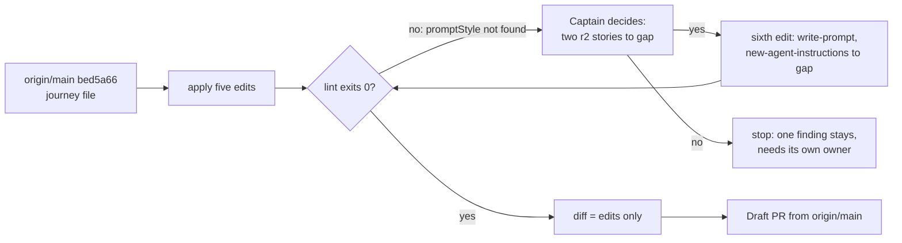

---
id:
title: The project-env journey map matches what shipped and what release r1b now holds
status: implementation
variant: kc-dev-flow-2
profile: pilot
merge: pr
worktree: .worktrees/spacedock-ensign-project-env-journey-map-r1b-update
pr:
gates:
    version: 1
    records:
        - id: gate:project-env-journey-map-r1b-update:backlog
          stage: backlog
          attempts:
            - id: gate-attempt:project-env-journey-map-r1b-update-backlog-1
              briefing:
                id: briefing:project-env-journey-map-r1b-update:backlog:attempt-1:revision-1
                digest: sha256:e545cb4fda61288435ac157772214d0e05d179a62e0c1211134629e71adc60bc
                room-ref: ./project-env-journey-map-r1b-update/review/backlog/briefing-1
              resolution:
                type: Resolution
                id: resolution:spacedock:project-env-journey-map-r1b-update:backlog:1
                briefing: briefing:project-env-journey-map-r1b-update:backlog:attempt-1:revision-1
                by: person:captain
                at: "2026-10-27T18:32:37.452639Z"
                decision: approve
                reason: '「開」 — Captain in FO chat, 2026-10-28. Asked: 「下一件要你決定的：要不要開一個「更新旅程地圖」的小任務？我建議開…回「開」或「先不用」。」 FO had recommended opening it.'
              application:
                target-stage: ideation
                state: consumed
        - id: gate:project-env-journey-map-r1b-update:ideation
          stage: ideation
          attempts:
            - id: gate-attempt:project-env-journey-map-r1b-update-ideation-1
              briefing:
                id: briefing:project-env-journey-map-r1b-update:ideation:attempt-1:revision-1
                digest: sha256:e932eb2e47aecac943823ac94c5b699e6caec47d2f6d34c1829e6b67e24c33ff
                room-ref: ./project-env-journey-map-r1b-update/review/ideation/briefing-1
              resolution:
                type: Resolution
                id: resolution:spacedock:project-env-journey-map-r1b-update:ideation:1
                briefing: briefing:project-env-journey-map-r1b-update:ideation:attempt-1:revision-1
                by: person:captain
                at: "2026-10-27T18:47:56.335216Z"
                decision: approve
                reason: '「准」 — Captain in FO chat, 2026-10-28, on the ideation gate (sha256:e932eb2e), FO having recommended approval; approval also accepts the sixth edit (write-prompt and new-agent-instructions to gap). Asked: Approve the journey map edit design and AC-1 into implementation, including a sixth edit ...? Say if you object to any part.'
              application:
                target-stage: implementation
                state: consumed
started: 2026-10-27T18:33:05Z
---

The r1b release review of 2026-10-28 (`project-env-docs-site/release-review-r1b.md` in this state checkout) found `docs/journey/project-env/give-agents-their-project-setup.yaml` out of date: four r1.5 stories that merged (#21, #15, #17, #20) still read `gap`, r1b's `slice_because` says no plugin code is needed although four of its stories need code, and the introduction, reference and changelog pages the Captain asked for (「plugin 介紹，文件說明」, 2026-10-27) belong to no story. The Captain ruled 「移出」 on 2026-10-28: story `agent-lays-out-vault` leaves r1b. Asked whether to open a task for the map edit, recommending it, he answered 「開」.

## Scope

In: one edit of the journey file that (1) takes `agent-lays-out-vault` out of r1b, (2) sets `paste-token`, `token-works`, `add-remove-variable` and `test-each-variable` to `exists` with evidence symbols read from main, (3) replaces r1b's `slice_because` with a true reason, (4) adds one story for reading the plugin's introduction and docs, quoting the Captain's words, and (5) corrects the status card so it says r1.5 is merged and r1b is not built. Out: any plugin code, any other release's goal, r1b's goal sentence (the review's open point on "in-app steps" goes to the Captain separately), the canvas. Stop condition: the acceptance criterion passes.

## Acceptance criteria

**AC-1**: The journey file carries the five edits in Scope, every `exists` story's evidence symbol is found on main, and the journey lint passes.
Verified by: at the candidate checkout, built on `origin/main` (not local `main`, which lags it), run (a) `node <kc-journey-map>/lib/journey-lint.mjs docs/journey/project-env/give-agents-their-project-setup.yaml "$(git rev-parse --show-toplevel)"`, which must exit 0 and end with `all lints pass`; (b) `git diff origin/main -- docs/journey/project-env/give-agents-their-project-setup.yaml`, which must touch only the hunks in `design/journey-five-edits.diff`; (c) for each of `storeToken`, `tokenStatus`, `nameFromLabel`, `testProject`, `git grep -nw <symbol> origin/main -- project-env` returns a non-test hit. Clause (a) cannot pass on the five edits alone; see "Needs decision".

## FO alignment

Surfaces: none
Visible change: none
Direction alignment with the Captain: done — he ruled 「移出」 on agent-lays-out-vault and answered 「開」 to this task on 2026-10-28.
Release review: not needed: map maintenance carrying the review-release output and the Captain's ruling; it moves no task into a release.
Map footprints: not needed: no open map question is answered by this task.

## Design

Evidence folder: `project-env-journey-map-r1b-update/design/` in this state checkout. Everything below was built on a throwaway `git archive` copy of `origin/main` bed5a66 (tag `project-env-v0.2.0`, read with `git ls-remote --tags origin` on 2026-10-28), with a scratch `git init` so the lint's `git grep` works. No branch, no repo file, no canvas touched. Local `main` is at b5381b1, one commit behind `origin/main`; implementation must start from `origin/main`.

### PRFAQ

Press release: the project-env journey file says what is true on 2026-10-28. The four r1.5 stories show as built, release r1b lists the 11 stories it holds with a reason that matches them, the Captain's request for an introduction and docs is a story, and the status card says r1.5 is merged.

FAQ:
- *Why did the file drift?* The r1.5 tasks merged (#21, #15, #17, #20) and the release shipped as `project-env-v0.2.0` without the map being edited; the review of 2026-10-28 found it.
- *What leaves r1b?* `agent-lays-out-vault`, by the Captain's 「移出」 of 2026-10-28. It keeps `status: gap` and stays on the map with no release.
- *Is any plugin code touched?* No. Existing-code check: nothing to change or replace; the only artifact is one YAML file.
- *What does this not do?* It does not edit r1b's goal sentence (the review's "in-app steps" point goes to the Captain separately), another release's goal, the question answers the fold tool wrote, or the canvas.



### The edits, as exact YAML (full diff: `design/journey-six-edits.diff`; five-only: `design/journey-five-edits.diff`)

1. `agent-lays-out-vault` leaves r1b: delete its line `release: r1b`. Id, `status: gap` and card stay.
2. Four r1.5 stories change `status: gap` to `status: exists`. Evidence symbols are unchanged and were read on `origin/main` bed5a66; each tag-contains its merge commit (`git merge-base --is-ancestor <sha> project-env-v0.2.0`).

   | Story | Merged | Evidence symbol | Where it is on main |
   | --- | --- | --- | --- |
   | `paste-token` | #21 1adf630 | `storeToken` | `project-env/server/secrets.ts` (checks the token with `checkToken` before `writeToken`), RPC in `shared/config.ts` |
   | `token-works` | #15 948e98a | `tokenStatus` | `project-env/server/secrets.ts` (names missing, locked, unexpected), RPC in `shared/config.ts` |
   | `add-remove-variable` | #17 15b1e3f | `nameFromLabel` | `project-env/shared/config.ts`, used by `client/field-picker.tsx` and `client/settings-screen.tsx` |
   | `test-each-variable` | #20 985e7e4 | `testProject` | `project-env/shared/config.ts`, handled in `server/contribute.ts` |

   Their `Gap:` question answers are left as the fold tool wrote them.
3. r1b `slice_because` becomes:
   `"Each story is a step a teammate new to the plugin meets, and one teammate-Mac run accepts them together; four (pick-repository, pick-field, setup-guide, find-settings) need plugin code, and the rest need only pages."`
   Count after edits: 11 stories not `exists`, limit 5, so the lint reports `slice-size (accepted)` with this reason, as before. The four are the review's own list of stories that need code; the rest need only pages.
4. New story under step `get-plugin`, after `find-settings`:
   ```yaml
         - id: read-the-docs
           card: "Read the plugin's introduction and docs (「plugin 介紹，文件說明」, Captain)"
           release: r1b
           status: gap
   ```
   The Captain's words are from 2026-10-27, quoted in `project-env-docs-site.md` ("顯然還缺 plugin 介紹，文件說明，..."). No `evidence` (nothing built), no question added.
5. Status card: `as_of: "2026-10-28"`; `unmerged:` becomes `"r1 is merged and tagged project-env-v0.1.0; r1.5 is merged and tagged project-env-v0.2.0; r1b is not built."` The `unproven`, `undeployed` and `irreversible` lines stay: r1.5 has no acceptance ruling in this file, which `unproven` does not claim either way.

### Needs decision

**A sixth edit is needed for AC-1's lint to pass: set the two r2 standing-instruction stories to `gap`. Recommendation: yes, add it.** Baseline lint on `origin/main` already exits 1 (`design/lint-base-bed5a66.txt`): `write-prompt` is `exists` with evidence `promptStyle`, a symbol that no longer greps. PR #53 (0b55dfd, merged 2026-10-27) removed the default-prompt box and the `prompt` key; its task file says so (`_archive/project-env-built-in-agent-notice.md`, "The 'Default prompt for new agents' heading and box are gone"). `new-agent-instructions` ("A new agent follows the standing instructions", evidence `systemPrompt`) is the same drift: its symbol still greps, but only in the new built-in notice (`withNotice` in `server/agent-notice.ts`), not any user instruction, so the lint cannot catch it.
- Edit: in `write-prompt` change `status: exists` to `status: gap` and delete `evidence: promptStyle`; in `new-agent-instructions` do the same with `systemPrompt`. r2's goal and the stories' questions stay. The `write-prompt` q1 answer ("they stay for Kent's own use") is then stale text; I leave it for the Captain's call rather than rewrite an answer.
- Lint result with it: exit 0, `all lints pass` (`design/lint-six-edits.txt`). Without it: exit 1, one finding (`design/lint-five-edits.txt`).
- If the Captain says yes: implementation adds the sixth edit to Scope, and AC-1 (b) points at `design/journey-six-edits.diff`.
- If the Captain says no: AC-1's lint clause (a) is replaced by "exactly one finding, `evidence-not-found` for `promptStyle`" (`design/lint-five-edits.txt`), and that residual needs its own owner.
- Prior rulings: `Override:` lines in the state checkout (`git grep -n 'Override:'`, 2026-10-28) touch neither r2 nor `write-prompt`; the Captain's 「拿掉避免誤會」 (2026-10-25, amendment 1, AC-3) and 「准」 (2026-10-26) in `_archive/project-env-built-in-agent-notice.md` removed the default-prompt box, which is why I recommend yes.

### Batch overlap

`project-env-docs-site` (implementation): its branch `spacedock-ensign/project-env-docs-site` changes no file under `docs/journey` (`git diff --stat origin/main...<branch> -- docs/journey` empty on 2026-10-28), so no file conflict. It refers to journey stories by id in its own task table; the review asks it to add `rotate-token` there, and `read-the-docs` exists only after this task merges. `project-env-release-1` and `project-env-test-row-draft-note` (backlog): none. Recommended order: this task first, then docs-site cites `read-the-docs`.

## Stage Report: ideation

- DONE: Design the five journey-file edits your Scope names, using the kc-journey-map skill's cell contract: write each edit as the exact YAML change (story ids, status, evidence symbols read on main for the four r1.5 stories, the new read-the-docs story's card in the Captain's words, the new r1b slice_because, the status card), keep AC-1 and give it a reproducible evidence clause, and run the journey lint on a throwaway copy with the edits applied.
  All five edits are written as exact YAML under "Design"; full diffs in `design/journey-five-edits.diff` and `design/journey-six-edits.diff`. The four evidence symbols (`storeToken`, `tokenStatus`, `nameFromLabel`, `testProject`) were read on `origin/main` bed5a66; the merge commits are in tag `project-env-v0.2.0`. AC-1 kept, with a three-part command clause; its current evidence is under `### AC-1`.
- DONE: Name any decision the Captain must make (at most one), with a recommendation.
  One: add a sixth edit setting `write-prompt` and `new-agent-instructions` to `gap` (PR #53 removed the default prompt). Recommendation: yes. See "Needs decision".

### AC-1

Current evidence, on the throwaway copy of `origin/main` bed5a66. Five edits: lint exits 1 with one finding, `evidence-not-found` for `promptStyle` (`write-prompt`), which the unedited base also shows (`design/lint-base-bed5a66.txt`, `design/lint-five-edits.txt`). Five edits plus the two r2 corrections: exit 0, `all lints pass` (`design/lint-six-edits.txt`). `slice-size (accepted)` reports 11 stories with the new reason. Not yet verified: clauses (b) and (c) on a real candidate checkout; (c) was only spot-read for the four symbols.

### Summary

The five edits are designed and lint-checked on a throwaway copy of `origin/main`. Finding: the file's lint already fails on `origin/main` because `write-prompt` cites `promptStyle`, removed by #53; AC-1 cannot pass without a sixth edit, so that is the one Captain decision. Local `main` is one commit behind `origin/main`; implement from `origin/main`.
