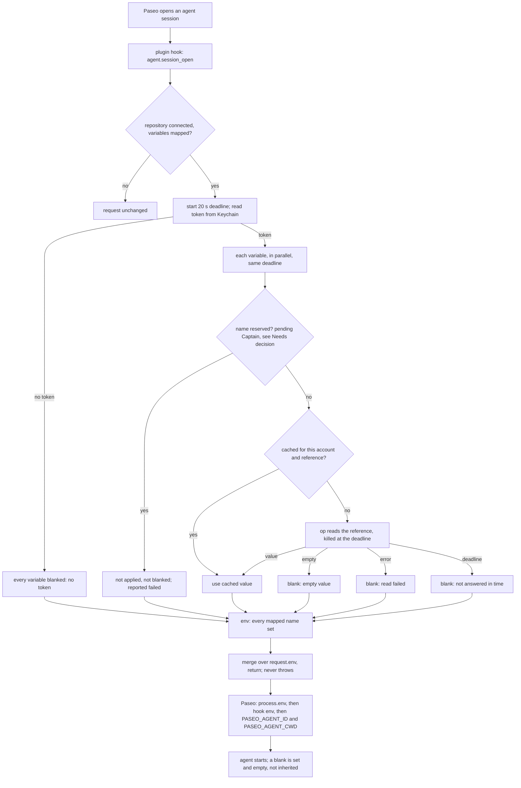

---
id:
title: New agents start with each resolved variable, and a failed or empty one arrives empty
status: implementation
variant: kc-dev-flow-2
profile: pilot
merge: pr
worktree: .worktrees/spacedock-ensign-project-env-new-agent-env
pr:
journey: paseo-project-env
journey-release: r1
journey-story: new-agent-env
journey-required-tasks: '["project-env-new-agent-env"]'
journey-mapping-complete: true
gates:
    version: 1
    records:
        - id: gate:project-env-new-agent-env:backlog
          stage: backlog
          attempts:
            - id: gate-attempt:project-env-new-agent-env-backlog-1
              briefing:
                id: briefing:project-env-new-agent-env:backlog:attempt-1:revision-1
                digest: sha256:4af7224cfbdc9629d79b98d6dc38749ef60b11830cdce70e3e35a5f74b81a59e
                room-ref: ./project-env-new-agent-env/review/backlog/briefing-1
              resolution:
                type: Resolution
                id: resolution:spacedock:project-env-new-agent-env:backlog:1
                briefing: briefing:project-env-new-agent-env:backlog:attempt-1:revision-1
                by: person:captain
                at: "2026-10-20T14:16:44.187576Z"
                decision: approve
                reason: 'Captain 2026-10-20: 「准。」 — accepts this release r1 task''s outcome, scope and acceptance criteria on the pilot profile, into ideation.'
              application:
                target-stage: ideation
                state: consumed
        - id: gate:project-env-new-agent-env:ideation
          stage: ideation
          attempts:
            - id: gate-attempt:project-env-new-agent-env-ideation-1
              briefing:
                id: briefing:project-env-new-agent-env:ideation:attempt-1:revision-1
                digest: sha256:0336136366fc6c92b054c4af7c79f12c98fc44399050ebe8d05af3e90f1bcc4a
                room-ref: ./project-env-new-agent-env/review/ideation/briefing-1
              resolution:
                type: Resolution
                id: resolution:spacedock:project-env-new-agent-env:ideation:1
                briefing: briefing:project-env-new-agent-env:ideation:attempt-1:revision-1
                by: person:captain
                at: "2026-10-20T14:57:01.598889Z"
                decision: approve
                reason: 'Captain 2026-10-20: 「准」 — accepts this ideation design and its acceptance criteria into implementation, including the presented additions (the one-line run fix in project-env-plain-failure-reason; AC-2 in project-env-vault-boundary).'
              application:
                target-stage: implementation
                state: consumed
started: 2026-10-20T14:19:32Z
---

Release r1 of the paseo-project-env journey: Kent, on his own Mac, connects one repository to 1Password, and new agents there start with its secrets safely. ADR 0002 rules that a variable that cannot be resolved is blanked; the Captain ruled on 2026-10-20 that an empty value is a failed variable (「算失敗」). Today a failed variable is left out of the merge, so a value the daemon inherited under that name survives, and an empty value passes as set.

## Scope

In: the `agent.session_open` merge, the value cache, the hook's time budget, and test fakes for `op`, the macOS `security` tool and `git` that later r1 tasks reuse. Open for ideation, not decided here: which variable names are refused (journey `new-agent-env/q6`). Non-goals: the timeline line (project-env-notice-missing-variable), cause text (project-env-plain-failure-reason), settings-screen changes (r1.5). Stop condition: the acceptance criteria below pass on Kent's daemon.

## Acceptance criteria

**AC-1**: A new agent in the connected repository starts with each configured variable that resolves.
Verified by: an agent on Kent's daemon reporting set or missing per variable without printing values.

**AC-2**: A variable that fails, or resolves to an empty value, reaches the agent as empty, even when the daemon's own environment holds that name.
Verified by: a unit test with the fakes, the daemon environment carrying the name.

**AC-3**: A value fetched with one service account's token is never returned for a lookup made with another account's token.
Verified by: a fake-op unit test with two tokens and one reference.

**AC-4**: A slow 1Password does not stop the agent from starting; variables not resolved within Paseo's 30-second hook limit are blanked.
Verified by: a fake-op unit test with a delayed response.

**AC-5**: The test suite runs without the real `op`, Keychain or `git`.
Verified by: `npm test` with those tools off `PATH`.

## FO alignment

Surfaces: none
Visible change: none
Direction alignment with the Captain: not needed — the outcome follows rulings already recorded (docs/adr/0001, docs/adr/0002, and the Captain's 2026-10-20 rulings in the journey map); release r1 was marked changed by signal 2 (the Captain narrowed r1 on 2026-10-20: 「可以改成兩段，不用第一時間給隊友，要先我用到覺得可以」, 「就五個，剩下做 r1.5」). kc-journey-map review-release ran on r1 at 60799d9; after the rulings, a fresh audit, the map split and an interrogation of the changed stories, this task split was re-derived from the map at 760bfaa (branch docs/project-env-r1-split, PR #6).
Release review: paseo-project-env/r1 at 760bfaa

## Number guards

ADR: 0004

## PRFAQ

**Press line.** When Kent opens an agent in a connected repository, every variable he mapped arrives as its 1Password value, or arrives empty. It never arrives as a stale value the Paseo daemon happened to hold under the same name, and a slow 1Password never stops the agent from starting.

**What is wrong today** (read from `project-env/server/secrets.ts` and `index.server.ts`, 2026-10-20):
- A failed variable is left out of `env`, and the hook returns `{ ...request.env, ...env }`, so nothing overrides the daemon's own value under that name.
- `readRef` returns `""` as a success and caches it, so an empty value counts as set.
- The cache key is the reference alone, so a value fetched with one token can be returned for another account's lookup.
- `run` allows each `op` call 30 seconds, and Paseo fails the whole opening at 30 seconds, so one slow `op` stops the agent.

**FAQ**
- *Why does an empty string blank a variable?* Fact, read from the installed Paseo.app (`app.asar`, `@getpaseo/server`), 2026-10-20: `buildLaunchContext` takes the hook's `env`; the provider builds the process environment as `Object.assign({}, process.env, runtimeSettings.env, launchEnv)` (`buildExternalProcessEnv`, `createProviderEnv`) and deletes only `undefined` values. `""` is not `undefined`, so `NAME=""` overrides the daemon's value and the agent sees the name set and empty. The hook schema is `z.record(z.string(), z.string())`, so `undefined` cannot be returned; `""` is the only blanking value available.
- *What counts as failed?* No token; a rejected token; a missing field; any `op` or `security` error; an empty value (Captain, 2026-10-20: 「算失敗」); not answered before the deadline. All are blanked. Only exactly `""` is empty; a whitespace-only value is a value. Empty values are not cached, so a fixed field is picked up on the next open.
- *Can the hook still fail the opening?* It must not. `openSession` catches everything and blanks every configured name, because a throwing before-hook fails the agent's opening (Paseo's `PluginRuntime.before`).
- *What is the time budget?* The daemon's per-hook timer is 30 s (`REQUEST_TIMEOUT_MS` in the plugin runtime) and starts when it sends the request, so the settings read, the git calls in `mainCheckout` and the Keychain read are inside it. The resolve deadline is 20 s from hook entry (`HOOK_BUDGET_MS`), leaving 10 s for those and for IPC. Both numbers are choices, not measurements; typical `op` latency was not measured.
- *How are late variables handled?* Each variable races the one shared deadline. At the deadline `op` children are killed (`execFile` `timeout`) and any variable still pending is blanked as not answered. A late result may still fill the cache for the next open, which is harmless because the cache is keyed by account.
- *What does the cache key become?* `serviceAccount` name plus reference. Rejected: also fingerprinting the token. What breaks without it is a token replaced under the same Keychain name for a different account serving old values for up to 15 minutes; nothing observed, and secret-change-picked-up (r3) owns staleness.
- *Does this change the Test button?* Only that an empty value now shows as failed, which the journey already says Test shares (`test-each-variable/q1`).
- *Which openings are covered?* All four reasons (create, resume, refresh, import): the hook resolves for each. Whether a history-only opening should resolve is notice-missing-variable `q3`, not this task.
- *Is an ADR needed?* No, unless the Captain accepts the reserved-name recommendation below, which makes an exception to ADR 0002; then a short ADR "Reserved variable names are skipped, not blanked" (no number) records it.

## Design

**Mechanism: three small changes and one test seam.**

1. `server/secrets.ts` becomes a factory, `createSecrets(tools)`, where `tools = { op, security, git }` are executable paths. It returns the functions that exist today (`mainCheckout`, `tokenStatus`, `storeToken`, `listRefs`, `resolveProject`, `clearCache`); the cache lives inside the instance. `server/tools.ts` holds the real paths (the existing `OP` lookup and the two `/usr/bin` paths) and is imported only by `index.server.ts`, the composition root. `tools` has no default, so a test cannot reach a real tool by forgetting to pass one.
2. `resolveProject(project, { deadline })` keeps its return shape `{ env, results }` but changes meaning: `env` holds every mapped name, value or `""`. Each result is `{ name, ok, error?, stage? }`, where the new `stage` (`token | read | empty | deadline`) says where it failed; plain-failure-reason maps stages and `error` to cause classes. `run` takes the remaining milliseconds as its `timeout`, and each variable is also raced against the deadline so a child that ignores SIGTERM cannot hold the hook. The `testProject` RPC calls it without a deadline and keeps today's 30 s per call.
3. `server/session-open.ts` exports `openSession(secrets, project, request, { budgetMs = HOOK_BUDGET_MS })` returning `{ request, results }`. The hook in `index.server.ts` becomes `projectFor`, then `openSession`, then the daemon-log line it prints today, then return `request`. Returning `results` is the seam notice-missing-variable uses to append its timeline row; this task appends none.
4. Test seam: `npm test` runs `node --test "test/**/*.test.ts"` (Node's built-in runner and type stripping; no new dependency). Files in the test graph import with `.ts` extensions, so `tsconfig.json` gains `allowImportingTsExtensions` (valid under the existing `noEmit`). Paseo bundles plugin servers with esbuild (`plugins/compiler.js`), which resolves `.ts` specifiers; AC-1 on the probe install is what confirms the bundle still loads.

**Shared fakes (for the other four r1 tasks).** Under `project-env/test/`:
- `fakes/op.mjs`, `fakes/security.mjs`, `fakes/git.mjs`: real executables, so the tests exercise `execFile`, argv, the `OP_SERVICE_ACCOUNT_TOKEN` environment, timeouts and kills. They are not in-process stubs.
- `world.ts`: `makeWorld(scenario)` writes the scenario JSON to a temp dir, writes one `/bin/sh` wrapper per tool that runs `exec <process.execPath> <fake> "$@"` with that world's directory (no `PATH` and no global env needed, so worlds do not collide), and returns `{ tools, calls(), cleanup() }`. `calls()` reads a JSONL log of `{ tool, argv, account }` per invocation; `account` is a scenario label, never a token.
- Scenario: `keychain: { <service>: <label> }` (the token is the fake string `ops_fake_<label>`); `op.accounts: { <label>: { refs: { <ref>: <value> }, vaults? } }` (a value of `""` models an empty field; an unknown ref or token fails); `op.delayMs: { <ref>: ms }`; `op.fail: { <ref or "*">: { stderr, code } }` for any text a sibling needs; `git.answers: { <argv joined by NUL>: stdout | { exit, stderr } }`, answered per `-C <path>` form with no filesystem pretence (worktree-real-paths builds real temp symlinks itself); `security` records `add-generic-password` into the world's keychain state so `storeToken` round-trips.
- `paseo-env.ts`: `paseoLaunchEnv(daemonEnv, hookEnv)` = `Object.assign({}, daemonEnv, hookEnv)`, the daemon's launch merge as read in `buildExternalProcessEnv`. It is what lets AC-2 say "the daemon environment carrying the name".
- Real stderr texts of `op` and `security` were not captured (the Keychain command is blocked for agents here, and `op` was not run against 1Password). Fake failures therefore carry scenario-chosen text; plain-failure-reason should confirm real shapes on Kent's Mac.

**Tests this task owns** (each names the change that makes it fail):
- *blank beats daemon value* (AC-2): `process.env.STALE_NAME="daemon"`; the fake `op` errors for that ref; `paseoLaunchEnv(process.env, openSession(...).request.env).STALE_NAME === ""`. Fails if a failed name is omitted from `env`.
- *empty is failed* (AC-2): the fake returns `""`; result `ok:false, stage:"empty"`, env `""`, and a second open calls `op` again (not cached). Fails if `readRef` returns `""` as a value or caches it.
- *any error and no token blank* (AC-2): rejected token, missing ref, and no Keychain entry each give `""` for every mapped name.
- *accounts do not share cache* (AC-3): two service accounts hold different tokens for the same ref; open for A then B; B's env equals B's value and `calls()` shows two `op` reads. Fails if the key drops the account.
- *deadline* (AC-4): the fake delays one ref past `budgetMs: 300`; the fast variable keeps its value, the slow one is `""` with `stage:"deadline"`, `openSession` returns before the delay ends, and the fake's child is gone (killed). Fails if the call waits for `op`.
- *never throws* (AC-4 safety): the `security` fake crashes; `openSession` still returns all mapped names blank.
- *tools off PATH* (AC-5): see AC-5.

**Existing-code check.** Boundary: the hook in `index.server.ts`, and `resolveProject`, `readRef`, `run` in `server/secrets.ts`. Searched `project-env/` for `test`, `mock`, `fake` and `session_open`: no test file or seam exists (only `typecheck`), and the hook is the only consumer of `resolveProject` besides the Test RPC. Completeness: the merge, cache and timeout exist and are incomplete (omit, key, 30 s). Need: Captain-ruled behaviour (ADR 0002, 「算失敗」) plus AC-3/AC-4. Smallest mechanism: repair those four behaviours in place; the factory exists only because `/usr/bin/security`, `/usr/bin/git` and the `/opt/homebrew/bin/op` lookup are absolute paths that no `PATH` change reaches, so without it AC-5 cannot be tested. No upstream capability applies: Paseo gives plugin hooks no fakes, and the contract used here was read in Paseo's own server source, not from a sibling's usage.

**Siblings.** Needs from siblings: none. Gives: the fakes and `npm test` to all four; `results[].stage` to plain-failure-reason (name and mapping theirs); `openSession(...).results` to notice-missing-variable; the factory and `tools.git` to worktree-real-paths (it asked for a replaceable git runner and a working `npm test`; its `projectForCwd` can live in the same factory); `calls()` to vault-boundary (it asked for a call-recording fake `op`). Merge order is this task first, so the others rebase over the `secrets.ts` factory edit.

## Acceptance criteria (evidence clauses)

AC-1 to AC-5 above are the Captain's wording, kept verbatim. The `Reproduce:` lines add the command each proof runs.

**AC-1**: A new agent in the connected repository starts with each configured variable that resolves.
Reproduce: on Kent's daemon, a throwaway probe install (its own plugin id, never `paseo-project-env`, removed afterwards) with one temp repository connected to a test vault; start a new agent there and have it run `node -e 'for (const n of process.argv.slice(1)) console.log(n, process.env[n] === undefined ? "unset" : process.env[n] === "" ? "empty" : "set")' NAME1 NAME2`. Expect `set` for each variable that resolves; no value is printed. Not run: ideation runs nothing against the live daemon.

**AC-2**: A variable that fails, or resolves to an empty value, reaches the agent as empty, even when the daemon's own environment holds that name.
Reproduce: `npm test` (*blank beats daemon value*, *empty is failed*, *any error and no token blank*). Live clause on the same probe install: map a name the daemon holds, such as `LANG`, to a field that does not exist; the agent command above must print `empty`, not `set`.

**AC-3**: A value fetched with one service account's token is never returned for a lookup made with another account's token.
Reproduce: `npm test` (*accounts do not share cache*).

**AC-4**: A slow 1Password does not stop the agent from starting; variables not resolved within Paseo's 30-second hook limit are blanked.
Reproduce: `npm test` (*deadline*, *never throws*). The real 30 s limit is not exercised live: the fake test proves the plugin returns inside its own 20 s budget, and that 20 s is below Paseo's 30 s is read from `REQUEST_TIMEOUT_MS`, not measured.

**AC-5**: The test suite runs without the real `op`, Keychain or `git`.
Reproduce: with `SB` an empty temp dir, `ln -s "$(command -v node)" "$SB/node"; ln -s "$(command -v npm)" "$SB/npm"; ln -s /bin/sh "$SB/sh"; (cd project-env && PATH="$SB" "$SB/npm" test)`. A spike of this shape (a fake executable run through `execFile`, a timeout kill, Node 24.18.0) passed on this Mac on 2026-10-20, and `command -v op security git` printed nothing under that `PATH`. Limit: `/usr/bin/git`, `/usr/bin/security` and `/opt/homebrew/bin/op` are absolute and exist on this Mac, so the stripped `PATH` alone would not catch a call to them; what keeps the suite off them is that `createSecrets` takes `tools` with no default and `tools.ts` is imported only by `index.server.ts`, which no test imports.

## Journey question new-agent-env/q6

q6 cannot be fully settled from rulings and facts. Facts: the name check admits any identifier; the hook spreads resolved values over `request.env`; after the hooks the daemon (a) sets `PASEO_AGENT_ID` and `PASEO_AGENT_CWD`, and (b) deletes `PASEO_NODE_ENV`, `PASEO_DESKTOP_MANAGED`, `PASEO_SUPERVISED`, `ELECTRON_RUN_AS_NODE`, `ELECTRON_NO_ATTACH_CONSOLE`, `ESBUILD_BINARY_PATH` and the parent-session variables `CLAUDECODE`, `CLAUDE_CODE_ENTRYPOINT`, `CLAUDE_CODE_SSE_PORT`, `CLAUDE_AGENT_SDK_VERSION` (`buildLaunchContext`, `buildExternalProcessEnv`, `PARENT_SESSION_ENV_VARS`; installed Paseo.app, 2026-10-20). Mapping any of those is silently ineffective. The map also names `PATH`, `HOME`, `NODE_OPTIONS` and `OP_SERVICE_ACCOUNT_TOKEN` for refusal when added (r1.5). No ruling says what session open does with a reserved name; ADR 0002's "blanked" would break the agent for `PATH`.

### Needs decision

**One decision for the Captain: what session open does with a reserved name.** Recommendation: such a name is neither applied nor blanked; the agent keeps its own value, and the name is reported as a failed variable with a new cause class "reserved name". The reserved set is the four names the map already lists plus the twelve Paseo overwrites or deletes above. Why: blanking `PATH` or `HOME` breaks the agent, applying them replaces the agent's own, and the rest do nothing anyway. What gets worse: ADR 0002's sentence "an agent never runs on a stale value of a mapped name" gains an exception, and plain-failure-reason gets a fifth class beyond ADR 0002's four plus empty and outside-vault. If the Captain rules otherwise (blank them, or apply them), the only code that changes is one predicate `isReservedName` in `shared/config.ts` and its handling in `resolveProject`; r1.5's refusal on add reuses the same predicate. Until ruled, implementation must not start on that branch of the flowchart. Past rulings checked: ADRs 0001-0003 and the `Override:` lines in the state checkout (none recorded) name no reserved names.

### Known limits (not decisions)
- A hung `git` or settings read before the deadline starts is not bounded here (nothing is known to blank yet); worktree-real-paths owns `mainCheckout`.
- Many mapped variables start that many parallel `op` processes; bounded by the deadline, not capped. Deferred until a repository has enough variables to hit 1Password's rate limit.
- Duplicate variable names: the later entry wins as today; add-time refusal is r1.5.
- No CI job is added: `npm test` is local, so the cost per PR is zero CI minutes. Wiring it into CI is Kent's call.

## Stage Report: ideation

- DONE: Design the session-open merge so a failed or empty variable reaches the agent as empty even when the daemon environment holds the name, the cache is keyed by service account and reference, and unresolved variables are blanked within Paseo's 30-second hook limit; each AC keeps a reproducible evidence clause.
  `## PRFAQ` and `## Design`: `""` blanks (Paseo merges `process.env` then the hook env, deleting only `undefined`); cache key is account plus reference; one 20 s deadline raced per variable; `openSession` never throws; every AC has a `Reproduce:` line.
- DONE: Design the op, security and git test fakes the other r1 tasks reuse, and how `npm test` runs with the real tools off PATH.
  `## Design` "Shared fakes": executable fakes plus `makeWorld`, `calls()`, scenario schema, `paseoLaunchEnv`; `createSecrets(tools)` with no default. A spike on this Mac (fake executable, timeout kill, Node 24.18.0, `PATH` of node/npm/sh only) passed.
- DONE: Settle journey question new-agent-env/q6 (which names are refused at session open) from rulings and facts, or name it as an unresolved decision for the Captain with a recommendation.
  Not settleable from rulings: named as one Needs-decision item with a recommendation (skip, do not blank or apply; sixteen names; a "reserved name" cause class).
- DONE: AC-1 current evidence.
  Not yet verified: no implementation; proof is a probe install on Kent's daemon (proposed, nothing run against the live install).
- DONE: AC-2 current evidence.
  Not yet verified: the mechanism is read from Paseo.app source (`buildExternalProcessEnv`), not run; proof is `npm test` plus a live `LANG` probe.
- DONE: AC-3 current evidence.
  Not yet verified: fake-op test *accounts do not share cache* would fail if the key dropped the account.
- DONE: AC-4 current evidence.
  Not yet verified: *deadline* and *never throws* tests; the 30 s limit is read from `REQUEST_TIMEOUT_MS`, the 20 s budget is a choice, not measured.
- DONE: AC-5 current evidence.
  Observed: the spike passed under a stripped `PATH`; not yet verified on the real suite. Limit stated: absolute tool paths are kept off by the factory, not by `PATH`.
- DONE: Design surfaces check.
  `design_surfaces.py check project-env-new-agent-env.md` printed "design surfaces presentable", exit 0 (Surfaces: none).

### Summary

The merge fix is small: every mapped name is always written, `""` when failed, empty or late, and Paseo's own launch merge makes that override the daemon's value. The larger piece is the test seam: `createSecrets(tools)` plus executable fakes and `npm test` on Node's built-in runner. One decision needs the Captain (q6, reserved names); the 20 s budget and the 12-name reserved set come from reading Paseo's source, not from running it.
