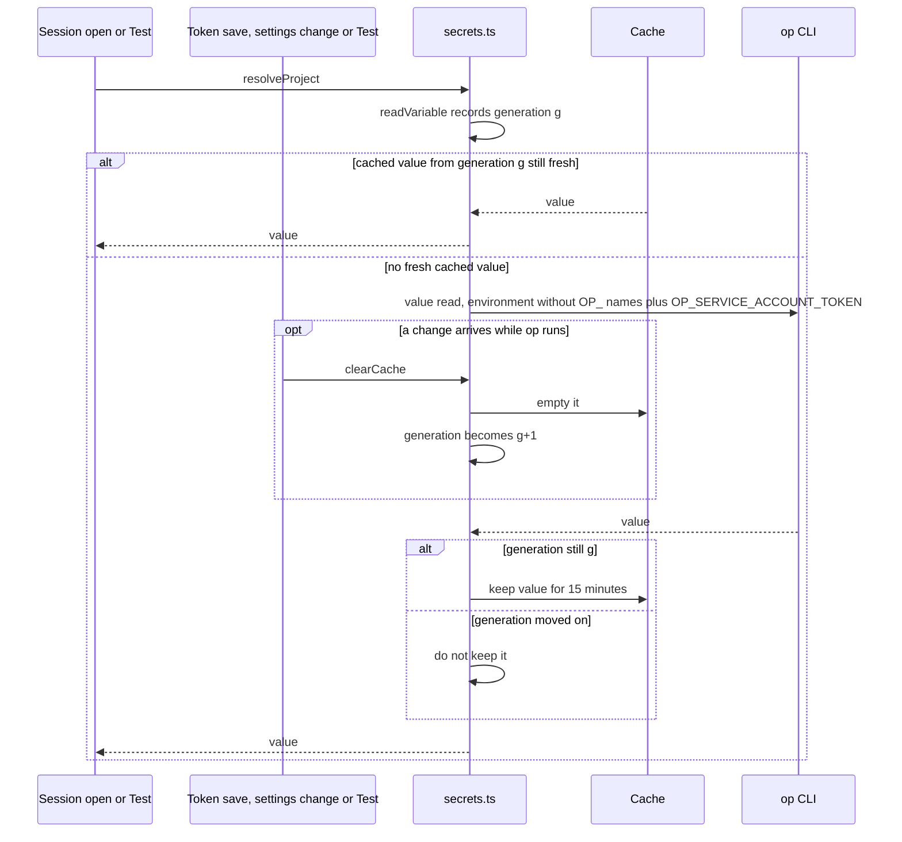

---
id:
title: The plugin always signs in to 1Password with its own service account and never serves a value read before a token change
status: validation
variant: kc-dev-flow-2
profile: pilot
merge: pr
worktree: .worktrees/spacedock-ensign-project-env-op-auth-and-cache
pr: 81
gates:
    version: 1
    records:
        - id: gate:project-env-op-auth-and-cache:backlog
          stage: backlog
          attempts:
            - id: gate-attempt:project-env-op-auth-and-cache-backlog-1
              briefing:
                id: briefing:project-env-op-auth-and-cache:backlog:attempt-1:revision-1
                digest: sha256:709a82f65f3f88a559b4bff420ab0c621da7b0f907eb631216e02b1093542a7d
                room-ref: ./project-env-op-auth-and-cache/review/backlog/briefing-1
              resolution:
                type: Resolution
                id: resolution:spacedock:project-env-op-auth-and-cache:backlog:1
                briefing: briefing:project-env-op-auth-and-cache:backlog:attempt-1:revision-1
                by: person:captain
                at: "2026-11-09T07:40:15.525117Z"
                decision: approve
                reason: '「開，幫我合併 78」 — Captain in FO chat, 2026-11-09, answering 「我建議：開一批「送審前修正」3 個任務，修上面第 1 到第 3 項，並補齊第 4 項的資料；做完再跑送審合規檢查。這一版會變成 v0.3.2。真正送出 Paseo 的申請之前，我還會再問你一次，因為那是對外的動作。」 (items 1-3: service account name spaces, op Connect credentials and cache race, item 4: registry listing data). Recommendation: followed.'
              application:
                target-stage: ideation
                state: consumed
        - id: gate:project-env-op-auth-and-cache:ideation
          stage: ideation
          attempts:
            - id: gate-attempt:project-env-op-auth-and-cache-ideation-1
              briefing:
                id: briefing:project-env-op-auth-and-cache:ideation:attempt-1:revision-1
                digest: sha256:8c5f9f81e5c0bdb11e7f1e33a59d6be020c6a16b59525a21aebe467385f30663
                room-ref: ./project-env-op-auth-and-cache/review/ideation/briefing-1
              resolution:
                type: Resolution
                id: resolution:spacedock:project-env-op-auth-and-cache:ideation:1
                briefing: briefing:project-env-op-auth-and-cache:ideation:attempt-1:revision-1
                by: person:captain
                at: "2026-11-09T08:47:45.944568Z"
                decision: approve
                reason: '「准」 — Captain in FO chat, 2026-11-09, answering 「設計關（送審前修正 2/3）：我建議准。呼叫 op 前拿掉所有 OP_ 開頭的環境變數，再放入我們的服務帳號 token（1Password 官方文件證實 Connect 變數會優先）；清快取時加一個編號，清之前開始的讀取不再存進快取，存新 token 也改走同一個清快取函式。兩個問題都在 main 上重現了。准了就照這個設計進實作，排在服務帳號那份之後。」 (the three public-release-prep ideation gates presented together). Recommendation: followed.'
              application:
                target-stage: implementation
                state: consumed
started: 2026-11-09T07:41:25Z
---

Batch: public-release-prep, approved by the Captain on 2026-11-09 (「開，幫我合併 78」, answering FO's 「…開一批「送審前修正」3 個任務…回「開」就開這批 3 個任務」) with three members: project-env-service-account-trim, project-env-op-auth-and-cache, project-env-registry-listing. Source: the Codex and Gemini release reviews of origin/main 2026-11-09 saved in research/2026-11-09-public-release-review/ (codex.md, gemini.md), each claim below re-read by FO in the code on main e4acaec. `opEnv` in `project-env/server/secrets.ts` passes the whole daemon environment to `op` plus `OP_SERVICE_ACCOUNT_TOKEN`; the reviewer cites 1Password's service-account page saying Connect credentials (`OP_CONNECT_HOST`, `OP_CONNECT_TOKEN`) take precedence, so a Mac with those set would read through Connect instead (codex.md P1 "Wrong authentication identity"; FO has not re-read the 1Password page). `readVariable` stores a value with `cache.set` after its `op` call returns, so a read in flight when `clearCache` runs (token change, settings change, Test) can put an old value back for up to 15 minutes (codex.md P1 "Cache invalidation races"; FO read the code, not reproduced).

## Scope

In: `op` always uses the configured service account whatever other 1Password credentials the daemon environment carries; a value whose read started before the cache was cleared is never cached; verify the 1Password precedence claim from its own docs.
Non-goals: changing the cache lifetime; the field reference format; the other review findings.
Budget: one ideation, implementation and validation round.
Stop condition: the acceptance criterion passes.

## Acceptance criteria

**AC-1**: With Connect variables set in the daemon environment, every `op` call the plugin makes runs without them and with the configured token; a read that finishes after the cache was cleared is returned but not cached.
Verified by: unit tests that fail on main for each half, and `npm test` passing.

## FO alignment

Surfaces: none
Visible change: none
Direction alignment with the Captain: done — he answered 「開，幫我合併 78」 on 2026-11-09 to FO's proposed batch naming this fix.
Result: the batch question and this Scope.
Release review: not needed: hardening with no journey release goal change.
Map footprints: not needed: no map answer is recorded by this task.

## Design

Profile: pilot. Surfaces: none, so the PRFAQ and Mermaid below are the whole artifact.

### PRFAQ

**The plugin reads 1Password only as the service account you connected, and a value read before a change is never reused after it.** Every time the plugin calls the 1Password CLI (`op`), it hands `op` the token of the project's service account and nothing else from 1Password's own settings, so a Mac whose Paseo was started with 1Password Connect settings still reads through the service account you chose. When you save a new token, change settings or press Test, any read already under way still answers the agent that asked for it, but its value is not kept, so the next agent gets a fresh read.

- *Why does a Connect setting matter?* 1Password says Connect wins over a service account token when both are present (quote below), so on such a Mac the plugin would check and read with a different identity than the one shown on its settings screen.
- *Which 1Password settings are removed?* Every environment variable whose name starts with `OP_` (`OP_CONNECT_HOST`, `OP_CONNECT_TOKEN`, `OP_SESSION…`, `OP_ACCOUNT`, `OP_CONFIG_DIR`, `OP_CACHE`, `OP_DEBUG`, `OP_FORMAT`, `OP_INCLUDE_ARCHIVE` and others), then `OP_SERVICE_ACCOUNT_TOKEN` is set. The rest of the daemon environment (`HOME`, `PATH`, …) still passes. A prefix strip is the one rule that covers `OP_SESSION_<account>` names, which vary by account. Nothing in project-env reads or sets another `OP_` name (`grep -rn "OP_" project-env/server project-env/shared`, 2026-11-09: only `OP_SERVICE_ACCOUNT_TOKEN`). What gets worse: someone who relied on an inherited `OP_INCLUDE_ARCHIVE=true` to read archived items through the plugin loses that; no such use is known.
- *Does the agent that asked during the change get the old value?* Yes, as the criterion says: the read is returned, only not cached. It started under the old settings and that agent's session is already opening.
- *What does not change?* The 15-minute cache lifetime, the field reference format, the `security` and `git` calls, and every other release-review finding (Scope non-goals).

### 1Password's precedence rule (checked 2026-11-09)

Source: https://developer.1password.com/docs/service-accounts/use-with-1password-cli/, which redirects (301) to https://www.1password.dev/service-accounts/use-with-1password-cli, fetched with `curl -sSL` on 2026-11-09. Quote: "If you have 1Password CLI configured to work with 1Password Connect, the OP_CONNECT_HOST and OP_CONNECT_TOKEN environment variables take precedence over OP_SERVICE_ACCOUNT_TOKEN. Clear the Connect environment variables to configure a service account instead." Corroborated by https://www.1password.dev/connect/cli: "The presence of these environment variables tells 1Password CLI to use the Connect server to fetch secrets." The full `OP_` list comes from https://www.1password.dev/cli/environment-variables. Verdict: the reviewer's claim (codex.md P1 "Wrong authentication identity") is correct.

### Every `op` call and how it runs

All four go through `opEnv(token)` in `project-env/server/secrets.ts`, so one change there covers them:

| Call | Caller | Reached from |
| --- | --- | --- |
| `op vault list --format json` | `checkToken` | `tokenStatus` (settings screen), `storeToken` (paste a token) |
| `op item list --vault <v> --format json` | `listRefs` | Browse vault / field picker |
| `op item get <id> --vault <v> --format json` | `listRefs` → `readItem` | Browse vault / field picker |
| `op read --no-newline <ref>` | `readVariable` | `resolveProject`: agent session open, Test |

Change 1: `opEnv` builds the environment from `process.env` without any key starting with `OP_`, then adds `OP_SERVICE_ACCOUNT_TOKEN: token`.

### Keeping a read started before a clear out of the cache

Change 2: `createSecrets` holds a `generation` number. `clearCache()` empties the cache and adds one to it. `readVariable` records the generation on entry, before it awaits the token, and calls `cache.set` only if the generation is still the same after the `op` value read returns; the value is returned either way. `storeToken` calls `cache.clear()` directly today, so it changes to call `clearCache()`; without that, the token-change case the reviewer named first stays broken. The two other triggers already call `clearCache()`: the settings subscription and the Test handler in `project-env/server/contribute.ts`. Recording on entry is safe because `resolveProject` starts the Keychain read and every `readVariable` in the same synchronous step.

The other three `op` calls (`vault list`, `item list`, `item get`) take the same environment and never touch the cache.

### Existing-code check

Skipped by its own rule: this repairs two seams already named by the release review, not a new or removed capability. Observation on main e4acaec1, 2026-11-09, with a throwaway script outside the repository that imported `createSecrets` and `test/world.ts`: (1) a fake `op` logging only the names of `OP_` variables it received saw `OP_CONNECT_HOST`, `OP_CONNECT_TOKEN`, `OP_SERVICE_ACCOUNT_TOKEN` on `checkToken`; (2) with the value read delayed 800 ms, `clearCache()` during the read and 1Password's value changed afterwards, the next `resolveProject` returned the old value with one value read in total. Both defects reproduce.

### AC-1 evidence clauses (rerunnable)

Run from `project-env/` on the candidate. Each new test must fail on main e4acaec1 and pass on the candidate.

1. Fake support: `test/fakes/op.mjs` adds `opVars` (the sorted names, never values, of environment variables starting with `OP_`) to each logged call; `test/world.ts` adds `opVars?: string[]` to `Call`. Existing tests stay green because none compares a non-empty call record whole (the three `deepEqual(world.calls(), [])` in `paste-token.test.ts` compare empty lists) and none sets an `OP_` variable.
2. `node --test test/op-identity.test.ts`: with `OP_CONNECT_HOST`, `OP_CONNECT_TOKEN` and an `OP_SESSION_` variable set to fake strings in the test process (restored in `afterEach`), drive `tokenStatus`, `storeToken`, `listRefs` and `resolveProject` against fake account `x`; assert the logged `op` commands cover `vault list`, `item list`, `item get` and `read`, and every one has `opVars` equal to `["OP_SERVICE_ACCOUNT_TOKEN"]` and `account` equal to `x`. Fails if `opEnv` spreads `process.env` unfiltered (main), or drops the token (account becomes null).
3. `node --test test/cache-after-clear.test.ts`, case "Test or settings change": delay the value read for the ref (`delayMs`), poll `world.calls()` until the `read` call is logged, call `clearCache()`, rewrite `scenario.json` so the ref holds a new value, await the first `resolveProject` (returns the old value), then resolve again: it returns the new value and two `read` calls are logged. Fails on main (old value, one call) and if the generation check is removed.
4. Same file, case "token change": as 3, but the clear comes from `storeToken` with a valid token while the read is in flight. Fails on main and if `storeToken` keeps calling `cache.clear()` without moving the generation.
5. `npm test` passes in full. Main baseline, e4acaec1, 2026-11-09: 335 tests, 335 pass, 0 fail (`npm test` in `project-env/`).

No isolated Paseo run is owed: both halves sit inside `secrets.ts` and are reached through the same `resolveProject`, `checkToken` and `listRefs` the daemon hooks call; the fakes are the `op` and `security` stand-ins the existing tests already use, and there is no visible change.

### Batch overlap

- project-env-service-account-trim: may touch `project-env/server/secrets.ts` (its Scope includes the Keychain lookup name, used by `lookupToken` and `resolveProject`), while this task changes `opEnv`, `readVariable`, `storeToken` and `clearCache` in the same file; different functions, a textual rebase at most. Both add tests under `project-env/test/` with distinct new file names. Both PRs feed the release-please `project-env/CHANGELOG.md` (generated from PR titles, not edited by hand).
- project-env-registry-listing: changes `project-env/OVERVIEW.md` and `paseo-plugin.json`, and checks every overview claim against the code. The overview sentence "A value read from 1Password is kept in memory and reused for up to 15 minutes, then read again. Saving settings and pressing Test read again." stays true after this task. If its overview says which identity `op` uses, that claim should be checked against this task's merged behaviour.
- Recommended order: this task and project-env-service-account-trim in either order; project-env-registry-listing last, so its overview is checked against both fixes.

## Stage Report: ideation

- DONE: Read 1Password's own documentation for how `op` chooses between Connect credentials and `OP_SERVICE_ACCOUNT_TOKEN`, and record the page and quote; if the precedence claim is wrong, say so.
  Design § "1Password's precedence rule": service-accounts/use-with-1password-cli (301 to www.1password.dev), quoted verbatim, corroborated by connect/cli; the claim is correct.
- DONE: List every `op` call the plugin makes and propose how each runs with only the configured token; propose how a read started before `clearCache` is kept out of the cache.
  Four calls, all through `opEnv` (table); Change 1 strips every `OP_` name then sets the token; Change 2 is a generation number checked before `cache.set`, with `storeToken` routed through `clearCache()`.
- DONE: Write the PRFAQ, Mermaid and AC-1 evidence clauses a reviewer can rerun.
  Design § PRFAQ, sequence diagram (both clear triggers, the in-flight read, keep or drop branch), § "AC-1 evidence clauses" 1-5 with one falsifier each.
- DONE: Every project-env change you propose names how `npm test` in project-env stays green; run `npm test` on main once and record the result.
  Evidence clause 1 names why existing tests survive the fake change; `npm test` on main e4acaec1, 2026-11-09: 335 pass, 0 fail.
- DONE: AC-1 — not yet verified (no candidate exists); both defects reproduced on main e4acaec1 by a throwaway probe (design § "Existing-code check"); proof plan is evidence clauses 2-5.
- DONE: design_surfaces check
  `design_surfaces.py check` on this file, 2026-11-09: "design surfaces presentable", exit 0.

### Summary

Confirmed from 1Password's own page that Connect variables win over a service account token, so the reviewer's identity finding stands. Proposed two changes inside `project-env/server/secrets.ts`: `op` gets the daemon environment minus every `OP_` name plus the service account token, and a cache generation number keeps any read that started before a clear (settings change, Test, or `storeToken`, which today bypasses `clearCache()`) from being cached. Both defects were reproduced on main with fakes; no Captain decision is open — stripping all `OP_` names rather than only the two Connect names is a recommendation (it covers `OP_SESSION_<account>` and costs only inherited `OP_` behaviour no one is known to use). No ADR owed; past rulings checked: ADRs 0001-0009 name no op-environment or cache behaviour, and `Override:` lines appear only in archived tasks about other areas.

## Stage Report: implementation

- DONE: Implement the approved design in `project-env/server/secrets.ts`
  `opEnv` strips `OP_*` then sets the token; `generation` counter in `clearCache`/`readVariable`; `storeToken` calls `clearCache()`. Commit cac21317.
- DONE: Add `test/op-identity.test.ts` and `test/cache-after-clear.test.ts` (both clear paths) and show each fails on main
  With secrets.ts reverted: op-identity fails (saw OP_CONNECT_HOST/TOKEN/SESSION beside the token); both clear-path cases fail (actual 'old', expected 'new'). Control case (no clear -> one read) passes on both, so the fail is the generation check, not the fixture.
- DONE: Run `npm test` and `npx tsc --noEmit` and save both outputs; count added comment lines
  339 tests/339 pass/0 fail (main 335); tsc clean; outputs /tmp/opac/npm-test.txt, /tmp/opac/tsc.txt; comment lines added: 0.
- DONE: Commit, push, open Draft PR
  https://github.com/iamcxa/kc-paseo-plugins/pull/81 (draft, not merged).
- DONE: roborev gate
  evidence=roborev:1637 (clean on 889b7329d; first run roborev:1635 had one Low finding, unbounded wait in test, fixed in 889b7329).

### Summary

Both halves of AC-1 implemented in secrets.ts with fakes logging only `OP_` variable names. Tests were shown to fail on main and pass on the candidate. No isolated Paseo run, per the design.

## Stage Report: validation

- DONE: Validate PR #81 at its exact head against AC-1 and its evidence clauses: with Connect and other `OP_` variables in the daemon environment every `op` call runs without them and with the configured token; a read that finishes after a cache clear is returned but not cached, for the Test/settings path and the token-save path.
  Candidate 889b7329d844 = PR #81 headRefOid, base e4acaec1 = origin/main (fetched 2026-11-09). All four `op` calls (`vault list`, `item list`, `item get`, `read`) go through `opEnv`; Test handler and settings subscription in `contribute.ts` call `clearCache()`, `storeToken` now does too. AC-1 met.
- DONE: Run `npm test` and `npx tsc --noEmit` in `project-env` at the candidate; reproduce that each new test fails with `secrets.ts` from main.
  `npm test` 339/339 pass, `tsc` exit 0. Throwaway copy, one change each: main `secrets.ts` fails all 3 new cases (identity saw `OP_CONNECT_*`/`OP_SESSION_my`; both clear cases got 'old' not 'new'), control passes; generation check removed fails both clear cases; `storeToken` back to `cache.clear()` fails only the token case; strip only the two Connect names fails identity; token dropped fails all.
- DONE: Check the PR body's known limit (inherited `OP_INCLUDE_ARCHIVE` no longer reaches `op`) against the code, and whether any OVERVIEW.md sentence becomes untrue.
  True: probe with `OP_INCLUDE_ARCHIVE` and `OP_CONFIG_DIR` added to the identity test still sees only `OP_SERVICE_ACCOUNT_TOKEN`. OVERVIEW lines on the token going only to `op` and "Saving settings and pressing Test read again" stay true; PR #82's new overview ("It runs `op` with the token") agrees. Limit undercounted: see F2.
- DONE: Write the minimal acceptance script FO will rerun in a fresh shell; do not push, mark ready or merge.
  Below; run as written from `zsh -f` in an empty environment, 2026-11-09, outputs matched. Nothing pushed.
- DONE: Package checks
  `comment_ratio.py e4acaec1 889b7329`: 0 comment lines of 128, exit 0. `adr_lint.py docs/adr --since e4acaec1`: 9 checked, exit 0. `dispatch_records.py`: 3 complete, exit 0; every checklist line traces to AC-1 or the ideation design. `doc_impact.py`: lists ADR 0005 (F1). Number guards: no section, not owed. Surfaces none: no screenshot or design check owed. #81 merges cleanly onto #83 (`git merge-tree`).
- F1 Polish: `doc_impact.py` lists `docs/adr/0005-…` for `secrets.ts` and the implementation report carries no `updated`/`unaffected` for it (its dispatch did not ask). Validator reading: unaffected, since ADR 0005 cites `secrets.ts` only for the Keychain `find-generic-password -s <service account>` lookup, which this diff does not touch.
- F2 Deferred risk: the PR body names only `OP_INCLUDE_ARCHIVE` as lost; the prefix strip also drops `OP_CONFIG_DIR`, `OP_CACHE`, `OP_ACCOUNT`, `OP_FORMAT`, `OP_DEBUG`, `OP_ISO_TIMESTAMPS`, `OP_BIOMETRIC_UNLOCK_ENABLED`, `OP_RUN_NO_MASKING`, `OP_SESSION_*` (1Password's env-var page, fetched 2026-11-09), as the design intends. Only `OP_CONFIG_DIR` could change how these four commands run; no use is known. Material if a daemon whose default `op` config dir is unusable reports reads failing.

### Acceptance script

No visible change; these commands show the behaviour through the tests. Paste into a terminal (zsh is fine); needs the worktree below with `node_modules` installed. About 1 minute.

1. `cd /Users/kent/Project/kc-paseo-plugins/.worktrees/spacedock-ensign-project-env-op-auth-and-cache/project-env && git rev-parse HEAD` — prints `889b7329d844d41972c44142ce8df4fd9980d570`.
2. `node --test test/op-identity.test.ts test/cache-after-clear.test.ts 2>&1 | grep -E "^ℹ (pass|fail)"` — `pass 4`, `fail 0`.
3. `bash -c 'S=$PWD; T=$(mktemp -d); rsync -a --exclude node_modules "$S/" "$T/"; ln -s "$S/node_modules" "$T/node_modules"; git -C "$S" show e4acaec1:project-env/server/secrets.ts > "$T/server/secrets.ts"; cd "$T" && node --test test/op-identity.test.ts test/cache-after-clear.test.ts 2>&1 | grep -E "^ℹ (pass|fail)"; rm -rf "$T"'` — with main's `secrets.ts` in a scratch copy: `pass 1`, `fail 3`.
4. `npm test 2>&1 | grep -E "^ℹ (tests|pass|fail)"` — `tests 339`, `pass 339`, `fail 0`.
5. `npx tsc --noEmit; echo tsc_exit=$?` — `tsc_exit=0`.

Not covered: a real `op` binary with real Connect settings (fakes record only which `OP_` names arrive; the precedence rule rests on 1Password's documentation quoted in Design), and no isolated Paseo run (the design ruled none owed).

### Summary

Recommend PASSED for PR #81 at 889b7329. Both halves of AC-1 hold, and each new test was shown to detect its defect: main's file and four one-line breakages each fail the expected cases. Two non-blocking findings: a missing affected-document record (ADR 0005, which the validator reads as unaffected) and a PR-body known limit that names one of several dropped `OP_` names. Delivery (ready, merge after #83) stays the Captain's.
