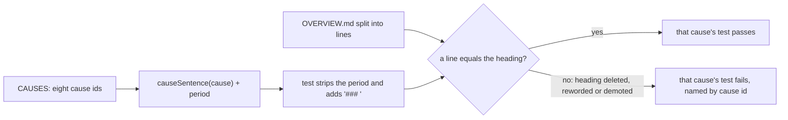

---
id:
title: The troubleshooting-notes test passes again on main
status: validation
variant: kc-dev-flow-2
profile: pilot
merge: pr
worktree: .worktrees/spacedock-ensign-project-env-overview-notes-test
pr:
gates:
    version: 1
    records:
        - id: gate:project-env-overview-notes-test:backlog
          stage: backlog
          attempts:
            - id: gate-attempt:project-env-overview-notes-test-backlog-1
              briefing:
                id: briefing:project-env-overview-notes-test:backlog:attempt-1:revision-1
                digest: sha256:2f37423583535056f195838d059fa1247d4fe732c13fab1f4ac8ec3765a7cb81
                room-ref: ./project-env-overview-notes-test/review/backlog/briefing-1
              resolution:
                type: Resolution
                id: resolution:spacedock:project-env-overview-notes-test:backlog:1
                briefing: briefing:project-env-overview-notes-test:backlog:attempt-1:revision-1
                by: person:captain
                at: "2026-10-28T12:10:27.530162Z"
                decision: approve
                reason: '「開」 — Captain in FO chat, 2026-10-28. Asked: 「要你決定的：要不要開一個小的修正任務？我建議開，而且在「選 repo」驗收之前先修好…回「開」或「先不用」。」 FO had recommended opening it.'
              application:
                target-stage: ideation
                state: consumed
        - id: gate:project-env-overview-notes-test:ideation
          stage: ideation
          attempts:
            - id: gate-attempt:project-env-overview-notes-test-ideation-1
              briefing:
                id: briefing:project-env-overview-notes-test:ideation:attempt-1:revision-1
                digest: sha256:01d43125af5a0fe56c6fdf059f6bb26c16e424dc96126e44ec6914fc0fa8957c
                room-ref: ./project-env-overview-notes-test/review/ideation/briefing-1
              resolution:
                type: Resolution
                id: resolution:spacedock:project-env-overview-notes-test:ideation:1
                briefing: briefing:project-env-overview-notes-test:ideation:attempt-1:revision-1
                by: person:captain
                at: "2026-10-28T12:18:22.560862Z"
                decision: approve
                reason: '「准」 — Captain in FO chat, 2026-10-28, on the ideation gate (sha256:01d43125), FO having recommended approval. Asked: Approve the notes-test fix design (the test matches each cause''s ### heading line ...) and AC-1 into implementation? Say if you object to any part.'
              application:
                target-stage: implementation
                state: consumed
started: 2026-10-28T12:10:48Z
---

Since PR #58 (docs site, merge d973876, 2026-10-28) main fails 8 tests: "the troubleshooting notes" in `project-env/test/agent-notice.test.ts` checks that `project-env/OVERVIEW.md` includes each `causeSentence(cause)` word for word, and #58 turned those sentences from bold sentences ending in a period into `###` headings without one. FO checked on 2026-10-28: `npm test` at 7b63c31 (before #58) passes 306 of 306; at d973876 it fails these 8. The live plugin is not affected: the test reads the shipped notes, not running code. FO's docs-site dispatches did not ask for `npm test`, so neither implementation nor validation ran it. Asked whether to open a small fix task before validating pick-repository, recommending it, the Captain answered 「開」 on 2026-10-28.

## Scope

In: make the troubleshooting-notes test pass on main while it still fails when a cause's words are missing from `OVERVIEW.md`, by matching the heading form (the sentence without its final period) in the test, or by the smallest equivalent change; keep every cause heading the docs site links to.
Non-goals: rewording any cause or the screen's text; any other test; the docs site's pages or theme.
Budget: one short ideation, one implementation and one validation round; anything wider returns to the Captain.
Stop condition: `npm test` passes on the candidate and the acceptance criterion holds.

## Acceptance criteria

**AC-1**: On the candidate `npm test` passes, and the troubleshooting-notes test still fails when one cause heading is removed from `OVERVIEW.md`.
Verified by: from a `git archive` of the candidate, `cd project-env && npm ci && npm test` reports 306 tests, 0 failures; then for each of the eight cause headings, delete that one `### ` line from `OVERVIEW.md` and run `npm test`: it reports 305 passed and 1 failed, and the failure is `explain <that cause> with the words the screen shows`. Reproduced on a throwaway copy of d973876 with the diff below: `evidence/mutation-run.txt` in this task's folder.

## FO alignment

Surfaces: none
Visible change: none
Direction alignment with the Captain: done — he answered 「開」 on 2026-10-28 to FO's recommendation to fix this before validating pick-repository.
Release review: not needed: a test repair with no journey story.
Map footprints: not needed: no journey question is touched.

## Design

**Press release.** `npm test` on main passes again, 306 of 306, and the troubleshooting-notes test still guards what it was written for: every reason a variable can come up blank has its own heading in `OVERVIEW.md`.

**FAQ.**
- *What is wrong?* The test looks for each reason's sentence with its final period; #58 made those sentences `###` headings with no period. Nothing in the plugin's running code changed.
- *Why match the heading instead of changing `OVERVIEW.md`?* Putting the periods back, or going back to bold sentences, would undo #58's headings, which the docs site renders as its reference page (`reference.md` includes `OVERVIEW.md`, and other pages link to `#when-a-variable-is-blank`) and is a rewording the Scope excludes.
- *Why not just drop the period from the old substring check?* A bare `includes` of "Reserved name" or "1Password rejected the token" would pass if those words appeared anywhere in the page, such as a body sentence. The test exists to prove a heading is there, so the new check matches the whole line `### <sentence without its period>`. This comparison is reasoning, not a measured run.
- *Is `causeSentence` changed?* No. It still returns the sentence with a period, which the screen and `test-marks.test.ts` rely on; the test removes the period with `.slice(0, -1)`, safe because `test-marks.test.ts` asserts every `causeSentence(c)` matches `^...\.$`.

**Existing-code check.** Existing code: `causeSentence`, `CAUSES` and the test. Observation: on d973876, `npm test` gives 306 tests, 298 pass, 8 fail, all `explain <cause> with the words the screen shows` (reproduced on a throwaway `git archive`). Conclusion: repair the test in place; no new function, no change to `shared/cause.ts` or `OVERVIEW.md`.



**The exact diff** (`evidence/agent-notice.test.ts.diff`, applies with `git apply` to d973876):

```diff
 describe("the troubleshooting notes", () => {
-  const notes = readFileSync(join(import.meta.dirname, "../OVERVIEW.md"), "utf8");
+  const lines = readFileSync(join(import.meta.dirname, "../OVERVIEW.md"), "utf8").split("\n");
   for (const cause of CAUSES) {
     it(`explain ${cause} with the words the screen shows`, () => {
-      assert.ok(notes.includes(causeSentence(cause)), causeSentence(cause));
+      const heading = `### ${causeSentence(cause).slice(0, -1)}`;
+      assert.ok(lines.includes(heading), heading);
     });
   }
 });
```

**Evidence on a throwaway copy** (d973876 plus the diff; repository and branch untouched): `npm test` 306 of 306 pass (baseline 298 pass, 8 fail); `npm run typecheck` clean; all eight single-heading deletions each fail exactly their own cause test; demoting `### Reserved name` to a plain line also fails exactly `explain reserved-name`. Files: `evidence/` in this task's folder.

**Limits.** `lines.includes` needs the heading line to be exactly `### ` plus the sentence, so adding trailing spaces, a different heading level or rewording a heading fails the test; that is the intended guard. The test file assumes `OVERVIEW.md` uses `\n` line ends, as it does today.

**Profile.** Pilot holds: a test-only change, no credentials, data or release duty.

### Needs decision

None. The choice between matching the heading in the test and an equivalent change is routine wording and test placement, taken in the recommendation above. Past rulings checked: ADRs 0001 to 0008 name no behaviour for this test; ADR 0002 (a failing variable shows its plain reason) is kept, since the screen text is unchanged; `git -C docs/dev2/.spacedock-state grep -n 'Override:'` finds only archived prose about other areas.

### Batch overlap

`project-env-pick-repository` (live, in implementation) changes `shared/project-list.ts`, `test/project-list.test.ts`, `client/settings-screen.tsx` and the Prepare step 4 sentence in `docs/project-env/prepare-1password.md`; this task changes only `project-env/test/agent-notice.test.ts`. No shared file, check, table or numbered record, except that pick-repository's `npm test` run would stop showing the 8 failures once this lands. Recommended order: this task first, so pick-repository validates against a green `npm test`.

## Stage Report: ideation

- DONE: Design the smallest change your Scope names: read `causeSentence`, `CAUSES` and the troubleshooting-notes test in `project-env/test/agent-notice.test.ts` and the cause headings in `project-env/OVERVIEW.md` on main, choose between matching the heading form in the test and an equivalent change, and write it as the exact diff; keep AC-1 and give it a reproducible evidence clause; run `npm test` and the mutation on a throwaway copy with the diff applied.
  Chose to match the heading line in the test (`lines.includes("### " + causeSentence(cause).slice(0, -1))`); `OVERVIEW.md` and `shared/cause.ts` unchanged; exact diff in `## Design` and `evidence/agent-notice.test.ts.diff`. AC-1 kept with a command-level evidence clause. Throwaway copy of d973876: baseline 298 pass / 8 fail; with diff 306/306 and typecheck clean; each of 8 heading deletions fails exactly its own cause test (`evidence/mutation-run.txt`). AC-1 current evidence: held on the throwaway copy, not yet on a real candidate.
- DONE: Name any decision the Captain must make (at most one), with a recommendation.
  None needed; ADRs 0001 to 0008 and `Override:` lines checked, none governs this test.

### Summary

The 8 failures are one cause: #58 made the cause sentences headings without the final period. The smallest fix is a three-line test change that matches the heading line, which also keeps the test from passing on the same words elsewhere in the page. `design_surfaces.py check` reports presentable (Surfaces: none). Nothing was committed to the repository; the throwaway copies are in /tmp.

## Stage Report: implementation

- DONE: Apply the approved diff (evidence/agent-notice.test.ts.diff in this task's folder) to project-env/test/agent-notice.test.ts and nothing else.
  `git apply` on d973876; commit ad34740 touches only `project-env/test/agent-notice.test.ts` (3 insertions, 2 deletions); branch `spacedock-ensign/project-env-overview-notes-test`.
- DONE: Land AC-1's evidence at the candidate commit: `npm ci && npm test` from a git archive of the candidate (306 of 306), `npm run typecheck`, and the per-heading deletion run showing each deletion fails exactly its own cause's test; then run the roborev gate and doc_impact.py, and open the Draft PR.
  Archive of ad34740: `npm ci` ok, `npm test` 306 tests / 306 pass / 0 fail, `npm run typecheck` exit 0. Deleting each of the 8 `### ` cause headings: 305 pass, 1 fail, the failure is that cause's own `explain <cause> with the words the screen shows` (all 8 match; `evidence/mutation-run-candidate.txt`). roborev: `clean on ad347406f; evidence=roborev:1302` (exit 0, first run). doc_impact.py ad34740 vs d973876: `0 document(s) mention what changed`, nothing to record. comment_ratio: 0 comment lines of 3 code lines, not enforced (<20). design_surfaces: presentable. Draft PR: https://github.com/iamcxa/kc-paseo-plugins/pull/62

### Summary

The test now requires the exact line `### <causeSentence(cause) without its period>`; no other file changed. AC-1 holds at the candidate: green suite, clean typecheck, and each of the eight heading deletions fails exactly its own cause test. Falsifier for the diff: reverting it brings back the 8 failures measured at d973876 (298 pass / 8 fail). No findings; no ADR added or changed.

## Stage Report: validation

- DONE: Independently check candidate ad347406fba976ba59417461ed4d0786145d0c52 (PR iamcxa/kc-paseo-plugins#62, base main d973876) against AC-1: from git archive run `npm ci && npm test` (306 of 306) and `npm run typecheck`, confirm the diff against d973876 is only the approved three-line change to project-env/test/agent-notice.test.ts, and run the per-heading deletion yourself (each deletion fails exactly its own cause's test); give a verdict.
  Verdict: PASSED, no findings. Archive of ad34740 in /tmp: `npm ci` ok, `npm test` 306 tests / 306 pass / 0 fail, `npm run typecheck` exit 0 (`evidence/val/npm-test-candidate.txt`). `git diff d973876 ad34740`: one file, 3 insertions 2 deletions, hunk identical to the approved `evidence/agent-notice.test.ts.diff`. I deleted each of the 8 `### ` lines in turn and ran the full `npm test`: every run 305 pass / 1 fail, and the one failure is `explain <cause> with the words the screen shows` for exactly the cause whose heading was removed (no-token, rejected-token, missing-field, unreachable, empty, outside-vault, reserved-name, unexpected; heading to cause mapping read from `causeText` in `shared/cause.ts`); `evidence/val/mutation-run-validator.txt`. Falsifier of the diff: reverting it restores the 8 failures measured at d973876 (298 / 8), per ideation evidence; I did not rerun that.
  Other checks at the candidate (package 0.32.0): adr_lint `--since d973876` exit 0 (no ADR added or changed); comment_ratio 3 code lines, 0 comment lines, exit 0; doc_impact 0 documents mention the change; dispatch_records 3 records complete; design_surfaces presentable (Surfaces: none, no built screen review owed); no `## Number guards` section. PR #62 is open and draft, head ad34740, its only check (GitGuardian) passed.
- DONE: Write the minimal acceptance script FO will rerun in a fresh shell and record every unverified obligation.
  Script at `evidence/val/acceptance.sh` (six steps, about 1 minute; I ran it in a fresh `env -i` shell and it printed every expected line). Not covered: the docs site rendering of the headings, test suites outside project-env (spacedock-bridge not run), and the live plugin (the test reads shipped notes only).

### Findings

None.

### Unverified obligations

- Repository CI for project-env tests: PR #62 shows only a GitGuardian check, so no CI run of `npm test` exists; the 306 of 306 here is a local run on Node of this machine, not a CI result.
- The pre-fix 298 / 8 baseline is taken from the ideation report, not rerun here.
- Dispatch named package root 0.32.1; the validation skill loaded 0.32.0, whose scripts I used as the skill instructs. Both are installed; results were not compared across the two.

### Minimal acceptance script

Run `sh /Users/kent/Project/kc-paseo-plugins/docs/dev2/.spacedock-state/project-env-overview-notes-test/evidence/val/acceptance.sh` (needs git, node, npm; works on a temp copy, changes nothing in the repository). Expected, in order:
1. `git diff --stat d973876 ad34740`: `project-env/test/agent-notice.test.ts | 5 +++--`, 1 file changed, 3 insertions, 2 deletions.
2. `npm ci ok`.
3. `ℹ tests 306`, `ℹ pass 306`, `ℹ fail 0`.
4. `typecheck exit 0`.
5. After deleting the line `### Reserved name` from the copy's `OVERVIEW.md`: `ℹ tests 306`, `ℹ pass 305`, `ℹ fail 1`, and the failing test `explain reserved-name with the words the screen shows`.
Does not cover: other headings (the full eight are in `evidence/val/mutation-run-validator.txt`), CI, the rendered docs site.

### Summary

Candidate ad34740 passes AC-1: the suite is green, typecheck is clean, the diff is only the approved three-line test change, and each of the eight heading deletions fails exactly its own cause's test. No findings; recommend PASSED. Nothing was changed in the repository or the live plugin; work copies are in /tmp.
