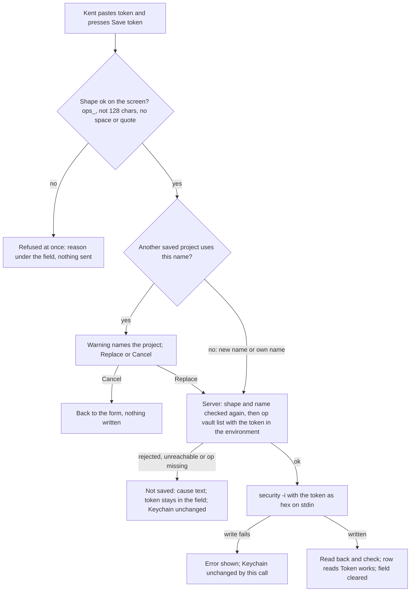

---
id:
title: A token is stored only after 1Password accepts it
status: validation
variant: kc-dev-flow-2
profile: pilot
merge: pr
worktree: .worktrees/spacedock-ensign-project-env-paste-token-check-first
pr: iamcxa/kc-paseo-plugins#21
journey: paseo-project-env
journey-release: r1.5
journey-story: paste-token
journey-required-tasks: '["project-env-paste-token-check-first"]'
journey-mapping-complete: true
gates:
    version: 1
    records:
        - id: gate:project-env-paste-token-check-first:backlog
          stage: backlog
          attempts:
            - id: gate-attempt:project-env-paste-token-check-first-backlog-1
              briefing:
                id: briefing:project-env-paste-token-check-first:backlog:attempt-1:revision-1
                digest: sha256:bff7fdb7603e47c890709aed8cb74fe4cc58f3a65fde85fab009382fc99e1a9b
                room-ref: ./project-env-paste-token-check-first/review/backlog/briefing-1
              resolution:
                type: Resolution
                id: resolution:spacedock:project-env-paste-token-check-first:backlog:1
                briefing: briefing:project-env-paste-token-check-first:backlog:attempt-1:revision-1
                by: person:captain
                at: "2026-10-21T08:40:27.125996Z"
                decision: approve
                reason: 'Captain 2026-10-21: 「准」 — accepts this release r1.5 task''s outcome, scope and acceptance criteria on the pilot profile, into ideation.'
              application:
                target-stage: ideation
                state: consumed
        - id: gate:project-env-paste-token-check-first:ideation
          stage: ideation
          attempts:
            - id: gate-attempt:project-env-paste-token-check-first-ideation-1
              briefing:
                id: briefing:project-env-paste-token-check-first:ideation:attempt-1:revision-1
                digest: sha256:a0132a01d30783636a7714d771a66886a7a1683c72cb51ab662fb41d1a1fb6ca
                room-ref: ./project-env-paste-token-check-first/review/ideation/briefing-1
              resolution:
                type: Resolution
                id: resolution:spacedock:project-env-paste-token-check-first:ideation:1
                briefing: briefing:project-env-paste-token-check-first:ideation:attempt-1:revision-1
                by: person:captain
                at: "2026-10-21T09:36:10.736487Z"
                decision: approve
                reason: 'Captain 2026-10-21: 「准五個設計」 — accepts this ideation design and its acceptance criteria into implementation, with the additions presented at this gate: no guessed reference in project-env-variable-row-edit (a new variable has no reference until a field is picked), AC-4 and the rewritten AC-3 in project-env-paste-token-check-first, the empty-value wording ''the 1Password field is empty'' in project-env-test-results-match-draft; FO''s recommendations also presented: removing the OP_CONNECT names in project-env-token-works-cause is left out and listed for the Captain, and naming a locked Keychain on the Test row is a follow-up after project-env-test-results-match-draft.'
              application:
                target-stage: implementation
                state: consumed
started: 2026-10-21T08:41:52Z
---

Release r1.5 of the paseo-project-env journey: on his own Mac, Kent stores a token only after it is checked, sees why a token fails, edits each variable where it sits, and sees test results that match his draft; his own use accepts it. Captain, 2026-10-20: 「我覺得UI不夠直覺」. Captain accepted this task list on 2026-10-21: 「可以」. Today storeToken writes the Keychain first and checks afterwards, and a name another project uses is overwritten without a warning.

## Scope

In: check the pasted token before writing it; refuse a rejected or unreachable token with its cause; warn before replacing a token another saved project uses, and replace the project's own without a warning; keep the token off the security command line if feasible, else return to the Captain. Settled in ideation: journey paste-token/q3, q4, q5. Depends on: project-env-token-works-cause (the check and cause states). Non-goals: rotation (r1b). Stop condition: the acceptance criteria below pass.

## Acceptance criteria

**AC-1**: A rejected or unreachable token is not written to the Keychain, and the error names the cause.
Verified by: `npm test` in `project-env` runs one test per cause (rejected, unreachable, `op` missing) through `storeToken` with the fake `op` and `security`; each asserts `stored` is false, `state` is that cause, the fake `security` log holds no `add-generic-password` call, and a token stored earlier under the name still reads back. Moving the write before the check makes it fail.

**AC-2**: A name another saved project uses shows a warning naming that project before it is replaced; the project's own token is replaced without one.
Verified by: `npm test` on `projectsUsingName` (another project's name returns that project, two sharing return both, the project's own root and an unused name return none, trimmed names match, an unsaved draft owns nothing), and Kent's own use on his Mac, where he sees the warning name the other project, nothing change in the Keychain until Replace, and no warning for the project's own name. The screen has no test seam, so the warning's appearance rests on his use.

**AC-3**: The ops_ prefix check and the 128-character guard still apply.
Verified by: new tests, because no test covers either today (`git grep -nE "128|ops_" project-env/test` finds only the fakes): `tokenShapeError` and `storeToken` refuse a token without `ops_` and one of exactly 128 characters, and accept 127 and 129; each refusal happens before any fake `op` or `security` call.

**AC-4**: The token never appears on the command line of a `security` process, and nothing in a token or a service account name can end the command that carries it. (Added by ideation from Scope's "keep the token off the security command line"; the Captain's list names AC-1 to AC-3 only.)
Verified by: `npm test` asserts every `security` argv the fake logs is `["-i"]` or a read, and that a sentinel token is in none of them; tokens with a space, quote, backslash or line break, and a name with a quote, backslash or line break, are refused before any `security` call; and a recorded run of the write against the real `/usr/bin/security` with a throwaway keychain file and a fake value shows the running process's `ps -o args=` is `/usr/bin/security -i`. Kent's own save of a real token reading "Token works" proves the stored bytes.

## FO alignment

Surfaces: ui
Visible change: A bad token is refused before it is saved, and replacing another project's token asks first.
Direction alignment with the Captain: not needed for the outcome — the Captain approved it on 2026-10-21 (「可以」); the warning's form is settled in ideation.
Release review: paseo-project-env/r1.5 at 9489e13

## Design

### PRFAQ

**Press release (future).** Kent pastes a service account token and presses Save token. The plugin first asks 1Password whether it accepts the token; only then does it write the Keychain. A rejected token, an unreachable 1Password or a missing `op` leaves the Keychain unchanged and says which. If another saved project already uses the typed name, a warning names that project and waits for Replace. The token no longer appears on any `security` command line.

**FAQ**
- *What counts as an existing name? (journey paste-token/q3)* The service account name is the Keychain service string, and Keychain matches it exactly and case-sensitively (probe below). A token has no recorded owner in the Keychain; the plugin infers ownership from saved settings: a project owns a name when its saved `serviceAccount`, trimmed, equals the typed name, trimmed. The project being edited is told apart by `root`, so its own saved name never warns. An unsaved draft owns nothing. A Keychain entry no saved project uses is replaced without a warning, because the plugin cannot know whose it is (known limit; no acceptance criterion depends on it).
- *What must a token pass before it is stored? (q4)* Two gates, in order. (1) Shape, with no network: starts with `ops_`, is not exactly 128 characters (the existing guard), and holds no whitespace, control character, `"` , `'` or `\`. (2) 1Password: `op vault list` with the token in `OP_SERVICE_ACCOUNT_TOKEN`, as `tokenStatus` does today; only `ok` is stored. Rejected, unreachable and `op` missing are each refused with their own fixed text. Offline is refused, with no store-anyway path: AC-1 says an unreachable token is not written, and the pasted token stays in the field for a retry.
- *Is the token kept off the security command line? (q5)* Yes, feasible. `security -i` reads commands from stdin, so the process list shows only `/usr/bin/security -i`; the token travels as `-X <hex of its UTF-8 bytes>` on stdin. Probed on this Mac (macOS 26.5.2) against a throwaway keychain file with fake values: the running process's argv was `/usr/bin/security -i`; exit 0 and an item with the right attributes were stored; a repeat without `-U` exited 45 with an error that did not echo the value. The documented "-w at the end prompts" route is not usable from a daemon: with no controlling terminal it printed its prompt, exited 0 and stored nothing. No return to the Captain is needed.
- *What does the stdin route put at risk?* A newline in the token ended its command and started another: the probe's injected `add-generic-password` created an item, so the shape gate must stay in front of the write. Hex encoding removes the token from the quoting problem; the service name still sits inside double quotes, and the probe stored twelve names with spaces, `'`, `;`, `#`, `$`, backticks, `&`, `|`, `!`, `~*?`, parentheses and non-ASCII exactly. The write therefore refuses a name holding `"`, `\` or a control character.
- *Which part of this task is a sibling's?* The check. This task needs `project-env-token-works-cause` (T1) to name: `checkToken(token)`, a check that takes the pasted token string (not one read from the Keychain) and returns `ok` with the readable vaults, or one of T1's cause states for rejected, unreachable and `op` missing; T1's fixed text for each, worded to read correctly for a token not yet stored (`causeText` already has "1Password rejected the token" and "1Password could not be reached"); and T1's failure scenarios in the fake `op` for `vault list`. If T1 exposes only a Keychain-reading `tokenStatus`, this task splits the token argument out of it without changing T1's states.
- *What is not decided here?* Rotation (r1b); deleting a token when its project is removed (q8); concurrent stores (q9); showing `security`'s raw first line when the write itself fails (q6, unplaced).

### Existing-code check

Capability under change: storing a token (`storeToken`). Completeness: working through the journey (screen → `token.store` → `secrets.storeToken` → Keychain → `tokenStatus`), with the happy path under test through the fakes; the screen has no test seam. Need: the Captain's goal and AC-1/AC-2; no consumer other than the screen. Search 1, `grep -rn "storeToken\|add-generic-password" project-env` (excluding `node_modules`): the function, its one RPC handler, one screen caller, two tests, the fake `security`. Search 2, `grep -rliE "keychain|secret|credential" project-env/node_modules/@getpaseo/plugin`: one hit, a doc comment in `usage.d.ts`; Paseo's plugin SDK offers no secret store to use instead. Conclusion: repair by reordering and one new `run` option (stdin), no replacement. Unknowns: real `op` wording for a rejected or unreachable token (existing `classifyOpFailure` hypothesis); `security -i` behaviour on other macOS versions (probed on 26.5.2 only).

### Flow

Editing the name or the token while the warning is open closes it, so a warning never names a stale project. Replace and Cancel exist only while it is open; Save token is disabled then, and while a check runs.

### Interface

- `shared/token.ts` (new, no dependencies): `tokenShapeError(raw): string | null` (the prefix, 128 and character rules; messages are fixed text) and `projectsUsingName(projects, root, name): string[]` (roots of other projects that use the name, trimmed exact match). Used by the screen and the server.
- `token.store` output gains `stored: boolean`: `{ stored: false, state, vaults: [] }` when the check refuses (state is the failing cause, nothing written); `{ stored: true, state, vaults }` from the read-back after the write. A shape or name error still throws as today.
- `run` gains an optional stdin text; `storeToken` calls `security -i` with `add-generic-password -U -a op-service-account-token -s "<name>" -X <hex>`; the write function takes an optional keychain path as its last argument so a probe can target a throwaway keychain.
- The fake `security` learns `-i`: it reads stdin, logs argv as `["-i"]` and the command with the value redacted.

### Evidence plan

Falsifiers are in each criterion. The warning's appearance and the Replace and Cancel buttons have no test seam in the screen (journey token-works/q8); they are proved by Kent's own use, as the release goal says. The value round trip through `-X` is proved by Kent's own save of a real token reading "Token works": the plugin reads the Keychain back and 1Password accepts what it read. No command in this task fetches a secret or a Keychain password.

### UI proposal

UI proposal: In the "Connect to 1Password" card of the plugin's settings screen, pressing "Save token" no longer writes the pasted token at once. A token that is malformed (not ops_..., exactly 128 characters, or containing a space, quote, backslash or line break) is refused on the spot, with the reason under the token field. Otherwise, if another saved project already uses the typed service account name, a warning row appears naming that project (or both, if two use it) with a "Replace" button and a "Cancel" button, and nothing is written until Replace is pressed; the project's own name and a new name show no warning. The button reads "Checking…" while 1Password checks the token; a token 1Password rejects, cannot reach, or whose command-line tool is missing is not saved, and the field shows "Not saved: <fixed cause>" while the pasted token stays in the field for another try and the existing token row is unchanged. A token that passes is saved, the field is cleared and the token row reads "Token works".

Preview: project-env-paste-token-check-first/design/preview.html

The preview is an operable page, disposable and not Paseo's real styling: open it, type a token starting with ops_, press Save token, and use the dashed preview controls to pick the check result (works, rejected, unreachable, op missing), type another project's name, your own name or a new name, show two projects sharing a name, and switch light and dark. Pictures of it, in the same folder, are `design/preview-*.png`: idle, checking, rejected (light, dark, new project on a phone), unreachable, op missing (phone), three shape refusals, the warning (desktop light and dark, two projects, phone dark), Replace pressed (checking, then rejected) and saved. Fidelity limits: the real controls are Paseo's `SettingsInput`, `SettingsRow` and `SettingsAction` (`@getpaseo/plugin` 0.12.0 `ui.d.ts`): one button style with no secondary variant, no colour or icon control on a row, and the error line is the `error` prop; the amber warning heading is therefore drawn as ordinary hint text in the real screen.

### Design review

Design review: design/ideation-1.yaml

Design finding 1: fixed: `preview-replace-checking-desktop-light.png` and `preview-replace-rejected-desktop-light.png` added; Replace closes the warning, the Save token button reads "Checking…", and a refusal appears under the field.
Design finding 2: fixed: `preview-prefix-desktop-light.png` and `preview-length128-desktop-light.png` added beside the character refusal; each message names its problem, the 128 one names the length, and AC-3 tests the texts.
Design finding 3: declined: the top row is the stored token's state and is T1's row; "Not saved:" in front of the refusal says the pasted token was the one refused.
Design finding 4: fixed: the caption is removed from the saved picture, `preview-saved-newname-desktop-light.png` replaces it, and with `preview-rejected-newproject-phone-light.png` shows the row going from "No token in Keychain" to "Token works".
Design finding 5: fixed: the repeated caption is removed in every picture; the row label "Save token to Keychain" beside the button is today's screen and stays.
Design finding 6: declined: each `SettingsAction` row needs its own label; the labels are as short as the component allows.
Design finding 7: declined: `SettingsAction` has one button style and no width or variant prop, so a secondary Cancel is not available.
Design finding 8: fixed: the Flow section states that editing the name or the token closes the warning and that Save token is disabled while it is open.
Design finding 9: declined: the busy state is the existing disabled "Checking…" button; Paseo's components have no spinner, field lock or cancel, and a slow check ends at the 30 s call timeout as "1Password could not be reached".
Design finding 10: fixed: the long `op` message is drawn on a phone in `preview-opmissing-phone-light.png`; a next step per cause is T1's fixed text and not added here (declined for that part).
Design finding 11: declined: three or more sharing projects and a long name wrap as the two-project picture does, and the screen has no read-only mode.
Design finding 12: declined: touch target size and where a name wraps belong to Paseo's components.
Design finding 13: declined: `SettingsRow` has no icon or colour control; the real warning is plain hint text.
Design finding 14: fixed: `preview-opmissing-phone-light.png` added; the other combinations reuse the same card and differ only in theme and width.

## Stage Report: ideation

- DONE: Design check-before-store: a rejected or unreachable token is never written, with its cause shown; settle journey paste-token/q3 (what counts as another project's name) and q4 (what a token must pass, and the offline case).
  `## Design` PRFAQ and Flow: q3 is a saved project's trimmed `serviceAccount` equal to the typed name (Keychain match is exact and case-sensitive, probed); q4 is a shape gate then `op vault list`, offline refused with no store-anyway. Needs T1's `checkToken(token)`, cause texts and fake-`op` failure scenarios, named in Design.
- DONE: Settle paste-token/q5: keep the token off the security command line if feasible and prove it by a run with a harmless fake value; if not feasible, return it to FO as a decision for the Captain.
  Feasible: `security -i` with `-X <hex>` on stdin; a run against a throwaway keychain with fake values showed argv `/usr/bin/security -i`. The `-w`-at-end prompt route exits 0 and stores nothing without a terminal. A newline in a token ran a second command, so a shape gate is required. Nothing returns to the Captain.
- DONE: Keep AC-1 to AC-3 with reproducible evidence clauses and produce the artifact the ui surface owes, including the overwrite warning's form.
  AC-1 to AC-3 kept with falsifiable clauses (AC-3's "existing tests" was wrong: none cover prefix or 128, so it now names new tests). `UI proposal:` line, operable disposable `design/preview.html`, 17 pictures, review `design/ideation-1.yaml` (14 findings, 7 fixed, 7 declined). The warning is a row naming the project with Replace and Cancel.
- DONE: AC-1 current evidence
  Not yet verified: tests are an implementation deliverable; the design's flow puts the write after the check.
- DONE: AC-2 current evidence
  Not yet verified: `projectsUsingName` and Kent's own use are future; Keychain exactness was probed at design time.
- DONE: AC-3 current evidence
  Not yet verified: grep shows no existing test for the prefix or 128 guard; new tests are planned.
- DONE: AC-4 current evidence
  Probed, not yet in tests: throwaway-keychain run with fake values, argv `/usr/bin/security -i`, injection reproduced; implementation repeats it and adds the fake-argv test.
- DONE: `design_surfaces.py check` run
  Output: "design surfaces presentable"; "design review design/ideation-1.yaml: 14 findings, 7 fixed, 0 criteria, 7 declined, 0 decisions"; exit 0.

### Summary

Check-before-store is a reorder of `storeToken` plus a stdin write through `security -i`; ownership of a name is inferred from saved settings, with the screen asking before it replaces another project's token. For FO to surface at the gate: AC-4 is added from Scope (the Captain's list names AC-1 to AC-3); AC-3's old clause cited tests that do not exist; this task depends on T1's `checkToken`. The reviewer's `preview:` field was set to the task's Preview value so the checker accepts it. Not changed in scope: a typed name with trailing spaces is stored trimmed but read untrimmed by an existing path, which the task does not touch. Journey q3, q4 and q5 can be marked answered with the rulings in Design.

## Stage Report: implementation

- DONE: Implement the approved design on top of main (which now holds T1's `checkToken(token)`, the eight token states and `shared/token.ts`): a shape check (ops_ prefix, not exactly 128 characters, no whitespace, control character, quote or backslash), then `checkToken` on the pasted token, and only an ok token is written; the token goes to `security -i` on stdin as `-X <hex>`, never on argv; the write refuses a service name with a quote, backslash or control character; the overwrite warning names the other project(s) with Replace and Cancel; a refused token stays in the field.
  Draft PR https://github.com/iamcxa/kc-paseo-plugins/pull/21, branch `spacedock-ensign/project-env-paste-token-check-first`, commits 0865382 and c23b96c on base 948e98a; server `storeToken`/`writeToken` in `project-env/server/secrets.ts`, `tokenShapeError`/`serviceAccountNameError`/`projectsUsingName` in `shared/token.ts`, screen in `client/settings-screen.tsx`. Draft PR opened under the standing grant.
- DONE: Land tests so AC-1 to AC-4 pass with the evidence their clauses name and fail when their behaviour is removed, including a test that the token never appears on a security argv and that a newline in a token cannot start a second command; record Kent's on-Mac use as owed.
  `test/paste-token.test.ts`, 14 tests; fake `security` learned `-i` and runs each stdin line as a command. Mutations run and caught: write before check (AC-1, 3 fail), no shape gate (AC-3, 1 fail), token on argv via `-w` (AC-4, 5 fail), no name guard in the write (AC-4, 1 fail), own root counted (AC-2, 1 fail). Argv test asserts every security argv is `["-i"]` or a read with the sentinel and its hex in none; the newline test shows `writeToken` of a value with a line break plus an injected command makes one item. AC-4 real run: throwaway keychain file, fake values, observer around `/usr/bin/security`; live `ps -o args=` was `/usr/bin/security -i` on both writes, special-character name stored exactly (attributes only), no injected item; keychain deleted, search list unchanged. Stored value not read back (secret-read guard blocked it; hex round trip rests on Kent's real save). Owed to Kent's on-Mac use and recorded in PR #21: the warning naming the other project, Replace and Cancel, the "Not saved" line with the token kept, a real token reading "Token works".
- DONE: Run `npm test` (rerun the load-sensitive session-open deadline test alone if it is the only failure), `npm run typecheck`, the roborev gate, `python3 /Users/kent/.claude/plugins/cache/kc-claude-plugins/kc-dev-flow-2/0.26.0/scripts/design_surfaces.py check docs/dev2/.spacedock-state/project-env-paste-token-check-first.md` and `python3 /Users/kent/.claude/plugins/cache/kc-claude-plugins/kc-dev-flow-2/0.26.0/scripts/doc_impact.py <base> <candidate>`, then open the Draft PR.
  `npm test` 164 pass, 0 fail; typecheck clean. Roborev: first run `evidence=roborev:984` found one Medium (editing during a save re-enabled Save), fixed in c23b96c; second run `clean on c23b96cc1; evidence=roborev:985`. `design_surfaces.py check`: "design surfaces presentable", exit 0. `doc_impact.py` 948e98a..HEAD lists docs/adr/0004-reserved-variable-names-are-skipped-not-blanked.md: unaffected: only `token.store` output in `shared/config.ts` changed, reserved names untouched. `comment_ratio.py`: 281 code lines, 3 comment lines, 1.1%, under 5%. No ADR or number guard. Draft PR #21 opened.

### Summary

Storing a token is now check, then write: shape gate, `checkToken` on the pasted token, then `security -i` with hex on stdin; a name or token holding a quote, backslash or control character never reaches `security`. The screen refuses on the spot, keeps the pasted token after a refusal, and asks Replace or Cancel when another saved project uses the name. Limits: no screen test seam; `security -i` probed on macOS 26.5.2 only; a Keychain entry no saved project uses is replaced without a warning (known limit from design); `checkToken`'s `truncated` state is unreachable from the store path because the shape gate refuses 128 first.
