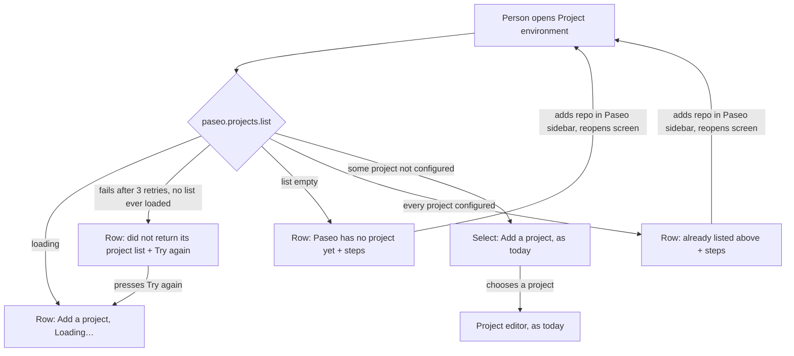

---
id:
title: A new teammate can add a repository even when Paseo has no project or the project list fails
status: ideation
variant: kc-dev-flow-2
profile: pilot
merge: pr
worktree:
pr:
journey: paseo-project-env
journey-release: r1b
journey-story: pick-repository
gates:
    version: 1
    records:
        - id: gate:project-env-pick-repository:backlog
          stage: backlog
          attempts:
            - id: gate-attempt:project-env-pick-repository-backlog-1
              briefing:
                id: briefing:project-env-pick-repository:backlog:attempt-1:revision-1
                digest: sha256:057906b5c4cb51de90b971c96d1e4aa250ff48372b33375b9805953fccecd65f
                room-ref: ./project-env-pick-repository/review/backlog/briefing-1
              resolution:
                type: Resolution
                id: resolution:spacedock:project-env-pick-repository:backlog:1
                briefing: briefing:project-env-pick-repository:backlog:attempt-1:revision-1
                by: person:captain
                at: "2026-10-28T01:10:18.577205Z"
                decision: approve
                reason: '「r1b開。跟 dev2 fo 講這個需求」 — Captain in FO chat, 2026-10-28. Asked: 「下一件要你決定的：要不要開 r1b 的第一個程式任務「選 repo」？我建議開，而且先做這個…回「開」或「先不用」。」 FO read 「r1b開」 as opening this task, the one asked; the other r1b code tasks are asked one at a time.'
              application:
                target-stage: ideation
                state: consumed
        - id: gate:project-env-pick-repository:ideation
          stage: ideation
          attempts:
            - id: gate-attempt:project-env-pick-repository-ideation-1
              briefing:
                id: briefing:project-env-pick-repository:ideation:attempt-1:revision-1
                digest: sha256:a4fa7e4d9c604769a4b51dddcb3b1289e53e03a5c855f6a2e43ce1af2223ae7b
                room-ref: ./project-env-pick-repository/review/ideation/briefing-1
started: 2026-10-28T01:10:58Z
---

Journey release r1b story `pick-repository` ("Pick the repository from Paseo's project list") is a gap. FO read `Configured` in `project-env/client/settings-screen.tsx` at origin/main 7b63c31 on 2026-10-28: the "Add a project" select is drawn only when `candidates.length > 0`, so when Paseo has no project, every project is already configured, or `paseo.projects.list()` fails, the section shows nothing and says nothing. The r1b release review (`project-env-docs-site/release-review-r1b.md`) and the docs-site AC-2 run both met it; the Prepare page works around it with words. Asked whether to open this task first among r1b's code tasks, recommending it, the Captain answered 「r1b開。跟 dev2 fo 講這個需求」 on 2026-10-28.

## Scope

In: the project list section always tells a person what to do next: with no unconfigured Paseo project it says how to add the repository to Paseo first (the path the Prepare page names), and when the project list fails to load it says so and offers a retry, instead of drawing nothing. The existing "Add a project" select is unchanged when candidates exist.
Non-goals: creating a Paseo project from inside the plugin; the field picker; the other r1b stories (pick-field, find-settings, setup-guide); the docs pages beyond the one Prepare step that describes this screen.
Budget: one ideation, implementation and validation round; a second validation cycle returns to the Captain.
Stop condition: the acceptance criteria pass and the Captain's UAT is recorded.

## Acceptance criteria

**AC-1**: On an isolated Paseo with no project, with every project already configured, and with the project list failing, the project list section shows a sentence that names the next step (and, on failure, a retry), never an empty section; with an unconfigured project the "Add a project" select works as today.
Verified by: on an isolated Paseo from `docs/project-env/capture/setup.sh` (own home and port, fake `op` and `security`) running this branch's `project-env`, four runs, each opened at Settings, Plugins, Project environment and photographed whole-page (`agent-browser screenshot --full`) at 1280 and 400 px: (a) no `paseo project create`; (b) both projects created and both written to `projects.json` as configured; (c) one project created and, in the copied plugin only, `queryFn: () => paseo.projects.list()` edited to reject; (d) one project created and not configured. Expected: (a) and (b) a row labelled "Add a project" whose text contains "Add project", "Search for directory" and "Open this path"; (c) a row whose text contains "did not return its project list" and a "Try again" button; (d) the "Add a project" select, as on main; no run shows an empty "Projects" card. And `npm test` in `project-env` runs a test of the project-list states that fails when the empty-state branch is removed and fails again when the failure branch is removed (ideation's draft of it, with both mutation results, is under `design/evidence/`).

**AC-2**: When the project list failed and Try again is pressed while it still fails, the row shows "Loading…" and then the failure sentence with "Try again" again; once the cause is gone, Try again shows the "Add a project" select. When a person adds a repository to Paseo through the sidebar and opens the Project environment screen again, without reloading the app, the select lists it.
Verified by: the same isolated Paseo; in run (c) press "Try again" once while the edited `queryFn` still rejects and once after it is lifted, and in run (a) add a repository through the sidebar's Add project, Search for directory, Open this path, then reopen the screen in the same browser session; the row's accessibility snapshot after each step is the evidence (ideation's runs: `design/evidence/ac2-return-flow.txt`, `design/extra-retry-loading-1280.png`, `design/extra-after-retry-400.png`).

## FO alignment

Surfaces: ui
Visible change: The project list section tells a new teammate how to add a repository when Paseo has none, and says when the list failed to load.
Direction alignment with the Captain: done — he approved opening it on 2026-10-28 (「r1b開」) after FO's recommendation to do pick-repository first.
Release review: paseo-project-env/r1b at 637d05404ccafa198d9f283e1d7d2183c8304dea — the task carries story pick-repository, already in r1b at the journey file's last edit (#59), and no goal changed since the 2026-10-28 review.
Map footprints: not needed: no open map question is answered by this task.

## Design

### PRFAQ

**Press release.** A new teammate opens Project environment and always learns what to do next. If Paseo has no project, or every project is already set up, the "Add a project" row says so and how to add the repository to Paseo first. If Paseo's project list does not load, the row says so and offers Try again. With a project to pick, the select is the same as before.

**FAQ.**
- *What does the screen say?* No project: "Paseo has no project yet. In Paseo's sidebar choose Add project, then Search for directory, type the folder's path and choose Open this path. Then come back here." All configured: "Every project in Paseo is already listed above. To add another repository, add it to Paseo first." plus the same steps. Failure: "Paseo did not return its project list, so no project can be chosen yet." plus a "Try again" button. Loading: the row's label with "Loading…" at its right. The steps are the ones the docs' Prepare page names; I opened Paseo 0.13.0's web app and saw the sidebar "Add project", the menu item "Search for directory" and the button "Open this path" (2026-10-28).
- *Does the person have to press anything after adding the repository?* No. The screen re-reads the list each time it opens: in one browser session with no reload, the screen showed no select, a repository was added through the sidebar, and the screen then showed the select (`design/evidence/ac2-return-flow.txt`). So no "Check again" button is added; the design director's MAJOR finding 1 asked for one or a criterion, and AC-2 is that criterion.
- *What if a refetch fails after a list was loaded?* The row keeps choosing from the list it has; "failed" shows only when no list was ever loaded (unit test).
- *How long before the failure shows?* Paseo's client retries a failed read three times first; in the isolated run the failure sentence appeared about 7 seconds after opening, and the row reads "Loading…" meanwhile. The same wait follows each press of Try again, which shows "Loading…" again, not a separate "Trying…" state (observed; my first draft had a "Trying…" label that never appears, removed).
- *Do configured projects stay?* Yes, in every state they keep their rows above (`preview-5-list-fails-with-configured-*.png`).
- *Cost?* One small pure function and its test in `shared/`, one component in `settings-screen.tsx`, one sentence on the Prepare page. No new dependency, no server change.

### Existing-code check

Boundary: `project-env/client/settings-screen.tsx` function `Configured`, and the `paseo.projects.list()` use in it. Search 1: `grep -rn "projects.list" project-env/client shared server index.*` finds one use, the `known` query in `Configured`. Search 2: `grep -rn "Try again" project-env/client` finds one pattern, `SettingsAction label="Try again" actionLabel="Reload"` in `ProjectEnvSettings` for a failed settings load; the design reuses its words and the `SettingsAction` component. Completeness: the select path works through the journey (docs-site AC-2 run and r1b release review); the empty and failure branches are not found (the code draws `null`). Need: the Captain's r1b story `pick-repository` and the release review's finding. Unknowns: other consumers of the `["projects"]` query key, none found in the plugin. Conclusion: repair the existing `Configured` section; build no replacement.

### What changes (read from main d973876, 2026-10-28)

`Configured` computes `candidates` and draws the select only when `candidates.length > 0`. The draft replaces that with `addProjectState(known, configuredRoots)` from a new `shared/project-list.ts` (states loading, failed, none, all-configured, choose; data wins over error) and a small `AddProject` component drawing the select, `SettingsRow`, or `SettingsAction`. Draft code and diff: `design/evidence/project-list.ts.draft`, `design/evidence/settings-screen.draft.diff` (70 lines). Typecheck passes; 6 unit tests pass.

### UI proposal

UI proposal: The project list section's "Add a project" row never draws nothing. With no Paseo project it reads "Paseo has no project yet." and, with every Paseo project already configured, "Every project in Paseo is already listed above. To add another repository, add it to Paseo first."; both then read "In Paseo's sidebar choose Add project, then Search for directory, type the folder's path and choose Open this path. Then come back here." When Paseo's project list fails to load, the row reads "Paseo did not return its project list, so no project can be chosen yet." with a "Try again" button. While the list loads the row reads "Add a project" with "Loading…" at its right. With an unconfigured project the existing select is unchanged. Configured projects keep their rows above in every state.

Preview: /Users/kent/Project/kc-paseo-plugins/docs/dev2/.spacedock-state/project-env-pick-repository/design/previews.html

The preview is whole-page pictures from a running isolated Paseo build (throwaway copy of main d973876 plus the draft; disposable), operated, not static mock-ups: `preview-1-no-project-{1280,400}.png`, `preview-2-all-configured-*`, `preview-3-list-fails-*`, `preview-4-one-unconfigured-*`, `preview-5-list-fails-with-configured-*`, and `extra-*` pictures of loading, Try again pressed while still failing, and after a successful retry. `today-none-*` shows main's blank section. The pictures show the host name "KentMacBookPro" in the sidebar; they are working evidence, not docs pictures.

### Design review

Design review: design/ideation-1.yaml
Design finding 1: AC-2 (the list re-reads when the screen is opened again, shown in `design/evidence/ac2-return-flow.txt`; no "Check again" button is added, as the director's fix allows either)
Design finding 2: fixed: the sentence now reads "Every project in Paseo is already listed above." (preview-2-all-configured-1280.png and -400.png redrawn)
Design finding 3: fixed: the "Trying…" state does not exist (a retry shows the loading row, observed), so it was removed from the draft; added `extra-retry-loading-1280.png` and `-400.png` (retry pressed while failing), `preview-5-list-fails-with-configured-*.png` (failure with one configured row), and AC-2 states the failed-retry sequence
Design finding 4: fixed: the loading row is now a one-line label-plus-"Loading…" row, the select's height class, so loading and select no longer differ by a two-line row (`extra-loading-1280.png`); the label's remaining shift from the loading row to the select row is 8 px, measured in `design/evidence/label-y.txt`, and comes from the select control's own height. The director's pass 1b ruled this decline overruled and suggested a hint line on the select row; I did not adopt that, because it changes the select row Scope keeps unchanged, so the residual 8 px is open for the director's or the Captain's read at the gate
Design finding 5: declined: host component SettingsSelect at project-env/node_modules/@getpaseo/plugin/dist/client/ui.d.ts: the select with an unconfigured project is today's code path and the task changes nothing in it; its open list and overflow are the host's.
Design finding 6: declined: host component SettingsRow at project-env/node_modules/@getpaseo/plugin/dist/client/ui.d.ts: the row's colors and hint text size come from the host's theme tokens, not the plugin, so a light theme picture shows the host's styling of a component every other settings row already uses.
Decline check: design/declines-1.yaml

(Finding 4's original decline text was "host component SettingsRow, SettingsAction and SettingsSelect"; the ruling was overruled and the line above is its replacement.)

### Docs change

The Prepare page, `docs/project-env/prepare-1password.md` step 4, has one sentence that changes: "The repository must already be a project in Paseo; if the list is empty, choose the sidebar's **Add project**, then **Search for directory**, type the folder's path and choose **Open this path** first." It becomes: "The repository must already be a project in Paseo. If the **Projects** section says Paseo has no project yet, or that every project is already listed, add the repository first: choose the sidebar's **Add project**, then **Search for directory**, type the folder's path and choose **Open this path**, then return here. If it says Paseo did not return its project list, choose **Try again**." Screenshot `img/03-add-project.png` shows the select with unconfigured projects, which this task leaves unchanged, so it is not retaken. Implementation updates the sentence only; if the screen's words change in implementation, the sentence follows.

### Acceptance evidence plan

- AC-1: current evidence: the four states photographed at 1280 and 400 px from a running isolated Paseo (previews 1 to 4; the page `scrollWidth` at 400 px was 400 in each run that measured it, so nothing scrolls sideways), unit tests 6 of 6 pass, and removing the empty-state branch fails 1, removing the failure branch fails 1 (`design/evidence/mutation-*.txt`). Not yet verified: the same against the real implementation (the draft is a throwaway copy); implementation reruns it.
- AC-2: current evidence: the return flow (`ac2-return-flow.txt`) and the retry pictures; not yet verified against the real implementation.

### Needs decision

None. Reason: nothing here widens Scope; AC-2 is an added criterion that Scope's stop condition already implies ("always tells a person what to do next"), and the Captain approves or strikes it at the gate. Open for the gate, not a decision: finding 4's 8 px shift.

### Batch overlap

`project-env-test-row-draft-note` (backlog): changes one sentence in the Test row of `client/settings-screen.tsx`; this task changes `Configured` and adds `shared/project-list.ts` and its test. Different regions of one file; either order, whichever merges second rebases. Tests, tables, numbered records: none shared. `project-env-release-1` (backlog, umbrella): none. Recommended order: this task first, or either; no dependency.

## Stage Report: ideation

- DONE: Design the change your Scope names: the project list section's sentence when Paseo has no unconfigured project (naming how to add the repository to Paseo first, the path the docs' Prepare page names), and its failure state with a retry when `paseo.projects.list()` fails; keep AC-1 and give it a reproducible evidence clause; say which Prepare-page sentence and screenshot change with it.
  `## Design` holds the PRFAQ, Mermaid, existing-code check and docs change; AC-1 kept, Verified-by now a four-run recipe plus a mutation-checked unit test; AC-2 added (failed retry, return flow). Prepare step 4 sentence changes; `img/03-add-project.png` does not (select state unchanged).
- DONE: Produce the artifact the ui surface owes: whole-page previews from a running build at 1280 and 400 px of the four states (no project, all configured, list fails, an unconfigured project), plus the design review, with each finding dispositioned.
  `design/previews.html` and `design/preview-{1..5}-*-{1280,400}.png` from an isolated Paseo; `design/ideation-1.yaml` (6 findings: 3 fixed, 1 AC, 2 declined) and `design/declines-1.yaml` (2 upheld, 1 overruled); `design_surfaces.py check` exit 0.
- DONE: Name any decision the Captain must make (at most one), with a recommendation.
  None needed. Open for the gate, not a decision: AC-2 is mine and the Captain may strike it; finding 4's remaining 8 px label shift (director overruled my decline; I did not add a hint to the select row, as Scope keeps the select unchanged).

### AC mapping
- AC-1: current evidence: the four states photographed at both widths; 6 of 6 unit tests pass; removing the empty-state branch fails 1, removing the failure branch fails 1 (`design/evidence/mutation-*.txt`). Not yet verified against the real implementation.
- AC-2: current evidence: `design/evidence/ac2-return-flow.txt` (no select, repo added in sidebar, select appears with no reload), `design/extra-retry-loading-*.png`, `design/extra-after-retry-400.png`, and a failed retry returning to "Try again". Not yet verified against the real implementation.

### Findings
- The first draft's "Trying…" label never shows: after a failed read, Try again returns the query to loading, so the row reads "Loading…" (observed). Removed from the design.
- Paseo's client retries three times, so the failure sentence appears about 7 seconds after the screen opens; the row reads "Loading…" meanwhile.
- The failure was injected by editing `queryFn` in the throwaway copy; a real daemon failing on `projects.list()` was not produced. Unit tests prove the states, not wiring; the runtime pictures prove wiring only for the injected failure.
- Dark theme only; light theme and the open select with many or long names are not pictured (declines 5 and 6, host components).
- Sidebar pictures show this Mac's host name; they are working evidence, not docs pictures.

### Summary
The "Add a project" row gets a pure state function (loading, failed, none, all-configured, choose) and one component: a text row with the Add project steps, a Try again row on failure, the unchanged select otherwise. The screen already re-reads the list when reopened, so no refresh button is added. No decision for the Captain; no repository file, branch or commit was made (throwaway copies under /tmp, evidence under this task's folder).
