---
id:
title: A failed variable names its cause class, never raw tool output
status: ideation
variant: kc-dev-flow-2
profile: pilot
merge: pr
worktree:
pr:
journey: paseo-project-env
journey-release: r1
journey-story: plain-failure-reason
journey-required-tasks: '["project-env-plain-failure-reason"]'
journey-mapping-complete: true
gates:
    version: 1
    records:
        - id: gate:project-env-plain-failure-reason:backlog
          stage: backlog
          attempts:
            - id: gate-attempt:project-env-plain-failure-reason-backlog-1
              briefing:
                id: briefing:project-env-plain-failure-reason:backlog:attempt-1:revision-1
                digest: sha256:b607313c88f936da18906ca22d51c066f1f869ebeb6309344428235a9949d76a
                room-ref: ./project-env-plain-failure-reason/review/backlog/briefing-1
              resolution:
                type: Resolution
                id: resolution:spacedock:project-env-plain-failure-reason:backlog:1
                briefing: briefing:project-env-plain-failure-reason:backlog:attempt-1:revision-1
                by: person:captain
                at: "2026-10-20T14:16:57.473175Z"
                decision: approve
                reason: 'Captain 2026-10-20: 「准。」 — accepts this release r1 task''s outcome, scope and acceptance criteria on the pilot profile, into ideation.'
              application:
                target-stage: ideation
                state: consumed
        - id: gate:project-env-plain-failure-reason:ideation
          stage: ideation
          attempts:
            - id: gate-attempt:project-env-plain-failure-reason-ideation-1
              briefing:
                id: briefing:project-env-plain-failure-reason:ideation:attempt-1:revision-1
                digest: sha256:6430188c1aa688787591e213a1d2a2ed40e92e602f3e91d321a7b4859efb8942
                room-ref: ./project-env-plain-failure-reason/review/ideation/briefing-1
              resolution:
                type: Resolution
                id: resolution:spacedock:project-env-plain-failure-reason:ideation:1
                briefing: briefing:project-env-plain-failure-reason:ideation:attempt-1:revision-1
                by: person:captain
                at: "2026-10-20T14:57:07.256963Z"
                decision: approve
                reason: 'Captain 2026-10-20: 「准」 — accepts this ideation design and its acceptance criteria into implementation, including the presented additions (the one-line run fix in project-env-plain-failure-reason; AC-2 in project-env-vault-boundary).'
              application:
                target-stage: implementation
                state: pending
started: 2026-10-20T14:19:44Z
---

ADR 0002 rules that an unresolved variable is shown with the reason it failed. Today the first line of raw `op` stderr reaches the daemon log and the settings Test row.

## Scope

In: one list of failure cause classes covering ADR 0002's causes, an empty value (Captain, 2026-10-20) and a reference outside the chosen vault (ADR 0001); the daemon log line and the settings Test row use it. The exact class names are settled in ideation. Non-goals: the timeline line, settings-screen layout. Depends on: project-env-new-agent-env (fakes). Stop condition: the acceptance criteria below pass.

## Acceptance criteria

**AC-1**: Each failure is reported as the variable name plus exactly one cause class.
Verified by: a unit test feeding each fake failure.

**AC-2**: No raw `op` or `security` output and no value appears in the daemon log or the settings Test row.
Verified by: a test with a fixed stderr string and a fixed fake value, searching both outputs for them. Reproduce: in `project-env`, `npm test` runs a case that drives `resolveProject` and the `agent.session_open` hook with a fake `op` that exits 1 writing the stderr sentinel `STDERR-SENTINEL-7f3a` and the value sentinel `VALUE-SENTINEL-9c1d` to stderr, and a second variable the fake resolves to `VALUE-SENTINEL-9c1d`; it captures every `console` call, the JSON of the `project.test` result and the Test row text, and fails if either sentinel appears in any of them or if the log line for the failed variable is absent.

## FO alignment

Surfaces: ui
Visible change: The settings Test row shows a cause class such as a rejected token instead of raw op output.
Direction alignment with the Captain: not needed — the outcome follows rulings already recorded (docs/adr/0001, docs/adr/0002, and the Captain's 2026-10-20 rulings in the journey map); release r1 was marked changed by signal 2 (the Captain narrowed r1 on 2026-10-20: 「可以改成兩段，不用第一時間給隊友，要先我用到覺得可以」, 「就五個，剩下做 r1.5」). kc-journey-map review-release ran on r1 at 60799d9; after the rulings, a fresh audit, the map split and an interrogation of the changed stories, this task split was re-derived from the map at 760bfaa (branch docs/project-env-r1-split, PR #6).
Release review: paseo-project-env/r1 at 760bfaa

## Design

### PRFAQ

**Press release (future).** When one of Kent's variables fails, the settings Test row and the daemon log say why in one plain phrase, such as "1Password rejected the token", and never repeat what `op` or `security` printed.

**FAQ**
- *What counts as one cause?* One of seven classes, below. Six come from rulings (ADR 0002's four, an empty value per the Captain's 「算失敗」, a reference outside the chosen vault per ADR 0001). The seventh, `unexpected`, is this design's addition: AC-1 says "exactly one cause class", so every failure needs a class, and the plugin cannot know every message `op` prints. It is a recommendation, not a ruling; remove it only by choosing another class to carry unrecognised failures.
- *How is raw output kept out?* Structurally: the failed result carries a class id from a closed list, never a string from a tool. The classifier reads the exit shape and the first stderr line, returns a class, and drops the text.
- *What do the siblings use?* The `Cause` list and its text, below.
- *What stays raw?* The Save-token error and the Browse-vault error still show a tool's first line (they are not variable failures); r1.5 (`token-works`) replaces them.

### Cause classes

| id | Text shown (Test row; timeline reuses it) | Meaning |
| --- | --- | --- |
| `no-token` | no token stored for this service account | account name blank, or the Keychain read gave nothing |
| `rejected-token` | 1Password rejected the token | `op` refused the stored token |
| `missing-field` | field not found in the vault | reference malformed, or `op` found no such vault item or field |
| `unreachable` | 1Password could not be reached | `op` timed out, was killed, or reported a network failure |
| `empty` | the field is empty | `op` returned an empty value |
| `outside-vault` | reference points outside the chosen vault | reference's vault is not the repository's vault (task project-env-vault-boundary detects it) |
| `unexpected` | 1Password returned an error the plugin does not recognise | any other failure, including `op` not installed |

Decisions inside the list: an item or vault that `op` cannot find is `missing-field` too, since the user's fix is the same (correct the reference); a malformed reference is `missing-field` for the same reason and is caught before `op` runs; `op` not installed (spawn error ENOENT) is `unexpected`, not `unreachable`, because the network is not the cause (r1.5 `token-works` names a missing `op`).

### Failure path map (project-env/server and index.server.ts)

| Site | What fails | Class |
| --- | --- | --- |
| `resolveProject`, blank `serviceAccount` or `readToken` returns null | no token | `no-token` |
| `readToken` catch | any Keychain failure, a locked Keychain included | `no-token` (known limit: a locked Keychain or denied prompt reads as no token; r1.5 `token-works/q1` separates them) |
| `resolveProject`, reference does not parse as `op://vault/item/field` (new) | malformed reference | `missing-field` |
| vault check (task project-env-vault-boundary) | reference outside the chosen vault | `outside-vault` |
| `readRef` via `run`, killed by timeout, or network wording on stderr | slow or offline 1Password | `unreachable` |
| new-agent-env's 30-second hook budget (journey `new-agent-env/q8`) | not resolved in time | `unreachable` |
| `readRef` via `run`, authentication wording on stderr | bad, expired or truncated token (the 128-character check is not applied at resolve time, so a truncated token arrives here) | `rejected-token` |
| `readRef` via `run`, vault, item or field not found on stderr | wrong reference | `missing-field` |
| `readRef` via `run`, spawn error or no wording matched | anything else | `unexpected` |
| `readRef` returns an empty string | empty value | `empty` |
| `index.server.ts` session_open hook log line | reports a failed variable | consumes the class; logs its id, never text from a tool |

No variable fails at these sites, so they get no class and keep today's behaviour: `mainCheckout` catch (project not found, the agent starts unmanaged), `tokenStatus` and its own `TokenState` (r1.5), `storeToken` throws, `listRefs` throws, `importConductor` readdir catch. `run` is the transport, not a path: it carries the exit shape to the classifier.

### Flow

```mermaid
flowchart TD
  A["Agent session opens, or Test is pressed"] --> B{"Service account set and Keychain has a token?"}
  B -- no --> C1["no-token"]
  B -- yes --> D{"Reference parses as op://vault/item/field?"}
  D -- no --> C3["missing-field"]
  D -- yes --> E{"Vault is the chosen vault? (vault-boundary task)"}
  E -- no --> C6["outside-vault"]
  E -- yes --> F["op read"]
  F -- "in time, value returned" --> G{"Value empty?"}
  G -- yes --> C5["empty"]
  G -- no --> OK["set"]
  F -- "failed or too slow" --> H["Classify exit shape and first stderr line, then drop the text"]
  H --> C2["rejected-token"]
  H --> C3
  H --> C4["unreachable"]
  H --> C7["unexpected"]
  C1 --> R["One record: variable name + one cause id"]
  C3 --> R
  C6 --> R
  C5 --> R
  C2 --> R
  C4 --> R
  C7 --> R
  R --> LOG["Daemon log: name and cause id"]
  R --> ROW["Test row: failed: cause text"]
  R --> TL["Timeline line: sibling task, same text"]
```

### Interface

Changes in this task, named so siblings can build on them without waiting:
- `shared/cause.ts` (new): the closed list of seven ids as a `Cause` type with a zod enum, and `causeText`, the id-to-text map above. `notice-missing-variable` renders its line from `causeText`; `project-env-vault-boundary` returns `outside-vault`.
- `shared/config.ts`: `project.test` results change from `error?: string` to `cause?: Cause`. The Test row is `failed: ${causeText[cause]}`, built by a pure `rowHint` so a test can read it without the settings screen.
- `server/cause.ts` (new): `classifyOpFailure({ code, killed, signal, stderr })`, a pure, non-throwing function (a throw inside the hook would fail the agent opening, so the function has no input it can throw on), and `parseRef`, which splits `op://vault/item/field` and which vault-boundary reuses for the vault segment.
- `run` attaches the exit shape to the error it already rejects with, and stops falling back to `error.message`: execFile's message is `Command failed: <file> <args>`, whose first line carries every argument. Observed 2026-10-20 with a harmless fake argument: empty stderr produced `Command failed: /bin/sh -c exit 3 -w FAKE-ARG-VALUE`. In `storeToken` the `-w` argument is the token, so a Keychain write that fails with no stderr (a timeout, for example) shows the token in the Save-token error row. With no stderr the message becomes `<tool> failed`. Without this one-line change the fix leaves a token echo in the same function. It is a scope addition, listed below as the one open decision.
- Log line: `[project-env] <root> <name>: <cause id>`.
- From `project-env-new-agent-env`: the fakes (`op`, `security`, `git`) and the `npm test` script; its failed and empty results carry a class from this list, and until this task merges they need only be marked failed.

Existing-code check: classification is missing, not repairable. Search 1, `git grep -n -i 'cause\|classif' -- project-env`: no match. Search 2, `git grep -n -E 'catch|\.error|stderr|console\.' -- project-env`: the only failure text is `run`'s first stderr line, passed to the `console.error` in the session_open hook and to the Test row, plus the catch blocks mapped above. Unknown: how the real `op` words each failure; see Evidence limits.

### UI proposal

UI proposal: In the "Check and save" card of the plugin's settings screen, pressing Test shows one row per variable: a variable that resolved reads "set", and a variable that failed reads "failed: <cause text>" where the cause text is one of seven plain phrases (no token stored for this service account; 1Password rejected the token; field not found in the vault; 1Password could not be reached; the field is empty; reference points outside the chosen vault; 1Password returned an error the plugin does not recognise). No tool output and no value appears in any row.

Preview: project-env-plain-failure-reason/design/preview.html

The preview is an operable page, disposable and not Paseo's real styling: open it, press Test, and use the dashed preview controls to switch between mixed results, every cause, all set and long names, and between light and dark. Pictures of it, in the same folder, are `design/preview-*.png`: before test, testing, all set, mixed (desktop light and dark, phone dark), every cause (desktop light and dark, phone dark) and a long name on a phone. Fidelity limit: the real rows are Paseo's `SettingsRow` (label and hint text only, no colour control), so the failure hint is drawn in the same muted hint style as `set`.

### Design review

Design review: design/ideation-1.yaml

Design finding 1: declined: result rows are the same Paseo `SettingsRow` kind as today; a Results heading is settings-screen layout, a stated non-goal (r1.5).
Design finding 2: fixed: the footnote under the card is removed from `preview.html` and every picture redrawn; the row's own help line keeps the statement.
Design finding 3: declined: Test and Save are Paseo's own `SettingsAction` buttons; their styling is not this task's.
Design finding 4: declined: Save moves down as rows appear today as well; layout is a stated non-goal (r1.5).
Design finding 5: fixed: `preview-testing-light.png` and `preview-allset-light.png` added; a project with no variables shows no rows after Test, as today, and this task does not change it.
Design finding 6: declined: clearing results when the draft changes is journey `test-variables/q1` in r1.5, outside this task.
Design finding 7: fixed: the every-cause pictures are redrawn tall enough to show the Save row at the end, on desktop light, desktop dark and phone dark.
Design finding 8: declined: wrapping of a long name belongs to Paseo's row component and is unchanged by this task; the picture only approximates it.
Design finding 9: declined: whether Save is allowed with failing variables is unchanged by this task; saving stays allowed as today.
Design finding 10: declined: the cause text is the ruled form (ADR 0002); remedy hints belong to r1.5's setup steps.
Design finding 11: declined: button size is Paseo's `SettingsAction`; the preview's 36px is an approximation, not a requirement.
Design finding 12: fixed: `preview-mixed-phone-dark.png` and `preview-everycause-desktop-dark.png` added; the remaining combinations share one theme-token set.
Design finding 13: fixed: the failure hint is redrawn in the muted hint style, not red, because `SettingsRow` has no colour control; contrast then follows Paseo's own theme.

### Evidence plan

- **AC-1.** Cases against the classifier and `resolveProject` with new-agent-env's fakes, one per class: `no-token` (fake `security` returns nothing), `rejected-token`, `missing-field` (fake `op` exits 1 with each wording), `unreachable` (fake `op` killed by timeout), `unexpected` (fake `op` absent and an unmatched stderr), `empty` (fake `op` returns an empty value). Each asserts the one class id. Counter-test: an unmatched stderr must return `unexpected`, never throw; a table test asserts every id in `Cause` is produced by some case. Falsified by: changing the `rejected-token` wording match makes its case return `unexpected`. `outside-vault` is proven in two parts: this task's test asserts it renders as `failed: reference points outside the chosen vault` in the row and `outside-vault` in the log; detection is project-env-vault-boundary's AC-1.
- **AC-2.** The clause on AC-2 above. Falsified by: restoring `${r.error}` in the hook or the Test row, or `error.message` in `run`, makes it fail. One further assertion: a `security add-generic-password` failure with empty stderr must not put the token argument in the thrown message.
- **Daemon check (Kent's use, the r1 acceptance).** A wrong field reference, a throwaway account name with no token and a stored `ops_` token that 1Password rejects each show their class on the Test row.

### Evidence limits

- Not yet verified: the exact words `op` prints for rejected, missing and unreachable. A probe was refused by the secrets guard and the auto-mode classifier, and I did not work around either. The 1Password secret-reference page lists no error text; the only wording found is two community threads quoting "isn't a vault in this account" and "isn't an item in the vault". The pattern table is therefore a hypothesis. Implementation's evidence is stderr samples captured outside the agent (no value in a failure message) and stored as fixtures; a missed wording degrades to `unexpected`, which is visible, not silent.
- The preview shows no real Paseo styling and the reviewer saw pictures only: hover, focus, keyboard order and real wrapping are not checked.
- `readToken` cannot tell a locked Keychain from a missing item; both read as `no-token`.

### Unresolved decisions

- **Needs decision: include the `run` argv fix in this task.** Recommend yes: it is one line in the function this task already changes, and without it a failed Keychain write can print the token into the Save-token error row (ADR 0001: the plugin never shows a secret). The alternative is a separate task, leaving that echo until it merges. AC text is unchanged either way; the fix adds one assertion to AC-2's test.

## Stage Report: ideation

- DONE: Define one list of cause classes covering ADR 0002's causes, an empty value and a reference outside the chosen vault, and map every failure path in project-env/server to exactly one class.
  `## Design` holds seven classes (six ruled, `unexpected` added and flagged) and a path table; non-variable sites are listed as classless and unchanged.
- DONE: Produce the artifact the `ui` surface owes for the settings Test row text, per the ideation skill's profile routing.
  `UI proposal:` line, operable disposable `design/preview.html` with ten pictures, and design review `design/ideation-1.yaml` (13 MINOR: 5 fixed, 8 declined).
- DONE: Give AC-2 a reproducible evidence clause that proves no raw op/security output and no value reach the daemon log or the Test row.
  AC-2's `Verified by` now names two sentinels, a failing fake `op`, captured console, RPC JSON and row text, and a presence check on the log line.
- DONE: AC-1 current evidence
  Not yet verified: the design plans one case per class in `## Design` Evidence plan; no code exists. `design_surfaces.py check` passes.
- DONE: AC-2 current evidence
  Not yet verified: reproducible clause is written; the test is an implementation deliverable.
- DONE: `design_surfaces.py check` run
  Output: "design surfaces presentable"; "design review design/ideation-1.yaml: 13 findings, 5 fixed, 0 criteria, 8 declined, 0 decisions"; exit 0.

### Summary

A failed variable carries one of seven cause ids from a closed list; the log, the Test row and the sibling timeline line render from that id, so no tool text can reach them. Needs decision: include a one-line fix in `run`, where an empty-stderr failure puts the whole command line, including the token in `storeToken`, into the Save-token error row (observed with a harmless fake argument). Real `op` error wording is unverified (probes refused, docs silent); misses degrade visibly to `unexpected`.
