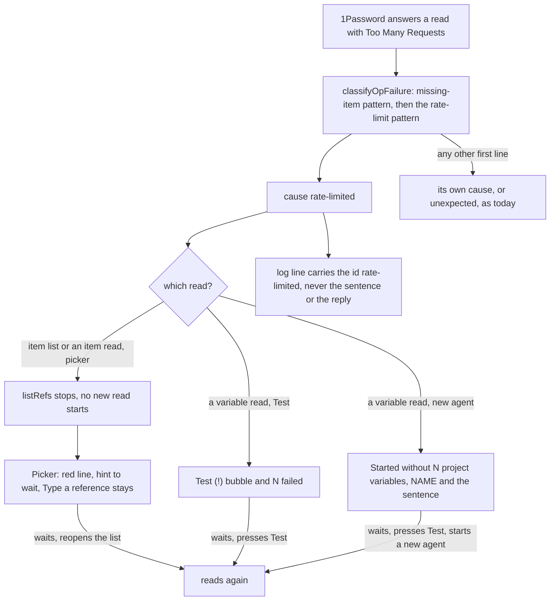

---
id:
title: A 1Password rate limit is shown as a rate limit, not as an unreadable item
status: validation
variant: kc-dev-flow-2
profile: pilot
merge: pr
worktree: .worktrees/spacedock-ensign-project-env-rate-limit-cause
pr: 73
gates:
    version: 1
    records:
        - id: gate:project-env-rate-limit-cause:backlog
          stage: backlog
          attempts:
            - id: gate-attempt:project-env-rate-limit-cause-backlog-1
              briefing:
                id: briefing:project-env-rate-limit-cause:backlog:attempt-1:revision-1
                digest: sha256:9cc7bc06629d94af1bc25367bf9acbbecafb8a0db28bdfaf6a8f4bb64f0f5f88
                room-ref: ./project-env-rate-limit-cause/review/backlog/briefing-1
              resolution:
                type: Resolution
                id: resolution:spacedock:project-env-rate-limit-cause:backlog:1
                briefing: briefing:project-env-rate-limit-cause:backlog:attempt-1:revision-1
                by: person:captain
                at: "2026-11-05T08:38:52.116562Z"
                decision: approve
                reason: '「開這批」 — Captain in FO chat, 2026-11-05. Asked: 「回「開這批」，我就開這 4 個任務，同時派設計」 after FO proposed batch r1b-polish-1 (picker-slow-hint, rate-limit-cause, started-row-visible, journey-map-r1b-catch-up) and recommended opening it.'
              application:
                target-stage: ideation
                state: consumed
        - id: gate:project-env-rate-limit-cause:ideation
          stage: ideation
          attempts:
            - id: gate-attempt:project-env-rate-limit-cause-ideation-1
              briefing:
                id: briefing:project-env-rate-limit-cause:ideation:attempt-1:revision-1
                digest: sha256:b950f3c3030ebc3ad30bb373e702e3de529a05233e5042200446bb8e7469dc11
                room-ref: ./project-env-rate-limit-cause/review/ideation/briefing-1
              resolution:
                type: Resolution
                id: resolution:spacedock:project-env-rate-limit-cause:ideation:1
                briefing: briefing:project-env-rate-limit-cause:ideation:attempt-1:revision-1
                by: person:captain
                at: "2026-11-05T15:10:54.931345Z"
                decision: approve
                reason: 「准」 — Captain in FO chat, 2026-11-05, on the batch r1b-polish-1 ideation gates presented together (picker-slow-hint cd66afef, rate-limit-cause b950f3c3, started-row-visible e37a1851, journey-map-r1b-catch-up d0cd0aa6), FO having recommended approving all four and building in the order picker-slow-hint, rate-limit-cause, started-row-visible, with the map task independent.
              application:
                target-stage: implementation
                state: consumed
        - id: gate:project-env-rate-limit-cause:validation
          stage: validation
          attempts:
            - id: gate-attempt:project-env-rate-limit-cause-validation-1
              briefing:
                id: briefing:project-env-rate-limit-cause:validation:attempt-1:revision-1
                digest: sha256:a2fca5f9cec2773b6b0a855835cf1ab765599d142bf73f084e9654ce88535033
                room-ref: ./project-env-rate-limit-cause/review/validation/briefing-1
              resolution:
                type: Resolution
                id: resolution:spacedock:project-env-rate-limit-cause:validation:1
                briefing: briefing:project-env-rate-limit-cause:validation:attempt-1:revision-1
                by: person:captain
                at: "2026-11-06T00:45:02.087978Z"
                decision: approve
                reason: '「准」 — Captain in FO chat, 2026-11-06, on the batch r1b-polish-1 validation gates presented together (picker-slow-hint faac1b25 PR #72, rate-limit-cause a2fca5f9 PR #73, started-row-visible 05ebb219 PR #75, journey-map-r1b-catch-up 4e0593b0 PR #71), FO having recommended approving all four with the proposed declines and merging #72, #73, #75 in order plus #71, then one plugin reload under ADR 0007 class 2.'
              application:
                target-stage: done
                state: pending
started: 2026-11-05T08:40:17Z
journey: paseo-project-env
journey-release: r1b
journey-story: pick-field
---

Batch: r1b-polish-1, approved by the Captain on 2026-11-05 (「開這批」) with four members: project-env-picker-slow-hint, project-env-rate-limit-cause, project-env-started-row-visible, project-env-journey-map-r1b-catch-up. On 2026-10-27 the vault-list task found that `classifyOpFailure` in `project-env/server/cause.ts` returns `unexpected` for 1Password's "Too Many Requests: You've reached the maximum number of this type of requests…" reply, so after a limit is hit every item read lands in skipped as "1Password could not read this item" (archived project-env-vault-list-loads-faster, "Findings from the runs"). Service-account limits are per hour and per day (research/2026-10-27-1password-agents-and-docs-site.md).

## Scope

In: recognise 1Password's rate-limit reply as its own cause, show it in the field picker, in Test and in the "Started without" line with the screen's own words and a next step, and add it to the troubleshooting notes.
Non-goals: retrying or backing off; changing how many reads are made; any other cause's wording.
Budget: one ideation, implementation and validation round; a second validation cycle returns to the Captain.
Stop condition: the acceptance criterion passes and the Captain's UAT is recorded.

## Acceptance criteria

**AC-1**: When `op` returns 1Password's rate-limit reply, the picker, Test and the "Started without" line name the rate limit and what to do, and the troubleshooting notes carry a heading for it; other failures keep their causes.
Verified by: a fake `op` that returns the rate-limit reply on an isolated Paseo, pictures at 1280 and 400 px, a unit test for the classification that fails when the new branch is removed, and `npm test` passing (the troubleshooting-notes test covers the new heading).
Evidence clauses a reviewer can rerun (paths under `project-env-rate-limit-cause/design/`):
1. `cd project-env && npm test` passes and `npm run typecheck` is clean. Removing the `RATE_LIMITED` line from `classifyOpFailure` (`server/cause.ts`) makes 6 tests fail, among them the classification rows "a rate-limit reply is rate-limited"; removing `|| cause === "rate-limited"` from the stop set in `listRefs` (`server/secrets.ts`) makes "stops the whole list on a rate limit instead of naming every item" fail. The troubleshooting-notes test fails until `OVERVIEW.md` holds the heading `### 1Password rate limit reached so wait and try again`.
2. Isolated Paseo 0.14.0 run (`harness/setup.sh`, then `harness/shoot-settings.sh` and `harness/shoot-started.sh`; own home, own port, fake `op` and `security`): the fake answers 1Password's rate-limit sentence to the item reads of three items and to the reads of two variables. Pictures at 1280 and 400 px show the picker, the Test summary and an open (!) bubble, and the Started line, each with that sentence; `scrollWidth` equals the viewport width in every picture.
3. The picker shows the error and no partial list when the limit hits partway through the items, and the same error when it hits the item list itself (unit test "stops on a rate limit that hits the item list itself", and a picture of each at implementation).
4. In the search box of that error state, typing a new name still offers "Add NAME and pick the field later".
5. A Test run that mixes a rate-limited variable and a variable whose field is missing shows each (!) bubble with its own sentence, and a new conversation's Started line shows the same two causes side by side.
6. Other failures keep their causes: the existing classification rows and the "each failure names exactly one cause class" cases still pass unchanged.

## FO alignment

Surfaces: ui
Visible change: A rate-limited 1Password read is shown as a rate limit with a next step, not as an unreadable item.
Direction alignment with the Captain: done — he answered 「開這批」 on 2026-11-05 to FO's proposed batch naming this task.
Result: the batch question and this Scope.
Release review: paseo-project-env/r1b at 637d05404ccafa198d9f283e1d7d2183c8304dea — signal 1: admitted into r1b under story pick-field ("reports a slow or limited vault"); review-release runs at the batch's first implementation dispatch.
Map footprints: not needed: no map answer is recorded by this task.

## Design

### PRFAQ

**Press release.** When 1Password refuses reads because a service account has used up its hourly or daily allowance, project-env says so. The field picker shows "1Password rate limit reached so wait and try again" with the hint "Close this list, wait a while, then open it again." instead of a list of items it "could not read". Test's (!) bubble and the "Started without N project variables" line carry the same sentence instead of "returned an error the plugin does not recognise". The troubleshooting notes gain a heading with the same words that says what the limit is and what to do.

**FAQ.**
- *What does main do today?* Run on main 6709c72, 2026-11-05 (`design/evidence/baseline-classify.mts`, output `baseline-classify.txt`): `classifyOpFailure({ code: 1, stderr: "[ERROR] 2026/10/27 14:01:40 Too Many Requests: You've reached the maximum number of this type of requests this service account is allowed to make. ..." })` returns `unexpected`, and so does the same sentence without the prefix. Reach: `listRefs` in `server/secrets.ts` sends an item-read failure that is not `rejected-token` or `unreachable` to `skipped`, so the picker shows the items read before the limit and a "Not listed" row, "1Password could not read this item (api credential)", for each later one (`today-picker-*.png`); `readVariable` returns the cause to Test (`rowReason` in `shared/test-marks.ts`, bubble "1Password returned an error the plugin does not recognise.") and to the Started line (`causeWords` in `MissingVariablesRow`).
- *Where does the wording come from?* The 1Password rate-limits page as summarised on 2026-10-27 (archived project-env-vault-list-loads-faster, "1Password limits"), and the `op` 2.41.1 binary on this Mac holds the strings "Too Many Requests", "RateLimitExceeded" and "X-Rate-Limit-Retry-In" (`strings`, 2026-11-05). No real `op` stderr line for a limit has been observed, because a limit cannot be hit on purpose without spending an account's allowance. Known limit: if the real first line differs, the classifier misses and the screens show today's `unexpected` words, as the comment in `server/cause.ts` already says. The pattern is `too many requests|maximum number of this type of requests|rate[- ]?limit`, tried after the missing-item pattern and before the network and authentication patterns, so an item titled "Too Many Requests" in a missing-item error stays `missing-field` (a new test row) and a timestamp that contains "401" cannot turn the reply into `rejected-token`.
- *Why one sentence on every screen, with the step inside it?* Every other cause is one fixed phrase on all three screens, and `npm test` pins that shape: `causeText` may use only letters, digits and spaces, and `causeSentence` must read as one capitalised sentence. A phrase that carries its own step, "1Password rate limit reached so wait and try again", gives all three screens a next step without a new field or a test change. It was written without a comma for that reason; "so" is the price. ADR 0002 (an unresolved variable is shown with the reason it failed) and the fixed-phrase rule of project-env-plain-failure-reason stand: the retry time in 1Password's reply is not shown, because tool text can carry a secret.
- *Why does the picker stop instead of skipping each item?* A limit hits every read after it, as a rejected token does, and the comment in `listRefs` already says naming each item as skipped hides the real problem. Adding `rate-limited` to the stop set also stops the picker starting further reads once a limit is seen (at most four are in flight). The cost: items read before the limit are not shown, so the person cannot pick one of them until they reopen the list after the wait; "Type a reference…" stays available (design finding 1; AC-1 clause 3).
- *Why does the picker's hint change?* The existing hint, "Close this list, fix the 1Password connection on this page, then open it again.", sends a person to fix a connection that is fine. For this cause the hint reads "Close this list, wait a while, then open it again." The client has only the error's message, so it picks the hint by comparing the message with the cause's phrase.
- *What does the picker not cover?* The token check on the connection line (`classifyTokenCheckFailure`) still maps a rate-limited `op vault list` to `unexpected`; Scope names three screens and this is not one of them. Known limit.
- *Can an older open settings page break?* `config.ts` types Test results' `cause` as the enum, so a settings page loaded before the plugin was updated would reject a result carrying `rate-limited` until it is reloaded; the Started row's wire type is a plain string and is not affected. Known limit, seen only when a limit is hit right after an update; not changed here.
- *Cost?* One id and phrase in `shared/cause.ts`, one pattern in `server/cause.ts`, one condition in `server/secrets.ts`, one hint choice in `client/settings-screen.tsx`, one troubleshooting section, seven tests. No new dependency.

### Existing-code check

Boundary: the failure path from `run` in `server/secrets.ts` through `classifyOpFailure` to `listRefs`, `resolveProject`, `rowReason` and `MissingVariablesRow`. This repairs a named broken seam (a wrong class for one reply), so no capability is added. Search 1: `grep -rn "classifyOpFailure" project-env/server project-env/shared` finds the one classifier and its four callers (`listRefs` twice, `readVariable`, `classifyTokenCheckFailure`); Search 2: `grep -rn -i "too many\|rate.limit" project-env --include=*.ts --include=*.tsx --include=*.md` (excluding `node_modules`) finds no handling. Completeness: classification works for the other causes; the rate-limit reply is not found. Need: Scope and the vault-list task's finding. Unknown: the real stderr line. Upstream chain: nothing in spacedock or kc-dev-flow concerns `op` replies.

### Words on each screen (quoted)

- Cause id `rate-limited`; `causeText["rate-limited"]` = "1Password rate limit reached so wait and try again".
- Picker, red line: "1Password rate limit reached so wait and try again"; hint: "Close this list, wait a while, then open it again."
- Test (!) bubble: "1Password rate limit reached so wait and try again." (`causeSentence`); the summary counts the row as failed ("2 failed · 1 set").
- Started line: "NAME — 1Password rate limit reached so wait and try again".
- Log line: `[project-env] <root> <NAME>: rate-limited`.
- Troubleshooting heading: `### 1Password rate limit reached so wait and try again`, placed after "1Password could not be reached", with the text: "1Password limits how many reads a service account may make: a number per hour for each token and a number per day for the whole 1Password account. When one is used up, 1Password answers "Too Many Requests" to every read until the limit resets, so the plugin shows this reason instead of "could not read this item". Wait, then press Test or open the field list again, and start a new agent. Pressing Test or opening the field list sooner only spends more reads. Opening the field list reads every item of the vault, so a large vault uses a lot of an hour's allowance."

### UI proposal

UI proposal: A 1Password rate limit is named as a rate limit, with a next step, on the three screens that show a failure cause. In the field picker, when a read hits the limit (at the item list or partway through the items), the whole list is replaced by the red line "1Password rate limit reached so wait and try again" with the muted hint "Close this list, wait a while, then open it again." under it and the "Type a reference…" row still below; today the picker shows the items read before the limit plus a "Not listed" group of rows each saying "1Password could not read this item (api credential)". In Test, a variable that hit the limit shows the red (!) mark whose pressed or hovered bubble reads "1Password rate limit reached so wait and try again." and the summary counts it as failed; today the bubble reads "1Password returned an error the plugin does not recognise.". In a new conversation the "Started without N project variables" line lists each such variable as "NAME — 1Password rate limit reached so wait and try again"; today it reads "NAME — 1Password returned an error the plugin does not recognise". No new control, layout or colour; only the sentence and the picker's hint change.

Preview: /Users/kent/Project/kc-paseo-plugins/docs/dev2/.spacedock-state/project-env-rate-limit-cause/design/previews.html

The pictures are whole-page, from a running isolated Paseo 0.14.0 (own home and port, fake `op` and `security`; disposable) with the plugin built from a throwaway copy of main 6709c72 plus the draft (`design/evidence/draft.diff`, 150 lines): `preview-{picker,test,test-bubble,started}-{1280,400}.png`, `preview-picker-typed-name-1280.png` (typing a new name in the error state), and `today-*` for main. They show this Mac's host name in the sidebar; working evidence, not docs pictures. Dark theme only.

### Design review

Design review: design/ideation-1.yaml
Design finding 1: AC-1 (the design keeps stop, discards the partial list so an incomplete list never looks complete; clause 3 tests that the error shows and no partial list)
Design finding 2: declined: unchanged by this task: in every list error today (a rejected token, an unreachable 1Password) the field picker opened from "+ Add" keeps the search box so a person can type a new variable name and choose "Add NAME and pick the field later"; the box is not a filter in that state, and the code that shows it (`list.status !== "error" || adding` in project-env/client/field-picker.tsx) is not touched. Checked on the candidate: `design/preview-picker-typed-name-1280.png` shows "Add NEW_KEY and pick the field later" under the red line; AC-1 clause 4.
Design finding 3: declined: unchanged by this task: the centred error line and hint are the layout every list error already uses in project-env/client/field-picker.tsx; the task changes only the sentence and one hint string, and re-aligning would change the other errors' look, which Scope excludes.
Design finding 4: AC-1 (clause 3: both cases render the same error; unit test for the item-list case now, a picture of each at implementation)
Design finding 5: AC-1 (clause 5: a mixed Test run and a mixed Started line, each cause with its own sentence)
Design finding 6: declined: the bubble is the existing FailureMark/MarkBubble component, unchanged by this task, and the director calls its behaviour the same as today.
Design finding 7: declined: the red line and muted hint use the theme tokens statusDanger and foregroundMuted that every list error already uses; the task adds no colour, so no new light-theme contrast is introduced.
Decline check: design/declines-1.yaml

The director's limitation that a one-variable, many-variable and mixed-cause Started line is not pictured is covered by AC-1 clause 5; the line's layout is existing code that this task does not touch.

### How `npm test` stays green

Run on main 6709c72, 2026-11-05: 325 tests, 325 pass, `tsc --noEmit` clean. On the draft: 332 tests, 332 pass, typecheck clean. Adding an id to `CAUSES` is what makes tests demand more, so the draft supplies each: `cause.test.ts` "has one plain phrase per id" needs `causeText` to match `^[a-z0-9 ]+$` (the phrase has no comma or apostrophe) and the key set to equal `CAUSES`; `test-marks.test.ts` "is a capitalised sentence for every cause" needs `^[A-Z0-9][A-Za-z0-9 ]+\.$`; `failure-reason.test.ts` "every id is produced by a case here" needs a `resolveProject` case with the fake `op` answering the reply (added); `agent-notice.test.ts` "the troubleshooting notes explain <cause> with the words the screen shows" needs the `OVERVIEW.md` heading above (added). New rows and tests: two classification rows plus "an item named like a rate-limit reply is missing-field" in `cause.test.ts`, one case in `failure-reason.test.ts`, and two in `browse-vault.test.ts` (a limit on an item read, a limit on the item list). Falsifiers (`design/evidence/mutations.txt`): without the classifier line 6 fail; without the stop-set condition 1 fails. Not covered by a unit test: the client's hint choice in `settings-screen.tsx`; its proof is the picture and AC-1 clause 2. No existing test or guard is edited.

### Acceptance evidence plan

- AC-1: current evidence: the baseline run; the draft's tests and falsifiers; pictures of picker, Test, bubble and Started at 1280 and 400 px on today and proposed (`design/`), `scrollWidth` equal to the viewport in all twelve (`design/evidence/scrollwidth.txt`); the daemon log holds `rate-limited` lines and the conversation's plugin row holds `"cause":"rate-limited"` (`design/evidence/log-lines-cand.txt`, `row-data-cand.txt`). Not yet verified: clauses 3 (a picture of the item-list case), 4 and 5 against the real implementation, and the real 1Password stderr line.

### Needs decision

None. Open for the gate, not a decision: the partial list is discarded (finding 1); the phrase reads "reached so wait" because the shipped tests allow no comma.

### Batch overlap

- `project-env-picker-slow-hint`: changes the same `fix` hint and `list` construction in `client/settings-screen.tsx`, and may add a troubleshooting section to `OVERVIEW.md`. This task adds a hint choice there and a section after "1Password could not be reached". Both would choose the picker's hint from the error. Recommended: that task first, then this one builds its hint choice on the same function.
- `project-env-started-row-visible`: changes where the Started row is appended; this task changes only the cause words in it and the pictures of it (taken in the default display, where the row was visible in my runs). No shared file expected.
- `project-env-journey-map-r1b-catch-up`: edits `docs/journey/...yaml` only; none.
- Shared index: `project-env/CHANGELOG.md` is written by release-please, no task edits it.
Recommended order: picker-slow-hint, then this task; the other two in any order.

## Stage Report: ideation

- DONE: Confirm on main what `classifyOpFailure` returns for 1Password's rate-limit reply and where that cause reaches the picker, Test and the Started-without line.
  Run on main 6709c72: `unexpected` for the full reply and for the unprefixed one (`design/evidence/baseline-classify.txt`); reach traced in `## Design`, FAQ "What does main do today?", with `today-*.png` pictures.
- DONE: Propose the new cause, its words on each screen, and the troubleshooting heading; quote each sentence.
  Cause `rate-limited`; sentences, hint and the notes section quoted under "Words on each screen (quoted)".
- DONE: Write the PRFAQ, Mermaid and the ui artifact the Surfaces value owes, plus AC-1 evidence clauses that a reviewer can rerun.
  PRFAQ, Mermaid, `UI proposal:`/`Preview:`, design review `design/ideation-1.yaml` (7 MINOR: 3 to AC-1 clauses, 4 declined, all 4 upheld in `design/declines-1.yaml`), AC-1 now has 6 rerunnable clauses; `design_surfaces.py check` exit 0, "design surfaces presentable".
- DONE: Every project-env change you propose names how `npm test` in project-env stays green; run `npm test` on main once and record the result.
  main 6709c72: 325 tests, 325 pass, typecheck clean; draft: 332 pass, typecheck clean, no existing test or guard edited; falsifiers: 6 fail without the classifier line, 1 without the stop-set condition (`design/evidence/mutations.txt`). See "How `npm test` stays green".
- DONE: Live probes run only on an isolated Paseo (own PASEO_HOME, fake `op`/`security`); never touch the Captain's live install `paseo-project-env` or its settings, and never read or print a secret value.
  Isolated Paseo 0.14.0 on ports 47631 and 47632 with their own homes under `/tmp/pe-rl`, fake `op` and `security`, both daemons stopped afterwards; no real `op` call, no secret read. One slip: my cleanup ran `agent-browser close --all` and closed an unrelated browser session named `schedule-revision-board`, not mine.
- Acceptance criterion AC-1: current evidence is the baseline, the draft's 332 passing tests with two falsifiers, and pictures of picker, Test, bubble and Started at 1280 and 400 px with `scrollWidth` equal to the viewport. Not yet verified: clauses 3 (item-list picture), 4 and 5 on the real implementation, and the real 1Password stderr line (only the documented wording and strings in `op` 2.41.1 support it).

### Findings
- The Started row was visible in the default display in every run here (it landed before the first user message); the folded case belongs to project-env-started-row-visible.
- The token check on the connection line still reports `unexpected` for a rate-limited `op vault list`; outside Scope.
- A settings page opened before a plugin update would reject a Test result carrying `rate-limited` until reloaded (`config.ts` types the result's cause as the enum).
- The draft tree is `/tmp/pe-rl/draft` (disposable); `design/evidence/draft.diff` is its diff against main.

### Summary
The reply gets its own cause `rate-limited`, one phrase on all three screens ("1Password rate limit reached so wait and try again"), a stop (not a skip) in the picker with its own hint, and a troubleshooting section. No decision is needed from the Captain; open for the gate are the discarded partial list and the "so" in the phrase. No repository file, branch or commit was made.

## Stage Report: implementation

- DONE: Base your branch on the picker-slow-hint candidate, not on main; open the Draft PR against main saying it stacks on #72.
  Fast-forwarded to b684b68 (origin/spacedock-ensign/project-env-picker-slow-hint), commit 6fcce94 on spacedock-ensign/project-env-rate-limit-cause; Draft PR https://github.com/iamcxa/kc-paseo-plugins/pull/73 states it stacks on #72 and merges after it.
- DONE: Implement the approved design (cause after the missing-item pattern, phrase on three screens, picker stop and hint via `vaultListFailure`, `OVERVIEW.md` heading); no existing test or guard edited.
  9 files, +32/-1; the hint is chosen in `vaultListFailure` (shared/field-picker.ts), so `settings-screen.tsx` is untouched. Only added test rows and cases; no existing assertion changed.
- DONE: Run `npm test` and `npx tsc --noEmit` and save both; show that removing the classifier line and the stop condition each fail tests.
  335 tests, 335 pass, tsc clean (`implementation/evidence/npm-test.txt`, `tsc.txt`). Without the `RATE_LIMITED` line 6 fail (classification rows "a rate-limit reply is rate-limited" and the no-prefix row, "every id is produced by a case here", the failure-reason case, "stops on a rate limit that hits the item list itself", "stops the whole list on a rate limit…"); without the stop condition 1 fails ("stops the whole list on a rate limit instead of naming every item"); without the hint branch 1 fails ("tells a rate limit to wait, not to fix the connection"); renaming the OVERVIEW.md heading fails the troubleshooting-notes test. All in `implementation/evidence/mutations.txt`.
- DONE: Take the AC-1 pictures on an isolated Paseo at the newest release, picker, Test and Started line, 1280 and 400 px.
  Paseo 0.15.2 (npm latest), own home and ports 47651/47652 under /tmp/pe-rl2, fake `op`/`security`; both daemons stopped; Captain's live install untouched, no secret read. Pictures in `implementation/`: `cand-{picker,test,test-bubble,test-bubble-linear,started}-{1280,400}.png` (limit partway through the items), `list-*` (limit on the item list itself), `*-picker-typed-name-1280.png`; `scrollWidth` equals the viewport in all (`evidence/*-text.txt`). Clauses 3, 4, 5 now verified: error and no partial list in both cases; "Add NEW_KEY and pick the field later" offered; mixed Test shows "1Password rate limit reached so wait and try again." and "Field not found in the vault." bubbles, and the Started row holds both causes side by side (`cand-row-data.txt`, `cand-log-lines.txt`).
- DONE: Docs: retake the docs pictures with `docs/project-env/capture/` and compare; update the docs or say `docs: no change` with the capture diff.
  docs: no change. 05-field-picker and 07-test-result (the two screens that can show a cause) are pixel-identical to the committed ones; 01-04 and 06 differ only in regions outside the changed screens (Paseo UI and work-path text, 790 to 6594 pixels) and are not taken from this change. No docs page lists causes (grep of docs/project-env/*.md and OVERVIEW.md); `OVERVIEW.md` gains the heading in this PR.
- DONE: Commit with a conventional title scoped to the plugin, push, open the Draft PR; do not mark it ready or merge.
  Commit 6fcce94 "fix(project-env): a 1Password rate limit is shown as a rate limit"; PR #73 is Draft.
- DONE: Close only browser sessions you opened yourself, by name; stop only daemons you started.
  Closed sessions by their own `--session` names (pe-rl-*, pe-rl2-dbg), never `close --all`; stopped the two daemons and the docs-capture daemon (`teardown.sh`).

### Checks
- `comment_ratio.py b684b68 HEAD`: code lines 26, comment lines 0, 0.0%; maximum 5% met, exit 0.
- `doc_impact.py b684b68 HEAD` lists docs/adr/0005-an-agent-lays-out-vault-items-and-a-person-fills-values.md: unaffected: it cites `cause.ts`, `secrets.ts` and `field-picker.ts` only by symbol for vault layout and prefix matching, and no cited symbol changed. OVERVIEW.md: updated (new heading).
- `design_surfaces.py check`: exit 0. No ADR added, no `db` surface, number guards not applicable.

### Findings
- On Paseo 0.15.2 the "Started without N project variables" line is inside the turn's collapsed tool group (0.14.0 showed it by default); pictures open the group first. That is project-env-started-row-visible's scope; it stacks on this branch.
- The first harness version used 0.14.0 and a single list-mode; `implementation/harness/` holds the 0.15.2 version (`MODE=partial|list`, a fourth variable with a missing field, `shoot-typed.sh`, `shoot-started2.sh`). The real 1Password rate-limit stderr line is still unobserved (known limit in the PR).
- One slip: a first `git reset --hard` was refused by the permission classifier; I used `git merge --ff-only b684b68` instead on the clean branch.

### Summary
The `rate-limited` cause is implemented as designed, with the hint chosen in `vaultListFailure`, and covered by 9 new test cases whose falsifiers each fail as named. Pictures on Paseo 0.15.2 confirm AC-1 clauses 2 to 5; docs pictures need no change. Draft PR #73 stacks on #72.

## Stage Report: validation

- DONE: Validate PR #73 at its exact head (Candidate 6fcce94, stacked on #72 at b684b68, diff b684b68..6fcce94 only) against AC-1 and its six Verified-by clauses on an isolated Paseo at the newest release, with pictures at 1280 and 400 px.
  Candidate 6fcce94de4514d490cd1922a4ab935f1cc05c731 equals `origin/spacedock-ensign/project-env-rate-limit-cause` after `git fetch`. Isolated Paseo 0.15.2 (npm `latest`, `npm view`, 2026-11-06), own homes `/tmp/pe-rl-val/run-{part,list}`, ports 47671/47672, fake `op`/`security`; both daemons stopped. Seen: picker "1Password rate limit reached so wait and try again" plus "Close this list, wait a while, then open it again." with no partial list, limit partway through the items and on the item list itself (clauses 1-3); typing NEW_KEY still offers "Add NEW_KEY and pick the field later" (4); Test "3 failed · 1 set" with the stripe bubble "1Password rate limit reached so wait and try again." and the linear bubble "Field not found in the vault." (5); the new agent's Started line "STRIPE_SECRET_KEY — 1Password rate limit reached so wait and try again / POSTHOG_API_KEY — same / LINEAR_API_KEY — field not found in the vault", plugin row `rate-limited, rate-limited, missing-field` (5); `scrollWidth` equals the viewport at 1280 and 400 in every shot (`validation/val-text.txt`, `list-text.txt`). Pictures `design/built-*.png`.
- DONE: Run `npm test` and `npx tsc --noEmit` in `project-env` at the candidate; confirm the classification test fails when the new branch is removed.
  335 tests, 335 pass, 0 fail; tsc exit 0. In a throwaway copy `/tmp/pe-rl-val-mut` (candidate untouched, `git status` clean): without the `RATE_LIMITED` line 6 fail (two classification rows "a rate-limit reply ..." , "every id is produced by a case here", the failure-reason "rate-limited" case, "stops on a rate limit that hits the item list itself", "stops the whole list on a rate limit ..."); without `|| cause === "rate-limited"` in `listRefs` 1 fails ("stops the whole list ..."); renaming the OVERVIEW.md heading fails "explain rate-limited with the words the screen shows"; without the hint branch "tells a rate limit to wait, not to fix the connection" fails. Each falsifier asserts the named behaviour; the mutation that removes it makes it fail.
- DONE: Docs: follow the built Install and Prepare 1Password pages' words through the screens this change touches, and report any sentence or picture that no longer matches.
  Built the site from `git archive 6fcce94` with `docs/project-env/capture/build-site.sh` (exit 0). Install has no screen this change touches; Prepare 4b (picker, `05-field-picker.png`) and 4c ("a row that cannot be read shows a red "!" that gives the reason", `07-test-result.png`) still match, since neither shows a cause; its link "When a variable is blank" now leads to the built Reference page, which holds the new `id="1password-rate-limit-reached-so-wait-and-try-again"` section and the "Too Many Requests" text. No sentence or picture is stale. See F1.
- DONE: Run `design_surfaces.py check <task>` and record it.
  Run with 0.34.0 and 0.35.0 before the review lines were written: exit 1 "built screen review not run: a ui task with a design review needs a 'Built screen review:' line" (the line this report adds); rerun result under Checks below.
- DONE: Never touch the Captain's live install `paseo-project-env`; never read or print a secret value; do not push, mark ready or merge; stop only my own daemons and close only my own browser sessions.
  Only `/tmp/pe-rl-val` homes and ports; no real `op`, no Keychain read; closed `pe-rl-val-started` and the harness's own `pe-rl-shoot-*`/`pe-rl-typed-*` sessions (not `probe152`, not mine); `gh` not called (head verified by `git fetch`). Product code pushed or merged: none.

Built screen review: design/validation-1.yaml
Built screen finding 1: declined: red line and hint are the approved wording; the same layout every list error uses
Built screen finding 2: declined: unchanged by this task: "Type a reference…" is the existing pressable under every list error
Built screen finding 3: declined: unchanged by this task: the Add row's insertion is the existing behaviour of every list error
Built screen finding 4: declined: one FailureMark for every cause by ADR 0002; the task's Scope excludes other looks
Built screen finding 5: declined: the one-sentence-on-every-screen rule is pinned by a test; the notes say "start a new agent"
Built screen finding 6: declined: existing MarkBubble with fixed width, shown only while hovered or pressed
Built screen finding 7: declined: MissingVariablesRow layout is untouched by this task
Built screen finding 8: declined: no new colour or token, so no new light-theme contrast
Built screen decline check: design/validation-declines-1.yaml

### Checks
- `comment_ratio.py b684b68 6fcce94 --workflow-dir docs/dev2`: code 26, comment 0, 0.0%, maximum 5% met, exit 0. `adr_lint.py docs/adr --since b684b68`: 9 ADR files, exit 0 (no ADR added or changed). `doc_impact.py b684b68 6fcce94` lists ADR 0005 only; the implementation report's `unaffected` reason holds (it cites `cause.ts`, `secrets.ts`, `field-picker.ts` by symbol for layout and prefix matching, none of which changed). No `## Number guards` section; no `db` surface.
- `design_surfaces.py check <task>` rerun with both 0.34.0 and 0.35.0 after the review lines: exit 0, "design surfaces presentable", 8 findings, 8 upheld declines, 0 decisions. The check accepts one `preview:` path, so `design/validation-1.yaml` carries `preview: design/built-picker-1280.png` where the director listed ten pictures (its findings still cite them by name); that one line is my edit.
- `dispatch_records.py <task folder>`: exit 1, "no dispatch records under dispatch/". See F3.
- Surfaces: pilot depth; goal sufficiency met (AC-1 clauses 1-6 observed, other causes unchanged); minimal necessity: 9 files, +32/-1, every line maps to a clause (cause id and phrase, one pattern, one stop condition, one hint branch, notes heading, 9 tests).

### Findings
- F1 Polish: the new troubleshooting text says "open the field list", a term no screen or docs page uses (the screen is titled "Add a variable"; Prepare calls it "the Add a variable list"). No user-visible loss: the sentence still reads. Would be Material only if a reader could not find the control, which the same paragraph's "press Test" does not suggest.
- F2 Polish: `implementation/harness/shoot-started2.sh` and `shoot-typed.sh` are not executable, and `shoot-started2.sh` clicked the project header, not the workspace, on Paseo 0.15.2, so its Started pictures were wrong in my run; I took the Started pictures by hand (open workspace "limited", open the "Edited 1 file, ran 3 commands ..." group). `env.sh` still says 0.14.0. Harness is task evidence, not shipped code.
- F3 Needs FO: `dispatch_records.py` exit 1, no `dispatch/` folder for this task. Neither does #72's task folder; the workflow may not write them here. FO decides whether this is a missing record.
- Deferred risk: the real 1Password stderr line for a limit is unobserved (documented wording plus strings in `op` 2.41.1 only); a miss shows today's "returned an error the plugin does not recognise". It would become Material if a real limit reply were captured that the pattern misses.
- Deferred risk: the limits' hour/day wording in `OVERVIEW.md` rests on a summarised 1Password page read 2026-10-27 (archived vault-list task), not re-read here.
- Known limits already recorded by implementation, unchanged: the connection line's token check still maps a limited `op vault list` to unexpected; a settings page opened before a plugin update rejects a `rate-limited` Test result until reloaded.

### Minimal acceptance script
Needs `node` and `npm`; the checkout is the candidate worktree. Not covered: a real 1Password limit, a light theme, a phone.
1. `cd /Users/kent/Project/kc-paseo-plugins/.worktrees/spacedock-ensign-project-env-rate-limit-cause/project-env && git rev-parse HEAD` prints `6fcce94de4514d490cd1922a4ab935f1cc05c731`.
2. `npm test` ends with `ℹ pass 335` and `ℹ fail 0`.
3. `npx tsc --noEmit` prints nothing but npm's warning and exits 0 (`echo $?` prints 0).
4. `node --disable-warning=MODULE_TYPELESS_PACKAGE_JSON -e 'import("./server/cause.ts").then(m=>console.log(m.classifyOpFailure({code:1,stderr:"[ERROR] Too Many Requests: You have reached the maximum number of this type of requests"}), m.classifyOpFailure({code:1,stderr:"[ERROR] something new"})))'` prints `rate-limited unexpected`.
5. Open `/Users/kent/Project/kc-paseo-plugins/docs/dev2/.spacedock-state/project-env-rate-limit-cause/design/built-picker-1280.png`, `built-test-bubble-1280.png` and `built-started-1280.png`: each shows "1Password rate limit reached so wait and try again" (the picker also "Close this list, wait a while, then open it again."). Pictures are from the isolated run described above; rerunning them needs the harness in `implementation/harness/` and an npm install of `@getpaseo/cli@0.15.2`, more than five minutes.

### Summary
Recommend PASSED at 6fcce94: AC-1 and all six clauses observed on Paseo 0.15.2 at 1280 and 400 px, tests and typecheck green, four falsifiers each fail as named, built docs carry the new heading and no page went stale, design director's eight MINORs all declined and upheld. Open for FO: F3 (dispatch records), and the two Polish items; no Material finding.
