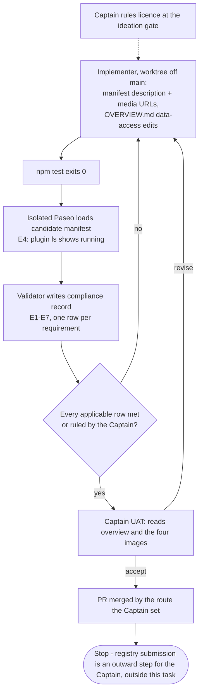

---
id:
title: project-env carries what Paseo's plugin registry needs to list it
status: implementation
variant: kc-dev-flow-2
profile: pilot
merge: pr
worktree:
pr:
gates:
    version: 1
    records:
        - id: gate:project-env-registry-listing:backlog
          stage: backlog
          attempts:
            - id: gate-attempt:project-env-registry-listing-backlog-1
              briefing:
                id: briefing:project-env-registry-listing:backlog:attempt-1:revision-1
                digest: sha256:de9c508ee26456d4afbe77415ffaea90c988eeb6dc39754c54e9171183fcc447
                room-ref: ./project-env-registry-listing/review/backlog/briefing-1
              resolution:
                type: Resolution
                id: resolution:spacedock:project-env-registry-listing:backlog:1
                briefing: briefing:project-env-registry-listing:backlog:attempt-1:revision-1
                by: person:captain
                at: "2026-11-09T07:40:27.412258Z"
                decision: approve
                reason: '「開，幫我合併 78」 — Captain in FO chat, 2026-11-09, answering 「我建議：開一批「送審前修正」3 個任務，修上面第 1 到第 3 項，並補齊第 4 項的資料；做完再跑送審合規檢查。這一版會變成 v0.3.2。真正送出 Paseo 的申請之前，我還會再問你一次，因為那是對外的動作。」 (items 1-3: service account name spaces, op Connect credentials and cache race, item 4: registry listing data). Recommendation: followed.'
              application:
                target-stage: ideation
                state: consumed
        - id: gate:project-env-registry-listing:ideation
          stage: ideation
          attempts:
            - id: gate-attempt:project-env-registry-listing-ideation-1
              briefing:
                id: briefing:project-env-registry-listing:ideation:attempt-1:revision-1
                digest: sha256:bd9270b2a1d61335cf64dca372d5c0be274465bcddbdfefdeabed402b11d844d
                room-ref: ./project-env-registry-listing/review/ideation/briefing-1
              resolution:
                type: Resolution
                id: resolution:spacedock:project-env-registry-listing:ideation:1
                briefing: briefing:project-env-registry-listing:ideation:attempt-1:revision-1
                by: person:captain
                at: "2026-11-09T08:48:00.465108Z"
                decision: approve
                reason: '「准」 — Captain in FO chat, 2026-11-09, answering 「設計關（送審前修正 3/3）：我建議准，授權條款用 MIT（跟你另一個公開外掛 repo 一樣），放在 repo 根目錄。只改外掛設定檔（加一句介紹和 4 張截圖連結）和說明檔（補上值可能傳到 agent 的模型供應商、修正「登入鑰匙圈」說法），另附一份合規檢查紀錄。限制：Paseo 0.12 這個最低版本是用型別檢查推的，沒在 0.12 實跑。准了就照這個設計、用 MIT 進實作，排在最後。」 (the three public-release-prep ideation gates presented together). Recommendation: followed.'
              application:
                target-stage: implementation
                state: consumed
started: 2026-11-09T07:41:37Z
---

Batch: public-release-prep, approved by the Captain on 2026-11-09 (「開，幫我合併 78」, answering FO's 「…開一批「送審前修正」3 個任務…回「開」就開這批 3 個任務」) with three members: project-env-service-account-trim, project-env-op-auth-and-cache, project-env-registry-listing. Source: the Codex and Gemini release reviews of origin/main 2026-11-09 saved in research/2026-11-09-public-release-review/ (codex.md, gemini.md). Paseo's publishing guide (https://paseo.sh/docs/plugins/publishing.md, saved there as paseo-publishing.md) and the registry review policy (getpaseo/plugins REVIEW.md, saved as paseo-registry-REVIEW.md) ask for a one-sentence description (the manifest's `description` for a Git source), an overview beside `paseo-plugin.json` that says where data goes including to agent providers, and at least one image for a plugin with its own interface. On main e4acaec `project-env/paseo-plugin.json` has no `description` and `"media": []`, the repository has no licence file (`gh repo view` licenseInfo null, 2026-11-09), and the plugin has a settings screen. Its runtime imports are only host-provided modules (`@getpaseo/plugin`, react, react-native, @tanstack/react-query, zod) and `node:` built-ins (grep of imports, 2026-11-09), so no runtime lock is owed for a Git source.

## Scope

In: the manifest description, listing media, and an overview that meets the publishing guide's content rules and the registry policy for this plugin's data access; check every claim the overview makes against the code; name the licence choice for the Captain; a written compliance check of the candidate against the publishing guide and REVIEW.md.
Non-goals: npm publication; submitting to the registry (outward, the Captain's); the other review findings; translations unless the Captain asks.
Budget: one ideation, implementation and validation round.
Stop condition: the acceptance criterion passes and the Captain's UAT is recorded.

## Acceptance criteria

**AC-1**: At the candidate, `project-env/` satisfies every requirement of the publishing guide and REVIEW.md that applies to a public GitHub folder source, and the compliance record lists each requirement with its evidence or the Captain's ruling.
Verified by: the compliance record checked line by line against both saved documents, every media URL returning HTTP 200 with an image content type, and `npm test` passing. Each clause below is rerun at the candidate commit from the repository root of a checkout of it:
- E1 description: `node -e 'const m=require("./project-env/paseo-plugin.json"); const d=(m.description||"").trim(); if(!d||/[.!?]\s+\S/.test(d)) process.exit(1); console.log(d)'` exits 0 and prints one sentence.
- E2 media: `node -e 'const m=require("./project-env/paseo-plugin.json"); const u=(m.media||[]).filter(x=>/^https:\/\/\S+\.(png|jpe?g|webp|gif)$/i.test(x)); if(!u.length||u.length!==m.media.length) process.exit(1); console.log(u.join("\n"))'` exits 0, then for each printed URL `curl -sSIL -o /dev/null -w '%{http_code} %{content_type}\n' <url>` prints `200 image/png` (a HEAD request that follows redirects, as the registry's `checkMediaUrls` does).
- E3 forbidden commands: `grep -nE 'paseo plugin add|npm install|npm i( |$)' project-env/OVERVIEW.md` prints nothing and exits 1.
- E4 manifest loads in Paseo: `docs/project-env/capture/setup.sh <empty-dir> <free-port>` (isolated Paseo home and port, fake `op`, `security` and `git`; it copies the candidate `paseo-plugin.json`), then `paseo plugin ls --home <dir>/home` shows `paseo-project-env` `running` with no error; then `paseo daemon stop --home <dir>/home` and `rm -rf <dir>` stop only that daemon and remove the directory (not `teardown.sh`, which also closes a shared browser session by name).
- E5 overview claims: every row of the design's overview claims table is re-read at the candidate against the named symbol; a claim with no supporting symbol fails.
- E6 tests: `npm test` in `project-env/` exits 0 with `fail 0`.
- E7 images current: for each media image, the strings listed for it in the design are found by `grep -rlF '<string>' project-env/client project-env/shared`.

## FO alignment

Surfaces: none
Visible change: none
Direction alignment with the Captain: done — he answered 「開，幫我合併 78」 on 2026-11-09 to FO's proposed batch naming the listing work.
Result: the batch question and this Scope.
Release review: not needed: packaging for the registry with no journey release goal change.
Map footprints: not needed: no map answer is recorded by this task.

## Design

Profile: pilot. Surfaces: none, so the PRFAQ and the diagram below are the whole design artifact. The change is two files in `project-env/`: `paseo-plugin.json` gains a description and four screenshot URLs, and `OVERVIEW.md` gains a complete account of where data goes. No code changes. Sources: the saved publishing guide (`research/2026-11-09-public-release-review/paseo-publishing.md`) and review policy (`paseo-registry-REVIEW.md`); Paseo's manifest schema `PluginManifestSchema` in `packages/server/src/server/plugins/manifest.ts` at tags v0.12.0 and v0.15.3 (identical, fetched 2026-11-09 with `gh api`); the registry validator `resolveMetadata` and `checkMediaUrls` in getpaseo/plugins `scripts/lib/` at commit c64d1181 (fetched 2026-11-09).

### PRFAQ

**project-env is ready for the Paseo plugin registry.** A reviewer opening `iamcxa/kc-paseo-plugins` at path `project-env` finds a one-sentence description, four screenshots of the settings screen with sample data, and an overview that says every place a token, a value, a variable name or the agent notice goes, including what reaches the agent's model provider. Every requirement of the publishing guide and the review policy that applies to a public GitHub folder is listed in a compliance record with the command that proves it. Submitting is still the Captain's step.

- *Does this submit the plugin?* No. Submission is an outward action the Captain takes after this task.
- *Does it change what the plugin does?* No. Only the manifest's listing fields and the overview text change; `npm test` covers that the overview keeps its troubleshooting headings.
- *Why web links instead of image files inside `project-env/`?* Manifest image paths must stay inside the plugin folder, and the pictures live in `docs/project-env/img/`. Links pinned to a commit add no copy and never change; the cost is editing the manifest when a picture is replaced.
- *Why no icon or Chinese text?* Neither is required; translations are a non-goal unless the Captain asks.
- *Does the registry need a licence?* No. Neither saved document asks for one; the release reviews flagged it, so it is the Captain's decision below.
- *Is "Paseo 0.12 or later" true?* Yes as far as checked: the manifest, overview and install page all say 0.12, the plugin type-checks against SDK 0.12.0, and it runs today on Paseo 0.15.3 (`paseo plugin ls`, 2026-11-09). It has not been run on 0.12.0 itself.



### Requirements that apply to a public GitHub folder source

Status on main e4acaec, 2026-11-09. G = publishing guide, R = review policy; anchors are their section headings.

| ID | Requirement (source) | Main e4acaec | Candidate action |
| --- | --- | --- | --- |
| G1 | `OVERVIEW.md` beside `paseo-plugin.json` (G "Your listing page"; R "Overview") | met | none |
| G2 | Order: what it does, how, setup incl. settings, accounts, tokens, external tools, OS, Paseo versions, then capabilities, data access, permissions, limits (G) | met: intro, How it works, Setup with macOS and 0.12, then reads and limits | O2 adds "installs nothing" |
| G3 | Where data goes, including prompts and tool results sent to agent providers; local storage is not staying on the host (G) | lacks: no mention of the provider; notice and printed values unstated | O3 |
| G4 | Runtime download or install disclosed, with confirmation (G; R "Security review") | not applicable: the plugin installs nothing | O2 states it |
| G5 | Plain factual sentence case; no marketing, badges, changelog, contributing, licence sections (G; R) | met | none |
| G6 | No `paseo plugin add`, `npm install`, `npm i` anywhere in the overview (G) | met: E3 grep exits 1 | none |
| G7 | One-sentence description in the manifest `description` for Git (G; R "Concrete acceptance requirements") | lacks: no `description` | add |
| G8 | Visual plugin: at least one image of the current interface, sample data, private details hidden (G "Icons and screenshots"; R "Images and media") | lacks: `"media": []` while the plugin has a settings screen | add four URLs |
| G9 | Media entries: package-relative paths or HTTPS URLs with png/jpg/jpeg/webp/gif, HTTP 200 with image content type, no SVG (G; R) | not applicable until G8 | E2 |
| G10 | Metadata fields need Paseo 0.11.0+ (G) | met: `requirements.paseo` `>=0.12.0` | none |
| G11 | Public GitHub repository holding manifest, runtime entries, imported files and listing assets (G "Share through GitHub or Git") | met: `gh repo view` visibility PUBLIC; all imported files tracked (`git ls-files project-env`) | none |
| G12 | Runtime npm dependencies need a committed lock and a `build` command (G; R) | not applicable: runtime imports are only host-provided modules (Paseo reference "Client runtime", "Server runtime") and `node:` built-ins | none |
| G13 | English default name, description, overview; translations optional (G "Other languages"; R "Translated listings") | met for name and overview | description in English |
| R1 | Reviewer pins an exact commit; a tag or commit from the author is optional (R "From submission to review") | not an author obligation | record the candidate merge commit |
| R2 | Accurate overview: every claim true of the artifact (R "Overview") | partly: "login Keychain" overstates; the Codex review's P2 found writes go to the default keychain | O1, O4, O5 |
| R3 | Security review inputs are inspectable: network, credentials, filesystem, execution, readability (R "Security review") | met: plain TypeScript, `execFile` with no shell, network only through `op` | O3 discloses each |

Flagged by the release reviews but required by neither document: a licence (codex.md P2, gemini.md P1); `repository`, `author` and `private: true` in `package.json` (npm only, a non-goal). The record lists them under that heading so no row says the registry demands them.

### Manifest

```json
{
  "id": "paseo-project-env",
  "name": "Project environment",
  "description": "Fills environment variables for the agents Paseo starts in a repository from fields in one 1Password vault.",
  "media": [
    "https://raw.githubusercontent.com/iamcxa/kc-paseo-plugins/e4acaec1a454ccf39bb9aaaa48a478ac5333b561/docs/project-env/img/06-variables.png",
    "https://raw.githubusercontent.com/iamcxa/kc-paseo-plugins/e4acaec1a454ccf39bb9aaaa48a478ac5333b561/docs/project-env/img/04-connect-1password.png",
    "https://raw.githubusercontent.com/iamcxa/kc-paseo-plugins/e4acaec1a454ccf39bb9aaaa48a478ac5333b561/docs/project-env/img/05-field-picker.png",
    "https://raw.githubusercontent.com/iamcxa/kc-paseo-plugins/e4acaec1a454ccf39bb9aaaa48a478ac5333b561/docs/project-env/img/07-test-result.png"
  ],
  "requirements": { "paseo": ">=0.12.0" }
}
```

- Key order may follow the existing file; only `description` and `media` change.
- 06 is first because the first image is the card thumbnail. All four show sample data (`shop-api`, `/tmp/pe-docs/shop-api`, `agent-shop-api-dev`), no real vault, path or token.
- Host choice: the commit-pinned `raw.githubusercontent.com` link returned `200 image/png` on a HEAD request (2026-11-09), as did the Pages link and the `main` raw link. The pinned link cannot change or break when `docs/` moves; the Pages link depends on the site staying published and the path staying put.
- Paseo accepts both fields: `description` is `z.string().trim().min(1)` and `media` admits `z.url({ protocol: /^https$/ })` in `PluginManifestSchema` at v0.12.0 and v0.15.3.
- E7 strings, each found in today's code: 06 `Connected`, `+ Add`, `so the agent` (the hint wraps after "agent"); 04 `Save token to Keychain`, `Stored in this Mac's Keychain`; 05 `Add a variable`, `Search fields, or type a name`, `Type a reference`; 07 `failed` and `summaryText` joining parts with ` · `. The implementer confirms each grep and drops an image whose text no longer matches.

### Overview changes

Every `### <reason>` heading under "When a variable is blank" stays byte-identical: the `the troubleshooting notes` suite in `test/agent-notice.test.ts` asserts one heading per reason from `causeSentence`, and the agent notice points agents to this file. That suite is how `npm test` stays green; no test is added.

- O1 (How it works): "keeps that service account's token in the login Keychain of the Mac that runs Paseo" becomes "keeps that service account's token in the Keychain of the Mac that runs Paseo (the default keychain, which is the login Keychain unless you changed it)". Evidence: `addTokenCommand` passes no keychain, so `security add-generic-password` writes the default keychain; `lookupToken` reads the search list.
- O2 (Setup, last line): "It needs Paseo 0.12 or later running on your own Mac (macOS only) and the 1Password CLI (`op`), which you install yourself. The plugin downloads and installs nothing."
- O3 (replace the bullets under "What it reads and sends"):
  - **Keychain.** It reads the service account token with macOS's `security` tool when an agent starts, when the settings screen checks a connection, when you press Test and when you open the field list, and writes it when you choose **Save token**. It passes the token only to `security` and `op`.
  - **1Password.** It runs `op` with the token. `op` contacts 1Password to list the service account's vaults, to list every item and field of the chosen vault when you open the field list, and to read each mapped field. The plugin makes no other network request.
  - **Git.** When an agent starts, it runs `git` read-only in the agent's working directory to find which connected repository or worktree that is.
  - **Paseo.** Paseo's plugin settings on the Mac hold each repository's path, service account name, vault, variable names and field references, never a token or value. The settings screen reads Paseo's project list to offer repositories. A token you paste reaches the plugin over Paseo's connection from whichever Paseo app you paste it in.
  - **The agent's model provider.** The notice is added to the instructions of each new agent in a connected repository. Paseo saves it with the agent, and the agent's model provider receives it as part of those instructions. It names no variable and carries no value.
  - **The agent's environment.** Values are set for that agent's launch only and Paseo does not save them. The agent program and every command it runs can read them. If the agent or a command prints a value, that output goes to the agent's model provider with the conversation. The notice tells the agent never to; the plugin cannot prevent it.
  - **The conversation and Logs.** The "Started without" and "Resumed without" lines name each blank variable and its reason; they are kept in the conversation history and show in every Paseo app connected to this Mac. The plugin's Logs hold one line per failed variable with the repository path, variable name and reason class.
  - A value read from 1Password is kept in memory and reused for up to 15 minutes, then read again. Saving settings and pressing Test read again.
  - Apart from putting values in an agent's environment, it never shows, logs or sends a secret value.
- O4 (Limits): "the token in the login Keychain" becomes "the token in the Keychain".
- O5 ("No token stored for this service account" body, heading unchanged): "in the login Keychain" becomes "in the Keychain"; "when the login Keychain is locked" becomes "when that Keychain is locked".

### Overview claims table

Read on main e4acaec, 2026-11-09; E5 rereads each at the candidate.

| Claim | Supported by | Verdict |
| --- | --- | --- |
| Token stored in the Keychain; passed only to `security` and `op` | `writeToken`, `lookupToken`, `opEnv` in `server/secrets.ts` | true after O1, O3 |
| Values read through `op`, put in the agent's environment at session open | `readVariable`, `openSession`, `server.before("agent.session_open")` in `contribute` | true |
| Paseo does not save open-time environment | Paseo hooks doc v0.15.3: open-time `env` is launch-only and re-derived on every open | true (Paseo's documented contract) |
| Notice added to instructions; names no variable, no value | `withNotice`, `agentNotice`; test "names no variable, reference or value" | true |
| Notice saved with the agent and sent to the provider | hooks doc: `agent.create.before` config changes are saved; `systemPrompt` is agent configuration | true |
| 15-minute reuse; Save and Test read again | `CACHE_MS`; `settings.subscribe(() => secrets.clearCache())`; the `testProject` handler clears | true |
| 20-second limit while an agent starts | `HOOK_BUDGET_MS` in `server/session-open.ts` | true |
| Field list reads every item of the vault | `listRefs` (item list, then one item get per item) | true |
| No network request besides `op` | no `fetch` or HTTP import in `client/`, `server/`, `shared/` (grep 2026-11-09) | true |
| `git` read-only in the agent's directory | `locate`: `rev-parse` and `worktree list` only | true |
| Settings hold paths, names, refs, never values | `projectEnv` settings schema in `shared/config.ts` | true |
| Logs: one line per failed variable, no value | `failureLine` in `server/cause.ts` | true |
| Started/Resumed lines kept in history | `timeline.append` in `contribute`; Paseo reference "Append a timeline row from the daemon" (canonical history) | true |
| Terminals do not get the variables | only agent hooks registered in `contribute` | true |
| Paseo 0.12 or later, macOS only | `requirements.paseo`; SDK devDependency 0.12.0 with `tsc --noEmit` exit 0; `paseo plugin ls` shows `running` on 0.15.3; `/usr/bin/security` in `realTools` | true; not run on 0.12.0 |

Not changed here: the docs site pages `docs/project-env/index.md` and `prepare-1password.md` and the screen hint in `shared/token.ts` also say "login Keychain". They are outside this task's files; FO may file a follow-up. The hook names and the `/client/react-native` import the plugin uses are deprecated in Paseo, with removal after 2027-04-30 and 2027-04-20 (Paseo hooks and migration docs v0.15.3). They do not change the 0.12 claim today.

### Compliance record format

The validator writes `## Compliance record` in this task file at validation, not in the repository. One row per ID G1-G13 and R1-R3 above, then a separate table "Flagged by the release reviews, required by neither document". Columns: ID | Requirement as quoted from the saved document, with section heading | Applies to a public GitHub folder (yes, or no with reason) | Status at candidate `<sha>` (met, not applicable, or Captain ruling) | Evidence: the E-clause command and its output line, or the Captain's quoted words with date. The header names the candidate commit and the two saved files' SHA-256 digests (`shasum -a 256`), so a later reader knows what was checked. The PR body carries a short summary and links the record.

### Existing-code check

Nothing is rebuilt: the overview, the docs screenshots and the isolated Paseo harness (`docs/project-env/capture/setup.sh`) already exist and are reused. The observation that makes the change needed: on main the E1 and E2 checks both exit 1 (no description, empty media), and the overview has no sentence about the agent's model provider.

### Needs decision

**Licence.** Recommendation: MIT, as a `LICENSE` file at the repository root, added in this task's pull request with the same copyright holder line as `iamcxa/kc-claude-plugins`. Reasons: it matches Kent's other public plugin repository and the registry repository (`gh repo view` licenseInfo `mit` for both, 2026-11-09), and it lets the people the registry reaches use and change the code without asking. What gets worse: a root licence also covers `spacedock-bridge`, and MIT gives no patent grant. Other options: Apache-2.0 (explicit patent grant, longer text, a NOTICE convention); no licence (the registry accepts it, but others have no stated right to copy or change the code). No `license` field in `package.json`: nothing reads it for a Git source.

Past rulings checked: ADR 0001 requires the overview to state both weaknesses in plain words, and O3 keeps them; ADR 0003 (same Mac only) matches the overview; `git -C docs/dev2/.spacedock-state grep -n 'Override:'` finds only archived prose about other areas.

### Batch overlap

- project-env-service-account-trim: changes `client/settings-screen.tsx` and possibly `shared/config.ts` and tests. No shared file. If it changes text visible in image 04, E7 keeps or drops that image.
- project-env-op-auth-and-cache: changes `server/secrets.ts` and tests. Shared file only if it adds an overview sentence about 1Password Connect; that would land in "What it reads and sends", which O3 rewrites.
- project-env-test-row-draft-note (backlog): changes the Test row hint in `client/settings-screen.tsx`; no image shows that hint.
- project-env-release-1 (backlog): no file.
- No shared check, table or numbered record; `CHANGELOG.md` is written by release-please.

Recommended order: this task last of the batch, so the compliance record and the overview claims are checked against the v0.3.2 candidate that includes both fixes.

## Stage Report: ideation

- DONE: Read the saved publishing guide and REVIEW.md and list every requirement that applies to a public GitHub folder source (iamcxa/kc-paseo-plugins, path project-env), with what main e4acaec already meets and what it lacks.
  Design "Requirements that apply" table G1-G13, R1-R3: lacks description (G7), media (G8) and provider data flow (G3); "login Keychain" overstated (R2); rest met or not applicable; release-review-only items listed apart.
- DONE: Propose the manifest description, the listing media (public HTTPS image URLs or packaged files; the docs site pictures under docs/project-env/img/ are candidates), and every overview change the rules or the plugin's data access require, including where values go once an agent has them; check each overview claim against the code, including the Paseo version requirement.
  Design "Manifest" (four commit-pinned raw URLs, HEAD 200 image/png 2026-11-09; schema accepts both fields at Paseo v0.12.0 and v0.15.3), "Overview changes" O1-O5, "Overview claims table" (15 claims, all supported; 0.12 floor by SDK 0.12.0 typecheck, not run on 0.12.0).
- DONE: Name the licence options for the Captain with one recommendation; do not add a licence.
  "Needs decision": MIT at repository root (recommended), Apache-2.0, none; nothing added.
- DONE: Write the PRFAQ and AC-1 evidence clauses a reviewer can rerun; the compliance record format is part of the design.
  PRFAQ and Mermaid in "Design"; AC-1 "Verified by" now carries E1-E7; "Compliance record format" fixes rows, columns and location.
- DONE: Every project-env change you propose names how `npm test` in project-env stays green; run `npm test` on main once and record the result.
  Main e4acaec: 335 tests, 335 pass, 0 fail, exit 0; `tsc --noEmit` exit 0. Overview edits keep every `### <reason>` heading that the "the troubleshooting notes" suite asserts (it fails if a heading changes); no test reads the manifest.
- DONE: AC-1 current evidence.
  Not yet verified: no candidate exists. On main E1 and E2 exit 1 (no description, empty media), E3 exits 1 (met), all four proposed media URLs return 200 image/png. E4-E7 run at the candidate.
- DONE: design_surfaces.py check.
  `python3 <package>/scripts/design_surfaces.py check` printed "design surfaces presentable", exit 0.

### Summary

Ideation for registry listing. Two files change in implementation, `project-env/paseo-plugin.json` (description plus four commit-pinned screenshot URLs) and `project-env/OVERVIEW.md` (complete data-flow disclosure including the agent's model provider; "login Keychain" corrected). There is no code change. One decision is open for the Captain: the licence. The recommendation is MIT at the repository root, added in this task's PR, which would also cover spacedock-bridge. The design recommends running this task last in the batch so the compliance record checks the v0.3.2 candidate.
