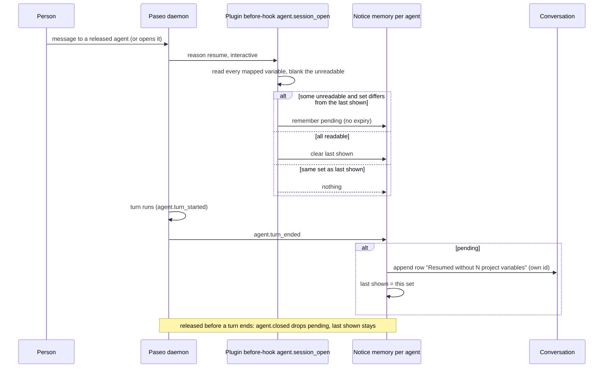

---
id:
title: An agent that resumes without a project variable tells the person why
status: validation
variant: kc-dev-flow-2
profile: pilot
merge: pr
worktree: .worktrees/spacedock-ensign-project-env-resume-blank-notice
pr:
gates:
    version: 1
    records:
        - id: gate:project-env-resume-blank-notice:backlog
          stage: backlog
          attempts:
            - id: gate-attempt:project-env-resume-blank-notice-backlog-1
              briefing:
                id: briefing:project-env-resume-blank-notice:backlog:attempt-1:revision-1
                digest: sha256:c5e6c599004f3e61597c795c17b036c63db4e778a61786cf111ee12ad75cf3d6
                room-ref: ./project-env-resume-blank-notice/review/backlog/briefing-1
              resolution:
                type: Resolution
                id: resolution:spacedock:project-env-resume-blank-notice:backlog:1
                briefing: briefing:project-env-resume-blank-notice:backlog:attempt-1:revision-1
                by: person:captain
                at: "2026-10-30T14:41:48.149008Z"
                decision: approve
                reason: '「開」 — Captain in FO chat, 2026-10-30. Asked: 「要不要開一個小任務，在隔離環境用 0.14.0 實測「agent 恢復時讀不到變數」的情況，有問題就補上提示？我建議開…回「開」或「先不用」。」 FO had recommended opening it.'
              application:
                target-stage: ideation
                state: consumed
        - id: gate:project-env-resume-blank-notice:ideation
          stage: ideation
          attempts:
            - id: gate-attempt:project-env-resume-blank-notice-ideation-1
              briefing:
                id: briefing:project-env-resume-blank-notice:ideation:attempt-1:revision-1
                digest: sha256:ddd599e5bdd7a7536dbcef12b695d71595168bfb30cd80c43c64667e23c14952
                room-ref: ./project-env-resume-blank-notice/review/ideation/briefing-1
              resolution:
                type: Resolution
                id: resolution:spacedock:project-env-resume-blank-notice:ideation:1
                briefing: briefing:project-env-resume-blank-notice:ideation:attempt-1:revision-1
                by: person:captain
                at: "2026-10-30T16:11:53.951434Z"
                decision: approve
                reason: '「准」 — Captain in FO chat, 2026-10-31, on the ideation gate (sha256:ddd599e5), FO having recommended approval; approval also accepts that the line shows when the first turn after a resume ends, not when the chat is opened. Asked: Approve the resume-notice design ... and AC-1 into implementation? FO recommends approving, which also accepts that the line shows when that first turn ends, not when the chat is opened. Say if you object to any part.'
              application:
                target-stage: implementation
                state: consumed
started: 2026-10-30T14:42:08Z
---

Paseo 0.14.0 (released 2026-10-29) "Release eligible agent runtimes after one idle hour, resuming the saved session on the next prompt" (its release notes, read with `gh release view v0.14.0 -R getpaseo/paseo` on 2026-10-30). In `agent.session_open` in `project-env/server/contribute.ts` on main, a variable that cannot be read is blanked for every opening, but the "Started without N project variables" line is recorded only when `request.reason === "create"`. FO has not run this on 0.14.0; whether a release and resume fires `agent.session_open` is unverified. Asked whether to open a small task to test it on 0.14.0 and add the notice if it is a problem, recommending it, the Captain answered 「開」 on 2026-10-30.

## Scope

In: on an isolated Paseo 0.14.0, observe what `agent.session_open` does when an agent's runtime is released and resumed, with a variable readable and with it unreadable; if a resumed agent can lose a variable with no line in its conversation, show the same kind of line there and keep the notice text true.
Non-goals: upgrading the Captain's own Paseo; agent tools or MCP servers from 0.14.0; agent-organised vaults; retrying 1Password reads; changing which variables are injected.
Budget: one ideation, implementation and validation round; a second validation cycle returns to the Captain. If ideation's run shows no gap, the task stops there with the evidence and no code.
Stop condition: the acceptance criterion holds on 0.14.0 and the Captain's UAT is recorded, or ideation's evidence shows no gap and the Captain accepts that.

## Acceptance criteria

**AC-1**: On an isolated Paseo 0.14.0, when an agent's runtime is released and resumed while one mapped variable cannot be read, the conversation shows a line naming that variable and its reason; with every variable readable it shows no such line.
Verified by: a runtime run of both cases on an isolated Paseo 0.14.0 with fake `op` and `security`, recording the `agent.session_open` reason seen, plus a unit test that fails when the resume branch is removed. A real 1Password account is not used.

## FO alignment

Surfaces: ui
Visible change: A resumed agent that lost a project variable shows a line in its conversation naming the variable and the reason.
Direction alignment with the Captain: done — he answered 「開」 on 2026-10-30 to FO's recommendation to test this before he upgrades.
Release review: not needed: it follows a host release and adds no journey story.
Map footprints: not needed: no open map question is answered by this task.

## PRFAQ

**Press line.** When an agent in a connected repository is resumed after Paseo released it, and a mapped variable can no longer be read, the first turn after the resume ends with the warning row "Resumed without N project variables" naming each variable and why. Today that agent runs with the variable blank and shows nothing.

**What is wrong today** (observed 2026-10-30 on an isolated Paseo 0.14.0, fake `op` and `security`; `evidence/runs/resume-check-main.txt`, agent `lost`): the agent opened with `STRIPE_KEY` readable; after a release and a resume `agent.session_open` ran with `reason: "resume"`, `purpose: "interactive"`, the plugin resolved again and returned `STRIPE_KEY: "blank"`, and the conversation holds no plugin row. `contribute.ts` records a notice only when `request.reason === "create"`, and `agent.created` fires only on creation.

**FAQ**
- *Does a release and resume fire `agent.session_open`?* Yes, both times seen: `reason: "resume"`. Viewing a released agent (a timeline fetch) resumes it too, with no message sent (`evidence/observe/fast-events.jsonl`, 14:56:05 and 14:57:17). Resumes are frequent, so a repeat rule is needed.
- *Can the line be appended at the opening?* No. In-hook `timeline.append` fails `Unknown agent` on resume (`evidence/probe-resume.txt`), as the earlier spike found for create.
- *What fires after the resume?* `agent.turn_started` and `agent.turn_ended`, each with a working `paseo` handle; both appends succeeded. A same-id append replaces the earlier row in place (seq unchanged), so a later row needs its own id to appear at the end.
- *Why `turn_ended` and not `turn_started`?* Paseo 0.14.0's default Chat display, "Collapse turns", folds everything inside a finished turn into one summary line. A row appended at turn start lands inside the turn and is not on the page once the turn is done (page text of the default display lacks it, the Full display holds it); a row appended at turn end sits under the final reply and stays visible (`evidence/shots/cand-three-1280.png`).
- *Does the line repeat on every resume?* No. The plugin keeps, per agent in memory, the set of failures last shown (kept across a release, dropped with the daemon); an identical set adds nothing, a different set adds a new row at the end, and a resume with everything readable clears the memory so a later failure shows again. A pending line waits as long as the agent stays open (no ten-minute expiry), and is dropped if the agent is released first.
- *What about the existing "Started without" line?* Kept as is. A failure shown at start is not shown again at a resume with the same set.
- *Does the agent notice stay true?* One sentence changes, because "Started without N project variables" would be incomplete: it now says Paseo shows the user a line in this conversation, "Started without N project variables" or, after the agent was paused and resumed, "Resumed without N project variables", with the same reasons (candidate diff, `server/agent-notice.ts`). The 60 comprehension runs of the notice (task `project-env-built-in-agent-notice`) were on the old sentence; implementation reruns that harness on the new text.
- *Cache.* A value is reused for 15 minutes (`CACHE_MS`), so a resume within 15 minutes of a read sees the cached value and shows no failure; a real release comes after one idle hour, when the cache has expired. My short runs change the mapping to a ref that was never read to get a cold read.

**Existing-code check.** `createNotices` in `missing-variables-notice.ts`, the `agent.created` handler and `MissingVariablesRow` already carry the line; the design extends them (one optional `resumed` flag, one more event, one remembered signature) and adds no new store or module.

## Design

Changes (disposable candidate, `evidence/candidate-disposable.diff`, 8 files against main 06aa5bee, 0 comment lines added): the before-hook also records for `reason === "resume"`; `createNotices` gains a `resumed` flag per entry, a remembered signature per agent, no expiry for resumed entries; one handler on `agent.turn_ended` appends with id `project-env-missing-variables-resumed-<uuid>`; the row data gains optional `resumed: true` and `missingVariablesTitle(count, resumed)` says "Resumed"; OVERVIEW.md's two sentences about the line change. `refresh` and `import` openings stay silent. Candidate: 320 of 320 tests (312 on main), `tsc --noEmit` clean, six mutations each killed (`evidence/mutations-candidate.txt`: resume branch removed, same-failure check removed, resumed entries expiring, fixed row id, `turn_ended` handler removed, title ignoring `resumed`).

Runtime run on the candidate (`evidence/runs/resume-check-cand.txt`) beside main (`resume-check-main.txt`), same script: agent `healthy` resumes twice with `reason: "resume"`, nothing blank, no plugin row in either build; agent `lost` (readable at start, unreadable at both resumes) shows no row on main and one "Resumed" row after the first resumed turn on the candidate, none added by the second resume; agent `blank` (unreadable from the start) keeps its single start row in both builds.

### UI proposal

UI proposal: When an agent Paseo released after an idle hour is resumed and one or more mapped variables can no longer be read, the same warning row the agent shows when it starts without variables appears under the final reply of the first turn after the resume. Its title reads "Resumed without N project variables" (singular "1 project variable"), then one line per variable: the name in monospace, then the reason in the screen's own words. It is not repeated by a later resume that fails the same way; a different set adds a new row at the end; with every variable readable nothing is added.

Preview: /Users/kent/Project/kc-paseo-plugins/docs/dev2/.spacedock-state/project-env-resume-blank-notice/evidence/shots/index.html
The preview is disposable: real Paseo 0.14.0 windows of the candidate on an isolated daemon, driven through the app (operable, not mock-ups), 1280 x 900 and 400 x 900 in dark and light, `cand-<one|three|both>-<1280|400>[-light].png`; `cand-both-startandresume-full-1280.png` (Full display, 1280 x 2600) shows the start row and the resume row together; `main-three-*` is today's build, context. Every picture is a first turn stopped after two seconds. Not drawn: the turn while it runs, a turn that fails, more than three variables, dark-theme contrast; the running screen settles these in validation (AC-1 clause).

### Design review

Design review: design/ideation-1.yaml
Design finding 1: fixed: drew `cand-both-startandresume-full-1280.png` with the "Started without 1 project variable" row and the "Resumed without 2 project variables" row in one frame; the repeated name STRIPE_KEY is listed again under the resume title because each row lists the set at its own opening.
Design finding 2: AC-1
Finding 2's answer: the row is appended on `agent.turn_ended`, which Paseo 0.14.0 emits for a completed, a failed and a cancelled turn (`publishAgentStream` in the daemon's `plugins/lifecycle`), so a first turn that fails still ends with the row; every picture is a stopped (cancelled) turn. The AC-1 evidence clause adds a screenshot of a failed first turn. The many-variables half is the existing row's one-line-per-variable stack, unchanged here.
Design finding 3: declined: the mid-word wrap and the dangling dash come from the existing row component the start row shares; changing it is its own task.
Design finding 4: declined: host component foregroundMuted at /tmp/pe-resume-install/node_modules/@getpaseo/plugin/dist/contracts.d.ts: the reason colour is the plugin theme token the start row already uses; this task adds no colour.
Decline check: design/declines-2.yaml
Rulings (`declines-2.yaml`, run on the declines then standing; `declines-1.yaml` was the first pass): finding 1 was overruled in the first pass and fixed; finding 2 overruled, now AC-1; findings 3 and 4 upheld (4 first came back as a decision for the Captain because no declaration was named; with the declaration, `contracts.d.ts` lists only two text tokens).

### Batch overlap

- `project-env-overview-notes-test` (validation): changes `test/` for the OVERVIEW troubleshooting notes and may touch `OVERVIEW.md` headings; this design edits two sentences in `OVERVIEW.md` outside any cause heading and adds tests in `test/missing-variables.test.ts`. Shared index: none.
- `project-env-pick-repository` (validation): `client/` project list and one docs Prepare step; no shared file. 
- `project-env-test-row-draft-note` (backlog): `client/settings-screen.tsx`; no shared file.
- `project-env-release-1` (backlog): a release umbrella, no file.
Recommended order: any; this task touches `server/contribute.ts`, `server/missing-variables-notice.ts`, `server/agent-notice.ts`, `shared/cause.ts`, `shared/config.ts`, `client/missing-variables-row.tsx`, `OVERVIEW.md` and `test/missing-variables.test.ts`, none of which the others change. If `project-env-overview-notes-test` lands first, rebase the two `OVERVIEW.md` sentences onto it.

### AC-1 evidence clause

Reproduce: `RUN=<label> PORT=<free port> CHECKOUT=<tree holding project-env> bash evidence/harness/resume-check.sh` (needs `@getpaseo/cli@0.14.0` installed in `/tmp/pe-resume-install`, `npm install` there). It builds an isolated daemon (own home and port, plugin built from `CHECKOUT`, fake `op`/`security`, mock provider via `PASEO_NODE_ENV=development`, idle period cut to 20 s), runs three agents through a release and two resumes and prints, per agent, each `agent.session_open` reason, which variables came back blank, and the plugin rows in the conversation. Passes when: `lost` shows `reason: resume` with one variable blank and exactly one row "Resumed without 1 project variable" naming it after the first resumed turn and no second row after the second; `healthy` shows no row; `blank` shows only its start row. Plus a unit test in `test/missing-variables.test.ts` that fails when the resume branch is removed (killed by "resume branch removed", 4 failures), and validation's screenshots of the running screen at 1280 and 400 px with the default Chat display, one of them a resumed first turn that fails (not only one that is stopped) showing the row. No real 1Password account.

## Observation record (2026-10-30, Paseo 0.14.0 from `npm install @getpaseo/cli@0.14.0` in `/tmp/pe-resume-install`; `/Applications/Paseo.app`, the global `paseo` and `~/.paseo` untouched)

- Release: `idle-runtime-cleanup/index.js` collects a runtime idle for `IDLE_PERIOD_MS = 60 * 60000`, sweeping every 60 s, and logs "Collected idle agent runtime"; it emits `agent.closed`, not `agent.created`, at the next open. Forced by changing that one constant to `20000` in a throwaway copy of the installed package (`evidence/observe/fast-idle-period.txt`; the unpatched copy reads `60 * 60000`, `real-idle-period.txt`); the plugin, the sweep and the resume path are untouched. The `mock` provider needs `PASEO_NODE_ENV=development`.
- Resume with a readable variable: `reason: "resume"`, both variables filled, no row (`evidence/observe/fast-events.jsonl`).
- Resume with an unreadable one: `reason: "resume"`, `STRIPE_KEY: "blank"`, no plugin row (14:58 to 15:00 in the same file, and `resume-check-main.txt`). An earlier try at 14:52:52 saw both variables filled because the 15-minute cache still held the value; I do not count it.
- Probe (`evidence/harness/probe.index.server.tmpl.ts`, `evidence/probe-resume.txt`): in-hook append fails `Unknown agent`; append after 300 ms and 3 s succeeds on the mock provider; `agent.turn_started` fires on the resume's turn; a same-id append replaces in place.
- Chat display: in the default "Collapse turns" the resume row appended at turn start is absent from the page text; appended at turn end it is visible. The existing start row is visible when it lands before the first user message (seq 1) and folded when it lands after it (seq 3 in one candidate run), so it can be folded by default in 0.14.0 today (pre-existing; not changed here).
- Unpatched one-hour release (`evidence/observe/real-hour-events.jsonl`, `real-hour-collected.txt`): two agents created at 14:53:31, both "Collected idle agent runtime" at 15:54:27 (about 61 minutes), with `agent.closed` and no `agent.created`; a message then fired `reason: "resume"`, `purpose: "interactive"` with both variables filled and no row. My attempt at the unreadable case there failed: I resumed the second agent after the first had re-read and re-cached the values, so it saw filled values. That case was not captured on an unpatched run.
- Not observed: an unreadable variable at a resume on an unpatched one-hour release, a real provider's resume time, the desktop app, a failed (not stopped) turn, a daemon restart with a real provider (the mock keeps no history), dark-theme contrast.

## Known limits (not decisions)

- The row appears when the first turn after the resume ends, not when a person opens the conversation: Paseo 0.14.0 gives the plugin no event between the resume and a turn, and the in-hook append fails `Unknown agent`. A person who only views a resumed agent sees nothing until a turn finishes; the agent notice tells the agent to say a variable is blank.
- `refresh` (reload) and `import` openings stay silent, as before; a daemon restart drops the remembered set (and, per the earlier task, plugin rows), so one restart can repeat a line.
- The existing "Started without" row can be folded away by the default Chat display when Paseo places it after the first user message (seen once, seq 3); pre-existing, outside this task.
- The 60 comprehension runs of the agent notice were on the old sentence; the implementation reruns that harness on the new one. Agents created before the plugin update keep the old notice text.
- Not exercised: the unpatched one-hour release (`real-hour-*` files), a real provider's resume time, the desktop app, a turn that fails (source and a stopped turn only), dark-theme contrast.

### Needs decision

Is it acceptable that the line shows when the first turn after the resume ends rather than when a person opens the chat? Recommendation: yes. The alternatives are worse: a row at turn start is folded away by Paseo 0.14.0's default Chat display once the turn finishes (observed), and a timed retry after the opening depends on how long each provider takes to resume (not measured; the in-hook append fails and a fixed delay is a guess). Cost of yes: a person who only views a resumed chat sees nothing until a turn ends. AC-1 as written says "the conversation shows a line"; this reads it as "once the next turn has ended".

## Stage Report: ideation

- DONE: Run first, then design: on an isolated Paseo 0.14.0 observe what `agent.session_open` does when an agent's runtime is released and resumed, with a mapped variable readable and with it unreadable, recording the `reason` and whether the conversation shows any line; say how you forced the release if the one-hour idle wait can be shortened, and what you could not observe. If there is no gap, say so with the evidence and propose stopping.
  There is a gap. Resume fires `agent.session_open` with `reason: "resume"`; readable shows no line (correct), unreadable blanks the variable and shows no line (`evidence/runs/resume-check-main.txt`, `evidence/observe/fast-events.jsonl`). Release forced by changing `IDLE_PERIOD_MS` from `60 * 60000` to `20000` in a throwaway copy of `@getpaseo/cli@0.14.0`; one unpatched hour release also observed (readable case only). Not observed: listed in "Observation record" (unreadable on an unpatched hour, real provider, desktop app, failed turn).
- DONE: If there is a gap, design the smallest change: the line on a resumed agent, how it avoids repeating on every resume with the same failure, whether the agent notice text stays true, keeping AC-1 with a reproducible evidence clause; produce the previews the ui surface owes at 1280 and 400 px and the design review, each finding dispositioned.
  PRFAQ, Mermaid, `### UI proposal`, `Preview:`, `### Design review` (4 findings: 1 fixed, 1 AC-1, 2 declined and upheld), `### AC-1 evidence clause`, `### Batch overlap`; `design_surfaces.py check` printed "design surfaces presentable". Candidate (disposable, `evidence/candidate-disposable.diff`): 320 of 320 tests, typecheck clean, 6 of 6 mutations killed, 0 comment lines added.
  AC-1: design stated with a reproducible clause (`evidence/harness/resume-check.sh`, unit test killed by "resume branch removed"); met on the throwaway candidate in the shortened-idle runs (`resume-check-cand.txt`); not yet verified: the unpatched-hour unreadable case, the failed-turn screenshot, the real running screen at validation.
- DONE: Name any decision the Captain must make (at most one), with a recommendation.
  One: accept that the line shows when the first turn after the resume ends, not when the chat is opened; recommendation yes (see "Needs decision").

### Summary

Resumed agents lose an unreadable variable silently on Paseo 0.14.0; the fix is a "Resumed without N project variables" row appended at the end of the first turn after the resume, remembered per agent so the same failure is not repeated, with one agent-notice sentence updated. The row goes at turn end because the default Chat display folds a row placed at turn start; all runtime evidence was on the mock provider with fake `op`, and the unpatched-hour unreadable case was not captured. Isolated daemons, ports 9411 to 9417 and install copies are removed.

## Stage Report: implementation

- DONE: Implement the approved design exactly, starting from evidence/candidate-disposable.diff: the "Resumed without N project variables" row at the end of the first turn after a resume, the per-agent memory so the same failure is not repeated, the agent-notice sentence and the two OVERVIEW.md sentences.
  Candidate applied clean (51481d2), plus two roborev repairs on the memory (33d3c62, 9d8760b); branch spacedock-ensign/project-env-resume-blank-notice on base 06aa5bee; Draft PR https://github.com/iamcxa/kc-paseo-plugins/pull/66. Deviation from "refresh stays silent": a refresh now silently forgets the shown variables it read (`retain` in `missing-variables-notice.ts`); no row, no UI change.
- DONE: Land AC-1's evidence at the candidate commit with evidence/harness/resume-check.sh (adapted: own install, port 19604), plus the unit test that fails when the resume branch is removed.
  `evidence/impl/runs/resume-check-impl-cand.txt` at 9d8760b: `lost` reason=resume STRIPE_KEY blank, one "Resumed" row (seq 361) after resume 1, none added by resume 2; `healthy` no row; `blank` only its start row. Earlier run at 51481d2 in `resume-check-impl-cand-51481d2.txt`. `runs/mutations-impl.txt`: "resume branch removed" fails 6 tests; same-failure check, ten-minute expiry, fixed row id, missing turn_ended handler, title and refresh-forget mutations each fail 1 to 11.
- DONE: A screenshot of a failed first turn, and whole-page pictures at 1280 and 400 px.
  `evidence/impl/shots/cand-failed-full-{1280,400}.png` (mock "Requested mock provider failure" turn, row under it), plus `cand-{one,three,both}-full-{1280,400}.png`, dark theme, Paseo 0.14.0 default Chat display; taken at 51481d2, the row code is unchanged since.
- DONE: A rerun of the agent comprehension harness on the new notice sentence (Codex gpt-6.1-sol medium, Claude claude-sonnet-5-5 medium and low, at least 4 runs per cell, blank-variable scenario).
  12 runs, 4 per cell (`evidence/impl/comprehension/out/r1..r4`, `run4.sh`, notice `notice-resume.txt`): every run says the variable is blank and gives the Settings, Plugins, Project environment, Test path; `grade.py`: no leak in transcript or repo, no env probe. Read by me, not independently graded.
- DONE: Run `npm test`, `npm run typecheck`, the roborev gate, `design_surfaces.py check` and `doc_impact.py <base> <candidate>`.
  `npm test` 322 of 322 (session-open deadline test not the cause of any failure), typecheck clean, design_surfaces "presentable", `comment_ratio.py` 0 of 188 code lines. doc_impact lists only `docs/adr/0004-reserved-variable-names-are-skipped-not-blanked.md`: unaffected: it governs reserved names; the `resumed` field added to `shared/config.ts` does not touch them. Roborev: three runs (`roborev:1367`, `1369`, `1371`), the first two fixed; the last, `evidence=roborev:1371` at 9d8760b, is open (below).
- DONE: Docs (doc-site extension): retake the docs pictures and compare; update docs or say `docs: no change` with the capture diff.
  Retaken on 0.14.0 (`evidence/impl/docs-capture/new`): 05 and 07 identical; 01, 02, 04, 06 differ in a 13 px text band (the plugin and repository path, `diff04-new-over-committed.png`), 03 in 10 pixels. docs: no change to pictures. Sentences: `project-env/OVERVIEW.md` two sentences updated (intro and "When a variable is blank"); `docs/project-env/index.md` "A failure is visible, not silent" still true for a new agent and left alone (finding below).
- DONE: Open the Draft PR.
  PR 66, draft, base main; body carries evidence, limits and `without-it unanswered: none`.

### Findings for FO

- Open roborev finding (Medium, fix budget of two used): if a refresh reads every variable between a resume's opening and the end of that turn, the later flush still remembers the failure, so one later identical failure is suppressed. Trigger unobserved; Deferred risk. Would become Material if refresh during a running turn is shown to happen.
- `docs/project-env/index.md` line "a line at the top of the new conversation" describes only the start row; the resumed row is not mentioned there. Not in the design's two-sentence scope; FO to say if a third sentence belongs in this PR.
- Not exercised: unreadable variable on an unpatched one-hour release, real provider resume time, desktop app, dark-theme contrast; runtime evidence is on the mock provider with a 20 s idle period. Validation owns the real-screen pictures at 1280 and 400 px.

### Summary

The ideation candidate is implemented and in Draft PR 66: a resumed agent that lost a variable shows "Resumed without N project variables" once its next turn ends, including a failed turn, and the same failure is not repeated. AC-1 holds on an isolated Paseo 0.14.0; comprehension of the changed notice sentence was 12 of 12. Two memory edge cases found by the roborev gate were repaired inside the design's spirit; a third narrow one is reported open.
