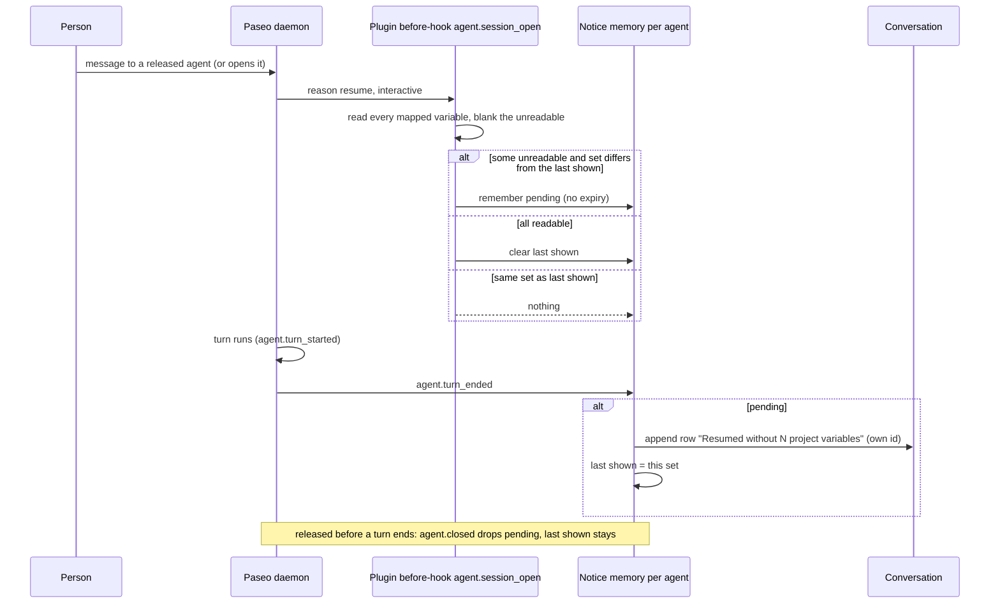

---
id:
title: An agent that resumes without a project variable tells the person why
status: validation
variant: kc-dev-flow-2
profile: pilot
merge: pr
worktree: .worktrees/spacedock-ensign-project-env-resume-blank-notice
pr: iamcxa/kc-paseo-plugins#66
gates:
    version: 1
    records:
        - id: gate:project-env-resume-blank-notice:backlog
          stage: backlog
          attempts:
            - id: gate-attempt:project-env-resume-blank-notice-backlog-1
              briefing:
                id: briefing:project-env-resume-blank-notice:backlog:attempt-1:revision-1
                digest: sha256:c5e6c599004f3e61597c795c17b036c63db4e778a61786cf111ee12ad75cf3d6
                room-ref: ./project-env-resume-blank-notice/review/backlog/briefing-1
              resolution:
                type: Resolution
                id: resolution:spacedock:project-env-resume-blank-notice:backlog:1
                briefing: briefing:project-env-resume-blank-notice:backlog:attempt-1:revision-1
                by: person:captain
                at: "2026-10-30T14:41:48.149008Z"
                decision: approve
                reason: '「開」 — Captain in FO chat, 2026-10-30. Asked: 「要不要開一個小任務，在隔離環境用 0.14.0 實測「agent 恢復時讀不到變數」的情況，有問題就補上提示？我建議開…回「開」或「先不用」。」 FO had recommended opening it.'
              application:
                target-stage: ideation
                state: consumed
        - id: gate:project-env-resume-blank-notice:ideation
          stage: ideation
          attempts:
            - id: gate-attempt:project-env-resume-blank-notice-ideation-1
              briefing:
                id: briefing:project-env-resume-blank-notice:ideation:attempt-1:revision-1
                digest: sha256:ddd599e5bdd7a7536dbcef12b695d71595168bfb30cd80c43c64667e23c14952
                room-ref: ./project-env-resume-blank-notice/review/ideation/briefing-1
              resolution:
                type: Resolution
                id: resolution:spacedock:project-env-resume-blank-notice:ideation:1
                briefing: briefing:project-env-resume-blank-notice:ideation:attempt-1:revision-1
                by: person:captain
                at: "2026-10-30T16:11:53.951434Z"
                decision: approve
                reason: '「准」 — Captain in FO chat, 2026-10-31, on the ideation gate (sha256:ddd599e5), FO having recommended approval; approval also accepts that the line shows when the first turn after a resume ends, not when the chat is opened. Asked: Approve the resume-notice design ... and AC-1 into implementation? FO recommends approving, which also accepts that the line shows when that first turn ends, not when the chat is opened. Say if you object to any part.'
              application:
                target-stage: implementation
                state: consumed
        - id: gate:project-env-resume-blank-notice:validation
          stage: validation
          attempts:
            - id: gate-attempt:project-env-resume-blank-notice-validation-1
              briefing:
                id: briefing:project-env-resume-blank-notice:validation:attempt-1:revision-1
                digest: sha256:8bedffded8f81676dd09a8651431d5127fc9782e221736c2f7bcb5561a900bfa
                room-ref: ./project-env-resume-blank-notice/review/validation/briefing-1
              withdrawal:
                by: agent:first-officer
                at: "2026-11-05T06:46:10.86925Z"
                reason: The Captain asked (「加」, 2026-11-05) to add one Reference sentence that Paseo terminals get no project variables to this PR; the candidate changes, so the validation gate at fec5b13 is withdrawn and re-prepared after a recheck.
            - id: gate-attempt:project-env-resume-blank-notice-validation-2
              briefing:
                id: briefing:project-env-resume-blank-notice:validation:attempt-2:revision-1
                digest: sha256:6f3d0d8f8a202805b655f1a31dd2892bcbc2ac8e7db72db0153f7c5aa6b7cb54
                room-ref: ./project-env-resume-blank-notice/review/validation/briefing-2
              resolution:
                type: Resolution
                id: resolution:spacedock:project-env-resume-blank-notice:validation:2
                briefing: briefing:project-env-resume-blank-notice:validation:attempt-2:revision-1
                by: person:captain
                at: "2026-11-05T08:06:23.300786Z"
                decision: approve
                reason: '「准。再教我一次選 repo 怎樣驗收」 — Captain in FO chat, 2026-11-05, on the validation gate attempt 2 (sha256:6f3d0d8f), FO having recommended approval; approves validation and the three proposed declines (F1, F4, F6 Polish) at candidate df6180ce252d2ae007614dab15aadd7daed12b28. Asked: Approve validation of the resume notice (PR #66 at df6180c) and the three proposed declines? Approval lets FO merge it and reload the live plugin under ADR 0007 class 2, unless the Captain says he merges or holds; the Captain then gives UAT.'
              application:
                target-stage: done
                state: pending
started: 2026-10-30T14:42:08Z
---

Paseo 0.14.0 (released 2026-10-29) "Release eligible agent runtimes after one idle hour, resuming the saved session on the next prompt" (its release notes, read with `gh release view v0.14.0 -R getpaseo/paseo` on 2026-10-30). In `agent.session_open` in `project-env/server/contribute.ts` on main, a variable that cannot be read is blanked for every opening, but the "Started without N project variables" line is recorded only when `request.reason === "create"`. FO has not run this on 0.14.0; whether a release and resume fires `agent.session_open` is unverified. Asked whether to open a small task to test it on 0.14.0 and add the notice if it is a problem, recommending it, the Captain answered 「開」 on 2026-10-30.

## Scope

In: on an isolated Paseo 0.14.0, observe what `agent.session_open` does when an agent's runtime is released and resumed, with a variable readable and with it unreadable; if a resumed agent can lose a variable with no line in its conversation, show the same kind of line there and keep the notice text true.
Non-goals: upgrading the Captain's own Paseo; agent tools or MCP servers from 0.14.0; agent-organised vaults; retrying 1Password reads; changing which variables are injected.
Budget: one ideation, implementation and validation round; a second validation cycle returns to the Captain. If ideation's run shows no gap, the task stops there with the evidence and no code.
Stop condition: the acceptance criterion holds on 0.14.0 and the Captain's UAT is recorded, or ideation's evidence shows no gap and the Captain accepts that.

## Acceptance criteria

**AC-1**: On an isolated Paseo 0.14.0, when an agent's runtime is released and resumed while one mapped variable cannot be read, the conversation shows a line naming that variable and its reason; with every variable readable it shows no such line.
Verified by: a runtime run of both cases on an isolated Paseo 0.14.0 with fake `op` and `security`, recording the `agent.session_open` reason seen, plus a unit test that fails when the resume branch is removed. A real 1Password account is not used.

## FO alignment

Surfaces: ui
Visible change: A resumed agent that lost a project variable shows a line in its conversation naming the variable and the reason.
Direction alignment with the Captain: done — he answered 「開」 on 2026-10-30 to FO's recommendation to test this before he upgrades.
Release review: not needed: it follows a host release and adds no journey story.
Map footprints: not needed: no open map question is answered by this task.
Reviewer: kc-dev-flow-2:engineering-reviewer not run 2026-11-05: Captain amendment 1 adds one sentence to OVERVIEW.md "Limits worth knowing" and supersedes no acceptance criterion (Supersedes: none); nothing the Captain approved is withdrawn, and validation cycle 4 checked the sentence against the SDK 0.14.0 hook list.

## Captain amendments

### Amendment 1 — 2026-11-05, chat
Captain: 「加」 (FO chat, 2026-11-05)
Asked: "要不要在參考頁的「Limits worth knowing」加一句「Paseo 裡開的 terminal 不會有這些變數」？我建議加，只改一句文件，可以併進下一個 PR。…回「加」或「不用」。"
Supersedes: none
Design: Scope gains one sentence in project-env/OVERVIEW.md "Limits worth knowing" saying that terminals opened in Paseo get no project variables

## PRFAQ

**Press line.** When an agent in a connected repository is resumed after Paseo released it, and a mapped variable can no longer be read, the first turn after the resume ends with the warning row "Resumed without N project variables" naming each variable and why. Today that agent runs with the variable blank and shows nothing.

**What is wrong today** (observed 2026-10-30 on an isolated Paseo 0.14.0, fake `op` and `security`; `evidence/runs/resume-check-main.txt`, agent `lost`): the agent opened with `STRIPE_KEY` readable; after a release and a resume `agent.session_open` ran with `reason: "resume"`, `purpose: "interactive"`, the plugin resolved again and returned `STRIPE_KEY: "blank"`, and the conversation holds no plugin row. `contribute.ts` records a notice only when `request.reason === "create"`, and `agent.created` fires only on creation.

**FAQ**
- *Does a release and resume fire `agent.session_open`?* Yes, both times seen: `reason: "resume"`. Viewing a released agent (a timeline fetch) resumes it too, with no message sent (`evidence/observe/fast-events.jsonl`, 14:56:05 and 14:57:17). Resumes are frequent, so a repeat rule is needed.
- *Can the line be appended at the opening?* No. In-hook `timeline.append` fails `Unknown agent` on resume (`evidence/probe-resume.txt`), as the earlier spike found for create.
- *What fires after the resume?* `agent.turn_started` and `agent.turn_ended`, each with a working `paseo` handle; both appends succeeded. A same-id append replaces the earlier row in place (seq unchanged), so a later row needs its own id to appear at the end.
- *Why `turn_ended` and not `turn_started`?* Paseo 0.14.0's default Chat display, "Collapse turns", folds everything inside a finished turn into one summary line. A row appended at turn start lands inside the turn and is not on the page once the turn is done (page text of the default display lacks it, the Full display holds it); a row appended at turn end sits under the final reply and stays visible (`evidence/shots/cand-three-1280.png`).
- *Does the line repeat on every resume?* No. The plugin keeps, per agent in memory, the set of failures last shown (kept across a release, dropped with the daemon); an identical set adds nothing, a different set adds a new row at the end, and a resume with everything readable clears the memory so a later failure shows again. A pending line waits as long as the agent stays open (no ten-minute expiry), and is dropped if the agent is released first.
- *What about the existing "Started without" line?* Kept as is. A failure shown at start is not shown again at a resume with the same set.
- *Does the agent notice stay true?* One sentence changes, because "Started without N project variables" would be incomplete: it now says Paseo shows the user a line in this conversation, "Started without N project variables" or, after the agent was paused and resumed, "Resumed without N project variables", with the same reasons (candidate diff, `server/agent-notice.ts`). The 60 comprehension runs of the notice (task `project-env-built-in-agent-notice`) were on the old sentence; implementation reruns that harness on the new text.
- *Cache.* A value is reused for 15 minutes (`CACHE_MS`), so a resume within 15 minutes of a read sees the cached value and shows no failure; a real release comes after one idle hour, when the cache has expired. My short runs change the mapping to a ref that was never read to get a cold read.

**Existing-code check.** `createNotices` in `missing-variables-notice.ts`, the `agent.created` handler and `MissingVariablesRow` already carry the line; the design extends them (one optional `resumed` flag, one more event, one remembered signature) and adds no new store or module.

## Design

Changes (disposable candidate, `evidence/candidate-disposable.diff`, 8 files against main 06aa5bee, 0 comment lines added): the before-hook also records for `reason === "resume"`; `createNotices` gains a `resumed` flag per entry, a remembered signature per agent, no expiry for resumed entries; one handler on `agent.turn_ended` appends with id `project-env-missing-variables-resumed-<uuid>`; the row data gains optional `resumed: true` and `missingVariablesTitle(count, resumed)` says "Resumed"; OVERVIEW.md's two sentences about the line change. `refresh` and `import` openings stay silent. Candidate: 320 of 320 tests (312 on main), `tsc --noEmit` clean, six mutations each killed (`evidence/mutations-candidate.txt`: resume branch removed, same-failure check removed, resumed entries expiring, fixed row id, `turn_ended` handler removed, title ignoring `resumed`).

Runtime run on the candidate (`evidence/runs/resume-check-cand.txt`) beside main (`resume-check-main.txt`), same script: agent `healthy` resumes twice with `reason: "resume"`, nothing blank, no plugin row in either build; agent `lost` (readable at start, unreadable at both resumes) shows no row on main and one "Resumed" row after the first resumed turn on the candidate, none added by the second resume; agent `blank` (unreadable from the start) keeps its single start row in both builds.

### UI proposal

UI proposal: When an agent Paseo released after an idle hour is resumed and one or more mapped variables can no longer be read, the same warning row the agent shows when it starts without variables appears under the final reply of the first turn after the resume. Its title reads "Resumed without N project variables" (singular "1 project variable"), then one line per variable: the name in monospace, then the reason in the screen's own words. It is not repeated by a later resume that fails the same way; a different set adds a new row at the end; with every variable readable nothing is added.

Preview: /Users/kent/Project/kc-paseo-plugins/docs/dev2/.spacedock-state/project-env-resume-blank-notice/evidence/shots/index.html
The preview is disposable: real Paseo 0.14.0 windows of the candidate on an isolated daemon, driven through the app (operable, not mock-ups), 1280 x 900 and 400 x 900 in dark and light, `cand-<one|three|both>-<1280|400>[-light].png`; `cand-both-startandresume-full-1280.png` (Full display, 1280 x 2600) shows the start row and the resume row together; `main-three-*` is today's build, context. Every picture is a first turn stopped after two seconds. Not drawn: the turn while it runs, a turn that fails, more than three variables, dark-theme contrast; the running screen settles these in validation (AC-1 clause).

### Design review

Design review: design/ideation-1.yaml
Design finding 1: fixed: drew `cand-both-startandresume-full-1280.png` with the "Started without 1 project variable" row and the "Resumed without 2 project variables" row in one frame; the repeated name STRIPE_KEY is listed again under the resume title because each row lists the set at its own opening.
Design finding 2: AC-1
Finding 2's answer: the row is appended on `agent.turn_ended`, which Paseo 0.14.0 emits for a completed, a failed and a cancelled turn (`publishAgentStream` in the daemon's `plugins/lifecycle`), so a first turn that fails still ends with the row; every picture is a stopped (cancelled) turn. The AC-1 evidence clause adds a screenshot of a failed first turn. The many-variables half is the existing row's one-line-per-variable stack, unchanged here.
Design finding 3: declined: the mid-word wrap and the dangling dash come from the existing row component the start row shares; changing it is its own task.
Design finding 4: declined: host component foregroundMuted at /tmp/pe-resume-install/node_modules/@getpaseo/plugin/dist/contracts.d.ts: the reason colour is the plugin theme token the start row already uses; this task adds no colour.
Decline check: design/declines-2.yaml
Rulings (`declines-2.yaml`, run on the declines then standing; `declines-1.yaml` was the first pass): finding 1 was overruled in the first pass and fixed; finding 2 overruled, now AC-1; findings 3 and 4 upheld (4 first came back as a decision for the Captain because no declaration was named; with the declaration, `contracts.d.ts` lists only two text tokens).

### Batch overlap

- `project-env-overview-notes-test` (validation): changes `test/` for the OVERVIEW troubleshooting notes and may touch `OVERVIEW.md` headings; this design edits two sentences in `OVERVIEW.md` outside any cause heading and adds tests in `test/missing-variables.test.ts`. Shared index: none.
- `project-env-pick-repository` (validation): `client/` project list and one docs Prepare step; no shared file. 
- `project-env-test-row-draft-note` (backlog): `client/settings-screen.tsx`; no shared file.
- `project-env-release-1` (backlog): a release umbrella, no file.
Recommended order: any; this task touches `server/contribute.ts`, `server/missing-variables-notice.ts`, `server/agent-notice.ts`, `shared/cause.ts`, `shared/config.ts`, `client/missing-variables-row.tsx`, `OVERVIEW.md` and `test/missing-variables.test.ts`, none of which the others change. If `project-env-overview-notes-test` lands first, rebase the two `OVERVIEW.md` sentences onto it.

### AC-1 evidence clause

Reproduce: `RUN=<label> PORT=<free port> CHECKOUT=<tree holding project-env> bash evidence/harness/resume-check.sh` (needs `@getpaseo/cli@0.14.0` installed in `/tmp/pe-resume-install`, `npm install` there). It builds an isolated daemon (own home and port, plugin built from `CHECKOUT`, fake `op`/`security`, mock provider via `PASEO_NODE_ENV=development`, idle period cut to 20 s), runs three agents through a release and two resumes and prints, per agent, each `agent.session_open` reason, which variables came back blank, and the plugin rows in the conversation. Passes when: `lost` shows `reason: resume` with one variable blank and exactly one row "Resumed without 1 project variable" naming it after the first resumed turn and no second row after the second; `healthy` shows no row; `blank` shows only its start row. Plus a unit test in `test/missing-variables.test.ts` that fails when the resume branch is removed (killed by "resume branch removed", 4 failures), and validation's screenshots of the running screen at 1280 and 400 px with the default Chat display, one of them a resumed first turn that fails (not only one that is stopped) showing the row. No real 1Password account.

## Observation record (2026-10-30, Paseo 0.14.0 from `npm install @getpaseo/cli@0.14.0` in `/tmp/pe-resume-install`; `/Applications/Paseo.app`, the global `paseo` and `~/.paseo` untouched)

- Release: `idle-runtime-cleanup/index.js` collects a runtime idle for `IDLE_PERIOD_MS = 60 * 60000`, sweeping every 60 s, and logs "Collected idle agent runtime"; it emits `agent.closed`, not `agent.created`, at the next open. Forced by changing that one constant to `20000` in a throwaway copy of the installed package (`evidence/observe/fast-idle-period.txt`; the unpatched copy reads `60 * 60000`, `real-idle-period.txt`); the plugin, the sweep and the resume path are untouched. The `mock` provider needs `PASEO_NODE_ENV=development`.
- Resume with a readable variable: `reason: "resume"`, both variables filled, no row (`evidence/observe/fast-events.jsonl`).
- Resume with an unreadable one: `reason: "resume"`, `STRIPE_KEY: "blank"`, no plugin row (14:58 to 15:00 in the same file, and `resume-check-main.txt`). An earlier try at 14:52:52 saw both variables filled because the 15-minute cache still held the value; I do not count it.
- Probe (`evidence/harness/probe.index.server.tmpl.ts`, `evidence/probe-resume.txt`): in-hook append fails `Unknown agent`; append after 300 ms and 3 s succeeds on the mock provider; `agent.turn_started` fires on the resume's turn; a same-id append replaces in place.
- Chat display: in the default "Collapse turns" the resume row appended at turn start is absent from the page text; appended at turn end it is visible. The existing start row is visible when it lands before the first user message (seq 1) and folded when it lands after it (seq 3 in one candidate run), so it can be folded by default in 0.14.0 today (pre-existing; not changed here).
- Unpatched one-hour release (`evidence/observe/real-hour-events.jsonl`, `real-hour-collected.txt`): two agents created at 14:53:31, both "Collected idle agent runtime" at 15:54:27 (about 61 minutes), with `agent.closed` and no `agent.created`; a message then fired `reason: "resume"`, `purpose: "interactive"` with both variables filled and no row. My attempt at the unreadable case there failed: I resumed the second agent after the first had re-read and re-cached the values, so it saw filled values. That case was not captured on an unpatched run.
- Not observed: an unreadable variable at a resume on an unpatched one-hour release, a real provider's resume time, the desktop app, a failed (not stopped) turn, a daemon restart with a real provider (the mock keeps no history), dark-theme contrast.

## Known limits (not decisions)

- The row appears when the first turn after the resume ends, not when a person opens the conversation: Paseo 0.14.0 gives the plugin no event between the resume and a turn, and the in-hook append fails `Unknown agent`. A person who only views a resumed agent sees nothing until a turn finishes; the agent notice tells the agent to say a variable is blank.
- `refresh` (reload) and `import` openings stay silent, as before; a daemon restart drops the remembered set (and, per the earlier task, plugin rows), so one restart can repeat a line.
- The existing "Started without" row can be folded away by the default Chat display when Paseo places it after the first user message (seen once, seq 3); pre-existing, outside this task.
- The 60 comprehension runs of the agent notice were on the old sentence; the implementation reruns that harness on the new one. Agents created before the plugin update keep the old notice text.
- Not exercised: the unpatched one-hour release (`real-hour-*` files), a real provider's resume time, the desktop app, a turn that fails (source and a stopped turn only), dark-theme contrast.

### Needs decision

Is it acceptable that the line shows when the first turn after the resume ends rather than when a person opens the chat? Recommendation: yes. The alternatives are worse: a row at turn start is folded away by Paseo 0.14.0's default Chat display once the turn finishes (observed), and a timed retry after the opening depends on how long each provider takes to resume (not measured; the in-hook append fails and a fixed delay is a guess). Cost of yes: a person who only views a resumed chat sees nothing until a turn ends. AC-1 as written says "the conversation shows a line"; this reads it as "once the next turn has ended".

## Stage Report: ideation

- DONE: Run first, then design: on an isolated Paseo 0.14.0 observe what `agent.session_open` does when an agent's runtime is released and resumed, with a mapped variable readable and with it unreadable, recording the `reason` and whether the conversation shows any line; say how you forced the release if the one-hour idle wait can be shortened, and what you could not observe. If there is no gap, say so with the evidence and propose stopping.
  There is a gap. Resume fires `agent.session_open` with `reason: "resume"`; readable shows no line (correct), unreadable blanks the variable and shows no line (`evidence/runs/resume-check-main.txt`, `evidence/observe/fast-events.jsonl`). Release forced by changing `IDLE_PERIOD_MS` from `60 * 60000` to `20000` in a throwaway copy of `@getpaseo/cli@0.14.0`; one unpatched hour release also observed (readable case only). Not observed: listed in "Observation record" (unreadable on an unpatched hour, real provider, desktop app, failed turn).
- DONE: If there is a gap, design the smallest change: the line on a resumed agent, how it avoids repeating on every resume with the same failure, whether the agent notice text stays true, keeping AC-1 with a reproducible evidence clause; produce the previews the ui surface owes at 1280 and 400 px and the design review, each finding dispositioned.
  PRFAQ, Mermaid, `### UI proposal`, `Preview:`, `### Design review` (4 findings: 1 fixed, 1 AC-1, 2 declined and upheld), `### AC-1 evidence clause`, `### Batch overlap`; `design_surfaces.py check` printed "design surfaces presentable". Candidate (disposable, `evidence/candidate-disposable.diff`): 320 of 320 tests, typecheck clean, 6 of 6 mutations killed, 0 comment lines added.
  AC-1: design stated with a reproducible clause (`evidence/harness/resume-check.sh`, unit test killed by "resume branch removed"); met on the throwaway candidate in the shortened-idle runs (`resume-check-cand.txt`); not yet verified: the unpatched-hour unreadable case, the failed-turn screenshot, the real running screen at validation.
- DONE: Name any decision the Captain must make (at most one), with a recommendation.
  One: accept that the line shows when the first turn after the resume ends, not when the chat is opened; recommendation yes (see "Needs decision").

### Summary

Resumed agents lose an unreadable variable silently on Paseo 0.14.0; the fix is a "Resumed without N project variables" row appended at the end of the first turn after the resume, remembered per agent so the same failure is not repeated, with one agent-notice sentence updated. The row goes at turn end because the default Chat display folds a row placed at turn start; all runtime evidence was on the mock provider with fake `op`, and the unpatched-hour unreadable case was not captured. Isolated daemons, ports 9411 to 9417 and install copies are removed.

## Stage Report: implementation

- DONE: Implement the approved design exactly, starting from evidence/candidate-disposable.diff: the "Resumed without N project variables" row at the end of the first turn after a resume, the per-agent memory so the same failure is not repeated, the agent-notice sentence and the two OVERVIEW.md sentences.
  Candidate applied clean (51481d2), plus two roborev repairs on the memory (33d3c62, 9d8760b); branch spacedock-ensign/project-env-resume-blank-notice on base 06aa5bee; Draft PR https://github.com/iamcxa/kc-paseo-plugins/pull/66. Deviation from "refresh stays silent": a refresh now silently forgets the shown variables it read (`retain` in `missing-variables-notice.ts`); no row, no UI change.
- DONE: Land AC-1's evidence at the candidate commit with evidence/harness/resume-check.sh (adapted: own install, port 19604), plus the unit test that fails when the resume branch is removed.
  `evidence/impl/runs/resume-check-impl-cand.txt` at 9d8760b: `lost` reason=resume STRIPE_KEY blank, one "Resumed" row (seq 361) after resume 1, none added by resume 2; `healthy` no row; `blank` only its start row. Earlier run at 51481d2 in `resume-check-impl-cand-51481d2.txt`. `runs/mutations-impl.txt`: "resume branch removed" fails 6 tests; same-failure check, ten-minute expiry, fixed row id, missing turn_ended handler, title and refresh-forget mutations each fail 1 to 11.
- DONE: A screenshot of a failed first turn, and whole-page pictures at 1280 and 400 px.
  `evidence/impl/shots/cand-failed-full-{1280,400}.png` (mock "Requested mock provider failure" turn, row under it), plus `cand-{one,three,both}-full-{1280,400}.png`, dark theme, Paseo 0.14.0 default Chat display; taken at 51481d2, the row code is unchanged since.
- DONE: A rerun of the agent comprehension harness on the new notice sentence (Codex gpt-6.1-sol medium, Claude claude-sonnet-5-5 medium and low, at least 4 runs per cell, blank-variable scenario).
  12 runs, 4 per cell (`evidence/impl/comprehension/out/r1..r4`, `run4.sh`, notice `notice-resume.txt`): every run says the variable is blank and gives the Settings, Plugins, Project environment, Test path; `grade.py`: no leak in transcript or repo, no env probe. Read by me, not independently graded.
- DONE: Run `npm test`, `npm run typecheck`, the roborev gate, `design_surfaces.py check` and `doc_impact.py <base> <candidate>`.
  `npm test` 322 of 322 (session-open deadline test not the cause of any failure), typecheck clean, design_surfaces "presentable", `comment_ratio.py` 0 of 188 code lines. doc_impact lists only `docs/adr/0004-reserved-variable-names-are-skipped-not-blanked.md`: unaffected: it governs reserved names; the `resumed` field added to `shared/config.ts` does not touch them. Roborev: three runs (`roborev:1367`, `1369`, `1371`), the first two fixed; the last, `evidence=roborev:1371` at 9d8760b, is open (below).
- DONE: Docs (doc-site extension): retake the docs pictures and compare; update docs or say `docs: no change` with the capture diff.
  Retaken on 0.14.0 (`evidence/impl/docs-capture/new`): 05 and 07 identical; 01, 02, 04, 06 differ in a 13 px text band (the plugin and repository path, `diff04-new-over-committed.png`), 03 in 10 pixels. docs: no change to pictures. Sentences: `project-env/OVERVIEW.md` two sentences updated (intro and "When a variable is blank"); `docs/project-env/index.md` "A failure is visible, not silent" still true for a new agent and left alone (finding below).
- DONE: Open the Draft PR.
  PR 66, draft, base main; body carries evidence, limits and `without-it unanswered: none`.

### Findings for FO

- Open roborev finding (Medium, fix budget of two used): if a refresh reads every variable between a resume's opening and the end of that turn, the later flush still remembers the failure, so one later identical failure is suppressed. Trigger unobserved; Deferred risk. Would become Material if refresh during a running turn is shown to happen.
- `docs/project-env/index.md` line "a line at the top of the new conversation" describes only the start row; the resumed row is not mentioned there. Not in the design's two-sentence scope; FO to say if a third sentence belongs in this PR.
- Not exercised: unreadable variable on an unpatched one-hour release, real provider resume time, desktop app, dark-theme contrast; runtime evidence is on the mock provider with a 20 s idle period. Validation owns the real-screen pictures at 1280 and 400 px.

### Summary

The ideation candidate is implemented and in Draft PR 66: a resumed agent that lost a variable shows "Resumed without N project variables" once its next turn ends, including a failed turn, and the same failure is not repeated. AC-1 holds on an isolated Paseo 0.14.0; comprehension of the changed notice sentence was 12 of 12. Two memory edge cases found by the roborev gate were repaired inside the design's spirit; a third narrow one is reported open.

## Stage Report: validation

Verdict: PASSED recommended for candidate 9d8760b85a71f72087a11821eb276ccf2d3d0ec2 (PR #66, base 06aa5be). Run from `git archive` of the candidate; evidence under `evidence/val/`.

- DONE: Independently check candidate 9d8760b against AC-1 and the approved design: from git archive run `npm ci && npm test` and `npm run typecheck`
  `npm ci` clean, `npm test` 322 of 322 pass (no flaky failure), `tsc --noEmit` no errors. comment_ratio 0 of 188 code lines exit 0; adr_lint exit 0 (9 records); dispatch_records 3 complete; doc_impact lists ADR 0004 only, implementation recorded `unaffected: reserved names` and I agree (the new `resumed` field touches no reserved name).
- DONE: run the resume harness yourself on an isolated Paseo 0.14.0 for the lost, healthy and blank agents
  `evidence/val/runs/resume-check-cand.txt` (own install, port 21704, idle period 20 s): `lost` reason=resume STRIPE_KEY blank, one "resumed" row after resume 1, still one after resume 2; `healthy` two resumes, nothing blank, no plugin row; `blank` only its start row. Control on base 06aa5be (`resume-check-main.txt`): `lost` blank at both resumes and no row, so the harness detects the gap.
- DONE: try to capture the unreadable case on an unpatched one-hour release if the run can wait
  Captured. `runs/hour-idle-period.txt` reads `60 * 60000` (unpatched); both agents created 16:45:01Z, "Collected idle agent runtime" at 17:45:58Z (`hour-collected.txt`, `agent.closed` and no `agent.created`); the ref for `lost` was renamed to a never-read one for a cold read; resume fired `reason=resume purpose=interactive`, STRIPE_KEY blank, one row `{"variables":[STRIPE_KEY missing-field],"resumed":true}` after the turn; `healthy` filled, no row (`hour-check-cand.txt`, `hour-events.jsonl`). One run, mock provider.
- DONE: check the row after a failed first turn
  `shots/val-failed-full-1280.png`, `val-failed-full-400.png`, light `valv-failed-*-light.png`: "[System Error] Requested mock provider failure" then the "Resumed without 1 project variable / STRIPE_KEY — field not found in the vault" row under it, in Paseo 0.14.0's default Chat display.
- DONE: check the resume branch is caught by a unit test when removed
  Removing `|| request.reason === "resume"` in `contribute.ts` fails 6 of 322 (`runs/mutation-resume-branch-removed.txt`): the next-turn-end line, one line per opening, no repeat on same failure, new line on changed failure, and both refresh-forget tests. Restoring it passes 322 (`acceptance.sh` steps 1-2).
- DONE: rerun the agent comprehension harness on the new notice sentence and grade it independently
  `notice-candidate.txt` is byte-identical to the candidate's `agentNotice`. 12 runs (Codex gpt-6.1-sol medium, Claude claude-sonnet-5-5 medium and low, 4 each, scenario s1-blank, fake values) in `comprehension/out`; I read all 12 final messages: 12 of 12 say the variable is unusable and give the Settings, Plugins, actions menu, Project environment, Test path; none asks the person to set or paste a value; `grade.py` finds no leak in transcript or repo (its one env-probe flag is a `sed` of the script, not an env read). Two runs say "isn't set" rather than "blank". Limit: no run mentions either line, so the harness shows the sentence causes no regression, not that an agent names "Resumed without".
- DONE: Classify the implementation's two open points: its deviation from "refresh stays silent" and roborev:1371; say whether docs/project-env/index.md's "a line at the top of the new conversation" is still true.
  See F1, F2, F3 below.
- DONE: Run the built screen review your validation principles require (design-director pass 2a on your own screenshots of the built screen at 1280 and 400 px) and write its Built screen review lines
  Lines below; 3 MINOR findings, all declined and upheld in pass 2b.
- DONE: write the minimal acceptance script FO will rerun in a fresh shell.
  `evidence/val/acceptance.sh` (41 s measured), steps below.
- DONE: Record what the Captain should see in the screenshots and every unverified obligation.
  Below.

Built screen review: design/validation-1.yaml
(The report's `preview:` lists twelve pictures; the check takes one path, so the file keeps the first, `val-failed-full-1280.png`.)
Built screen finding 1: declined: no-row and repeat-adds-nothing cannot be drawn; proven by `resume-check-cand.txt` and unit tests
Built screen finding 2: declined: wrapped-reason layout belongs to the shared MissingVariablesRow, already upheld as its own task
Built screen finding 3: declined: light three-variable and failed pictures cover the same component
Built screen decline check: design/validation-declines-1.yaml

### Findings

- F1 Polish: the "refresh stays silent" deviation (`notices.retain`) changes nothing a person sees. A refresh or import opening still adds no row; it only drops remembered failures that refresh read as fixed, which is the design's own rule for a resume with everything readable. Two unit tests cover it (both killed by the resume-branch removal above; the implementation's mutation run killed the refresh-forget mutation). No field of Material is established (no observable harm, no AC at risk). Disposition: accept.
- F2 Deferred risk: roborev:1371. A probe on the real module (`runs/probe-1371.ts`, output `rows ... : 1`) confirms the mechanism: resume with failure, a refresh that reads everything, turn end, then an identical failing resume adds no second row. The trigger needs a refresh between the resume opening and that turn's end. Source (`reloadAgentSessionInternal`, daemon 0.14.0) cancels an in-flight run before building the launch context, so the turn normally ends first; I did not observe a refresh inside a resumed turn. It would become Material if a reload during a running resumed turn is shown to deliver `agent.turn_ended` after the refresh opening.
- F3 Polish: `docs/project-env/index.md` line "a line at the top of the new conversation, "Started without 1 project variable"" is still true for a new agent but now incomplete: a resumed agent gets "Resumed without N project variables" at the end of its next turn, which that page does not say (the Reference page includes the updated OVERVIEW.md, so the full wording is published there). Install and Prepare 1Password pages and their pictures show no conversation row and still match. One added clause on index.md would close it; FO or the Captain decides whether it belongs in this PR.
- F4 Polish (pre-existing, outside this task): in the default Chat display the "Started without" row sits at seq 3, after the first user message, and is folded; `val-both-*.png` shows only the resumed row. The resumed row is visible, so after this change a resumed conversation can show the later line while the earlier one is hidden.

### Acceptance script (Captain or FO, fresh shell, 41 s measured)

Run `bash /Users/kent/Project/kc-paseo-plugins/docs/dev2/.spacedock-state/project-env-resume-blank-notice/evidence/val/acceptance.sh`. It extracts the candidate commit into a temp folder, then:
1. `npm ci`, then the 11 "a resumed agent" tests: expect `ℹ tests 11`, `ℹ pass 11`, `ℹ fail 0`.
2. Removes the resume branch from `server/contribute.ts` and reruns them: expect `ℹ fail 6`.
3. Restores it, runs the whole suite and the typecheck: expect `ℹ tests 322`, `ℹ pass 322`, `ℹ fail 0`, `typecheck clean`.
4. Prints the two screenshot paths to open: dark, the first turn after a resume that failed, row "Resumed without 1 project variable / STRIPE_KEY — field not found in the vault" under the error line, at 1280 px (also in `val-failed-full-400.png`).
Does not cover: the live Paseo resume (needs the harness, about 6 minutes: `RUN=<label> PORT=<free port> CHECKOUT=<tree> IDLE_MS=20000 bash evidence/val/harness/resume-check.sh` after `npm install @getpaseo/cli@0.14.0` into `/tmp/pe-val-install`; run once above), a real provider, a real 1Password account.

### What the Captain should see in the screenshots

`shots/val-*-full-{1280,400}.png` (dark, whole page) and `valv-*-{1280,400}[-light].png` (viewport): a warning triangle row under the final reply: title "Resumed without N project variables" (singular "1 project variable"), then each name in monospace and its reason in grey; `val-three-*`: three names with three different reasons, long name breaks mid-word at 400 px (accepted earlier); `val-both-*`: only the resumed row (the start row is folded). Mock provider replies are cut mid-sentence by the mock, not by the change.

### Unverified obligations

- A real provider's resume time and a real `op`/1Password account (all runs: mock provider, fake `op` and `security`).
- The desktop app (all pictures: the 0.14.0 web app served by the isolated daemon).
- A daemon restart (the remembered set is dropped; a restart can repeat one line), and the resumed row on a person who only views the chat without a turn (known limit, accepted at the ideation gate).
- Contrast in dark and light is read by the design director from the pictures, not measured; no two-variable light picture.
- The unpatched one-hour release was captured once; repeat suppression and the failed-turn row were observed on the 20 s idle period.
- F2's trigger (a refresh inside a resumed turn) and the comprehension of the new "Resumed without" clause by an agent in a resumed conversation.
- Temporary installs, daemons (ports 21704 to 21707) and `/tmp/pe-val*` copies were removed; Paseo.app, the global `paseo` and `~/.paseo` untouched.

### Summary

The candidate meets AC-1 on an isolated Paseo 0.14.0: unreadable at a resume shows one "Resumed without" row after the next turn (also after a failed turn and on an unpatched one-hour release), readable shows none, a repeat adds none, and removing the resume branch fails 6 tests. The refresh deviation is Polish, roborev:1371 is a confirmed-mechanism Deferred risk with an unobserved trigger, and `docs/project-env/index.md` is incomplete but not false. Recommend PASSED.

### Local extension doc-site (round 2)

Asked: implementation retakes the docs pictures and updates changed words; validation follows the built pages through the changed screens. Caught: `docs/project-env/index.md` "a line at the top of the new conversation" is true for a new agent but incomplete for a resumed one (validation-1 F3, also raised by implementation), which `doc_impact.py` did not list. Pictures: no change. Cost: one capture run in implementation and part of validation; a possible extra small repair, pending the Captain. By hand: FO wrote both lines into the scope notes.

### Captain disposition of validation-1 F3 (2026-11-01)

Captain: 「補」 (FO chat, 2026-11-01)
Asked: 「要你決定的：文件網站介紹頁的一句話…我建議在這個 PR 補一個子句，再做一次簡短複驗…回「補」或「不補」。」, about validation-1 F3 at candidate 9d8760b85a71f72087a11821eb276ccf2d3d0ec2.
Effect: one clause is added to `docs/project-env/index.md` on PR #66, then a short recheck.

## Feedback cycle 1 (validation-1 F3)

Head: acf6a0e46 on PR #66's branch (pushed), one docs commit on top of 9d8760b; only `docs/project-env/index.md` changed.

- DONE: added one sentence to the "A failure is visible, not silent." bullet: "A resumed agent that can no longer read a variable gets a "Resumed without N project variables" line when its next turn ends."
- DONE: rebuilt the site with `docs/project-env/capture/build-site.sh` (ruby:3.3, github-pages gem set, built from `git archive` of the branch plus the edit); the built `docs/project-env/index.html` carries the sentence (`evidence/fb1/page-sentence.txt`, `build-site.txt`).
- DONE: `npm test` 322 of 322, `npm run typecheck` clean (no code changed).
- Roborev gate at acf6a0e (`evidence=roborev:1382`, `evidence/fb1/roborev-gate.txt`): one Medium finding, on code this docs-only repair did not touch and was told not to change: a partial recovery at a resume is forgotten only when the notice is appended, so if the agent is released before its turn ends and both variables then fail again, the next resume's warning is suppressed. Same family as the open finding in the implementation report (stale remembered set); unobserved trigger, Deferred risk. Not fixed; FO to decide whether it returns to a code repair.

## Stage Report: validation (cycle 2)

Verdict: PASSED recommended for candidate acf6a0e4685b8bd1f5eb941b2abd2a259f08d8c2 (PR #66 after feedback cycle 1; rejected candidate 9d8760b). Run from `git archive`; evidence under `evidence/val2/`.

- DONE: Re-review candidate acf6a0e for validation-1 F3: confirm the diff against 9d8760b is the one sentence in docs/project-env/index.md and nothing else
  `git diff --name-only 9d8760b acf6a0e` lists only `docs/project-env/index.md`, 1 insertion and 1 deletion; 9d8760b is an ancestor. comment_ratio 0 of 188 exit 0, adr_lint exit 0, dispatch_records 5 complete, doc_impact the same single ADR 0004 line as in cycle 1 (candidate code unchanged, so the recorded `unaffected` stands).
- DONE: read it against the behaviour you observed
  The added sentence "A resumed agent that can no longer read a variable gets a "Resumed without N project variables" line when its next turn ends." matches the runs in `evidence/val/runs/`: the row is appended at the turn end after a resume that reads a variable as unreadable, not at the opening (`resume-check-cand.txt`, `hour-check-cand.txt`), and an agent that was blank from the start gets no second row. It does not say "not repeated while the same variables stay blank" (OVERVIEW.md and the Reference page carry that); not false, and F3 is closed.
- DONE: rebuild the site and confirm the page shows it
  `docs/project-env/capture/build-site.sh` (Docker, github-pages 232, 38 s, `evidence/val2/site-build.txt`) on the archive: built `docs/project-env/index.html` contains the sentence; `reference.html` carries both OVERVIEW.md sentences.
- DONE: rerun `npm test` and `npm run typecheck` from git archive
  `npm ci`, `npm test` 322 of 322, `tsc --noEmit` clean.
- DONE: update the acceptance script for the new head
  `evidence/val2/acceptance.sh` (42 s measured), steps below.
- DONE: Classify roborev:1382 (Medium, server/missing-variables-notice.ts ...), together with roborev:1371: say whether the two are one cause, whether either changes AC-1, and what would make them Material.
  See F5.
- DONE: Built screen review: no client file changed since validation-1 (confirm with the diff); if so, say so instead of rerunning it.
  Confirmed: the only changed file is `docs/project-env/index.md`, no file under `project-env/client/` or `shared/`; the pictures of validation 1 stand (taken at 9d8760b).

Built screen review: design/validation-1.yaml
Built screen finding 1: declined: no-row and repeat-adds-nothing cannot be drawn; proven by `resume-check-cand.txt` and unit tests
Built screen finding 2: declined: wrapped-reason layout belongs to the shared MissingVariablesRow, already upheld as its own task
Built screen finding 3: declined: light three-variable and failed pictures cover the same component
Built screen decline check: design/validation-declines-1.yaml

### Findings

- F5 Deferred risk: roborev:1371 and roborev:1382 are one cause on two paths, and neither changes AC-1. Cause: `shown` (the failures a person last saw) is written only when a resumed row is flushed at a turn end, from the snapshot taken at that resume's opening, so a later observation that cannot reach a flush leaves it stale. 1371: a refresh that reads everything between the opening and the flush is overwritten by the flush. 1382: a resume that reads only some of the failures, followed by a release before any turn ends (`drop`), never updates `shown`. A probe on the real module (`evidence/val2/probe-1371-1382.ts`, output `.txt`) reproduces both: 1 row where 2 are expected; controls: the same partial recovery with its turn ending gives 3 rows, a full recovery then release gives 2. AC-1 stands: the first unreadable variable after a resume always shows a row (harness, hour run), and "an identical set adds nothing" is the Captain-approved design; these two only suppress a repeat of a set the person already saw, after a recovery in between. The all-readable case the design promises ("a later failure shows again") is intact.
- F5 trigger and what would make it Material: 1382's trigger is more likely than 1371's, because a view-only resume (opening a released chat resumes it with no turn, ideation FAQ) followed by the idle-hour release drops the pending line with no turn end; 1371 needs a reload during a resumed turn (the daemon cancels the in-flight run first; unobserved). Neither is observed in a user's workflow. Each would be Material if the Captain rules, or an AC states, that a variable which recovered (even partly) and fails again must always be shown again, or if a person is shown to miss a real failure this way in a supported flow. I believe one repair covers both (apply each opening's observed failures to `shown` at the opening, and let the flush only decide display); I did not build or test it. Disposition: keep as Deferred risk; the Captain may rule to fix it in this PR or a follow-up.

### Acceptance script (Captain or FO, fresh shell, 42 s measured)

Run `bash /Users/kent/Project/kc-paseo-plugins/docs/dev2/.spacedock-state/project-env-resume-blank-notice/evidence/val2/acceptance.sh`. It extracts the candidate into a temp folder, then:
1. Prints the diff stat since the rejected candidate: expect `docs/project-env/index.md | 2 +-` and `1 file changed`.
2. Greps the new sentence from `docs/project-env/index.md`: expect it printed once.
3. `npm ci`, then the 11 "a resumed agent" tests (expect `ℹ pass 11`), then with the resume branch removed (expect `ℹ fail 6`).
4. Full suite (expect `ℹ pass 322`, `ℹ fail 0`) and `typecheck clean`.
5. Prints the two screenshot paths to open: dark, first turn after a resume that failed, "Resumed without 1 project variable / STRIPE_KEY — field not found in the vault" under the error line.
Does not cover: the rendered site (needs Docker: `bash docs/project-env/capture/build-site.sh <copy>` then open `_site/docs/project-env/index.html`; run once above), the live resume (harness, about 6 minutes, run in cycle 1 including an unpatched one-hour release), a real provider, a real 1Password account.

### Unverified obligations

Unchanged from cycle 1 (real provider and 1Password, desktop app, daemon restart, view-only resume shows nothing until a turn ends, measured contrast, comprehension of the "Resumed without" clause), plus: F5 is reproduced at module level only, not in a running daemon. `/tmp/val2-cand` and `/tmp/x` copies removed; Paseo.app, the global `paseo` and `~/.paseo` untouched.

### Summary

The only change since the rejected candidate is one accurate sentence on the introduction page, confirmed in the source diff and in the rebuilt site, and checks are unchanged (322 of 322, typecheck clean, built-screen review stands). roborev:1371 and 1382 are one stale-memory cause that only suppresses a repeat of an already-seen failure after a recovery; AC-1 holds and both stay Deferred risk. Recommend PASSED.

### FO acceptance rerun (2026-11-01)

FO ran `evidence/val2/acceptance.sh` in a fresh `env -i` shell against acf6a0e: the 11 resumed-agent tests pass, removing the resume branch fails 6, the whole suite 322 pass 0 fail, typecheck clean; exit 0 (`evidence/fo-acceptance-rerun-acf6a0e.txt`).

## ADR 0007 classes for this task

Classes 1 and 3 stay with the Captain (demoted 2026-10-25, kept by 「可以，這輪維持」 on 2026-10-26, not restored in writing since). FO merges under class 2 only after his approved validation.

### FO declines (proposed; the Captain rules)

- Validation F1 (Polish), candidate revision acf6a0e4685b8bd1f5eb941b2abd2a259f08d8c2: `notices.retain` forgets shown variables a refresh read, unlike the design's "refresh stays silent". Proposed decline of any change: no row or UI differs, and it is the design's own rule for a resume with everything readable (validation-1). Material if a refresh is seen to add or drop a row; candidate fix: none needed.
- Validation F2 and F5 (Deferred risk), roborev:1371 and roborev:1382, candidate revision acf6a0e4685b8bd1f5eb941b2abd2a259f08d8c2: one cause on two paths, the "last shown" memory is written only at a turn-end flush, so a repeat of a failure already shown can be suppressed after a recovery that reached no flush (module probe `evidence/val2/probe-1371-1382.ts`; not seen in a running daemon). Proposed decline: AC-1 holds, the first unreadable variable after a resume always shows, and "an identical set adds nothing" is the approved design. Material if a person misses a real failure this way in a supported flow; candidate fix: apply each opening's failures to the memory at the opening and let the flush only decide display.
- Validation F4 (Polish, pre-existing), candidate revision acf6a0e4685b8bd1f5eb941b2abd2a259f08d8c2: the "Started without" row can be folded by Paseo 0.14.0's default Chat display. Proposed decline: outside this task's Scope and unchanged by it. Material when the Captain upgrades to 0.14.0 and misses that line; candidate fix: its own task.

### Codex round 1 on acf6a0e (2026-11-01)

External review rounds: 1 — Codex review:5726153468 on acf6a0e46: one P2 line finding in `project-env/server/missing-variables-notice.ts`, "Preserve recovery state when flushing a pending resume notice" (comment 4434175350). It is the same cause as roborev:1371 and roborev:1382 (validation cycle 2 F5). FO asks the Captain whether to repair it; no gate is prepared until he rules.

### Captain disposition of Codex round 1 P2 and roborev:1371/1382 (2026-11-03)

Captain: 「修」 (FO chat, 2026-11-03)
Asked: 「…這是同一個原因第三次被獨立抓到…建議的修法：每次開啟 agent 時就更新記憶，回合結束時只決定要不要顯示…回「修」或「先合併」。」, about Codex comment 4434175350 (P2) and roborev:1371 and roborev:1382 at candidate acf6a0e4685b8bd1f5eb941b2abd2a259f08d8c2.
Effect: the stale "last shown" memory is repaired on PR #66 so a recovery that reaches no turn-end flush is not lost; then validation reruns and Codex is asked again.

## Feedback cycle 2 (Codex P2, roborev 1371/1382)

Head: fec5b137b on PR #66's branch (pushed over SSH), two code commits on top of acf6a0e (ae46e7f, fec5b13); only `project-env/server/missing-variables-notice.ts` and `project-env/test/missing-variables.test.ts` changed.

- DONE: repaired the one cause. `createNotices` keeps, per agent, `current` (failing variables at the latest opening, any reason) beside `shown` (last displayed set). Every opening (`record` and `retain`) applies its failures and recoveries to both at once (`observe`); the turn-end `flush` only decides what to append and then remembers `shown = displayed ∩ current`, so a recovery that reached no flush is not undone. Resume still shows a row when the set differs from `shown` as it was before that opening (so a partial recovery still adds a row for the smaller set, as the design says); identical set, all readable, create, drop-on-release and the ten-minute expiry for non-resumed entries behave as before.
- DONE: three regression tests, each fails on acf6a0e and passes on ae46e7f (run by swapping in `git show acf6a0e:project-env/server/missing-variables-notice.ts`): (1) Codex's sequence record(failure, resumed) → retain([]) → flush() → record(failure, resumed) → flush() appends 2 rows (acf6a0e: 1); (2) 1371 refresh path: resume opening, readable refresh, turn end, cache expiry, same failure at the next resume shows 2 rows (acf6a0e: 1); (3) 1382 path: resume {A,B} shown, resume {B} released before its turn ends, resume {A,B} shows 2 rows (acf6a0e: 1).
- DONE: `npm test` 325 of 325, `npm run typecheck` clean, comment_ratio 0 of 229 code lines.
- DONE: resume-check.sh on Paseo 0.14.0 (throwaway npm install, own home, port 19606, fake `op`/`security`, idle period 20 s) at fec5b13, `evidence/fb2/runs/resume-check-fb2.txt`: `lost` reason=resume STRIPE_KEY blank, one "Resumed" row after resume 1, none added by resume 2; `healthy` no row; `blank` only its start row. Same as acf6a0e's run.
- DONE: roborev gate (`--base 06aa5bee`): `evidence/fb2/roborev-gate.txt` at ae46e7f found one Low (notice memory entries never cleaned: `current` kept an entry for every agent); fixed in fec5b13 (an agent with no remembered failure leaves no entry); the rerun is `clean on fec5b137b; evidence=roborev:1447` (`roborev-gate-2.txt`). The three earlier open findings (1371, 1382, Codex P2) are the repaired cause.
- Limits: unchanged from the implementation report (mock provider, shortened idle period, no unpatched one-hour unreadable case, no real provider, no desktop app). The row UI did not change, so the pictures are not retaken. `shown` and `current` still live for the daemon's lifetime for an agent with a remembered failure, as designed ("kept across a release, dropped with the daemon").

## Stage Report: validation (cycle 3)

Verdict: PASSED recommended for candidate fec5b137b8d3955999aab0db084da49f4e2c3ea2 (PR #66 after feedback cycle 2; previous candidate acf6a0e). Run from `git archive`; evidence under `evidence/val3/`.

- DONE: Re-review candidate fec5b137 for Codex P2 (comment 4434175350) and roborev:1371/1382: confirm the diff against acf6a0e touches only project-env/server/missing-variables-notice.ts and its test
  `git diff --name-only acf6a0e fec5b13` lists exactly those two files (+34/-15 and +42); comment_ratio 0 of 229 code lines exit 0, adr_lint exit 0, dispatch_records 7 complete, doc_impact the same single ADR 0004 line (unaffected, as before).
- DONE: read the new memory logic against the approved design (first unreadable variable after a resume always shows, an identical set adds nothing, a different set adds a row, a clean resume clears)
  `record` compares the new set with `shown` as it was before this opening, so the first failure (empty `shown`) shows, an identical set adds nothing, a different or smaller set adds a row, and an all-readable resume cancels a pending line and empties both maps. `observe` applies every opening's failures to `current` and narrows `shown` at once, and `flush` stores `displayed ∩ current`, so a recovery no flush saw is no longer undone. The Codex P2 cause (flush restoring an older failure after `retain`) is that last line. Empty entries are deleted, closing the Low the implementation found. One consequence, acceptable: a pending resumed row is still shown at the turn end even if a refresh found the variable recovered meanwhile, and the memory then forgets it.
- DONE: run each new regression test on acf6a0e and on fec5b137 yourself
  `evidence/val3/runs/new-tests-on-prev-and-cand.txt`: acf6a0e's code with the candidate's test file fails all 3 (`1 !== 2` rows) and fec5b13 passes all 3: Codex's record, retain, flush, record, flush; the refresh-before-turn-end path (1371); the partial recovery then release path (1382).
- DONE: try one sequence of your own that the three tests do not cover
  `evidence/val3/probe-sequences.ts`: 9 explicit sequences (identical set across a same-failure refresh adds nothing, a release before the first turn ends shows one line, a clean resume cancels a pending line, create row then identical resume adds nothing, create then clean resume then failure shows again, a different set adds a row, refresh-only recovery and re-failure then the shown set shows again, a refresh that fixes the variable mid-turn) all as expected; plus 30000 random sequences of resume, refresh, create, turn end and release over variables A, B, C against an oracle I wrote from the approved rule: 0 mismatches. Control: the same probe on acf6a0e gives 1 failed explicit sequence and 756 fuzz mismatches (`probe-sequences-prev-control.txt`), so it detects the bug class.
- DONE: rerun the resume harness on an isolated Paseo 0.14.0
  `evidence/val3/runs/resume-check-cand.txt` (own install, port 21711, idle period 20 s, fake `op`/`security`): `lost` reason=resume STRIPE_KEY blank, one "resumed" row (seq 354) after resume 1 and none added after resume 2; `healthy` two resumes, nothing blank, no plugin row; `blank` only its start row. Same as cycles 1 and 2.
- DONE: rerun `npm test` and `npm run typecheck` from git archive
  `npm ci`, `npm test` 325 of 325, `tsc --noEmit` clean.
- DONE: update the acceptance script
  `evidence/val3/acceptance.sh` (37 s measured), steps below.
- DONE: Built screen review: no client file changed (confirm with the diff); if so, say so instead of rerunning it.
  Confirmed: only the two files above changed, nothing under `project-env/client/` or `shared/`; the pictures of validation 1 stand.

Built screen review: design/validation-1.yaml
Built screen finding 1: declined: no-row and repeat-adds-nothing cannot be drawn; proven by `resume-check-cand.txt` and unit tests
Built screen finding 2: declined: wrapped-reason layout belongs to the shared MissingVariablesRow, already upheld as its own task
Built screen finding 3: declined: light three-variable and failed pictures cover the same component
Built screen decline check: design/validation-declines-1.yaml

### Findings

- F5 closed: the Deferred risk from cycle 2 (roborev:1371 and 1382, one stale-memory cause) and Codex P2 are repaired by the candidate; the module-level reproductions that gave 1 row now give 2, and the random check finds no divergence from the rule. No new finding.

### Acceptance script (Captain or FO, fresh shell, 37 s measured)

Run `bash /Users/kent/Project/kc-paseo-plugins/docs/dev2/.spacedock-state/project-env-resume-blank-notice/evidence/val3/acceptance.sh`. It extracts the candidate into a temp folder, then:
1. Prints the diff stat since the previous candidate: expect two files, `missing-variables-notice.ts` and its test.
2. `npm ci`, then the three new regression tests on the candidate: expect `ℹ pass 3`.
3. The same tests with the previous candidate's notice code swapped in: expect `ℹ fail 3`.
4. 30000 random sequences against the oracle: expect `0 mismatches against the oracle`.
5. Full suite and typecheck: expect `ℹ pass 325`, `ℹ fail 0`, `typecheck clean`.
6. Prints the two screenshot paths to open (unchanged screen, dark, failed first turn).
Does not cover: the live resume (harness, about 7 minutes, run above on an isolated Paseo 0.14.0), the unpatched one-hour release (captured in cycle 1 at 9d8760b, not rerun; the server hook wiring in `contribute.ts` is unchanged since then), a real provider, a real 1Password account.

### Unverified obligations

Unchanged from cycles 1 and 2 (real provider and 1Password, desktop app, daemon restart, a view-only resume shows nothing until a turn ends, measured contrast, agent comprehension of the "Resumed without" clause), plus: the roborev gate result (`clean on fec5b137b; evidence=roborev:1447`) is read from the implementation's `evidence/fb2/roborev-gate-2.txt`, not rerun; the new memory logic is exercised at module level and by one harness run on the mock provider, not in a daemon sequence with a refresh. Temp copies, the isolated daemon on port 21711 and `/tmp/pe-val3*` were removed; Paseo.app, the global `paseo` and `~/.paseo` untouched.

### Summary

The two-file repair makes every opening update the remembered failures at once, so a recovery no turn end flushed can no longer be undone; the three regression tests fail on acf6a0e and pass on fec5b13, my own sequences and a 30000-sequence check against an independent oracle agree with the approved rule, and the resume harness behaves as before. Checks are 325 of 325 with a clean typecheck, and no screen changed. Recommend PASSED.

### FO acceptance rerun (2026-11-03)

FO ran `evidence/val3/acceptance.sh` in a fresh `env -i` shell against fec5b13: the two-file diff, the 3 new tests pass and fail on the previous notice code, 30000 random sequences with 0 mismatches, 325 pass 0 fail, typecheck clean; exit 0 (`evidence/fo-acceptance-rerun-fec5b13.txt`).

### FO declines, revised after feedback cycle 2 (proposed; the Captain rules)

The earlier proposed decline of F2/F5 (roborev:1371/1382) is withdrawn: the Captain ruled 「修」 and validation cycle 3 closed it at fec5b137b8d3955999aab0db084da49f4e2c3ea2. Still proposed:
- Validation F1 (Polish), candidate revision fec5b137b8d3955999aab0db084da49f4e2c3ea2: a refresh updates the per-agent memory without adding a row. Proposed decline: no row or UI differs; it is the design's rule for a clean opening (validation cycles 1 and 3). Material if a refresh is seen to add or drop a row; candidate fix: none needed.
- Validation F4 (Polish, pre-existing), candidate revision fec5b137b8d3955999aab0db084da49f4e2c3ea2: the "Started without" row can be folded by Paseo 0.14.0's default Chat display. Proposed decline: outside this task's Scope and unchanged by it; the Captain now runs 0.14.0. Material if he misses that line; candidate fix: its own task.

## Feedback cycle 3 (amendment 1)

Head: df6180ce2 on PR #66's branch (pushed), one docs commit on top of fec5b13; only `project-env/OVERVIEW.md` changed (one line added).

- DONE: added under "Limits worth knowing": "A terminal you open in Paseo does not get the project variables; only agents do." (Captain amendment 1, 「加」, 2026-11-05.)
- DONE: rebuilt the site with `docs/project-env/capture/build-site.sh` (ruby:3.3, github-pages gem set, `git archive` of the branch plus the edit); the built Reference page (`docs/project-env/reference.html`) lists the sentence in "Limits worth knowing" (`evidence/fb3/page-sentence.txt`, `build-site.txt`).
- DONE: `npm test` 325 of 325, `npm run typecheck` clean (no code changed).
- DONE: roborev gate (`--base 06aa5bee`) `clean on df6180ce2; evidence=roborev:1483` (`evidence/fb3/roborev-gate.txt`).

## Stage Report: validation (cycle 4)

Verdict: PASSED recommended for candidate df6180ce252d2ae007614dab15aadd7daed12b28 (PR #66 after feedback cycle 3, Captain amendment 1; previous candidate fec5b13). Run from `git archive`; evidence under `evidence/val4/`.

- DONE: Re-review candidate df6180ce for amendment 1: confirm the diff against fec5b13 is the one OVERVIEW.md sentence about terminals and nothing else
  `git diff --stat fec5b13 df6180c`: `project-env/OVERVIEW.md | 1 +`, one added line, no other file; the line is "A terminal you open in Paseo does not get the project variables; only agents do." under "Limits worth knowing". comment_ratio 0 of 229 exit 0, adr_lint exit 0, dispatch_records 9 complete, doc_impact the same single ADR 0004 line (unaffected, unchanged).
- DONE: check the sentence against the FO's 2026-11-04 observation and Paseo plugin SDK 0.14.0's hooks (agent and workspace only, no terminal hook)
  Checked the hooks myself on a throwaway `npm install @getpaseo/plugin@0.14.0 @getpaseo/cli@0.14.0`: the SDK's `PluginLifecycleEvents` are `agent.turn_started/turn_ended/permission_requested/permission_resolved/archived/created/closed` and `workspace.created/archived`; `PluginBeforeRequests` are `agent.create`, `agent.session_open`, `workspace.create`; the daemon's `beforeHookNames` and event list in `plugins/lifecycle/index.js` say the same. No terminal hook, and project-env registers only `agent.create`, `agent.session_open`, `agent.created`, `agent.turn_ended`, `agent.closed` (`contribute.ts`), so the plugin cannot put a variable in a terminal. The FO's observation (new agent had all five variables, new terminal none, 2026-11-04, the Captain's own workspace) is read from the implementation dispatch record `dispatch/implementation-4.md`; I did not open a terminal there or in my isolated daemon.
- DONE: rebuild the site and confirm the Reference page shows it
  `docs/project-env/capture/build-site.sh` (Docker, github-pages 232) on the archive, `evidence/val4/site-build.txt`: built `docs/project-env/reference.html` lists the sentence as the fourth item of "Limits worth knowing", between the headless-daemon item and the renamed-vault item (`page-sentence.txt`). The words "terminal" elsewhere in the Install and Prepare pages mean the reader's own macOS terminal for `op` and `brew` commands and do not conflict.
- DONE: rerun `npm test` and `npm run typecheck` from git archive
  `npm ci`, `npm test` 325 of 325, `tsc --noEmit` clean (no code changed).
- DONE: update the acceptance script
  `evidence/val4/acceptance.sh` (24 s measured), steps below.
- DONE: Built screen review: no client file changed (confirm with the diff); if so, say so.
  Confirmed: the only changed file is `project-env/OVERVIEW.md`; nothing under `project-env/client/` or `shared/`; the validation-1 pictures stand.

Built screen review: design/validation-1.yaml
Built screen finding 1: declined: no-row and repeat-adds-nothing cannot be drawn; proven by `resume-check-cand.txt` and unit tests
Built screen finding 2: declined: wrapped-reason layout belongs to the shared MissingVariablesRow, already upheld as its own task
Built screen finding 3: declined: light three-variable and failed pictures cover the same component
Built screen decline check: design/validation-declines-1.yaml

### Findings

- F6 Polish: the added sentence says slightly more than the Captain's words. His question proposed "Paseo 裡開的 terminal 不會有這些變數" (a Paseo terminal gets none of these variables); the sentence adds "; only agents do". It is true by the hook list above, so I found no harm; FO or the Captain may keep it or cut the clause.

### Acceptance script (Captain or FO, fresh shell, 24 s measured)

Run `bash /Users/kent/Project/kc-paseo-plugins/docs/dev2/.spacedock-state/project-env-resume-blank-notice/evidence/val4/acceptance.sh`. It extracts the candidate into a temp folder, then:
1. Prints the diff stat since the previous candidate: expect `project-env/OVERVIEW.md | 1 +` and `1 file changed, 1 insertion(+)`.
2. Prints the "Limits worth knowing" lines that mention a terminal: expect "A terminal you open in Paseo does not get the project variables; only agents do."
3. Lists the hooks the plugin registers: expect only `agent.create`, `agent.session_open`, `agent.created`, `agent.turn_ended`, `agent.closed`.
4. `npm ci`, then the whole suite and typecheck: expect `ℹ pass 325`, `ℹ fail 0`, `typecheck clean`.
5. Prints the built-page evidence line `A terminal you open in Paseo does not get the project variables; only agents do.` (the site build itself needs Docker: `bash docs/project-env/capture/build-site.sh <copy>`, run once above).
Does not cover: a live terminal in a running Paseo (only the hook list and the FO's recorded observation), the live resume behaviour (covered in cycles 1 to 3; no code changed since fec5b13), a real provider, a real 1Password account.

### Unverified obligations

Unchanged from cycle 3, plus: the FO's 2026-11-04 observation is second-hand (dispatch record); I verified the cause (no terminal hook), not a live terminal. The roborev gate result (`clean on df6180ce2; evidence=roborev:1483`) is read from `evidence/fb3/roborev-gate.txt`, not rerun. Temp installs and `/tmp/pe-val4*`, `/tmp/val4-cand` removed; no daemon was started; Paseo.app, the global `paseo` and `~/.paseo` untouched.

### Summary

The candidate adds one documentation sentence to the Reference page's "Limits worth knowing" and changes nothing else; the Paseo 0.14.0 hook list confirms the plugin has no way to reach a terminal, the rebuilt page shows the sentence, and checks are 325 of 325 with a clean typecheck. One Polish note: "; only agents do" goes a clause beyond the Captain's words. Recommend PASSED.

### FO acceptance rerun (2026-11-05)

FO ran `evidence/val4/acceptance.sh` in a fresh `env -i` shell against df6180c: the one-line diff, the sentence under "Limits worth knowing", the five registered hooks, 325 pass 0 fail, typecheck clean, the built-page line; exit 0 (`evidence/fo-acceptance-rerun-df6180c.txt`).

### FO declines, after feedback cycle 3 (proposed; the Captain rules)

- Validation F1 (Polish), candidate revision df6180ce252d2ae007614dab15aadd7daed12b28: a refresh updates the per-agent memory without adding a row. Proposed decline: no row or UI differs (validation cycles 1 and 3).
- Validation F4 (Polish, pre-existing), candidate revision df6180ce252d2ae007614dab15aadd7daed12b28: the "Started without" row can be folded by Paseo 0.14.0's default Chat display. Proposed decline: outside this task's Scope; its own task later.
- Validation F6 (Polish), candidate revision df6180ce252d2ae007614dab15aadd7daed12b28: the OVERVIEW sentence adds "; only agents do" beyond the Captain's words. Proposed decline: it is true by the SDK 0.14.0 hook list and the FO's 2026-11-04 observation, and FO had told him the sentence would say only agents get them (chat, 2026-11-05). Material if he wants his words only; candidate fix: cut the clause.

### FO merge and reload (ADR 0007 class 2, 2026-11-05)

After the Captain approved validation (「准」, 2026-11-05), FO merged PR iamcxa/kc-paseo-plugins#66 by squash with `--match-head-commit df6180ce252d2ae007614dab15aadd7daed12b28` (delivery_gate check exit 0, GitGuardian pass, mergeable CLEAN, Codex clean on the head); merge commit 6709c7283b0906cbdf8d6155048e198625520e8e. Reload route: (1) backup `~/.paseo-backup-project-env-20261021/projects-20261105T160658.json`, byte-identical; (2) `git fetch origin`, origin/main contains 6709c72; (3) clean main checkout at 90982ca, 0 ahead, `merge --ff-only`, HEAD equals origin/main; (4) `npm ci`; (5) `paseo plugin reload paseo-project-env`. After reload the settings file is byte-identical to the backup.

## UAT

UAT (Captain, 2026-11-05): OK — 「ok」
Asked: FO asked for the UAT of pick-repository, the resume notice and the notes-test fix together (「如果都沒問題，回一個「OK」就兩件一起收」, after earlier asking the same for the test fix); his 「ok」 answers all three.

Cost: Captain messages 9; worker tokens not measured (reported: ideation 333315, implementation 163136, 176752, 201933 and 210569, validation 166865, 190422, 224901 and 246144)
