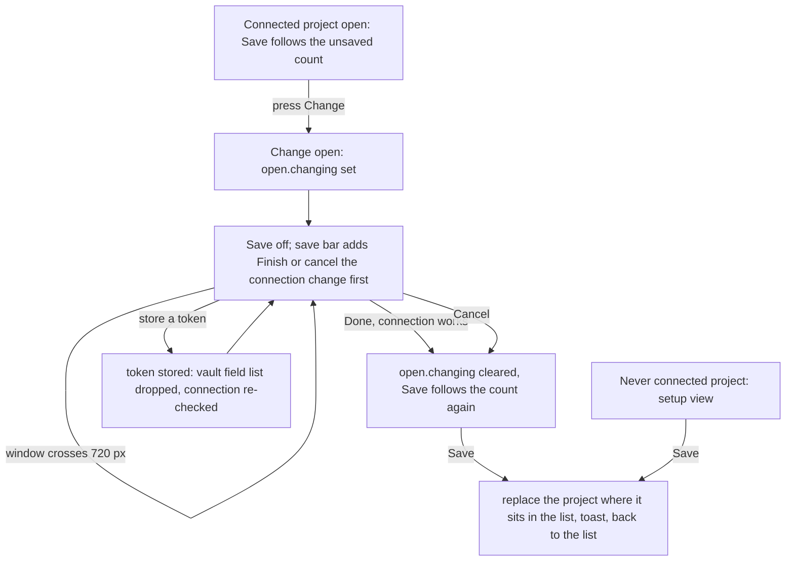

---
id:
title: Save never overwrites a working connection with a half-changed one
status: validation
variant: kc-dev-flow-2
profile: pilot
merge: pr
worktree: .worktrees/spacedock-ensign-project-env-save-blocks-half-changed-connection
pr: iamcxa/kc-paseo-plugins#29
gates:
    version: 1
    records:
        - id: gate:project-env-save-blocks-half-changed-connection:backlog
          stage: backlog
          attempts:
            - id: gate-attempt:project-env-save-blocks-half-changed-connection-backlog-1
              briefing:
                id: briefing:project-env-save-blocks-half-changed-connection:backlog:attempt-1:revision-1
                digest: sha256:68cd0349e206be3d459bf6f1958ab5472ef4db855b689196ff52ca7ef67971e9
                room-ref: ./project-env-save-blocks-half-changed-connection/review/backlog/briefing-1
              resolution:
                type: Resolution
                id: resolution:spacedock:project-env-save-blocks-half-changed-connection:backlog:1
                briefing: briefing:project-env-save-blocks-half-changed-connection:backlog:attempt-1:revision-1
                by: person:captain
                at: "2026-10-23T05:25:30.795084Z"
                decision: approve
                reason: 'Captain 2026-10-23: 「准」 — answers the backlog question put in chat: approves Design Director Tasks A and B, A first, with both stated recommendations (token store refreshes the field list; the ≠ explanation adds ''Check it is the field you mean.'').'
              application:
                target-stage: ideation
                state: consumed
        - id: gate:project-env-save-blocks-half-changed-connection:ideation
          stage: ideation
          attempts:
            - id: gate-attempt:project-env-save-blocks-half-changed-connection-ideation-1
              briefing:
                id: briefing:project-env-save-blocks-half-changed-connection:ideation:attempt-1:revision-1
                digest: sha256:646e2600975060d36683adf86e3850abda580cbd5f84db5db3f230adfd7b92e3
                room-ref: ./project-env-save-blocks-half-changed-connection/review/ideation/briefing-1
              resolution:
                type: Resolution
                id: resolution:spacedock:project-env-save-blocks-half-changed-connection:ideation:1
                briefing: briefing:project-env-save-blocks-half-changed-connection:ideation:attempt-1:revision-1
                by: person:captain
                at: "2026-10-23T06:10:53.023547Z"
                decision: approve
                reason: 'Captain 2026-10-23: 「准」 — approves this Task A design and its acceptance criteria into implementation.'
              application:
                target-stage: implementation
                state: consumed
        - id: gate:project-env-save-blocks-half-changed-connection:validation
          stage: validation
          attempts:
            - id: gate-attempt:project-env-save-blocks-half-changed-connection-validation-1
              briefing:
                id: briefing:project-env-save-blocks-half-changed-connection:validation:attempt-1:revision-1
                digest: sha256:e9fc662258c56c02d5b0280a5a9ec1291a7268ec77887292564794524b8ddcd2
                room-ref: ./project-env-save-blocks-half-changed-connection/review/validation/briefing-1
              resolution:
                type: Resolution
                id: resolution:spacedock:project-env-save-blocks-half-changed-connection:validation:1
                briefing: briefing:project-env-save-blocks-half-changed-connection:validation:attempt-1:revision-1
                by: person:captain
                at: "2026-10-23T07:36:25.393397Z"
                decision: approve
                reason: 'Captain 2026-10-23: 「准」 — approves delivery of PR #29 at e5e41cc per the gate question; the save() guard stays as recommended.'
              application:
                target-stage: done
                state: pending
started: 2026-10-23T05:26:08Z
---

Polish round after the A5 settings-screen rework of the project-env plugin (main 40849b4). Source: the picky-user pass (two reviewers on different models, `ux-review-a5-polish/astra-review.md` and `gemini-review.md`) and the Design Director's ruling (`ux-review-a5-polish/design-director.md`, Task A, rows R1, R11 and R2), approved by the Captain on 2026-10-23 with 「准」, including the Director's recommendation that storing a token refreshes the field list.

## Scope

In: the footer Save is disabled, with its reason shown in the save bar, while the 1Password connection is being changed, and works again after Done or Cancel (R1); a saved project keeps its place in the project list (R11); storing a token drops the vault field list already loaded, so the next field press reads the vault again (R2). Out: the first-setup form of a project never connected (R10, release r1b). Stop condition: the acceptance criteria pass. Runs before project-env-every-row-findable, which branches from this task's merged main.

## Acceptance criteria

**AC-1**: While Change is open with an unchecked account name typed, Save is disabled and the save bar says why; after Done or Cancel, Save works again, also after the window crosses 720 px.
Verified by: a unit test on the Save rule that fails when the open-change term is removed; a runtime script on an isolated Paseo at 1280 and 400 px that presses Save during Change and finds `projects.json` unchanged.

**AC-2**: Saving any project leaves the project list in the same order.
Verified by: a unit test that saves the middle of three projects and finds it still in the middle; a runtime check of the list text before and after Save.

**AC-3**: After a token is stored, the next press on a field opens a list read again from the vault.
Verified by: a runtime script with a fake `op` that returns different fields for two tokens stored under one account name; the second list shows the new fields.

## FO alignment

Surfaces: ui
Visible change: Save is off while you are changing the 1Password connection, and a saved project stays where it was in the list.
Direction alignment with the Captain: done — the Captain approved the Design Director's Task A and its recommendation on 2026-10-23 (「准」).
Result: ux-review-a5-polish/design-director.md, Task A; every ui gate shows the Captain screenshots of the screen.
Release review: not needed: a polish of the r1.5 settings screen from the Captain-approved picky-user pass; it adds no journey story.
Map footprints: not needed: no journey story or open map question is attached to this polish task.

## Design

### PRFAQ

**Press release.** Kent presses Change on a connected project, types a different 1Password account name, and the footer Save goes dim. The save bar says "Finish or cancel the connection change first" under its unsaved count, so he cannot write a half-changed connection over the working one. He presses Done or Cancel and Save lights again. Saving a project leaves it where it was in the project list. Storing a new token under an account name makes the next press on a field read the vault again.

**FAQ.**
- *What counts as "being changed"?* The connection card is open through Change. The store already records it as `open.changing` (set by Change, cleared by Done and Cancel), so the block survives the remount Paseo does at 720 px. It is not tied to the typed text, which is what the Director ruled ("while the connection is being changed"): the block holds from the press on Change until Done or Cancel.
- *Why is Save blocked even when Change is open and untouched?* Two ways out are one press away (Done or Cancel); one rule is simpler than guessing whether the typed text differs. Nothing is lost: edits to rows and prompt stay in the draft. The reason line shows only when there is something to save (the count is above zero, or the project is new): with nothing to save Save is dim already, and picture 2 reads "No unsaved changes" without the line.
- *Is the first setup of a project that never connected blocked?* No. That form is the setup view, not Change, so `open.changing` stays null; saving an unfinished first setup stays allowed (R1 ruling, work-bare, picture 12).
- *Where does the reason sit?* One line in the save bar's left column, under the count, shown only while Save is blocked for this reason. The "N with no field picked yet" note stays on its own line below it, so Task B can make that note a button without moving the reason.
- *Does the project list order matter?* Yes: when two saved entries match one repository the first in list order wins (project-env-worktree-real-paths). Save replaces the entry where it sits; a project not yet saved is added at the end.
- *Why does storing a token drop the field list?* The list is loaded once per account and vault and kept. A token stored under the same account name can read other data, so the stored list is stale; the Captain approved dropping it on a stored token (2026-10-23, 「准」). A token the vault rejects stores nothing and leaves the list alone.

### What changes (read from `project-env/` on main at 40849b4, 2026-10-23)

Today `SaveBar` computes `canSave = pending && !saving && unnamed === 0` and `save` returns only on `unnamed > 0`, so neither reads `open.changing`; `save` writes `[...others, draft]`, which moves the project to the end; the `store` mutation's `onSuccess` calls `check()` and never `refs.reset()`, and `refs` resets only on `[account, draft.vault]`. New: `saveRule({ pending, saving, unnamed, changing })` returning `canSave` and `reason`, and `replaceProject(projects, draft)` in `shared/config.ts` (pure, so unit-testable like `unsavedCount`); a `changing` prop and a reason line in `SaveBar`; the same guard inside `save`, so a stale press cannot write; `refs.reset()` in `onSuccess` of `store`. No new setting, store field, RPC or dependency.

Existing-code check: the capability is missing, not broken. Two bounded searches over `project-env/client` and `project-env/shared` excluding `node_modules`: `grep -n "changing" client/settings-screen.tsx client/open-project.ts` finds the store field and the Done and Cancel handlers but no read in `SaveBar` or `save`; `grep -n "canSave\|others, draft" client/settings-screen.tsx` finds only the two unguarded sites. The store field is used, not rebuilt. Not searched: other plugins in other repositories.

### UI proposal

UI proposal: The save bar keeps its shape (count on the left, Close or Discard and Save on the right, pinned at the bottom of the web client). While the connection card is open through Change, Save is the existing dimmed outline and when there is something to save, a second line under the unsaved count reads "Finish or cancel the connection change first" in normal text colour; the line is absent otherwise (also while Change is open and nothing is unsaved, where Save is dim and the bar reads "No unsaved changes"), and the "N with no field picked yet" note stays beneath it in muted text. Nothing else on the page changes: Done and Cancel in the connection card are as today, and after either the line disappears and Save lights again.

Preview: project-env-save-blocks-half-changed-connection/design/preview-desktop-dark-3-change-typed-checked.png

The proposed design is the set `design/preview-*.png`, drawn from a running build of the real `project-env` client at main 40849b4 with only this task's change applied (`spike/save-polish.diff`), on a throwaway Paseo 0.12.0 daemon (own home `/tmp/pe-save`, port 6931, plugin id `pe-save`, fake `op`, `security` and `git` from `test/fakes`, one extra fake account `b` that reads different fields), driven through Paseo's own web client with a headless browser. Each picture is the whole settings page. Desktop 1280 px: 1 connected (Save off, nothing to save), 2 Change open untouched, 3 an unchecked account name typed and checked (the main picture), 4 after Cancel (Save back, 1 unsaved), 5 Change open with an unrelated prompt edit (Save still off), 6 after Done (Save on), 7 work-many with the "4 with no field picked yet" note below the reason, 8 the project list after saving the second project, 9 and 10 the field list before and after a token for another account is stored, 11 Change open after the token is stored, 12 first setup of a never-connected project (Save on), 13 an unchecked account name typed together with a prompt edit (the count reads 2). 400 px: the same 1 to 8, 10, 12 and 13. Light: picture 3 at both sizes. It is operable while the daemon is up. Disposable: the daemon, the plugin and `/tmp/pe-save` are removed at the end of ideation (teardown in the Stage Report); `spike/` keeps the diff, the test and the harness.

### Design review

Design review: design/ideation-1.yaml
Design finding 1: declined: the reason is 13 px in full text colour under the 14 px count, a deliberate step so it reads as the cause; the Director asked for a simple slot Task B can put its note beside, so no mark or size change.
Design finding 2: declined: Discard already opens "Discard N unsaved changes?" and drops the whole draft, connection included, and a typed connection change counts in N (picture 13 reads 2); the line names the two exits Done and Cancel that unblock Save.
Design finding 3: fixed: the FAQ and the UI proposal now say the line shows only when there is something to save, as drawn in preview-desktop-dark-2-change-open-untouched.png (Save already dim, "No unsaved changes").
Design finding 4: fixed: preview-desktop-dark-13-connection-draft-plus-prompt-edit.png and preview-compact-dark-13-connection-draft-plus-prompt-edit.png draw a connection draft with a prompt edit (count 2, Save off, reason shown); Check failed is drawn in picture 3 ("No token in Keychain"); a running Check lasts a second and Done is dim then, as in picture 3; the 400 px bar with a muted note and the reason is drawn in compact picture 7 (three text lines above the button row).
Design finding 5: declined: the Vault text input appears because the failed check gives no vault list, which is today's connection card and not touched by this task.
Design finding 6: declined: the bar wraps its buttons on a narrow window today (project-env-save-footer-danger-zone); the reason adds one line and Task B adds another, accepted there.
Design finding 7: declined: the 4 px inset difference is today's bar padding, not part of this change.
Design finding 8: declined: every button on the page is about 32 px high, and the dimmed Save is today's disabled style (project-env-save-footer-danger-zone design finding 7 and 5).
Design finding 9: declined: "Back" and "Back to plugins" are drawn by Paseo, not by the plugin.
Design finding 10: declined: light adds only theme colours to the same layout and picture 3 shows the new line in light at both sizes; picker pictures at 400 px for token 9 and 11 repeat the desktop states and picture 10 shows the 400 px list after the token.

### Acceptance evidence plan

Each result below was observed on 2026-10-23 on the isolated Paseo from the spike (`spike/save-polish.diff` on main 40849b4, port 6931); the merged implementation is not yet verified.

AC-1: unit rule `spike/save-rule.test.ts` (4 tests on `saveRule`): fails when `&& !changing` is removed from `canSave` (mutation run: 1 failed, "blocks Save with a reason while the connection change is open"). Runtime `spike/harness/ac1.sh 1280 1750` and `ac1.sh 400 2500` on work-empty with a prompt edit and Change open, an unchecked name typed and checked: Save disabled both sizes, pressing Save left `projects.json` byte-identical (shasum equal), Save stayed disabled after the window crossed 700 px and back, enabled after Cancel, and the saved file then changed. The same script on an unpatched main build (port 6932) wrote the file during Change (shasum differed) and re-ordered the list, so the script fails without the change. First setup (work-bare, picture 12): Save enabled.
AC-2: unit test `replaceProject` in the same file: fails when the entry is filtered out and appended (mutation run: 1 failed). Runtime: `ac1.sh` prints the order before and after saving the second of four projects: `work, work-empty, work-many, work-bare` both times; on unpatched main the saved project moved to the end (`work, work-many, work-bare, work-empty`).
AC-3: runtime `spike/harness/ac3.sh 1280 1000`: the field list before (token a) held SENTRY and not ROTATED; after storing a fake token for account b under the same account name `sa-a` it held ROTATED and not SENTRY (pictures 9 and 10). On unpatched main the same script still listed SENTRY after the token was stored. Not tested: a refused token (stores nothing, list unchanged, by source), and the phone app.

Not yet verified: the merged implementation; `npm test` and `npm run typecheck` on the merged branch (on the spike copy: typecheck clean, 262 of 262 tests pass, 2026-10-23); the phone app, where the sticky bar is skipped.

### Needs decision

None. The two Director recommendations (the save bar block with its reason, and the token store refreshing the list) were approved by the Captain on 2026-10-23 (「准」). Past rulings checked: `git -C docs/dev2/.spacedock-state grep -n 'Override:'` and the ADRs in the area name no behaviour for Save while Change is open.

### Spike notes

Machine dependencies, declared: Paseo.app 0.12.0 CLI at `/Users/kent/.local/bin/paseo`, Node, `agent-browser`, python3 with PIL only to crop pictures. `spike/harness/` is the review harness with an added fake account `b` (`setup.sh`); its defaults point at `/tmp/pe-save-ckpt` (a copy of `project-env` from main 40849b4 with `spike/save-polish.diff` applied, `node_modules` linked) on port 6931. The test copy and `/tmp/pe-save*` are removed at teardown. No real Keychain, 1Password or model provider was touched; Kent's `~/.paseo` and the live plugin were not touched.

## Stage Report: ideation

- DONE: Design the change your Scope names inside the current settings screen (direction A5 as built on main), with each acceptance criterion kept and given a reproducible evidence clause.
  `## Design` holds the PRFAQ, Mermaid, existing-code check, UI proposal and an evidence plan per criterion; AC-1 to AC-3 are unchanged; the spike diff is `spike/save-polish.diff` on main 40849b4.
- DONE: Produce the artifact the ui surface owes: whole-page previews from a running build at desktop and 400 px, including the save bar's reason while Change is open, plus the design review, with each finding dispositioned.
  26 whole-page pictures in `design/` from the real client on an isolated Paseo 0.12.0 (port 6931); `design/ideation-1.yaml` (10 MINOR, no MAJOR; only its `preview:` path was prefixed with the task folder to match the Preview line); `design_surfaces.py check`: "design surfaces presentable; design review design/ideation-1.yaml: 10 findings, 2 fixed, 0 criteria, 8 declined, 0 decisions".
- DONE: Name any decision the Captain must make (at most one), with a recommendation; the two Design Director recommendations are already approved and are not decisions.
  None needed; both approved recommendations are designed in (reason line in the save bar; token store drops the field list).
- DONE: AC-1 While Change is open with an unchecked account name typed, Save is disabled and the save bar says why; after Done or Cancel, Save works again, also after the window crosses 720 px.
  Spike 2026-10-23: `save-rule.test.ts` fails when the `changing` term is removed (mutation: 1 failed); `ac1.sh` at 1280 and 400 px: Save disabled, `projects.json` shasum unchanged after pressing Save, still disabled after a 700 px round trip, enabled after Cancel; unpatched main wrote the file. Not yet verified: the merged implementation.
- DONE: AC-2 Saving any project leaves the project list in the same order.
  Spike: `replaceProject` test fails when the entry is filtered and appended (mutation: 1 failed); `ac1.sh` list order identical before and after; unpatched main moved the project to the end. Not yet verified: the merged implementation.
- DONE: AC-3 After a token is stored, the next press on a field opens a list read again from the vault.
  Spike: `ac3.sh`: list held SENTRY before, ROTATED after storing a token for account b under `sa-a`; unpatched main still held SENTRY. Not yet verified: a refused token (by source only), the merged implementation.

Teardown (2026-10-23): daemon on port 6931 stopped, browser session closed, `/tmp/pe-save*` removed; Kent's `~/.paseo`, the live plugin and `/tmp/pe-astra` (port 6920) were not touched.

### Summary

Save is blocked with a one-line reason in the save bar from the press on Change until Done or Cancel, a saved project is replaced where it sits, and a stored token drops the loaded field list; all three were built as a spike on main 40849b4 (about 30 changed lines, no new store field or RPC), drawn at 1280 and 400 px, and shown to fail on unpatched main. The design review found no MAJOR finding; the reason slot is one line under the count so Task B's no-field note sits beside it. No Captain decision remains.

## Stage Report: implementation

- DONE: Implement the approved design exactly, starting from the spike diff in this task's spike/ folder.
  Spike diff and `save-rule.test.ts` applied unchanged on main 40849b4; commit e5e41cc on `spacedock-ensign/project-env-save-blocks-half-changed-connection` (3 files, +66/-4).
- DONE: AC-1 While Change is open with an unchecked account name typed, Save is disabled and the save bar says why; after Done or Cancel, Save works again, also after the window crosses 720 px.
  `save-rule.test.ts` "blocks Save with a reason while the connection change is open" fails when `&& !changing` is removed (mutation run, 1 failed). `evidence/ac1-run-1280.txt` and `ac1-run-400.txt`: Save disabled with the reason line, `projects.json` unchanged after pressing Save, still disabled after a 700 px round trip, enabled after Cancel, file changed after Save.
- DONE: AC-2 Saving any project leaves the project list in the same order.
  `replaceProject` "keeps a saved project where it was" fails when the entry is filtered and appended (mutation run, 1 failed). Both ac1 runs: order `work, work-empty, work-many, work-bare` before and after saving the second.
- DONE: AC-3 After a token is stored, the next press on a field opens a list read again from the vault.
  `evidence/ac3-run.txt`: list held SENTRY (old) before; after storing a token for fake account b under `sa-a` it held ROTATED and not SENTRY. Falsified by removing `refs.reset()` (unpatched main kept SENTRY in the spike run). Refused-token path: by source only, not run.
- DONE: Whole-page screenshots of the built change at desktop and 400 px, saved in the task folder.
  `evidence/built-{desktop,compact}-dark-1..8`, `built-desktop-dark-9/10` (picker before and after token), `built-*-light-3`; isolated Paseo 0.12.0 on own S `/tmp/pe-save-impl`, port 6941, torn down (removed, port closed); not /tmp/pe-astra or 6920.
- DONE: Run `npm test`, `npm run typecheck`, the roborev gate, design_surfaces check and doc_impact.
  `npm test` 262 of 262 (incl. 6 new); typecheck clean; roborev `clean on e5e41ccdd; evidence=roborev:1078`; design_surfaces: "design surfaces presentable"; comment_ratio: "code lines 55, comment lines 0, 0.0%", max 5% met.
- DONE: Affected documents (doc_impact base 40849b4 vs e5e41cc).
  `docs/adr/0004-reserved-variable-names-are-skipped-not-blanked.md`: unaffected: it records reserved variable names in `isReservedName`; this change touches the Save rule, project order and field-list reset only.
- DONE: Open the Draft PR.
  https://github.com/iamcxa/kc-paseo-plugins/pull/29 (Draft, base main, from 40849b4; the Captain's standing grant quoted in the dispatch).

### Summary

Save is off with a reason line while Change is open, a saved project is replaced where it sits, and storing a token resets the field list; all three behave on the built branch as in the spike, at 1280 and 400 px. No design change, no new store field or RPC. Limits: the refused-token path and the phone app are not run. Note: the 400 px ac1 run first hit a stale browser session (Paseo "Connect to this host" page) and was rerun on a fresh one; the reported run is the clean one.

## Stage Report: validation

- DONE: Independently check candidate e5e41ccdd9bea76d09d12fe0cb8c58106eb18f8d (PR #29, base main 40849b4) against AC-1 to AC-3 and the approved design on an isolated Paseo built with the ux-review-a5-polish harness; give a verdict.
  Verdict: PASSED (recommended). Built the candidate (plugin copy byte-identical to the worktree's client and shared) on the harness plus its fake account b (`spike/harness/setup.sh`), own S `/tmp/pe-val-save`, port 6951, own agent-browser session; torn down, port closed, `/tmp/pe-astra` and 6920 untouched. Worktree clean at e5e41cc.
- DONE: Save disabled with its reason while Change is open; projects.json unchanged after pressing Save then; stays disabled across a 720 px round trip; works after Done and after Cancel.
  Observed at 1280 and 400 px: Change open untouched and with an unchecked name typed, Save disabled and "Finish or cancel the connection change first" in the bar; pressing Save left the projects.json shasum equal (both sizes, both states); disabled after 1280-700-1280 and 400-1000-400-1100-400 resizes with the typed text kept; enabled with no reason after Cancel and after Done, and Save then wrote the file. Nothing to save: Save dim and no reason line. Never-connected project (work-bare) with an edit: Save enabled, no reason.
- DONE: A saved project keeps its place in the list.
  Saved the first, third and second of four projects (one run each at 1280/400): order stayed `work, work-empty, work-many, work-bare` every time; screenshots of the list after Save at both widths.
- DONE: After a token is stored the next field press reads the vault again.
  Fake op call log: first press 1 `item list`; second press with no token change 0 new reads (cached); store token b under `sa-a` then press: list ROTATED not SENTRY, a new read; store token a again, press: SENTRY, a new read. A refused token (unknown account, "Not saved: 1Password rejected the token", keychain unchanged) left the list and the read count unchanged: the refused path the implementer left unrun is now run.
- DONE: Confirm the new unit tests fail when their behaviour is removed; check the rest of the screen still works.
  `save-rule.test.ts` 6 of 6 pass; mutation on a scratch copy of `shared/config.ts`, each restored: drop `&& !changing` fails "blocks Save with a reason while the connection change is open"; `reason: null` fails the same test; reason without `pending` fails "gives no reason when nothing is pending"; filter-and-append in `replaceProject` fails "keeps a saved project where it was". Full `npm test` 262 of 262, `npm run typecheck` clean. The three wiring sites (the `changing` prop, the `save` guard, `refs.reset()`) have no unit test; with all three removed together in a scratch build, the runtime script showed Save enabled during Change, projects.json changed by pressing Save, and the stale SENTRY list after token b. Smoke on the rest of the screen: Test summary "All 3 set", the field picker opens, Discard asks "Discard 1 unsaved change?", Done on an untouched Change returns to Connected.
- DONE: Write the minimal acceptance script FO will rerun in a fresh shell, and run adr_lint with exit code.
  Script below, run once from a fresh `env -i` shell: 0 failures (20 checks incl. unit and typecheck). `python3 <package>/scripts/adr_lint.py docs/adr --since 60799d9`: "5 ADR file(s) checked, 0 legacy", exit 0 (run in the worktree and at the repo root). Also: comment_ratio 40849b4..e5e41cc "code lines 55, comment lines 0, 0.0%" exit 0; dispatch_records "3 dispatch record(s) complete" exit 0; design_surfaces check "presentable" exit 0; doc_impact lists ADR 0004 and the implementation report records `unaffected: <reason>` for it (the reason holds: the diff does not touch reserved names).
- DONE: Look at the whole-page screenshots at 1280 and 400 px and record what the Captain should see; record every unverified obligation.
  Screenshots `evidence/validation-{desktop,compact}-dark-*.png` (6 plus `validation-compact-dark-many-change-open.png`). See the two sections below.

### Minimal acceptance script

Run `bash /Users/kent/Project/kc-paseo-plugins/docs/dev2/.spacedock-state/project-env-save-blocks-half-changed-connection/validation/accept.sh` (needs node, npm, python3, `agent-browser` and the `paseo` CLI on PATH; builds an isolated Paseo on port 6961 under `/tmp/pe-accept` with fake op/security/git; real Keychain, 1Password and `~/.paseo` untouched; ran longer than my 120 s foreground limit, not otherwise timed). It prints PASS or FAIL per check and ends `failures: 0`, exit 0:
1. Unit tests `test/save-rule.test.ts` print `pass 6`, `fail 0`; typecheck prints PASS.
2. It builds the candidate into the isolated Paseo.
3. At 1280 and at 400 px, with Change open and an unchecked account name typed: Save disabled with the reason line; pressing Save leaves projects.json unchanged; still disabled after a window-size round trip; after Cancel and after Done Save is enabled and writes the file.
4. Saving the first project and then the third of four leaves the list order `work, work-empty, work-many, work-bare`.
5. Token b stored under account name `sa-a`: the next field list shows ROTATED not SENTRY; a refused token leaves the list as it was. It then removes the isolated Paseo.
Not covered: the phone app, a real Keychain or 1Password, Kent's live Paseo, light theme, the 720 px breakpoint itself (resizes go 1280-700-1280 and 400-1000-400), CI on PR #29.

### What the Captain should see

- 1280 px, Change open with `sa-typo` typed and checked ("No token in Keychain"): the connection card is open at the top, the variable rows and prompt are unchanged, and the pinned bar reads "2 unsaved changes" with the second line "Finish or cancel the connection change first"; Discard is live, Save is dim.
- 400 px, same state: one column, the reason line sits under the count in the bar, Discard and Save wrap to a row below it. On a long project (work-many) the bar shows three text lines (count, reason, "4 with no field picked yet") then the buttons; nothing overlaps.
- After Cancel the connection card collapses to "Connected, sa-a · Dev", the bar reads "No unsaved changes" or the count, no reason line, Save lit when there is a change. After Save the list shows the four projects in their old order.
- Two things a reader may trip on: the count under Change shows 1 when only the typed name differs and 2 with a prompt edit as well (consistent, not a defect); and Save looks the same dim style as a Save with nothing to save, only the reason line tells them apart.

### Unverified obligations

- Phone app (sticky bar skipped there), real 1Password and Keychain, Kent's own Paseo and plugin: not run.
- The 720 px remount is exercised by resizes across it, not observed as a remount; the typed text and the block survived.
- The `open.changing !== null` guard inside `save()` has no individual falsifier: the disabled button already stops the press, and my mutation removed it together with the prop. Without-it unanswered: Kent rules (the design keeps it so a stale press cannot write).
- Light theme: not rerun by me (implementer's `built-*-light-3` screenshots only).
- PR #29 CI and review state: not checked.
- No finding reaches Material or Deferred risk; no Polish finding is raised.

### Summary

The candidate does what AC-1 to AC-3 promise on a rebuilt isolated Paseo at 1280 and 400 px, including the refused-token path the implementer had not run, and the new unit tests and the runtime script both fail when the behaviour is removed. Recommend PASSED; delivery (merge) stays with the Captain.
