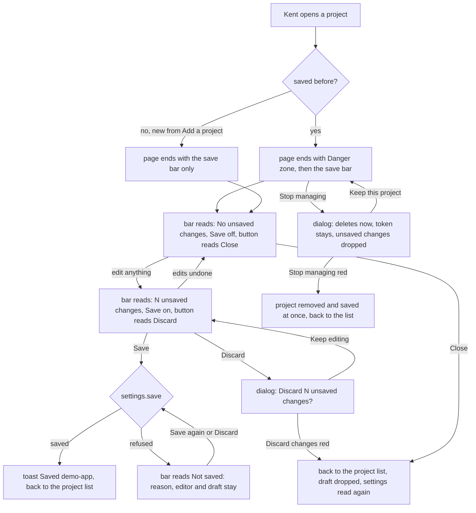

---
id:
title: A save bar shows unsaved changes and Stop managing has its own section
status: implementation
variant: kc-dev-flow-2
profile: pilot
merge: pr
worktree: .worktrees/spacedock-ensign-project-env-save-footer-danger-zone
pr:
gates:
    version: 1
    records:
        - id: gate:project-env-save-footer-danger-zone:backlog
          stage: backlog
          attempts:
            - id: gate-attempt:project-env-save-footer-danger-zone-backlog-1
              briefing:
                id: briefing:project-env-save-footer-danger-zone:backlog:attempt-1:revision-1
                digest: sha256:ff39de4d5ca7dbca58e48d767b0528c9858e49d1a9349da5ada47da2fd54a85d
                room-ref: ./project-env-save-footer-danger-zone/review/backlog/briefing-1
              resolution:
                type: Resolution
                id: resolution:spacedock:project-env-save-footer-danger-zone:backlog:1
                briefing: briefing:project-env-save-footer-danger-zone:backlog:attempt-1:revision-1
                by: person:captain
                at: "2026-10-22T04:15:33.251858Z"
                decision: approve
                reason: 'Captain 2026-10-22: 「准」 — accepts this A5 settings-screen rework task''s outcome, scope and acceptance criteria on the pilot profile, into ideation.'
              application:
                target-stage: ideation
                state: consumed
        - id: gate:project-env-save-footer-danger-zone:ideation
          stage: ideation
          attempts:
            - id: gate-attempt:project-env-save-footer-danger-zone-ideation-1
              briefing:
                id: briefing:project-env-save-footer-danger-zone:ideation:attempt-1:revision-1
                digest: sha256:46d86c9f2283cbaa6186e42a8aa6d71aa91a3dbd85fe3b47fb507324fe9382de
                room-ref: ./project-env-save-footer-danger-zone/review/ideation/briefing-1
              resolution:
                type: Resolution
                id: resolution:spacedock:project-env-save-footer-danger-zone:ideation:1
                briefing: briefing:project-env-save-footer-danger-zone:ideation:attempt-1:revision-1
                by: person:captain
                at: "2026-10-22T07:45:01.945507Z"
                decision: approve
                reason: 'Captain 2026-10-22: 「准」 — accepts this A5 rework design and its acceptance criteria into implementation, including the recommendation stated in this gate''s question.'
              application:
                target-stage: implementation
                state: consumed
started: 2026-10-22T04:16:59Z
---

Settings-screen rework of release r1.5 of the project-env plugin. Design reference: the design-director review (ux-review-r1.5/index.html) and direction A5 (ux-review-r1.5/direction-a5.html, shots/a5-*.png) in the state checkout; Captain approved A5 on 2026-10-22 (「就這樣」) after 「這個 UX 完全不行」, and the Add flow on 2026-10-22 (「可以」).

## Scope

In: a footer save bar with an unsaved-change count, Discard and Save; Save confirms with a toast; Stop managing sits in its own section, shown only for a saved project, with a destructive-looking confirm button (review finding 9). Stop condition: the acceptance criteria pass.

## Acceptance criteria

**AC-1**: The footer shows the number of unsaved changes, and Save confirms with a toast.
Verified by: screenshots on an isolated Paseo.

**AC-2**: Stop managing appears only for a saved project, in its own section, and its confirm button looks destructive.
Verified by: screenshots of an unsaved and a saved project and of the dialog.

## FO alignment

Surfaces: ui
Visible change: A save bar shows how many changes are unsaved, and Stop managing sits in its own section.
Direction alignment with the Captain: done — the Captain chose direction A5 and the Add flow on 2026-10-22.
Result: direction A5 (ux-review-r1.5/direction-a5.html); every ui gate shows the Captain screenshots of the screen.
Release review: not needed: a rework of the r1.5 settings screen the Captain ruled on 2026-10-22; it adds no journey story.

## Design

### PRFAQ

**Press release.** Kent opens a project and sees, pinned to the bottom of the settings page, a save bar: "No unsaved changes" with Save off while nothing changed, "3 unsaved changes" with Save on after he edits. Save writes the project and a toast says "Saved demo-app". Stop managing no longer sits among Save and Discard: a saved project has its own "Danger zone" section holding it, a project not yet saved has none, and the confirm button in the dialog is red.

**FAQ.**
- *What did the Captain decide?* Direction A5, a footer with the unsaved count, Discard and Save, and Stop managing in its own section (「就這樣」, 2026-10-22). Review finding 9 (ux-review-r1.5/index.html) names the toast, the red confirm and hiding Stop managing for an unsaved project.
- *What counts as one unsaved change?* One difference between the project as last saved and the draft: the service account, the vault, the prompt, and each variable added, removed or pointed at another field. Test results, the token box and a variable removed then added back with the same field are not changes. Counting differences, not edits, means every sibling task's way of editing a row is counted without knowing about this bar.
- *Does Save close the editor?* Yes, as today: Save and Discard both return to the project list, so the toast shows on the list and its row shows the new variable count. The bar therefore never shows 0 after a Save; it shows 0 only on a freshly opened project. Whether Save should instead stay in the editor is the one Captain decision below.
- *Does Discard ask first?* Yes when the count is above zero: a dialog "Discard 3 unsaved changes?" says they are dropped and the project list reads the saved settings again, with a plain "Keep editing" and a red "Discard changes". At zero changes the button reads "Close" and returns to the project list at once, so a "Discard" never discards nothing; "Back to plugins" above the title is the host's way out of the whole plugin, Close is the way back to this plugin's project list.
- *What if Save is refused?* The bar shows "Not saved: <reason>" in red, and under it the count still standing and what to do: "3 unsaved changes are still here. Discard drops them and reloads the settings." The editor stays open with the draft intact and Save stays on, so a refusal that is not a conflict can be retried; after a conflict (another client changed the settings) Discard is the way to reload, because it returns to the list, which reads the settings again.
- *Is Stop managing still immediate?* Yes. It deletes the saved project at once, without Save, as today; the dialog now says that unsaved changes are dropped too when there are any, and Keep this project is the plain button, Stop managing the red one.
- *Is it sticky on every client?* On the web client (which the Paseo desktop app also uses) the bar stays at the bottom of the window while the page scrolls; on a client that cannot honour a sticky style it sits after Stop managing, at the end of the page. Observed in the web client only (see Preview).

### What changes (read from `project-env/` on main at 1adf630, 2026-10-22)

Today `ProjectEditor` ends with one card named "Save" holding three equal rows: Save (enabled with nothing changed, closes the editor, no confirmation), Discard changes, and Stop managing this project, followed by a dialog whose Keep and Stop managing buttons are both host action rows. The only change tracking is `edits`, a counter bumped on every keystroke that keys Test results to the draft; it does not say whether the draft differs from what is saved. `useToast` is exported by `@getpaseo/plugin/client/react-native` and used nowhere in `project-env/` (`grep -rn useToast project-env --exclude-dir=node_modules`: no hit). New: `unsavedCount(saved, draft)` in `shared/config.ts`, a `SaveBar` and a Danger-zone section in `client/settings-screen.tsx`, one `useToast().show` on a successful Save. Removed: the "Save" card.

Existing-code check: the capability (an unsaved count) is missing, not broken: two bounded searches, `grep -rniE "unsaved|dirty" project-env` (one hit, a test title about a token field) and `grep -n edits client/settings-screen.tsx` (the keystroke counter above, which keys Test results and cannot serve as a difference), exclude `node_modules` and dormant plugins in other repositories. The toast is existing kit capability, used rather than rebuilt.

### Interfaces named from siblings (not designed here)

- project-env-draft-survives-remount: the footer needs, from wherever the open project and its draft live, `saved` (the project as last read from settings, or an empty project for a new one), `draft`, and `close()` that returns to the list and drops the draft. It calls `close()` on Save success, Discard, Close and Stop managing, and keeps using the revision read when the project opened.
- project-env-field-pill-one-control, -field-picker-grouped, -add-variable-one-step, -connection-collapse: none; the count is a difference, so their edits are counted without a hook. A variable added by a picker with no field yet counts as one change.
- project-env-test-summary-failure-mark: none; Test results are not changes. The Test disclaimer it moves leaves the sentence about agents reading values where this task keeps it, under the prompt.
- Page order they must preserve: variables, prompt, the sentence about agents reading values, Danger zone (saved projects only), save bar last.

### UI proposal

UI proposal: At the end of the project editor the old "Save" card is gone; in its place a "Danger zone" section (shown only when the project is already saved) holds one row, "Stop managing this project", its one-line consequence and a red-outlined Stop managing button; below it the save bar, a rounded bar pinned to the bottom of the window on the web client, reads "No unsaved changes" or "N unsaved changes" on the left and a Close or Discard button and a filled Save button on the right (Save is dimmed at zero changes); Save shows a toast "Saved <project>" on the project list, a refused Save shows a red "Not saved: <reason>" with the count and "Discard drops them and reloads the settings" beneath it, and the Stop managing dialog has a plain "Keep this project" and a red filled "Stop managing", saying that unsaved changes are dropped too; Discard with changes opens a "Discard N unsaved changes?" dialog with a plain "Keep editing" and a red filled "Discard changes".

Preview: project-env-save-footer-danger-zone/design/preview-desktop-dark-edited-3-unsaved.png

The main picture is the one above: the whole settings page of a saved project, desktop, dark, after three edits. The proposed design is the set `design/preview-*.png` in this task's folder, taken from a real run: the real `project-env` client at main 1adf630 with only this task's change applied (`spike/settings-screen.diff`, `spike/config.diff`), fake `op`/`security`/`git` from `test/fakes`, on a throwaway Paseo 0.12.0 daemon (own home, port 6831, plugin id `save-footer-spike`, no model provider), driven through Paseo's own web client with a headless browser; the other r1.5 rework tasks are not applied, so the rows above the prompt are today's. Pictures, desktop dark: saved project untouched, edited (3 unsaved, whole page), edited with the window one screen high (the bar pinned), Stop managing dialog, Discard dialog, toast on the project list after Save, new project not yet saved with no change and with one change (no Danger zone), refused Save; desktop light: edited with the bar pinned, the dialog, refused Save; 400 px dark: untouched, edited, edited with the bar pinned, both dialogs, new project with one change, refused Save, toast; 400 px light: edited and edited with the bar pinned. It is operable while the daemon is up: Settings, Plugins, Actions, Project environment. Disposable: the daemon, the plugin and `/tmp/save-footer-spike` are removed at the end of ideation (teardown in the Stage Report); `spike/` keeps the sources, fixture script and drive scripts.

### Design review

Two reviews ran, the most the stage allows. Report 1 (design/ideation-1.yaml, 14 findings) had two MAJOR findings, both fixed and redrawn: the desktop Stop managing dialog was drawn before it learned to say unsaved changes are dropped, and a refused Save hid the count and named a Reload that does not exist (now the count stays and Discard is named as the reload). Report 2 below is on the redrawn set; its one MAJOR finding, Discard dropping edits with no confirm, is fixed in the Discard dialog drawn after that report and checked in a run, but that dialog was not reviewed again because the cap was reached.

Design review: design/ideation-2.yaml
Design finding 1: fixed: Discard with a count above zero now opens "Discard 3 unsaved changes?" with Keep editing and a red Discard changes, drawn in preview-desktop-dark-discard-dialog.png and preview-compact-dark-discard-dialog.png; on the isolated Paseo Keep editing returned to the editor and Discard changes returned to the list with the saved file unchanged (6 variables, empty prompt).
Design finding 2: declined: the first line is the host's own refusal sentence; the line under it names Discard as the reload, and Save stays on so a refusal that is not a conflict can be retried.
Design finding 3: declined: marks on changed rows belong to the row tasks and to the r3 unsaved warning; the count is a difference, so it can be traced by reading the rows.
Design finding 4: declined: Close returns to this plugin's project list while "Back to plugins" leaves the plugin, which the Design FAQ now says; the host owns the second exit.
Design finding 5: fixed: a disabled Save is now a dim outline with dimmed text like Save token and Add, in preview-desktop-dark-clean-saved-project.png and preview-compact-dark-clean-saved-project.png.
Design finding 6: declined: the toast position is the host's (useToast has no placement option); it clears the title text at 400 px.
Design finding 7: declined: every button on the page, host rows included (Check, Test, Remove), is about 32 px high; a larger tap area for the bar alone would mismatch the rest of the page.
Design finding 8: declined: the reason is the host's refusal sentence and wraps; the bar grows only by that text.
Design finding 9: declined: the sheet's size and handle are the host Modal's; the plugin passes only its content.
Design finding 10: AC-1 the design states Save reads "Saving…" and is off while a save is pending and Stop managing is off while saving, and a refused Stop managing shows the refusal in the dialog; AC-1 and AC-2 evidence below checks each in source and on the refused state.
Design finding 11: declined: light uses the same theme colours as dark; light is drawn for the bar, the Stop managing dialog and a refused Save on desktop and for the bar at 400 px.

### Acceptance evidence plan

AC-1 evidence, reproducible with the steps in Spike notes (`spike/edit3.sh 1280` opens demo-app with three edits). Pure rule: `spike/plugin/unsaved.test.ts` (2 tests, passed 2026-10-22 with `node --test`; at implementation it moves to `test/` beside `variable-name.test.ts`); it asserts 0 for no change and for a trimmed-equal service account, 1 each for a changed account, vault, prompt, removed variable, added variable and re-pointed variable, 3 for three of them, and 0 for a variable removed then added back, so counting keystrokes (`edits`) instead of differences makes it fail. Runtime on an isolated Paseo: the bar reads "No unsaved changes" with Save off on open, "3 unsaved changes" with Save on after removing two variables and typing a prompt, and Save shows the toast "Saved demo-app" and leaves the list reading the new variable count (observed 2026-10-22, pictures named in Preview); a Save that closes with no toast, or a count that stays 0, fails it. Source: Save is off while the count is 0 or `settings.saving`, and reads "Saving…" while pending (not drawn: it lasts milliseconds against the fake). A refused Save (settings changed between open and Save) shows the red reason with the count.

AC-2 evidence: pictures of demo-app (saved: Danger zone present) and billing-api (new, unsaved: no Danger zone) at desktop and 400 px, and of the dialog at both sizes with Keep this project plain and Stop managing red filled; runtime on the isolated Paseo (2026-10-22): Keep this project left the saved file with 1 project, Stop managing removed it (0 projects) and returned to the list. A Danger zone shown for billing-api, or a confirm styled like Keep, fails it. A refused Stop managing shows `settings.saveError` inside the dialog (source only; not drawn).

Not yet verified: all of the above is on a spike copy of main with this task's change; the merged implementation, the draft-survives-remount interface, and the phone app (a sticky style is skipped on native clients, so the bar sits at the end of the page there) are unverified.

### Needs decision

**One decision for the Captain: after Save, does the editor close?** Recommendation: yes, as today; Save and Discard both return to the project list and the toast shows there. Why: the editor keeps the settings revision it read when it opened, so staying open after a Save would also need that revision and the saved baseline refreshed, and a way back to the list that today only Save and Discard provide. What gets worse: to keep editing after a Save Kent reopens the project, and the bar's "No unsaved changes" is seen only before the first edit. If the Captain rules otherwise (stay open), Save refreshes the baseline and revision, Close becomes the only way out, and the toast shows over the editor; the count, the Danger zone and the dialogs do not change. Past rulings checked: ADRs 0001 to 0005 and the `Override:` lines (`git -C docs/dev2/.spacedock-state grep -n 'Override:'` finds only archived prose, none on settings navigation) name no behaviour for Save.

### Spike notes

Machine dependencies, declared: Paseo.app 0.12.0 CLI at `/Users/kent/.local/bin/paseo`, Node 24.18.0, `agent-browser`, Paseo.app's `app-dist` as the web client. Run (2026-10-22): `S=/tmp/save-footer-spike`; copy `project-env/{client,server,shared,index.*,paseo-plugin.json,package.json,tsconfig.json}` to `$S/plugin`, link `project-env/node_modules`, apply `spike/*.diff`, put `test/fakes/*` under `$S/plugin/server/fakes`, use `spike/plugin/index.server.ts` (fake world) and a `server/spike-world.ts` copied from `test/world.ts` with the fakes path hardcoded (the plugin loader gives no `import.meta.dirname`); `spike/config.json` is the daemon config; then `PASEO_HOME=$S/home PASEO_LISTEN=127.0.0.1:6831 PASEO_RELAY_ENABLED=false PASEO_WEB_UI_ENABLED=true PASEO_WEB_UI_DIST_DIR=/Applications/Paseo.app/Contents/Resources/app-dist paseo daemon run --home $S/home`, `paseo --home $S/home project create $S/billing-api`, `python3 spike/fx.py` writes the saved project (names and fields only, no value), and `spike/open.sh WIDTH HEIGHT` opens the editor. Facts learned: set the window size before opening the editor, because a resize across 700 to 800 px remounts the screen and drops the draft (project-env-draft-survives-remount); a sticky style works in the web client (`Platform.OS === "web"` guard); `useToast` renders at the top centre of the window and outlives the screen change; `SettingsSection` has no top margin, so a muted line above it needs its own bottom margin. No real Keychain, 1Password or model provider was touched; Kent's daemon (`~/.paseo`, port 6767) was not touched.

## Stage Report: ideation

- DONE: Design the change your Scope names inside direction A5, with each acceptance criterion kept and given a reproducible evidence clause.
  `## Design` holds the PRFAQ, Mermaid, UI proposal and an Acceptance evidence plan per criterion; the two criteria are unchanged; A5 departures (Danger zone heading and one-line consequence, Close at zero changes, Save off at zero) are named in the FAQ.
- DONE: Produce the artifact the ui surface owes: whole-page previews from a running build at desktop and 400 px, plus the design review, with each finding dispositioned.
  22 pictures in `project-env-save-footer-danger-zone/design/` from the real client on a throwaway Paseo 0.12.0 (port 6831, plugin `save-footer-spike`, fake op/security/git); `design/ideation-1.yaml` and `ideation-2.yaml` saved unedited; `design_surfaces.py check`: "design surfaces presentable; design review design/ideation-2.yaml: 11 findings, 2 fixed, 1 criteria, 8 declined, 0 decisions".
- DONE: Name every interface you need from a sibling rework task, and any decision the Captain must make (at most one), with a recommendation.
  One interface (draft-survives-remount exposes `saved`, `draft`, `close()`), none from the other five; one Captain decision, whether the editor closes after Save, recommended yes (as today).
- DONE: AC-1 The footer shows the number of unsaved changes, and Save confirms with a toast.
  Spike evidence 2026-10-22: `node --test unsaved.test.ts` 2 passed (fails if edits are counted instead of differences); on the isolated Paseo the bar read 0, then 3 after two removals and a prompt, Save showed "Saved demo-app" and the list read the new count. Not yet verified: the merged implementation, the "Saving…" label, the phone app.
- DONE: AC-2 Stop managing appears only for a saved project, in its own section, and its confirm button looks destructive.
  Spike evidence 2026-10-22: Danger zone present for demo-app, absent for billing-api, desktop and 400 px; Keep left 1 project in the saved file, Stop managing left 0; the dialog's confirm is a red fill. Not yet verified: the merged implementation, a refused Stop managing.

Teardown (2026-10-22): daemon on port 6831 stopped (`paseo --home <spike home> daemon stop`, port no longer listening), browser session closed, `/tmp/save-footer-spike` removed; `spike/` keeps the sources and drive scripts; Kent's `~/.paseo` and port 6767 were not touched.

### Summary

The footer is one pure function, `unsavedCount(saved, draft)`, a bar that shows it, one toast on Save, a Danger zone shown only for a saved project, and two confirm dialogs (Stop managing, Discard) with red confirm buttons; it was built as a spike on main 1adf630 and drawn at desktop and 400 px, dark and light. Both design reviews ran; the Discard confirm that fixes the last MAJOR finding was not reviewed again because the two-run cap was reached. The only Captain decision is whether Save should keep the editor open; the default recommended is that it closes, as today.

## Stage Report: implementation

- DONE: Implement the approved design exactly, including every interface it names for its sibling tasks and, where present, Captain amendment 1 in the task file.
  Draft PR https://github.com/iamcxa/kc-paseo-plugins/pull/23 (commits 9b5008b, aded542) off d61e243; `unsavedCount`, `SaveBar`, Danger zone, Stop managing and Discard dialogs, toast; uses `openProject` `initial`/`draft` and `onDone` (close); no Captain amendment in the task. One departure: the service account is compared raw, not trimmed (roborev finding: Save writes it raw, so a whitespace-only fix is a real change); decision on Save closing the editor kept as recommended (yes, as today).
- DONE: Land tests so each acceptance criterion passes with the evidence its clause names and fails when its behaviour is removed, plus whole-page screenshots of the built change at desktop and 400 px.
  AC-1 count rule: `test/unsaved-count.test.ts` asserts 0 for no change, 1 per changed account/vault/prompt/removed/added/re-pointed variable, 3 for three, 0 for remove-then-re-add; mutation (prompt no longer counted) made it fail. AC-1/AC-2 runtime: 21 screenshots in `project-env-save-footer-danger-zone/impl/` (desktop 1280 and 400 px, whole page, isolated Paseo 0.12.0 on port 6893, throwaway plugin `sfdz-impl`, fake op/security/git); bar read 3 unsaved with Save on, Save wrote 4 variables and the prompt and showed "Saved demo-app" on the list; Discard changes left the file unchanged; Danger zone present for demo-app, absent for billing-api; Keep this project left 1 project, Stop managing left 0; refused Save showed the red reason with the count. A bar that never counts, or a Danger zone for an unsaved project, fails these.
- DONE: Run `npm test`, `npm run typecheck`, the roborev gate, `design_surfaces.py check` and `doc_impact.py`, then open the Draft PR.
  `npm test` 176 pass, 0 fail (first run once hit the session-open deadline under load; rerun passed); typecheck clean; roborev first run `evidence=roborev:1031` one Medium (fixed), final `clean on aded5429f; evidence=roborev:1034`; `design_surfaces.py`: "design surfaces presentable"; `comment_ratio.py`: code lines 226, comment lines 0, 0.0%, maximum 5% met; Draft PR opened (url above).

### Affected documents

`doc_impact.py d61e243 HEAD` lists one document: `docs/adr/0004-reserved-variable-names-are-skipped-not-blanked.md` (review): unaffected: it records the reserved-name predicate `isReservedName`, which this change does not touch; only `unsavedCount` was added to `shared/config.ts`. No ADR added. CHANGELOG is release-please managed.

### Summary

The settings page now ends with the Danger zone (saved projects only) and a pinned save bar with the unsaved count, Close/Discard and Save, a Discard confirm, a red-confirm Stop managing dialog and a Saved toast; the count is a difference between `initial` and `draft`. Known limits: the phone app, the "Saving…" label and a refused Stop managing are source-verified only, not drawn; screenshots show the page as of main d61e243 without the sibling rework tasks. The isolated daemon was stopped and `/tmp/sfdz-impl` removed; Kent's `~/.paseo` and the live plugin were not touched.
