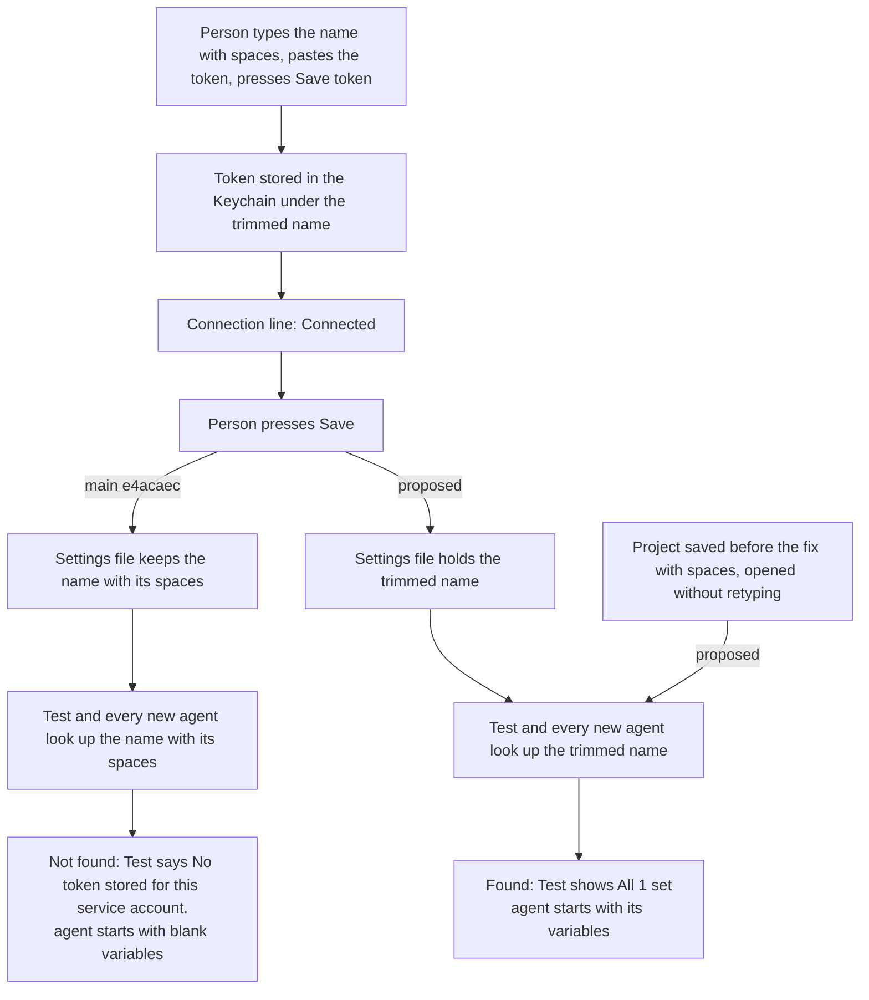

---
id:
title: A service account name with surrounding spaces still gets its variables
status: ideation
variant: kc-dev-flow-2
profile: pilot
merge: pr
worktree:
pr:
gates:
    version: 1
    records:
        - id: gate:project-env-service-account-trim:backlog
          stage: backlog
          attempts:
            - id: gate-attempt:project-env-service-account-trim-backlog-1
              briefing:
                id: briefing:project-env-service-account-trim:backlog:attempt-1:revision-1
                digest: sha256:e7a584f3f70476bce36eb6555ac933ea916b2d2d792477ddeae1bb508a4a6427
                room-ref: ./project-env-service-account-trim/review/backlog/briefing-1
              resolution:
                type: Resolution
                id: resolution:spacedock:project-env-service-account-trim:backlog:1
                briefing: briefing:project-env-service-account-trim:backlog:attempt-1:revision-1
                by: person:captain
                at: "2026-11-09T07:40:03.140078Z"
                decision: approve
                reason: '「開，幫我合併 78」 — Captain in FO chat, 2026-11-09, answering 「我建議：開一批「送審前修正」3 個任務，修上面第 1 到第 3 項，並補齊第 4 項的資料；做完再跑送審合規檢查。這一版會變成 v0.3.2。真正送出 Paseo 的申請之前，我還會再問你一次，因為那是對外的動作。」 (items 1-3: service account name spaces, op Connect credentials and cache race, item 4: registry listing data). Recommendation: followed.'
              application:
                target-stage: ideation
                state: consumed
        - id: gate:project-env-service-account-trim:ideation
          stage: ideation
          attempts:
            - id: gate-attempt:project-env-service-account-trim-ideation-1
              briefing:
                id: briefing:project-env-service-account-trim:ideation:attempt-1:revision-1
                digest: sha256:d3badb5c71fab5a55c6fd290862d66a3b311d142c05b5facf2cccc90edd6cdf9
                room-ref: ./project-env-service-account-trim/review/ideation/briefing-1
              resolution:
                type: Resolution
                id: resolution:spacedock:project-env-service-account-trim:ideation:1
                briefing: briefing:project-env-service-account-trim:ideation:attempt-1:revision-1
                by: person:captain
                at: "2026-11-09T08:47:31.21671Z"
                decision: approve
                reason: '「准」 — Captain in FO chat, 2026-11-09, answering 「設計關（送審前修正 1/3）：我建議准。服務帳號名稱存檔時去掉前後空白，伺服器查 token 前也去掉空白，畫面文字不變；已存了空白的舊專案也會好。在 Paseo 0.15.3 上重現了問題，修正後 Test 全過、agent 拿得到變數，測試 336 個全過。限制：只用假的鑰匙圈工具驗證過，真的 macOS 鑰匙圈比對沒測。准了就照這個設計進實作。」 (the three public-release-prep ideation gates presented together). Recommendation: followed.'
              application:
                target-stage: implementation
                state: pending
started: 2026-11-09T07:41:12Z
---

Batch: public-release-prep, approved by the Captain on 2026-11-09 (「開，幫我合併 78」, answering FO's 「…開一批「送審前修正」3 個任務…回「開」就開這批 3 個任務」) with three members: project-env-service-account-trim, project-env-op-auth-and-cache, project-env-registry-listing. Source: the Codex and Gemini release reviews of origin/main 2026-11-09 saved in research/2026-11-09-public-release-review/ (codex.md, gemini.md), each claim below re-read by FO in the code on main e4acaec. In `ProjectEditor` (`project-env/client/settings-screen.tsx`) the token is checked and stored under `draft.serviceAccount.trim()`, while the project is saved with the untrimmed `draft.serviceAccount`, which `resolveProject` in `project-env/server/secrets.ts` later uses for the Keychain lookup. Both reviewers report that a name typed with a trailing space passes the check and then gives every agent blank variables (codex.md P2 "Whitespace creates a false working connection", gemini.md P2 "Whitespace trimming inconsistency"); FO has read the code paths, not reproduced it.

## Scope

In: one service account name is used everywhere: what is saved, looked up in the Keychain, checked and compared for unsaved changes; reproduce the failure on main first.
Non-goals: renaming or migrating existing saved names; other settings fields.
Budget: one ideation, implementation and validation round.
Stop condition: the acceptance criterion passes and the Captain's UAT is recorded.

## Acceptance criteria

**AC-1**: A project whose service account name was typed with leading or trailing spaces passes the connection check and gives a new agent its mapped variables; an unchanged name with no spaces behaves as today.
Verified by: a reproduction on main and on the candidate on an isolated Paseo at the newest release with fake `op` and `security`, a unit test that fails on main, and `npm test` passing.

## FO alignment

Surfaces: ui
Visible change: A service account name typed with spaces no longer leaves agents with blank variables after the check says it works.
Direction alignment with the Captain: done — he answered 「開，幫我合併 78」 on 2026-11-09 to FO's proposed batch naming this fix.
Result: the batch question and this Scope.
Release review: not needed: a defect fix with no journey release goal change.
Map footprints: not needed: no map answer is recorded by this task.

## Design

Evidence folder: `project-env-service-account-trim/` in this state checkout (`design/` pictures, `evidence/` harness, runs and diffs). Everything below ran on an isolated Paseo 0.15.3, the newest `@getpaseo/cli` on npm on 2026-11-09 (own home under `/tmp/pe-trim`, port 7493, plugin id `pe-trim`, fake `op` and `security` from `project-env/test/fakes`, mock agent provider), from a copy of main e4acaec. The proposed change was a throwaway copy of the same (`evidence/candidate-disposable.diff`). No branch, no repository file, no live install touched, no secret read.

### PRFAQ

**Press release.** A person who types the service account name with a space before or after it, presses Save token and sees "Connected" now gets what that word promises: Test shows the variables set and every new agent starts with them. Today the same person sees "Connected" while Test says "No token stored for this service account." and every agent starts with blank variables. Projects saved before the fix with such a name start working too, with nothing renamed. No screen word changes.

**FAQ.**
- *What does main do today?* Reproduced with `evidence/harness/repro.sh` (`evidence/runs/main-spaced.txt`, `main-spaced-400.txt`). I typed ` sa-a ` and pasted a fake token, then pressed Save token. The fake Keychain item was written as `sa-a` and the line read "Connected · sa-a · Dev". After Save the settings file held `' sa-a '`. When the project was opened again the line still read "Connected". Pressing Test showed "1 failed" and "No token stored for this service account." (`design/main-test-1280.png`, `-400.png`). A new mock agent got `STRIPE_KEY=blank` at session open. Without spaces (`main-plain.txt`) the steps give "All 1 set" and `STRIPE_KEY=filled`.
- *Which signal on the screen is wrong?* The connection line. Check and Save token use the trimmed name, so they look up the item the token was stored under. Test and agent start use the saved name, which still has its spaces. So Test, on the same screen, already tells the truth. Nothing tells the person why the two disagree.
- *What changes?* Two lines. (1) The name field stores what was typed without the surrounding spaces (`onChangeText` of the "1Password service account" `SettingsInput` in `ProjectEditor`, `client/settings-screen.tsx`). From then on the saved value is the trimmed one, and so is every comparison of it. (2) `resolveProject` in `server/secrets.ts` trims the saved name before it looks up the token and before it builds the cache key. That makes Test and agent start use the same name as Check. It also covers a name saved with spaces before this fix.
- *Does the field stop showing what I type?* No. The field is uncontrolled (`initialValue` plus `onChangeText`), so the typed spaces stay visible until the project is opened again (`design/proposed-typed-1280.png`). Spaces inside a name are kept, since only the ends are trimmed.
- *Is (2) "migrating existing saved names", a non-goal?* No. Nothing in the settings file is rewritten, and the saved ` sa-a ` stays as it is (`evidence/runs/proposed-saved-spaced.txt`). Only the lookup changes. The file is cleaned the next time the person edits the name and saves.
- *Who gets worse?* Someone who created, outside this plugin, a Keychain item whose name itself starts or ends with a space and typed that exact name. On main their Check already says no token is stored, while Test and agents work. After the fix agents look up the trimmed name and stop working. The plugin's own Save token can never create such an item, because it always writes the trimmed name (`storeToken` gets `account`). I know of no such user. This is a stated limit, not a decision.
- *Why not trim in the settings schema (`z.string().trim()`)?* That would rest on whether Paseo's host parses saved settings with the plugin's schema on every read and write. I did not verify that, and the two lines above do not depend on it.
- *Cost?* Two changed lines of product code, plus one unit test in `test/secrets.test.ts`. No new dependency. No changed screen word: `grep` of `project-env/OVERVIEW.md` finds no sentence about spaces in the name.

### Where the name is saved, looked up, checked and compared

| Place (symbol) | Kind | main e4acaec | Proposed |
| --- | --- | --- | --- |
| name field `onChangeText` → `patch` in `ProjectEditor` | written to the draft | as typed | trimmed: the one place the value is made |
| `save` → `replaceProject(…, draft)` in `ProjectEditor` | saved | as typed (`' sa-a '` saved) | the trimmed draft |
| `account` in `ProjectEditor`: `check`/`tokenStatus`, `pressSave`/`storeToken`, `tokenShapeError`, `serviceAccountNameError`, `projectsUsingName`, `refsRpc`/`listRefs`, connection line and token-row words | checked, looked up | trimmed | unchanged: still trims, which also covers a name saved before the fix |
| `resolveProject` → `readToken`/`lookupToken` and the cache key in `readVariable` (`server/secrets.ts`), reached from `agent.session_open` and `project.test` | looked up | the saved value as is | trimmed |
| `storeToken`/`writeToken`/`addTokenCommand` | saved to the Keychain | the name the client sends (trimmed) | unchanged |
| `unsavedCount` (`shared/config.ts`) | compared | saved vs draft, raw | unchanged code; the draft side is now trimmed, so spaces alone are not a change |
| `sameInputs` (`shared/test-marks.ts`) | compared | draft vs the project Test was sent, raw | unchanged code; both sides come from the trimmed draft |
| Cancel in the change view (`draft.serviceAccount !== before.serviceAccount`, `settleConnection`, `setChecked(before.serviceAccount.trim())`) and the initial `view` | compared | mixed raw and trimmed | unchanged code; the draft is trimmed |
| project list hint `${p.serviceAccount …}` | shown | the saved value (`·  sa-a `) | the saved value, trimmed for new saves |
| `project` schema and the `token.status`/`token.store`/`vault.list-refs`/`project.test` inputs (`shared/config.ts`) | validated | no trim | unchanged |

Changed screen words: none.

### Existing-code check

Boundary: the name from the settings field to the Keychain lookup at agent start: `ProjectEditor` (`client/settings-screen.tsx`), `shared/config.ts`, `shared/token.ts`, `shared/test-marks.ts`, `shared/ref.ts`, `server/secrets.ts`, `server/contribute.ts`. Searches: `grep -rn "serviceAccount\|\baccount\b"` over `client server shared index.*`, and `grep -n "\.trim()"` on the same hits. Both give the rows above. Completeness: everything works except one broken seam. The client checks one value and saves another, and the server reads the saved one. Need: AC-1, and today's reproduction (`main-spaced.txt`, `main-saved-spaced.txt`). Unknowns: whether real macOS `security find-generic-password -s` matches a service name exactly, as the fake does. It was not probed on a real Keychain under this dispatch's limits, and the validation rerun inherits the same limit. Conclusion: repair the seam in its two places. No new function and no replacement.

### UI proposal

UI proposal: No screen words or layout change. A service account name typed with spaces before or after it is saved without them, and Test and new agents look it up the same way Check does. After Save token says "Connected", Test shows "All 1 set" instead of "No token stored for this service account.", and the agent starts with its variables. A project saved earlier with such a name behaves the same without being retyped.

Preview: /Users/kent/Project/kc-paseo-plugins/docs/dev2/.spacedock-state/project-env-service-account-trim/design/previews.html

The preview is a page of whole-page pictures from a running isolated Paseo (disposable). `main-*` is today and `proposed-*` is main plus `evidence/candidate-disposable.diff`. Spaced name at 1280 and 400 px; a name saved before the fix; the unchanged no-space case. It can be operated by rerunning `evidence/harness/setup.sh` with `LABEL=proposed PATCH=<that diff>`, which leaves the daemon serving at http://127.0.0.1:7493. Dark theme only.

### Design review

Design review: design/ideation-1.yaml
Design finding 1: AC-1 (clause 7: the line after Save token, which runs Check on the trimmed name, reads `Connected · sa-a · Dev` as for `sa-a`; `design/proposed-connected-1280.png`, `-400.png`)
Design finding 2: fixed: added `design/proposed-blank-1280.png` and `-400.png` (a name of only spaces: "No service account named yet", Check and Save token off), now on the preview page, and AC-1 clause 8
Design finding 3: AC-1 (clause 7: the field keeps what was typed and the token row below names the trimmed name, "Not checked for sa-a yet"; that row is the cue, so no change on blur)
Design finding 4: declined: the task's Scope lists "renaming or migrating existing saved names" as a non-goal, so a name saved before the fix stays in the settings file as " sa-a " and the list hint shows the saved value as it is (one extra space after the dot, now pictured in proposed-saved-list-1280.png); it is cleaned the next time the person edits the name and saves, and Test, the connection line and agents all use the trimmed name.
Design finding 5: declined: no screen word or layout changes; the changed result (typed, connected, test, list, and now an all-spaces name) is pictured at 1280 and 400 px; the earlier-saved and no-spaces cases at 1280 only, and no state in the light theme; recorded as a limit of the design.
Decline check: design/declines-1.yaml

Both declines were upheld (`design/declines-1.yaml`). The review's limitations are covered as follows. The agent's variables and the lookup by the trimmed name are shown by a run, not a picture: clauses 3 and 5 print `STRIPE_KEY=filled`. Dark theme only is a stated limit below. The four `proposed-*-1280.png` pictures of the spaced case were taken again at 08:28 UTC, after the review, by the same steps; the only change was that `repro.sh` also prints the token row (`evidence/runs/proposed-spaced.txt`).

### Acceptance evidence plan

- AC-1, current evidence. (a) Main reproduced on Paseo 0.15.3: Connected, then Test "No token stored for this service account.", then a new agent `STRIPE_KEY=blank` (`evidence/runs/main-spaced.txt`, `main-spaced-400.txt`, `main-saved-spaced.txt`). (b) The no-space control on main: "All 1 set", `filled` (`main-plain.txt`). (c) The throwaway candidate: saved `'sa-a'`, "All 1 set", `filled` for a typed spaced name; a name saved before the fix stays saved as `' sa-a '` and gives "All 1 set" and `filled`; the no-space case is unchanged (`proposed-*.txt`). (d) `npm test` on main e4acaec: 335 of 335 pass (`evidence/main-npm-test.txt`). (e) The proposed unit test fails on a main copy (335 of 336) and passes on the candidate copy (336 of 336); `tsc --noEmit` exits 0 on the candidate (`evidence/candidate-tests.txt`). Not yet verified: any of this on the real implementation.
- AC-1, clauses a reviewer reruns on the implementation:
  1. `cd project-env && npm test && npm run typecheck` exits 0, and the run includes a test that calls `resolveProject` with the saved name ` sa-x `, a fake Keychain holding `sa-x`, and asserts the variable is `ok` and its value is set.
  2. Falsifier for the server half: drop the `.trim()` in `resolveProject`, and that test fails with cause `no-token`.
  3. On the isolated Paseo (`evidence/harness/`; install `@getpaseo/cli` at the newest release into `/tmp/pe-trim/install`; `CHECKOUT=<implementation tree> LABEL=impl bash setup.sh`, then `LABEL=impl OUT=<dir> bash repro.sh`): with `NAME=" sa-a "` it prints `saved serviceAccount: 'sa-a'`, a connection line starting `Connected`, `Test: All 1 set` and `STRIPE_KEY=filled`; with `W=400` the same.
  4. Falsifier for the client half: on the same harness with the client `.trim()` dropped, clause 3 prints `saved serviceAccount: ' sa-a '`. The agent is still `filled` through the server half, so this line is the one that catches it.
  5. A name saved before the fix: `SEED_NAME=" sa-a " SEED_VAULT=Dev SEED_KEYCHAIN='{"sa-a": "a"}' bash setup.sh`, then `saved.sh`, prints `saved serviceAccount: ' sa-a '` (not rewritten), `Test: All 1 set` and `STRIPE_KEY=filled`.
  6. Unchanged case: clause 3 with `NAME=sa-a` prints `'sa-a'`, `All 1 set` and `filled`, as on main (`main-plain.txt`).
  7. Check on a spaced name: in clause 3, the picture `impl-typed-<W>.png` shows the field still holding ` sa-a ` as typed, and the token row below reads "Not checked for sa-a yet", with the trimmed name; that row is the cue that the spaces are dropped. The line after Save token, which runs Check on the trimmed name, reads `Connected · sa-a · Dev`, the same as `NAME=sa-a`.
  8. A name of only spaces: `blank.sh` at `W=1280` and `W=400` prints "No service account named yet", and `Check` and `Save token` are both `[disabled]` (`evidence/runs/proposed-blank.txt`; `design/proposed-blank-*.png`).
- Limits: a fake `security` that matches names exactly; no real Keychain or 1Password account; dark theme only; the earlier-saved and no-space cases are pictured at 1280 only. A project saved before the fix keeps ` sa-a ` in the list hint (`design/proposed-saved-list-1280.png`, `evidence/runs/proposed-saved-list.txt`) until the person edits the name and saves.

### Needs decision

None. Past rulings checked: ADRs 0001 and 0002, which the design director read, set no rule for the service account name, and `git -C docs/dev2/.spacedock-state grep -n 'Override:'` finds only archived prose about other areas.

### Batch overlap

- `project-env-op-auth-and-cache` (ideation): changes `opEnv`, `readVariable`, `storeToken` and `clearCache` in `project-env/server/secrets.ts`. This task changes the start of `resolveProject` in the same file, including the argument it passes to `readVariable`. They are different functions, so at most a textual rebase. Both add tests under `project-env/test/`: this task adds to `secrets.test.ts`, and that task names new files. Both PRs feed the release-please `project-env/CHANGELOG.md`, which is generated and not edited by hand.
- `project-env-registry-listing` (ideation): changes `OVERVIEW.md`, `package.json` and `paseo-plugin.json`, and checks every overview claim against the code. This task changes no overview sentence and no manifest field.
- `project-env-test-row-draft-note`, `project-env-release-1` (backlog): no shared file, check, table or numbered record.
- Recommended order: this task and `project-env-op-auth-and-cache` in either order, then `project-env-registry-listing` last. That is the order the sibling already recommends.

## Stage Report: ideation

- DONE: Reproduce on main (e4acaec) a service account name typed with surrounding spaces: what the check says and what a new agent gets, on an isolated Paseo at the newest release; record it.
  Paseo 0.15.3 (newest on npm on 2026-11-09). With ` sa-a ` typed, the connection line says "Connected · sa-a · Dev" before and after Save, the file saves `' sa-a '`, Test says "No token stored for this service account." and a new agent gets `STRIPE_KEY=blank` (`evidence/runs/main-spaced.txt`, `-400.txt`, `main-saved-spaced.txt`). The no-space control gives `filled` (`main-plain.txt`).
- DONE: Name every place the name is saved, looked up, checked or compared, and propose the smallest change that makes them use one value; quote any changed screen words.
  Design § "Where the name is saved, looked up, checked and compared" has 10 rows. The change is two lines: the name field trims what it writes to the draft, and `resolveProject` trims before the Keychain lookup and the cache key (`evidence/candidate-disposable.diff`). Changed screen words: none.
- DONE: Write the PRFAQ, Mermaid and the ui artifact the Surfaces value owes, plus AC-1 evidence clauses a reviewer can rerun.
  `## Design` has the PRFAQ, a flowchart covering main, proposed and earlier-saved, the UI proposal, Preview `design/previews.html` and clauses 1 to 8. Design review `design/ideation-1.yaml`: 5 MINOR findings, 1 fixed, 2 to AC-1, 2 declined and upheld (`design/declines-1.yaml`). `design_surfaces.py check` exit 0 ("design surfaces presentable").
- DONE: Every project-env change you propose names how `npm test` in project-env stays green; run `npm test` on main once and record the result.
  Main e4acaec: 335 of 335 pass (`evidence/main-npm-test.txt`). The candidate adds one test to `test/secrets.test.ts` and changes no existing test: 336 of 336 pass and `tsc --noEmit` exits 0. The same test fails on a main copy, 335 of 336 (`evidence/candidate-tests.txt`).

### AC mapping
- AC-1, current evidence. Reproduction on main: done (above). A throwaway candidate on the same isolated Paseo, typed ` sa-a `: saves `'sa-a'`, Test "All 1 set", agent `filled`. A name saved before the fix: not rewritten, "All 1 set", `filled`. The no-space case is unchanged (`proposed-*.txt`). The unit test fails on main and passes on the candidate. Not yet verified: the real implementation, and a real macOS Keychain's exact-name matching (the fake matches exactly).

### Findings
- On main the connection line is the signal that misleads. Test on the same screen already shows the failure.
- The server half also fixes projects saved before the fix without rewriting them. It would break only a Keychain item someone named by hand with surrounding spaces. The plugin itself never writes such an item.

### Summary
The fix is two trims: one where the name field writes the draft, and one where `resolveProject` looks up the token. With them, the saved value, the comparisons, Check, Test and agent start all use the same name. No screen word changes, and nothing needs a Captain decision. Ideation wrote no repository file, branch or commit. Live probes ran only on an isolated Paseo 0.15.3 with fake `op` and `security`. The daemons and browser sessions I started are stopped and closed, and the npm install in `/tmp/pe-trim/install` is left for the validation rerun.
