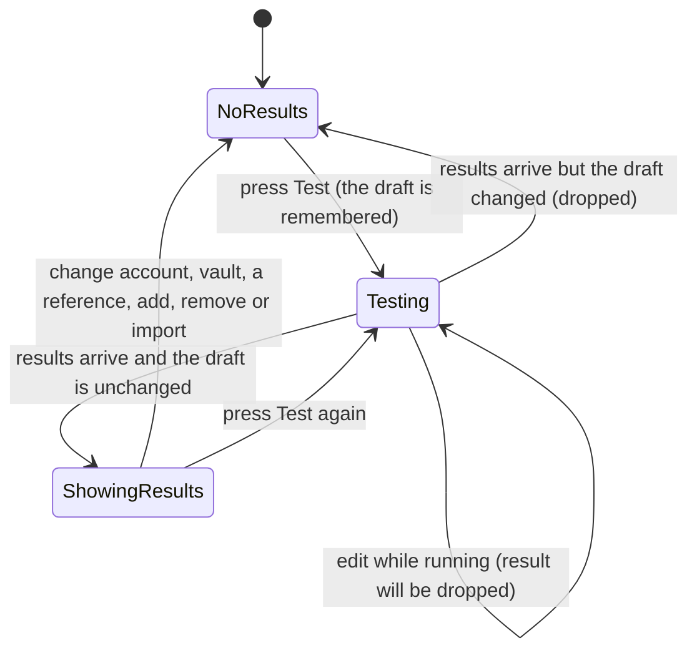
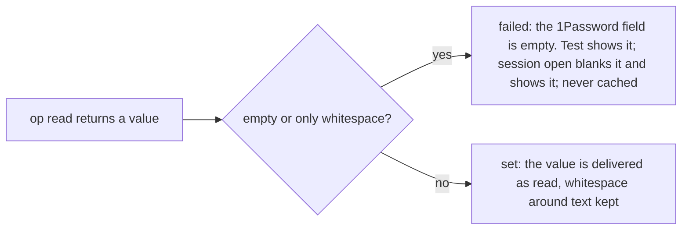

---
id:
title: Test results clear when the draft changes and say what set means
status: implementation
variant: kc-dev-flow-2
profile: pilot
merge: pr
worktree:
pr:
journey: paseo-project-env
journey-release: r1.5
journey-story: test-each-variable
journey-required-tasks: '["project-env-test-results-match-draft"]'
journey-mapping-complete: true
gates:
    version: 1
    records:
        - id: gate:project-env-test-results-match-draft:backlog
          stage: backlog
          attempts:
            - id: gate-attempt:project-env-test-results-match-draft-backlog-1
              briefing:
                id: briefing:project-env-test-results-match-draft:backlog:attempt-1:revision-1
                digest: sha256:7c6993c7b2e690e9261bd15498a708242f1c7f723792d49d48edcd21f68266b8
                room-ref: ./project-env-test-results-match-draft/review/backlog/briefing-1
              resolution:
                type: Resolution
                id: resolution:spacedock:project-env-test-results-match-draft:backlog:1
                briefing: briefing:project-env-test-results-match-draft:backlog:attempt-1:revision-1
                by: person:captain
                at: "2026-10-21T08:40:52.869275Z"
                decision: approve
                reason: 'Captain 2026-10-21: 「准」 — accepts this release r1.5 task''s outcome, scope and acceptance criteria on the pilot profile, into ideation.'
              application:
                target-stage: ideation
                state: consumed
        - id: gate:project-env-test-results-match-draft:ideation
          stage: ideation
          attempts:
            - id: gate-attempt:project-env-test-results-match-draft-ideation-1
              briefing:
                id: briefing:project-env-test-results-match-draft:ideation:attempt-1:revision-1
                digest: sha256:51099762d8164bc1af1e9a598c9df78abdcdc7d788cd16c04cfe403187ee529a
                room-ref: ./project-env-test-results-match-draft/review/ideation/briefing-1
              resolution:
                type: Resolution
                id: resolution:spacedock:project-env-test-results-match-draft:ideation:1
                briefing: briefing:project-env-test-results-match-draft:ideation:attempt-1:revision-1
                by: person:captain
                at: "2026-10-21T09:36:21.81253Z"
                decision: approve
                reason: 'Captain 2026-10-21: 「准五個設計」 — accepts this ideation design and its acceptance criteria into implementation, with the additions presented at this gate: no guessed reference in project-env-variable-row-edit (a new variable has no reference until a field is picked), AC-4 and the rewritten AC-3 in project-env-paste-token-check-first, the empty-value wording ''the 1Password field is empty'' in project-env-test-results-match-draft; FO''s recommendations also presented: removing the OP_CONNECT names in project-env-token-works-cause is left out and listed for the Captain, and naming a locked Keychain on the Test row is a follow-up after project-env-test-results-match-draft.'
              application:
                target-stage: implementation
                state: consumed
started: 2026-10-21T08:42:06Z
---

Release r1.5 of the paseo-project-env journey: on his own Mac, Kent stores a token only after it is checked, sees why a token fails, edits each variable where it sits, and sees test results that match his draft; his own use accepts it. Captain, 2026-10-20: 「我覺得UI不夠直覺」. Captain accepted this task list on 2026-10-21: 「可以」. Today results stay after the draft changes, and "set" does not say it only proves a value came back.

## Scope

In: editing the account, the vault, a reference, or adding or removing a variable clears the results; the screen says set only proves a value came back; a whitespace-only value counts as empty, and so failed (Captain 2026-10-21, journey test-each-variable/q5). Depends on: project-env-variable-row-edit (results live on each row). Stop condition: the acceptance criteria below pass.

## Acceptance criteria

**AC-1**: Changing the draft clears earlier Test results.
Verified by: Kent's own use on his Mac. With a project whose variables give a mix of set and failed, press Test so each variable shows its result; then change the account, change the vault, edit one reference, add a variable, and remove a variable, pressing Test again before each change. After each change no variable shows a result. Then press Test and edit a reference before it finishes: when it finishes no result appears. The same sequence on a throwaway plugin id on an isolated daemon with fake `op` and `security` (screenshots or a transcript in the PR) is the lower-level evidence; it fails if the Test state is shown without comparing it to the current draft.

**AC-2**: The screen states that set does not prove the service accepts the key.
Verified by: a screenshot in the PR, desktop and compact width, of the Test row showing this sentence verbatim: "Set means a value came back from 1Password; it does not prove the service accepts that key." The text is on screen before any Test is pressed.

**AC-3**: A whitespace-only value is reported as empty, at Test and at session open.
Verified by: unit tests with the fakes (`npm test` in `project-env`). For a fake `op` value of `"   \t "`, `resolveProject` returns `{ name, ok: false, cause: "empty" }` and the value is not cached (a second call reads `op` again); `openSession` puts `""` for that name in the request env and returns the same failed result; `rowHint` for it reads `failed: the 1Password field is empty`. For a value of `" x "` the result is `ok` and the env value is `" x "` unchanged. The existing test `whitespace is a value, not empty` is replaced by these. The tests fail if the empty check stops trimming, or trims the delivered value.

## FO alignment

Surfaces: ui
Visible change: Stale Test results disappear, set is explained, and a blank value shows as failed.
Direction alignment with the Captain: not needed — follows the Captain's 2026-10-21 layout choice (one row per variable).
Release review: paseo-project-env/r1.5 at 9489e13

## Design

### PRFAQ

**Press release.** In Project environment, the Test results Kent sees always belong to what is on screen. Change the account, the vault or a reference, or add, remove or import a variable, and every result disappears at once; press Test to check the new draft. The Test row says what "set" proves: a value came back from 1Password, not that the service accepts the key. A value of only spaces reads "failed: the 1Password field is empty", in Test and for a new agent alike.

**FAQ**
- *Why clear the results instead of marking them stale?* Journey `test-each-variable/q1` records that release 1.5 clears results on edit; a stale label keeps a result on screen that may be wrong.
- *What counts as a change?* Anything that changes what Test resolves: account, vault, a reference, an added, removed or imported variable. Editing the prompt does not: `resolveProject` ignores it. This is routine wording, not a decision for the Captain.
- *Does editing a value back bring the old result back?* No. A result belongs to the exact draft Test was pressed on; any later edit, even back to the same text, needs a new Test.
- *Kent edits while Test runs?* The late result is dropped, never drawn. The Test button reads "Testing…" until the call returns, as today.
- *Why no "results cleared" message?* The outcome asked for is that a result never outlives its draft; the absence of a result is the cue, and a message is new copy nobody asked for. A late result that is dropped leaves the same screen.
- *Why "the 1Password field is empty"?* The cause text `empty` becomes "the 1Password field is empty" (`causeText` in `project-env/shared/cause.ts`): beside a filled reference input, "the field is empty" read as that input (design review round 1, finding 1). It is shared by Test and the new-agent timeline row; no test asserts the old words.
- *Does the value an agent receives change?* No. Only a value that is empty or all whitespace fails; `" x "` is delivered as read.
- *Why trim on the server?* Test and session open both go through `readVariable` in `project-env/server/secrets.ts`, so one change covers both.

### Mechanism

The editor keeps the draft object each Test was sent with next to its results, and shows the results only while that object is still the current draft. Every edit, including import, replaces the draft object, so no edit path needs to remember to clear anything, and a late result is dropped the same way. On the server `value === ""` in `readVariable` becomes `value.trim() === ""`, and the `empty` cause text becomes "the 1Password field is empty". A disposable build of exactly this, on an isolated daemon, produced the previews below and the evidence under AC-1 and AC-3.

**Existing-code check.** Boundary: the editor's Test state and `readVariable`. Completeness: the `empty` cause works through the journey for exactly `""` (test `an empty value is a failed variable and is not cached`); whitespace is a broken seam, and the test `whitespace is a value, not empty` encodes the rule the Captain superseded (2026-10-21, `test-each-variable/q5`). Nothing clears Test results today. Searches: `grep -rn 'test\.\|\.reset(' client` finds only the Test button and the result list; `grep -rn '=== ""\|\.trim()' server shared client` finds the one empty check. Alternative rejected: `test.reset()` on each edit, which would need every edit path to call it (import calls `setDraft` directly) and would not drop a result still in flight.

### Row contract needed from project-env-variable-row-edit

Its draft previews (`project-env-variable-row-edit/design/`, not final) draw each variable's result on its row, and its spike passes `result` to the row as a prop. T4 needs exactly that, no more: (1) each variable row takes its result as one optional `{ name, ok, cause? }` and draws it, holding no result state of its own; (2) the editor computes that value in one place from the Test state, which is the expression T4 changes; (3) the Test action keeps a hint, and T4 appends one sentence to whatever text T3 leaves there. Until T3 lands, the preview draws the result in each variable field's hint, as T3's row does.

### ADR 0002 amendment (draft, no number: an amendment keeps ADR 0002)

Recommendation: yes. The journey cites ADR 0002 as the home of the empty-value ruling (`new-agent-env/q7` carries its link), yet ADR 0002 never says it; both rulings exist only in the journey file and an archived task. Without the amendment a reader who follows that link finds nothing about empty values. Text to append to `docs/adr/0002-an-unresolved-variable-is-blanked-and-shown.md`:

> ## Amendment, 2026-10-21
>
> **Words:** 「算失敗」 — Captain, 2026-10-20 (journey question new-agent-env/q7); 「可以」 — Captain, 2026-10-21 (journey question test-each-variable/q5)
>
> A value that is empty, or only whitespace, is a failed variable: blanked and shown at session open as this decision rules, and reported as failed by Test.

### UI

UI proposal: In the project editor, pressing Test shows set or failed with its cause on each variable's row. As soon as Kent changes the account, the vault or a reference, or adds, removes or imports a variable, every result disappears, and a Test still running when he edits shows nothing when it finishes. The Test row's help text gains one sentence: "Set means a value came back from 1Password; it does not prove the service accepts that key." A value of only spaces reads "failed: the 1Password field is empty". Where the field, Remove and result sit on one row belongs to the variable-row-edit task; the preview draws today's layout with the result under each variable's name.

Preview: project-env-test-results-match-draft/design/preview-desktop-dark-results-shown.png

The main picture is the one above. The proposed design is the set `design/preview-*.png` in this task's folder, taken from Paseo's real web client running a disposable build (`spike/preview.diff` on `main` at 487b9b0) under a throwaway plugin id `pe-t4-preview` on an isolated daemon (own home, port 6841), with fake `op` and `security` from `project-env/test/fakes` and no real token, Keychain item or secret. Pictures: desktop dark with the results shown, cleared after one edit, and while Testing; desktop light shown and cleared; compact (400 px) dark and light, shown and cleared. The variables are one set, one empty and one whitespace-only field, and one set. The daemon, plugin install, browser session and `/tmp/pe-t4-match-draft` are removed at the end of ideation.

### Design review

Design review: design/ideation-2.yaml
Design finding 1: Needs decision: the project-level "Remove" row is project-env-variable-row-edit's row layout; its draft previews draw a stop confirmation. Nothing in this task changes it; FO confirms it stays there. Not a Captain decision unless that task drops it.
Design finding 2: declined: row progress marks are new UI nobody asked for; the Test button already reads "Testing…".
Design finding 3: AC-1 — the design (FAQ "Kent edits while Test runs?", first state diagram) and AC-1's last sentence require that a late result is dropped; the end state is the same screen as the cleared pictures. Silence is intended.
Design finding 4: declined: the cleared screen is the outcome asked for; recorded in the FAQ ("Why no results cleared message?").
Design finding 5: declined: this task adds no cause text beyond the one reworded, a whole-test error is journey `test-each-variable/q7` (not this task), and many variables is drawn by project-env-variable-row-edit's `preview-*-twelve-long.png`.
Design finding 6: declined: the hint line of `SettingsRow` (Paseo 0.12.0 plugin UI) takes text only; colouring a failure belongs to the row component of project-env-variable-row-edit, whose draft previews colour it.
Design finding 7: declined: the height of a result line is that task's row layout.
Design finding 8: declined: a disabled Add with no reason is today's behaviour; project-env-variable-row-edit changes Add.
Design finding 9: declined: whether Test checks the draft or the saved project is journey `test-each-variable/q2`, not placed in a release; kept out as listed below.
Design finding 10: declined: `SettingsAction` has no primary or destructive variant, so the plugin cannot style these buttons.
Design finding 11: declined: button sizes come from Paseo's `SettingsAction`, which the plugin does not size.
Design finding 12: declined: the testing state differs between themes and sizes only by colour and wrapping, which the shown and cleared pictures already cover.

Round 1 (`design/ideation-1.yaml`) had two MAJOR findings. Finding 1, "the field is empty" read as the reference input beside it: fixed, the cause text is now "the 1Password field is empty" and the four `*-results-shown.png` pictures were redrawn. Finding 2, the project-level Remove button: the same disposition as round 2 finding 1. The review ran twice, the limit.

### Not in this task

- Clearing results when a token is saved: the accepted scope lists five edits, and storing a token is project-env-paste-token-check-first's flow; named for FO, not adopted.
- Journey `test-each-variable/q3`, `q4` and `q7` (Test deadline, Test load, a non-`op://` reference refusing the whole Test): not placed in this task.
- The name input not clearing after Add (visible in the previews): project-env-variable-row-edit.
- Stating that Test checks the draft while new agents use the saved project (`q2`): no ruling asks for it here.

## Stage Report: ideation

- DONE: Design clearing Test results on any draft change, the wording that set only proves a value came back, and whitespace-only values counting as empty at Test and session open (Captain 2026-10-21).
  `## Design`: results kept with the draft object they were run on and shown only while it is current; the sentence goes on the Test hint; `value.trim() === ""` in `readVariable`, which Test and session open share; `empty` cause text becomes "the 1Password field is empty" (design review round 1). Built as a disposable and run on an isolated daemon: after Test, changing the account, the vault, a reference, an add and a remove each took the 2 empty rows from 2 to 0; a Test edited mid-flight (a 5 s fake delay) drew nothing when it finished, while the unedited control drew 2.
- DONE: Name the row contract you need from project-env-variable-row-edit rather than designing the row; decide whether ADR 0002 gains an amendment recording empty and whitespace as failed (Captain 「算失敗」 2026-10-20 and 「可以」 2026-10-21), and draft it if so.
  Contract: a row takes one optional `{ name, ok, cause? }` result and holds no result state; the editor computes it in one place; T4 appends one sentence to T3's Test hint (read from T3's draft previews and spike, not its final design). Amendment: yes, drafted in `## Design`; the journey links ADR 0002 for the empty ruling but ADR 0002 never says it. It keeps number 0002.
- DONE: Keep AC-1 to AC-3 with reproducible evidence clauses and produce the artifact the ui surface owes.
  AC wording unchanged; each `Verified by` now carries steps and a falsifier. Artifact: `UI proposal:`, `Preview:` and nine real-client pictures in `project-env-test-results-match-draft/design/`, build diff in `spike/preview.diff`.
  Checker (`design_surfaces.py check`): "design surfaces presentable; design review design/ideation-2.yaml: 12 findings, 0 fixed, 1 criteria, 10 declined, 1 decisions".

### Per-criterion evidence
- AC-1: not verified in code (no implementation). The disposable build on an isolated daemon showed all five edits clearing results and the in-flight drop; Kent's own use and a rerun on the implemented plugin are owed.
- AC-2: not verified in code. The sentence was drawn in the Test hint at desktop and compact width, dark and light (previews); the PR screenshot of the implementation is owed.
- AC-3: not verified in code. Against the one-line server change `npm test` gave 79 of 80 passing; the one failure is `whitespace is a value, not empty`, which encodes the superseded rule and is replaced by the tests in AC-3's clause.

### Summary
Test results are tied to the draft they were run on, `set` is explained on the Test hint, and whitespace fails as empty through the shared `readVariable`. Two choices went beyond the task text: the `empty` wording change, adopted to fix a MAJOR review finding, and the ADR 0002 amendment. The design review ran twice (the limit): round 2 left one MAJOR, the project-level Remove button, which is project-env-variable-row-edit's row layout and is routed there.

### Needs decision
- None for the Captain. For FO: confirm the project-level Remove button (design finding 1) stays with project-env-variable-row-edit; whether storing a token should also clear results is named for project-env-paste-token-check-first's ideation.

### Limits
- Mermaid diagrams were not rendered; only the checker ran. Kent's live `paseo-project-env` install was untouched (`paseo plugin ls` shows it running before and after). The isolated daemon, plugin id `pe-t4-preview`, browser session and `/tmp/pe-t4-match-draft` are removed. Machine dependencies: Paseo.app 0.12.0 CLI, Node 24, `agent-browser`; `spike/index.server.ts` and `spike/lib.sh` hardcode `/tmp/pe-t4-match-draft`.
