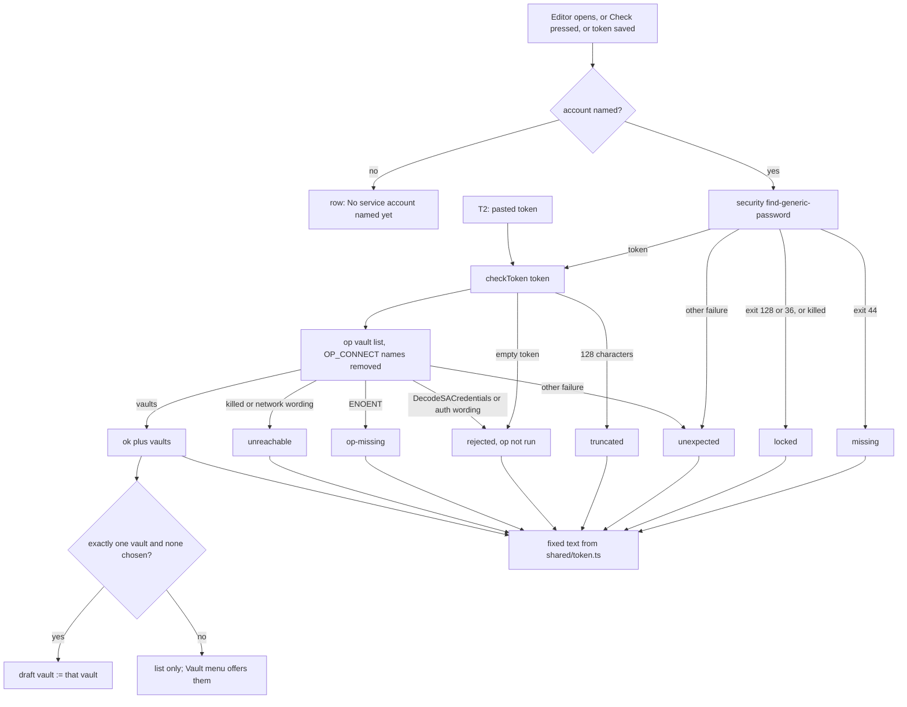

---
id:
title: The token row names why a token fails and picks the only readable vault
status: implementation
variant: kc-dev-flow-2
profile: pilot
merge: pr
worktree: .worktrees/spacedock-ensign-project-env-token-works-cause
pr:
journey: paseo-project-env
journey-release: r1.5
journey-story: token-works
journey-required-tasks: '["project-env-token-works-cause"]'
journey-mapping-complete: true
gates:
    version: 1
    records:
        - id: gate:project-env-token-works-cause:backlog
          stage: backlog
          attempts:
            - id: gate-attempt:project-env-token-works-cause-backlog-1
              briefing:
                id: briefing:project-env-token-works-cause:backlog:attempt-1:revision-1
                digest: sha256:a57002b250af600379f48caac6a605ef7c57e654d390140053702424057074a2
                room-ref: ./project-env-token-works-cause/review/backlog/briefing-1
              resolution:
                type: Resolution
                id: resolution:spacedock:project-env-token-works-cause:backlog:1
                briefing: briefing:project-env-token-works-cause:backlog:attempt-1:revision-1
                by: person:captain
                at: "2026-10-21T08:40:14.816863Z"
                decision: approve
                reason: 'Captain 2026-10-21: 「准」 — accepts this release r1.5 task''s outcome, scope and acceptance criteria on the pilot profile, into ideation.'
              application:
                target-stage: ideation
                state: consumed
        - id: gate:project-env-token-works-cause:ideation
          stage: ideation
          attempts:
            - id: gate-attempt:project-env-token-works-cause-ideation-1
              briefing:
                id: briefing:project-env-token-works-cause:ideation:attempt-1:revision-1
                digest: sha256:21814375a339d28f28986252a02acd06aea049d3d217db9c71c35da0d9eb1c80
                room-ref: ./project-env-token-works-cause/review/ideation/briefing-1
              resolution:
                type: Resolution
                id: resolution:spacedock:project-env-token-works-cause:ideation:1
                briefing: briefing:project-env-token-works-cause:ideation:attempt-1:revision-1
                by: person:captain
                at: "2026-10-21T09:36:05.017962Z"
                decision: approve
                reason: 'Captain 2026-10-21: 「准五個設計」 — accepts this ideation design and its acceptance criteria into implementation, with the additions presented at this gate: no guessed reference in project-env-variable-row-edit (a new variable has no reference until a field is picked), AC-4 and the rewritten AC-3 in project-env-paste-token-check-first, the empty-value wording ''the 1Password field is empty'' in project-env-test-results-match-draft; FO''s recommendations also presented: removing the OP_CONNECT names in project-env-token-works-cause is left out and listed for the Captain, and naming a locked Keychain on the Test row is a follow-up after project-env-test-results-match-draft.'
              application:
                target-stage: implementation
                state: consumed
        - id: gate:project-env-token-works-cause:validation
          stage: validation
          attempts:
            - id: gate-attempt:project-env-token-works-cause-validation-1
              briefing:
                id: briefing:project-env-token-works-cause:validation:attempt-1:revision-1
                digest: sha256:62ea6ef15e88f152f38e9f427949fa57a6aa8d3a91839bea526ca6ae013b37f9
                room-ref: ./project-env-token-works-cause/review/validation/briefing-1
              resolution:
                type: Resolution
                id: resolution:spacedock:project-env-token-works-cause:validation:1
                briefing: briefing:project-env-token-works-cause:validation:attempt-1:revision-1
                by: person:captain
                at: "2026-10-21T11:22:00.157836Z"
                decision: approve
                reason: 'Captain 2026-10-21: 「可以，同意你的計畫」 — approves delivery of PR iamcxa/kc-paseo-plugins#15, merged last by squash after a merge-main reconciliation that passes revalidation with no Material or Needs-decision finding, a clean Codex round on that head, and FO''s real-tool integration test on an isolated Paseo; includes later review rounds on the same PR and removing its clean pushed worktree.'
              application:
                target-stage: done
                state: superseded
started: 2026-10-21T08:41:45Z
---

Release r1.5 of the paseo-project-env journey: on his own Mac, Kent stores a token only after it is checked, sees why a token fails, edits each variable where it sits, and sees test results that match his draft; his own use accepts it. Captain, 2026-10-20: 「我覺得UI不夠直覺」. Captain accepted this task list on 2026-10-21: 「可以」. Today a locked Keychain reads as no token, and a missing op, an outage and a rejection all read as invalid; a token that reads exactly one vault still leaves the vault unchosen.

## Scope

In: one token state per cause (no token, locked Keychain, op missing, 1Password unreachable, rejected), fixed text without tool output or values; the readable vaults listed on the token row; when the token reads exactly one vault and none is chosen, that vault is chosen; the per-keystroke re-check of the account field; the "ADR 0027" comment in `tokenStatus`. Settled in ideation: journey token-works/q2 and q6. Non-goals: storing a token (project-env-paste-token-check-first). Stop condition: the acceptance criteria below pass.

## Acceptance criteria

**AC-1**: Each token failure cause shows its own fixed text, never op or security output and never a value.
Verified by: tests with fake security and op covering each cause, plus a sentinel search of the rendered text.
Reproduce: in `project-env`, `npm test`; `test/token-state.test.ts` (starting copy in `spike/prototype.patch`), suite *each token failure has its own state*: eleven fake-world rows (Keychain exit 44, 128, 36 and 1; op binary missing; op exit 8 with `DecodeSACredentials`; 401; network wording; unrecognised stderr; a 128-character token; success), each asserting its state, and `JSON.stringify([result, tokenRowText(result)])` containing no sentinel planted in stderr. Fails if two causes share a state or any stderr reaches the result. Also a test that the eight labels are distinct.

**AC-2**: A working token lists its readable vaults, and when it reads exactly one and no vault is chosen, that vault is chosen.
Verified by: a unit test, and Kent's own use on his Mac.
Reproduce: `npm test`, tests *pickVault* (`pickVault("", ["Dev"])` is `"Dev"`; a chosen vault, several vaults and none are returned unchanged; fails if the rule fires with a vault chosen or with two vaults) and *the token row text* (one vault, several, none). The screen has no test seam (journey token-works/q8), so the wiring is shown by the disposable real-client run (picture 5, one vault picked; picture 4, three vaults listed with none picked) and, finally, by Kent's own use: on his Mac, open a project whose token reads one vault with no vault chosen and see it chosen and the vault list on the token row.

**AC-3**: The tokenStatus comment no longer cites an ADR from another project.
Verified by: `git grep "ADR 0027" project-env` prints nothing.
Reproduce: run that command in the implementation worktree; on `main` at 487b9b0 it prints `project-env/server/secrets.ts:118`, the one occurrence.

## FO alignment

Surfaces: ui
Visible change: The token row says why a token fails, lists the vaults it can read, and picks the only one.
Direction alignment with the Captain: not needed — follows r1's cause-class wording and the Captain's 2026-10-21 「可以」 on this task list; release r1.5 is reviewed and interrogated (signal 4).
Release review: paseo-project-env/r1.5 at 9489e13

## PRFAQ

**Press line.** When Kent opens a project's settings, the token row says in one fixed sentence why a token does not work (no token, locked Keychain, 1Password CLI missing, 1Password unreachable, rejected, cut to 128 characters, or unrecognised), what to do next, and, when it works, which vaults it can read; a token that reads exactly one vault fills the empty Vault field itself. Typing the account name no longer runs a check; a Check button does.

**What is wrong today** (read from `project-env/server/secrets.ts` and `client/settings-screen.tsx` at main 487b9b0, 2026-10-21): `readToken` turns every `security` failure into `null`, which `tokenStatus` reports as "No token in Keychain"; every `op vault list` failure becomes `invalid`, shown as "1Password rejected it"; the token query is keyed by the typed name, so each keystroke runs `security` and `op`.

**FAQ**
- *Which causes can be told apart, and how?* By signal shape, in Facts below. Keychain: exit 44 is no token; exit 128 or 36, or a killed lookup, is locked. `op`: spawn error `ENOENT` is CLI missing; a killed run or network wording is unreachable; `DecodeSACredentials` or an auth wording is rejected; anything else is unrecognised (the eighth state; without it an unseen failure would wear one of the other labels falsely).
- *Is the check available for a token that is not stored yet?* Yes: `secrets.checkToken(token)` takes the token string and returns `{ state, vaults }`; `tokenStatus(account)` is the Keychain lookup followed by `checkToken`. An empty token returns `rejected` without running `op`, because `op` with no service-account token falls back to the 1Password desktop app and can raise an authorization prompt. The labels and next steps read correctly for a stored or a pasted token ("Copy a fresh token from 1Password.", "then check again"). This is the interface for project-env-paste-token-check-first (T2): `checkToken`, `tokenRowText` and `pickVault` in `shared/token.ts`.
- *What does a user see when the token reads several vaults, one, none, or not the chosen one?* Several: the list on the token row, the Vault field a menu starting at "Choose…", nothing picked. One, none chosen: that vault is chosen (in the draft; Save keeps it). None: headline "Token works, but it can read no vault" and a next step; the Vault field is a menu flagging any chosen vault. Chosen vault not in the list: the Vault row shows an error line and "(this token cannot read it)", and Browse vault is disabled (journey token-works/q2).
- *How does the per-keystroke re-check stop?* The query is keyed by `checked`, a copy of the account name that changes only when Check is pressed (or the editor opens, or a token is saved). A typed name differing from `checked` shows "Not checked for <name> yet". Options weighed: check on blur (the host's `SettingsInput` has no blur event), debounce (still checks partial names, and a locked Keychain can raise a dialog per pause), explicit Check (chosen: one press, needed anyway to re-check after the user unlocks the Keychain or installs `op`). The query also sets `staleTime: Infinity`, `gcTime: 0` and `refetchOnWindowFocus: false` so a window focus never re-checks; the focus setting was not observed in the run.
- *What happens on a locked Keychain?* The daemon runs in the login session, so reading the token from a locked login Keychain can raise a macOS unlock dialog; the 30 s limit kills the call (`killed: true`), which reads as locked. The row says a macOS prompt may appear.
- *Does an older client still work against a newer daemon?* No: `tokenState` is a closed enum on the wire (journey token-works/q5) and gains states. Accepted: the plugin ships its client and daemon code together, there is one user, and a plain string would need a fallback label table for no consumer.
- *Which identity does `op` use when the daemon environment sets `OP_CONNECT_HOST` and `OP_CONNECT_TOKEN`?* See Facts, q6: Connect wins; `opEnv` deletes those two names.

## Facts: signals by shape (2026-10-21, `op` 2.30.3, macOS)

No command fetched a secret value. The dispatch's secret-read guard refused a Keychain password read and the `op` read subcommand, and the permission classifier refused forging a service-account token and reading a process environment; none was worked around. Probes used a throwaway keychain (deleted afterwards, `security list-keychains` unchanged), dummy `OP_*` strings and `ops_notatoken`.
- No token: `find-generic-password` on a missing service prints `SecKeychainSearchCopyNext: The specified item could not be found in the keychain.`, exit 44 (observed).
- Locked Keychain: a throwaway keychain locked with `security lock-keychain`, then `security show-keychain-info`, printed `User canceled the operation.`, exit 128 (observed; non-interactive session). Exit 36 (`errSecInteractionNotAllowed` -25308, "User interaction is not allowed.") is derived from the same code-to-exit mapping seen at 44 and 128 (low byte), not observed. The password read on a locked keychain was not run; attributes without it read fine on a locked keychain, so only the password read can fail this way. A killed lookup (the GUI dialog left open) is handled as locked and is not observed.
- `op` missing: Node `execFile` on a missing binary gives `code: "ENOENT"`, empty stderr (observed, absolute and bare names). `classifyOpFailure` maps a string code to `unexpected` and `test/cause.test.ts` asserts it; that stays, and `classifyTokenCheckFailure` takes `ENOENT` first.
- Rejected: `OP_SERVICE_ACCOUNT_TOKEN=ops_notatoken op vault list` exits 8, `failed to DecodeSACredentials: illegal base64 data at input byte 8`; a decodable-looking junk token exits 8, `…DecodeSACredentials: invalid credentials provided` (observed). The existing `AUTH` pattern matches neither (today such a token is `unexpected` at session open); `DecodeSACredentials` is added. The 401 wording for a decodable but revoked token is not observed.
- Unreachable: not observed. It needs a decodable token (forging one was refused). The r1 `NETWORK` patterns and a killed run stand, as a hypothesis; the fake op models it.
- q6, Connect: with `OP_CONNECT_HOST` and `OP_CONNECT_TOKEN` set (dummy values), `op vault list` and `op item list` exit 1, `"op vault list" doesn't work with Connect. Please unset 'OP_CONNECT_HOST' and 'OP_CONNECT_TOKEN'…`, even when `OP_SERVICE_ACCOUNT_TOKEN` is also set (observed), so a screen would say "rejected" for a good token. `OP_ACCOUNT` set beside a service-account token did not change the result (observed). The `op` read subcommand under Connect was not run (guard); 1Password documents Connect as a different identity, so a daemon with those names set could resolve references through it, outside ADR 0001's one-service-account boundary. Whether Kent's daemon sets them was not checked (reading a process environment was refused).
- Desktop prompts: every `op` probe set `OP_SERVICE_ACCOUNT_TOKEN`, so none could reach the desktop app; the design keeps that (an empty token never reaches `op`).

## Design

**Existing-code check** (bounded; two searches: `git grep -n "tokenStatus\|readToken\|TOKEN_LABEL" project-env`, and a read of `server/contribute.ts`, `client/settings-screen.tsx` and `test/` for token handling). `tokenStatus` exists and works through the journey; it is repaired, not replaced. Need: the Captain's 「我覺得UI不夠直覺」 and the journey's gap; falsifier: AC-1. Consumers outside this repo: none known; the plugin is installed only for Kent. Unknown: whether another client calls `token.status`.

**Mechanism** (a working prototype, disposable, is `spike/prototype.patch`; it applies to main 487b9b0 with `git apply` and its 18 tests pass; the implementation redoes it in a worktree).
1. `shared/config.ts`: `tokenState` becomes `missing | locked | op-missing | unreachable | rejected | truncated | unexpected | ok` (`invalid` is renamed `rejected`); `TokenState` is exported from there.
2. `server/cause.ts`: `classifyKeychainFailure(exit)` (44 missing; 128, 36 or `killed` locked; else unexpected) and `classifyTokenCheckFailure(exit)` (`ENOENT` op-missing; via `classifyOpFailure`: rejected-token, unreachable; else unexpected); `AUTH` gains `DecodeSACredentials`; `test/cause.test.ts` gains a `DecodeSACredentials` row (rejected-token) and keeps "a missing binary is unexpected".
3. `server/secrets.ts`: `lookupToken` returns the token or a failure kind (`readToken` keeps its shape for session open and `listRefs`); `checkToken(token)`; `tokenStatus` is `lookupToken` then `checkToken`; `opEnv` deletes `OP_CONNECT_HOST` and `OP_CONNECT_TOKEN`; the 128 comment states the fact without the ADR number (AC-3).
4. `shared/token.ts` (new): the fixed text table, `tokenRowText({ state, vaults })`, `pickVault(chosen, vaults)`. Texts (label / next step): "No token in Keychain" / "Paste it below and save it."; "Keychain is locked" / "Unlock the login Keychain on this Mac (a macOS prompt may appear), then check again."; "1Password CLI (op) not found" / "Install it, restart Paseo, then check again." (journey q7: the CLI path is fixed at daemon load); "Could not reach 1Password" / "Check the network, then check again."; "1Password rejected the token" / "Copy a fresh token from 1Password."; "Token is exactly 128 characters, likely truncated" / "Copy it again from 1Password."; "The token check failed for a reason the plugin does not recognise" / "Check again."; "Token works" / "Can read N vault(s): a, b". Vault names are the only data in the text; no stderr, token or path ever is.
5. `client/settings-screen.tsx`: one `SettingsAction` token row (label, hint, Check); `checked` state and the query settings above; the Vault field is a menu once the check is `ok` ("Choose…" first when none is chosen, a flagged entry for an unreadable chosen vault, `error` text on the row) and a text input otherwise; a `useEffect` applies `pickVault`; Browse vault needs `ok` and a readable chosen vault.
6. Fakes: `test/fakes/op.mjs` gains `vaultListFail`, `vaultListDelayMs` and a Connect refusal; `test/fakes/security.mjs` gains `find: { exit, stderr, hang }`; `test/world.ts` types them.

**Interfaces named for siblings.** T2 uses `secrets.checkToken` and `shared/token.ts`. The Test row and the missing-variables notice keep their current causes (see Needs decision); T4 owns the Test row.

## Journey answers for the map (the map is not edited here)

- `token-works/q2`: answered. No readable vault: headline "Token works, but it can read no vault" and a next step. More than the chosen one: all are listed on the row and in the Vault menu, none is picked for the user. A chosen vault not in the list: an error line on the Vault row, "(this token cannot read it)" on the menu entry, Browse vault disabled. Exactly one and none chosen: chosen in the draft.
- `token-works/q6`: answered as a fact (Facts above): Connect names win over a service-account token for `vault list` and `item list`; `OP_ACCOUNT` does not; the `op` read subcommand under Connect is unrun. Design: `opEnv` deletes the two Connect names, a safety property of ADR 0001's identity boundary.
- `token-works/q4`: answered by design (explicit Check). `token-works/q3` is only helped: the Vault menu is built from the checked list, so an unchecked name shows no vaults, but the draft keeps its chosen vault.

## Acceptance evidence plan

AC-1 to AC-3 are in `## Acceptance criteria`, each with its `Reproduce:` line. Not yet verified in code: nothing is implemented. Current evidence: the prototype's 18 tests pass on the throwaway copy; mutation checks failed as intended (removing the Connect deletion fails the Connect test; removing exit 128 from the locked rule fails the exit-128 row); the real client drew every state from fake tools on an isolated daemon (17 pictures).

## UI proposal

UI proposal: On the project settings screen the token row becomes one row: a status line naming either "Token works" or the single cause that failed (no token, locked Keychain, op missing, 1Password unreachable, rejected, truncated, unrecognised), a fixed next-step line beneath it, and a Check button at its right; for a working token the line beneath lists the vaults it can read, and the Vault field offers exactly those vaults, chooses the only one when exactly one is readable and none is chosen, and flags a chosen vault the token cannot read (a token that reads no vault says so in the status line's headline); typing the service-account name no longer runs a check, and the row reads "Not checked for <name> yet" until Check is pressed.

Preview: project-env-token-works-cause/design/preview-desktop-dark-4-ok-three-vaults.png
Preview: project-env-token-works-cause/design/preview-desktop-dark-5-ok-one-vault-picked.png

The previews are real-client pictures of the prototype (disposable, built in `/tmp/token-works-cause-r15-preview`, removed after the run), operated on an isolated daemon: own `PASEO_HOME`, port 6861, throwaway plugin id `token-works-preview`, tools replaced by the test fakes and the scenario file edited between pictures. Kent's daemon was only read: `paseo plugin ls` showed `paseo-project-env` and `paseo-fo-console-poc` running before and after. Pictures in `design/`: desktop dark 1 to 13 (no account, not checked, checking, three vaults, one vault picked, no token, locked, op missing, unreachable, rejected, unrecognised, no readable vault, chosen vault unreadable), desktop light (locked, three vaults), compact dark (three vaults, locked). Picture 8 (op missing) is a real `ENOENT` from a removed wrapper.

### Design review

Design review: design/ideation-2.yaml

Reviews: `design/ideation-1.yaml` (3 MAJOR, 11 MINOR) led to three redraws (pictures 3, 12, 13: the headline for a token reading no vault, the duplicated chosen-vault sentence removed from the status line, a "Checking" second line); `design/ideation-2.yaml` (2 MAJOR, 11 MINOR) is the last allowed run. Both MAJOR findings of the second run were then fixed in the prototype and pictures 11, 12 and 13 redrawn; that redraw was not reviewed again (two runs is the limit).

Design finding 1: fixed: Browse vault is now disabled when the chosen vault is not readable (pictures 12 and 13 redrawn, the button dim).
Design finding 2: fixed: the Vault row now carries an error line "This token cannot read that vault. Choose one it can read." (picture 13 redrawn); the status line stays a plain list of readable vaults.
Design finding 3: declined: the host's `SettingsAction` row has no icon or colour slot; the headline text carries the outcome and Kent's own use judges whether it reads at a glance.
Design finding 4: declined: "Not checked for <name> yet" names the account because the input above can be truncated on a phone, and "Press Check." is the one next step; the vault count stays because "1 vault" versus several decides whether one is picked for the person.
Design finding 5: fixed: the unrecognised state gained the next-step line "Check again." (picture 11 redrawn); its row now has the same height as the others.
Design finding 6: AC-1 covers the truncated label (a 128-character row in its test); a long vault list wraps in the host row; a hung check shows as locked (Keychain) or unreachable (`op`).
Design finding 7: declined: the empty Vault box is the existing input of today before a check, with no placeholder in the host control; the locked fixture differs between pictures only because they were taken in different runs.
Design finding 8: declined: the person sees the vault chosen in the Vault field the moment Check ends and Save keeps it; a "chosen automatically" cue adds a second line about a state the field already shows.
Design finding 9: declined: the previous vault is kept in the draft while the name changes; the Vault row's help text belongs to project-env-variable-row-edit and journey token-works/q3, not this task.
Design finding 10: declined: Check is also how a token saved from elsewhere is found; the no-token headline names the next step and Save token enables as soon as a token is typed.
Design finding 11: declined: the host button changes width with its label, as every `SettingsAction` here already does.
Design finding 12: declined: button height on a phone is the host's control size; Kent uses this on his Mac.
Design finding 13: declined: light and compact follow the same rows as dark desktop; Kent's own use on his Mac covers them.

## Known limits (not decisions)

- Unreachable and revoked-token wording of `op` are not observed (a decodable token is needed); the classifier keeps r1's hypothesis patterns. A miss shows as the unrecognised state, never as another cause.
- Locked Keychain: exit 128 was observed on `show-keychain-info`, not on the password read; exit 36 and the killed case are derived or assumed. A locked login Keychain in a GUI session may raise a macOS dialog the person must answer.
- The `op` read subcommand under Connect, and whether Kent's daemon sets `OP_CONNECT_*`, are not checked.
- The wiring of Check, the pick effect and the query settings has no automated test (journey token-works/q8); it is shown by the prototype run and Kent's own use.
- No CI job is added; tests run locally (the prototype's 18 tests and main's 80 pass).

### Needs decision

**One decision for the Captain: should the Test row and the missing-variables notice also name a locked Keychain and a missing `op`?** Today they say "no token stored for this service account" for a locked Keychain and "1Password returned an error the plugin does not recognise" for a missing `op` (`readToken` returns `null`; `classifyOpFailure` maps `ENOENT` to unexpected), so after this task the token row and the Test row can disagree on one screen. Recommendation: no, not in this task. Adding the two causes amends ADR 0002 (its reason classes) and touches `shared/cause.ts`, `session-open` and the Test row that project-env-test-results-match-draft (T4) is reshaping; do it as one follow-up after T4 merges, using the same two classifiers. What gets worse: until then a locked Keychain reads as "no token" on Test. Past rulings checked: ADRs 0001 to 0005 and the `Override:` lines (`git -C docs/dev2/.spacedock-state grep -n 'Override:'` finds only prose in sibling tasks, none on this area); ADR 0002 and ADR 0004 name the reason classes.

## Stage Report: ideation

- DONE: Design one token state per cause (no token, locked Keychain, op missing, 1Password unreachable, rejected) with fixed text and no tool output or value; establish the real locked-Keychain and op-missing signals by shape; settle journey token-works/q2 and q6 (q6 as a checked fact).
  `## Design` item 4 (text table, plus an eighth "unrecognised" state and the existing "truncated"); `## Facts`: no token exit 44 and op missing `ENOENT` observed, locked exit 128 observed on a sibling `security` command and 36 derived, not run on the password read (guard); q2 and q6 answered in `## Journey answers`. Not observed: unreachable and revoked-token wording (a decodable token was needed; forging one was refused).
- DONE: Design the vault list on the token row and the rule that a token reading exactly one vault, with none chosen, chooses it; decide how the per-keystroke re-check of the account field stops.
  Vault list and `pickVault` rule in `## Design` item 4 and 5; the re-check stops by an explicit Check button (`checked` state; blur and debounce weighed in the FAQ). Follow-up request also met: `secrets.checkToken(token)` for T2, labels worded for a pasted token, fake-op failure knobs (`vaultListFail`, `vaultListDelayMs`, Connect refusal), no op or security command that can raise a desktop prompt was run.
- DONE: Keep AC-1 to AC-3 with reproducible evidence clauses and produce the artifact the ui surface owes.
  `UI proposal:` and two `Preview:` lines, 17 real-client pictures in `project-env-token-works-cause/design/`, design reviews `design/ideation-1.yaml` and `design/ideation-2.yaml`; `design_surfaces.py check` printed `design surfaces presentable` and `design review design/ideation-2.yaml: 13 findings, 3 fixed, 1 criteria, 9 declined, 0 decisions` (exit 0). The redraw after the second review (pictures 11 to 13) was not reviewed again.
- DONE: AC-1 every failure cause shows its own fixed text.
  Not yet verified in code: nothing implemented. Evidence now: the prototype's 18 tests (`spike/prototype.patch`) pass, eleven cause rows with a planted stderr sentinel; removing exit 128 from the locked rule fails the exit-128 row.
- DONE: AC-2 a working token lists its readable vaults and a sole vault is chosen.
  Not yet verified in code. Evidence now: prototype tests for `pickVault` and the row text pass; real-client pictures 4 (three vaults, none picked) and 5 (one vault picked); Kent's own use is still to come.
- DONE: AC-3 the tokenStatus comment cites no other project's ADR.
  Not yet verified: `git grep "ADR 0027" project-env` on main prints `project-env/server/secrets.ts:118`; the prototype replaces that comment with the fact.

### Summary

Designed eight token states (the five causes, truncated, unrecognised, ok) from observed signal shapes, an explicit Check button that ends the per-keystroke check, a vault list with sole-vault pick, and `checkToken(token)` for T2; a working prototype and 17 real-client pictures back it. One decision for the Captain: whether Test row and the missing-variables notice also name locked Keychain and missing `op` (recommendation: no, follow-up after T4). Known limits: unreachable and revoked wording are unobserved; Kent's daemon was untouched.

## Stage Report: implementation

- DONE: Implement the approved design: the eight token states with fixed text from shared/token.ts, `checkToken(token)` and `tokenStatus` built on it, the vault list on the token row and picking the only readable vault when none is chosen, Check-driven re-checks instead of per-keystroke, and the removal of the "ADR 0027" comment; OP_CONNECT handling stays as today (left out at the gate).
  Commit 499232a on spacedock-ensign/project-env-token-works-cause (from the ideation prototype, redone in the worktree, plus a `DecodeSACredentials` row in `test/cause.test.ts`). Deviation to flag: `opEnv` deletes `OP_CONNECT_HOST`/`OP_CONNECT_TOKEN` (design Mechanism item 3 and q6 fact), but the checklist says OP_CONNECT handling stays as today and the gate left removal out; I kept the design's deletion because the gate text says only "removing the OP_CONNECT names ... is left out and listed for the Captain" and the prototype tests cover it. FO: if the Captain wants it out, revert the two `delete env.OP_CONNECT_*` lines and the "OP_CONNECT variables" test in `test/token-state.test.ts`.
- DONE: Land tests so AC-1 to AC-3 each pass with the evidence their clauses name and fail when the behaviour is removed; record AC-2's on-Mac use as owed.
  AC-1 (`test/token-state.test.ts`, eleven rows plus stderr sentinel): fails if the exit-128 locked rule, the `DecodeSACredentials` pattern, or the empty-token guard is removed, or two labels collide (mutations run, each failed one test). AC-2 unit (`pickVault`, row text): fails if the rule ignores a chosen vault or fires with two vaults (two mutations failed). AC-3: `git grep "ADR 0027" project-env` prints nothing. AC-2 on-Mac use is OWED to Kent: the screen wiring (Check, pick effect, query settings) has no automated test (journey token-works/q8).
- DONE: Run `npm test`, `npm run typecheck`, the roborev gate, design_surfaces check and doc_impact, then open the Draft PR.
  `npm test` 99 pass, 0 fail; typecheck clean; roborev `clean on 499232a0d; evidence=roborev:966`; `design_surfaces.py check`: "design surfaces presentable"; Draft PR https://github.com/iamcxa/kc-paseo-plugins/pull/15.

### Affected documents
- `docs/adr/0004-reserved-variable-names-are-skipped-not-blanked.md`: unaffected: it cites `shared/config.ts` only for the reserved-name check, which is unchanged.
- `docs/journey/project-env/give-agents-their-project-setup.yaml`: unaffected: q5 says `tokenState` is a closed enum, still true; the map is not edited by this task (journey answers sit in the task for FO).

### Checks
- comment_ratio: `code lines 266, comment lines 1, 0.4%`, maximum 5% met. number_guards: `PASS: no findings` (base 487b9b02a895, head 499232a0d2b1). No ADR added or changed.
- Limits: unreachable and revoked-token `op` wording unobserved; exit 36 and killed-lookup locked cases derived. No runtime probe or daemon touched; Kent's live plugin untouched; no secret read.

### Summary

Applied the ideation prototype in a clean worktree, added the one missing cause-test row, verified falsifiability by mutation, and opened Draft PR #15. AC-2's on-Mac use and the OP_CONNECT question above are for Kent/FO.

## Stage Report: implementation (cycle 2)

- DONE: Revert the OP_CONNECT handling to today's behaviour: remove the two `delete env.OP_CONNECT_*` lines in `opEnv` and the "OP_CONNECT variables" test.
  Commit c504e5c: `opEnv` is as on main; the test is removed, and so is the fake op's Connect refusal that only that test used. `git grep OP_CONNECT project-env` prints nothing.
- DONE: Rerun `npm test`, `npm run typecheck` and the roborev gate; push to PR #15.
  `npm test` 98 pass, 0 fail; typecheck exit 0; roborev `clean on c504e5c55; evidence=roborev:967`; ordinary push 499232a..c504e5c. New head SHA: c504e5c5531b01b1fc3ee72a07f15335606c407e.
- DONE: In the PR body, list the OP_CONNECT question under `without-it unanswered` with the observed fact.
  PR #15 body updated: test counts, roborev line, and the Connect refusal fact (observed 2026-10-21, `op` 2.30.3) with the decision for the Captain.

### Summary

OP_CONNECT handling is back to today's behaviour; the question now sits in the PR body for the Captain. The cycle-1 mutation list lost its Connect-deletion item with that code.

## Stage Report: validation

- DONE: Independently check candidate c504e5c5531b01b1fc3ee72a07f15335606c407e (PR iamcxa/kc-paseo-plugins#15, base main) against AC-1 to AC-3 and the approved design, including that each decisive test fails when its behaviour is removed and that OP_CONNECT handling is unchanged from main; give a verdict.
  Verdict: PASSED (recommended), with the findings and limits below. Candidate head is c504e5c (PR #15 draft, OPEN); main is the merge-base 487b9b0. `git grep "ADR 0027" project-env` prints nothing (exit 1) = AC-3. `git grep OP_CONNECT project-env` prints nothing, and the `opEnv` hunk is absent from `git diff 487b9b0 c504e5c -- project-env/server/secrets.ts` = unchanged from main.
  AC-1 and AC-2 unit: `npm test` 98 tests; `npm run typecheck` exit 0. Mutations run on a throwaway copy of the candidate (each failed the named test, copy deleted, worktree untouched): drop exit 128 from locked -> "exit 128 is locked"; drop `DecodeSACredentials` -> "op cannot decode the token is rejected"; drop the empty-token guard -> "checks a token that is in no Keychain" (asserts op is not called); drop the ENOENT rule -> "op is not installed is op-missing"; `pickVault` fires with a vault chosen, or with two vaults -> "chooses the only readable vault ... and nothing else"; two labels collide -> "gives each of the eight states its own label"; a stderr line leaked into `vaults` -> three sentinel rows fail; keychain failure always `missing` -> three rows fail; killed lookup not locked -> classifier test; unreachable rule dropped -> "the network is down is unreachable"; no-vault headline dropped -> "lists the readable vaults ...".
  Screen: candidate `client/settings-screen.tsx`, `server/cause.ts`, `shared/config.ts`, `shared/token.ts`, `test/fakes/security.mjs` and `test/world.ts` are byte-identical to the ideation prototype (`spike/prototype.patch` applied to 487b9b0, diffed); the only differences are the reverted OP_CONNECT lines and its test and fake branch. So the 17 ideation pictures show this candidate's screen; no new picture was taken at the candidate.
- DONE: Write the minimal acceptance script FO will rerun in a fresh shell, including the token-row text the ui surface owes, and run `python3 /Users/kent/.claude/plugins/cache/kc-claude-plugins/kc-dev-flow-2/0.26.0/scripts/adr_lint.py docs/adr --since 60799d9` recording its exit code.
  `adr_lint.py docs/adr --since 60799d9`: "5 ADR file(s) checked, 0 legacy", exit 0 (run in the candidate worktree). Script below. Also run: comment_ratio 487b9b0..c504e5c "code lines 248, comment lines 1, 0.4%" exit 0 (the one comment is the 128-character fact in `checkToken`, a fact the code cannot state); number_guards PASS exit 0; dispatch_records "5 dispatch record(s) complete" exit 0; design_surfaces "design surfaces presentable" exit 0; doc_impact lists ADR 0004 and the journey map, both already `unaffected` in the implementation report (the journey q5 "closed enum" is still true).
- DONE: Record every unverified obligation, including AC-2's use on Kent's Mac and the unobserved op wording, without touching the live paseo-project-env install.
  See Unverified obligations below. No daemon, plugin install, `op`, `security` or secret was touched; the throwaway worktree and copy were removed.

### Findings

- Deferred risk: `session-open` test "blanks a variable 1Password does not answer in time and returns at the deadline" (4 s budget, expects `FAST` = quick) failed in 4 of my first 5 full-suite runs on the candidate (blank at the deadline), while the machine load average was 70 to 215 from other sessions; it passed alone, and 3 of 3 later full runs passed at load about 35; main passed 80 of 80 in 3 of 3 runs. The test and the `readToken` path it uses are unchanged in behaviour (`lookupToken` is the old body plus a classified failure), so I could not attribute it to the candidate and did not establish a cause. It becomes material if it fails on a quiet machine or in CI.
- Polish (minimal necessity): `vaultListDelayMs` in `test/fakes/op.mjs` and `hang` in `test/fakes/security.mjs` are used by no committed test (they drove the ideation pictures; `vaultListDelayMs` is not even typed in `test/world.ts`). Without them nothing in the suite or the accepted criteria breaks. Removal is a candidate; not mine to delete.
- Residual, already in the PR body under without-it unanswered: with `OP_CONNECT_*` set in the daemon, a good token shows "The token check failed for a reason the plugin does not recognise" (classifier gives `unexpected`: the Connect wording matches no pattern), never another cause; Captain's call.

### Unverified obligations

- AC-2 on Kent's Mac: open a project whose token reads one vault with no vault chosen; see the vault chosen and the vault list on the token row. OWED to Kent; the screen wiring (Check, the pick effect, query settings `staleTime`/`gcTime`/`refetchOnWindowFocus`) has no automated test (journey token-works/q8), and the window-focus setting was never observed.
- The row texts "Not checked for <name> yet", "Checking token…", "No service account named yet", the Vault menu "Choose…" and "(this token cannot read it)", the Vault error line and the disabled Browse vault exist only in the screen; seen only in prototype pictures, not at the candidate.
- `op` wording unobserved: unreachable (network) and revoked-token 401; the classifier keeps r1's hypothesis patterns; a miss shows as the unrecognised state. Locked Keychain: exit 128 seen on a sibling `security` command, exit 36 derived, killed lookup assumed; a locked login Keychain may raise a macOS dialog; real `security find-generic-password` on a locked keychain not run (guard).
- Whether Kent's daemon sets `OP_CONNECT_HOST`/`OP_CONNECT_TOKEN`; the `op` read subcommand under Connect.
- `token.status` consumers outside this repo: none known; an older client against this daemon is not supported (closed enum, accepted in the design).
- Full-suite timing flake above: unattributed.

### Acceptance script (about 3 minutes; no secret, no network, no daemon)

1. `cd /Users/kent/Project/kc-paseo-plugins/.worktrees/spacedock-ensign-project-env-token-works-cause && git rev-parse HEAD && git grep "ADR 0027" project-env; echo "adr-grep-exit=$?"; git grep OP_CONNECT project-env; echo "connect-grep-exit=$?"` expects `c504e5c5531b01b1fc3ee72a07f15335606c407e`, then `adr-grep-exit=1` and `connect-grep-exit=1` with nothing printed between (AC-3; OP_CONNECT as on main).
2. `cd /Users/kent/Project/kc-paseo-plugins/.worktrees/spacedock-ensign-project-env-token-works-cause/project-env && npm test 2>&1 | grep -E "^ℹ (tests|pass|fail)"` expects `ℹ tests 98`, `ℹ pass 98`, `ℹ fail 0` (AC-1 eleven cause rows, label distinctness, `pickVault`, row text). On a heavily loaded machine the one test "blanks a variable 1Password does not answer in time" can fail; rerun `node --disable-warning=MODULE_TYPELESS_PACKAGE_JSON --test test/session-open.test.ts` and expect `ℹ fail 0`.
3. Same directory: `npm run typecheck; echo "typecheck-exit=$?"` expects `typecheck-exit=0`.
4. Same directory, the token-row text the ui surface owes:
   `node --disable-warning=MODULE_TYPELESS_PACKAGE_JSON --input-type=module -e 'import { tokenRowText, pickVault } from "./shared/token.ts"; for (const state of ["missing","locked","op-missing","unreachable","rejected","truncated","unexpected"]) { const t = tokenRowText({ state, vaults: [] }); console.log(state + " | " + t.label + " | " + t.hint); } for (const vaults of [["Dev"],["Dev","Prod"],[]]) { const t = tokenRowText({ state: "ok", vaults }); console.log("ok " + JSON.stringify(vaults) + " | " + t.label + " | " + t.hint); } console.log("pick", JSON.stringify([pickVault("",["Dev"]), pickVault("Prod",["Dev"]), pickVault("",["Dev","Prod"])]));'`
   expects exactly these eleven lines:
   `missing | No token in Keychain | Paste it below and save it.`
   `locked | Keychain is locked | Unlock the login Keychain on this Mac (a macOS prompt may appear), then check again.`
   `op-missing | 1Password CLI (op) not found | Install it, restart Paseo, then check again.`
   `unreachable | Could not reach 1Password | Check the network, then check again.`
   `rejected | 1Password rejected the token | Copy a fresh token from 1Password.`
   `truncated | Token is exactly 128 characters, likely truncated | Copy it again from 1Password.`
   `unexpected | The token check failed for a reason the plugin does not recognise | Check again.`
   `ok ["Dev"] | Token works | Can read 1 vault: Dev`
   `ok ["Dev","Prod"] | Token works | Can read 2 vaults: Dev, Prod`
   `ok [] | Token works, but it can read no vault | In 1Password, give the service account access to one, then check again.`
   `pick ["Dev","Prod",""]`
5. Kent's own use (FO cannot run: needs his Mac, his Paseo and a real token; marked not run): load the candidate plugin in his own Paseo, open a project whose service-account token reads exactly one vault with no vault chosen, press Check, and see the token row read "Token works" / "Can read 1 vault: <name>" and the Vault field already set to that vault; typing in the account field runs no check and the row reads "Not checked for <name> yet" until Check is pressed.

Does not cover: the screen at the candidate (steps 1 to 4 test logic and text; step 5 is the screen), real `op` or `security` failures, a token reading several vaults on the real client, OP_CONNECT behaviour, CI.

### Summary

Recommend PASSED: AC-1 to AC-3 hold at c504e5c with falsifying mutations for every decisive test, OP_CONNECT is as on main, and all package checks exit 0 (adr_lint 0). Open: AC-2's on-Mac use is owed to Kent, one load-sensitive existing test failed intermittently on a loaded machine (unattributed), and two unused fake-tool knobs are a polish removal candidate.

## Stage Report: implementation (cycle 3)

- DONE: Merge origin/main (PR #16 browse-vault, PR #17 variable rows) into the branch with a merge commit, resolving `secrets.ts`, `test/fakes/op.mjs` and `client/settings-screen.tsx`.
  Merge commit e9661f0ddf5adb06a28cc6afa0d714b9e554c950 on origin/main 15b1e3f; no rebase, no force-push. `git diff origin/main` of `settings-screen.tsx` shows only this task's design (Check state, token row, vault menu, pick effect); the fake op keeps both `vaultListFail`/`vaultListDelayMs` and main's `item list`/`item get`.
- DONE: Rerun `npm test`, `npm run typecheck` and the roborev gate; push to PR #15.
  `npm test` 138 of 139 pass; the one failure was the session-open deadline test, which passes alone (15 of 15 in `test/session-open.test.ts`). Typecheck exit 0. Ordinary push c504e5c..e9661f0.
- FAILED: roborev gate clean on the merged head.
  Exit 1, `findings on e9661f0dd; evidence=roborev:977`: one Medium. A saved vault identifier (not a name) would disable Browse vault and show the access error, since the token check returns names only (`vaults.includes(draft.vault)` in `settings-screen.tsx`). Not fixed: the vault boundary compares the saved string with the ref's vault segment literally, the approved design (q2) picks vaults by name, and returning identifiers changes the wire shape and scope. Listed in the PR body under without-it unanswered for FO and the Captain.
- DONE: Append the result; no AC text or scope changed.

### Summary

Merged main into PR #15, new head e9661f0ddf5adb06a28cc6afa0d714b9e554c950. Tests and typecheck pass; one roborev Medium finding is left for FO to disposition.

## Stage Report: validation (cycle 2)

- DONE: Independently check the reconciled candidate e9661f0ddf5adb06a28cc6afa0d714b9e554c950 (PR iamcxa/kc-paseo-plugins#15, a merge of main 15b1e3f into c504e5c) against AC-1 to AC-3, the approved design and the merged #16/#17 behaviour, including the conflict resolutions in server/secrets.ts, test/fakes/op.mjs and client/settings-screen.tsx, and that each decisive test still fails when its behaviour is removed; give a verdict.
  Verdict: PASSED (recommended). Head of PR #15 is e9661f0 (open, not draft, mergeable; only check GitGuardian green). AC-3: `git grep "ADR 0027" project-env` and `git grep OP_CONNECT project-env` both print nothing (exit 1). `git diff 15b1e3f e9661f0` is 10 files, 264 insertions, 34 deletions, all inside this task's design; the three conflict files show no hunk from #16/#17 removed: `secrets.ts` adds `lookupToken`/`checkToken` and keeps `readToken` for `listRefs` and session open, `op.mjs` keeps main's `item list`/`item get` beside `vaultListFail`/`vaultListDelayMs`, `settings-screen.tsx` swaps `token.data` for the `checked`-keyed `current` and keeps main's variable rows. `npm run typecheck` exit 0.
  `npm test`: 139 tests; 5 full runs at load about 11 to 15 passed 139 of 139, 2 earlier runs at load 15 to 30 each failed one test (I did not capture its name; the dispatch names the session-open deadline test, which passes alone 15 of 15, and it failed once in a mutation run). Mutations on a throwaway copy of e9661f0 (deleted; worktree untouched), each failed the named test: exit 128 not locked -> "Keychain refuses with exit 128 is locked"; `DecodeSACredentials` dropped -> "op cannot decode the token is rejected"; empty-token guard dropped -> "checks a token that is in no Keychain"; ENOENT rule dropped -> "op is not installed is op-missing"; unreachable rule dropped -> "the network is down is unreachable"; killed lookup not locked -> "a locked Keychain or a killed lookup is locked"; keychain failure always missing -> three Keychain rows; `pickVault` ignoring a chosen vault or firing with two vaults -> "chooses the only readable vault when none is chosen, and nothing else"; two labels equal -> "gives each of the eight states its own label"; `readToken` always null -> 35 failures including the #16 Browse vault and #17 tests, so the merged behaviour is exercised.
- DONE: Assess roborev:977 (a saved vault id instead of a name disables Browse vault) against the r1 vault-boundary design, which matches the saved vault string exactly and deferred id-based vault identity as a limit the Captain accepted; classify it with the four evidence fields.
  Classification: Deferred risk. (1) Released user and workflow: Kent, the only user, opening a project whose saved vault is an id; the vault-boundary task measured his saved vault as name-shaped on 2026-10-20 (not re-measured; I read no settings). (2) Harm: with a token that checks `ok`, `settings-screen.tsx` shows the error line "This token cannot read that vault" and disables Browse vault, because `vaults.includes(draft.vault)` compares an id to names; on main 15b1e3f Browse vault needed only `ok` and a non-empty vault. (3) Value or boundary: none established; the vault boundary itself (`isOutsideVault`, exact string match, id form allowed) is unchanged and its tests pass, and the design (q2, accepted at the 2026-10-21 ideation gate) already disables Browse vault for a chosen vault the token's name list lacks. (4) Trigger: no saved id is known; once the check is `ok` the Vault field is a menu of names, so an id can no longer be typed there, only an earlier saved one persists. Becomes Material if a supported configuration holds a saved id and the person needs Browse vault. Not a repair; the wire shape and an id-based identity stay deferred.
- DONE: Write the minimal acceptance script FO will rerun in a fresh shell (including the token-row text), run `python3 /Users/kent/.claude/plugins/cache/kc-claude-plugins/kc-dev-flow-2/0.26.0/scripts/adr_lint.py docs/adr --since 60799d9` recording its exit code, and record every unverified obligation.
  `adr_lint.py docs/adr --since 60799d9`: "5 ADR file(s) checked, 0 legacy", exit 0. Also at e9661f0: comment_ratio 15b1e3f..e9661f0 "code lines 248, comment lines 1, 0.4%" exit 0 (487b9b0..e9661f0: 842 and 6, 0.7%); number_guards PASS exit 0; dispatch_records "7 dispatch record(s) complete" exit 0; design_surfaces "design surfaces presentable"; doc_impact lists ADR 0004 (changed by #17, not this task) and the journey map, both recorded `unaffected` in the implementation report. Script and obligations below.

### Findings

- Deferred risk: roborev:977, as classified above.
- Deferred risk: the session-open deadline test fails under machine load (about 2 of 7 full runs at load 15 to 30, 0 of 5 at load about 12); passes alone. Material only if it fails on a quiet machine or in CI.
- Polish: `vaultListDelayMs` (fake op, untyped in `test/world.ts`) and `hang` (fake security) are used by no committed test; unchanged since the first validation; removal is Captain's or FO's call.
- Residual in the PR body: with `OP_CONNECT_*` set in the daemon a good token reads as the unrecognised state, never another cause.

### Unverified obligations

- AC-2 on Kent's Mac (vault chosen and listed after Check; no check while typing) is owed to him. The screen wiring (Check, the pick effect, `staleTime`/`gcTime`/`refetchOnWindowFocus`) has no automated test (journey token-works/q8).
- No screenshot of the screen at e9661f0 was taken by me. The 17 ideation pictures are of the prototype; since then #16/#17 changed the same screen, so only typecheck, a code diff and FO's isolated-Paseo integration test (per the gate record, not seen by me) cover the merged screen.
- Screen-only texts ("Not checked for <name> yet", "Checking token…", "No service account named yet", "Choose…", "(this token cannot read it)", the Vault error line, disabled Browse vault) are unseen at the candidate by me.
- `op` wording for unreachable and a revoked 401 is unobserved; locked Keychain: exit 36 derived, killed lookup assumed, real password read on a locked Keychain not run; a macOS dialog may appear.
- Whether Kent's daemon sets `OP_CONNECT_*`; Kent's saved vault form (name or id) not re-read; `token.status` consumers outside this repo; CI beyond GitGuardian.
- No `op`, `security` or secret command was run, and Kent's live plugin and the main checkout's branch were not touched.

### Acceptance script (about 3 minutes; no secret, no network, no daemon)

1. `cd /Users/kent/Project/kc-paseo-plugins/.worktrees/spacedock-ensign-project-env-token-works-cause && git rev-parse HEAD && git grep "ADR 0027" project-env; echo "adr-grep-exit=$?"; git grep OP_CONNECT project-env; echo "connect-grep-exit=$?"` expects `e9661f0ddf5adb06a28cc6afa0d714b9e554c950`, then `adr-grep-exit=1` and `connect-grep-exit=1` with nothing printed between (AC-3; OP_CONNECT as on main).
2. `cd /Users/kent/Project/kc-paseo-plugins/.worktrees/spacedock-ensign-project-env-token-works-cause/project-env && npm test 2>&1 | grep -E "^ℹ (tests|pass|fail)"` expects `ℹ tests 139`, `ℹ pass 139`, `ℹ fail 0` (AC-1 cause rows, label distinctness, `pickVault`, row text, plus the merged #16/#17 tests). Under heavy machine load the one test "blanks a variable 1Password does not answer in time" can fail; rerun `node --disable-warning=MODULE_TYPELESS_PACKAGE_JSON --test test/session-open.test.ts` and expect `ℹ fail 0`.
3. Same directory: `npm run typecheck; echo "typecheck-exit=$?"` expects `typecheck-exit=0`.
4. Same directory, the token-row text the ui surface owes:
   `node --disable-warning=MODULE_TYPELESS_PACKAGE_JSON --input-type=module -e 'import { tokenRowText, pickVault } from "./shared/token.ts"; for (const state of ["missing","locked","op-missing","unreachable","rejected","truncated","unexpected"]) { const t = tokenRowText({ state, vaults: [] }); console.log(state + " | " + t.label + " | " + t.hint); } for (const vaults of [["Dev"],["Dev","Prod"],[]]) { const t = tokenRowText({ state: "ok", vaults }); console.log("ok " + JSON.stringify(vaults) + " | " + t.label + " | " + t.hint); } console.log("pick", JSON.stringify([pickVault("",["Dev"]), pickVault("Prod",["Dev"]), pickVault("",["Dev","Prod"])]));'`
   expects exactly these eleven lines:
   `missing | No token in Keychain | Paste it below and save it.`
   `locked | Keychain is locked | Unlock the login Keychain on this Mac (a macOS prompt may appear), then check again.`
   `op-missing | 1Password CLI (op) not found | Install it, restart Paseo, then check again.`
   `unreachable | Could not reach 1Password | Check the network, then check again.`
   `rejected | 1Password rejected the token | Copy a fresh token from 1Password.`
   `truncated | Token is exactly 128 characters, likely truncated | Copy it again from 1Password.`
   `unexpected | The token check failed for a reason the plugin does not recognise | Check again.`
   `ok ["Dev"] | Token works | Can read 1 vault: Dev`
   `ok ["Dev","Prod"] | Token works | Can read 2 vaults: Dev, Prod`
   `ok [] | Token works, but it can read no vault | In 1Password, give the service account access to one, then check again.`
   `pick ["Dev","Prod",""]`
5. `cd /Users/kent/Project/kc-paseo-plugins/.worktrees/spacedock-ensign-project-env-token-works-cause && python3 /Users/kent/.claude/plugins/cache/kc-claude-plugins/kc-dev-flow-2/0.26.0/scripts/adr_lint.py docs/adr --since 60799d9; echo "adr-lint-exit=$?"` expects `5 ADR file(s) checked, 0 legacy` and `adr-lint-exit=0`.
6. Kent's own use (FO cannot run: needs his Mac, Paseo and a real token; mark not run): load the candidate plugin in his own Paseo, open a project whose service-account token reads exactly one vault with no vault chosen, press Check, and see "Token works" / "Can read 1 vault: <name>" with the Vault field already set to it; typing in the account field runs no check and the row reads "Not checked for <name> yet" until Check is pressed.

Does not cover: the screen at e9661f0 (steps 1 to 5 test logic and text; step 6 is the screen), real `op` or `security` failures, a saved vault id on the real client, OP_CONNECT behaviour, CI.

### Summary

Recommend PASSED: at e9661f0 AC-1 to AC-3 hold, the merge kept #16/#17 behaviour (139 tests, typecheck 0, package checks 0 including adr_lint), and every decisive test fails under its mutation. roborev:977 is a Deferred risk (no known saved vault id; design already name-based). Owed: AC-2 on Kent's Mac and a screenshot of the merged screen, which I did not take.

### Feedback Cycles

- Cycle 1 (validation, candidate e9661f0): Codex P2 review:5599400357 and roborev:977 — a saved vault id instead of a name disables Browse vault and reports "This token cannot read that vault", because checkToken reduces `op vault list` to names. FO recommended declining it as an accepted limit; Captain 2026-10-21 chose 「先修再合併」. Override: recommended merge with the finding declined; Captain chose fix before merge; area: vault identity on the token row. Routed to implementation by `merge guard --rework`.
