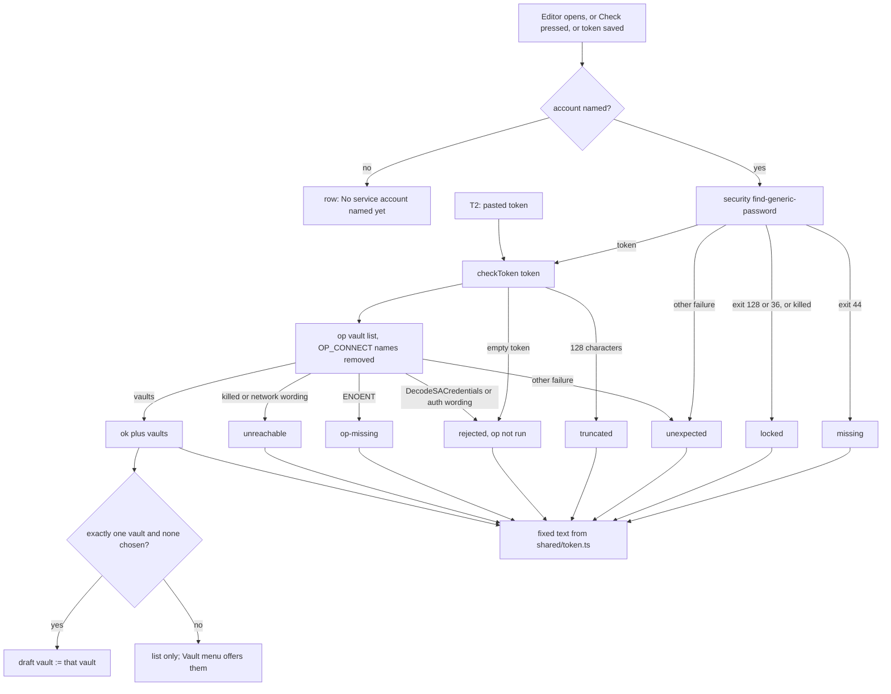

---
id:
title: The token row names why a token fails and picks the only readable vault
status: ideation
variant: kc-dev-flow-2
profile: pilot
merge: pr
worktree:
pr:
journey: paseo-project-env
journey-release: r1.5
journey-story: token-works
journey-required-tasks: '["project-env-token-works-cause"]'
journey-mapping-complete: true
gates:
    version: 1
    records:
        - id: gate:project-env-token-works-cause:backlog
          stage: backlog
          attempts:
            - id: gate-attempt:project-env-token-works-cause-backlog-1
              briefing:
                id: briefing:project-env-token-works-cause:backlog:attempt-1:revision-1
                digest: sha256:a57002b250af600379f48caac6a605ef7c57e654d390140053702424057074a2
                room-ref: ./project-env-token-works-cause/review/backlog/briefing-1
              resolution:
                type: Resolution
                id: resolution:spacedock:project-env-token-works-cause:backlog:1
                briefing: briefing:project-env-token-works-cause:backlog:attempt-1:revision-1
                by: person:captain
                at: "2026-10-21T08:40:14.816863Z"
                decision: approve
                reason: 'Captain 2026-10-21: 「准」 — accepts this release r1.5 task''s outcome, scope and acceptance criteria on the pilot profile, into ideation.'
              application:
                target-stage: ideation
                state: consumed
        - id: gate:project-env-token-works-cause:ideation
          stage: ideation
          attempts:
            - id: gate-attempt:project-env-token-works-cause-ideation-1
              briefing:
                id: briefing:project-env-token-works-cause:ideation:attempt-1:revision-1
                digest: sha256:21814375a339d28f28986252a02acd06aea049d3d217db9c71c35da0d9eb1c80
                room-ref: ./project-env-token-works-cause/review/ideation/briefing-1
started: 2026-10-21T08:41:45Z
---

Release r1.5 of the paseo-project-env journey: on his own Mac, Kent stores a token only after it is checked, sees why a token fails, edits each variable where it sits, and sees test results that match his draft; his own use accepts it. Captain, 2026-10-20: 「我覺得UI不夠直覺」. Captain accepted this task list on 2026-10-21: 「可以」. Today a locked Keychain reads as no token, and a missing op, an outage and a rejection all read as invalid; a token that reads exactly one vault still leaves the vault unchosen.

## Scope

In: one token state per cause (no token, locked Keychain, op missing, 1Password unreachable, rejected), fixed text without tool output or values; the readable vaults listed on the token row; when the token reads exactly one vault and none is chosen, that vault is chosen; the per-keystroke re-check of the account field; the "ADR 0027" comment in `tokenStatus`. Settled in ideation: journey token-works/q2 and q6. Non-goals: storing a token (project-env-paste-token-check-first). Stop condition: the acceptance criteria below pass.

## Acceptance criteria

**AC-1**: Each token failure cause shows its own fixed text, never op or security output and never a value.
Verified by: tests with fake security and op covering each cause, plus a sentinel search of the rendered text.
Reproduce: in `project-env`, `npm test`; `test/token-state.test.ts` (starting copy in `spike/prototype.patch`), suite *each token failure has its own state*: eleven fake-world rows (Keychain exit 44, 128, 36 and 1; op binary missing; op exit 8 with `DecodeSACredentials`; 401; network wording; unrecognised stderr; a 128-character token; success), each asserting its state, and `JSON.stringify([result, tokenRowText(result)])` containing no sentinel planted in stderr. Fails if two causes share a state or any stderr reaches the result. Also a test that the eight labels are distinct.

**AC-2**: A working token lists its readable vaults, and when it reads exactly one and no vault is chosen, that vault is chosen.
Verified by: a unit test, and Kent's own use on his Mac.
Reproduce: `npm test`, tests *pickVault* (`pickVault("", ["Dev"])` is `"Dev"`; a chosen vault, several vaults and none are returned unchanged; fails if the rule fires with a vault chosen or with two vaults) and *the token row text* (one vault, several, none). The screen has no test seam (journey token-works/q8), so the wiring is shown by the disposable real-client run (picture 5, one vault picked; picture 4, three vaults listed with none picked) and, finally, by Kent's own use: on his Mac, open a project whose token reads one vault with no vault chosen and see it chosen and the vault list on the token row.

**AC-3**: The tokenStatus comment no longer cites an ADR from another project.
Verified by: `git grep "ADR 0027" project-env` prints nothing.
Reproduce: run that command in the implementation worktree; on `main` at 487b9b0 it prints `project-env/server/secrets.ts:118`, the one occurrence.

## FO alignment

Surfaces: ui
Visible change: The token row says why a token fails, lists the vaults it can read, and picks the only one.
Direction alignment with the Captain: not needed — follows r1's cause-class wording and the Captain's 2026-10-21 「可以」 on this task list; release r1.5 is reviewed and interrogated (signal 4).
Release review: paseo-project-env/r1.5 at 9489e13

## PRFAQ

**Press line.** When Kent opens a project's settings, the token row says in one fixed sentence why a token does not work (no token, locked Keychain, 1Password CLI missing, 1Password unreachable, rejected, cut to 128 characters, or unrecognised), what to do next, and, when it works, which vaults it can read; a token that reads exactly one vault fills the empty Vault field itself. Typing the account name no longer runs a check; a Check button does.

**What is wrong today** (read from `project-env/server/secrets.ts` and `client/settings-screen.tsx` at main 487b9b0, 2026-10-21): `readToken` turns every `security` failure into `null`, which `tokenStatus` reports as "No token in Keychain"; every `op vault list` failure becomes `invalid`, shown as "1Password rejected it"; the token query is keyed by the typed name, so each keystroke runs `security` and `op`.

**FAQ**
- *Which causes can be told apart, and how?* By signal shape, in Facts below. Keychain: exit 44 is no token; exit 128 or 36, or a killed lookup, is locked. `op`: spawn error `ENOENT` is CLI missing; a killed run or network wording is unreachable; `DecodeSACredentials` or an auth wording is rejected; anything else is unrecognised (the eighth state; without it an unseen failure would wear one of the other labels falsely).
- *Is the check available for a token that is not stored yet?* Yes: `secrets.checkToken(token)` takes the token string and returns `{ state, vaults }`; `tokenStatus(account)` is the Keychain lookup followed by `checkToken`. An empty token returns `rejected` without running `op`, because `op` with no service-account token falls back to the 1Password desktop app and can raise an authorization prompt. The labels and next steps read correctly for a stored or a pasted token ("Copy a fresh token from 1Password.", "then check again"). This is the interface for project-env-paste-token-check-first (T2): `checkToken`, `tokenRowText` and `pickVault` in `shared/token.ts`.
- *What does a user see when the token reads several vaults, one, none, or not the chosen one?* Several: the list on the token row, the Vault field a menu starting at "Choose…", nothing picked. One, none chosen: that vault is chosen (in the draft; Save keeps it). None: headline "Token works, but it can read no vault" and a next step; the Vault field is a menu flagging any chosen vault. Chosen vault not in the list: the Vault row shows an error line and "(this token cannot read it)", and Browse vault is disabled (journey token-works/q2).
- *How does the per-keystroke re-check stop?* The query is keyed by `checked`, a copy of the account name that changes only when Check is pressed (or the editor opens, or a token is saved). A typed name differing from `checked` shows "Not checked for <name> yet". Options weighed: check on blur (the host's `SettingsInput` has no blur event), debounce (still checks partial names, and a locked Keychain can raise a dialog per pause), explicit Check (chosen: one press, needed anyway to re-check after the user unlocks the Keychain or installs `op`). The query also sets `staleTime: Infinity`, `gcTime: 0` and `refetchOnWindowFocus: false` so a window focus never re-checks; the focus setting was not observed in the run.
- *What happens on a locked Keychain?* The daemon runs in the login session, so reading the token from a locked login Keychain can raise a macOS unlock dialog; the 30 s limit kills the call (`killed: true`), which reads as locked. The row says a macOS prompt may appear.
- *Does an older client still work against a newer daemon?* No: `tokenState` is a closed enum on the wire (journey token-works/q5) and gains states. Accepted: the plugin ships its client and daemon code together, there is one user, and a plain string would need a fallback label table for no consumer.
- *Which identity does `op` use when the daemon environment sets `OP_CONNECT_HOST` and `OP_CONNECT_TOKEN`?* See Facts, q6: Connect wins; `opEnv` deletes those two names.

## Facts: signals by shape (2026-10-21, `op` 2.30.3, macOS)

No command fetched a secret value. The dispatch's secret-read guard refused a Keychain password read and the `op` read subcommand, and the permission classifier refused forging a service-account token and reading a process environment; none was worked around. Probes used a throwaway keychain (deleted afterwards, `security list-keychains` unchanged), dummy `OP_*` strings and `ops_notatoken`.
- No token: `find-generic-password` on a missing service prints `SecKeychainSearchCopyNext: The specified item could not be found in the keychain.`, exit 44 (observed).
- Locked Keychain: a throwaway keychain locked with `security lock-keychain`, then `security show-keychain-info`, printed `User canceled the operation.`, exit 128 (observed; non-interactive session). Exit 36 (`errSecInteractionNotAllowed` -25308, "User interaction is not allowed.") is derived from the same code-to-exit mapping seen at 44 and 128 (low byte), not observed. The password read on a locked keychain was not run; attributes without it read fine on a locked keychain, so only the password read can fail this way. A killed lookup (the GUI dialog left open) is handled as locked and is not observed.
- `op` missing: Node `execFile` on a missing binary gives `code: "ENOENT"`, empty stderr (observed, absolute and bare names). `classifyOpFailure` maps a string code to `unexpected` and `test/cause.test.ts` asserts it; that stays, and `classifyTokenCheckFailure` takes `ENOENT` first.
- Rejected: `OP_SERVICE_ACCOUNT_TOKEN=ops_notatoken op vault list` exits 8, `failed to DecodeSACredentials: illegal base64 data at input byte 8`; a decodable-looking junk token exits 8, `…DecodeSACredentials: invalid credentials provided` (observed). The existing `AUTH` pattern matches neither (today such a token is `unexpected` at session open); `DecodeSACredentials` is added. The 401 wording for a decodable but revoked token is not observed.
- Unreachable: not observed. It needs a decodable token (forging one was refused). The r1 `NETWORK` patterns and a killed run stand, as a hypothesis; the fake op models it.
- q6, Connect: with `OP_CONNECT_HOST` and `OP_CONNECT_TOKEN` set (dummy values), `op vault list` and `op item list` exit 1, `"op vault list" doesn't work with Connect. Please unset 'OP_CONNECT_HOST' and 'OP_CONNECT_TOKEN'…`, even when `OP_SERVICE_ACCOUNT_TOKEN` is also set (observed), so a screen would say "rejected" for a good token. `OP_ACCOUNT` set beside a service-account token did not change the result (observed). The `op` read subcommand under Connect was not run (guard); 1Password documents Connect as a different identity, so a daemon with those names set could resolve references through it, outside ADR 0001's one-service-account boundary. Whether Kent's daemon sets them was not checked (reading a process environment was refused).
- Desktop prompts: every `op` probe set `OP_SERVICE_ACCOUNT_TOKEN`, so none could reach the desktop app; the design keeps that (an empty token never reaches `op`).

## Design

**Existing-code check** (bounded; two searches: `git grep -n "tokenStatus\|readToken\|TOKEN_LABEL" project-env`, and a read of `server/contribute.ts`, `client/settings-screen.tsx` and `test/` for token handling). `tokenStatus` exists and works through the journey; it is repaired, not replaced. Need: the Captain's 「我覺得UI不夠直覺」 and the journey's gap; falsifier: AC-1. Consumers outside this repo: none known; the plugin is installed only for Kent. Unknown: whether another client calls `token.status`.

**Mechanism** (a working prototype, disposable, is `spike/prototype.patch`; it applies to main 487b9b0 with `git apply` and its 18 tests pass; the implementation redoes it in a worktree).
1. `shared/config.ts`: `tokenState` becomes `missing | locked | op-missing | unreachable | rejected | truncated | unexpected | ok` (`invalid` is renamed `rejected`); `TokenState` is exported from there.
2. `server/cause.ts`: `classifyKeychainFailure(exit)` (44 missing; 128, 36 or `killed` locked; else unexpected) and `classifyTokenCheckFailure(exit)` (`ENOENT` op-missing; via `classifyOpFailure`: rejected-token, unreachable; else unexpected); `AUTH` gains `DecodeSACredentials`; `test/cause.test.ts` gains a `DecodeSACredentials` row (rejected-token) and keeps "a missing binary is unexpected".
3. `server/secrets.ts`: `lookupToken` returns the token or a failure kind (`readToken` keeps its shape for session open and `listRefs`); `checkToken(token)`; `tokenStatus` is `lookupToken` then `checkToken`; `opEnv` deletes `OP_CONNECT_HOST` and `OP_CONNECT_TOKEN`; the 128 comment states the fact without the ADR number (AC-3).
4. `shared/token.ts` (new): the fixed text table, `tokenRowText({ state, vaults })`, `pickVault(chosen, vaults)`. Texts (label / next step): "No token in Keychain" / "Paste it below and save it."; "Keychain is locked" / "Unlock the login Keychain on this Mac (a macOS prompt may appear), then check again."; "1Password CLI (op) not found" / "Install it, restart Paseo, then check again." (journey q7: the CLI path is fixed at daemon load); "Could not reach 1Password" / "Check the network, then check again."; "1Password rejected the token" / "Copy a fresh token from 1Password."; "Token is exactly 128 characters, likely truncated" / "Copy it again from 1Password."; "The token check failed for a reason the plugin does not recognise" / "Check again."; "Token works" / "Can read N vault(s): a, b". Vault names are the only data in the text; no stderr, token or path ever is.
5. `client/settings-screen.tsx`: one `SettingsAction` token row (label, hint, Check); `checked` state and the query settings above; the Vault field is a menu once the check is `ok` ("Choose…" first when none is chosen, a flagged entry for an unreadable chosen vault, `error` text on the row) and a text input otherwise; a `useEffect` applies `pickVault`; Browse vault needs `ok` and a readable chosen vault.
6. Fakes: `test/fakes/op.mjs` gains `vaultListFail`, `vaultListDelayMs` and a Connect refusal; `test/fakes/security.mjs` gains `find: { exit, stderr, hang }`; `test/world.ts` types them.

**Interfaces named for siblings.** T2 uses `secrets.checkToken` and `shared/token.ts`. The Test row and the missing-variables notice keep their current causes (see Needs decision); T4 owns the Test row.

## Journey answers for the map (the map is not edited here)

- `token-works/q2`: answered. No readable vault: headline "Token works, but it can read no vault" and a next step. More than the chosen one: all are listed on the row and in the Vault menu, none is picked for the user. A chosen vault not in the list: an error line on the Vault row, "(this token cannot read it)" on the menu entry, Browse vault disabled. Exactly one and none chosen: chosen in the draft.
- `token-works/q6`: answered as a fact (Facts above): Connect names win over a service-account token for `vault list` and `item list`; `OP_ACCOUNT` does not; the `op` read subcommand under Connect is unrun. Design: `opEnv` deletes the two Connect names, a safety property of ADR 0001's identity boundary.
- `token-works/q4`: answered by design (explicit Check). `token-works/q3` is only helped: the Vault menu is built from the checked list, so an unchecked name shows no vaults, but the draft keeps its chosen vault.

## Acceptance evidence plan

AC-1 to AC-3 are in `## Acceptance criteria`, each with its `Reproduce:` line. Not yet verified in code: nothing is implemented. Current evidence: the prototype's 18 tests pass on the throwaway copy; mutation checks failed as intended (removing the Connect deletion fails the Connect test; removing exit 128 from the locked rule fails the exit-128 row); the real client drew every state from fake tools on an isolated daemon (17 pictures).

## UI proposal

UI proposal: On the project settings screen the token row becomes one row: a status line naming either "Token works" or the single cause that failed (no token, locked Keychain, op missing, 1Password unreachable, rejected, truncated, unrecognised), a fixed next-step line beneath it, and a Check button at its right; for a working token the line beneath lists the vaults it can read, and the Vault field offers exactly those vaults, chooses the only one when exactly one is readable and none is chosen, and flags a chosen vault the token cannot read (a token that reads no vault says so in the status line's headline); typing the service-account name no longer runs a check, and the row reads "Not checked for <name> yet" until Check is pressed.

Preview: project-env-token-works-cause/design/preview-desktop-dark-4-ok-three-vaults.png
Preview: project-env-token-works-cause/design/preview-desktop-dark-5-ok-one-vault-picked.png

The previews are real-client pictures of the prototype (disposable, built in `/tmp/token-works-cause-r15-preview`, removed after the run), operated on an isolated daemon: own `PASEO_HOME`, port 6861, throwaway plugin id `token-works-preview`, tools replaced by the test fakes and the scenario file edited between pictures. Kent's daemon was only read: `paseo plugin ls` showed `paseo-project-env` and `paseo-fo-console-poc` running before and after. Pictures in `design/`: desktop dark 1 to 13 (no account, not checked, checking, three vaults, one vault picked, no token, locked, op missing, unreachable, rejected, unrecognised, no readable vault, chosen vault unreadable), desktop light (locked, three vaults), compact dark (three vaults, locked). Picture 8 (op missing) is a real `ENOENT` from a removed wrapper.

### Design review

Design review: design/ideation-2.yaml

Reviews: `design/ideation-1.yaml` (3 MAJOR, 11 MINOR) led to three redraws (pictures 3, 12, 13: the headline for a token reading no vault, the duplicated chosen-vault sentence removed from the status line, a "Checking" second line); `design/ideation-2.yaml` (2 MAJOR, 11 MINOR) is the last allowed run. Both MAJOR findings of the second run were then fixed in the prototype and pictures 11, 12 and 13 redrawn; that redraw was not reviewed again (two runs is the limit).

Design finding 1: fixed: Browse vault is now disabled when the chosen vault is not readable (pictures 12 and 13 redrawn, the button dim).
Design finding 2: fixed: the Vault row now carries an error line "This token cannot read that vault. Choose one it can read." (picture 13 redrawn); the status line stays a plain list of readable vaults.
Design finding 3: declined: the host's `SettingsAction` row has no icon or colour slot; the headline text carries the outcome and Kent's own use judges whether it reads at a glance.
Design finding 4: declined: "Not checked for <name> yet" names the account because the input above can be truncated on a phone, and "Press Check." is the one next step; the vault count stays because "1 vault" versus several decides whether one is picked for the person.
Design finding 5: fixed: the unrecognised state gained the next-step line "Check again." (picture 11 redrawn); its row now has the same height as the others.
Design finding 6: AC-1 covers the truncated label (a 128-character row in its test); a long vault list wraps in the host row; a hung check shows as locked (Keychain) or unreachable (`op`).
Design finding 7: declined: the empty Vault box is the existing input of today before a check, with no placeholder in the host control; the locked fixture differs between pictures only because they were taken in different runs.
Design finding 8: declined: the person sees the vault chosen in the Vault field the moment Check ends and Save keeps it; a "chosen automatically" cue adds a second line about a state the field already shows.
Design finding 9: declined: the previous vault is kept in the draft while the name changes; the Vault row's help text belongs to project-env-variable-row-edit and journey token-works/q3, not this task.
Design finding 10: declined: Check is also how a token saved from elsewhere is found; the no-token headline names the next step and Save token enables as soon as a token is typed.
Design finding 11: declined: the host button changes width with its label, as every `SettingsAction` here already does.
Design finding 12: declined: button height on a phone is the host's control size; Kent uses this on his Mac.
Design finding 13: declined: light and compact follow the same rows as dark desktop; Kent's own use on his Mac covers them.

## Known limits (not decisions)

- Unreachable and revoked-token wording of `op` are not observed (a decodable token is needed); the classifier keeps r1's hypothesis patterns. A miss shows as the unrecognised state, never as another cause.
- Locked Keychain: exit 128 was observed on `show-keychain-info`, not on the password read; exit 36 and the killed case are derived or assumed. A locked login Keychain in a GUI session may raise a macOS dialog the person must answer.
- The `op` read subcommand under Connect, and whether Kent's daemon sets `OP_CONNECT_*`, are not checked.
- The wiring of Check, the pick effect and the query settings has no automated test (journey token-works/q8); it is shown by the prototype run and Kent's own use.
- No CI job is added; tests run locally (the prototype's 18 tests and main's 80 pass).

### Needs decision

**One decision for the Captain: should the Test row and the missing-variables notice also name a locked Keychain and a missing `op`?** Today they say "no token stored for this service account" for a locked Keychain and "1Password returned an error the plugin does not recognise" for a missing `op` (`readToken` returns `null`; `classifyOpFailure` maps `ENOENT` to unexpected), so after this task the token row and the Test row can disagree on one screen. Recommendation: no, not in this task. Adding the two causes amends ADR 0002 (its reason classes) and touches `shared/cause.ts`, `session-open` and the Test row that project-env-test-results-match-draft (T4) is reshaping; do it as one follow-up after T4 merges, using the same two classifiers. What gets worse: until then a locked Keychain reads as "no token" on Test. Past rulings checked: ADRs 0001 to 0005 and the `Override:` lines (`git -C docs/dev2/.spacedock-state grep -n 'Override:'` finds only prose in sibling tasks, none on this area); ADR 0002 and ADR 0004 name the reason classes.

## Stage Report: ideation

- DONE: Design one token state per cause (no token, locked Keychain, op missing, 1Password unreachable, rejected) with fixed text and no tool output or value; establish the real locked-Keychain and op-missing signals by shape; settle journey token-works/q2 and q6 (q6 as a checked fact).
  `## Design` item 4 (text table, plus an eighth "unrecognised" state and the existing "truncated"); `## Facts`: no token exit 44 and op missing `ENOENT` observed, locked exit 128 observed on a sibling `security` command and 36 derived, not run on the password read (guard); q2 and q6 answered in `## Journey answers`. Not observed: unreachable and revoked-token wording (a decodable token was needed; forging one was refused).
- DONE: Design the vault list on the token row and the rule that a token reading exactly one vault, with none chosen, chooses it; decide how the per-keystroke re-check of the account field stops.
  Vault list and `pickVault` rule in `## Design` item 4 and 5; the re-check stops by an explicit Check button (`checked` state; blur and debounce weighed in the FAQ). Follow-up request also met: `secrets.checkToken(token)` for T2, labels worded for a pasted token, fake-op failure knobs (`vaultListFail`, `vaultListDelayMs`, Connect refusal), no op or security command that can raise a desktop prompt was run.
- DONE: Keep AC-1 to AC-3 with reproducible evidence clauses and produce the artifact the ui surface owes.
  `UI proposal:` and two `Preview:` lines, 17 real-client pictures in `project-env-token-works-cause/design/`, design reviews `design/ideation-1.yaml` and `design/ideation-2.yaml`; `design_surfaces.py check` printed `design surfaces presentable` and `design review design/ideation-2.yaml: 13 findings, 3 fixed, 1 criteria, 9 declined, 0 decisions` (exit 0). The redraw after the second review (pictures 11 to 13) was not reviewed again.
- DONE: AC-1 every failure cause shows its own fixed text.
  Not yet verified in code: nothing implemented. Evidence now: the prototype's 18 tests (`spike/prototype.patch`) pass, eleven cause rows with a planted stderr sentinel; removing exit 128 from the locked rule fails the exit-128 row.
- DONE: AC-2 a working token lists its readable vaults and a sole vault is chosen.
  Not yet verified in code. Evidence now: prototype tests for `pickVault` and the row text pass; real-client pictures 4 (three vaults, none picked) and 5 (one vault picked); Kent's own use is still to come.
- DONE: AC-3 the tokenStatus comment cites no other project's ADR.
  Not yet verified: `git grep "ADR 0027" project-env` on main prints `project-env/server/secrets.ts:118`; the prototype replaces that comment with the fact.

### Summary

Designed eight token states (the five causes, truncated, unrecognised, ok) from observed signal shapes, an explicit Check button that ends the per-keystroke check, a vault list with sole-vault pick, and `checkToken(token)` for T2; a working prototype and 17 real-client pictures back it. One decision for the Captain: whether Test row and the missing-variables notice also name locked Keychain and missing `op` (recommendation: no, follow-up after T4). Known limits: unreachable and revoked wording are unobserved; Kent's daemon was untouched.
