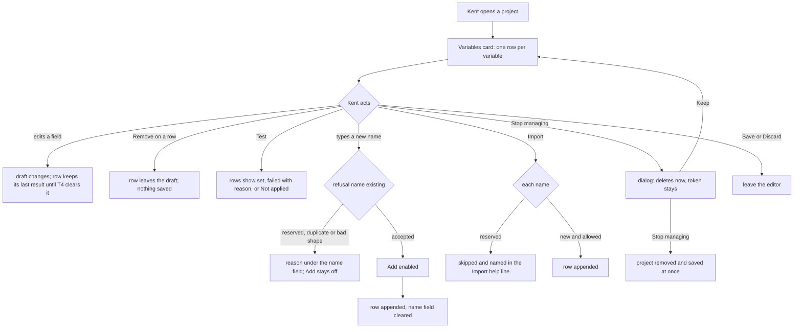

---
id:
title: Each variable is one row with its field, Remove and last Test result
status: validation
variant: kc-dev-flow-2
profile: pilot
merge: pr
worktree: .worktrees/spacedock-ensign-project-env-variable-row-edit
pr: iamcxa/kc-paseo-plugins#17
journey: paseo-project-env
journey-release: r1.5
journey-story: add-remove-variable
journey-required-tasks: '["project-env-variable-row-edit"]'
journey-mapping-complete: true
gates:
    version: 1
    records:
        - id: gate:project-env-variable-row-edit:backlog
          stage: backlog
          attempts:
            - id: gate-attempt:project-env-variable-row-edit-backlog-1
              briefing:
                id: briefing:project-env-variable-row-edit:backlog:attempt-1:revision-1
                digest: sha256:0206a1bba6667ba86102e83a22ccdfb37f9636fb30efa5d6976585321881b1b8
                room-ref: ./project-env-variable-row-edit/review/backlog/briefing-1
              resolution:
                type: Resolution
                id: resolution:spacedock:project-env-variable-row-edit:backlog:1
                briefing: briefing:project-env-variable-row-edit:backlog:attempt-1:revision-1
                by: person:captain
                at: "2026-10-21T08:40:40.237397Z"
                decision: approve
                reason: 'Captain 2026-10-21: 「准」 — accepts this release r1.5 task''s outcome, scope and acceptance criteria on the pilot profile, into ideation.'
              application:
                target-stage: ideation
                state: consumed
        - id: gate:project-env-variable-row-edit:ideation
          stage: ideation
          attempts:
            - id: gate-attempt:project-env-variable-row-edit-ideation-1
              briefing:
                id: briefing:project-env-variable-row-edit:ideation:attempt-1:revision-1
                digest: sha256:beb4eefb10230ff03bd9ba9222c2ff0c3a5fc600b8682513eb208605b31c1f35
                room-ref: ./project-env-variable-row-edit/review/ideation/briefing-1
              resolution:
                type: Resolution
                id: resolution:spacedock:project-env-variable-row-edit:ideation:1
                briefing: briefing:project-env-variable-row-edit:ideation:attempt-1:revision-1
                by: person:captain
                at: "2026-10-21T09:36:16.279886Z"
                decision: approve
                reason: 'Captain 2026-10-21: 「准五個設計」 — accepts this ideation design and its acceptance criteria into implementation, with the additions presented at this gate: no guessed reference in project-env-variable-row-edit (a new variable has no reference until a field is picked), AC-4 and the rewritten AC-3 in project-env-paste-token-check-first, the empty-value wording ''the 1Password field is empty'' in project-env-test-results-match-draft; FO''s recommendations also presented: removing the OP_CONNECT names in project-env-token-works-cause is left out and listed for the Captain, and naming a locked Keychain on the Test row is a follow-up after project-env-test-results-match-draft.'
              application:
                target-stage: implementation
                state: consumed
        - id: gate:project-env-variable-row-edit:validation
          stage: validation
          attempts:
            - id: gate-attempt:project-env-variable-row-edit-validation-1
              briefing:
                id: briefing:project-env-variable-row-edit:validation:attempt-1:revision-1
                digest: sha256:0fa362f3e55edcbf3c02994d47435f87ac54fa624d2d7584836a176e085caab4
                room-ref: ./project-env-variable-row-edit/review/validation/briefing-1
              resolution:
                type: Resolution
                id: resolution:spacedock:project-env-variable-row-edit:validation:1
                briefing: briefing:project-env-variable-row-edit:validation:attempt-1:revision-1
                by: person:captain
                at: "2026-10-21T11:21:54.418106Z"
                decision: approve
                reason: 'Captain 2026-10-21: 「可以，同意你的計畫」 — approves delivery of PR iamcxa/kc-paseo-plugins#17 at head 1e317edc869b9e310e129a4b7718895f0f535792, merged second by squash once Codex is clean, including later review rounds on the same PR and removing its clean pushed worktree.'
              application:
                target-stage: done
                state: pending
started: 2026-10-21T08:41:59Z
---

Release r1.5 of the paseo-project-env journey: on his own Mac, Kent stores a token only after it is checked, sees why a token fails, edits each variable where it sits, and sees test results that match his draft; his own use accepts it. Captain, 2026-10-20: 「我覺得UI不夠直覺」. Captain accepted this task list on 2026-10-21: 「可以」. Today all Remove buttons sit after all fields, Add accepts reserved names, and the name input is not cleared after Add.

## Scope

In: the variables card laid out one row per variable holding its field, its Remove button and its last Test result (Captain 2026-10-21 「可以」, layout recommended as one row per variable); Add refuses a reserved name with the reason, using isReservedName, with DYLD_* and LD_PRELOAD added to the reserved set and ADR 0004 amended (Captain 2026-10-21, journey add-remove-variable/q5); the name input clears after Add. Settled in ideation: journey add-remove-variable/q4 and q7. Non-goals: field references by ID (r1b). Stop condition: the acceptance criteria below pass.

## Acceptance criteria

**AC-1**: Each variable is one row holding its field, its Remove button and its last Test result.
Verified by: Kent's own use on his Mac, with a screenshot in the PR.

**AC-2**: Add refuses every reserved name, including DYLD_* and LD_PRELOAD, and says why.
Verified by: a unit test over the reserved set, and Kent's own use.

## FO alignment

Surfaces: ui
Visible change: The variables card shows one row per variable with its own Remove and Test result.
Direction alignment with the Captain: done — the Captain chose one row per variable on 2026-10-21 (「可以」 to the recommended layout).
Result: one row per variable holding its field, Remove button and last Test result.
Release review: paseo-project-env/r1.5 at 9489e13

## Design

### PRFAQ

**Press release.** Kent opens the Environment variables card and sees each variable as one row: its name, the reference it reads, a Remove button and the result of the last Test, side by side. He no longer matches a name in one list to a Remove button in another, and a Test result no longer sits in a card of its own. Typing a name Paseo or the agent owns, such as `PATH` or `DYLD_INSERT_LIBRARIES`, is refused on the spot with the reason.

**FAQ.**
- *What did the Captain decide?* One row per variable holding its field, its Remove and its last Test result (2026-10-21, 「可以」); reserved names grow by `DYLD_*` and `LD_PRELOAD`, not `ANTHROPIC_*` (journey add-remove-variable/q5).
- *Does Remove save?* No. Removing a variable edits the draft; Save writes it and Discard throws it away, so per-row Remove needs no confirmation. The project-level button is the one that saves at once; it is renamed and asks first (q7 below).
- *Where does Test live now?* In the variables card, in its own row under the last variable, shown only when the project has a variable. Its results appear on the rows. The old results list and the card named "Check and save" are gone; the card that keeps Save, Discard and Stop managing is named "Save".
- *Which names are refused?* The 16 names ADR 0004 reserves, any name starting `DYLD_`, and `LD_PRELOAD`. Refusal also covers a duplicate and a bad shape, with one message each.
- *Is the whole picture drawn from a real run?* Yes: `spike/` on an isolated daemon, the real Paseo web client, fake `op`, `security` and `git`; not drawn: the Paseo desktop app and phone app.

### What changes (read from `project-env/` on main at 487b9b0, 2026-10-21)

Today `client/settings-screen.tsx` draws every reference field, then every `Remove NAME` action, then the add row; Test and its results list sit in "Check and save"; Add is gated by an inline regex and a duplicate check with no message; the name field keeps its text after Add; Import adds every name it finds, reserved or not.

### UI proposal

UI proposal: The Environment variables card shows one row per variable: the variable name on the left with one line under it for its last Test result (set, failed with a plain reason, or for a reserved name "Not applied" with the reason), the reference field in the middle and a Remove button at the right end of the same row; a Test button sits in its own row under the last variable, and the separate results list is gone; Add refuses a reserved name and says why under the name field with the Add button off, and the name field clears after Add; Import skips reserved names and names them in its help line; the project-level button is renamed Stop managing and opens a confirmation dialog; after Browse vault each field becomes a pill that opens a list of fields.

Preview: project-env-variable-row-edit/design/preview-desktop-dark-tested.png

The main picture is the one above. The proposed design is the set `design/preview-*.png` in this task's folder, taken from a real run: the spike plugin in `spike/` (the real settings screen with the new rows, fake `op`/`security`/`git` from `test/fakes`) on a throwaway daemon (own home, port 6812, plugin id `row-edit-spike`, no model provider), driven through Paseo's own web client with a headless browser. It is operable: while the daemon is up, `http://127.0.0.1:6812` opens the screen at Settings, Plugins, Actions, Project environment, and Add, Remove, Test, Import, Browse vault and Stop managing all work. Disposable: the daemon, the plugin and `/tmp/variable-row-edit-spike-r15` are removed at the end of ideation (teardown recorded in the Stage Report); `spike/` keeps the sources and the commands to run it again. Pictures: desktop dark saved (before Test), tested, add refused (`DYLD_INSERT_LIBRARIES`), import skipped, stop-managing dialog, browse loaded, browse picker, 12 variables with a 53-character name and an 88-character reference, empty; desktop light tested and add refused with a duplicate; compact (390 px) dark saved, tested, 12 long, add refused, stop-managing dialog.

Row composition (observed 2026-10-21, Paseo 0.12.0 web client): `SettingsRow` draws its `children` at the right end of the row, label and hint on the left, and stacks them under the label at compact width; `SettingsInput` and `SettingsSelect` accept `children` in their types but draw none, and a `SettingsSelect` nested inside a `SettingsRow` truncates the reference to `op://Dev/…` and stretches the row. So a row is a `SettingsRow` whose children are the field and a Remove pressable; after Browse vault the field is a pill (`RefPicker`) that opens the host `Modal` with the fields listed, which keeps the whole reference visible. The old `SettingsSelect` swap is not used.

### Add, Import and saved variables

`project-env/shared/config.ts` gains three pure functions beside the existing predicate: `reservedReason(name): string | null` (the one table: agent names, plugin name, Paseo names, the `DYLD_` prefix and `LD_PRELOAD`), `isReservedName(name)` (its boolean view, unchanged signature, still used by `resolveProject` and `openSession`), `refusal(name, existing): string | null` (bad shape, reserved, duplicate; null when acceptable or empty) and `splitImported(names, existing): { add, skipped }`. The screen disables Add on a non-null refusal, shows it under the name field, and Add's handler checks it again. Reasons shown: "the agent needs its own value to run" (PATH, HOME, NODE_OPTIONS), "this plugin uses it to reach 1Password" (OP_SERVICE_ACCOUNT_TOKEN), "Paseo sets or removes it after plugins run" (the twelve Paseo names), "it makes the agent load other code" (`DYLD_*`, `LD_PRELOAD`); the message is `NAME is reserved: reason. The agent keeps its own value.` Run on the spike copy, 2026-10-21: the 9 sampled reserved names (including `LD_PRELOAD`, `DYLD_INSERT_LIBRARIES`) return a refusal and `DATABASE_URL`, `LD_LIBRARY_PATH`, `path`, `ANTHROPIC_API_KEY`, `DYLDX` return null.

**q4 (journey add-remove-variable/q4): does the refusal also cover Conductor import and variables saved before this release?** Import: yes, it follows ADR 0004's consequence that refusing on Add reuses the predicate; reserved names are skipped and the help line names them (picture: import skipped; a name already in the project is skipped silently, as today). Saved variables: no migration and no settings-schema change, so the screen still loads a project that holds `PATH` or, after this release, a `DYLD_*` name; the row shows "Not applied: reason" in place of a Test result, always, because session open already skips it (ADR 0004; verified by `test/session-open.test.ts` "neither applies nor blanks a reserved name, and reports it failed"), and Remove works. Consequence to know: an existing variable named `DYLD_*` or `LD_PRELOAD` stops being applied at the next session open after release. None is known to exist.

**q7 (journey add-remove-variable/q7): should the project's Remove, which saves at once, change?** Per-variable Remove: no confirmation, because it edits the draft and Discard reverts it. The project-level button deletes saved configuration at once, and with a Remove on every row it would be the one button of that name that does not wait for Save; so it is renamed "Stop managing", its help line says it deletes the project's variables and prompt now and that the token stays, and it opens a dialog (host `Modal`) with Keep and Stop managing. Alternatives not chosen: leave it (an unconfirmed destructive save beside twelve harmless ones); make it a draft edit saved by Save (a new "project removed" draft state, more than this task).

### Existing-code check

Boundary: the variables card, the name check and the reserved set in `project-env/` on main. Two searches, 2026-10-21: `grep -rn isReservedName project-env --exclude-dir=node_modules` (shared/config.ts, server/secrets.ts, server/session-open.ts, test/secrets.test.ts) and `grep -rln "reserved" project-env --exclude-dir=node_modules` (adds shared/cause.ts, the tests). Completeness: the predicate works through the journey at session open and Test (session-open and failure-reason tests); the Add gate is a regex in JSX with no message (not found: no refusal, no reason). Need: Captain ruling 2026-10-21 (q5) and ADR 0004's consequence line. Decision: extend `isReservedName` into one table with reasons rather than add a second list; reuse `rowHint` and `Modal`, `Icon` and `TextInput` from `@getpaseo/plugin/client/react-native`. Unknowns: other consumers of `isReservedName` outside the repository, and the desktop and phone apps (only the web client of the same Paseo build was driven).

### ADR 0004 amendment (draft; no number change, no new file)

Amend `docs/adr/0004-reserved-variable-names-are-skipped-not-blanked.md` at implementation: under Decision add "**Amendment, 2026-10-21** (Captain, journey add-remove-variable/q5, 「可以」): the reserved set also holds every name starting `DYLD_` and `LD_PRELOAD`, which make a process load other code; `ANTHROPIC_*` is not reserved, because a person may set it on purpose. The set is now a table of exact names and one prefix, still behind one predicate, `isReservedName` in `project-env/shared/config.ts`, which has a reason for each class, `reservedReason`." Under Consequences replace the Add line with "Add, Conductor import and the variables card use the same table: Add and import refuse a reserved name with its reason; a saved reserved variable stays, shows 'Not applied' and is skipped at session open." and add "An existing variable named `DYLD_*` or `LD_PRELOAD` stops being applied at the next session open." Status stays Accepted.

### Acceptance evidence plan

- **AC-1** (not yet verified; no implementation). Current evidence: the operable spike on the real Paseo web client shows each variable as one row with its field, Remove and last Test result, at desktop and 390 px width (`design/preview-*.png`). To prove: on Kent's Mac, open Settings, Plugins, Project environment on the branch's install (throwaway plugin id, never his live `paseo-project-env`), edit a project with at least three variables, press Test, and attach a screenshot showing every row with its field, Remove and result; press Remove on one row and see only that row go. Reproduce the picture with `spike/` (see Spike notes). A unit test cannot prove JSX composition, so none is claimed.
- **AC-2** (not yet verified in code). Current evidence: `refusal` run in the spike copy as stated above. To prove: `project-env/test/variable-name.test.ts` (new) with a table of every name in the ADR 0004 set plus `DYLD_INSERT_LIBRARIES` and `LD_PRELOAD`, each must return a refusal containing the name and a reason, `DATABASE_URL`, `LD_LIBRARY_PATH` and `ANTHROPIC_API_KEY` must return null, and `isReservedName(n) === (reservedReason(n) !== null)` for the table; it fails if one name leaves the table, if the `DYLD_` prefix check or `LD_PRELOAD` is dropped, or if a reason is empty. Plus `test/session-open.test.ts` gains a `DYLD_INSERT_LIBRARIES` case asserting it is reported `reserved-name` and the fake `op` log shows no call for it, a `splitImported` case (reserved skipped and named, existing skipped, rest added), and Kent typing `PATH` in Add on his Mac and seeing the reason with Add off.

### Interface for siblings

T4 (project-env-test-results-match-draft, after this task): the row's result is `test.data?.results.find((r) => r.name === v.name)` drawn through `rowHint`; T4 clears it by `test.reset()` on a draft change and owns the sentence that set does not prove acceptance. T1, T2, T5 (token, paste, browse): this task leaves their rows alone; T5 keeps its error in the Browse vault action row and feeds `RefPicker` through `refs.data`.

### Design review

Design review: design/ideation-1.yaml

Design finding 1: Needs decision: a row edited after Test keeps its result until T4 clears it (T4 AC-1 already owns that, and T4 runs after this task); recommendation: leave it to T4 and merge T4 before Kent accepts r1.5.
Design finding 2: Needs decision: the unsaved-changes cue is the Captain's deferred story unsaved-warning (release r3) and stays out; recommendation: add one sentence to the Test row hint here, "Checks the variables as edited here, saved or not", which this preview does not yet show.
Design finding 3: declined: the page title, Back link and the token and vault card order are the host's chrome and today's layout, outside this task.
Design finding 4: declined: the action rows and the separate name field and Add button are today's rows from the host kit; merging them is not in the accepted scope.
Design finding 5: declined: the token row belongs to project-env-token-works-cause (T1).
Design finding 6: declined: ADR 0004 rules a reserved name a failed variable, so it takes the failed tone; the saved-state red line is the intended cue that the variable does nothing.
Design finding 7: declined: the word set and its explanation belong to T4 (AC-2 there); the words come from `rowHint`.
Design finding 8: declined: the host row grows by one line when a result appears; pinning the height would need fixed-height rows that break long names (see twelve-long).
Design finding 9: declined: the name field is the host's input at its own width; the reference field is wider so references stay readable.
Design finding 10: declined: the Captain asked for a Remove button on each row; it uses the host button look, and Kent's own use in AC-1 judges its weight.
Design finding 11: declined: the host kit exports no bare select; the pill shows the full reference where the nested host select truncated it (observed, see Row composition).
Design finding 12: declined: the host action row has one style; Stop managing is renamed and confirmed (q7), which marks it apart from Save.
Design finding 13: declined: the host Modal offers no danger style; the dialog names the project as the section title does, and the plugin id in the page title is a spike artefact.
Design finding 14: declined: the message uses the host input's error slot; the placeholder and focus ring are the host's, and the duplicate refusal is drawn in preview-desktop-light-add-refused-duplicate.png.
Design finding 15: declined: Import's help line is the host's text slot; the skipped names are named there, and marking added rows is not accepted scope.
Design finding 16: declined: Browse vault listing states belong to T5 and the r1b rebuild (pick-field); today's select also replaces free text.
Design finding 17: declined: the first row of an empty card is the name field with its label, which already says what to do.
Design finding 18: declined: the host input scrolls long values and the button reads Testing… while a run is on; a failure count is not in scope.
Design finding 19: declined: control sizes are the host's, the same as today's screen at 390 px.
Design finding 20: declined: the pill opens a modal list because the host exports no anchored menu to plugins; the chevron states that it opens a choice.
Design finding 21: fixed: drew the missing states, compact add-refused and stop-managing dialog (a bottom sheet) and light add-refused with a duplicate, as preview-compact-dark-add-refused.png, preview-compact-dark-stop-confirm.png and preview-desktop-light-add-refused-duplicate.png.

### Spike notes

Machine dependencies, declared: Paseo.app 0.12.0 CLI at `/Users/kent/.local/bin/paseo`, Node 24.18.0, `agent-browser`, Paseo.app's `app-dist` as the web client. Run (2026-10-21): `S=/tmp/variable-row-edit-spike-r15`; put `spike/plugin/` at `$S/plugin` with the repository's `project-env/node_modules` linked in; `spike/home-config.json` is the daemon config (port 6812, plugins on, relay, speech and MCP off); `PASEO_HOME=$S/home PASEO_LISTEN=127.0.0.1:6812 PASEO_RELAY_ENABLED=false PASEO_WEB_UI_ENABLED=true PASEO_WEB_UI_DIST_DIR=/Applications/Paseo.app/Contents/Resources/app-dist paseo daemon run --home $S/home`, then `paseo --home $S/home plugin install $S/plugin`. `spike/fx.py` writes the project fixtures (names and references only, no value); `spike/open-editor.sh`, `ref.sh` and `ab.sh` drive the browser. Facts learned: Paseo's plugin loader rejects a module outside `client/`, `server/` or `shared/`, and `import.meta.dirname` and `import.meta.url` are undefined at runtime, so the spike keeps the fakes under `server/fakes` and hardcodes their path. No real Keychain, 1Password or model provider was touched; Kent's daemon (`~/.paseo`, port 6767) was never written, only listed.

## Journey answers for the map

- add-remove-variable/q4: answered as above (import skips and names reserved names; saved ones stay, show Not applied, are skipped at session open; no migration).
- add-remove-variable/q7: answered as above (row Remove unconfirmed because it edits the draft; project button renamed Stop managing and confirmed).
- add-remove-variable/q2: "the 16 reserved names" becomes the 16 names plus every `DYLD_` name and `LD_PRELOAD` (q5 ruling); the map itself is not edited here.
- add-remove-variable/q1: removals sit on the row of the variable they remove.

## Stage Report: ideation

- DONE: Design the variables card as one row per variable holding its field, its Remove button and its last Test result (Captain 2026-10-21, 「可以」); settle journey add-remove-variable/q4 (does the reserved refusal cover Conductor import and saved variables) and q7 (Remove without confirmation).
  `## Design` composes the row from `SettingsRow` children (observed in the real client); q4: import skips and names reserved names, saved ones stay with "Not applied", no migration; q7: row Remove unconfirmed (draft only), project button renamed Stop managing with a dialog.
- DONE: Design Add refusing every reserved name with its reason via isReservedName, with DYLD_* and LD_PRELOAD added, and draft the ADR 0004 amendment (no number change).
  `reservedReason` table beside `isReservedName`, `refusal`, `splitImported`; draft under "ADR 0004 amendment"; run on the spike copy: 9 reserved names refused, 5 allowed names null.
- DONE: Keep AC-1 and AC-2 with reproducible evidence clauses and produce the artifact the ui surface owes, including how T4's results sit in the row.
  Artifact: `UI proposal:` and `Preview:` lines, 16 real-client pictures in `design/`, spike sources in `spike/`, review `design/ideation-1.yaml`; T4 interface is the per-row `test.data` lookup that T4 clears with `test.reset()`.
- DONE: AC-1 — each variable is one row with its field, Remove and last Test result.
  Not yet verified: no implementation. Current evidence: the operable spike pictures; plan is Kent's use on his Mac with a screenshot.
- DONE: AC-2 — Add refuses every reserved name, including DYLD_* and LD_PRELOAD, and says why.
  Not yet verified in the repository: plan is `test/variable-name.test.ts` (falsified by dropping a name, the `DYLD_` prefix or `LD_PRELOAD`, or an empty reason) plus a session-open case and Kent's use; current evidence is the spike-copy run only.
- DONE: Run `design_surfaces.py check` and cite its output.
  `design surfaces presentable`; `design review design/ideation-1.yaml: 21 findings, 1 fixed, 0 criteria, 18 declined, 2 decisions` (exit 0, before this report was appended).

### Summary

Each variable is one row built from `SettingsRow` (field and Remove at the right, last Test result under the name); Test moves into the variables card under the last row. Add refuses reserved, duplicate and malformed names under the field with the reason; Import skips reserved names; saved reserved variables stay and read "Not applied"; Stop managing replaces the project Remove and asks first. Two Needs decisions from the design review (both small, recommendations given): a row edited after Test keeps its result until T4 clears it, and whether to add one "checks the draft, saved or not" sentence to the Test row. Not done on purpose: ADR 0004 file edit and any repository code (ideation writes none). The spike daemon, throwaway plugin and `/tmp/variable-row-edit-spike-r15` are removed; `paseo plugin ls` on Kent's daemon still shows `paseo-project-env` running, unchanged. Known limit: the in-row field picker is new code (a host `Modal` list), the price of keeping Browse vault inside one row, and r1b may replace it.

## Stage Report: implementation

- DONE: Implement the approved design: one row per variable with its field, Remove and last Test result; Add refusing reserved names (DYLD_* prefix and LD_PRELOAD added), duplicates and bad shapes with the reason; "Stop managing" with its confirmation; and the gate addition (no guessed reference, "No field picked" until one is chosen).
  Commits feed4f5, 01ef122, 1e317ed on `spacedock-ensign/project-env-variable-row-edit` (`client/settings-screen.tsx`, `shared/config.ts`: `reservedReason`, `refusal`, `splitImported`, `newVariable`, `variableLine`); schema `ref` now accepts "" (no migration). Runtime probe of the branch code on an isolated Paseo 0.12.0 daemon (port 6813, throwaway plugin `row-edit-impl`, fake op/security/git): rows with Remove and Test results on rows, `DYLD_INSERT_LIBRARIES` refused with Add off, Add clears the name field and the new row reads "No field picked". Not exercised on branch code: Browse picker, per-row Remove, Stop managing dialog (the session browser was hijacked to another site after the API pause, so the probe stopped; those were drawn in the ideation spike). Daemon, plugin and `/tmp/variable-row-edit-impl` removed; Kent's `paseo-project-env` untouched and still running.
- DONE: Land the ADR 0004 amendment as drafted.
  `docs/adr/0004-...md`: Amendment paragraph under Decision, Consequences replaced as drafted; `adr_lint.py docs/adr --since 487b9b0`: 5 ADR files checked, exit 0.
- DONE: Tests so AC-1 and AC-2 pass with the evidence their clauses name and fail when the behaviour is removed.
  AC-2: `test/variable-name.test.ts` asserts each of the 16 ADR 0004 names plus LD_PRELOAD and DYLD_* returns a refusal with a reason, and allowed names return null; `test/session-open.test.ts` asserts DYLD_/LD_PRELOAD are reported reserved with no 1Password read, and an empty-ref variable is blanked with no read. Mutation runs each fail a test: drop `LD_PRELOAD`, drop the `DYLD_` prefix, drop PATH, make `ref` strict again, guess a ref in `newVariable`, drop the "No field picked" line. AC-1: row logic (`variableLine`) is unit-tested; JSX composition is not unit-provable, evidence is the runtime probe above plus Kent's screenshot.
- DONE: Record the on-Mac screenshot as owed.
  AC-1 clause stays owed: Kent's own use on his Mac with a screenshot attached to the PR (steps in PR #17 "Known limits").
- DONE: Run `npm test`, `npm run typecheck`.
  `npm test`: 109 tests pass, 0 fail (at feed4f5; later commits touch only `client/settings-screen.tsx`); `npm run typecheck` clean at 1e317ed. One earlier run under load failed a 4 s-deadline test in session-open.test.ts (timing flake; base and later runs pass).
- DONE: Run the roborev gate.
  Run 1 `roborev:969` finding (import race), run 2 `roborev:970` finding (Stop managing error hidden behind dialog), both fixed in scope; run 3 `clean on 1e317edc8; evidence=roborev:971`.
- DONE: Run `design_surfaces.py check <task file>`.
  `design surfaces presentable`, exit 0.
- DONE: Run `doc_impact.py <base> <candidate>`.
  Lists `docs/adr/0004-reserved-variable-names-are-skipped-not-blanked.md`: updated (amendment, same candidate). Exit 0.
- DONE: Run `comment_ratio.py`.
  `code lines 377, comment lines 3, 0.8%`, maximum 5% met, exit 0.
- DONE: Open the Draft PR.
  https://github.com/iamcxa/kc-paseo-plugins/pull/17 (Draft, title `feat(project-env): one row per variable, Add refuses reserved names`).

### Summary

The variables card is one row per variable with field, Remove and the Test result, Add and Import refuse or skip reserved names (DYLD_* and LD_PRELOAD added, ADR 0004 amended), and Stop managing asks first. New and imported variables have no guessed reference: the schema accepts an empty `ref`, the row reads "No field picked", and at session open such a variable is blanked and reported failed like any unresolved one. Limits: AC-1 screenshot owed from Kent's Mac; Save stays enabled with an empty field (a decision for Kent if he wants it blocked); design finding 2's "checks the draft, saved or not" sentence was not added (it was a Needs decision, not in the gate additions; T4 owns the wording).

## Stage Report: validation

- DONE: Independently check candidate 1e317edc869b9e310e129a4b7718895f0f535792 (PR iamcxa/kc-paseo-plugins#17, base main) against AC-1, AC-2, the approved design and the gate addition (no guessed reference: a new or imported variable has ref "" and reads "No field picked", and is blanked at session open), including that each decisive test fails when its behaviour is removed and that the ADR 0004 amendment matches the Captain's ruling; give a verdict.
  Verdict: PASSED (recommend), no Material finding; AC-1's Mac screenshot stays owed. Worktree HEAD and PR head are both 1e317ed, Draft, only GitGuardian check. `npm test` 109 pass 0 fail, `npm run typecheck` clean, run by me at 1e317ed.
  AC-2: mutation runs on a throwaway copy, each fails the named test: drop `LD_PRELOAD` (refuses LD_PRELOAD, Import, session-open DYLD/LD case), drop the `DYLD_` prefix (refuses DYLD_*, variableLine "Not applied"), drop `PATH` (refuses PATH, plus session-open reserved case), refusal returns null instead of the reason (every refuses-NAME case fails).
  Gate addition: `ref` made strict again fails "starts with no guessed reference and the schema accepts it"; `newVariable` guessing a ref fails that and "reads No field picked"; deleting the `variableLine` "No field picked" line fails "reads No field picked"; skipping an empty ref at session open (not blanking it) fails "blanks a variable whose field was never picked without asking op for it".
  ADR 0004: Amendment adds `DYLD_*` and `LD_PRELOAD`, leaves `ANTHROPIC_*` out, states the Add/import/saved consequences; this matches journey add-remove-variable/q5 (Captain 2026-10-21 「可以」: add DYLD_* and LD_PRELOAD, not ANTHROPIC_*, amend ADR 0004). The extra Consequences line (an existing DYLD_* or LD_PRELOAD variable stops being applied) is the design's, approved at the ideation gate.
  Runtime, branch code, isolated Paseo 0.12.0 daemon (port 6814, plugin `row-edit-validate`, fake op/security/git), real web client, pictures in `validation/`: one row per variable (field, Remove, result under the name); Test puts "set", "failed: the field is empty" and "Not applied: ..." on rows; Add refuses DYLD_INSERT_LIBRARIES, LD_PRELOAD, PATH, a duplicate and a bad shape with the reason and Add off; Add clears the name field and the new row reads "No field picked" and nothing is saved; Remove BLANK_ONE removes only that row and the saved file still holds it; Browse vault turns fields into pickers and picking clears "No field picked"; Stop managing opens the dialog, Keep leaves the saved project, confirming deletes it at once. This closes the three items the implementation report left undriven (Browse picker, per-row Remove, Stop managing dialog) at the web client.
  Minimal necessity: each retained surface maps to the goal or a ruling: RefPicker (nested select truncates, observed in ideation), Stop managing dialog (q7), Import skip note (q4), `newVariable`/`""` ref (gate addition), `refusal`/`splitImported` (AC-2). Comment ratio 0.8%, I read the 3 added comments: each states a fact the code cannot.
- DONE: Write the minimal acceptance script FO will rerun in a fresh shell, including the row, Add-refusal and "No field picked" text the ui surface owes, and run `python3 /Users/kent/.claude/plugins/cache/kc-claude-plugins/kc-dev-flow-2/0.26.0/scripts/adr_lint.py docs/adr --since 60799d9` recording its exit code.
  `adr_lint.py docs/adr --since 60799d9`: "5 ADR file(s) checked, 0 legacy", exit 0 (also exit 0 with `--since 487b9b0`). Script below; I ran `validation/acceptance-ui.sh` once end to end: 30 PASS, 0 FAIL, 37 s, daemon, plugin copy and browser session removed by its own trap. Also exit 0: `comment_ratio.py`, `doc_impact.py` (ADR 0004 updated), `design_surfaces.py check`, `dispatch_records.py` (3 records).
- DONE: Record every unverified obligation, including AC-1's screenshot from Kent's Mac and the Browse picker, per-row Remove and Stop managing dialog not driven on branch code, without touching the live paseo-project-env install.
  Listed under Unverified obligations below; Kent's `paseo-project-env` still `running` from `/Users/kent/Project/kc-paseo-plugins/project-env` on main, never changed, reloaded or branch-switched.

### Minimal acceptance script

Run from any shell; needs the worktree at 1e317ed, `paseo` 0.12.0, `agent-browser`, `python3`. No secret is read; the daemon uses fake op/security/git.

1. `cd /Users/kent/Project/kc-paseo-plugins/.worktrees/spacedock-ensign-project-env-variable-row-edit/project-env && npm test 2>&1 | grep -E "^ℹ (tests|pass|fail)"` expect `tests 109`, `pass 109`, `fail 0`. If only the 4 s-deadline test in `session-open.test.ts` fails, rerun it alone before counting it.
2. `npm run typecheck` in the same directory: expect no error output.
3. `cd /Users/kent/Project/kc-paseo-plugins/.worktrees/spacedock-ensign-project-env-variable-row-edit && python3 /Users/kent/.claude/plugins/cache/kc-claude-plugins/kc-dev-flow-2/0.26.0/scripts/adr_lint.py docs/adr --since 60799d9; echo $?` expect `5 ADR file(s) checked, 0 legacy` and `0`.
4. `/Users/kent/Project/kc-paseo-plugins/docs/dev2/.spacedock-state/project-env-variable-row-edit/validation/acceptance-ui.sh; echo $?` expect 30 lines starting `PASS`, none starting `FAIL`, last line `--- result: 0 failing check(s)`, exit 0. It owes these texts on the screen: each variable row has `Remove NAME`; `Not applied: the agent needs its own value to run` on a PATH row; after Test `set` and `failed: the field is empty` on rows; typing DYLD_INSERT_LIBRARIES gives `DYLD_INSERT_LIBRARIES is reserved: it makes the agent load other code.` with Add disabled (likewise LD_PRELOAD, PATH, `STRIPE_KEY is already in this project`, `Use letters, digits and underscores, not starting with a digit`); a new row reads `No field picked`; Stop managing dialog reads `This deletes the project's variables and default prompt from this plugin right away, without Save.`
5. `paseo plugin ls | grep paseo-project-env` expect `running` on `/Users/kent/Project/kc-paseo-plugins/project-env` (the live install untouched), and `ls /tmp | grep validate-row-edit` expect no output (the script cleaned up).

Does not cover: AC-1 on Kent's Mac and the desktop and phone apps (web client of Paseo 0.12.0 only); the real 1Password, Keychain and `op`; compact (390 px) width on branch code; Save and Discard; a real agent opening with a blanked empty-field variable.

### Unverified obligations

- AC-1 screenshot from Kent's Mac (Settings, Plugins, Project environment, a project with three or more variables, press Test, screenshot with every row's field, Remove and result), on a throwaway plugin id, never the live install. Pictures in `validation/` are the web client on an isolated daemon, not Kent's own use.
- Browse vault against a real 1Password vault: the picker was driven with a fake `op` that lists fields; the test-tree fake `op` has no `item list` (the Browse error showed it), so the script uses the spike's fake.
- Desktop app and phone app, and 390 px width on branch code: not driven.
- Save stays enabled with an empty field (implementation report's limit): a saved empty-ref variable is blanked and reported failed at session open (tested), so the boundary holds; Deferred risk, becomes Material if Kent finds a blanked variable surprising in use.
- Design finding 2's "checks the draft, saved or not" sentence is not on the Test row; T4 (project-env-test-results-match-draft) owns the wording; a row edited after Test keeps its result until T4 clears it (design finding 1).
- The "Token works" row is blank in my fake-world pictures: that is project-env-token-works-cause's row, not assessed here.
- Flake: `session-open.test.ts` "blanks a variable 1Password does not answer in time" failed in 2 of 7 mutation runs I ran while other load was on, passed in the full run and the isolated mutation run; known flake, not counted.
- `/tmp/variable-row-edit-impl/home` (an empty `schedules` directory from the implementation probe) still exists; I did not create or remove it.

### Summary

The candidate meets AC-2 and the gate addition on every check I ran, and AC-1 as far as the web client on an isolated daemon shows it; the Captain's own use and screenshot on his Mac remain the owed proof. I recommend PASSED with no Material finding and the Deferred risks above; the acceptance script (`validation/acceptance-ui.sh`) reproduces the screen checks in 37 s. Product bytes and the live plugin were not touched.
