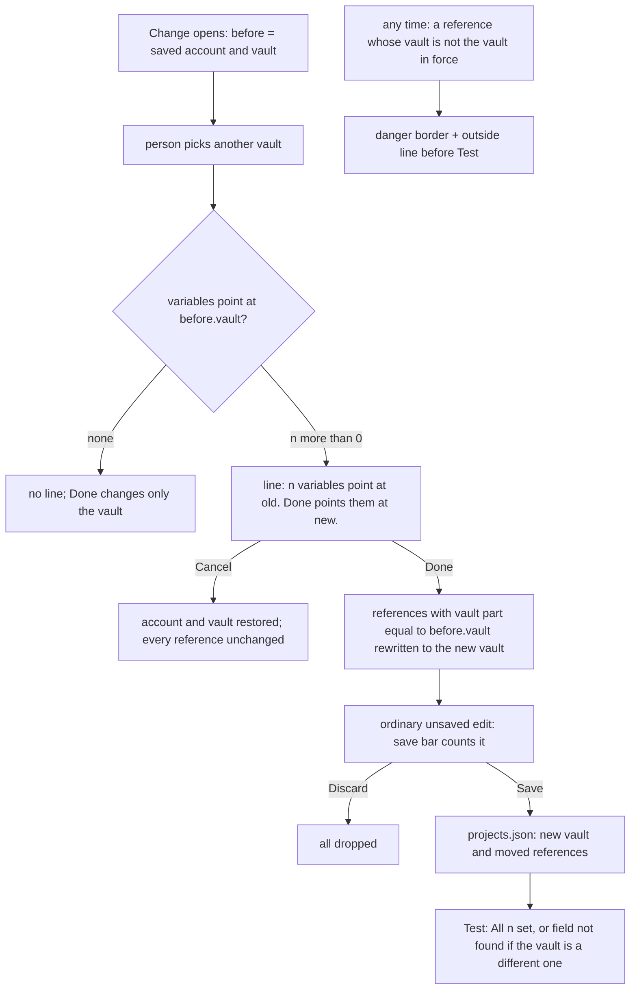

---
id:
title: Changing the vault keeps every variable pointing into it, and the screen marks any variable outside it before Test
status: validation
variant: kc-dev-flow-2
profile: pilot
merge: pr
worktree: .worktrees/spacedock-ensign-project-env-vault-change-repoints-refs
pr:
gates:
    version: 1
    records:
        - id: gate:project-env-vault-change-repoints-refs:backlog
          stage: backlog
          attempts:
            - id: gate-attempt:project-env-vault-change-repoints-refs-backlog-1
              briefing:
                id: briefing:project-env-vault-change-repoints-refs:backlog:attempt-1:revision-1
                digest: sha256:54975d6c1e7d2adf860e46c0de41dc0c9440e0a2818d98938c120ce02673e07a
                room-ref: ./project-env-vault-change-repoints-refs/review/backlog/briefing-1
              resolution:
                type: Resolution
                id: resolution:spacedock:project-env-vault-change-repoints-refs:backlog:1
                briefing: briefing:project-env-vault-change-repoints-refs:backlog:attempt-1:revision-1
                by: person:captain
                at: "2026-10-23T12:22:10.444485Z"
                decision: approve
                reason: 'Captain 2026-10-23: 「准」 — answers the backlog question put in chat: approves Design Director round-2 Tasks 1 to 3 in order, with option A, the re-point behaviour and the r2 rename as stated.'
              application:
                target-stage: ideation
                state: consumed
        - id: gate:project-env-vault-change-repoints-refs:ideation
          stage: ideation
          attempts:
            - id: gate-attempt:project-env-vault-change-repoints-refs-ideation-1
              briefing:
                id: briefing:project-env-vault-change-repoints-refs:ideation:attempt-1:revision-1
                digest: sha256:4249266e09cbcf147d91a092d7f8e46732fe9f1af260f5c4e5ba171e7e07a38b
                room-ref: ./project-env-vault-change-repoints-refs/review/ideation/briefing-1
              resolution:
                type: Resolution
                id: resolution:spacedock:project-env-vault-change-repoints-refs:ideation:1
                briefing: briefing:project-env-vault-change-repoints-refs:ideation:attempt-1:revision-1
                by: person:captain
                at: "2026-10-25T04:07:08.378602Z"
                decision: approve
                reason: '「准」 — Captain in FO chat, 2026-10-25, on the ideation gate (briefing-1, sha256:4249266e) after the FO''s Chinese brief of Task 3. Asked: Approve this vault re-point design and its acceptance criteria into implementation?'
              application:
                target-stage: implementation
                state: consumed
started: 2026-10-24T15:58:32Z
---

Polish round 2 of the project-env settings screen. Source: the Captain's UAT on 2026-10-23 (「這個 use this connection 按鈕是否可以放在 vault 選擇的後面？或是換個方式重新設計儲存跟取消」, 「import from conductor 功能可以移除」, and the qnow vault rename that blanked five variables live) and the Design Director's ruling in `ux-review-polish-2/design-director.md`, approved by the Captain on 2026-10-23 with 「准」, including option A, the re-point behaviour and the r2 wording.

## Scope

In (design-director.md Task 3): after another vault is picked in Change, a line says how many variables point at the old vault and that Done will point them at the new one; Done re-points exactly those references. A reference outside the saved vault shows the danger border and an outside line on its row before any Test. The focused pill's ring stands apart from the danger border and the dashed empty border. ADR 0005's consequence about vault renames gains a dated amendment: choosing the new vault in Change re-points those mappings, the screen marks mappings outside the saved vault, and identity by vault id stays deferred. Out: saving the vault by id (r3) and refusing to save outside references. Stop condition: the acceptance criteria pass. Branches from project-env-connection-done-cancel-one-row's merged main.

## Acceptance criteria

**AC-1**: In a fixture with saved vault Dev, three op://Dev/… refs and a token that reads only agent-dev, picking agent-dev in Change shows "3 variables point at Dev. Done points them at agent-dev. …"; Done then Save write vault agent-dev with three op://agent-dev/… refs, and Test reads "All 3 set".
Verified by: a runtime script on an isolated Paseo at 1280 and 400 px reading names and refs from projects.json; a unit test on the re-point rule that fails when the rewrite is removed; today's build writes op://Dev/… (observed by the Design Director).
Evidence clause: `project-env-vault-change-repoints-refs/evidence/harness/drive.sh rename` (isolated Paseo, own home and port, fake `op`, `security` and `git`; project `work-renamed`; token `sa-r` reads only `agent-dev`; `setup.sh` builds it from a source copy) opens Change, picks `agent-dev`, reads the line, presses Done and Save, reads `projects.json` with `rtk proxy python3`, reopens and presses Test. Disposable candidate at ideation: line "3 variables point at Dev." / "Done points them at agent-dev. Test then shows whether each field is there.", `projects.json` vault `agent-dev` with `op://agent-dev/SENTRY/SENTRY_AUTH_TOKEN`, `op://agent-dev/stripe/secret-key`, `op://agent-dev/POSTHOG/POSTHOG_CLI_API_KEY`, Test "All 3 set", at 1280 and 400 px (`evidence/cand-rename-log.txt`); main b20a949 writes `op://Dev/…` and Test reads "3 failed" (`evidence/main-rename-log.txt`). The unit test table (`test/repoint-refs.test.ts` in the candidate) fails 4 of 12 when `repointRefs` returns its input.

**AC-2**: Only exact old-vault references move: Cancel after picking another vault changes none; a reference into a third vault is left alone; an empty previous vault moves nothing; a vault saved by id moves the references written with that id.
Verified by: a unit test table, one row per case.
Evidence clause: the case table in `## Design` below, one `it` per row in `test/repoint-refs.test.ts`; the Cancel row is also read at runtime by `drive.sh rename` ("after-Cancel": the pills carry no "Dev ·" prefix and the connection line reads "This token cannot read Dev" again, `evidence/cand-rename-log.txt`).

**AC-3**: A reference outside the saved vault shows the danger border and the outside line before any Test, and the focused pill's ring differs from both the danger border and the dashed empty border.
Verified by: a runtime check on a fixture with one op://Other/… ref reading the line's text; a computed-style check comparing focused and unfocused pills; pictures for the ui gate.
Evidence clause: `drive.sh outside` (project `work-outside`, one `op://Other/stripe/secret-key` ref) reads each pill's computed border and outline through `measure.js`, and the body text. Disposable candidate at ideation: outside pill border `rgb(216, 132, 123)` solid 1 px with no Test run; focused pill outline `solid 2px rgb(32, 116, 74)` offset 2 px and border unchanged; the empty pill's border stays dashed `rgb(161, 165, 164)`; unfocused pills show `none` outline (`evidence/cand-outside-log.txt`, dark; `evidence/cand-outside-light-log.txt`, light). The line's text is in `shots/cand-outside-1280-outside.png`; main b20a949 shows no mark before Test (`shots/main-outside-1280-outside.png`).

## FO alignment

Surfaces: ui
Visible change: Picking another vault re-points the variables that used the old one, and a variable outside the vault is marked before Test.
Direction alignment with the Captain: done — the Captain approved the re-point behaviour on 2026-10-23 (「准」), knowing the screen then edits references he did not touch.
Result: ux-review-polish-2/director-shots/i3-*.png and opt-a-1280-picked.png; every ui gate shows the Captain screenshots of the screen.
Release review: not needed: a polish of the r1.5 settings screen the Captain ruled at backlog; it adds no journey story.
Map footprints: not needed: no journey story or open map question is attached to this polish task.

## Design

### PRFAQ

**Headline.** Choosing another vault in Change points every variable that used the old vault at the new one when Done is pressed, and any variable outside the vault is marked on its row before Test.

**Who and why.** The Captain and any teammate who renames a 1Password vault (ADR 0005 advises `agent-<project>-<env>`). On 2026-10-23 a rename blanked five variables on the Captain's live setup: the screen said "Connected", Save worked, and every reference still named the old vault, so new agents got blank values and only Test said why. The Captain approved the fix with 「准」 on 2026-10-23, knowing the screen then edits references he did not touch.

**FAQ.**
- *When does the rewrite happen?* At Done, not at the pick. Picking a vault only draws a line; Cancel then has nothing to undo. After Done the change is an ordinary unsaved edit: the save bar counts it (vault plus each moved reference: "4 unsaved changes" in `work-renamed`), Discard drops it, Save writes it.
- *Which references move?* Only those whose vault part equals the vault the connection had when Change opened, character for character. A reference into a third vault, an empty reference and a raw reference stay as written (rule below).
- *What does the person see before pressing Done?* A row between Vault and "Use this connection": "3 variables point at Dev." with the hint "Done points them at agent-dev. Test then shows whether each field is there." It shows only when another vault is picked and at least one variable points at the old one.
- *Why does a pill not turn red while that line is up?* While Change is open the screen judges each pill against the vault the connection has now (the old one), so the three variables the line is about stay quiet and a reference into a third vault is already marked. After Done or Cancel it judges against the vault in the draft.
- *What marks a reference outside the vault?* The danger border, the existing "Dev ·" style vault prefix, and under the pill "Outside the chosen vault. New agents get this variable blank." It shows before any Test, also for hand edits and older files. Nothing is shown while no vault is chosen. Save is not blocked, as for a variable with no field.
- *Does Test still say the same?* Yes. After the re-point Test tells a rename ("set") from a genuinely different vault ("field not found").
- *How does focus look now?* A 2 px accent-colour ring drawn as an outline 2 px off the pill, so the 1 px border states (none, dashed muted, solid danger) keep showing under it and the layout does not move.
- *What is not solved?* A vault renamed in 1Password after it was saved by name still breaks until the person chooses the new name in Change; saving the vault by its id is r3.



Stops: Save is never blocked by an outside reference. The rule never edits a reference outside `before.vault`. Saving the vault by id (r3) is untouched.

### Existing-code capability check

Boundary: Done and Cancel in `ProjectEditor` (`client/settings-screen.tsx`), `pillView`/`parseRef` (`shared/ref.ts`), `isOutsideVault` (`server/cause.ts`), `vaultChoices`/`canReadVault` (`shared/token.ts`), `unsavedCount` (`shared/config.ts`). Completeness: Done today only calls `backToLine` (journey through: works, but never touches a reference); `isOutsideVault` blanks a reference at session open and Test (works through the journey, `test/vault-boundary.test.ts`); no client code marks an outside reference before Test (broken seam, observed on main b20a949: `shots/main-outside-1280-outside.png`). Need: Captain-ruled (2026-10-23 「准」), plus ADR 0001/0002 (an unresolved variable is blanked and shown). Two bounded searches, 2026-10-25, main b20a949: `git grep -n "repoint\|rewriteRefs\|replaceVault" -- project-env` finds nothing; `git grep -n "isOutsideVault\|outside-vault" -- project-env` finds only the server check, the cause text and the tests. Decision: reuse `parseRef` for the vault part (the same function `isOutsideVault` uses, so the screen and the server agree); add four small pure functions to `shared/ref.ts` (`repointRefs`, `countPointingAt`, `markedOutside`, `settleConnection`) and one for the line (`repointLine`). `unsavedCount` already counts a changed reference and a changed vault, so the save bar needs no change. The disposable candidate is 62 changed production lines in two files plus one new test file (`evidence/candidate-disposable.diff`); `npm run typecheck` is clean and 287 of 287 tests pass in it (273 on main plus 14 new).

### Re-point rule

```ts
// shared/ref.ts. Exact match on parseRef(ref).vault, the same reading isOutsideVault uses.
repointRefs(variables, from, to)   // from "" or to "" or from === to: returns the input unchanged
                                   // else each ref with parseRef(ref)?.vault === from becomes `op://${to}` + the rest of the ref
settleConnection(before, draft, press)  // "cancel": {before.serviceAccount, before.vault, draft.variables}; "done": draft with repointRefs(draft.variables, before.vault, draft.vault)
markedOutside(ref, vault)          // vault !== "" && parseRef(ref) !== null && parsed.vault !== vault
```

AC-2 case table (one `it` per row, `test/repoint-refs.test.ts` in the candidate):

| # | Case | Input (from → to) | Expected |
| --- | --- | --- | --- |
| 1 | Exact old-vault references move, names and the rest of the path kept | Dev → agent-dev; three `op://Dev/…` and `op://Dev/TWILIO/Legacy section/FROM` | all four now `op://agent-dev/…`, names unchanged (AC-1's rewrite; fails when `repointRefs` returns its input) |
| 2 | Cancel changes none | `settleConnection(before, draft, "cancel")` with the vault picked and the account edited | account and vault of `before`, variables identical to the draft's |
| 3 | A third vault is left alone | Dev → agent-dev; one `op://Dev/…`, one `op://Other/…` | only the first moves |
| 4 | An empty previous vault moves nothing | "" → agent-dev | input unchanged |
| 5 | A vault saved by id moves the references written with that id, and only those | `vid-Dev` → agent-dev; `op://vid-Dev/a/A`, `op://Dev/b/B` | only `A` moves |
| 6 | Match is exact | Dev → agent-dev; `op://dev/…`, `op://Dev2/…`, `op://Development/…` | none move |
| 7 | Empty and raw references stay | Dev → agent-dev; `""`, `op://Dev` | unchanged |
| 8 | No target or same target moves nothing | Dev → "" and Dev → Dev | unchanged |
| 9 | Done on `settleConnection` | Dev → agent-dev | vault `agent-dev`, three references moved |
| 10 | `countPointingAt` | counts exact matches only; 0 for an empty vault | 3 and 0 |
| 11 | `markedOutside` | `op://Other/…` and `op://dev/…` against Dev: true; in-vault, empty, raw, or vault "": false | as listed |
| 12 | `repointLine` | 3 and 1 | "3 variables point at Dev." / "Done points them at …"; "1 variable points at Dev." / "Done points it at …" |

Compared with a "Re-point" button the Director weighed: a button adds a press where the answer is always yes and forgetting it leaves the project blank.

### UI proposal and preview

UI proposal: In the Change form, once another vault is picked and at least one variable names the old vault, a row between Vault and "Use this connection" reads "N variables point at <old>." with the hint "Done points them at <new>. Test then shows whether each field is there." (singular: "1 variable points at <old>." / "Done points it at <new>. …"), and Done re-points exactly those references. Any variable pill whose reference names a vault other than the vault in force gets the danger border and, under it, "Outside the chosen vault. New agents get this variable blank." before any Test. A focused pill gets a 2 px accent-colour ring, drawn as an outline 2 px outside the pill, so the border states stay visible and the layout does not move.

Preview: project-env-vault-change-repoints-refs/shots/

The preview is two running builds of the real plugin on isolated Paseos (own homes under `/tmp/pe-vcr`, ports 6971 and 6972; fake `op`, `security`, `git`; the A5 harness copied to `evidence/harness/` with a second account `sa-r` that reads only `agent-dev` and `agent-subspace-relay-production`): `main-*` is main b20a949 in the same states (today's UI, context), `cand-*` is the same tree with the edit in a throwaway copy, never on a branch (`evidence/candidate-disposable.diff`). Names read `<build>-<scenario>[-light]-<width>[-page]-<state>.png`; no `-page` at 1280 is a whole page at 1280 x 1400, `400` is the 400 x 900 window with the sticky bar, `400-page` is the whole page at 400 px. Scenarios: `rename` is `work-renamed` (saved vault Dev, three `op://Dev/…`, token reads agent-dev only; states `opened`, `picked` with the line, `after-done`, `after-test` after Save and reopen); `mixed` is the same plus a fourth variable into `op://Other/…` (`picked`, `after-done`); `outside` is a project on a working token with one `op://Other/…` reference and one empty field (`outside`, `focus-outside`, `focus-empty`); `long` is both vault names long (`picked` at 400). `light` after the scenario name is the light theme (`cand-outside-light-…`); `outside` also has `after-test` (Test pressed: "1 failed · 2 set · 1 no field" with the outside line kept). Not drawn: a phone keyboard, a vault list of many entries, hover.

Measured with the line present, Done's bottom against the sticky bar's top at 400 x 900 (`evidence/cand-single-log.txt`, `cand-rename-log.txt`, `cand-long-log.txt`, field `clearance`): a token that reads one vault (`work-single`), Done ends 11.5 px above the bar; a token that reads two vaults (`work-renamed`), 3.5 px under the bar's top edge, because the existing "Can read 2 vaults: …" hint wraps to a second line; both vault names long (`work-long`), 49.5 px under. At 1280 x 1400 Done is 624.5 px above the bar in every case. So the line alone leaves the previous task's one-row clearance thin (11.5 px with one readable vault), and any wrap above the row takes it away; the page scrolls and the bar covering the lower page is the A5 choice (round-1 ruling R3a, do not solve), so this is a limit and not a criterion.

### Design review

Design review: design/ideation-1.yaml

Design finding 1: fixed: `shots/cand-outside-1280-focus-outside.png` recaptured with the pill focused (the first capture was a full-page screenshot that lost the ring; the computed style in `evidence/cand-outside-log.txt` already read `solid 2px rgb(32, 116, 74)`); the 400 and light pictures were right.
Design finding 2: declined: the sticky save bar covering the lower page is the A5 choice and round-1 ruling R3a (do not solve), the page scrolls so Done is reachable, and the clearance is measured in Design (11.5 px above the bar with one readable vault, 3.5 px under with two, 49.5 px under with both names long).
Design finding 3: declined: the Captain approved on 2026-10-23 (「准」) that the screen edits references he did not touch and that only Discard undoes it; the footer count ("4 unsaved changes", cand-rename-1280-after-done.png) and the pills losing their old-vault prefix are the cue, and Discard drops all four.
Design finding 4: declined: "Outside the chosen vault. New agents get this variable blank." is the Design Director's wording the Captain approved on 2026-10-23 (「准」) and matches the cause text for a blanked reference ("reference points outside the chosen vault", causeText in project-env/shared/cause.ts); while Change is open the three Dev rows are covered by the line above them and the pill rule judges against the vault in force.
Design finding 5: declined: the red "!" is the existing Test failure mark (client/failure-mark.tsx) whose bubble gives the reason, the outside line is the Director's pre-Test mark kept after Test so the row reads the same before and after, and removing either changes behaviour outside this task.
Decline check: design/declines-1.yaml

All four declines were upheld by the design director (pass 1b). The review's limitations (hover, a real Test, a real rename, numeric contrast) are runtime checks: AC-1's script runs the real rename and Test, AC-3's script reads the computed styles, and hover is not in any criterion.

### Needs decision

None. The re-point behaviour is the Captain's ruling of 2026-10-23, and no finding needs a Captain choice. Past rulings checked: ADRs 0001 and 0002 (read by the design director) agree with the blanked-reference wording; `git -C docs/dev2/.spacedock-state grep -n 'Override:'` finds only archived prose about other areas (add-variable name editing, save bar).

### ADR 0005 amendment (draft, no number)

For `docs/adr/0005-an-agent-lays-out-vault-items-and-a-person-fills-values.md`, appended after its last Consequences bullet, dated the day implementation lands:

> **Amendment, <date the implementation PR opens>** (「准」 — Captain, 2026-10-23, approving that picking the new vault in Change re-points the references written with the old vault, and that the screen marks references outside the saved vault.) The consequence "Renaming a vault breaks project-env mappings stored by vault name, because a reference is matched by the prefix `op://<saved vault>/`" now holds only until the person chooses the new vault in Change: pressing Done points every mapping written with the old vault (its name, or its id when the vault was saved by id) at the new one, and Cancel changes none. A mapping outside the saved vault is marked on its row before Test (`markedOutside` in `project-env/shared/ref.ts`), and a mapping into a third vault is left as written and marked. Identity by vault id stays deferred: a vault renamed in 1Password after it was saved by name still breaks its mappings until the person chooses the new name in Change.

### Evidence plan and honest limits

Run at ideation on the disposable build: AC-1 (rename flow at 1280 and 400), AC-2's rules (12 unit rows, 4 fail when the rewrite is removed; Cancel and third-vault rows also read at runtime), AC-3's computed styles in dark and light, `npm run typecheck` and `npm test` (287 of 287). Not run: anything on a real candidate branch; a real 1Password account or a real vault rename (the fake `op` answers by exact reference string, so "All 3 set" shows the rewrite reached the read, not that 1Password resolves it); hover; a touch device. The unit tests prove the rule; the wiring (Done calls `settleConnection`, the pill reads `markedOutside` against the vault in force) is proved only by the runtime script, which is why AC-1 and AC-3 name it. `drive.sh` carries this run's `/tmp/pe-vcr` paths; validation adapts `ROOT`, `PORT` and `SESSION` in `harness/env.sh`. Known limits: references written with a vault name while the vault was saved by id are not moved (the outside mark flags them); a vault whose name contains `/` is not handled (the reference grammar splits on it); the clearance of the previous task's one-row Cancel/Done is thin with the line present (Design above), and is a limit not a criterion.

Package note: the ideation skill loaded from kc-dev-flow-2 0.28.0 while the dispatch named 0.29.0; the design review followed the 0.29.0 `design-director` skill (pass 1a and 1b) run through a general-purpose agent because the `kc-dev-flow-2:design-director` agent is not registered in this session.

### Batch overlap

- project-env-built-in-agent-notice (backlog): changes what an agent receives at session open (`server/contribute.ts`) and `project-env/OVERVIEW.md`, whose troubleshooting text names "reference outside the saved vault" and "vault changed"; no shared file with this task's edit (`client/settings-screen.tsx`, `shared/ref.ts`, one test file, ADR 0005). It runs after this task, as its Scope says.
- project-env-test-row-draft-note (backlog): changes the Test row hint in `client/settings-screen.tsx`, a different region from the Change form and the pill; its Scope says it starts after a prerequisite, so no concurrent edit.
- project-env-fo-grant-adr (implementation): adds a new ADR file whose number FO reserved; ADR 0005 is a different file and `docs/adr` has no index, so nothing shared. 
- Not in any live task, for the FO: the journey map (`docs/journey/project-env/give-agents-their-project-setup.yaml`, question `token-works/q3`) still says "Gap: … it fails only at Test or session open. Not yet placed in a release"; after this merges that answer is partly stale. This task's Scope does not edit the map.
Recommended order: this task, then project-env-built-in-agent-notice; project-env-test-row-draft-note after its own prerequisite.

## Stage Report: ideation

- DONE: Design the change your Scope names (the re-point line and Done's re-point, the outside-vault mark before Test, a focus ring distinct from the danger and dashed borders, the dated ADR 0005 amendment), with each acceptance criterion kept and given a reproducible evidence clause; write the re-point rule as a pure function with the AC-2 case table.
  `## Design` holds the PRFAQ, Mermaid, capability check, the rule (`repointRefs`, `settleConnection`, `markedOutside`) with a 12-row case table, and the ADR 0005 amendment draft (no number); AC-1 to AC-3 keep the Captain's wording and each carries an `Evidence clause:` naming `evidence/harness/drive.sh`.
- DONE: Produce the artifact the ui surface owes: whole-page previews from a running build at desktop and 400 px (vault picked with the re-point line; after Done and Save; a reference outside the vault marked before Test; the focused pill), plus the design review, with each finding dispositioned. Re-measure the one-row Cancel/Done clearance with the re-point line present at 400 x 900.
  `shots/` (57 pictures, `cand-*` the proposal, `main-*` today, dark and light); `design/ideation-1.yaml` (5 MINOR, 1 fixed, 4 declined) and `design/declines-1.yaml` (4 upheld). Clearance with the line at 400 x 900: 11.5 px above the bar with a one-vault token, 3.5 px under with a two-vault token (the existing hint wraps), 49.5 px under with both names long; recorded as a limit. `design_surfaces.py check` (0.29.0): "design surfaces presentable", exit 0.
- DONE: Name any decision the Captain must make (at most one), with a recommendation; the re-point behaviour is already approved.
  None: no finding needs a Captain choice; `### Needs decision` says so and lists the rulings checked.
- DONE: AC-1 evidence (not yet a pass on a candidate branch).
  Disposable build, `drive.sh rename`: line "3 variables point at Dev." at 1280 and 400; Done and Save wrote vault `agent-dev` with three `op://agent-dev/…` refs, reopen and Test read "All 3 set" (`evidence/cand-rename-log.txt`); main b20a949 wrote `op://Dev/…` and Test read "3 failed". Falsified by removing the rewrite (4 of 12 unit rows fail).
- DONE: AC-2 evidence (not yet a pass on a candidate branch).
  12 `it` rows in `test/repoint-refs.test.ts` of the disposable copy, 287 of 287 tests and typecheck pass there; the Cancel row (a changed account and vault restored, variables unchanged) and the third-vault row also read at runtime (`evidence/cand-rename-log.txt` after-Cancel, `cand-mixed-log.txt`).
- DONE: AC-3 evidence (not yet a pass on a candidate branch).
  `drive.sh outside`: the outside line text reads "Outside the chosen vault. New agents get this variable blank." before any Test at 1280 and 400; focused pill outline `solid 2px rgb(32, 116, 74)` offset 2 px against border `rgb(216, 132, 123)` solid (danger) and `rgb(161, 165, 164)` dashed (empty), same in light with `rgb(157, 67, 59)`; main shows no mark.

### Summary

The design re-points at Done (not at the pick) with an announcing line, marks outside references by comparing against the vault in force, and draws focus as a 2 px accent outline; the disposable candidate is 62 changed production lines and one new test file, kept only as `evidence/candidate-disposable.diff`, no branch exists. No Captain decision is open. Notable: the previous task's one-row clearance at 400 x 900 is thin (11.5 px) with the line and goes negative when the token reads two vaults; the ideation skill loaded from 0.28.0 while the dispatch named 0.29.0, so the 0.29.0 check and design-director passes were used.

## Stage Report: implementation

- DONE: Implement the approved design exactly, starting from evidence/candidate-disposable.diff in this task's folder: the re-point line between Vault and "Use this connection", Done re-pointing exactly the old-vault references through settleConnection/repointRefs, the outside-vault mark (markedOutside) before Test, the 2 px accent focus outline, and the dated ADR 0005 amendment from the task's Design.
  Commit 1450008 on spacedock-ensign/project-env-vault-change-repoints-refs (162 insertions, 4 deletions in 4 files: settings-screen.tsx, shared/ref.ts, test/repoint-refs.test.ts, ADR 0005); the diff applied unchanged; amendment dated 2026-10-25, the day the Draft PR opened.
- DONE: Land evidence for AC-1, AC-2 and AC-3 with the clauses they name (adapt evidence/harness/drive.sh and env.sh to your own ROOT, PORT and SESSION), plus whole-page screenshots at desktop and 400 px of the picked, after-Done, after-Test and outside states, under this task's state folder.
  `evidence/impl-harness/` (ROOT /tmp/pe-vcr-impl, PORT 6981, SESSION pe-vcr-impl-impl), logs `evidence/impl-*-log.txt`, pictures `shots/impl-*` (48). AC-1: line "3 variables point at Dev." at 1280 and 400; Save wrote `op://agent-dev/...` x3; Test "All 3 set". AC-2: 14 unit tests, 4 fail with `repointRefs` returning its input; after-Cancel pills carry no "Dev ·" prefix. AC-3: outside pill `rgb(216, 132, 123)` solid 1px with the outside line before Test (light `rgb(157, 67, 59)`); focused `solid 2px rgb(32, 116, 74)` offset 2px, border unchanged; empty stays dashed. The full-page focus pictures lose the ring (as in ideation finding 1); `shots/impl-outside-light-1280-focus-outside-viewport.png` shows it.
- DONE: Run `npm test` (rerun the load-sensitive session-open deadline test alone if it is the only failure), `npm run typecheck`, `python3 /Users/kent/.claude/plugins/cache/kc-claude-plugins/kc-dev-flow-2/0.29.0/scripts/adr_lint.py` on docs/adr, the roborev gate, `python3 /Users/kent/.claude/plugins/cache/kc-claude-plugins/kc-dev-flow-2/0.29.0/scripts/design_surfaces.py check docs/dev2/.spacedock-state/project-env-vault-change-repoints-refs.md` and `python3 /Users/kent/.claude/plugins/cache/kc-claude-plugins/kc-dev-flow-2/0.29.0/scripts/doc_impact.py <base> <candidate>`, then open the Draft PR.
  `npm test` 287 of 287 (no failure); typecheck clean; adr_lint exit 0 (8 files); roborev `clean on 1450008e9; evidence=roborev:1162`; design_surfaces "design surfaces presentable" (run from /Users/kent/Project/kc-paseo-plugins); comment_ratio "code lines 148, comment lines 0, 0.0%"; doc_impact (base e55cb33 to HEAD): ADR 0005 `updated`, no other document listed; Draft PR https://github.com/iamcxa/kc-paseo-plugins/pull/50.

### Summary

The approved design landed as drafted, plus the ADR 0005 amendment, and the runtime script on an isolated Paseo reproduced the ideation results on the real branch build. Limits: the fake `op` shows the rewrite reached the read, not that 1Password resolves it; no real rename was run; at 400 x 900 with a two-vault token Done sits 3.5 px under the sticky bar's top (measured -3.5 clearance, the A5 limit recorded at ideation). Package note: no `roborev` finding was raised; the PR body lists `without-it unanswered: none`.

## Stage Report: validation

- DONE: Independently check candidate 1450008e9bf687c7f75c054007dcb4b32844a314 (PR iamcxa/kc-paseo-plugins#50, base main e55cb33) against AC-1, AC-2 and AC-3 and the approved design: rebuild and run it yourself on an isolated Paseo; confirm the re-point line text and that Done then Save writes the new vault and moved refs while Cancel and a third-vault ref change nothing; the outside mark shows before any Test; the focus outline differs from the danger and dashed borders in dark and light; Discard drops the re-point; the ADR 0005 amendment matches the task's draft and the Captain's words; give a verdict.
  Verdict PASSED (recommended). From `git archive` of 1450008 (PR head `headRefOid` is the same): `npm run typecheck` clean, `npm test` 287 of 287. Isolated Paseo, port 6991, plugin `pe-vcr-val`, `evidence/val-harness/`, logs `evidence/val-*-log.txt`. AC-1 (`val-rename-log.txt`, 1280 and 400): line "3 variables point at Dev." / "Done points them at agent-dev. Test then shows whether each field is there."; Done then Save wrote vault `agent-dev` with `op://agent-dev/SENTRY/SENTRY_AUTH_TOKEN`, `op://agent-dev/stripe/secret-key`, `op://agent-dev/POSTHOG/POSTHOG_CLI_API_KEY`; Test "All 3 set". AC-2: Cancel after pick left pills without "Dev ·" and the line "This token cannot read Dev", bar "No unsaved changes", disk unchanged (`val-cancelbar-log.txt`); third-vault ref (`val-mixedsave-log.txt`): Save wrote `agent-dev` with three moved refs and `op://Other/TWILIO/TWILIO_ACCOUNT_SID` unchanged; Test "1 failed · 3 set" with the outside line. AC-3 (`val-outside-log.txt`, `val-outside-light-log.txt`, 1280 and 400): before any Test STRIPE_KEY border `rgb(216, 132, 123)` solid 1px (light `rgb(157, 67, 59)`) and the line "Outside the chosen vault. New agents get this variable blank."; focused pill outline `solid 2px rgb(32, 116, 74)` offset 2px with the border unchanged on the outside pill and the dashed empty pill (`rgb(161, 165, 164)`, light `rgb(113, 113, 122)`); unfocused pills `none`. Discard (`val-discard-log.txt`): after Done "4 unsaved changes", Discard then "Discard changes" closed the editor, projects.json unchanged, reopened with Dev refs. Falsifiers: `repointRefs` returning its input fails 4 of 14 `test/repoint-refs.test.ts` rows; `markedOutside` returning false fails 1. ADR 0005 amendment text equals the task's `### ADR 0005 amendment` draft with the date filled (2026-10-25, the Draft PR day) and carries the Captain's 「准」 of 2026-10-23 as the backlog gate records it.
- DONE: Run the built screen review your validation principles require (design-director pass 2a on your own screenshots of the built screen at 1280 and 400 px) and write its Built screen review lines; write the minimal acceptance script FO will rerun in a fresh shell, and run `python3 /Users/kent/.claude/plugins/cache/kc-claude-plugins/kc-dev-flow-2/0.29.0/scripts/adr_lint.py docs/adr --since e55cb33` recording its exit code.
  Pass 2a ran as `kc-dev-flow-2:design-director` on 22 pictures of the built screen (`design/validation-1.yaml`, 2 MINOR, 0 MAJOR), pass 2b upheld both declines (`design/validation-declines-1.yaml`). `adr_lint.py docs/adr --since e55cb33` (run in the PR worktree at 1450008): "8 ADR file(s) checked, 0 legacy", exit 0. Also at the candidate: `comment_ratio.py` code lines 148, comment lines 0, exit 0; `doc_impact.py` lists only ADR 0005, which carries `updated`, exit 0; `dispatch_records.py` "3 dispatch record(s) complete", exit 0; the task has no `## Number guards`.
- DONE: Record what the Captain should see in the screenshots and every unverified obligation.
  See `### Captain screenshots` and `### Unverified obligations` below.

### Summary

The candidate does what AC-1 to AC-3 say on an isolated Paseo built from the archive: Done re-points exactly the old-vault references, Cancel and a third-vault reference change nothing, the outside mark and its line show before any Test, and the focus ring differs from the danger and dashed borders in dark and light. Recommend PASSED; no Material finding. Limits are the fake `op` (no real 1Password), the thin Done clearance at 400 px with a two-vault token (the recorded A5 limit), and no check of Test pressed while Change is open.

### Findings

- F1 Polish: At 400 x 900 with a token that reads two vaults, Done sits 3.5 px under the sticky bar's top (clearance -3.5, `val-rename-log.txt`; -49.5 with both names long, `val-long-log.txt`), so the bar covers Done until the page is scrolled; scrolled to the end, Done was clicked and the editor closed (`val-reach-log.txt`). It is the A5 sticky-bar choice and round-1 ruling R3a recorded as a limit at ideation (Design finding 2), so it is not repaired here.
- F2 Deferred risk: Pressing Test while Change is open was not run, so which vault that Test reads (the saved one or the picked one) is unobserved; it becomes Material if Test then reports a rename as "field not found" for a person who has not pressed Done.

### Built screen review

Built screen review: design/validation-1.yaml
Built screen finding 1: declined: "Outside the chosen vault" is the wording the Captain approved on 2026-10-23 and the fourth pill in `design/built/val-mixed-1280-picked.png` is outside both vaults, so it is true under either reading; the three Dev pills sit directly under the "3 variables point at Dev." line.
Built screen finding 2: declined: the amber "≠" badge is existing behaviour; `shots/main-outside-1280-outside.png` (main before the candidate) shows it on the same pill and the diff does not touch the code that draws it.
Built screen decline check: design/validation-declines-1.yaml

### Captain screenshots

In `design/built/` (dark unless `light`; no `-page`: whole page 1280 x 1400; `400`: the 400 x 900 window with the sticky bar; `400-page`: whole page at 400):
- `val-rename-1280-picked.png`: after picking agent-dev in Change, a row "3 variables point at Dev. Done points them at agent-dev. Test then shows whether each field is there." between Vault and "Use this connection"; the three pills still read "Dev · …" and are not red; the bar says "Finish or cancel the connection change first". Light: `val-lightpicked-light-1280-picked.png`, `val-lightpicked-light-400-picked.png`.
- `val-rename-1280-after-done.png`: the pills lost their "Dev ·" prefix and the bar reads "4 unsaved changes"; `val-rename-1280-after-test.png` after Save and Test: "Connected · sa-r · agent-dev" and "All 3 set".
- `val-mixed-1280-picked.png` and `val-mixed-1280-after-done.png`: the fourth variable (`op://Other/…`) stays red with the outside line in both states.
- `val-outside-1280-outside.png` (light: `val-outside-light-1280-outside.png`, 400: `val-outside-400-outside.png`): the STRIPE_KEY pill has a red border and "Outside the chosen vault. New agents get this variable blank." with no Test run and "No unsaved changes"; the empty pill is dashed.
- `val-focusshot-1280-focus-outside.png`, `val-focusshot-1280-focus-empty.png`, the `-light-` and `-400-` variants: a green 2 px ring drawn outside the pill with the red or dashed border still visible inside it. The `-page-` and full-page `focus` pictures lose the ring (a full-page capture), so use the focusshot files.
- `val-long-400-picked.png`: at 400 px the sticky bar covers the "Use this connection" row (F1); `val-long-400-page-picked.png` shows the whole page with Done.

### Unverified obligations

- No real 1Password: the fake `op` answers by exact reference string, so "All 3 set" shows the rewrite reached the read, not that 1Password resolves `op://agent-dev/…`; no real vault rename was run.
- Test pressed while Change is open (F2); hover, a touch device or phone keyboard, keyboard path through Change, Done and Cancel, and a vault list of many entries were not run.
- Cancel after editing the account as well as the vault is proved by the unit row only; the runtime Cancel pressed after a vault pick only.
- The light theme was drawn for the picked, outside and focus states only, not for the mixed, long and after-Done states; numeric colour contrast was not measured.
- A vault saved by id and a vault name containing `/` are covered by unit rows only (ideation-recorded limit).
- Not run: roborev, `design_surfaces.py check` (FO runs it at the gate), `number_guards.py` (the task has no `## Number guards`).

### Minimal acceptance script

Needs this Mac with `node`, `npm`, `agent-browser`, `paseo`, `python3` and `git`, the repo at `/Users/kent/Project/kc-paseo-plugins`, and network for `npm ci`; it uses port 6993 and `/tmp/pe-vcr-acc` only, and touches no live plugin or `~/.paseo`. It does not cover real 1Password, hover, a touch device, Test while Change is open or a dark-theme-only reading of the light states.

1. Build the candidate from an archive and run its checks:
   `rm -rf /tmp/pe-vcr-acc && mkdir -p /tmp/pe-vcr-acc/src && git -C /Users/kent/Project/kc-paseo-plugins archive 1450008e9bf687c7f75c054007dcb4b32844a314 | tar -x -C /tmp/pe-vcr-acc/src && cd /tmp/pe-vcr-acc/src/project-env && npm ci >/dev/null 2>&1 && npm run typecheck && npm test 2>&1 | grep -E '^ℹ (pass|fail)'`
   Expect no type errors, `ℹ pass 287` and `ℹ fail 0`.
2. Start an isolated Paseo with the fixture projects:
   `export ROOT=/tmp/pe-vcr-acc PORT=6993 LABEL=acc H=/Users/kent/Project/kc-paseo-plugins/docs/dev2/.spacedock-state/project-env-vault-change-repoints-refs/evidence/val-harness && bash $H/setup.sh | tail -1`
   Expect `ready: http://127.0.0.1:6993`.
3. Drive the rename flow (pick agent-dev, Cancel, pick again, Done, Save, reopen, Test):
   `GEOMS="1280 1400" bash $H/drive.sh rename >/dev/null 2>&1; L=$ROOT/s-acc/out/acc-rename-log.txt; grep -oE '3 variables point at Dev\.\|Done points them at agent-dev\. Test then shows whether each field is there\.' $L | head -1; grep -E 'after-Cancel|after-Done bar|saved|test:' $L | cut -c1-330`
   Expect the line "3 variables point at Dev.|Done points them at agent-dev. Test then shows whether each field is there."; `after-Cancel` with "This token cannot read Dev" and pills without a "Dev ·" prefix; `after-Done bar: 4 unsaved changes`; `saved: agent-dev ['op://agent-dev/SENTRY/SENTRY_AUTH_TOKEN', 'op://agent-dev/stripe/secret-key', 'op://agent-dev/POSTHOG/POSTHOG_CLI_API_KEY']`; `test: All 3 set`.
4. Read the outside mark and the focus ring before any Test:
   `GEOMS="1280 1400" bash $H/drive.sh outside >/dev/null 2>&1; L=$ROOT/s-acc/out/acc-outside-log.txt; grep outside-line $L; python3 -I $H/parse.py $L | grep -E '^1280 |STRIPE_KEY|LINEAR'`
   Expect `outside-line: Outside the chosen vault. New agents get this variable blank.`; under `1280 measure` STRIPE_KEY `solid 1px rgb(216, 132, 123)` with `outline none` and LINEAR_API_KEY `dashed 1px rgb(161, 165, 164)`; under `1280 focus-outside` STRIPE_KEY `outline solid 2px rgb(32, 116, 74) off 2px` and `focused True` with the same border; under `1280 focus-empty` LINEAR_API_KEY the same outline on its dashed border.
5. Check Discard drops the re-point:
   `OUT=$ROOT/s-acc/out bash $H/extra.sh discard 2>&1 | grep -E 'disk|reopened' | cut -c1-200`
   Expect `disk-before` and `disk-after` both `Dev ['op://Dev/SENTRY/SENTRY_AUTH_TOKEN', 'op://Dev/stripe/secret-key', 'op://Dev/POSTHOG/POSTHOG_CLI_API_KEY']`, and `reopened` with "This token cannot read Dev" and no `agent-dev`.
6. Tear down and run the ADR check:
   `bash $H/teardown.sh; cd /Users/kent/Project/kc-paseo-plugins/.worktrees/spacedock-ensign-project-env-vault-change-repoints-refs && python3 /Users/kent/.claude/plugins/cache/kc-claude-plugins/kc-dev-flow-2/0.29.0/scripts/adr_lint.py docs/adr --since e55cb33; echo "exit $?"`
   Expect `removed /tmp/pe-vcr-acc/s-acc`, `8 ADR file(s) checked, 0 legacy`, `exit 0`.
