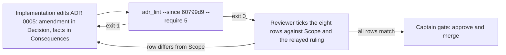

---
id:
title: ADR 0005 records how agent vaults, items and fields are named
status: implementation
variant: kc-dev-flow-2
profile: pilot
merge: pr
worktree: .worktrees/spacedock-ensign-project-env-vault-naming-rule-adr
pr:
gates:
    version: 1
    records:
        - id: gate:project-env-vault-naming-rule-adr:backlog
          stage: backlog
          attempts:
            - id: gate-attempt:project-env-vault-naming-rule-adr-backlog-1
              briefing:
                id: briefing:project-env-vault-naming-rule-adr:backlog:attempt-1:revision-1
                digest: sha256:346e2a7e5f9c1ba9d83bfb5daba0fdf88b8671d71356c2654a68937436cf278a
                room-ref: ./project-env-vault-naming-rule-adr/review/backlog/briefing-1
              resolution:
                type: Resolution
                id: resolution:spacedock:project-env-vault-naming-rule-adr:backlog:1
                briefing: briefing:project-env-vault-naming-rule-adr:backlog:attempt-1:revision-1
                by: person:captain
                at: "2026-10-23T05:47:06.367476Z"
                decision: approve
                reason: 'Captain 2026-10-23: 「准」 — answers the FO''s question in chat; approves a docs task that writes the vault naming rule into ADR 0005.'
              application:
                target-stage: ideation
                state: consumed
        - id: gate:project-env-vault-naming-rule-adr:ideation
          stage: ideation
          attempts:
            - id: gate-attempt:project-env-vault-naming-rule-adr-ideation-1
              briefing:
                id: briefing:project-env-vault-naming-rule-adr:ideation:attempt-1:revision-1
                digest: sha256:b35f2383056c7810ecfdec1839a19705c474fa1c29abc36d56cee579deb8a9ab
                room-ref: ./project-env-vault-naming-rule-adr/review/ideation/briefing-1
              resolution:
                type: Resolution
                id: resolution:spacedock:project-env-vault-naming-rule-adr:ideation:1
                briefing: briefing:project-env-vault-naming-rule-adr:ideation:attempt-1:revision-1
                by: person:captain
                at: "2026-10-23T07:13:11.306201Z"
                decision: approve
                reason: 'Captain 2026-10-23: 「准」 — approves the ADR 0005 amendment draft into implementation and, as the gate question stated, confirms the relayed words 「注意應該是建議守則不是強迫性的，直到我們設計一個 skill 讓獨立的 agent 做這件事，且可以確保完全保密完全不外洩」 as his.'
              application:
                target-stage: implementation
                state: consumed
started: 2026-10-23T05:48:10Z
---

The vault naming rule handed over on 2026-10-23 by the kc-paseo-plugins session that renamed Kent's vaults (Paseo agent fb988bc1), written into the project's decision record. The Captain approved opening this task on 2026-10-23 with 「准」, answering the FO's question "要不要開一個小的文件任務，把這條命名規則寫進 ADR 0005？"; the hand-off quotes his approval of the rule itself as 「同意」 and 「可以，就這樣做規則」.

## Scope

In: ADR 0005 (`docs/adr/0005-an-agent-lays-out-vault-items-and-a-person-fills-values.md`) gains the naming rule, in the form this repo's ADR conventions require (an amendment or a superseding record, decided in ideation):
1. Every vault an agent reads through a service account should be named `agent-<project>-<env>` (for example `agent-relay-dev`); the vault holding service account tokens, read only by a person, should be `agent-tokens`. Reason: 1Password lists vaults alphabetically with no manual order, and `@` is not allowed in `op://` references (https://www.1password.dev/cli/secret-reference-syntax/).
2. An item's title should be the service name, lowercase, words joined by hyphens (`netlify`, `posthog`); a `-<qualifier>` only when one vault holds two accounts of one service; no project prefix.
3. A field label should be the environment variable name the agent receives (`NETLIFY_AUTH_TOKEN`).
4. A service account token item in `agent-tokens` should be titled with the service account name, the same string as its Keychain service name.
It also records the facts verified on 2026-10-23 that settle ADR 0005's unverified point: `op item create --category "Secure Note"` with `NAME[password]=` creates an empty password field (op 2.30.3); references are case-insensitive; renaming a vault breaks project-env mappings stored by vault name.
Out: any vault, item or settings change; storing vault IDs instead of names (a separate backlog candidate). Stop condition: the acceptance criterion passes.

## Acceptance criteria

**AC-1**: The decision record states the four naming rules, their reasons and the three verified facts, and passes the repository's ADR lint.
Verified by, from the repository root of the candidate (`<package>` is the kc-dev-flow-2 package root):
1. `python3 <package>/scripts/adr_lint.py docs/adr --since 60799d9 --require 5` exits 0.
2. `git diff --name-only <base>..<candidate> -- docs/adr` prints only `docs/adr/0005-an-agent-lays-out-vault-items-and-a-person-fills-values.md`: the rule lands as an amendment, with no new ADR file.
3. A reviewer reads the amendment against the eight-row table under `## Design` and ticks each row; rows 1 to 7 match this task's Scope, row 8 matches the Captain's relayed advisory ruling (see `## Input added after the first report`).
4. Re-checkable without a secret: the `@` and case-insensitivity statements against https://www.1password.dev/cli/secret-reference-syntax/; fact 3 against `splitRef` in `project-env/shared/field-picker.ts`. Fact 1 (op 2.30.3) is taken from the 2026-10-23 hand-off and not re-run, because it needs the Captain's own 1Password sign-in and write access to a vault; validation marks it not run.

## FO alignment

Surfaces: none
Visible change: none
Direction alignment with the Captain: done — the Captain approved writing the rule into ADR 0005 on 2026-10-23 (「准」).
Release review: not needed: a decision-record update with no journey story or product behaviour change.
Map footprints: not needed: no journey story or open map question is attached to this docs task.

## FO records

The backlog gate was recorded before design_surfaces.py passed: the first draft carried `Surfaces: docs` and a sentence under `Visible change:`; both were corrected to `none` after the approval, with no change to scope or criteria.

## Design

**Ruling:** the naming rule lands as an in-place amendment of ADR 0005, `An agent lays out vault items; a person reviews them and fills the values` (file `docs/adr/0005-an-agent-lays-out-vault-items-and-a-person-fills-values.md`). No new ADR, so FO reserves no number.

**Why in place, not a new record.** Three reasons, none of which needs the Captain:
- This repository already amends in place when a ruling refines an accepted one: ADR 0002 and ADR 0004 each carry a dated `**Amendment, <date>**` paragraph in Decision (checked by reading both files, 2026-10-23).
- The rule refines ADR 0005's own convention (an item "titled with the service name") and settles its stated unverified point; a second record would split one vault layout across two files.
- `Superseded by NNNN` (the only supersede status `adr_lint.py` accepts) would mark all of ADR 0005 replaced, which is false: the structure-only, person-fills-values ruling stands.
`number_guards.py check` rules R4 and R5 read only ADR files added by the candidate (`added_changed` returns them first), so an edit to 0005 trips neither; I did not run `reserve`.

### PRFAQ

Press release: from the next release, anyone who sets up a vault for an agent finds recommended guidance for what to call vaults, items and fields, with the reason for each. Renaming a vault later is known to break saved mappings.
FAQ:
- Does the plugin enforce it? No. The vault setting is `z.string()` (`project-env/shared/config.ts`), so any name is accepted; the four rules are advice to a person laying out a vault. They authorize no agent to create, rename or edit a vault or item, and the layout skill ADR 0005 describes does not exist in this repository yet (no skill file in `git ls-files`, 2026-10-23).
- Does it change ADR 0001 (one vault per repository)? No. A repository still reads one vault at a time; `<env>` only names which one.
- Does it touch code, vaults or settings? No.

### Draft text for ADR 0005

Edit 1, in `## Decision`, after the paragraph ending "Credential item per service).", add:

> **Amendment, 2026-10-23** (「同意」 and 「可以，就這樣做規則」 — Captain, 2026-10-23, in the hand-off of the rule; 「注意應該是建議守則不是強迫性的，直到我們設計一個 skill 讓獨立的 agent 做這件事，且可以確保完全保密完全不外洩」 — Captain, 2026-10-23, relayed by the session that handed over the rule): four recommended rules for naming vaults, items and fields. They are guidance for a person laying out a vault, not a mandatory convention.
>
> 1. A vault an agent reads through a service account should be named `agent-<project>-<env>`, for example `agent-relay-dev`. The vault that holds service account tokens, read only by a person, should be `agent-tokens`. Reason: 1Password lists vaults alphabetically with no manual order, so a shared prefix keeps them together, and `@` is not allowed in an `op://` reference (https://www.1password.dev/cli/secret-reference-syntax/), so `-` joins the parts.
> 2. An item's title should be the service name, lowercase, words joined by hyphens (`netlify`, `posthog`). It should take a `-<qualifier>` only when one vault holds two accounts of one service, and never carry a project prefix. Reason: the vault name already carries the project, and a title with a space needs quotation marks in a reference. This refines "titled with the service name" above.
> 3. A field label should be the environment variable name the agent receives (`NETLIFY_AUTH_TOKEN`). Reason: the field picker suggests the field whose label equals the variable name (`sameName` in `project-env/shared/field-picker.ts`), so the mapping needs no choice.
> 4. A service account token item in `agent-tokens` should be titled with the service account name, the same string as its Keychain service name. Reason: the plugin looks the token up in the login Keychain by that name (`find-generic-password ... -s <service account>` in `project-env/server/secrets.ts`), so one string finds it in both places.
>
> The guidance authorizes no agent to create, rename or edit a vault or an item. This record's decision that an authorized agent lays out items through a skill shipped with this plugin, to the convention above, stays the target design; no such skill exists yet. Until one does, the guidance stays advisory. An agent lays out items only through a dedicated skill, run by an independent agent, that guarantees no secret value is exposed.

Edit 2, in `## Consequences`, replace the two-line bullet beginning "Whether `op` can create an empty password field" and ending "proves it before building." with:

> - Whether a 1Password MCP exists for this is unverified. Three facts were verified on 2026-10-23:
>   - `op item create --category "Secure Note"` with `NAME[password]=` creates an empty password field (op 2.30.3), which settles the point this record left open.
>   - Secret references are case-insensitive.
>   - Renaming a vault breaks project-env mappings stored by vault name, because a reference is matched by the prefix `op://<saved vault>/`.
> - The plugin checks none of the four names, and they bind no one: they are advice to a person until that skill exists.

(Reasons for rules 2 to 4 are drafted here from verified code and the reference page; Scope gave a reason only for rule 1. The Captain reads them at the gate; they add no new rule.)

Eight-row table for the reviewer (source in the right column):

| # | Record carries | Scope source |
| --- | --- | --- |
| 1 | rule 1, reason | Scope item 1 |
| 2 | rule 2 | Scope item 2 |
| 3 | rule 3 | Scope item 3 |
| 4 | rule 4 | Scope item 4 |
| 5 | fact: empty password field, op 2.30.3 | Scope, verified-facts sentence |
| 6 | fact: references case-insensitive | same |
| 7 | fact: vault rename breaks mappings by name | same |
| 8 | rules are recommended guidance for a person; authorize no agent to create, rename or edit a vault or item; agent layout waits for a dedicated skill run by an independent agent that guarantees no secret value is exposed | Captain's words, relayed 2026-10-23 (confirmed by him at the gate) |

Existing-code check (ideation principle): no code change is proposed, so no capability change to justify. Out of scope and untouched: vault IDs instead of names (note: `canReadVault` in `project-env/shared/token.ts` already accepts an ID, so that candidate is not blank ground).

## Decisions for the Captain

None. The in-place amendment follows ADR 0002 and ADR 0004; the Captain's 「准」 already named ADR 0005 as the home. No past `Override:` applies: `git -C docs/dev2/.spacedock-state grep -n 'Override:'` (2026-10-23) finds only archived prose about other areas.

## Input added after the first report

Source: coordinator message to the ideation ensign, relaying the session that handed over the rule. It quotes the Captain on 2026-10-23: 「這裡這些規則其實半隱含讓 agent 像這次一樣代操…注意應該是建議守則不是強迫性的，直到我們設計一個 skill 讓獨立的 agent 做這件事，且可以確保完全保密完全不外洩」. A peer relayed it, so it is not recorded as his ruling until he confirms it at the ideation gate; if he does not, drop the advisory sentences and row 8 and keep the rest.
Effect on the draft: the four rules are written as recommended guidance for a person, authorize no agent to create, rename or edit a vault or item, and agent layout waits for a dedicated skill run by an independent agent that guarantees no secret value is exposed. The ADR quotes only the second half of the sentence (from 「注意應該是…」); the first half describes a one-off session and is not cited as a pattern. Scope items 1 to 4 say "is named" and "is titled"; the draft reads them as "should", per this input.
Reconciling ADR 0005's title ("An agent lays out vault items; a person reviews them and fills the values") and Decision (an authorized agent creates items through a plugin skill): both stay as written and describe the target design, which is unbuilt. The amendment says so in its last paragraph and adds the Captain's conditions (independent agent, no secret exposed). The title is not changed: a retitle renames the file, and the journey file `docs/journey/project-env/give-agents-their-project-setup.yaml` links the current file name. A reader of the title alone can still take it as present behaviour; that residual is stated, not removed.

## Stage Report: ideation

- DONE: Decide how the naming rule lands under this repository's ADR conventions (amend ADR 0005 in place, or a new record that supersedes or extends it), with the reason, and draft the exact text of the four rules, their reasons and the three verified facts.
  Amend 0005 in place (precedent: ADR 0002 and 0004 amendments; `Superseded by` would falsely retire 0005). Exact text under `### Draft text for ADR 0005`; applied to a temp copy of docs/adr, `adr_lint.py <copy> --require 5` exit 0. Reasons for rules 2 to 4 are drafted from the reference page and code (`sameName`, `find-generic-password -s`), Scope gave one only for rule 1.
- DONE: Keep the acceptance criterion and give it a reproducible evidence clause; if a new ADR number is needed, say so so FO can reserve it under the README's number guards.
  AC-1 current evidence: the draft passes lint on a temp copy; repo `docs/adr` untouched; the candidate edit, its lint run and the reviewer read are not yet done (implementation and validation). `design_surfaces.py check` on this task: "design surfaces presentable", exit 0.
  AC-1 kept, with four numbered evidence steps (lint with `--since 60799d9 --require 5`, diff shows only 0005, eight-row reviewer table, secret-free re-checks). No new ADR number: FO runs no `reserve`; `number_guards.py` R4/R5 read only added ADR files, so editing 0005 trips neither (read from `added_changed`, not run).
- DONE: Name any decision the Captain must make (at most one), with a recommendation.
  None needed; `## Decisions for the Captain` says why. `Override:` grep (2026-10-23) finds only archived prose about other areas.

### Summary

(Revised after the relayed Captain input above: rules are advisory, eight-row table.) The rule lands as an amendment inside ADR 0005 (rules in Decision, facts in Consequences), with no new number. Two of three facts were re-checked in this stage (`@` not allowed and case-insensitivity against the 1Password reference page; rename breakage against `splitRef`); the `op` empty-password-field fact (op 2.30.3) is taken from the 2026-10-23 hand-off and not re-run, since this task forbids `op`. Limits: the connective wording of rule 1's reason and the reasons for rules 2 to 4 are mine, for the Captain to read at the gate.

## Stage Report: implementation

- DONE: Apply the approved draft (Edit 1 and Edit 2 under "Draft text for ADR 0005") to docs/adr/0005-an-agent-lays-out-vault-items-and-a-person-fills-values.md exactly; change no other file.
  Commit 6f44533 on spacedock-ensign/project-env-vault-naming-rule-adr: Amendment paragraph + rules 1-4 + closing paragraph after "(one API Credential item per service).", and the Consequences bullet replaced, text as drafted; 14 insertions, 2 deletions.
- DONE: Prove the acceptance criterion with its evidence steps (adr_lint exit 0, diff lists only the 0005 file, eight-row table ticked).
  `adr_lint.py docs/adr --since 60799d9 --require 5` -> "5 ADR file(s) checked, 0 legacy", exit 0; `git diff --name-only 40849b4` -> only the 0005 file. Table: rows 1-4 = rules 1-4 with reason, 5-7 = three facts in Consequences, 8 = guidance/no-agent-authority/independent-skill sentences; all present. Re-checked `sameName`, `splitRef`, `find-generic-password -s` in code (still match). Op 2.30.3 fact not re-run (needs Captain sign-in).
- DONE: Run doc_impact.py <base> <candidate>, then open the Draft PR with a conventional title scoped project-env (docs).
  doc_impact: "0 document(s) mention what changed", exit 0. Draft PR https://github.com/iamcxa/kc-paseo-plugins/pull/30 titled "docs(project-env): ADR 0005 records how agent vaults, items and fields are named".
- DONE: roborev gate.
  `clean on 6f445333b; evidence=roborev:1079`

### Summary

ADR 0005 amended in place as drafted and approved; lint passes and only that file changed. Residuals recorded in the PR body: op 2.30.3 fact not re-run, reasons for rules 2-4 are drafted not Captain-quoted, and the ADR title still reads as present behaviour.
