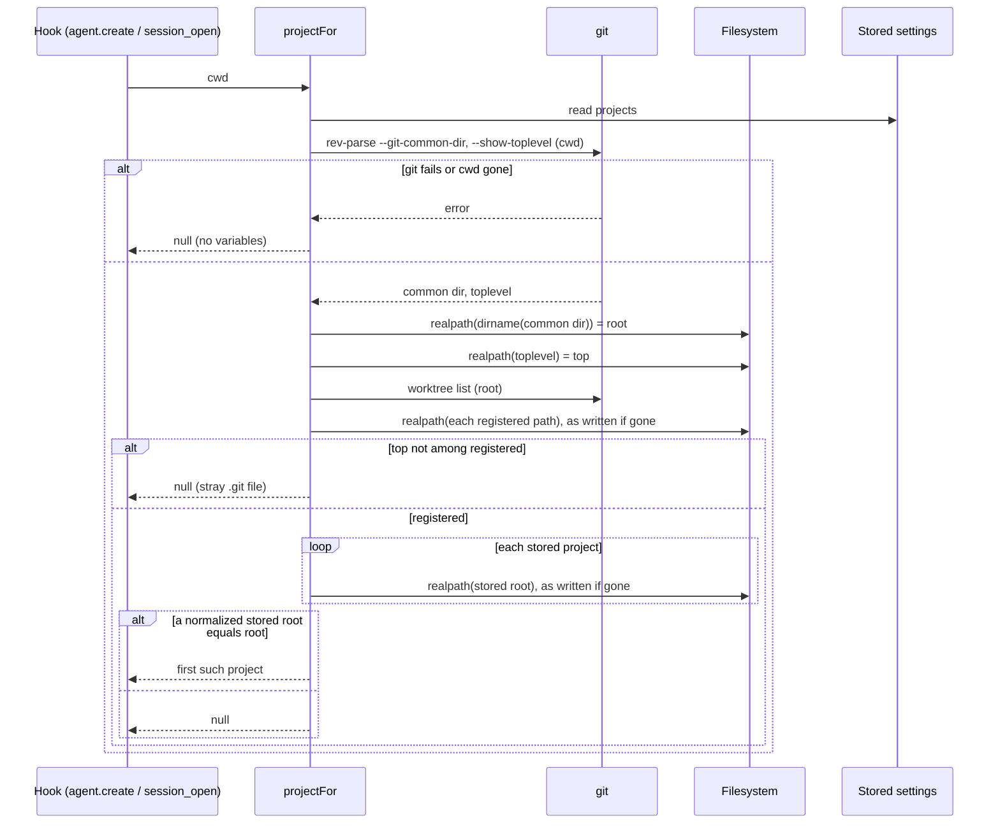

---
id:
title: Agents in a worktree or symlinked checkout get the repository's variables
status: ideation
variant: kc-dev-flow-2
profile: pilot
merge: pr
worktree:
pr:
journey: paseo-project-env
journey-release: r1
journey-story: worktree-env
journey-required-tasks: '["project-env-worktree-real-paths"]'
journey-mapping-complete: true
gates:
    version: 1
    records:
        - id: gate:project-env-worktree-real-paths:backlog
          stage: backlog
          attempts:
            - id: gate-attempt:project-env-worktree-real-paths-backlog-1
              briefing:
                id: briefing:project-env-worktree-real-paths:backlog:attempt-1:revision-1
                digest: sha256:75435fc7e1863041ba99d922828a55084a4e5e532882ae23e045ed8a7266ca00
                room-ref: ./project-env-worktree-real-paths/review/backlog/briefing-1
              resolution:
                type: Resolution
                id: resolution:spacedock:project-env-worktree-real-paths:backlog:1
                briefing: briefing:project-env-worktree-real-paths:backlog:attempt-1:revision-1
                by: person:captain
                at: "2026-10-20T14:17:20.202767Z"
                decision: approve
                reason: 'Captain 2026-10-20: 「准。」 — accepts this release r1 task''s outcome, scope and acceptance criteria on the pilot profile, into ideation.'
              application:
                target-stage: ideation
                state: consumed
started: 2026-10-20T14:19:57Z
---

Kent uses worktrees daily. Worktree membership already resolves real paths, but the stored repository root is compared with git's common-dir parent as written, so a symlinked path fails to match.

## Scope

In: resolving both the stored root and git's common-dir parent to real paths before comparing. Non-goals: resumed agents (r2). Depends on: project-env-new-agent-env (fakes). Stop condition: the acceptance criteria below pass.

## Acceptance criteria

**AC-1**: An agent started in a registered worktree, or through a symlinked path, of the connected repository starts with its variables.
Verified by: a fake-git test with a symlinked root, and one worktree agent on Kent's daemon reporting set or missing per variable without printing values.

## FO alignment

Surfaces: none
Visible change: none
Direction alignment with the Captain: not needed — the outcome follows rulings already recorded (docs/adr/0001, docs/adr/0002, and the Captain's 2026-10-20 rulings in the journey map); release r1 was marked changed by signal 2 (the Captain narrowed r1 on 2026-10-20: 「可以改成兩段，不用第一時間給隊友，要先我用到覺得可以」, 「就五個，剩下做 r1.5」). kc-journey-map review-release ran on r1 at 60799d9; after the rulings, a fresh audit, the map split and an interrogation of the changed stories, this task split was re-derived from the map at 760bfaa (branch docs/project-env-r1-split, PR #6).
Release review: paseo-project-env/r1 at 760bfaa

## PRFAQ

**Press line.** Kent opens an agent in any worktree of a connected repository, or in a checkout reached through a symlinked path, and it starts with the same variables as the main checkout.

**What is wrong today.** `projectFor` matches a stored `root` against `mainCheckout(cwd)` with `===`. `mainCheckout` realpaths the worktree top and the registered worktree list, but returns git's common-dir parent as written and never normalizes the stored root. A stored root written through a symlink (or any non-canonical form) never equals git's answer, so the project is not found: no variables, no prompt, no message.

**FAQ**
- *Is the bug observed?* Yes. Probe on this Mac, 2026-10-20, current `mainCheckout` run on a throwaway repo (no secrets involved): cwd through a symlink returned the canonical `/private/tmp/.../real/repo`; the stored form `/tmp/.../link/repo` is not equal to it, so `stored === returned` was `false`. Registered worktrees and a worktree reached through a symlink already resolved to the same canonical root.
- *Does git already return real paths?* Here, yes: in the same probe `rev-parse --git-common-dir`, `--show-toplevel` and `worktree list --porcelain` all printed canonical paths, even for a repo added via a symlinked path. So the unsafe side today is the stored root. Git's output is not a documented contract (older `gitdir` files, hand-edited files), so both sides are normalized, as the Captain's scope states.
- *What if a path no longer exists?* A stored root that is gone, or a registered worktree that was deleted, has no real path: normalization falls back to the string as written. A live `cwd` always yields an existing git root, so a gone stored root can never match, and a gone worktree entry is simply not a member. No throw, result `null` (the agent starts without variables), same as an unconnected repository.
- *Does it change stored settings?* No. Stored roots are compared in normalized form, never rewritten; the settings screen and `importConductor(root)` keep the path the user chose.
- *Cost?* One `realpath` per stored project per `agent.create` and `agent.session_open`. Not measured; the list is a handful of entries.

## Design

Change (the whole mechanism): one helper `realOrSelf(path) = realpath(path).catch(() => path)`, already the pattern used for the registered list. `mainCheckout` applies it to `dirname(common dir)` before returning, and to the registered list (replacing the inline catch). The stored-root comparison moves out of the closure in `index.server.ts` into an exported `projectForCwd(projects, cwd)` beside `mainCheckout` in `server/secrets.ts`, which normalizes each stored root with `realOrSelf` and compares; `projectFor` keeps only the settings read. The move exists so the symlink test can call the real comparison without a Paseo server context.

Unchanged: the registered-worktree guard (a stray `.git` file naming another repository's gitdir still yields `null`), `dirname(common dir)` as the root (bare, submodule and `--separate-git-dir` layouts remain unsupported, as today), first match wins.

## Existing-code check

Boundary: `projectFor`, `mainCheckout` (`server/secrets.ts`, `index.server.ts`) and every reader of a stored `root`. Completeness: main checkout and registered worktrees work through the journey; the stored-root comparison is a broken seam. Need: Captain-ruled scope (journey `worktree-env/q1`, AC-1). Two searches: `grep mainCheckout|projectFor` finds one definition and its two hook callers; `grep \.root` finds `importConductor(root)` (reads `.conductor` through any path form) and the settings screen's `p.root !== draft.root` and React keys, which compare stored entries to each other as strings, not repositories. Unknown: Paseo's own handling of project paths (not read). This repairs a named broken seam, so no replacement capability is proposed.

## Interfaces needed from siblings

From `project-env-new-agent-env` (owner of the shared fakes, its AC-5): (1) a replaceable git runner so `mainCheckout` can be driven by scripted `git` output per args, since `/usr/bin/git` is hard-coded and a fake on `PATH` would not be used; (2) a working `npm test`. This task adds only its own test file and needs no fake for `realpath`: tests build real temp directories with real symlinks, so the realpath code under test is real and only git's answers are scripted. Merge order puts this task after `project-env-new-agent-env`; expected textual contact is limited to `index.server.ts` near `projectFor`.

## Acceptance evidence plan

Cases for the fake-git symlink test (`projectForCwd` with real temp dirs and symlinks, scripted git):
1. Stored root through a symlink, git answers the canonical path: match. Red on current code (probe above).
2. Stored root canonical, scripted git answers the symlink form: match.
3. Stored and git forms reach the same directory through two different symlinks: match.
4. `cwd` is a registered worktree reached through a symlink: match.
5. Stored root removed from disk: `null`, no throw.
6. A registered worktree entry whose directory is gone: other worktrees still match, the gone one yields `null`.
7. Stored root is a different repository: `null` (control against matching everything).

Falsifiers: removing the stored-side `realOrSelf` fails 1, 3, 4; removing the git-side one fails 2, 3; making the fallback throw fails 5, 6; matching on `basename` or prefix fails 7.

Daemon check (Kent's daemon, run at implementation validation by a probe install with its own id, never the live `paseo-project-env`): one agent started in a registered worktree of the connected repository reports, per mapped variable, set or missing via a length test, without printing a value. The chosen variable must be absent from the daemon's own environment, otherwise "set" would not prove a match. Limit: if Kent's stored root is already canonical this run does not distinguish the fix from today's code; it guards that worktrees keep working. The distinguishing proof of the symlink claim is cases 1, 3, 4. The report records whether the stored root differs from its realpath (shape only).

## Known limits and unresolved decisions

- No unresolved decision for the Captain: the design follows the scope as ruled.
- Known limit: a stored root that no longer exists, or a repository moved after connecting, matches nothing and is silent (no timeline line, no log). The timeline line belongs to `project-env-notice-missing-variable` and covers failed variables, not unmatched projects; an unmatched-project message is not proposed here.
- Known limit: two stored entries that normalize to the same real root both match; the first in list order wins. Before this change only one could match.
- Out of scope: resumed agents (r2); bare, submodule and `--separate-git-dir` layouts; a project stored as a worktree path rather than the main checkout.

## Stage Report: ideation

- DONE: Design real-path resolution of both the stored root and git's common-dir parent (see `mainCheckout` and `projectFor`), including what happens when a path no longer exists.
  `## PRFAQ` and `## Design` (sequence diagram): helper `realOrSelf`, applied to git's root, the registered list and each stored root in an exported `projectForCwd`; a gone path falls back to the string as written and yields `null`, no throw.
- DONE: Keep AC-1 with a fake-git symlink test and the worktree agent check on Kent's daemon as its evidence clause.
  AC-1 kept verbatim under `## Acceptance criteria`; `## Acceptance evidence plan` lists 7 test cases, their falsifiers, and the daemon check with its limit.
- DONE: AC-1 current evidence.
  Observed: 2026-10-20 probe of current `mainCheckout` on a throwaway repo returned the canonical root for a symlinked cwd, so a stored symlink-form root compared `false`. Not yet verified: the fake-git test (not written) and the Kent-daemon worktree agent check (implementation stage).
- DONE: Design surfaces check.
  `design_surfaces.py check project-env-worktree-real-paths.md` printed "design surfaces presentable", exit 0 (Surfaces: none).
- DONE: Interfaces named for the sibling, not designed.
  `project-env-new-agent-env` owes a replaceable git runner for `mainCheckout` and a working `npm test`; `## Interfaces needed from siblings`.

### Summary

The bug is on the stored side: git already returns canonical paths on this Mac, but a stored root written through a symlink never equals them, so the project silently goes unmatched. The fix is one helper applied to both sides plus moving the comparison into a testable function; no stored data changes. Two limits for the gate: an unmatched or vanished stored root stays silent, and two stored entries for one real repository now both match, with list order deciding, which the settings screen does not prevent. No decision needs the Captain.
