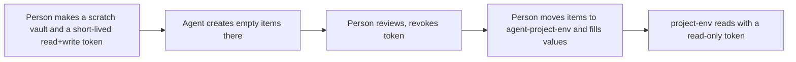

# Research: 1Password and agents; a docs page for project-env

All pages read 2026-10-27, through a page-summarising fetch tool (quotes are as returned; re-open a page before citing it outside this file). All sources are official 1Password or GitHub/tool-vendor pages. No non-official source was used.

## Q1. 1Password and AI agents

**Conclusion.** 1Password offers no way to let an agent create or edit item structure while being unable to read values. Both service-account write and person-level create require read. A design that keeps values away from the agent therefore rests on process, not on a permission. It cannot be made 100% safe.

### What 1Password offers for agents (official)
- Environments MCP server: "can only see variable and Environment names"; "never returns the secrets stored in your Environments". Every action needs a 1Password app prompt. Tools include `create_environment`, `rename_environment`, `append_variables`, `list_variables`. Beta; Mac/Linux; local stdio only. https://www.1password.dev/environments/mcp-server
  - It works on Environments, not on vault items. The page never mentions vault items. It does not say whether `append_variables` can add an empty variable. This answers ADR 0005's "is there a 1Password MCP" question: yes, but for a different object than the `op://vault/item/field` references project-env reads.
- Blog, 2025-07-16: "will not use MCP to expose raw credentials or secrets"; "Prompt injection and hidden tool instructions can cause agents to inadvertently exfiltrate secrets"; "No strong revocation model" once a secret is in agent context; "credentials should be injected on behalf of the agent"; "Human users should explicitly authorize any access to sensitive data". https://1password.com/blog/where-mcp-fits-and-where-it-doesnt
- `op run`: secrets only in a subprocess; "concealed by default" in stdout/stderr, and a flag exists to turn masking off. https://www.1password.dev/cli/reference/commands/run
- SDK agent tutorial: use a service account scoped to one vault with read only; "Where possible, avoid passing secrets to the model"; "short-lived, tightly scoped tokens"; check a usage report; the page itself says this "is not our recommended integration approach". https://www.1password.dev/sdks/ai-agent

### Service-account least privilege (official)
- Per vault: `read_items`, `write_items` (requires `read_items`), `share_items` (requires `read_items`). Create with `--vault <name>:<perm>` and `--expires-in 24h`. https://www.1password.dev/cli/reference/management-commands/service-account
- "A service account can only update, delete, and create items for vaults it has WRITE access to"; vault access cannot be added later; "Service accounts can't be modified after they're created"; token shown once. https://www.1password.dev/service-accounts/security and https://www.1password.dev/service-accounts/get-started
- Usage report per service account (vaults, items, last access, action); Business audit log shows service-account actors. `op service-account ratelimit` reports hourly and daily use; limits are 1,000 write/hour per token on Business, 100 on Teams. https://www.1password.dev/service-accounts/rate-limits
- IP restriction: not found. Business firewall rules are documented for team members; no page says they cover service-account tokens. https://support.1password.com/firewall-rules/

### Separating structure from values: no official way
- Business permission table: `create_items` requires `view_items`. https://www.1password.dev/cli/vault-permissions
- Support page: view is cryptographic (key holders can read); edit/create are server-enforced. https://support.1password.com/permission-enforcement/
- Closest feature: `op item create --category "Secure Note" 'NAME[password]='` makes an empty field (ADR 0005, op 2.30.3 on 2026-10-23); `--dry-run` previews; `--template` reads a JSON file; command arguments "can be visible to other processes". https://www.1password.dev/cli/reference/management-commands/item

### Best design I can support (assembled by me; no single page prescribes it)

1. The layout vault holds no values: the agent's read+write token reaches only a scratch vault, never `agent-<project>-<env>`.
2. Token expiry of hours, one token per session, revoked after review (all documented behaviours).
3. Fields created empty (`[password]=`); the agent never gets a value argument.
4. The person moves items and fills values after the token is gone. Moving items is implied by the `move_items` permission; I found no page confirming the move workflow, so test it.
5. Read the usage report and audit log after each session.

### Residual risks (none removable)
- Read equals write: while the token lives, the agent can read any value in its vault. Holds only if the scratch vault stays empty of values.
- Write includes edit and delete: an agent or injected prompt can rename, overwrite or delete items. Holds only if the scratch vault has nothing irreplaceable.
- Nothing forces "empty": the token could also write values. Only your skill and review prevent it.
- Titles and labels reach the agent and its logs; a person who types a secret into a label leaks it.
- Prompt injection from repository text could steer item creation or exfiltrate names. 1Password itself lists this as a core risk.
- Token in the agent's environment: a leaked token reaches the scratch vault until expiry. No IP restriction found.
- The agent must never use the person's own `op` sign-in: it sees everything that person can see (https://www.1password.dev/cli/app-integration-security).
- Unverified: whether `op item create` prints values by default; whether the Environments MCP could replace this. Test before relying.

## Q2. Release and docs page

**Recommendation: GitHub Pages, built-in Jekyll, source = repo root, one `_config.yml`.** It is the only option that renders the existing Markdown without adding Node, a build workflow or front matter. It gets worse on navigation, search and looks. I did not run a build.

| Option | Files added | Renders repo Markdown as-is | Release notes | Images | Deploy and cost |
|---|---|---|---|---|---|
| **A. Jekyll built-in** (recommended) | `_config.yml` (theme, exclude `docs/dev2`, `docs/adr`) | Yes: listed plugins `jekyll-optional-front-matter`, `jekyll-readme-index`, `jekyll-relative-links` | `project-env/CHANGELOG.md` is a page at its own path, no merge | Relative `` in repo | GitHub Pages only (Netlify needs a Gemfile). Free; Actions free for public repos. |
| B. just-the-docs | `_config.yml` + `Gemfile`; nav needs front matter | Mostly; nav wants front matter | Same as A | Same | Same as A; I could not confirm its remote-theme steps |
| C. VitePress | `package.json` dep, `docs/.vitepress/config`, workflow | Only inside its `docs` root; others via `<!--@include: -->` (outside-root paths unconfirmed) | Include per package | `public/` folder | Pages workflow or Netlify (`npm run docs:build`) |
| D. Starlight | Astro project, content in `src/content/docs/` | No, must be moved or copied | Copy or import | Astro assets | `withastro/action`; Netlify guide exists |
| E. Releases + README | none | Yes | release-please already makes GitHub Releases with the changelog as body | README images | No site, no cost |

Sources: https://docs.github.com/en/pages/getting-started-with-github-pages/configuring-a-publishing-source-for-your-github-pages-site, https://pages.github.com/versions/, https://vitepress.dev/guide/deploy, https://starlight.astro.build/getting-started/, https://github.com/googleapis/release-please-action.

Cost facts: Actions is "free ... for public repositories that use standard GitHub-hosted runners", including Pages (https://docs.github.com/en/billing/concepts/product-billing/github-actions). Pages soft limits: 1 GB site, 100 GB/month, 10 builds/hour (https://docs.github.com/en/pages/getting-started-with-github-pages/github-pages-limits). Netlify Free lists a 300-credit limit and 15 credits per production deploy, so about 20 deploys; the page does not say how often it resets (https://www.netlify.com/pricing/). Netlify is therefore the tighter budget for a repo that deploys on every release-please merge.

Ruled out: MkDocs Material, whose page says "End of life on May 5, 2027" with Zensical as successor (https://squidfunk.github.io/mkdocs-material/). 

What gets worse under A: no sidebar or search; plain themes; `docs/` holds internal ADRs and dev2 workflow files, so they need `exclude` or they publish (the repo is public anyway); two changelogs stay separate pages. Upgrade path if wanted later: Starlight (D) over the same files.
