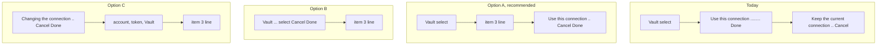
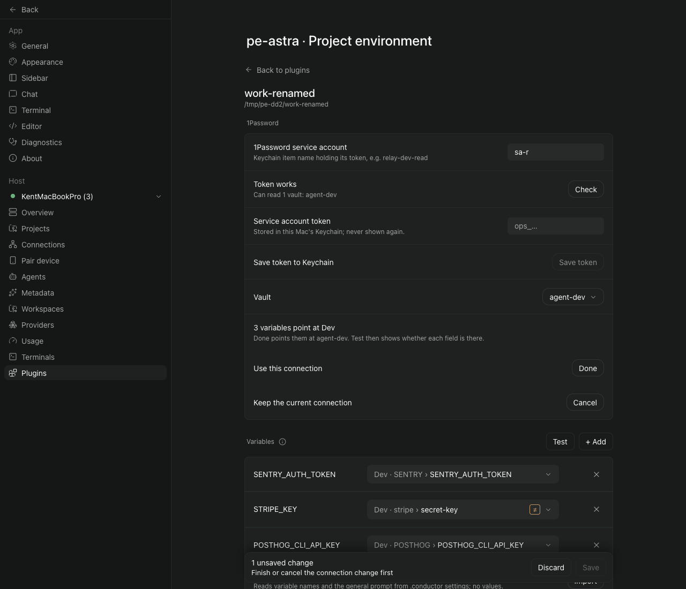
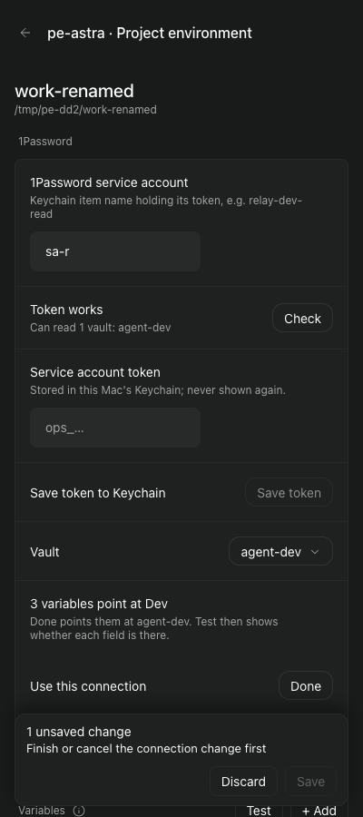
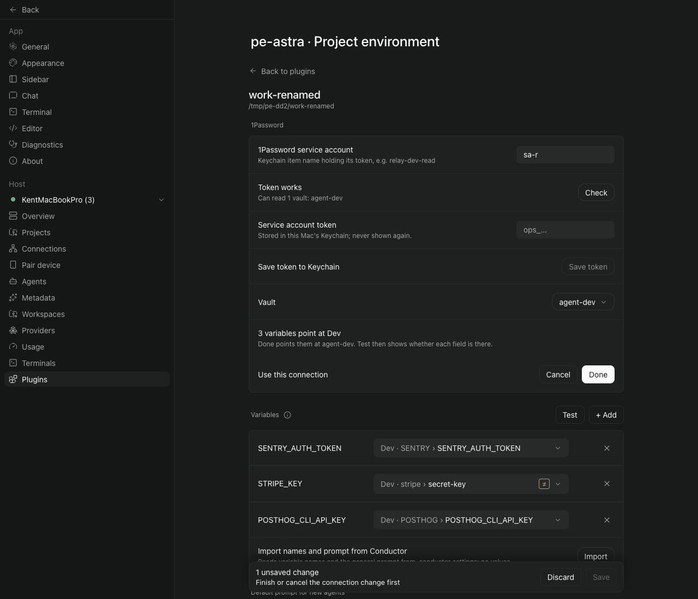
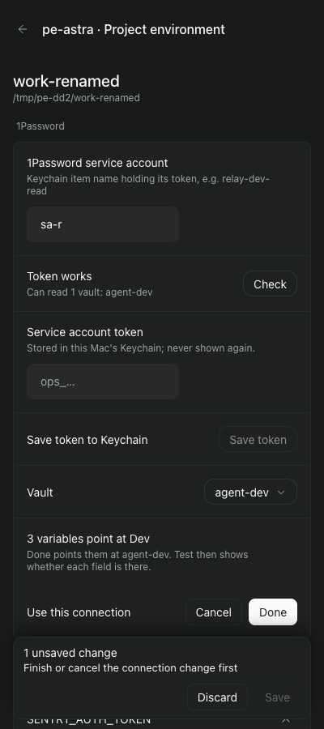
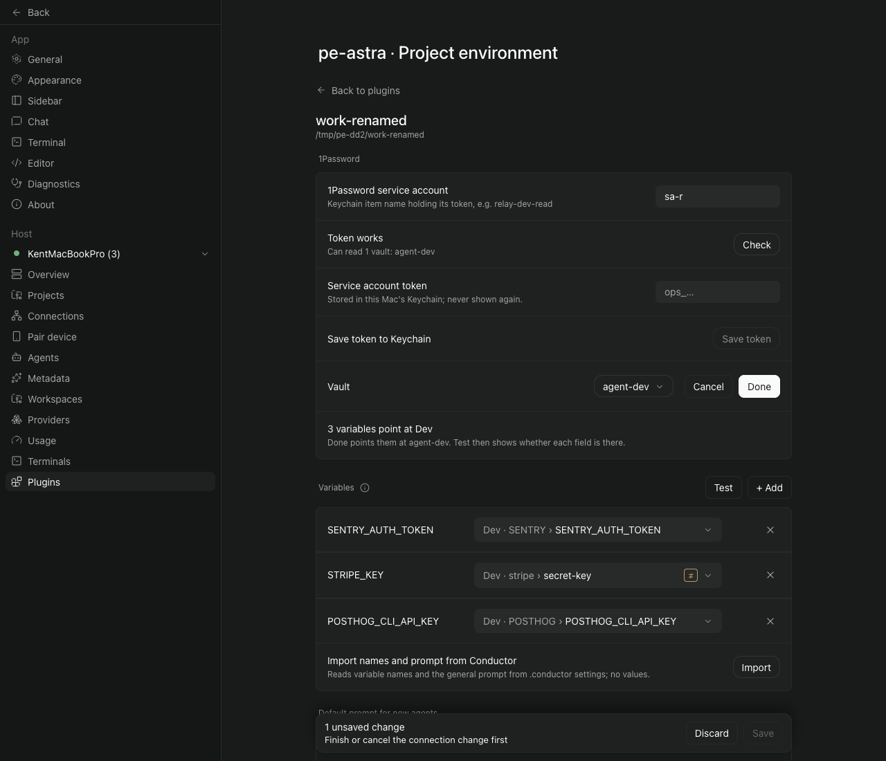
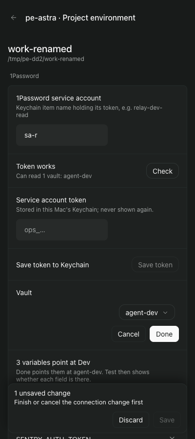
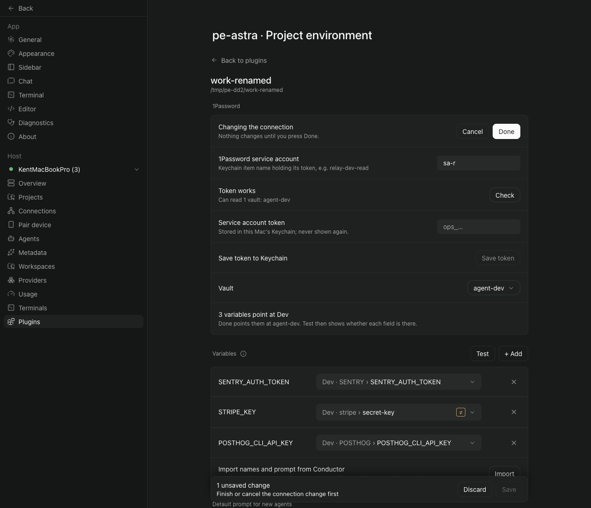
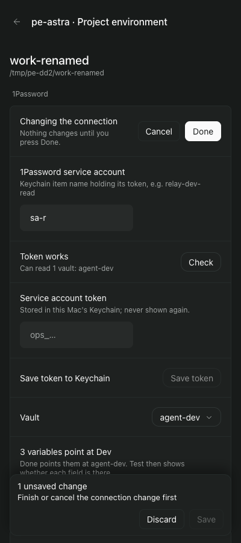

# Design Director ruling, polish round 2: the project-env settings screen (main 5eb0ba4)

Build reproduced: the main checkout at f849058. `git diff 5eb0ba4 main -- project-env` is empty, so the plugin is the build the Captain tested. The brief mentions the Captain's 1280 px screenshots, but they are not in this folder. I ruled on his words and on my own captures. My captures are in `director-shots/`. They come from an isolated Paseo (own home `/tmp/pe-dd2`, port 6925, fake `op`, `security` and `git`). I added one fixture project, work-renamed, that copies the live rename: its saved vault is `Dev`, its three references are `op://Dev/…`, and its token can read only `agent-dev`. The layout mocks were drawn by patching the harness's throwaway copy of the client, not the repository. The daemon, the copy and the browser session `director2` are all gone.

## 1. Verdict

Three tasks this round, run one after another. The vault change (item 3) matters most. If a vault is renamed and the new name is chosen in the screen, the screen still says "Connected", Save works, and every variable is then blanked for new agents with no warning before Test. ADR 0005's own naming advice (rename agent vaults to `agent-<project>-<env>`) invites exactly this rename, so each project that follows the advice hits it once. The fix is to re-point the references when the vault changes and to mark any reference outside the vault. That changes a design the Captain approved, so the approach is his to confirm.

Item 1 is also more than looks: at 400 px today's Cancel row sits under the save bar. One row with Cancel and Done, right after Vault (option A), fixes this and matches his words.

Item 2 is a clean removal. It also makes every editor page shorter (116 px at 400 px; I did not measure 1280), which happens to clear the round-1 save-bar overlap in the empty project at 400 × 900.

Of the five round-1 leftovers, only the faint focus border is worth fixing, because the item 3 work rewrites the same border rule. The other four stay as ruled.

## 2. Ruling table

"Today" means main 5eb0ba4. R-numbers are the round-1 rows in `../ux-review-a5-polish/design-director.md`.

| # | Item | Real? | Verdict | How (area) | When |
|---|---|---|---|---|---|
| 1 | "Use this connection / Done" and "Keep the current connection / Cancel" take two full rows under Vault | Reproduced at 1280 (`opt-today-1280-picked.png`). At 400 × 900 it is worse: once a vault is picked, the Cancel row is hidden under the save bar (`opt-today-400-picked.png`). That is the same kind of defect as R3b, a control you need lying under the bar. | Captain decision, only on which layout. Solving it is his request. | Option A: one row right after Vault. Cancel and Done sit on the right, in the same tones as the save bar's Discard and Save. The row's hint gives the reason when Done is disabled. Area: connection Change form only. The first-setup form stays as it is (R10, r1b). | This round, Task 2 |
| 2 | Remove "Import names and prompt from Conductor" | Read in code. The import's parts are `server/conductor.ts`, the `importConductor` RPC and `splitImported` in `shared/config.ts`, the handler in `server/contribute.ts`, `doImport`, `importRpc`, `importNote` and the import row in `client/settings-screen.tsx`, and the "Import" tests in `test/variable-name.test.ts`. `splitImported` has no other user, so it goes too. The `"import"` in `test/missing-variables.test.ts` is Paseo's own session-open reason, not Conductor, so it stays. | Solve. It is the Captain's instruction. | Delete everything listed. Variables and prompts that an earlier import put into saved projects stay. **Journey map:** stories `import-conductor-names` and `import-conductor-prompt` must be deleted. The map schema has only `gap`, `unverified` and `exists`, and `exists` needs an evidence symbol that the citation check verifies, so once `importConductor` is gone those cards would fail the check. No task names either story, so the progress view has no orphans. Release r2 is named "Standing instructions and Conductor carry-over", and its goal names a Conductor user. Both lose that part (Captain item 3). The answer to journey question add-remove-variable/q9, "Add and import refuse exact duplicates only", becomes "Add refuses…". **ADRs:** ADR 0004's consequence "Add, Conductor import and the variables card use the same table" gets a dated amendment saying the import was removed, and that Add and the variables card still use the table. No other ADR names it. This also takes away half of round-1 R14 (crowding). The default prompt stays, as A5 has it. | This round, Task 1 |
| 3 | After a vault rename, every reference still pointed at the old vault and was blanked without a word | Reproduced end to end. Opening work-renamed shows "This token cannot read Dev" (`i3-01`). I opened Change and picked `agent-dev` (`i3-03`), then pressed Done. The line then reads "Connected · sa-r · agent-dev" in green, Save is enabled, and the only clue is a muted "Dev ·" in front of each field (`i3-04`). After Save, `projects.json` holds vault `agent-dev` with refs `op://Dev/SENTRY/SENTRY_AUTH_TOKEN`, `op://Dev/stripe/secret-key` and `op://Dev/POSTHOG/POSTHOG_CLI_API_KEY`. `isOutsideVault` blanks all three at session open. Only Test shows it: "3 failed", each with "Reference points outside the chosen vault" (`i3-05`). This gap was already known but never given a release: journey question token-works/q3 says "…or a field from another vault; it fails only at Test or session open. Not yet placed in a release." | Captain decision. It changes what Done does in connection-collapse, which he approved. It replaces the vault-boundary FAQ answer ("the user fixes it by saving the new name and rewriting the references"). It also changes a consequence in ADR 0005. | Re-point automatically when Done is pressed, and say so before the press. Once a different vault is picked, a line under Vault reads "3 variables point at Dev. Done points them at agent-dev. Test then shows whether each field is there." (drawn in every mock below). Done rewrites only references whose vault part is exactly the old vault, and the rewrite counts as unsaved changes. Second part, as a backstop: any pill whose reference names a vault other than the saved one gets the danger border and the line "Outside the chosen vault. New agents get this variable blank.", with no Test needed. The screen already does this for a raw reference ("Not a field reference…"). The backstop also covers hand edits, older files, and the FO's fix by hand. Save is not blocked, the same as a row with no field. Areas: Change form, field pills. | This round, Task 3. The lasting fix, saving the vault by its id so a rename never matters, waits for r3 (keep it working). It is deferred in the vault-boundary FAQ and in journey token-works/q9. |
| R3a | At 400 px the save bar covers the Danger zone text on first load | Measured in work-empty at 400 × 900: the page is 71 px too tall for the window, and the import row is 116 px. With the import row hidden, the page fits exactly (836 of 836 px), and the Danger zone text sits above the bar (`r3a-empty-400-today.png`, `r3a-empty-400-without-import.png`). | Do not solve | A sticky bar covers what is under it. That is the A5 choice, and the round-1 ruling stands. Task 1 clears this one case with no margin to spare. I did not measure work-bare, and a page longer than the window will still overlap. Task 1's validation records the measurement. It is not an acceptance criterion. | Never, as its own item |
| C2 | The focused pill's border is faint when the no-field note takes you to a row | Seen in the FO walkthrough (`../ux-review-a5-polish/fo-walk/1280-04-note-press-1.png`). The rule in `FieldPill` turns the 1 px border foreground-coloured. Astra still called the outline visible. | Solve | Draw focus as a 2 px ring that does not move the layout, clearly different from the red border and the dashed empty border. This rides on Task 3 because Task 3 adds the red "outside" border to the same rule. With three border states, focus has to stand apart. Area: field pills. | This round, Task 3 |
| C3 | The note's cursor restarts after a 720 px remount | Read in code: the cursor (`reached`) is a `useRef` inside `ProjectEditor`. The remount at 720 px drops it, so the next press goes back to the first row with no field. | Do not solve | The only cost is pressing again after crossing 720 px. Nothing is lost. It belongs with roborev:1089 and 1092, which every-row-findable already deferred. The fix, if wanted, is to keep the cursor in the `openProject` store. | Never, unless the Captain hits it |
| R16 | "All N set" claims more than Test proves | Both reviewers still object. Read in code: the (i) next to Variables states the limit. | Do not solve | "N set" is his approved A5 wording, and the reviewers raised nothing new beyond round 1. Changing it would be his decision. I do not recommend it and am not asking. | Never |
| C5 | The disabled Save gives no reason on hover | Gemini's nitpick, read in code | Do not solve | The reason is already printed next to the button ("No unsaved changes", or the Task A reason). A hover tooltip works on the web only. every-row-findable design finding 5 declined the same thing. | Never |

## 3. Layout options for item 1

Every capture shows work-renamed after Change, with `agent-dev` picked, so the item 3 line ("3 variables point at Dev") is in the form. Each option has to leave a place for that line between Vault and the buttons.

| | 1280 px | 400 × 900 |
|---|---|---|
| Today |  |  Cancel is under the save bar. |
| **A. One row after Vault** |  |  |
| B. Buttons beside the vault choice |  |  |
| C. Actions at the top of the form |  |  |

When Done is disabled, option A puts the reason in the row's hint, next to the buttons (`opt-a-1280-unpicked.png`).

- **A, one row after Vault (recommended).** It is the closest reading of 「放在 vault 選擇的後面」 and halves the rows. Both buttons are visible above the bar at 400 px. The reason for a disabled Done sits beside it. The pair repeats the save bar's Discard and Save. When Done is ready, the row reads "Use this connection". I propose adding the hint "Cancel keeps the current one.", which is not in the capture.
  - What gets worse: Cancel loses its own label, so its meaning rests on the hint.
  - It uses the host's `SettingsRow` with two buttons inside, as the Danger zone row already does.
- **B, beside the vault choice.** This reads his words most literally, but it is not buildable as drawn. The host's `SettingsSelect` draws nothing passed into it: the first mock showed no buttons at all. The capture needed a host select nested inside a row at a fixed 340 px width, or the vault name was cut to "a…". At 400 px it stacks into three lines, and the item 3 line lands under the buttons, away from the vault it explains. Building B means the plugin draws its own select or the host changes.
- **C, at the top of the form.** Cancel and Done take the place where Change was, which is the only option where Done shows at 400 px without scrolling. But Done comes before the fields it confirms. The reason for a disabled Done and the item 3 line both end up far from the buttons.

Ruled out without mocks:
- Moving Done and Cancel into the save bar. The bar already carries the Task A reason, "Finish or cancel the connection change first", which the Captain approved on 2026-10-23.
- Closing the form automatically once the connection works. In Change, that would fire as soon as Check passes, before the person has picked the vault they want.

## 4. Proposed tasks

All three edit `client/settings-screen.tsx`, so they run in sequence: Task 1, then Task 2 from Task 1's merged main, then Task 3 from Task 2's merged main.
- Task 2 measures the 400 px page that Task 1 shortens.
- Task 3's line sits in the row that Task 2 builds.
- Tasks 1 and 2 touch different parts of the file and could run in parallel. Last round's merge-and-revalidate cost says not to, and Task 1 is small enough that the wait is short.

### Task 1: The variables card no longer offers a Conductor import

- **Scope:** everything listed in row 2: the client row and its state, the `importConductor` RPC, `server/conductor.ts`, the handler, `splitImported` and its tests. Also the two journey stories, the r2 name and goal as the Captain confirms them, the add-remove-variable/q9 answer, and a dated amendment to ADR 0004. Out of scope: the default prompt section, and Paseo's session-open `"import"` reason.
- **Acceptance criteria:**
  1. No project shows an import row, at 1280 or at 400 px, and the plugin serves no `project.import-conductor` call. *Proof:* a runtime text check of all four fixture projects at both widths. A search of `project-env/` for `importConductor`, `conductor` and `splitImported` finds nothing outside `CHANGELOG.md`. `npm test` and `npm run typecheck` pass.
  2. The journey map passes its check with no story citing a removed symbol, and r2 reads as the Captain confirmed. *Proof:* the kc-journey-map check run on `give-agents-their-project-setup.yaml` reports no citation failure, and a text diff of the r2 entry.
- **Size:** small. Mostly deletion, one implementation and validation pass. Validation also records the work-empty 400 × 900 measurement for R3a.

### Task 2: Finishing or cancelling a connection change is one row right after the vault

- **Scope:** in the Change form only, the two rows become one row after Vault (option A, or whichever the Captain picks). Cancel and Done keep their current behaviour, including Task A's blocked Save and its survival across 720 px. Out of scope: the first-setup form (R10, r1b) and the save bar.
- **Acceptance criteria:**
  1. In the Change form, with a working vault picked, Cancel and Done sit in one row after Vault, and both are fully above the save bar. This holds at 1280 × 1400 and 400 × 900. *Proof:* a measuring script checks that the two buttons share a top edge (within 2 px), that the row starts below the Vault row, and that both bottoms are above the bar's top. Today's build fails at 400 × 900: Cancel is under the bar (`opt-today-400-picked.png`).
  2. With an unchecked account name, Done is disabled and the row's hint reads "Available once the connection works.". With a typed, unsaved token it reads "Save the token or clear the field first.". Cancel brings back the previous account and vault. *Proof:* a runtime script at both widths that reads the hint and, after Cancel, the connection line. The existing save-rule unit tests pass unchanged.
- **Size:** small. Before the ui gate, the pictures need the item 3 line and the disabled state at both widths.

### Task 3: Changing the vault keeps every variable pointing into it, and the screen marks any variable outside it before Test

- **Scope:**
  - Done re-points references from the old vault to the new one, with the line announcing it beforehand (row 3).
  - The outside-vault mark on pills.
  - A focus ring on the pill that stands apart from the other borders (C2).
  - A dated amendment to the ADR 0005 consequence "Renaming a vault breaks project-env mappings stored by vault name…". It should say that choosing the new vault in Change now re-points those mappings, that the screen marks any mapping outside the saved vault, and that identity by vault id is still deferred.
  - Out of scope: saving the vault by id (r3), and refusing to save outside references.
- **Acceptance criteria:**
  1. In the work-renamed fixture (saved vault `Dev`, three `op://Dev/…` refs, a token that reads only `agent-dev`), picking `agent-dev` in Change shows "3 variables point at Dev. Done points them at agent-dev. …". Done and then Save write vault `agent-dev` with three `op://agent-dev/…` refs, and Test then reads "All 3 set". *Proof:* a runtime script on an isolated Paseo at 1280 and 400 px that reads names and refs from `projects.json`. A unit test on the re-point rule fails when the rewrite is removed. Today's build writes `op://Dev/…` (observed this round).
  2. Only exact old-vault references move. Cancel after picking another vault changes no reference. A reference into a third vault is left alone. An empty previous vault moves nothing. A vault saved by id moves the references written with that id. *Proof:* a unit test table, one row for each case.
  3. A reference outside the saved vault shows the danger border and the outside line before any Test. The focused pill's ring differs from both the danger border and the dashed empty border. *Proof:* a runtime check on a fixture with one `op://Other/…` ref reads the line's text. A computed-style check compares the focused and unfocused pill. The pictures go to the ui gate.
- **Size:** medium. One implementation and validation pass. It needs the second-account fixture used in this round, which is a few lines in the harness's `index.server.ts` and `fx.py`.

## 5. Traceability table

| # | Item | Ruling | Task | Carried by | Checked at acceptance by |
|---|---|---|---|---|---|
| 1 | Done and Cancel take two rows | Captain picks the layout; A recommended | Task 2 | AC-1 (one row, above the bar at both widths); AC-2 (behaviour unchanged) | Captain; both reviewers at 400 px |
| 2 | Remove the Conductor import | Solve | Task 1 | AC-1 (no row, no call); AC-2 (map check, r2 wording) | Captain; Gemini (R14 crowding) |
| 3 | A vault rename blanks every variable silently | Captain decision; recommendation: re-point at Done, plus the outside mark | Task 3 | AC-1 (rename flow ends in "All 3 set"); AC-2 (only exact old-vault refs move); AC-3 (outside mark before Test) | Captain, on his own renamed vault |
| R3a | Save bar covers the Danger zone text at 400 px | Do not solve (A5 sticky bar) | none | Task 1 validation records the work-empty 400 × 900 measurement; not a gate | both reviewers, for information |
| C2 | Focused pill's border is faint | Solve | Task 3 | AC-3, second clause (focus ring differs from the danger and empty borders) | FO walkthrough; Astra |
| C3 | Note's cursor restarts after a 720 px remount | Do not solve | none | none | none |
| R16 | "All N set" claims more than Test proves | Do not solve (A5 wording) | none | none | none |
| C5 | Disabled Save has no reason on hover | Do not solve | none | none | none |

## 6. Items for the Captain

The three decisions do not depend on each other. The item 3 line fits any of the layouts.

1. **Which layout for the Change form (item 1)?** Recommendation: A, one row with Cancel and Done right after Vault.
   - Why: it matches your words, it halves the rows, and it is the only option that keeps both buttons visible at 400 px without moving Done away from the fields it confirms.
   - What gets worse: Cancel loses its own label, so the hint explains it.
   - B is not buildable with the host's select as it is.
2. **How should a vault change treat existing references (item 3)?** Recommendation: Done re-points every reference that named the old vault, with a line saying so before the press. Any reference outside the saved vault is also marked on its pill before Test.
   - Why: a reference outside the vault is blanked every time (ADR 0001), so re-pointing can never leave it worse off.
   - Why: Test afterwards tells the two cases apart. "set" means it was a rename; "field not found" means a genuinely different vault.
   - Why: re-pointing at Done means Cancel has nothing to undo.
   - What gets worse: the screen edits references you did not touch, and the unsaved count goes up. Discard always undoes it. Changing back to the old vault undoes it only while the token can still read that vault, which is never the case after a rename.
   - The alternative is a "Re-point" button. It adds a press in a place where the answer is always yes, and forgetting it leaves the project blank.
   - Saying yes also amends the ADR 0005 consequence and replaces the vault-boundary FAQ answer.
3. **Release r2's new wording (from item 2).** Removing the import leaves r2 named "RELEASE 2 — Standing instructions and Conductor carry-over", with a goal that names a Conductor user. Proposed: "RELEASE 2 — Standing instructions", with the goal "New agents follow the repository's standing instructions." Release goals are your commitments, so Task 1 writes whatever wording you confirm.

For information, no decision needed: R16 and the hover reason stay as ruled. The cursor restart (C3) is deferred unless you hit it.
